# GeoLLM-Engine: A Realistic Environment for Building Geospatial Copilots — 逐页原文及配图

> **保真说明**：原文来自 PDF 文本层；文中跨栏文字顺序可能与视觉阅读顺序不同，页面原版截图是排版及公式的最终核对依据。


---

## 第 1 页（Page 1）

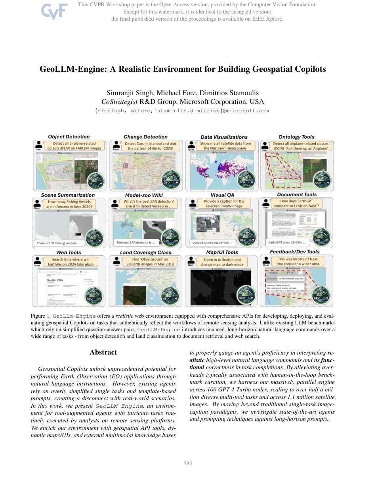


**原论文 Figure 1 · PDF p.1**

Figure 1. GeoLLM-Engine offers a realistic web environment equipped with comprehensive APIs for developing, deploying, and eval- uating geospatial Copilots on tasks that authentically reflect the workflows of remote sensing analysts. Unlike existing LLM benchmarks which rely on simplified question-answer pairs, GeoLLM-Engine introduces nuanced, long-horizon natural-language commands over a wide range of tasks - from object detection and land classification to document retrieval and web search.


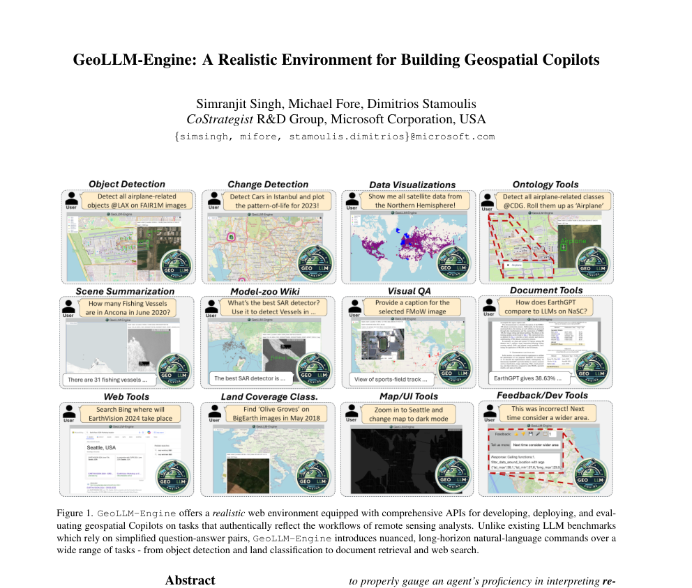


### 本页英文全文

```text
                   This CVPR Workshop paper is the Open Access version, provided by the Computer Vision Foundation.
                                   Except for this watermark, it is identical to the accepted version;
                                  the final published version of the proceedings is available on IEEE Xplore.


  GeoLLM-Engine: A Realistic Environment for Building Geospatial Copilots


                         Simranjit Singh, Michael Fore, Dimitrios Stamoulis
                       CoStrategist R&D Group, Microsoft Corporation, USA
                    {simsingh, mifore, stamoulis.dimitrios}@microsoft.com


Figure 1. GeoLLM-Engine offers a realistic web environment equipped with comprehensive APIs for developing, deploying, and eval-
uating geospatial Copilots on tasks that authentically reflect the workflows of remote sensing analysts. Unlike existing LLM benchmarks
which rely on simplified question-answer pairs, GeoLLM-Engine introduces nuanced, long-horizon natural-language commands over a
wide range of tasks - from object detection and land classification to document retrieval and web search.

                 Abstract                               to properly gauge an agent’s proficiency in interpreting re-
                                                                          alistic high-level natural language commands and its func-
   Geospatial Copilots unlock unprecedented potential for      tional correctness in task completions. By alleviating over-
performing Earth Observation (EO) applications through     heads typically associated with human-in-the-loop bench-
natural language instructions.  However, existing agents    mark curation, we harness our massively parallel engine
rely on overly simplified single tasks and template-based     across 100 GPT-4-Turbo nodes, scaling to over half a mil-
prompts, creating a disconnect with real-world scenarios.      lion diverse multi-tool tasks and across 1.1 million satellite
In this work, we present GeoLLM-Engine, an environ-     images. By moving beyond traditional single-task image-
ment for tool-augmented agents with intricate tasks rou-     caption paradigms, we investigate state-of-the-art agents
tinely executed by analysts on remote sensing platforms.     and prompting techniques against long-horizon prompts.
We enrich our environment with geospatial API tools, dy-
namic maps/UIs, and external multimodal knowledge bases


                                                       585
```


---

## 第 2 页（Page 2）

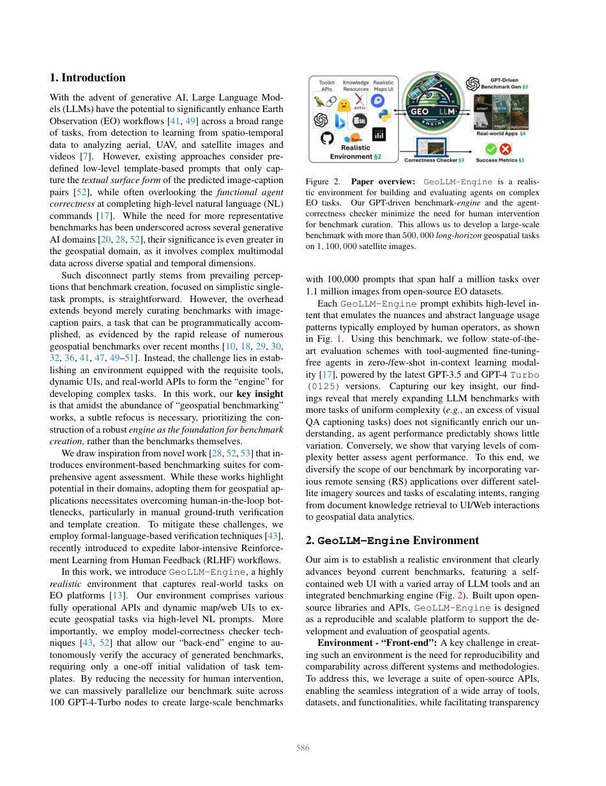


**原论文 Figure 2 · PDF p.2**

Figure 2. Paper overview: GeoLLM-Engine is a realis- tic environment for building and evaluating agents on complex EO tasks. Our GPT-driven benchmark-engine and the agent- correctness checker minimize the need for human intervention for benchmark curation. This allows us to develop a large-scale benchmark with more than 500, 000 long-horizon geospatial tasks on 1, 100, 000 satellite images.


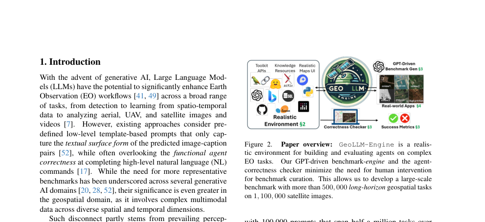


### 本页英文全文

```text
1. Introduction

With the advent of generative AI, Large Language Mod-
els (LLMs) have the potential to significantly enhance Earth
Observation (EO) workflows [41, 49] across a broad range
of tasks, from detection to learning from spatio-temporal
data to analyzing aerial, UAV, and satellite images and
videos [7].  However, existing approaches consider pre-
defined low-level template-based prompts that only cap-
ture the textual surface form of the predicted image-caption      Figure 2.  Paper overview:  GeoLLM-Engine  is a  realis-
pairs [52], while often overlooking the functional agent        tic environment for building and evaluating agents on complex
correctness at completing high-level natural language (NL)    EO tasks.  Our GPT-driven benchmark-engine and the agent-
commands [17].  While the need for more representative      correctness checker minimize the need for human intervention
benchmarks has been underscored across several generative      for benchmark curation. This allows us to develop a large-scale
                                                          benchmark with more than 500, 000 long-horizon geospatial tasksAI domains [20, 28, 52], their significance is even greater in
                                                          on 1, 100, 000 satellite images.
the geospatial domain, as it involves complex multimodal
data across diverse spatial and temporal dimensions.
  Such disconnect partly stems from prevailing percep-                                                          with 100,000 prompts that span half a million tasks over
tions that benchmark creation, focused on simplistic single-                                                              1.1 million images from open-source EO datasets.
task prompts, is straightforward.  However, the overhead                                                      Each GeoLLM-Engine prompt exhibits high-level in-
extends beyond merely curating benchmarks with image-                                                                     tent that emulates the nuances and abstract language usage
caption pairs, a task that can be programmatically accom-                                                                  patterns typically employed by human operators, as shown
plished, as evidenced by the rapid release of numerous                                                                   in Fig. 1. Using this benchmark, we follow state-of-the-
geospatial benchmarks over recent months [10, 18, 29, 30,                                                                          art evaluation schemes with tool-augmented fine-tuning-
32, 36, 41, 47, 49–51]. Instead, the challenge lies in estab-                                                                   free agents in zero-/few-shot in-context learning modal-
lishing an environment equipped with the requisite tools,                                                                          ity [17], powered by the latest GPT-3.5 and GPT-4 Turbo
dynamic UIs, and real-world APIs to form the “engine” for                                           (0125) versions.  Capturing our key insight, our find-
developing complex tasks.  In this work, our key insight                                                              ings reveal that merely expanding LLM benchmarks with
is that amidst the abundance of “geospatial benchmarking”                                                   more tasks of uniform complexity (e.g., an excess of visual
works, a subtle refocus is necessary, prioritizing the con-                                    QA captioning tasks) does not significantly enrich our un-
struction of a robust engine as the foundation for benchmark                                                               derstanding, as agent performance predictably shows little
creation, rather than the benchmarks themselves.                                                                     variation. Conversely, we show that varying levels of com-
  We draw inspiration from novel work [28, 52, 53] that in-                                                                  plexity better assess agent performance. To this end, we
troduces environment-based benchmarking suites for com-                                                                   diversify the scope of our benchmark by incorporating var-
prehensive agent assessment. While these works highlight                                                              ious remote sensing (RS) applications over different satel-
potential in their domains, adopting them for geospatial ap-                                                                                 lite imagery sources and tasks of escalating intents, ranging
plications necessitates overcoming human-in-the-loop bot-                                                     from document knowledge retrieval to UI/Web interactions
tlenecks, particularly in manual ground-truth verification                                                                   to geospatial data analytics.
and template creation.  To mitigate these challenges, we
employ formal-language-based verification techniques [43],                                                          2. GeoLLM-Engine Environment
recently introduced to expedite labor-intensive Reinforce-
ment Learning from Human Feedback (RLHF) workflows.     Our aim is to establish a realistic environment that clearly
   In this work, we introduce GeoLLM-Engine, a highly     advances beyond current benchmarks,  featuring a  self-
realistic environment  that captures real-world tasks on     contained web UI with a varied array of LLM tools and an
EO platforms [13].  Our environment comprises various      integrated benchmarking engine (Fig. 2). Built upon open-
fully operational APIs and dynamic map/web UIs to ex-     source libraries and APIs, GeoLLM-Engine is designed
ecute geospatial tasks via high-level NL prompts. More     as a reproducible and scalable platform to support the de-
importantly, we employ model-correctness checker tech-     velopment and evaluation of geospatial agents.
niques [43, 52] that allow our “back-end” engine to au-       Environment - “Front-end”: A key challenge in creat-
tonomously verify the accuracy of generated benchmarks,     ing such an environment is the need for reproducibility and
requiring only a one-off  initial validation of task tem-     comparability across different systems and methodologies.
plates. By reducing the necessity for human intervention,    To address this, we leverage a suite of open-source APIs,
we can massively parallelize our benchmark suite across     enabling the seamless integration of a wide array of tools,
100 GPT-4-Turbo nodes to create large-scale benchmarks      datasets, and functionalities, while facilitating transparency


                                                       586
```


---

## 第 3 页（Page 3）

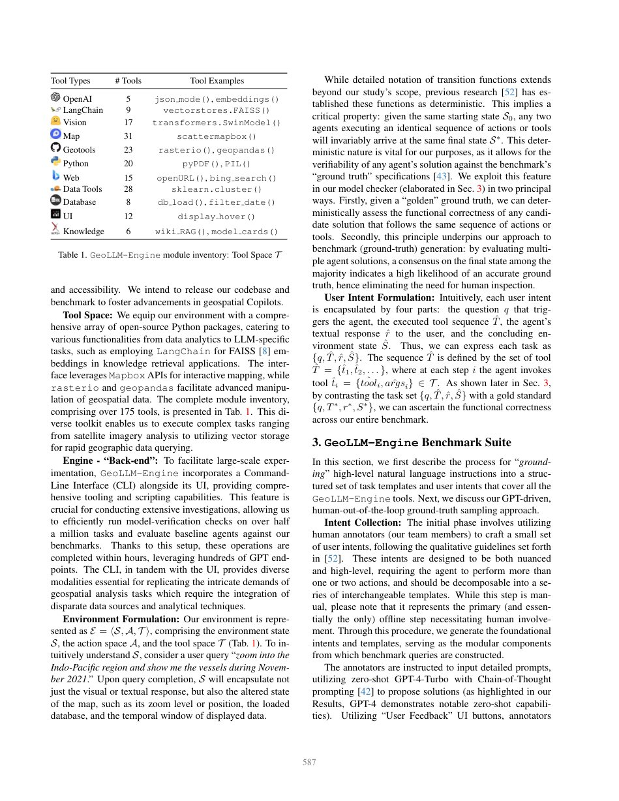


**原论文 Table 1 · PDF p.3**

Table 1. GeoLLM-Engine module inventory: Tool Space T


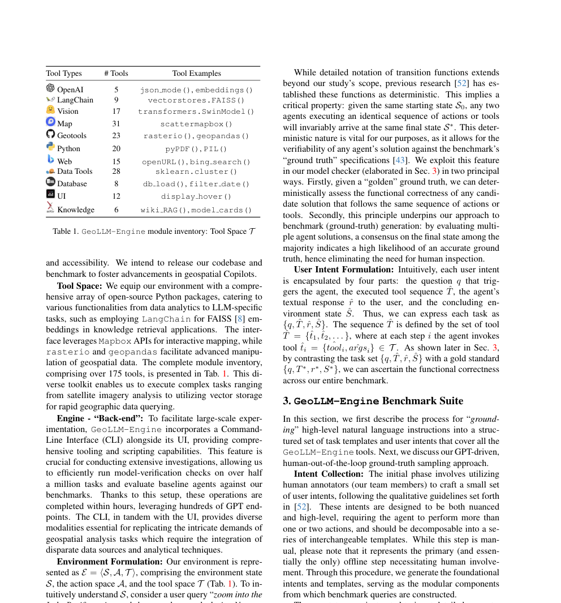


### 本页英文全文

```text
Tool Types     # Tools            Tool Examples                While detailed notation of transition functions extends
                                                     beyond our study’s scope, previous research [52] has es-
   OpenAI        5    json mode(), embeddings()
                                                                 tablished these functions as deterministic. This implies a
   LangChain     9      vectorstores.FAISS()
                                                                           critical property: given the same starting state S0, any two
   Vision        17    transformers.SwinModel()
                                                             agents executing an identical sequence of actions or tools
  Map          31        scattermapbox()                                                                   will invariably arrive at the same final state S∗. This deter-
   Geotools      23     rasterio(), geopandas()         ministic nature is vital for our purposes, as it allows for the
   Python        20          pyPDF(), PIL()                 verifiability of any agent’s solution against the benchmark’s
  Web          15     openURL(), bing search()       “ground truth” specifications [43]. We exploit this feature
   Data Tools     28       sklearn.cluster()             in our model checker (elaborated in Sec. 3) in two principal
   Database       8     db load(), filter date()        ways. Firstly, given a “golden” ground truth, we can deter-
   UI           12        display hover()              ministically assess the functional correctness of any candi-
                                                              date solution that follows the same sequence of actions or
   Knowledge     6     wiki RAG(), model cards()
                                                                       tools.  Secondly, this principle underpins our approach to
                                                     benchmark (ground-truth) generation: by evaluating multi-
  Table 1. GeoLLM-Engine module inventory: Tool Space T
                                                                ple agent solutions, a consensus on the final state among the
                                                             majority indicates a high likelihood of an accurate ground
                                                                         truth, hence eliminating the need for human inspection.and accessibility. We intend to release our codebase and
                                                      User Intent Formulation: Intuitively, each user intentbenchmark to foster advancements in geospatial Copilots.
                                                                              is encapsulated by four parts:  the question q that trig-
   Tool Space: We equip our environment with a compre-
                                                              gers the agent, the executed tool sequence ˆT, the agent’s
hensive array of open-source Python packages, catering to
                                                                   textual response  ˆr to the user, and the concluding en-
various functionalities from data analytics to LLM-specific
                                                         vironment state  ˆS.  Thus, we can express each task as
tasks, such as employing LangChain for FAISS [8] em-
                                                              {q, ˆT, ˆr, ˆS}. The sequence ˆT is defined by the set of tool
beddings in knowledge retrieval applications.  The inter-
                                                                           ˆT = {ˆt1, ˆt2, . . . }, where at each step i the agent invokesface leverages Mapbox APIs for interactive mapping, while
                                                                   tool  ˆti = {tooli,ˆ   argsi}ˆ  ∈T . As shown later in Sec. 3,rasterio and geopandas facilitate advanced manipu-
                                                    by contrasting the task set {q, ˆT, ˆr, ˆS} with a gold standardlation of geospatial data. The complete module inventory,
                                                              {q, T ∗, r∗, S∗}, we can ascertain the functional correctnesscomprising over 175 tools, is presented in Tab. 1. This di-
                                                              across our entire benchmark.verse toolkit enables us to execute complex tasks ranging
from satellite imagery analysis to utilizing vector storage
                                                          3. GeoLLM-Engine Benchmark Suitefor rapid geographic data querying.
  Engine - “Back-end”: To facilitate large-scale exper-     In this section, we first describe the process for “ground-
imentation, GeoLLM-Engine incorporates a Command-     ing” high-level natural language instructions into a struc-
Line Interface (CLI) alongside its UI, providing compre-     tured set of task templates and user intents that cover all the
hensive tooling and scripting capabilities.  This feature is    GeoLLM-Engine tools. Next, we discuss our GPT-driven,
crucial for conducting extensive investigations, allowing us     human-out-of-the-loop ground-truth sampling approach.
to efficiently run model-verification checks on over half        Intent Collection: The initial phase involves utilizing
a million tasks and evaluate baseline agents against our    human annotators (our team members) to craft a small set
benchmarks.  Thanks to this setup, these operations are     of user intents, following the qualitative guidelines set forth
completed within hours, leveraging hundreds of GPT end-      in [52].  These intents are designed to be both nuanced
points. The CLI, in tandem with the UI, provides diverse     and high-level, requiring the agent to perform more than
modalities essential for replicating the intricate demands of     one or two actions, and should be decomposable into a se-
geospatial analysis tasks which require the integration of      ries of interchangeable templates. While this step is man-
disparate data sources and analytical techniques.                  ual, please note that it represents the primary (and essen-
  Environment Formulation: Our environment is repre-       tially the only) offline step necessitating human involve-
sented as E = ⟨S, A, T ⟩, comprising the environment state     ment. Through this procedure, we generate the foundational
S, the action space A, and the tool space T (Tab. 1). To in-      intents and templates, serving as the modular components
tuitively understand S, consider a user query “zoom into the     from which benchmark queries are constructed.
Indo-Pacific region and show me the vessels during Novem-       The annotators are instructed to input detailed prompts,
ber 2021.” Upon query completion, S will encapsulate not      utilizing zero-shot GPT-4-Turbo with Chain-of-Thought
just the visual or textual response, but also the altered state     prompting [42] to propose solutions (as highlighted in our
of the map, such as its zoom level or position, the loaded      Results, GPT-4 demonstrates notable zero-shot capabili-
database, and the temporal window of displayed data.              ties).  Utilizing “User Feedback” UI buttons, annotators


                                                       587
```


---

## 第 4 页（Page 4）

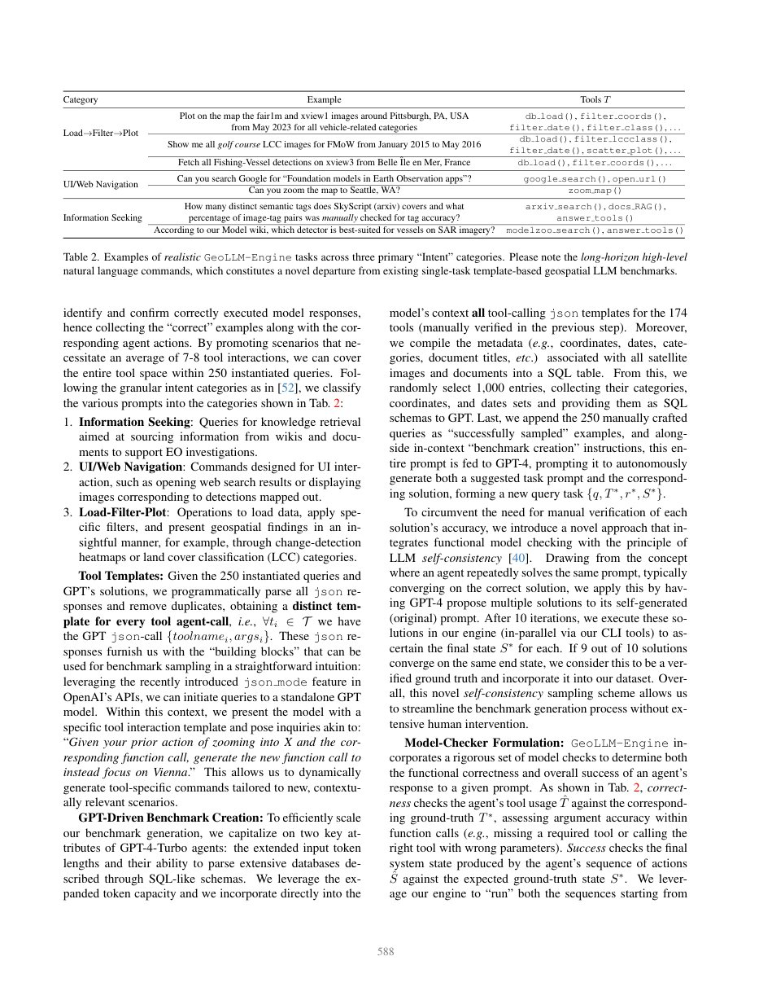


**原论文 Table 2 · PDF p.4**

Table 2. Examples of realistic GeoLLM-Engine tasks across three primary “Intent” categories. Please note the long-horizon high-level natural language commands, which constitutes a novel departure from existing single-task template-based geospatial LLM benchmarks.


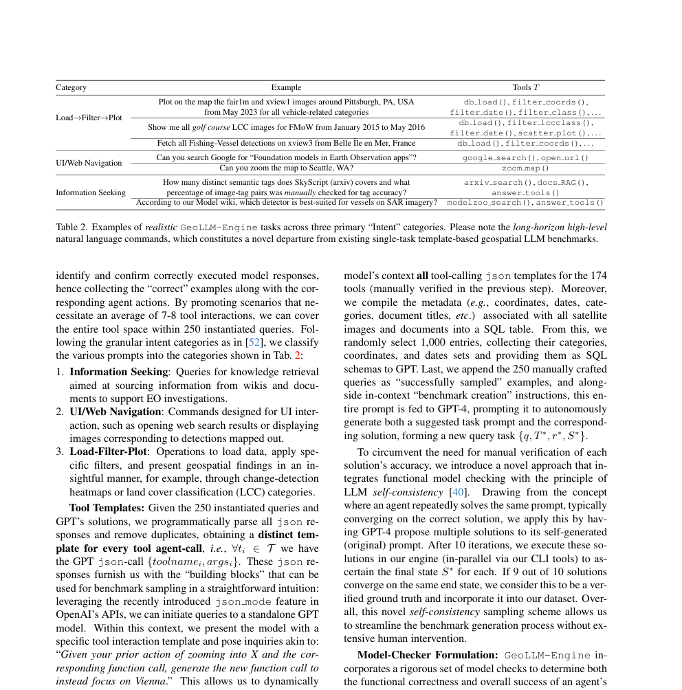


### 本页英文全文

```text
Category                                           Example                                                         Tools T

                              Plot on the map the fair1m and xview1 images around Pittsburgh, PA, USA          db load(), filter coords(),
                                    from May 2023 for all vehicle-related categories                filter date(), filter class(), . . .
Load→Filter→Plot
                                                                               db load(), filter lccclass(),
                   Show me all golf course LCC images for FMoW from January 2015 to May 2016
                                                                             filter date(), scatter plot(), . . .
                           Fetch all Fishing-Vessel detections on xview3 from Belle ˆIle en Mer, France        db load(), filter coords(), . . .

                      Can you search Google for “Foundation models in Earth Observation apps”?         google search(), open url()
UI/Web Navigation
                                    Can you zoom the map to Seattle, WA?                             zoom map()

                    How many distinct semantic tags does SkyScript (arxiv) covers and what           arxiv search(), docs RAG(),
Information Seeking           percentage of image-tag pairs was manually checked for tag accuracy?                 answer tools()
                    According to our Model wiki, which detector is best-suited for vessels on SAR imagery?  modelzoo search(), answer tools()

Table 2. Examples of realistic GeoLLM-Engine tasks across three primary “Intent” categories. Please note the long-horizon high-level
natural language commands, which constitutes a novel departure from existing single-task template-based geospatial LLM benchmarks.


identify and confirm correctly executed model responses,     model’s context all tool-calling json templates for the 174
hence collecting the “correct” examples along with the cor-      tools (manually verified in the previous step). Moreover,
responding agent actions. By promoting scenarios that ne-    we compile the metadata (e.g., coordinates, dates, cate-
cessitate an average of 7-8 tool interactions, we can cover      gories, document titles, etc.)  associated with all satellite
the entire tool space within 250 instantiated queries. Fol-     images and documents into a SQL table. From this, we
lowing the granular intent categories as in [52], we classify     randomly select 1,000 entries, collecting their categories,
the various prompts into the categories shown in Tab. 2:         coordinates, and dates sets and providing them as SQL
1. Information Seeking: Queries for knowledge retrieval     schemas to GPT. Last, we append the 250 manually crafted
   aimed at sourcing information from wikis and docu-     queries as “successfully sampled” examples, and along-
   ments to support EO investigations.                          side in-context “benchmark creation” instructions, this en-
2. UI/Web Navigation: Commands designed for UI inter-       tire prompt is fed to GPT-4, prompting it to autonomously
   action, such as opening web search results or displaying     generate both a suggested task prompt and the correspond-
   images corresponding to detections mapped out.             ing solution, forming a new query task {q, T ∗, r∗, S∗}.
3. Load-Filter-Plot: Operations to load data, apply spe-       To circumvent the need for manual verification of each
    cific filters, and present geospatial findings in an in-      solution’s accuracy, we introduce a novel approach that in-
   sightful manner, for example, through change-detection      tegrates functional model checking with the principle of
   heatmaps or land cover classification (LCC) categories.    LLM self-consistency [40].  Drawing from the concept
   Tool Templates: Given the 250 instantiated queries and     where an agent repeatedly solves the same prompt, typically
GPT’s solutions, we programmatically parse all json re-     converging on the correct solution, we apply this by hav-
sponses and remove duplicates, obtaining a distinct tem-     ing GPT-4 propose multiple solutions to its self-generated
plate for every tool agent-call,  i.e., ∀ti ∈T we have      (original) prompt. After 10 iterations, we execute these so-
the GPT json-call {toolnamei, argsi}. These json re-      lutions in our engine (in-parallel via our CLI tools) to as-
sponses furnish us with the “building blocks” that can be      certain the final state S∗for each. If 9 out of 10 solutions
used for benchmark sampling in a straightforward intuition:     converge on the same end state, we consider this to be a ver-
leveraging the recently introduced json mode feature in      ified ground truth and incorporate it into our dataset. Over-
OpenAI’s APIs, we can initiate queries to a standalone GPT       all, this novel self-consistency sampling scheme allows us
model. Within this context, we present the model with a      to streamline the benchmark generation process without ex-
specific tool interaction template and pose inquiries akin to:      tensive human intervention.
“Given your prior action of zooming into X and the cor-       Model-Checker Formulation: GeoLLM-Engine in-
responding function call, generate the new function call to     corporates a rigorous set of model checks to determine both
instead focus on Vienna.”  This allows us to dynamically      the functional correctness and overall success of an agent’s
generate tool-specific commands tailored to new, contextu-     response to a given prompt. As shown in Tab. 2, correct-
ally relevant scenarios.                                       ness checks the agent’s tool usage ˆT against the correspond-
  GPT-Driven Benchmark Creation: To efficiently scale     ing ground-truth T ∗, assessing argument accuracy within
our benchmark generation, we capitalize on two key at-     function calls (e.g., missing a required tool or calling the
tributes of GPT-4-Turbo agents: the extended input token      right tool with wrong parameters). Success checks the final
lengths and their ability to parse extensive databases de-     system state produced by the agent’s sequence of actions
scribed through SQL-like schemas. We leverage the ex-       ˆS against the expected ground-truth state S∗. We lever-
panded token capacity and we incorporate directly into the     age our engine to “run” both the sequences starting from


                                                       588
```


---

## 第 5 页（Page 5）

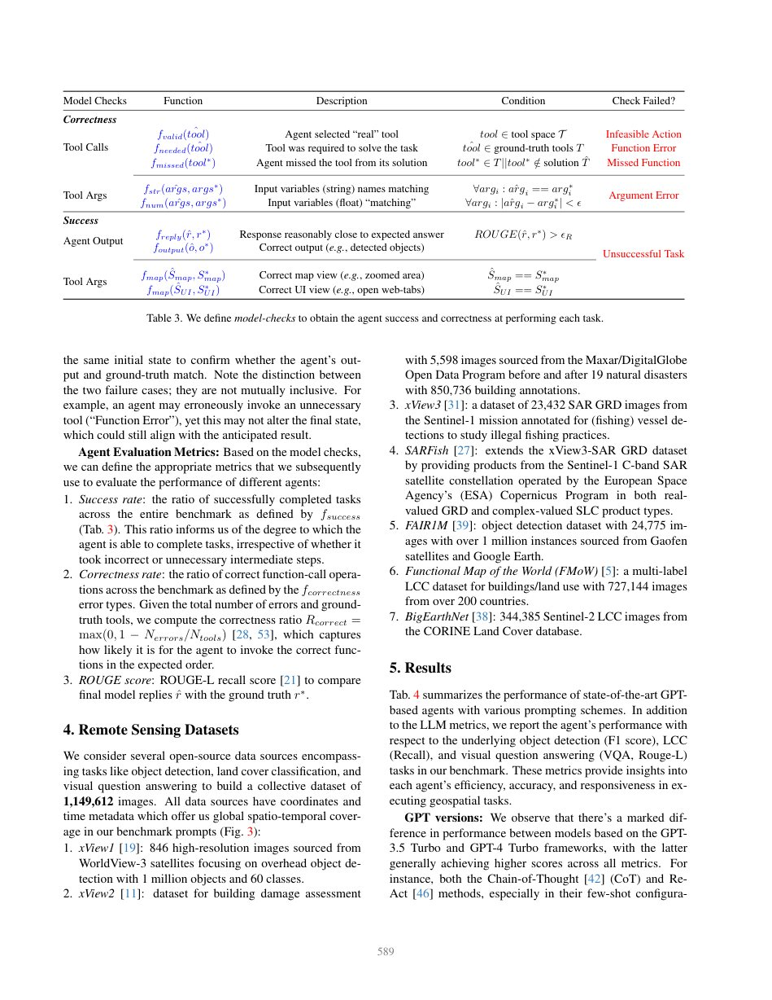


**原论文 Table 3 · PDF p.5**

Table 3. We define model-checks to obtain the agent success and correctness at performing each task.


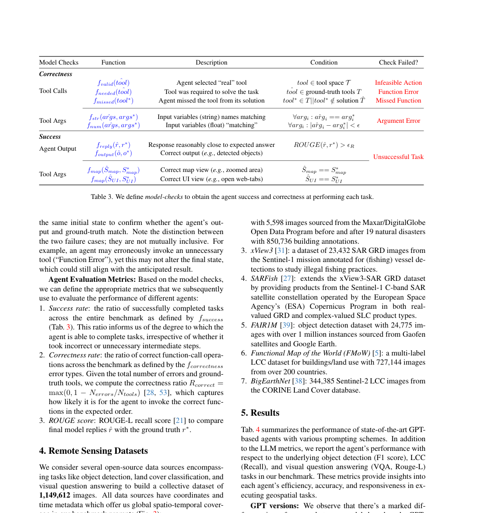


### 本页英文全文

```text
Model Checks        Function                        Description                           Condition            Check Failed?

Correctness
                      fvalid(tool)ˆ                Agent selected “real” tool                  tool ∈tool space T          Infeasible Action
Tool Calls          fneeded(tool)ˆ             Tool was required to solve the task          toolˆ  ∈ground-truth tools T      Function Error
                   fmissed(tool∗)       Agent missed the tool from its solution      tool∗∈T||tool∗/∈solution ˆT   Missed Function

                  fstr(args,ˆ   args∗)       Input variables (string) names matching         ∀argi : argiˆ == arg∗iTool Args                                                                                           Argument Error
             fnum(args,ˆ   args∗)         Input variables (float) “matching”          ∀argi : |argiˆ  −arg∗i | < ϵ

Success
                        freply(ˆr, r∗)     Response reasonably close to expected answer     ROUGE(ˆr, r∗) > ϵR
Agent Output
                      foutput(ˆo, o∗)          Correct output (e.g., detected objects)
                                                                                                               Unsuccessful Task
              fmap(ˆSmap, S∗map)       Correct map view (e.g., zoomed area)             ˆSmap == S∗mapTool Args
               fmap(ˆSUI, S∗UI)        Correct UI view (e.g., open web-tabs)                ˆSUI == S∗UI

                 Table 3. We define model-checks to obtain the agent success and correctness at performing each task.


the same initial state to confirm whether the agent’s out-        with 5,598 images sourced from the Maxar/DigitalGlobe
put and ground-truth match. Note the distinction between      Open Data Program before and after 19 natural disasters
the two failure cases; they are not mutually inclusive. For        with 850,736 building annotations.
example, an agent may erroneously invoke an unnecessary      3. xView3 [31]: a dataset of 23,432 SAR GRD images from
tool (“Function Error”), yet this may not alter the final state,         the Sentinel-1 mission annotated for (fishing) vessel de-
which could still align with the anticipated result.                   tections to study illegal fishing practices.
  Agent Evaluation Metrics: Based on the model checks,      4. SARFish [27]: extends the xView3-SAR GRD dataset
we can define the appropriate metrics that we subsequently       by providing products from the Sentinel-1 C-band SAR
use to evaluate the performance of different agents:                   satellite constellation operated by the European Space
1. Success rate: the ratio of successfully completed tasks       Agency’s (ESA) Copernicus Program  in both  real-
   across the  entire benchmark as defined by fsuccess        valued GRD and complex-valued SLC product types.
   (Tab. 3). This ratio informs us of the degree to which the      5. FAIR1M [39]: object detection dataset with 24,775 im-
   agent is able to complete tasks, irrespective of whether it        ages with over 1 million instances sourced from Gaofen
   took incorrect or unnecessary intermediate steps.                  satellites and Google Earth.
2. Correctness rate: the ratio of correct function-call opera-      6. Functional Map of the World (FMoW) [5]: a multi-label
   tions across the benchmark as defined by the fcorrectness     LCC dataset for buildings/land use with 727,144 images
   error types. Given the total number of errors and ground-       from over 200 countries.
   truth tools, we compute the correctness ratio Rcorrect =      7. BigEarthNet [38]: 344,385 Sentinel-2 LCC images from
  max(0, 1 −Nerrors/Ntools) [28, 53], which captures         the CORINE Land Cover database.
  how likely it is for the agent to invoke the correct func-
   tions in the expected order.                               5. Results
3. ROUGE score: ROUGE-L recall score [21] to compare
    final model replies ˆr with the ground truth r∗.               Tab. 4 summarizes the performance of state-of-the-art GPT-
                                                         based agents with various prompting schemes. In addition
4. Remote Sensing Datasets                               to the LLM metrics, we report the agent’s performance with
                                                                respect to the underlying object detection (F1 score), LCC
We consider several open-source data sources encompass-      (Recall), and visual question answering (VQA, Rouge-L)
ing tasks like object detection, land cover classification, and      tasks in our benchmark. These metrics provide insights into
visual question answering to build a collective dataset of     each agent’s efficiency, accuracy, and responsiveness in ex-
1,149,612 images. All data sources have coordinates and     ecuting geospatial tasks.
time metadata which offer us global spatio-temporal cover-     GPT versions: We observe that there’s a marked dif-
age in our benchmark prompts (Fig. 3):                        ference in performance between models based on the GPT-
1. xView1 [19]: 846 high-resolution images sourced from     3.5 Turbo and GPT-4 Turbo frameworks, with the latter
   WorldView-3 satellites focusing on overhead object de-     generally achieving higher scores across all metrics.  For
   tection with 1 million objects and 60 classes.                 instance, both the Chain-of-Thought [42] (CoT) and Re-
2. xView2 [11]:  dataset for building damage assessment     Act [46] methods, especially in their few-shot configura-


                                                       589
```


---

## 第 6 页（Page 6）

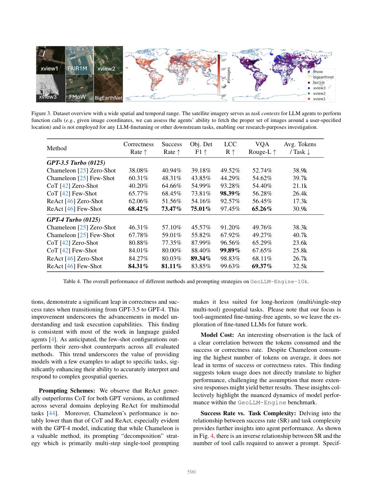


**原论文 Figure 3 · PDF p.6**

Figure 3. Dataset overview with a wide spatial and temporal range. The satellite imagery serves as task contexts for LLM agents to perform function calls (e.g., given image coordinates, we can assess the agents’ ability to fetch the proper set of images around a user-specified location) and is not employed for any LLM-finetuning or other downstream tasks, enabling our research-purposes investigation.


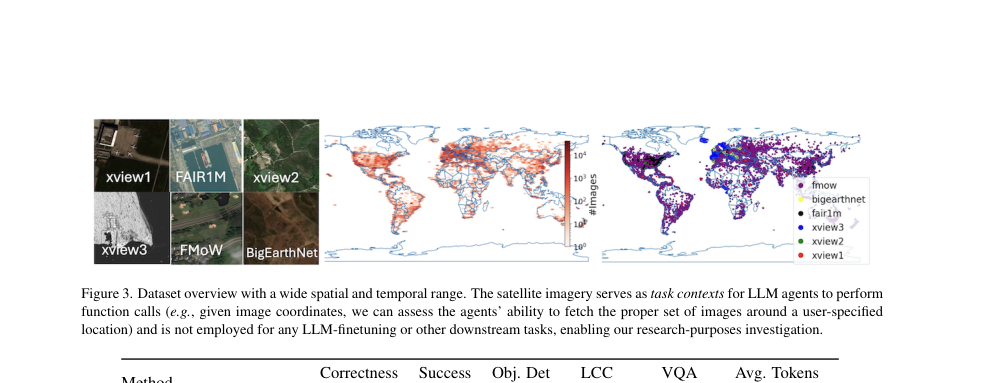


**原论文 Table 4 · PDF p.6**

Table 4. The overall performance of different methods and prompting strategies on GeoLLM-Engine-10k.


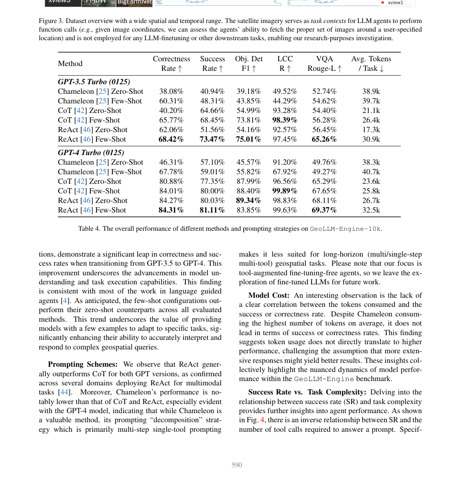


### 本页英文全文

```text
Figure 3. Dataset overview with a wide spatial and temporal range. The satellite imagery serves as task contexts for LLM agents to perform
function calls (e.g., given image coordinates, we can assess the agents’ ability to fetch the proper set of images around a user-specified
location) and is not employed for any LLM-finetuning or other downstream tasks, enabling our research-purposes investigation.


                                  Correctness   Success   Obj. Det   LCC    VQA     Avg. Tokens
     Method
                                  Rate ↑      Rate ↑     F1 ↑    R ↑    Rouge-L ↑        / Task ↓

     GPT-3.5 Turbo (0125)
     Chameleon [25] Zero-Shot    38.08%    40.94%   39.18%   49.52%    52.74%       38.9k
     Chameleon [25] Few-Shot    60.31%    48.31%   43.85%   44.29%    54.62%       39.7k
    CoT [42] Zero-Shot         40.20%    64.66%   54.99%   93.28%    54.40%       21.1k
    CoT [42] Few-Shot          65.77%    68.45%   73.81%   98.39%    56.28%       26.4k
     ReAct [46] Zero-Shot        62.06%    51.56%   54.16%   92.57%    56.45%       17.3k
     ReAct [46] Few-Shot        68.42%    73.47%  75.01%   97.45%   65.26%       30.9k

     GPT-4 Turbo (0125)
     Chameleon [25] Zero-Shot    46.31%    57.10%   45.57%   91.20%    49.76%       38.3k
     Chameleon [25] Few-Shot    67.78%    59.01%   55.82%   67.92%    49.27%       40.7k
    CoT [42] Zero-Shot         80.88%    77.35%   87.99%   96.56%    65.29%       23.6k
    CoT [42] Few-Shot          84.01%    80.00%   88.40%   99.89%    67.65%       25.8k
     ReAct [46] Zero-Shot        84.27%    80.03%   89.34%   98.83%    68.11%       26.7k
     ReAct [46] Few-Shot        84.31%    81.11%   83.85%   99.63%   69.37%       32.5k


             Table 4. The overall performance of different methods and prompting strategies on GeoLLM-Engine-10k.


tions, demonstrate a significant leap in correctness and suc-    makes  it less suited for long-horizon (multi/single-step
cess rates when transitioning from GPT-3.5 to GPT-4. This      multi-tool) geospatial tasks. Please note that our focus is
improvement underscores the advancements in model un-     tool-augmented fine-tuning-free agents, so we leave the ex-
derstanding and task execution capabilities.  This finding      ploration of fine-tuned LLMs for future work.
is consistent with most of the work in language guided
                                                  Model Cost: An interesting observation is the lack of
agents [4]. As anticipated, the few-shot configurations out-
                                                          a clear correlation between the tokens consumed and the
perform their zero-shot counterparts across all evaluated
                                                             success or correctness rate.  Despite Chameleon consum-
methods.  This trend underscores the value of providing
                                                             ing the highest number of tokens on average, it does not
models with a few examples to adapt to specific tasks, sig-
                                                              lead in terms of success or correctness rates. This finding
nificantly enhancing their ability to accurately interpret and
                                                             suggests token usage does not directly translate to higher
respond to complex geospatial queries.
                                                           performance, challenging the assumption that more exten-
                                                                  sive responses might yield better results. These insights col-
  Prompting Schemes: We observe that ReAct gener-
                                                                     lectively highlight the nuanced dynamics of model perfor-
ally outperforms CoT for both GPT versions, as confirmed
                                                  mance within the GeoLLM-Engine benchmark.
across several domains deploying ReAct for multimodal
tasks [44].  Moreover, Chameleon’s performance is no-        Success Rate vs. Task Complexity: Delving into the
tably lower than that of CoT and ReAct, especially evident      relationship between success rate (SR) and task complexity
with the GPT-4 model, indicating that while Chameleon is     provides further insights into agent performance. As shown
a valuable method,  its prompting “decomposition” strat-      in Fig. 4, there is an inverse relationship between SR and the
egy which is primarily multi-step single-tool prompting    number of tool calls required to answer a prompt. Specif-


                                                       590
```


---

## 第 7 页（Page 7）

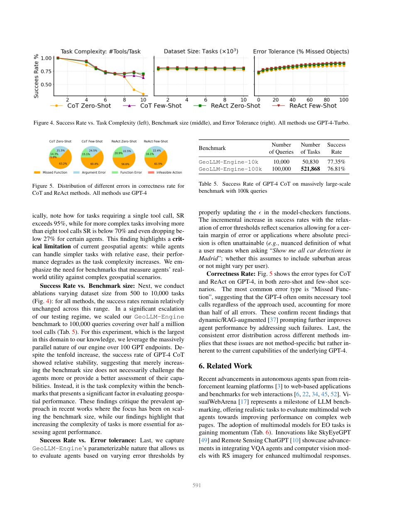


**原论文 Figure 4 · PDF p.7**

Figure 4. Success Rate vs. Task Complexity (left), Benchmark size (middle), and Error Tolerance (right). All methods use GPT-4-Turbo.


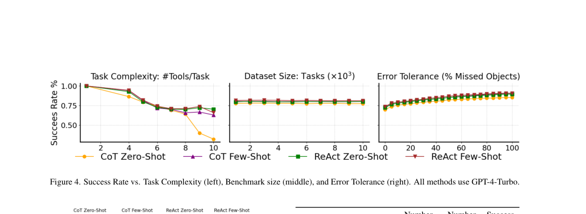


**原论文 Table 5 · PDF p.7**

Table 5. Success Rate of GPT-4 CoT on massively large-scale benchmark with 100k queries


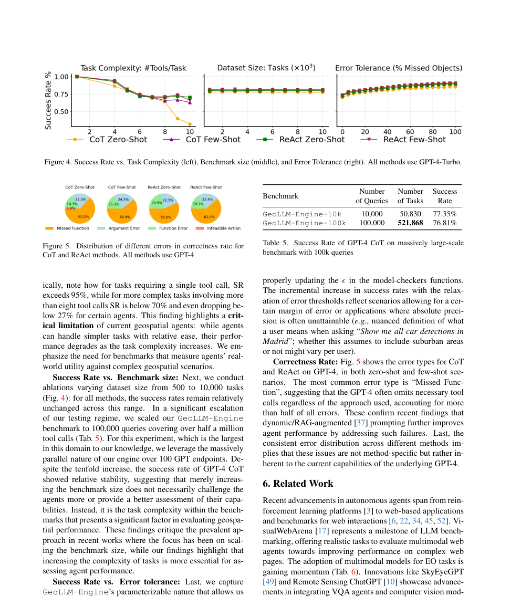


**原论文 Figure 5 · PDF p.7**

Figure 5. Distribution of different errors in correctness rate for CoT and ReAct methods. All methods use GPT-4


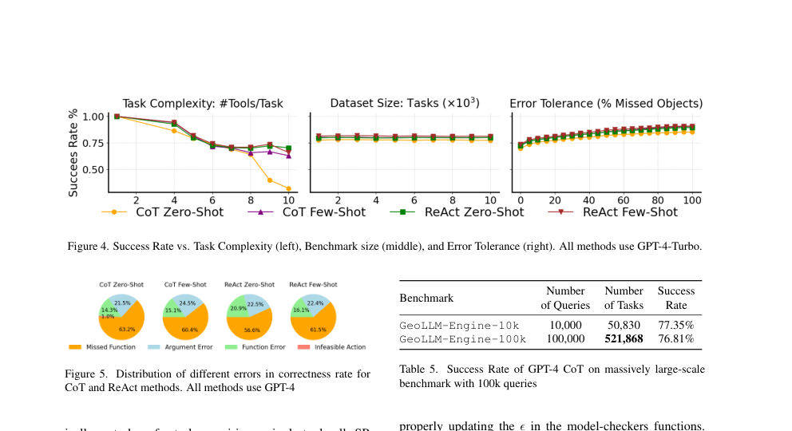


### 本页英文全文

```text
 Figure 4. Success Rate vs. Task Complexity (left), Benchmark size (middle), and Error Tolerance (right). All methods use GPT-4-Turbo.


                                                                           Number   Number   Success
                                                       Benchmark
                                                                                                 of Queries   of Tasks    Rate

                                               GeoLLM-Engine-10k      10,000     50,830   77.35%
                                               GeoLLM-Engine-100k    100,000    521,868  76.81%


                                                                  Table 5.  Success Rate of GPT-4 CoT on massively large-scaleFigure 5.  Distribution of different errors in correctness rate for
                                                          benchmark with 100k queriesCoT and ReAct methods. All methods use GPT-4


                                                             properly updating the ϵ in the model-checkers functions.
ically, note how for tasks requiring a single tool call, SR
                                                  The incremental increase in success rates with the relax-
exceeds 95%, while for more complex tasks involving more
                                                                 ation of error thresholds reflect scenarios allowing for a cer-
than eight tool calls SR is below 70% and even dropping be-
                                                                     tain margin of error or applications where absolute preci-
low 27% for certain agents. This finding highlights a crit-
                                                              sion is often unattainable (e.g., nuanced definition of what
ical limitation of current geospatial agents: while agents
                                                          a user means when asking “Show me all car detections in
can handle simpler tasks with relative ease, their perfor-
                                                       Madrid”; whether this assumes to include suburban areas
mance degrades as the task complexity increases. We em-
                                                              or not might vary per user).
phasize the need for benchmarks that measure agents’ real-
                                                           Correctness Rate: Fig. 5 shows the error types for CoT
world utility against complex geospatial scenarios.
                                                      and ReAct on GPT-4, in both zero-shot and few-shot sce-
   Success Rate vs. Benchmark size: Next, we conduct
                                                                   narios.  The most common error type is “Missed Func-
ablations varying dataset size from 500 to 10,000 tasks
                                                                     tion”, suggesting that the GPT-4 often omits necessary tool
(Fig. 4): for all methods, the success rates remain relatively
                                                                       calls regardless of the approach used, accounting for more
unchanged across this range.  In a significant escalation
                                                            than half of all errors. These confirm recent findings that
of our testing regime, we scaled our GeoLLM-Engine
                                                    dynamic/RAG-augmented [37] prompting further improves
benchmark to 100,000 queries covering over half a million
                                                            agent performance by addressing such failures.  Last, the
tool calls (Tab. 5). For this experiment, which is the largest
                                                                 consistent error distribution across different methods im-
in this domain to our knowledge, we leverage the massively
                                                                     plies that these issues are not method-specific but rather in-
parallel nature of our engine over 100 GPT endpoints. De-
                                                              herent to the current capabilities of the underlying GPT-4.
spite the tenfold increase, the success rate of GPT-4 CoT
showed relative stability, suggesting that merely increas-
                                                          6. Related Work
ing the benchmark size does not necessarily challenge the
agents more or provide a better assessment of their capa-     Recent advancements in autonomous agents span from rein-
bilities. Instead, it is the task complexity within the bench-     forcement learning platforms [3] to web-based applications
marks that presents a significant factor in evaluating geospa-     and benchmarks for web interactions [6, 22, 34, 45, 52]. Vi-
tial performance. These findings critique the prevalent ap-     sualWebArena [17] represents a milestone of LLM bench-
proach in recent works where the focus has been on scal-     marking, offering realistic tasks to evaluate multimodal web
ing the benchmark size, while our findings highlight that     agents towards improving performance on complex web
increasing the complexity of tasks is more essential for as-     pages. The adoption of multimodal models for EO tasks is
sessing agent performance.                                   gaining momentum (Tab. 6). Innovations like SkyEyeGPT
   Success Rate vs. Error tolerance:  Last, we capture     [49] and Remote Sensing ChatGPT [10] showcase advance-
GeoLLM-Engine’s parameterizable nature that allows us     ments in integrating VQA agents and computer vision mod-
to evaluate agents based on varying error thresholds by      els with RS imagery for enhanced multimodal responses.


                                                       591
```


---

## 第 8 页（Page 8）

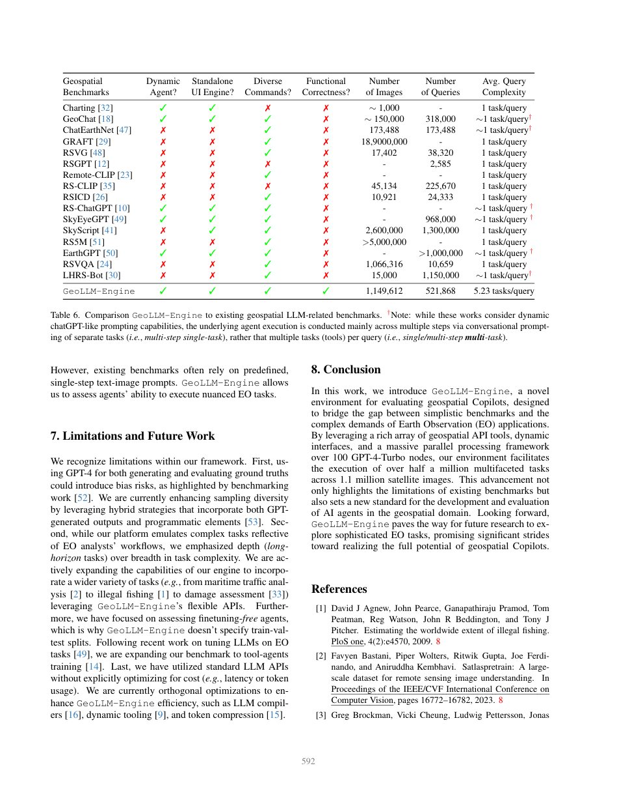


**原论文 Table 6 · PDF p.8**

Table 6. Comparison GeoLLM-Engine to existing geospatial LLM-related benchmarks. †Note: while these works consider dynamic chatGPT-like prompting capabilities, the underlying agent execution is conducted mainly across multiple steps via conversational prompt- ing of separate tasks (i.e., multi-step single-task), rather that multiple tasks (tools) per query (i.e., single/multi-step multi-task).


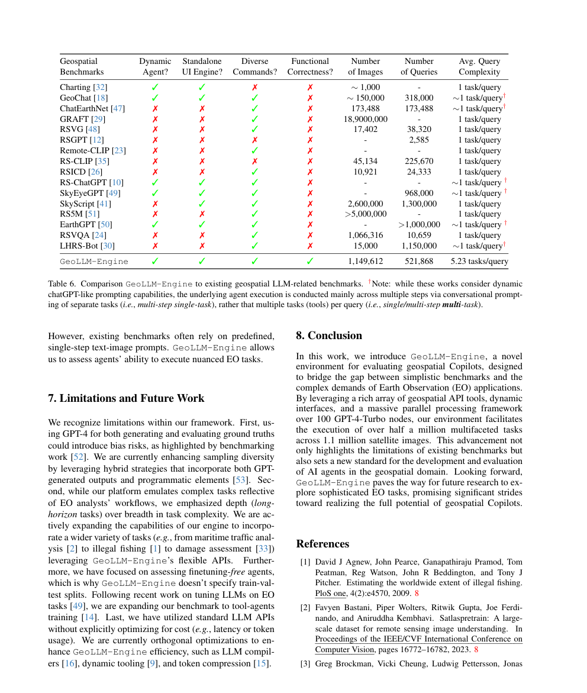


### 本页英文全文

```text
   Geospatial         Dynamic   Standalone     Diverse      Functional     Number     Number      Avg. Query
   Benchmarks         Agent?   UI Engine?  Commands?   Correctness?    of Images     of Queries     Complexity
   Charting [32]       ✓      ✓         ✗          ✗        ∼1,000             -        1 task/query
   GeoChat [18]       ✓      ✓       ✓          ✗       ∼150,000     318,000   ∼1 task/query†
   ChatEarthNet [47]     ✗        ✗       ✓          ✗         173,488      173,488   ∼1 task/query†
  GRAFT [29]         ✗        ✗       ✓          ✗        18,9000,000          -        1 task/query
  RSVG [48]          ✗        ✗       ✓          ✗          17,402       38,320      1 task/query
  RSGPT [12]          ✗        ✗         ✗          ✗                  -           2,585       1 task/query
   Remote-CLIP [23]     ✗        ✗       ✓          ✗                  -                 -        1 task/query
   RS-CLIP [35]         ✗        ✗         ✗          ✗          45,134       225,670      1 task/query
  RSICD [26]          ✗        ✗       ✓          ✗          10,921       24,333      1 task/query
   RS-ChatGPT [10]    ✓      ✓       ✓          ✗                  -                 -      ∼1 task/query †
  SkyEyeGPT [49]     ✓      ✓       ✓          ✗                  -         968,000   ∼1 task/query †
   SkyScript [41]        ✗      ✓       ✓          ✗         2,600,000     1,300,000     1 task/query
  RS5M [51]           ✗        ✗       ✓          ✗        >5,000,000           -        1 task/query
   EarthGPT [50]      ✓      ✓       ✓          ✗                  -       >1,000,000  ∼1 task/query †
  RSVQA [24]         ✗        ✗       ✓          ✗         1,066,316      10,659      1 task/query
  LHRS-Bot [30]        ✗        ✗       ✓          ✗          15,000      1,150,000   ∼1 task/query†
  GeoLLM-Engine    ✓      ✓       ✓       ✓         1,149,612     521,868    5.23 tasks/query

Table 6. Comparison GeoLLM-Engine to existing geospatial LLM-related benchmarks. †Note: while these works consider dynamic
chatGPT-like prompting capabilities, the underlying agent execution is conducted mainly across multiple steps via conversational prompt-
ing of separate tasks (i.e., multi-step single-task), rather that multiple tasks (tools) per query (i.e., single/multi-step multi-task).


However, existing benchmarks often rely on predefined,     8. Conclusion
single-step text-image prompts. GeoLLM-Engine allows
                                                              In this work, we introduce GeoLLM-Engine, a novelus to assess agents’ ability to execute nuanced EO tasks.
                                                         environment for evaluating geospatial Copilots, designed
                                                                   to bridge the gap between simplistic benchmarks and the
                                                     complex demands of Earth Observation (EO) applications.
7. Limitations and Future Work                By leveraging a rich array of geospatial API tools, dynamic
                                                                     interfaces, and a massive parallel processing framework
                                                           over 100 GPT-4-Turbo nodes, our environment facilitatesWe recognize limitations within our framework. First, us-
                                                                the execution of over half a million multifaceted tasksing GPT-4 for both generating and evaluating ground truths
                                                              across 1.1 million satellite images. This advancement not
could introduce bias risks, as highlighted by benchmarking
                                                          only highlights the limitations of existing benchmarks but
work [52]. We are currently enhancing sampling diversity                                                                also sets a new standard for the development and evaluation
by leveraging hybrid strategies that incorporate both GPT-                                                              of AI agents in the geospatial domain. Looking forward,
generated outputs and programmatic elements [53].  Sec-    GeoLLM-Engine paves the way for future research to ex-
ond, while our platform emulates complex tasks reflective     plore sophisticated EO tasks, promising significant strides
of EO analysts’ workflows, we emphasized depth (long-     toward realizing the full potential of geospatial Copilots.
horizon tasks) over breadth in task complexity. We are ac-
tively expanding the capabilities of our engine to incorpo-
rate a wider variety of tasks (e.g., from maritime traffic anal-
                                               Referencesysis [2] to illegal fishing [1] to damage assessment [33])
leveraging GeoLLM-Engine’s flexible APIs.   Further-        [1] David J Agnew, John Pearce, Ganapathiraju Pramod, Tom
more, we have focused on assessing finetuning-free agents,          Peatman, Reg Watson, John R Beddington, and Tony J
which is why GeoLLM-Engine doesn’t specify train-val-            Pitcher. Estimating the worldwide extent of illegal fishing.
test splits. Following recent work on tuning LLMs on EO          PloS one, 4(2):e4570, 2009. 8
tasks [49], we are expanding our benchmark to tool-agents        [2] Favyen Bastani, Piper Wolters, Ritwik Gupta, Joe Ferdi-
training [14].  Last, we have utilized standard LLM APIs           nando, and Aniruddha Kembhavi.  Satlaspretrain: A large-
without explicitly optimizing for cost (e.g., latency or token            scale dataset for remote sensing image understanding.  In
usage). We are currently orthogonal optimizations to en-           Proceedings of the IEEE/CVF International Conference on
hance GeoLLM-Engine efficiency, such as LLM compil-         Computer Vision, pages 16772–16782, 2023. 8
ers [16], dynamic tooling [9], and token compression [15].         [3] Greg Brockman, Vicki Cheung, Ludwig Pettersson, Jonas


                                                       592
```


---

## 第 9 页（Page 9）

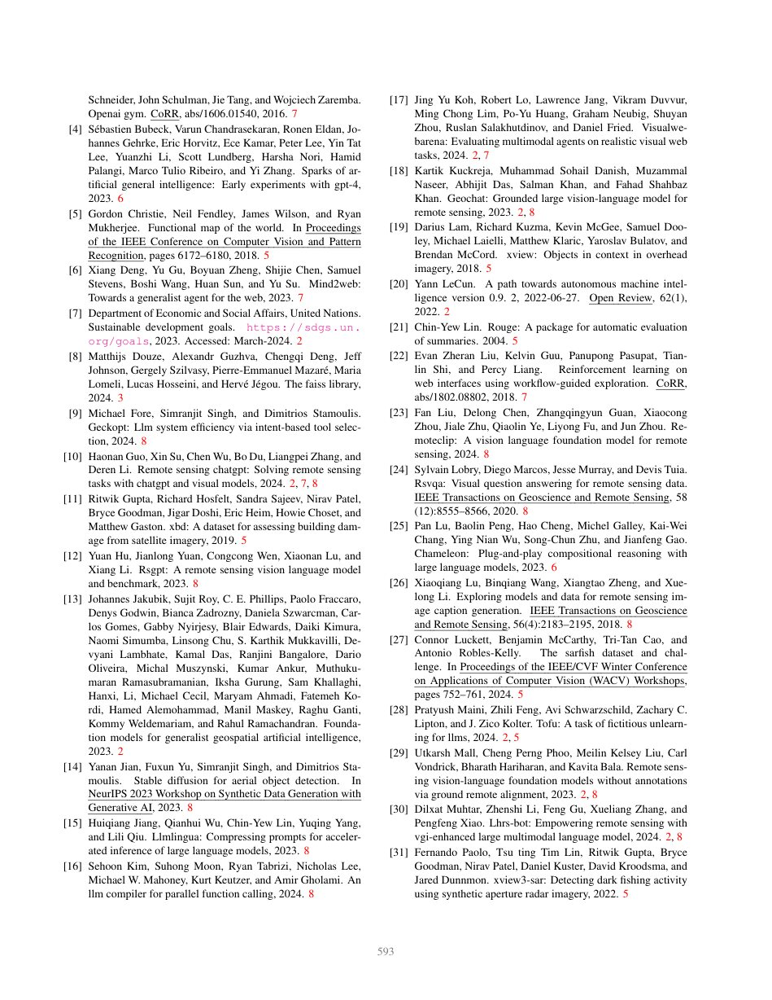


### 本页英文全文

```text
     Schneider, John Schulman, Jie Tang, and Wojciech Zaremba.      [17] Jing Yu Koh, Robert Lo, Lawrence Jang, Vikram Duvvur,
     Openai gym. CoRR, abs/1606.01540, 2016. 7                   Ming Chong Lim, Po-Yu Huang, Graham Neubig, Shuyan
 [4] S´ebastien Bubeck, Varun Chandrasekaran, Ronen Eldan, Jo-          Zhou, Ruslan Salakhutdinov, and Daniel Fried.  Visualwe-
     hannes Gehrke, Eric Horvitz, Ece Kamar, Peter Lee, Yin Tat           barena: Evaluating multimodal agents on realistic visual web
     Lee, Yuanzhi Li,  Scott Lundberg, Harsha Nori, Hamid             tasks, 2024. 2, 7
     Palangi, Marco Tulio Ribeiro, and Yi Zhang. Sparks of ar-      [18] Kartik Kuckreja, Muhammad Sohail Danish, Muzammal
       tificial general intelligence: Early experiments with gpt-4,           Naseer, Abhijit Das, Salman Khan, and Fahad Shahbaz
     2023. 6                                                     Khan. Geochat: Grounded large vision-language model for
 [5] Gordon Christie, Neil Fendley, James Wilson, and Ryan          remote sensing, 2023. 2, 8
     Mukherjee.  Functional map of the world.  In Proceedings      [19] Darius Lam, Richard Kuzma, Kevin McGee, Samuel Doo-
     of the IEEE Conference on Computer Vision and Pattern              ley, Michael Laielli, Matthew Klaric, Yaroslav Bulatov, and
     Recognition, pages 6172–6180, 2018. 5                           Brendan McCord.  xview: Objects in context in overhead
 [6] Xiang Deng, Yu Gu, Boyuan Zheng, Shijie Chen, Samuel           imagery, 2018. 5
     Stevens, Boshi Wang, Huan Sun, and Yu Su. Mind2web:      [20] Yann LeCun. A path towards autonomous machine intel-
     Towards a generalist agent for the web, 2023. 7                        ligence version 0.9. 2, 2022-06-27.  Open Review, 62(1),
 [7] Department of Economic and Social Affairs, United Nations.           2022. 2
     Sustainable development goals.  https://sdgs.un.      [21] Chin-Yew Lin. Rouge: A package for automatic evaluation
    org/goals, 2023. Accessed: March-2024. 2                        of summaries. 2004. 5
 [8] Matthijs Douze, Alexandr Guzhva, Chengqi Deng,  Jeff      [22] Evan Zheran Liu, Kelvin Guu, Panupong Pasupat, Tian-
     Johnson, Gergely Szilvasy, Pierre-Emmanuel Mazar´e, Maria             lin Shi, and Percy Liang.   Reinforcement learning on
     Lomeli, Lucas Hosseini, and Herv´e J´egou. The faiss library,         web interfaces using workflow-guided exploration. CoRR,
     2024. 3                                                          abs/1802.08802, 2018. 7
 [9] Michael Fore, Simranjit Singh, and Dimitrios Stamoulis.      [23] Fan Liu, Delong Chen, Zhangqingyun Guan, Xiaocong
     Geckopt: Llm system efficiency via intent-based tool selec-          Zhou, Jiale Zhu, Qiaolin Ye, Liyong Fu, and Jun Zhou. Re-
      tion, 2024. 8                                                        moteclip: A vision language foundation model for remote
[10] Haonan Guo, Xin Su, Chen Wu, Bo Du, Liangpei Zhang, and            sensing, 2024. 8
     Deren Li. Remote sensing chatgpt: Solving remote sensing      [24] Sylvain Lobry, Diego Marcos, Jesse Murray, and Devis Tuia.
      tasks with chatgpt and visual models, 2024. 2, 7, 8                  Rsvqa: Visual question answering for remote sensing data.
[11] Ritwik Gupta, Richard Hosfelt, Sandra Sajeev, Nirav Patel,         IEEE Transactions on Geoscience and Remote Sensing, 58
     Bryce Goodman, Jigar Doshi, Eric Heim, Howie Choset, and           (12):8555–8566, 2020. 8
    Matthew Gaston. xbd: A dataset for assessing building dam-      [25] Pan Lu, Baolin Peng, Hao Cheng, Michel Galley, Kai-Wei
     age from satellite imagery, 2019. 5                               Chang, Ying Nian Wu, Song-Chun Zhu, and Jianfeng Gao.
[12] Yuan Hu, Jianlong Yuan, Congcong Wen, Xiaonan Lu, and          Chameleon:  Plug-and-play compositional reasoning with
     Xiang Li. Rsgpt: A remote sensing vision language model            large language models, 2023. 6
     and benchmark, 2023. 8                                         [26] Xiaoqiang Lu, Binqiang Wang, Xiangtao Zheng, and Xue-
[13] Johannes Jakubik, Sujit Roy, C. E. Phillips, Paolo Fraccaro,           long Li. Exploring models and data for remote sensing im-
    Denys Godwin, Bianca Zadrozny, Daniela Szwarcman, Car-          age caption generation. IEEE Transactions on Geoscience
      los Gomes, Gabby Nyirjesy, Blair Edwards, Daiki Kimura,          and Remote Sensing, 56(4):2183–2195, 2018. 8
    Naomi Simumba, Linsong Chu, S. Karthik Mukkavilli, De-      [27] Connor Luckett, Benjamin McCarthy, Tri-Tan Cao, and
     vyani Lambhate, Kamal Das,  Ranjini Bangalore, Dario          Antonio  Robles-Kelly.   The  sarfish  dataset and  chal-
      Oliveira,  Michal Muszynski, Kumar Ankur,  Muthuku-            lenge. In Proceedings of the IEEE/CVF Winter Conference
    maran Ramasubramanian, Iksha Gurung, Sam Khallaghi,         on Applications of Computer Vision (WACV) Workshops,
     Hanxi, Li, Michael Cecil, Maryam Ahmadi, Fatemeh Ko-          pages 752–761, 2024. 5
       rdi, Hamed Alemohammad, Manil Maskey, Raghu Ganti,      [28] Pratyush Maini, Zhili Feng, Avi Schwarzschild, Zachary C.
   Kommy Weldemariam, and Rahul Ramachandran. Founda-           Lipton, and J. Zico Kolter. Tofu: A task of fictitious unlearn-
      tion models for generalist geospatial artificial intelligence,           ing for llms, 2024. 2, 5
     2023. 2                                                        [29] Utkarsh Mall, Cheng Perng Phoo, Meilin Kelsey Liu, Carl
[14] Yanan Jian, Fuxun Yu, Simranjit Singh, and Dimitrios Sta-           Vondrick, Bharath Hariharan, and Kavita Bala. Remote sens-
     moulis.   Stable diffusion for aerial object detection.   In           ing vision-language foundation models without annotations
     NeurIPS 2023 Workshop on Synthetic Data Generation with            via ground remote alignment, 2023. 2, 8
     Generative AI, 2023. 8                                          [30] Dilxat Muhtar, Zhenshi Li, Feng Gu, Xueliang Zhang, and
[15] Huiqiang Jiang, Qianhui Wu, Chin-Yew Lin, Yuqing Yang,          Pengfeng Xiao. Lhrs-bot: Empowering remote sensing with
     and Lili Qiu. Llmlingua: Compressing prompts for acceler-           vgi-enhanced large multimodal language model, 2024. 2, 8
     ated inference of large language models, 2023. 8                 [31] Fernando Paolo, Tsu ting Tim Lin, Ritwik Gupta, Bryce
[16] Sehoon Kim, Suhong Moon, Ryan Tabrizi, Nicholas Lee,         Goodman, Nirav Patel, Daniel Kuster, David Kroodsma, and
     Michael W. Mahoney, Kurt Keutzer, and Amir Gholami. An           Jared Dunnmon. xview3-sar: Detecting dark fishing activity
     llm compiler for parallel function calling, 2024. 8                     using synthetic aperture radar imagery, 2022. 5


                                                       593
```


---

## 第 10 页（Page 10）

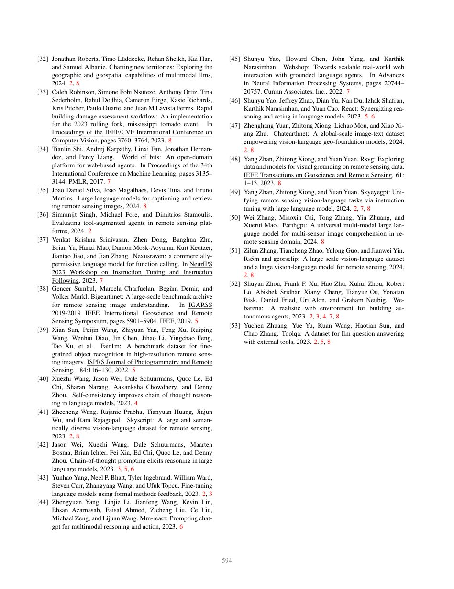


### 本页英文全文

```text
[32] Jonathan Roberts, Timo L¨uddecke, Rehan Sheikh, Kai Han,      [45] Shunyu Yao, Howard Chen,  John Yang,  and  Karthik
     and Samuel Albanie. Charting new territories: Exploring the          Narasimhan.  Webshop: Towards scalable real-world web
     geographic and geospatial capabilities of multimodal llms,            interaction with grounded language agents.  In Advances
     2024. 2, 8                                                                in Neural Information Processing Systems, pages 20744–
[33] Caleb Robinson, Simone Fobi Nsutezo, Anthony Ortiz, Tina          20757. Curran Associates, Inc., 2022. 7
     Sederholm, Rahul Dodhia, Cameron Birge, Kasie Richards,      [46] Shunyu Yao, Jeffrey Zhao, Dian Yu, Nan Du, Izhak Shafran,
     Kris Pitcher, Paulo Duarte, and Juan M Lavista Ferres. Rapid           Karthik Narasimhan, and Yuan Cao. React: Synergizing rea-
     building damage assessment workflow: An implementation           soning and acting in language models, 2023. 5, 6
      for the 2023 rolling fork, mississippi tornado event.   In      [47] Zhenghang Yuan, Zhitong Xiong, Lichao Mou, and Xiao Xi-
     Proceedings of the IEEE/CVF International Conference on          ang Zhu.  Chatearthnet: A global-scale image-text dataset
    Computer Vision, pages 3760–3764, 2023. 8                      empowering vision-language geo-foundation models, 2024.
[34] Tianlin Shi, Andrej Karpathy, Linxi Fan, Jonathan Hernan-             2, 8
     dez, and Percy Liang.  World of bits: An open-domain      [48] Yang Zhan, Zhitong Xiong, and Yuan Yuan. Rsvg: Exploring
     platform for web-based agents. In Proceedings of the 34th           data and models for visual grounding on remote sensing data.
      International Conference on Machine Learning, pages 3135–         IEEE Transactions on Geoscience and Remote Sensing, 61:
     3144. PMLR, 2017. 7                                            1–13, 2023. 8
[35]  Jo˜ao Daniel Silva, Jo˜ao Magalh˜aes, Devis Tuia, and Bruno      [49] Yang Zhan, Zhitong Xiong, and Yuan Yuan. Skyeyegpt: Uni-
     Martins. Large language models for captioning and retriev-           fying remote sensing vision-language tasks via instruction
     ing remote sensing images, 2024. 8                                  tuning with large language model, 2024. 2, 7, 8
[36] Simranjit Singh, Michael Fore, and Dimitrios Stamoulis.                                                                     [50] Wei Zhang, Miaoxin Cai, Tong Zhang, Yin Zhuang, and
     Evaluating tool-augmented agents in remote sensing plat-                                                                   Xuerui Mao. Earthgpt: A universal multi-modal large lan-
     forms, 2024. 2                                                                 guage model for multi-sensor image comprehension in re-
[37] Venkat Krishna  Srinivasan, Zhen Dong, Banghua Zhu,                                                              mote sensing domain, 2024. 8
     Brian Yu, Hanzi Mao, Damon Mosk-Aoyama, Kurt Keutzer,                                                                     [51] Zilun Zhang, Tiancheng Zhao, Yulong Guo, and Jianwei Yin.
     Jiantao Jiao, and Jian Zhang. Nexusraven: a commercially-                                                     Rs5m and georsclip: A large scale vision-language dataset
     permissive language model for function calling. In NeurIPS                                                                 and a large vision-language model for remote sensing, 2024.
    2023 Workshop on  Instruction Tuning and  Instruction                                                                                   2, 8
     Following, 2023. 7
                                                                     [52] Shuyan Zhou, Frank F. Xu, Hao Zhu, Xuhui Zhou, Robert
[38] Gencer Sumbul, Marcela Charfuelan, Beg¨um Demir, and
                                                                     Lo, Abishek Sridhar, Xianyi Cheng, Tianyue Ou, Yonatan
     Volker Markl. Bigearthnet: A large-scale benchmark archive
                                                                           Bisk, Daniel Fried, Uri Alon, and Graham Neubig.  We-
      for remote sensing image understanding.    In IGARSS
                                                                          barena: A  realistic web environment  for  building au-
     2019-2019 IEEE  International Geoscience and Remote
                                                               tonomous agents, 2023. 2, 3, 4, 7, 8
     Sensing Symposium, pages 5901–5904. IEEE, 2019. 5
                                                                     [53] Yuchen Zhuang, Yue Yu, Kuan Wang, Haotian Sun, and
[39] Xian Sun, Peijin Wang, Zhiyuan Yan, Feng Xu, Ruiping
                                                           Chao Zhang. Toolqa: A dataset for llm question answering
    Wang, Wenhui Diao, Jin Chen, Jihao Li, Yingchao Feng,
                                                                      with external tools, 2023. 2, 5, 8
     Tao Xu,  et  al.  Fair1m: A benchmark dataset for fine-
     grained object recognition in high-resolution remote sens-
     ing imagery. ISPRS Journal of Photogrammetry and Remote
     Sensing, 184:116–130, 2022. 5
[40] Xuezhi Wang, Jason Wei, Dale Schuurmans, Quoc Le, Ed
     Chi, Sharan Narang, Aakanksha Chowdhery, and Denny
     Zhou.  Self-consistency improves chain of thought reason-
     ing in language models, 2023. 4
[41] Zhecheng Wang, Rajanie Prabha, Tianyuan Huang, Jiajun
    Wu, and Ram Rajagopal.  Skyscript: A large and seman-
      tically diverse vision-language dataset for remote sensing,
     2023. 2, 8
[42] Jason Wei,  Xuezhi Wang,  Dale Schuurmans,  Maarten
    Bosma, Brian Ichter, Fei Xia, Ed Chi, Quoc Le, and Denny
     Zhou. Chain-of-thought prompting elicits reasoning in large
     language models, 2023. 3, 5, 6
[43] Yunhao Yang, Neel P. Bhatt, Tyler Ingebrand, William Ward,
     Steven Carr, Zhangyang Wang, and Ufuk Topcu. Fine-tuning
     language models using formal methods feedback, 2023. 2, 3
[44] Zhengyuan Yang, Linjie Li, Jianfeng Wang, Kevin Lin,
     Ehsan Azarnasab,  Faisal Ahmed, Zicheng Liu, Ce Liu,
     Michael Zeng, and Lijuan Wang. Mm-react: Prompting chat-
     gpt for multimodal reasoning and action, 2023. 6


                                                       594
```
