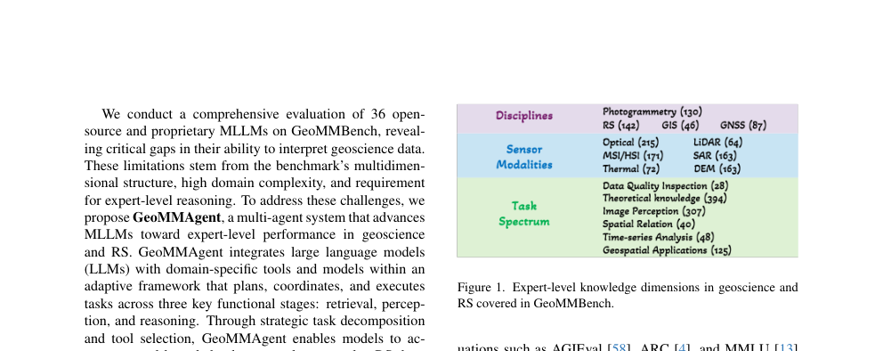
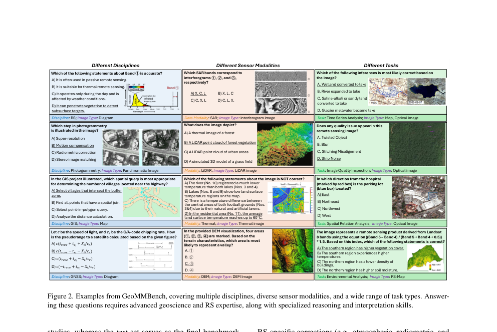
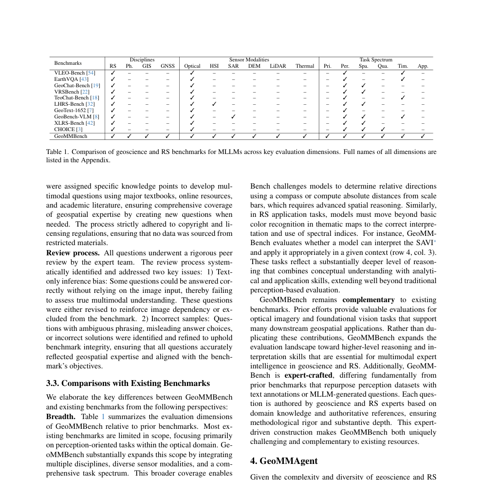
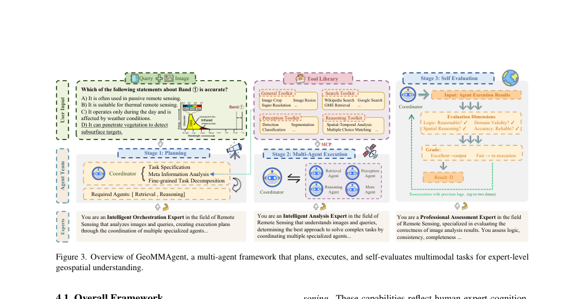
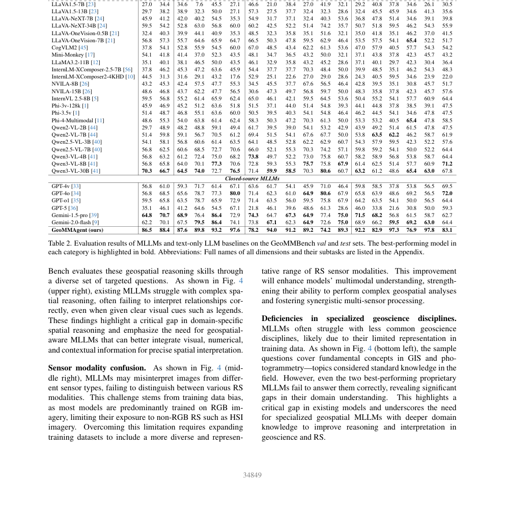
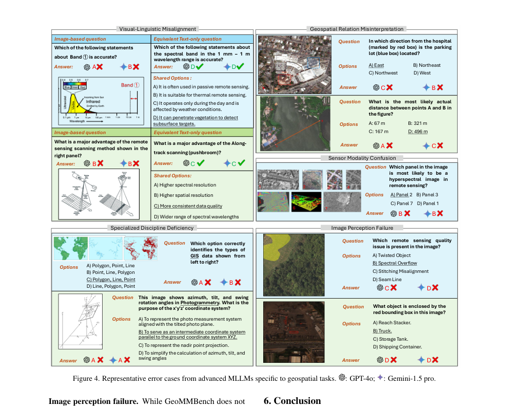

# GeoMMBench 与 GeoMMAgent：面向地学与遥感的专家级多模态智能

> **翻译范围说明**：摘要全文翻译、正文核心部分译述；英文全文、原图与原始 PDF 保留，可用于逐段补译。

## 原文摘要｜完整中文翻译

多模态大语言模型（Multimodal Large Language Models，MLLMs）的最新进展推动了面向特定领域的人工智能发展，但地球科学与遥感领域的进步仍受到若干特有挑战的制约：学科知识范围广、传感器模态异构以及任务类型分散。为弥补这些不足，作者提出 GeoMMBench，一项覆盖多样遥感学科、传感器和任务的综合性多模态问答基准，能够比以往基准开展更广泛、更加严格的评价。利用 GeoMMBench，作者评估了 36 个开源及专有大语言模型，发现它们在领域知识、感知锚定和推理能力方面存在系统性的不足；这些能力对专家级地理空间解释至关重要。除评价之外，作者还提出 GeoMMAgent：一种通过领域专用遥感模型和工具，策略性地整合检索、感知与推理的多智能体框架。大量实验表明，GeoMMAgent 明显优于独立使用的语言模型，说明工具增强智能体对于动态解决复杂地学与遥感问题具有重要价值。

## Benchmark 构建与任务｜重点译述

GeoMMBench 包含 **1,053 道专家级、基于图像的多项选择题**。问题覆盖遥感、摄影测量、地理信息系统和全球导航卫星系统等领域，涉及光学影像、SAR、多光谱、高光谱、LiDAR 和数字高程模型等传感器或数据类型。问题不仅要求识别影像对象，也涉及专业术语、数据预处理、空间关系和高层地学应用。

作者强调专家知识与人工审校的重要性。任务由领域专家共同设计，经过文本推断偏差和不准确样本的检查：对于仅凭文字表述就能猜出答案、没有真正依赖图像信息的题目，需要修改或剔除。

## GeoMMAgent 的基本机制｜重点译述

GeoMMAgent 将复杂问题分解到**检索—感知—推理**三个功能阶段，使通用语言模型能够借助知识检索与领域遥感工具完成专家级问题。它是一种与 Benchmark 配套的 Agent 方法，但 Benchmark 本身主要通过专家构建的图像多项选择题评价模型，而不是只考察工具调用轨迹。

## 实验与评价｜重点译述

论文对 36 个模型进行比较，利用专家标注的答案评价表现；此外，使用 GeoMMAgent 说明多 Agent 协同对提升复杂地学任务解决能力的贡献。与执行型 GIS Benchmark 不同，此处最关键的评价对象是**专业知识、视觉感知与推理输出**，需要与 GIS 工具真实执行结果区分。

## 图表阅读提示

- **图 1**：地学知识、传感器模态与任务类别的覆盖维度。
- **表 1**：GeoMMBench 与其他地学多模态 Benchmark 的覆盖能力对比。
- **图 3**：GeoMMAgent 的检索、感知、推理协同流程。

## 核心学术术语对照

| 英文术语 | 中文译法 | 注释 |
|---|---|---|
| Benchmark | 评测基准 | 与数据集、任务集合、执行环境和评分协议区分 |
| Ground Truth (GT) | 参考真值、标准答案 | 可能是答案、代码、执行结果或轨迹，需按论文实际定义 |
| Agentic AI | 智能体人工智能 | 具有规划、工具操作、反馈利用等能力的系统 |
| Tool-Augmented Agent | 工具增强智能体 | 可调用外部 API、程序或领域工具的智能体 |
| Tool Calling | 工具调用 | 包含工具选择和参数绑定，而不只是文本中提及工具 |
| Workflow | 工作流 | 有依赖关系的操作流程 |
| Trajectory | 执行轨迹 | 动作、调用参数、环境反馈和可能的中间产物 |
| Geospatial Grounding | 地理空间锚定 | 将模型输出与实际地物、坐标、尺度、属性或数据对应 |
| Vision-Language Model (VLM) | 视觉语言模型 | 同时处理视觉输入和语言的模型 |
| Multimodal Large Language Model (MLLM) | 多模态大语言模型 | 支持多模态理解和推理 |
| Remote Sensing (RS) | 遥感 | 本研究语境中的对地观测数据分析 |
| Earth Observation (EO) | 地球观测 | 涵盖卫星、航空以及相关环境观测 |
| Retrieval-Augmented Generation (RAG) | 检索增强生成 | 通过外部信息检索增强生成和推理 |
| Semantic Similarity | 语义相似性 | 与正确执行并不等价 |
| Execution-Based Evaluation | 基于执行的评价 | 需要真实或受控的运行环境及验证标准 |
| Multiple-Choice Question (MCQ) | 多项选择题 | 不等同于多工具执行任务 |
| Multispectral | 多光谱 | 传感器多波段观测 |
| Synthetic Aperture Radar (SAR) | 合成孔径雷达 | 主动微波遥感成像方式 |
| Refined Caption | 改进图注 | 利用论文上下文补充的科学图注 |

---

## 原论文全部图表（按照 PDF 页码）

> 图表图片不重新绘制，使用原始 PDF 区域截图；复杂或包含跨栏内容的图表，请点击对应原始页面进行视觉核对。以下逐图展示是为了保证译稿中的图片引用完整，而非宣称邻近英文图题均已翻译。

### Figure 1 — 原论文第 2 页

**原文图题（保留英文）：** Figure 1. Expert-level knowledge dimensions in geoscience and RS covered in GeoMMBench.

[查看完整原论文第 2 页](./source_pages/page-002.jpg)

### Figure 2 — 原论文第 3 页

**原文图题（保留英文）：** Figure 2. Examples from GeoMMBench, covering multiple disciplines, diverse sensor modalities, and a wide range of task types. Answer- ing these questions requires advanced geoscience and RS expertise, along with specialized reasoning and interpretation skills.

[查看完整原论文第 3 页](./source_pages/page-003.jpg)

### Table 1 — 原论文第 4 页

**原文图题（保留英文）：** Table 1. Comparison of geoscience and RS benchmarks for MLLMs across key evaluation dimensions. Full names of all dimensions are listed in the Appendix.

[查看完整原论文第 4 页](./source_pages/page-004.jpg)

### Figure 3 — 原论文第 5 页

**原文图题（保留英文）：** Figure 3. Overview of GeoMMAgent, a multi-agent framework that plans, executes, and self-evaluates multimodal tasks for expert-level geospatial understanding.

[查看完整原论文第 5 页](./source_pages/page-005.jpg)

### Table 2 — 原论文第 7 页

**原文图题（保留英文）：** Table 2. Evaluation results of MLLMs and text-only LLM baselines on the GeoMMBench val and test sets. The best-performing model in each category is highlighted in bold. Abbreviations: Full names of all dimensions and their subtasks are listed in the Appendix.

[查看完整原论文第 7 页](./source_pages/page-007.jpg)

### Figure 4 — 原论文第 8 页

**原文图题（保留英文）：** Figure 4. Representative error cases from advanced MLLMs specific to geospatial tasks. : GPT-4o; : Gemini-1.5 pro.

[查看完整原论文第 8 页](./source_pages/page-008.jpg)

## 逐页原文与翻译覆盖记录

| PDF 页码 | 英文原文 | 中文翻译状态 | 原版截图 |
|---|---|---|---|
| 1 | [英文原文](./英文原文_逐页全文.md) | 摘要已完整翻译；同页其他段落不保证全译 | [页面](./source_pages/page-001.jpg) |
| 2 | [英文原文](./英文原文_逐页全文.md) | 核心内容译述／本页未逐段全文翻译 | [页面](./source_pages/page-002.jpg) |
| 3 | [英文原文](./英文原文_逐页全文.md) | 核心内容译述／本页未逐段全文翻译 | [页面](./source_pages/page-003.jpg) |
| 4 | [英文原文](./英文原文_逐页全文.md) | 核心内容译述／本页未逐段全文翻译 | [页面](./source_pages/page-004.jpg) |
| 5 | [英文原文](./英文原文_逐页全文.md) | 核心内容译述／本页未逐段全文翻译 | [页面](./source_pages/page-005.jpg) |
| 6 | [英文原文](./英文原文_逐页全文.md) | 核心内容译述／本页未逐段全文翻译 | [页面](./source_pages/page-006.jpg) |
| 7 | [英文原文](./英文原文_逐页全文.md) | 核心内容译述／本页未逐段全文翻译 | [页面](./source_pages/page-007.jpg) |
| 8 | [英文原文](./英文原文_逐页全文.md) | 核心内容译述／本页未逐段全文翻译 | [页面](./source_pages/page-008.jpg) |
| 9 | [英文原文](./英文原文_逐页全文.md) | 核心内容译述／本页未逐段全文翻译 | [页面](./source_pages/page-009.jpg) |
| 10 | [英文原文](./英文原文_逐页全文.md) | 核心内容译述／本页未逐段全文翻译 | [页面](./source_pages/page-010.jpg) |
| 11 | [英文原文](./英文原文_逐页全文.md) | 核心内容译述／本页未逐段全文翻译 | [页面](./source_pages/page-011.jpg) |

> 如需获得完全逐句对应的中文版本，必须继续翻译原文主体与附录，并逐段人工校订。
