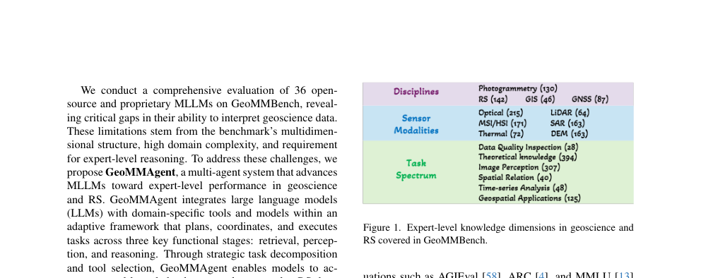
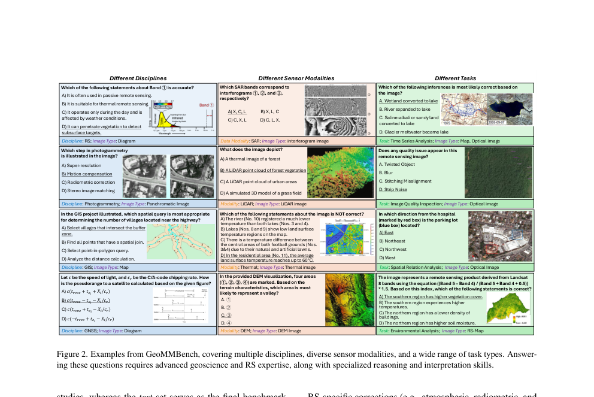
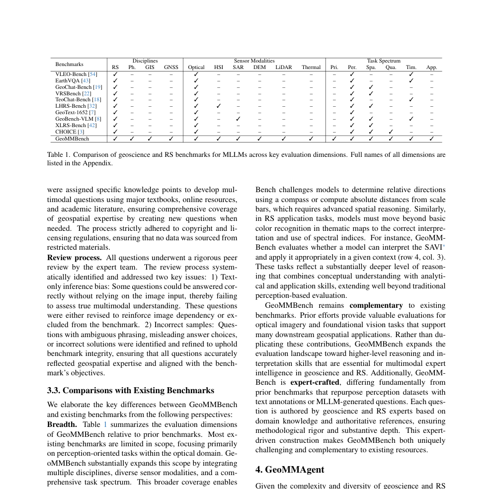
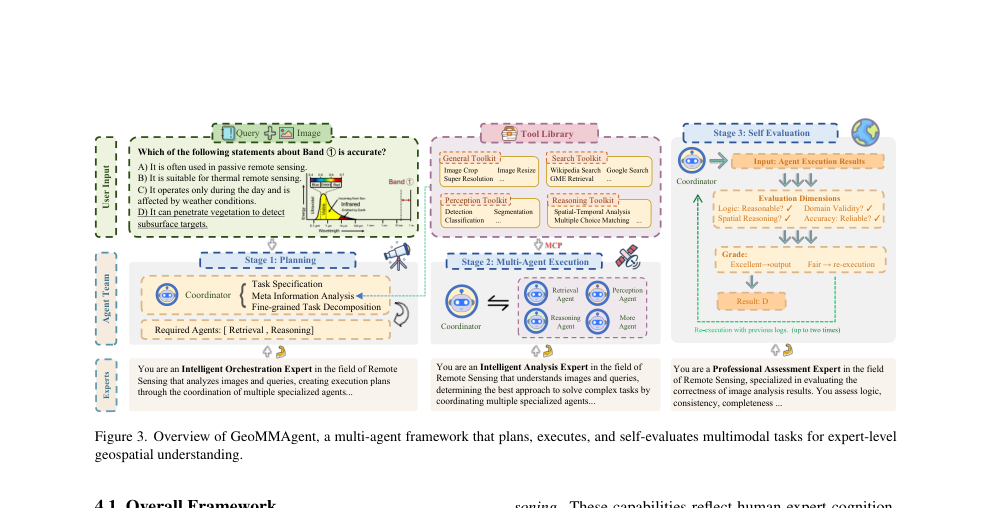
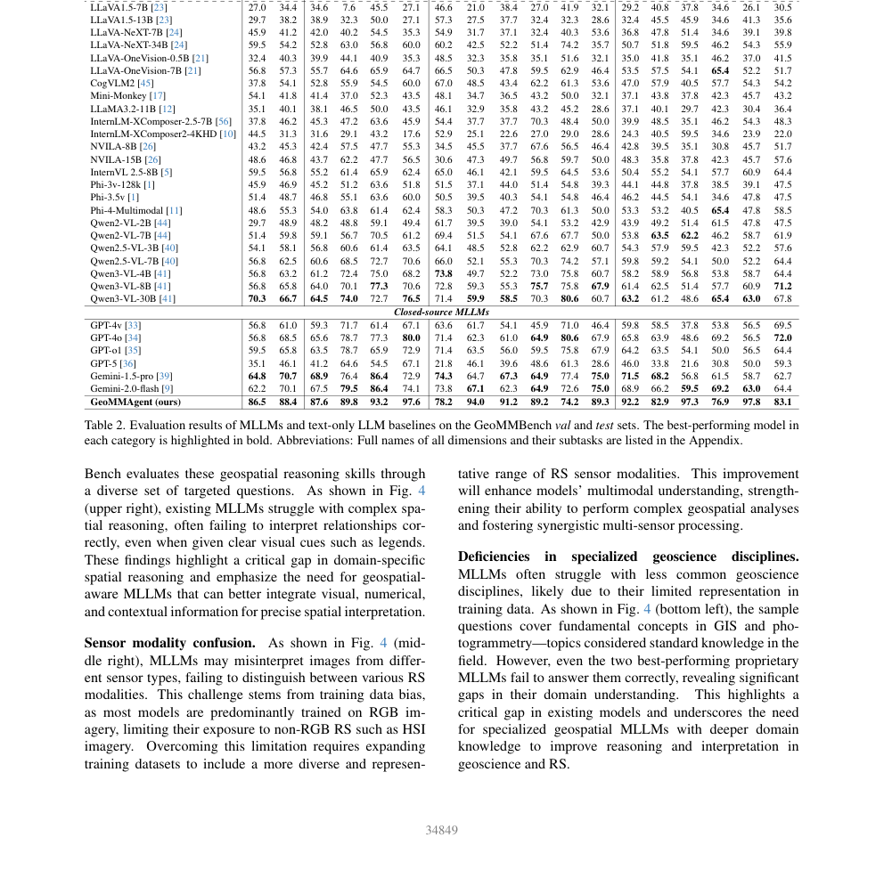
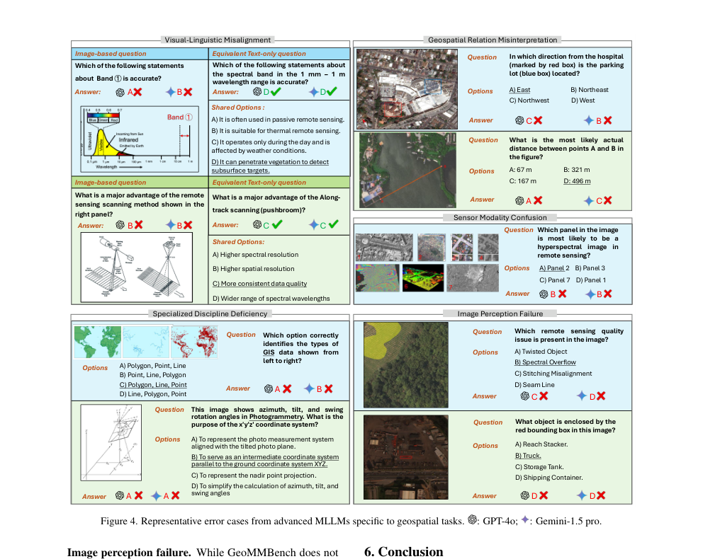

# GeoMMBench and GeoMMAgent: Toward Expert-Level Multimodal Intelligence in Geoscience and Remote Sensing：图表索引

**已识别明确标题的图表裁图：6 处。** PDF 中另有无单独标题的图片、图例和内嵌示意，均保留在 1:1 页码对应的完整截图中。

## Figure 1（第 2 页）

Figure 1. Expert-level knowledge dimensions in geoscience and RS covered in GeoMMBench.

[查看第 2 页原始版面](./source_pages/page-002.jpg)

## Figure 2（第 3 页）

Figure 2. Examples from GeoMMBench, covering multiple disciplines, diverse sensor modalities, and a wide range of task types. Answer- ing these questions requires advanced geoscience and RS expertise, along with specialized reasoning and interpretation skills.

[查看第 3 页原始版面](./source_pages/page-003.jpg)

## Table 1（第 4 页）

Table 1. Comparison of geoscience and RS benchmarks for MLLMs across key evaluation dimensions. Full names of all dimensions are listed in the Appendix.

[查看第 4 页原始版面](./source_pages/page-004.jpg)

## Figure 3（第 5 页）

Figure 3. Overview of GeoMMAgent, a multi-agent framework that plans, executes, and self-evaluates multimodal tasks for expert-level geospatial understanding.

[查看第 5 页原始版面](./source_pages/page-005.jpg)

## Table 2（第 7 页）

Table 2. Evaluation results of MLLMs and text-only LLM baselines on the GeoMMBench val and test sets. The best-performing model in each category is highlighted in bold. Abbreviations: Full names of all dimensions and their subtasks are listed in the Appendix.

[查看第 7 页原始版面](./source_pages/page-007.jpg)

## Figure 4（第 8 页）

Figure 4. Representative error cases from advanced MLLMs specific to geospatial tasks. : GPT-4o; : Gemini-1.5 pro.

[查看第 8 页原始版面](./source_pages/page-008.jpg)
