# GeoNatureAgent（GNA）：面向地理空间与环境任务工具型智能体的部署前评估框架与基准

**英文原题：** GeoNatureAgent (GNA): A Framework and Benchmark for Pre-Production Evaluation of Tool-Using Agents on Geospatial and Environmental Tasks  
**作者：** Gabriel Diaz-Ireland、Diego Prieto-Herráez、Mario García Peces 等。  
**原稿：** 10 页；GeoIndustry '26。

> **译文范围提示：** 以下是摘要全文翻译及正文核心内容的顺序中文译述，工具 API 名称、代码路径、参数与指标名称保留英文，便于核验。完整英文原文、所有参考文献和跨栏表格截图保留在同包；本文未将所有原文段落逐词汉化。

## 摘要（全文翻译）

在将具备工具调用能力的大语言模型智能体部署到环境与地理空间工作流之前，开发团队需要证据证明智能体能够可靠地选择适当的操作，并与真实 API 正确交互。然而，目前缺少可复用、自托管的部署前评估基础设施。本文提出 **GeoNatureAgent（GNA）**，一种面向工具型智能体的部署前评估框架。GNA 将固定的 **16 工具**地理空间接口（12 项主要操作、4 项辅助操作）以 **Model Context Protocol（MCP）**服务器的形式发布，使被测智能体成为唯一变化因素：任何兼容 MCP 的客户端都可以直接接入，并由相同的工具层、任务集合和确定性评分器进行评价。

该框架的旗舰实例是包含 **103 道任务**的基准，其中有覆盖 **18 个类别的 93 道主测试任务**和 **10 道比较类扩展任务**。任务涉及工具选择、多轮对话、空间推理、跨指标综合、错误处理、多语言理解、任务拒绝等能力，并在面向西班牙和葡萄牙三类环境指标的开放式自托管地理空间 API 上执行。作者在 Vertex AI、OpenRouter 和 Anthropic 平台上比较了九个大型语言模型，每个模型以温度 1.0 运行三个不同随机种子，并把任务能力与每题成本作为正交维度分别报告。

实验结果表明：（1）Claude Sonnet 4 在全部 103 题上取得最高的 **61.7% ± 0.7%** 能力准确率（93 题主集为 **60.8% ± 0.8%**），DeepSeek V3.2 以 **57.9% ± 3.9%** 紧随其后，其余模型都未超过 53%；（2）成本—准确率帕累托前沿主要由开放权重模型占据，DeepSeek V3.2 以 **11.3 倍更低的标价成本**达到 Claude 约 93% 的能力，每题成本为 **0.011 美元**；（3）严格的全部检查通过规则下，最好模型比通用 GIS 基准所报告的 85%–97% 低约 **24–36 个百分点**，但前四模型的单项检查部分得分（86%–90%）与这些基准相近，因此差距有相当部分来自评分严格程度，而不应简单归因于题目更难。作者还通过整合葡萄牙的 BigEarthNet V2 土地覆盖数据以及西班牙的二氧化碳适宜性和沟蚀指标，验证了框架的跨区域和跨领域扩展性。GNA 的 MCP 工具服务器、评估程序、基准测试和自托管 API 已公开，替换工具执行器与任务集即可将该设计迁移到其他地理空间领域。

## 1 引言与研究动机

环境监测往往涉及多时相地理空间分析，包括土地覆盖变化识别、侵蚀风险评估、植被指数计算以及用于法规合规的统计汇总。真正耗费时间的工作不仅是形成最终答案，还包括寻找数据、选择坐标系、理解元数据、重投影、调用 API 和处理不一致的环境状态。具有工具调用能力的 LLM Agent 可能降低这些门槛，但在生产环境中，智能体必须能够**选择正确工具、填写正确参数、按恰当顺序调用并根据结果作答**。

论文认为，已有 GIS 评价大致覆盖一般地理空间工具任务、遥感视觉、空间推理及代码生成等方向，但**缺少一个固定真实工具接口、可自托管、能够跨模型比较且有确定性评分的环境领域智能体评估底座**。因此 GNA 的研究对象不是单个模型的专业知识，而是完整工具编排过程。为了控制变量，作者固定工具、API、任务与评分器，只更换智能体主体。

文章相较其早期海报版本，扩展了 MCP 工具层、九模型排行榜、十题比较能力扩展、跨后端工具调用解析器、更细致的失败分类以及跨基准对比。其关键贡献是把地理空间 Benchmark 从一次性脚本组织成可替换执行器的**评估基础设施（evaluation substrate）**。

## 2 相关研究与定位

**原论文表1：GeoBenchX 与 GNA 的比较（PDF 第 3 页）**

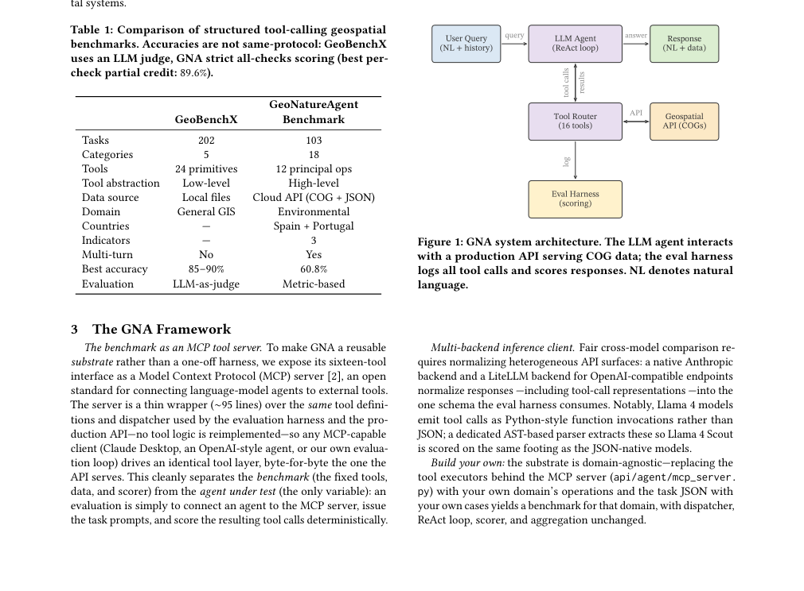

英文原始标题（点击展开）

Table 1: Comparison of structured tool-calling geospatial benchmarks. Accuracies are not same-protocol: GeoBenchX uses an LLM judge, GNA strict all-checks scoring (best per- check partial credit: 89.6%).

现有地理空间 Agent 的常见路线包括：通用 LLM 加工具池、经过领域微调的专用模型、多 Agent 协作以及成本更低的小模型混合系统。GeoBenchX、ThinkGeo 等基准关注地理空间工具使用，但工具层、真实环境复杂度和评分严格程度有所不同。

论文将 GNA 与 GeoBenchX 对比：后者覆盖 **202 个任务、24 项较低层的 GIS 操作**，主要在本地文件上运行并采用 LLM 裁判；GNA 的主集加扩展共 **103 项任务**，提供 **12 项主要高层领域操作及 4 项辅助工具**，面对真实云端地理空间 API，使用按检查项判定的确定性评分规则。**不同评价协议下的分数不应直接视作模型能力的严格横向排名**，作者也明确将此类比较视为指示性证据。

## 3 GNA 评估框架

**原论文图1：GNA：智能体、MCP 工具、云 API 和评价器结构（PDF 第 3 页）**

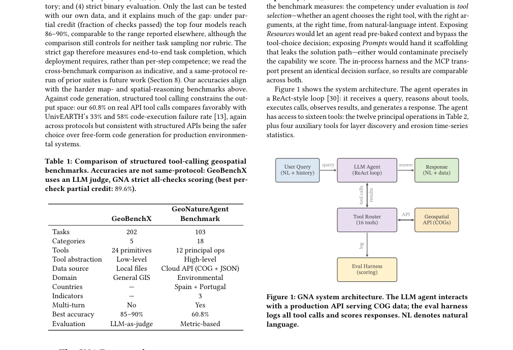

英文原始标题（点击展开）

Figure 1: GNA system architecture. The LLM agent interacts with a production API serving COG data; the eval harness logs all tool calls and scores responses. NL denotes natural language.

### 3.1 固定工具接口和 MCP 服务器

GNA 将 16 项工具作为 MCP Tools 暴露，支持列举与调用工具。框架没有同时提供 MCP Resources 或 Prompts：因为如果智能体可直接读取带有答案路径的预制资源或提示词，就可能绕过本应考查的工具决策。MCP 服务器只是原有工具分发器的轻量封装，确保原生评估程序与 MCP 客户端看到相同的工具能力。

Agent 使用类似 **ReAct** 的循环：接收自然语言问题，判断是否需要工具，构造参数，调用 API，读取结果，再生成最终答案。评估系统记录每次工具调用和回答，并由统一评分器进行评分。对接不同推理服务的客户端需统一工具调用格式；原文特别指出某些模型会将工具调用输出为 Python 风格表达式，而非 JSON，因此需要额外解析，使其可在同一标准下比较。

### 3.2 十二项主要工具的功能

**原论文表2：主要智能体工具的功能（PDF 第 4 页）**

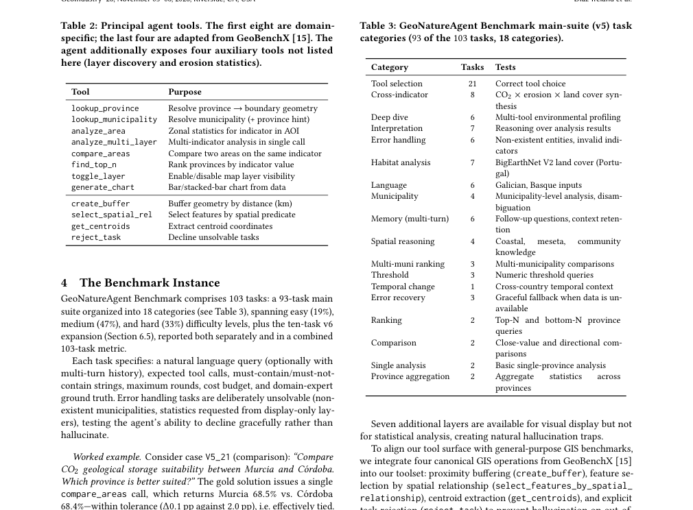

英文原始标题（点击展开）

Table 2: Principal agent tools. The first eight are domain- specific; the last four are adapted from GeoBenchX [15]. The agent additionally exposes four auxiliary tools not listed here (layer discovery and erosion statistics).

| 原始工具名 | 中文功能说明 |
|---|---|
| `lookup_province` | 将省份名称解析为相应边界几何。 |
| `lookup_municipality` | 按市镇名称（可带省份提示）检索市镇。 |
| `analyze_area` | 对指定感兴趣区域（AOI）的某项指标开展分区统计。 |
| `analyze_multi_layer` | 单次调用综合分析多个指标。 |
| `compare_areas` | 比较两个区域相同指标的数值。 |
| `find_top_n` | 根据指标值对省份排序并提取前 N 项。 |
| `toggle_layer` | 控制地图图层可见性。 |
| `generate_chart` | 将统计结果生成柱形图或堆叠柱形图。 |
| `create_buffer` | 根据以千米计的距离建立缓冲区。 |
| `select_spatial_rel` | 按空间关系谓词选择要素。 |
| `get_centroids` | 提取几何中心点坐标。 |
| `reject_task` | 对无法完成或不在支持范围内的任务明确拒绝，而非编造数据。 |

此外还有图层发现和沟蚀时间序列统计等 **4 项辅助工具**。原文指出，部分操作来自 GeoBenchX，但已改造为面对生产级云 API 的调用。该设计刻意保留了**工具覆盖差异**：西班牙的栅格指标支持更广泛的统计工具，葡萄牙土地覆盖预计算数据主要由 `analyze_area` 提供；当用户要求比较多个葡萄牙区域时，智能体可能需要组合多次工具调用，而不能套用看似方便但对该图层无效的接口。

## 4 基准任务与环境数据

**原论文表3：GNA 任务类别分布（PDF 第 4 页）**

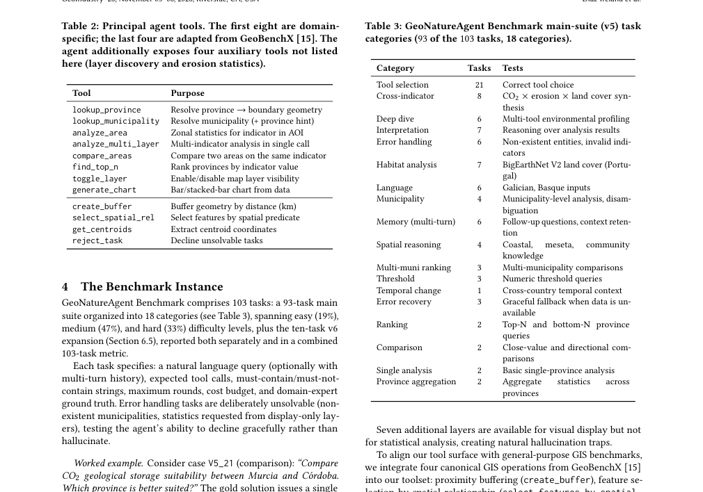

英文原始标题（点击展开）

Table 3: GeoNatureAgent Benchmark main-suite (v5) task categories (93 of the 103 tasks, 18 categories).

GNA 总计 103 题，包括 93 题主集和 10 题 v6 扩展。主集覆盖 18 类能力：工具选择、跨指标综合、深度分析、结果解释、错误处理、栖息地分析、多语言、市镇分析、多轮记忆、空间推理、多市镇排序、阈值判断、时间变化、错误恢复、排序、比较、单一区域分析和省份聚合。论文将难度分为易（约 19%）、中（47%）和难（33%），分组依据是预期工具链深度，而非经统计校准的客观难度。

原文提供三个领域数据来源：

- **西班牙 CO₂ 吸收/地质封存适宜性**：结合 MITECO 地理空间判据形成类别指标，以云优化 GeoTIFF（COG）提供。
- **欧洲沟蚀概率**：基于 LUCAS 2022 土壤调查构建的连续型概率指标，范围约 0–100%，同样通过 COG 提供。
- **葡萄牙 BigEarthNet V2 土地覆盖**：基于超过 75,000 个 Sentinel-2 图像片段得到的七类土地覆盖统计，经地区聚合后以 JSON 提供。

七个额外图层只供地图展示，不提供统计分析，成为检验智能体是否会对缺乏能力的接口“臆造结果”的自然陷阱。任务还会故意包含不存在的市镇或不支持统计的图层，评估智能体是否恰当拒绝。

## 5 评价协议：八项检查与严格通过规则

**原论文表4：八项评分检查（PDF 第 5 页）**

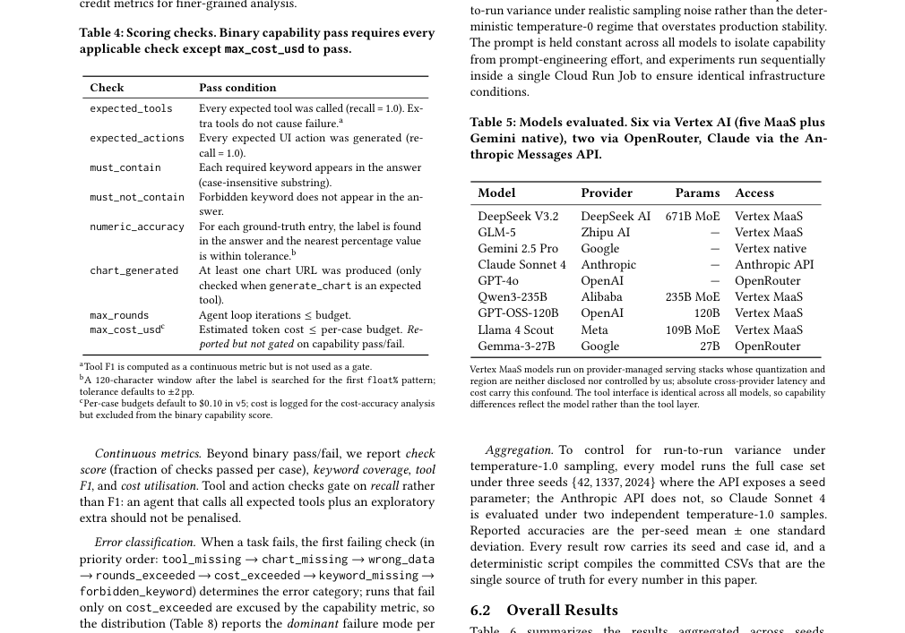

英文原始标题（点击展开）

Table 4: Scoring checks. Binary capability pass requires every applicable check except max_cost_usd to pass.

原文表 4 规定下列检查项；**二元能力通过分数要求所有适用检查项通过，但 `max_cost_usd` 只报告，不作为能力得分的门槛**。

| 检查字段 | 原论文判定逻辑的中文说明 |
|---|---|
| `expected_tools` | 所有期望工具都被调用（召回率 1.0）；允许额外的探索性工具调用。 |
| `expected_actions` | 所有期望 UI 动作均已产生（召回率 1.0）。 |
| `must_contain` | 最终回答包含所有必需关键词，采用忽略大小写的子串判断。 |
| `must_not_contain` | 最终回答没有出现禁止的关键词。 |
| `numeric_accuracy` | 检查答案包含要求的标签，其附近最近百分比数值落在设定容差内；默认约为 ±2 个百分点。 |
| `chart_generated` | 当任务需要 `generate_chart` 时至少产生一个图表 URL。 |
| `max_rounds` | 工具/交互轮次不超过设定预算。 |
| `max_cost_usd` | 估计的 token 费用不超过预算，但该项**不决定**能力测试是否通过。 |

作者还计算**单项检查通过比例（check score）**、关键词覆盖、**工具 F1** 和成本利用率等连续指标。工具调用的主要通过条件是召回而非 F1：多调用一个不相关工具本身不会导致该项失败，但可能造成额外延迟和费用。

失败归因采用优先顺序，例如 `tool_missing`、`chart_missing`、`wrong_data`、`rounds_exceeded`、`cost_exceeded`、`keyword_missing` 和 `forbidden_keyword`。同一运行可能存在多个失误，但报告的主失败类型通常只记录**优先级最高的首个失败检查**，不能将它理解为完整的多标签错误分类。

## 6 实验设计与结果

### 6.1 统一实验条件

**原论文表5：参与评估的九种模型（PDF 第 5 页）**

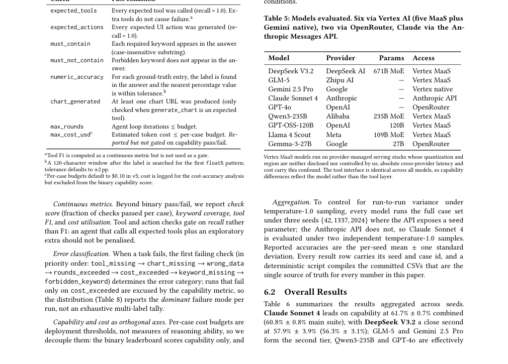

英文原始标题（点击展开）

Table 5: Models evaluated. Six via Vertex AI (five MaaS plus Gemini native), two via OpenRouter, Claude via the An- thropic Messages API.

作者对九个 LLM 在三种随机种子下运行完整 103 题，涵盖 Claude Sonnet 4、DeepSeek V3.2、GLM-5、Gemini 2.5 Pro、GPT-4o、Qwen3-235B、GPT-OSS-120B、Llama 4 Scout 和 Gemma-3-27B。采用统一 v3 系统提示词，`max_turns=10`、`max_tokens=4096`、`temperature=1.0`。固定提示词的目的是减少提示工程差异干扰，采用非零温度则是为了暴露实际部署时的结果波动。

### 6.2 能力排行榜及成本

**原论文表6：主测试集能力排行榜（PDF 第 6 页）**

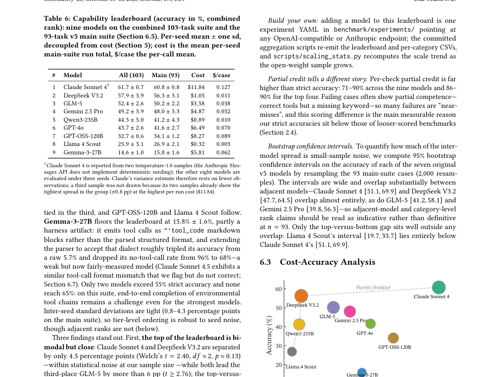

英文原始标题（点击展开）

Table 6: Capability leaderboard (accuracy in %, combined rank): nine models on the combined 103-task suite and the 93-task v5 main suite (Section 6.5). Per-seed mean ± one sd, decoupled from cost (Section 5); cost is the mean per-seed main-suite run total, $/case the per-call mean.

**原论文图2：成本与准确率帕累托比较（PDF 第 6 页）**

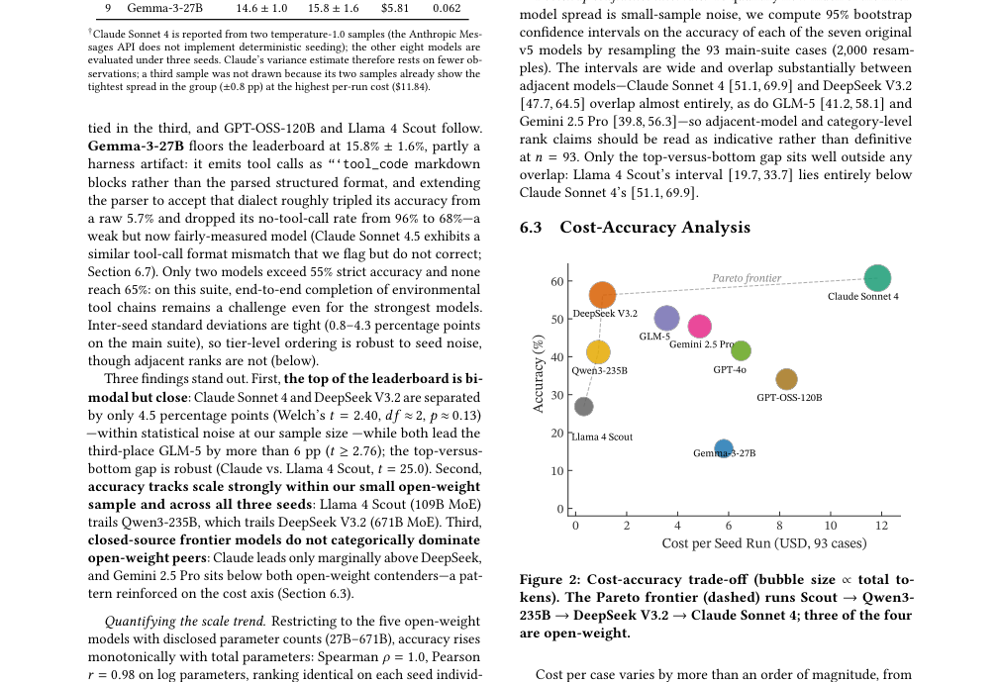

英文原始标题（点击展开）

Figure 2: Cost-accuracy trade-off (bubble size ∝total to- kens). The Pareto frontier (dashed) runs Scout →Qwen3- 235B →DeepSeek V3.2 →Claude Sonnet 4; three of the four are open-weight.

原文强调**能力**与**成本**应分开展示。全部 103 题的能力排行榜中，Claude Sonnet 4 为 **61.7% ± 0.7%**，DeepSeek V3.2 为 **57.9% ± 3.9%**，GLM-5 为 **52.4% ± 2.6%**。DeepSeek V3.2 的每题标价成本约 **0.011 美元**，能以更低成本获得较高能力，因此位于成本—准确率帕累托前沿。

**严格通过与部分通过**的差距是本文的中心发现之一。即使完整任务成功率只有约 60%，模型仍可能在 86%–90% 的单项检查上做对。这意味着智能体可能已经选对大部分工具，但只要最后少一次调用、答案漏一项或超出轮数，严格二元得分就记为失败。作者因此认为，不能把不同基准的最终成功率差异完全解释为模型能力差异：评分协议同样会显著改变数值。

### 6.3 失败类型、复杂比较与扩展实验

**原论文表7：估计能耗与碳排放（PDF 第 7 页）**

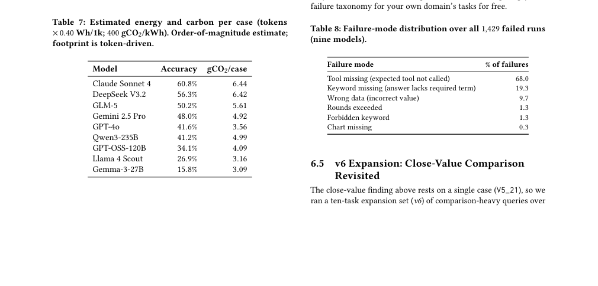

英文原始标题（点击展开）

Table 7: Estimated energy and carbon per case (tokens × 0.40 Wh/1k; 400 gCO2/kWh). Order-of-magnitude estimate; footprint is token-driven.

**原论文表8：全部失败运行的失败类型分布（PDF 第 7 页）**

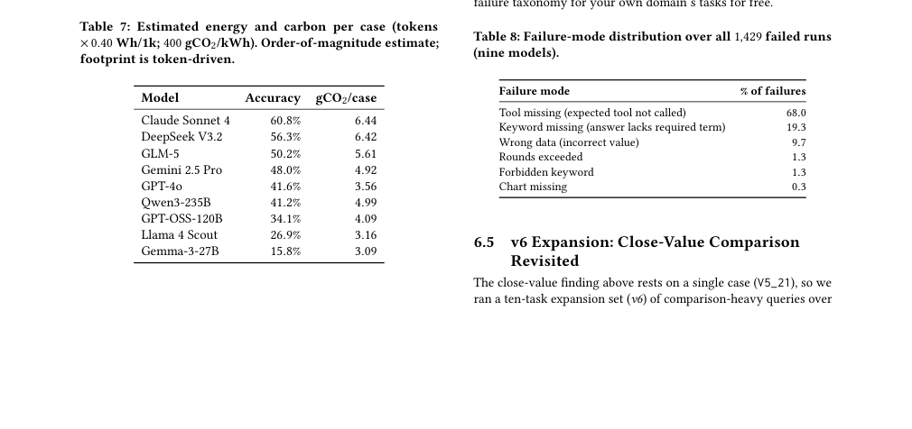

英文原始标题（点击展开）

Table 8: Failure-mode distribution over all 1,429 failed runs (nine models).

**原论文表9：v6 扩展与合并排行榜（PDF 第 8 页）**

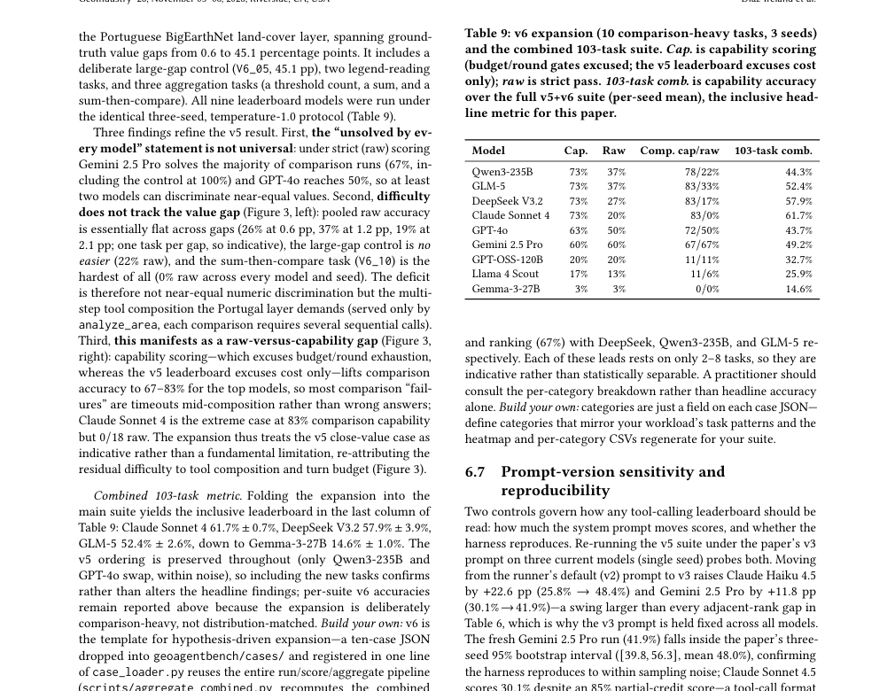

英文原始标题（点击展开）

Table 9: v6 expansion (10 comparison-heavy tasks, 3 seeds) and the combined 103-task suite. Cap. is capability scoring (budget/round gates excused; the v5 leaderboard excuses cost only); raw is strict pass. 103-task comb. is capability accuracy over the full v5+v6 suite (per-seed mean), the inclusive head- line metric for this paper.

**原论文图3：v6 扩展的近似数值比较结果（PDF 第 9 页）**

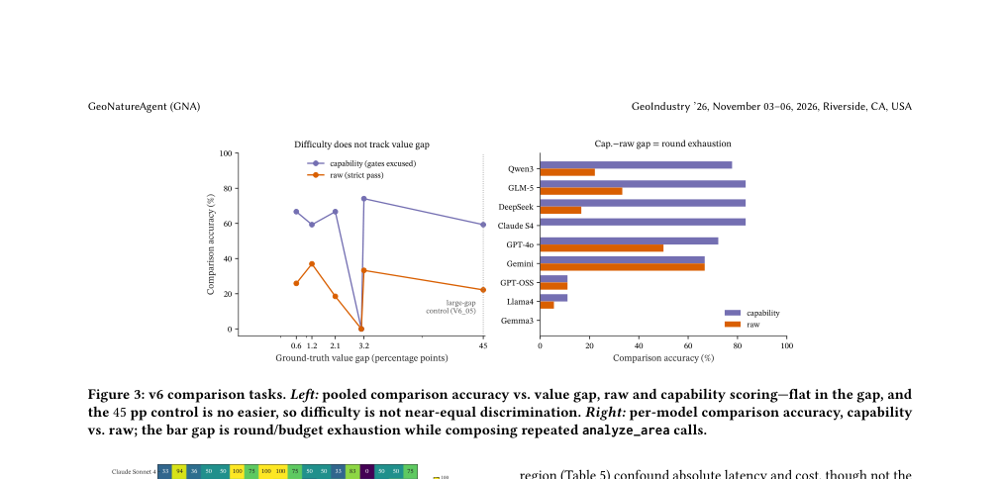

英文原始标题（点击展开）

Figure 3: v6 comparison tasks. Left: pooled comparison accuracy vs. value gap, raw and capability scoring—flat in the gap, and the 45 pp control is no easier, so difficulty is not near-equal discrimination. Right: per-model comparison accuracy, capability vs. raw; the bar gap is round/budget exhaustion while composing repeated analyze_area calls.

**原论文图4：九模型按任务类别的准确率（PDF 第 9 页）**

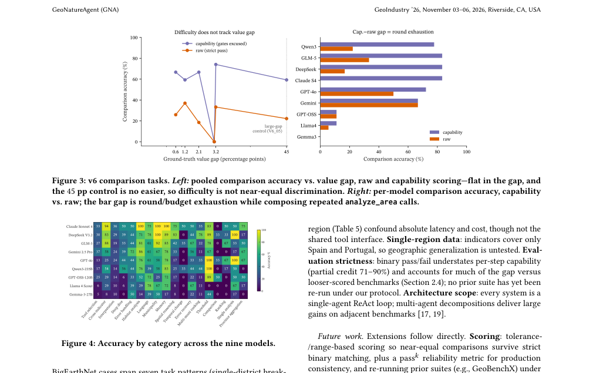

英文原始标题（点击展开）

Figure 4: Accuracy by category across the nine models.

论文的十题 v6 扩展专门测试数值十分接近的区域比较及多次工具组合。结果并不支持“接近的数字天然更难比较”这一单一解释：有些模型能够正确比较接近数值，但仍因缺少必要工具调用、连续执行多次 `analyze_area` 时轮次预算耗尽、或答案格式无法通过严格检查而失分。尤其葡萄牙土地覆盖数据限制了便捷的比较工具使用，需要智能体自行组装多次查询。

在主要类别层面，**工具选择**是许多模型共同的薄弱环节。作者还指出，单类任务数量较少，不宜对类别内排行榜进行过强的统计推断。按类别查看表现，比只看总体准确率更能暴露各模型在环境指标解释、空间推理、多轮记忆和工具编排上的差异。

### 6.4 提示词版本与可复现性

作者额外对系统提示词版本进行检查：将旧版提示词换为 v3，个别模型的任务成功率提高幅度可达十多个乃至二十多个百分点。**提示词设计造成的分数变化可能超过相邻排行榜模型的差距**。因此评测必须固定提示词、记录版本并报告随机种子波动。论文也记录了某模型工具调用格式与评分器不完全匹配的现象，提醒读者勿将解析失败直接当作推理失败。

## 7 跨数据集扩展：BigEarthNet V2

GNA 将第二个国家、另一种数据形式和新的环境指标纳入同一框架，证明只需增加新的统计数据、适当更新提示词及增加任务样例，便可复用既有 MCP 工具接口、任务运行器和评分器。这种可扩展性是把 GNA 用作研究平台而不是一次性 benchmark 的重要价值。

## 8 局限与未来工作

论文指出：93 道主任务分到 18 个类别后，很多类别只有少量例题，分类别和失败模式的比较统计效力有限；九模型所依赖的云服务运行环境、模型量化和机房区域不可完全控制；地理覆盖仅西班牙和葡萄牙；严格二元评分可能低估部分工具使用能力；尚未把其他 GIS 基准在**同一评分协议**下重新运行。当前智能体架构以单 Agent ReAct 循环为主，没有系统检验多 Agent 架构的收益。

后续方向包括：更完善的近似数值容差评分、`pass^k` 或重复运行稳定性评估、扩展国家与指标、对比不同 MCP 能力暴露方式，以及将碳排放和能源成本变成更可靠的性能维度。

## 9 结论

GNA 提供了一套对真实环境 API 进行工具调用评估的可复用框架。论文的九模型、三种随机种子实验表明，完整端到端工具编排距离可靠生产应用仍有差距；但不同评分粒度会大幅影响表面成功率。对地理空间 Agent 研究而言，该工作提示应同时公开**任务、固定工具表、评分代码、完整调用轨迹、单项检查结果、重复运行波动和成本**，避免仅靠一个总分判断系统能力。

## 术语对照

| 英文 | 中文 |
|---|---|
| Pre-production Evaluation | 部署前评估 |
| Tool-calling Agent | 工具调用型智能体 |
| Evaluation Substrate | 评估基础设施/评估底座 |
| Model Context Protocol (MCP) | 模型上下文协议 |
| Deterministic Scorer | 确定性评分器 |
| Strict All-checks Scoring | 全部检查通过的严格评分 |
| Partial Credit | 部分得分 |
| Tool F1 | 工具调用 F1 分数 |
| Cost–Accuracy Pareto Frontier | 成本—准确率帕累托前沿 |
| AOI (Area of Interest) | 感兴趣区域 |
| Cloud-Optimized GeoTIFF (COG) | 云优化 GeoTIFF |
| Zonal Statistics | 分区统计 |
| Tool Orchestration | 工具编排 |
| Task Rejection | 任务拒绝 |

## 参考文献

完整英文参考文献位于 PDF 第 10 页，保留于独立的英文逐页文件和原始 PDF。专有算法名与软件包名维持英文，便于复现和检索。

## 全文原稿与翻译完整性的边界

- 本文为**主要研究内容的中文翻译与忠实译述**，不是逐页逐句汉化完成的全文译本。
- `英文原文_逐页完整提取.md` 包含全部 PDF 页的文字提取；`英文原文_逐页布局提取.txt` 可用于检索对照。
- `图表与逐页原稿索引.md` 保存全部原图/表和全部 PDF 页截图，相对路径有效。
- `参考文献_原文.md` 保留原始英文书目，不擅自翻译作者、刊名和 DOI。
- 数学公式、长表格、跨页图题和图内英文应以原 PDF 和 `source_pages/` 核对；文本层存在图中文字无法直接提取的可能。
