# 通过层次化任务抽象机制设计领域专用智能体

**英文题名：** Designing Domain-Specific Agents via Hierarchical Task Abstraction Mechanism  
**作者：** Kaiyu Li, Jiayu Wang, Zhi Wang, Hui Qiao, Weizhan Zhang, Deyu Meng, Xiangyong Cao  
**机构：** 西安交通大学；中国电信陕西分公司  
**预印本：** arXiv:2511.17198v1（2025 年 11 月 21 日）  
**项目：** https://earth-insights.github.io/EarthAgent  
**通讯作者：** Xiangyong Cao（caoxiangyong@mail.xjtu.edu.cn）

> 本文提出的 **EarthAgent** 与另一篇《Earth-Agent: Unlocking the Full Landscape of Earth Observation with Agents》是不同的系统，作者在原论文补充材料第12节专门解释同名差异。**HTAM** = Hierarchical Task Abstraction Mechanism（层次化任务抽象机制）；**GeoPlan-bench** 是本文用于规划能力比较的基准；全文“工具调用路径”不等同于真实工具执行轨迹。

## 摘要

由大语言模型驱动的智能体，尤其是采用 ReAct 等通用框架或模拟人类社会角色协作的架构，在需要严格结构化流程的专门领域往往表现不佳。例如遥感分析既需要辐射校正、光谱指数计算等专业工具，也涉及多个中间产物、可选步骤和复杂的先后次序，对通用智能体提出很大挑战。为弥合这一差距，作者提出以**层次化任务抽象机制（HTAM）**为核心的新型智能体设计框架。HTAM 不再按照人类职业角色组织协作，而是依据目标领域本身的任务依赖图，将多智能体组织为符合问题求解逻辑的层级架构。复杂问题被拆为若干依次衔接的功能层，上层依赖下层处理结果，从结构上约束过程正确性。

作者将该方法实现为面向复杂地理空间分析的多智能体系统 **EarthAgent**，并提出 **GeoPlan-bench**，以真实的多步骤地理空间规划问题检验智能体对任务的分解与规划能力。论文设计了工具选择正确性、路径结构相似度和逻辑完整性等多维指标，比较了多种单智能体与多智能体架构。结果显示，EarthAgent 在多个评测维度上显著优于基线系统。研究强调：**让智能体架构与专业领域固有的任务结构相匹配，是构建稳健、可靠的专用自治系统的重要条件**。

## 1 引言

近年来，大语言模型在推理、规划和工具交互方面的进步推动了自治智能体的发展。早期单智能体系统如 ReAct 通过“思考—行动—观察”循环解决一般任务；为处理更复杂的问题，研究转向多智能体系统（MAS）。一种常见方式是借鉴人类组织，把各智能体设定为“项目经理”“软件架构师”等角色，协同完成任务。这类社会角色模拟虽然直观，但在遥感等专业领域并不总是适用。

遥感专业知识实际上体现为高度细分、依赖严格的**工作流**，例如数据获取、几何校正和变化检测等子任务必须按顺序开展，不同步骤可能由不同专家或算法承担。如果让一个大模型同时扮演通用遥感分析师，模型就必须隐式掌握整套专业流程，容易遗漏预处理要求、重要中间数据和关键先后约束。图1展示了三种处理复杂地理空间请求的方式。ReAct 能先进行合理的数据搜索，但缺乏全局约束时可能陷入重复工具调用，甚至在预处理之前就开展分析。Plan&Execute 虽然先规划后执行，但初始计划如果粗略或不正确，后续严格执行反而无法自我修正。HTAM 通过分层任务依赖关系，把数据获取与预处理、数据处理与分析、综合应用三类职责明确分开，约束步骤顺序并强化每层的专业化处理。

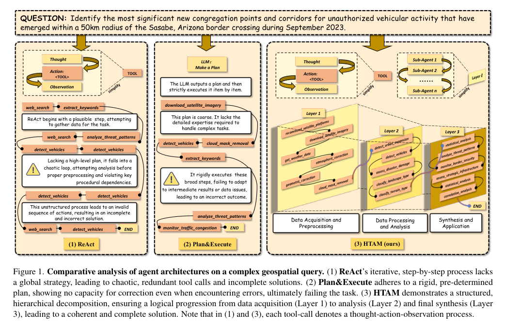

图2借用了优化算法中的梯度下降概念作类比：ReAct 更像随机梯度下降，每步响应局部变化，路径可能噪声大且迂回；Plan&Execute 接近一开始确定方向的普通梯度下降，一旦方向错误便难以纠偏；HTAM 类似小批量梯度下降，依靠结构化阶段维持相对稳定且可适应的求解路径。这只是架构行为的概念类比，并非声称其数学优化机制完全相同。

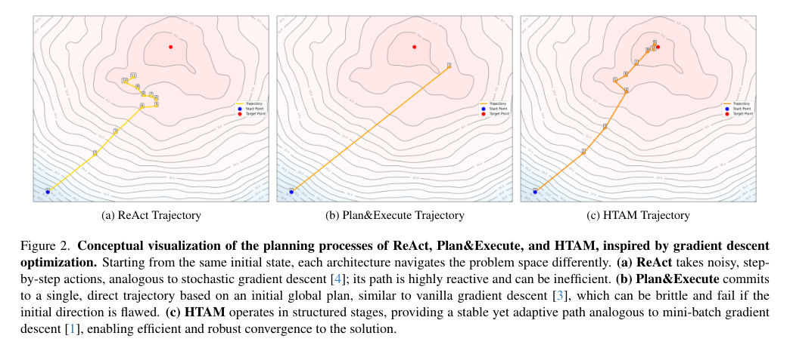

作者的核心主张是：多智能体不应只是简单套用“角色扮演”，而应让**智能体结构直接映射领域内生的任务依赖图**。HTAM 首先依据专家知识与程序标准分析领域操作的依赖关系；接着将任务划分为功能分明的层级，每层由承担专门处理阶段的子智能体组成。这样既保留细粒度专业知识，又能依靠结构降低逻辑不一致的风险。

作者认为既有智能体评测环境大多针对文本或自然图像，遥感任务规划方面的 ThinkGeo 虽具代表性，但任务往往较短、相互隔离，且评估高度依赖 ReAct 式推理轨迹，不利于公平比较其他架构。为此，本文创建综合、长链、架构无关的 GeoPlan-bench，允许同时评估关键工具选择、流程结构和整体逻辑完整程度。

**主要贡献**为：（1）提出 HTAM，基于领域任务依赖而非社会分工构建多智能体；（2）在遥感领域实现 EarthAgent；（3）发布支持复杂任务规划比较的 GeoPlan-bench 及多维指标；（4）通过实验表明领域任务结构对专门智能体能力具有重要影响。

## 2 相关工作

**LLM 智能体架构。** ReAct 将思考、行动与观察结合，能够根据外部结果动态调整；Tree-of-Thoughts、Graph-of-Thoughts 通过树与图扩展推理搜索空间；MemGPT、检索增强生成（RAG）与 Reflexion 让智能体利用外部知识和历史反馈。多智能体框架经常把参与者组织成“CEO”“程序员”等社会角色，通过讨论或协作生成结果。AFlow 将工作流发现视作搜索与优化问题，而 HTAM 采取另一种理念：当领域已有相对明确的任务依赖知识时，直接把其形式化为智能体结构，而不是从黑箱搜索中自动发现流程。

**专业领域智能体。** 研究已经覆盖软件工程（SWE-bench）、科学发现（SciAgents、ChemCrow）、网页交互（WebArena）以及遥感领域。遥感智能体经历了从 LLM 调度固定视觉模型，到采用 ReAct 结构的 RS-Agent、Change-Agent 等，再到 RingMo-Agent 和协作式 GeoLLM-Squad 等发展。作者指出，许多方法仍是把通用架构适配到遥感任务，而 HTAM 希望从领域流程本身出发设计架构。

**智能体评估。** 现有 Benchmark 覆盖有效计划生成、交互工具使用、从反馈中学习以及网页和软件开发应用；专门衡量遥感规划的体系仍不成熟。ThinkGeo 的任务覆盖较有限，且以 ReAct 逐步推理链为主要参照，不便比较采用不同规划机制的系统。GeoPlan-bench 采用与智能体架构无关的工具规划评价方案，面向较长、更综合的空间分析任务。

## 3 方法

### 3.1 层次化任务抽象机制（HTAM）

#### 3.1.1 层级架构构建

HTAM 从特定领域的**任务依赖图**出发，记为：

\[
G=(V,E).
\]

其中节点集合 \(V\) 表示领域内可能使用的原子操作、任务或工具；边集合 \(E\) 表示前置条件。如果存在有向边 \((v_i,v_j)\)，就意味着任务 \(v_i\) 必须在 \(v_j\) 开始前完成。该图通常基于专业知识和成熟作业规范构造，基本形式是有向无环图（DAG）。

HTAM 对任务依赖图实施**拓扑分层（topological stratification）**，把节点划分为有序的 \(L\) 个互不相交的集合：

\[
V=\bigcup_{l=1}^{L}V_l.
\]

对任意依赖边 \((v_i,v_j)\in E\)，若 \(v_i\in V_a\)、\(v_j\in V_b\)，则需满足 \(a\le b\)。每个 \(V_l\) 代表一个功能相近、处于类似工作流阶段的操作层。**跨层依赖**满足 \(a<b\)，体现从低层到高层的单向信息流；**层内依赖**满足 \(a=b\)，允许同一功能层内部存在多个连续步骤。每层配置一定数量的专业子智能体，每个子智能体负责其所在层中的一个或多个工具／任务。

层数 \(L\) 并非统一设定，而取决于该领域任务依赖图的复杂度。作者强调三项架构优势：（1）**模块化**，各层可相对独立开发与维护；（2）**逻辑约束**，单向依赖可防止“未预处理就开展分析”等明显错误顺序；（3）**复杂度分解**，把一个巨大的规划问题拆为多个约束更清晰的小型规划问题。

#### 3.1.2 自顶向下规划与自底向上执行

定义层级后，HTAM 对一次用户请求采用两个方向相反的阶段：

**规划阶段（Top-Down Planning）。** 给定查询 \(Q\)，系统从最高层 \(L\) 开始逐层向下，决定各层应由哪些子智能体负责。第 \(l\) 层策略函数 \(\pi_l\)（通常通过一次 LLM 调用实现）依据用户请求及高层已选择的子智能体集合，选出当前层的子智能体 \(S_l\)：

\[
S_L=\pi_L(Q),\qquad
S_l=\pi_l(Q,S_{l+1},\ldots,S_L),\quad l=L-1,\ldots,1.
\]

各层策略函数相当于专门的任务分配管理者，使笼统的用户需求转化为明确的分层执行计划。

**执行阶段（Bottom-Up Execution）。** 与规划方向相反，工具执行从最低层 \(l=1\) 开始，逐层向上。各层子智能体集合 \(S_l\) 可以看成复合变换函数 \(f_{S_l}\)，处理来自前一层的结果并生成后一层的输入：

\[
O_1=f_{S_1}(Q_{\mathrm{in}}),\qquad
O_l=f_{S_l}(O_{l-1}),\quad l=2,\ldots,L.
\]

最高层输出为系统最终响应：

\[
R=O_L=f_{S_L}\left(f_{S_{L-1}}\left(\cdots f_{S_1}(Q_{\mathrm{in}})\cdots\right)\right).
\]

这个过程形成严格的数据处理管线：每层产物作为下一层输入，使最终结果能够追溯到源数据以及各个中间变换步骤。

### 3.2 EarthAgent：HTAM 的遥感领域实现

作者将 HTAM 在遥感工作流中实现为 **EarthAgent**。典型遥感任务天然地经历“原始观测数据处理—信息提取与分析—解释与决策”三个阶段，因此任务依赖图被组织为三个功能层，具体子智能体分布见原文补充材料表4。

**第1层：数据获取与预处理（Data Acquisition and Preprocessing）。** 该层负责接入海量地理空间数据并生成可用于分析的标准化产品。`DataFetcherAgent` 可从 Sentinel Hub API 或商业数据服务查询和下载卫星数据，处理时空检索和数据协议；`PreprocessingAgent` 则执行辐射定标、大气校正、去噪等，使原始影像达到分析要求。

**第2层：数据处理与分析（Data Processing and Analysis）。** 该层是分析引擎，对预处理影像进行解释并提取结构化地理空间信息。`SemanticSegmentorAgent` 进行像素级语义分类，生成土地利用／土地覆盖地图或特定类别掩膜；`ChangeDetectorAgent` 对两期影像进行变化检测。中间产物可以是语义掩膜、矢量几何等。

**第3层：综合与应用（Synthesis and Application）。** 该层将下层中间产物转化为直接回答用户请求的高层结论。例如 `UrbanistAIAgent` 结合建筑与道路识别分析城市扩张；`AgriScoutAgent` 根据植被指数评价作物健康；`CrisisCommanderAgent` 利用受损建筑信息辅助应急响应。系统另设置 `GeneralChatBotAgent` 处理不需要复杂分析的简单知识问答。

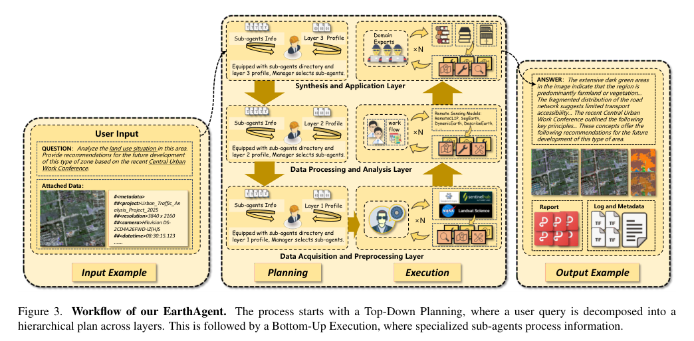

## 4 GeoPlan-bench：复杂遥感智能体规划的评估

现有地学智能体 Benchmark 通常未充分覆盖这样的能力：从高层目标出发，独立组织一条长链遥感分析流程，明确任务分解、工具选择以及操作依赖。GeoPlan-bench 因此着重设计更长、更综合、贴近真实应用的问题，让评估不依赖某一特定智能体架构。

### 4.1 基准构建管线

作者建立了**半自动任务构建流程**，分为“任务生成”和“任务验证”两大阶段。

**任务生成。** 先为 LLM 提供数百种工具和它们的依赖关系，让模型在农业监测、灾害响应等子领域生成完整的任务依赖图。随后从图中提取多条彼此不同的、可独立构成求解路径的工具子图作为模板。再令 LLM 为这些模板构造现实情境，并为工具参数填入合理数值。最后采用**反向推理（reverse inference）**：给定完整、已参数化的工具路径，让模型生成一条简洁的自然语言请求，使其恰好对应既定流程的解决方案。作者认为该策略能够确保每条生成问题都有已知的参考工具路径。

**任务验证。** 第一关是复杂度检查，确保参考工具路径的长度与相互依赖程度符合简单／中等／复杂难度设定；第二关是领域相关性检查，结合关键词与分类模型过滤与所属遥感子领域不一致的问题；第三关通过向量语义相似度筛查重复任务。最终形成 **1,244 道独立题目**，分布在**7 个子领域**，包含**简单 561 题、中等 441 题、复杂 242 题**。完整生成方法、工具表及验证提示见补充材料 8.1 与 8.6 节。

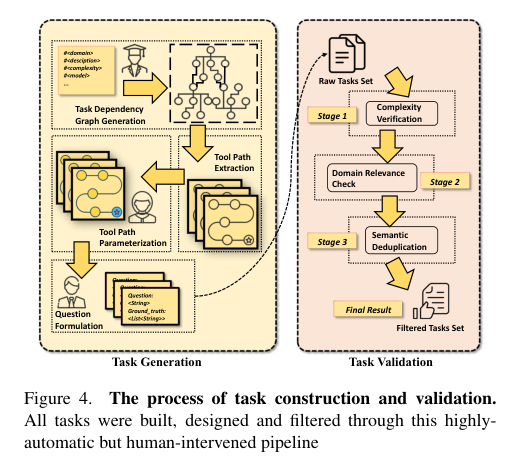

### 4.2 评价指标

作者把规划质量划分为**工具选择正确性（Correctness）**、**流程结构一致性（Structural）**和**整体逻辑完整性（Holistic）**三种视角。所有指标针对的是生成的**工具规划序列**，而非实际执行 GIS 程序后的结果是否正确。这里的“正确性”是规划层面定义，不能被误写为“真实执行正确率”。

**第一类：关键工具正确性。** 在长链流程中，不同工具的重要程度并不相同。作者先从每道题的参考解中识别“关键工具”（Key Tools），然后定义 `Recall_key`，衡量是否找回解题不可缺少的工具；定义 `Precision_key`，衡量智能体提出的重要工具有多少位于参考工作流中，从而惩罚冗余或幻觉操作。再以二者调和平均得到 `F1_key`。完整集合运算定义见补充材料8.2.1。

**第二类：结构指标。** 为衡量整条规划路径是否连贯，论文采用**基于加权编辑距离的路径相似度**。相比普通 Levenshtein 距离，删除或插入位于依赖图关键位置的工具会受到更高惩罚，而功能相近的工具替换成本相对更低。最后将距离规范化为 Path Similarity，值为1时表示路径完全一致。详细成本函数和图中心性计算见补充材料8.2.2和10.3。

**第三类：整体指标。** 有的计划在工具选择和结构方面得分较高，却仍然存在重大逻辑缺陷或必要步骤缺失。作者通过 **LLM-as-Judge + Elo 排名**评价整体逻辑完整性：对同一题两种智能体生成的计划，裁判比较谁更全面、合理，然后更新对应 Elo 分数。相比让裁判一次性绝对打分，成对比较被认为认知负担更低、结果更稳定。最终 Elo 被用作 Completeness Score。相关裁判机制、配对与分数更新见补充材料8.2.3。

## 5 实验

### 5.1 实验设置

作者在 GeoPlan-bench 上比较 EarthAgent 与多种规划架构，明确**只评价规划阶段的工具序列，不运行真实工具**。基线包括：直接按步骤推理并生成计划的 **Chain-of-Thought（CoT）**；反复思考—行动—观察的 **ReAct**；一次性确定计划的 **Plan&Execute**；多智能体相互质疑并协作改进的 **Debate**；以及通过学习优化流程的 **AFlow**。

除特别说明外，所有架构使用**同一底座模型 GPT-4o-mini** 和相同的工具及描述，避免将模型能力差异误认为架构差异。AFlow 使用基准中的 **248 个样例**学习工作流，在其余 **996 个样例**上开展主要比较。由于 API 费用，第5.3和5.4节的部分实验只采用均匀采样的 **70 道任务**。EarthAgent 使用第3.2节介绍的三层配置。

### 5.2 主要结果

表1比较简单、中等、复杂及总体场景的关键工具召回率、精确率、F1、结构相似度以及整体 Elo 完整性。总体上，EarthAgent 的关键工具指标和整体 Elo 排名领先多数基线；多智能体架构普遍优于简单单智能体。对总体 996 项任务，结果包括：

| 架构 | Recall_key | Precision_key | F1_key | Structural | Holistic（Elo） |
|---|---:|---:|---:|---:|---:|
| CoT | 0.40 | 0.51 | 0.42 | 0.55 | 980.87 |
| ReAct | 0.33 | 0.50 | 0.37 | 0.47 | 962.57 |
| Plan&Execute | 0.38 | 0.55 | 0.43 | 0.47 | 973.52 |
| Debate | 0.62 | 0.57 | 0.57 | 0.62 | 1030.59 |
| AFlow | 0.39 | 0.62 | 0.44 | 0.68 | 992.60 |
| **EarthAgent（HTAM）** | **0.66** | **0.65** | **0.63** | **0.68** | **1068.27** |

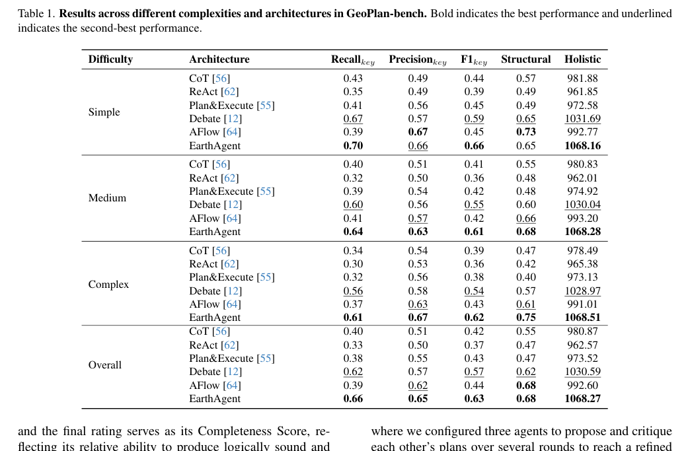

作者认为，ReAct 和 Plan&Execute 等单智能体方法难以稳定处理复杂遥感规划；Debate 虽然借助讨论机制有所改善，但缺乏 HTAM 的领域流程约束。AFlow 有时取得较高的结构相似度，但较低的关键工具召回率说明其可能生成“看起来顺序合理、实际上遗漏必要操作”的计划。EarthAgent 在复杂任务中的结构指标达到 **0.75**，反映其在长链依赖任务上的相对优势。

### 5.3 不同 LLM 底座下的表现

作者替换 EarthAgent 的底座模型，包括 InternVL3-78B、Qwen3-235B、DeepSeek-V3.2-Exp、Gemini-2.5-flash、Gemini-2.5-pro、GLM-4.5-Air、Claude Sonnet 4.5、GPT-4o-mini 和 GPT-5。表2和图5显示，EarthAgent 在不同模型上维持较稳定的关键工具与结构指标，而相同模型上的 ReAct 方差明显更大。作者据此提出：HTAM 的固定任务分层结构承担了相当一部分程序性推理负担，模型只需在约束清晰的每一层选择子智能体，因此系统不完全依赖底座模型自身的一次性全流程规划能力。

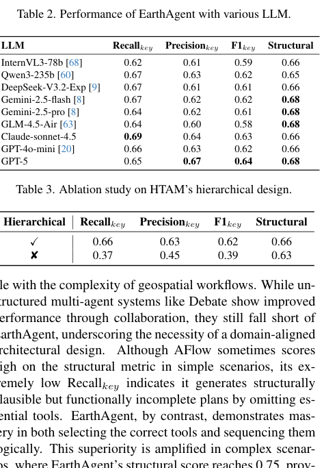

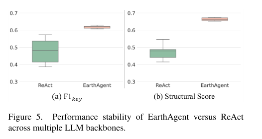

### 5.4 消融实验

为了验证层次化设计的必要性，作者去除层级策略进行消融，见表3。取消分层后，`F1_key` 从 **0.62** 下降到 **0.39**；结构指标则从 **0.66** 下降到 **0.63**。作者认为这一现象显示：没有层级结构的系统可能仍能生成表面顺畅的步骤顺序，但难以根据不同阶段的上下文选择真正需要的工具。因此，层级机制的价值不仅体现在安排操作先后，更体现在**约束每个阶段的正确工具选择**。

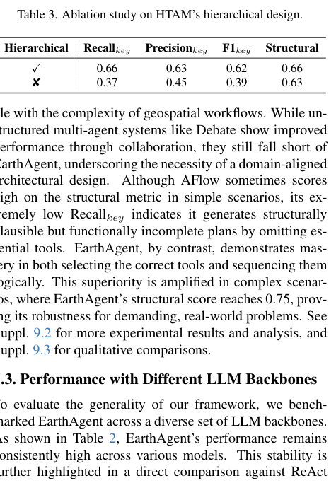

## 6 结论

本文提出新的领域专用多智能体设计机制 HTAM，打破传统基于职业角色组织智能体的范式，改为以领域固有任务依赖图构造多层架构。该设计通过明确程序依赖减少逻辑错误，同时把复杂问题拆解成若干约束较强的子问题。作者在遥感领域实现 EarthAgent，并通过 GeoPlan-bench 与多种单／多智能体基线进行比较，证明了**任务结构与智能体结构对齐**在专用场景中的价值。

研究同时提供了基本可用的 EarthAgent Web 应用，展示了执行复杂遥感工作流的系统界面；但是本文主实验的计划质量指标明确独立于真实工具执行，不能据此推断所有输出的地理空间精度已经过终端验证。其实际执行系统的基础版本见补充材料第11节。

## 主文参考文献

为确保作者姓名、论文题目、文献编号、DOI/arXiv 编号保持准确，主文所有参考文献完整保留在 `英文原文_逐页.md` 的 PDF 第9—11页及 `原始论文.pdf` 中；本中文稿使用原编号援引。

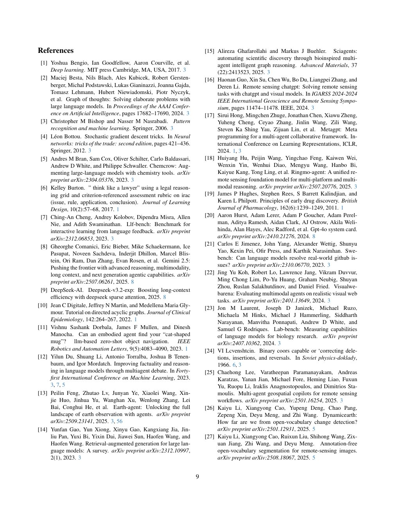

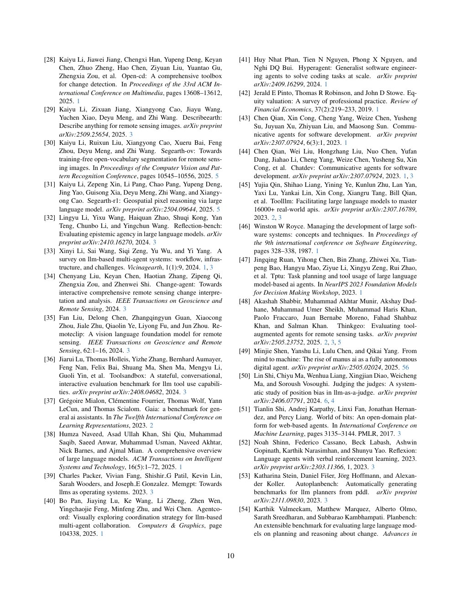

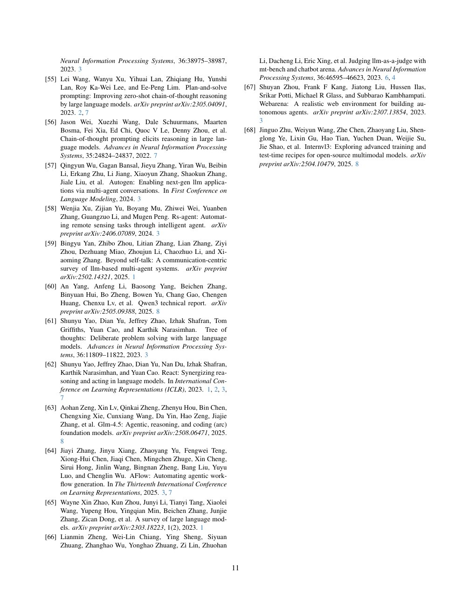
