# 图表索引

- **Figure 1**（PDF 第 2 页）：Figure 1. Comparative analysis of agent architectures on a complex geospatial query. (1) ReAct’s iterative, step-by-step process lacks a global strategy, leading to chaotic, redundant tool calls and incomplete solutions. (2) Plan&Execute adheres to a rigid, pre-determined plan, showing no capacity f

  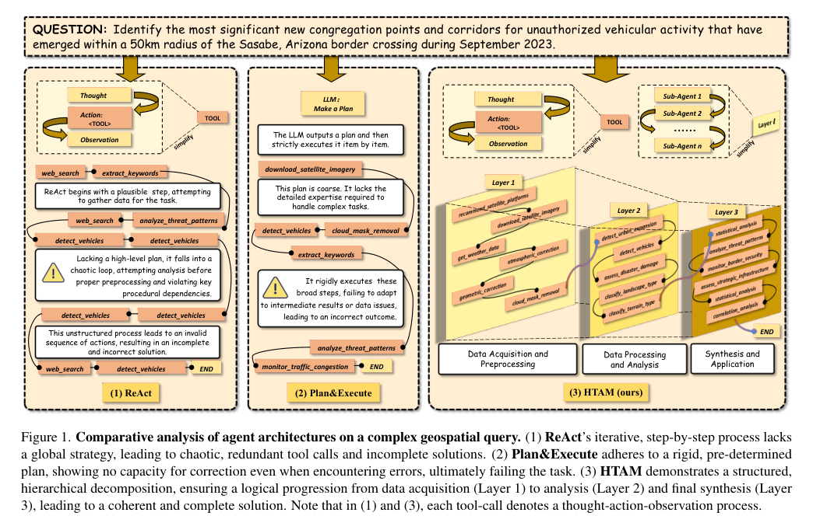

- **Figure 2**（PDF 第 3 页）：Figure 2. Conceptual visualization of the planning processes of ReAct, Plan&Execute, and HTAM, inspired by gradient descent optimization. Starting from the same initial state, each architecture navigates the problem space differently. (a) ReAct takes noisy, stepby-step actions, analogous to stochast

  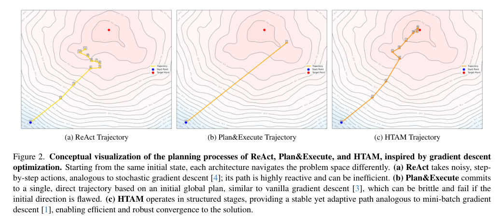

- **Figure 3**（PDF 第 5 页）：Figure 3. Workflow of our EarthAgent. The process starts with a Top-Down Planning, where a user query is decomposed into a hierarchical plan across layers. This is followed by a Bottom-Up Execution, where specialized sub-agents process information.

  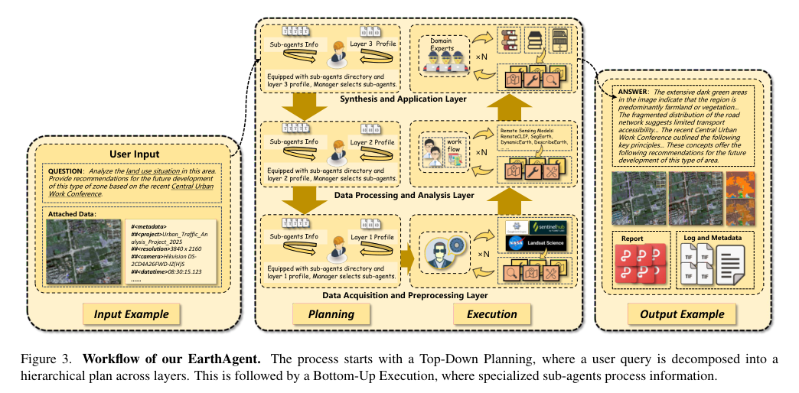

- **Figure 4**（PDF 第 6 页）：Figure 4. The process of task construction and validation. All tasks were built, designed and filtered through this highlyautomatic but human-intervened pipeline

  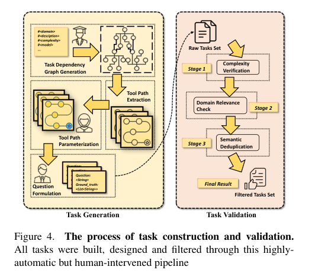

- **Table 1**（PDF 第 7 页）：Table 1. Results across different complexities and architectures in GeoPlan-bench. Bold indicates the best performance and underlined indicates the second-best performance.

  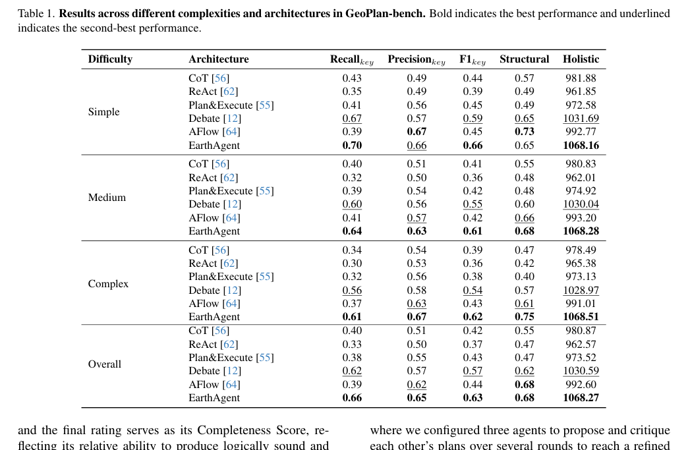

- **Table 2**（PDF 第 8 页）：Table 2. Performance of EarthAgent with various LLM.

  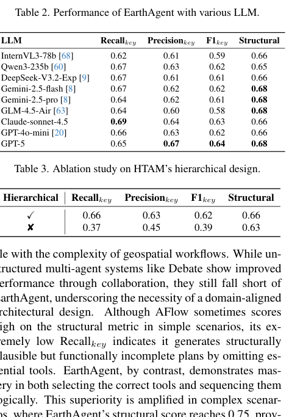

- **Table 3**（PDF 第 8 页）：Table 3. Ablation study on HTAM’s hierarchical design.

  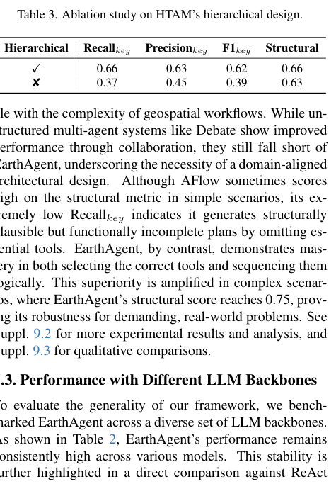

- **Figure 5**（PDF 第 8 页）：Figure 5. Performance stability of EarthAgent versus ReAct across multiple LLM backbones.

  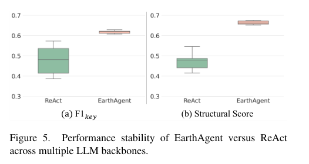

- **Figure 6**（PDF 第 13 页）：Figure 6. An sample example of task dependency graph in Urban & Regional Planning sub-domain. Light yellow node denotes entry node while red node denotes ending node. The brown arrow denotes the dependency relation between nodes. In the process of production, 4 tasks were successfully built based on

  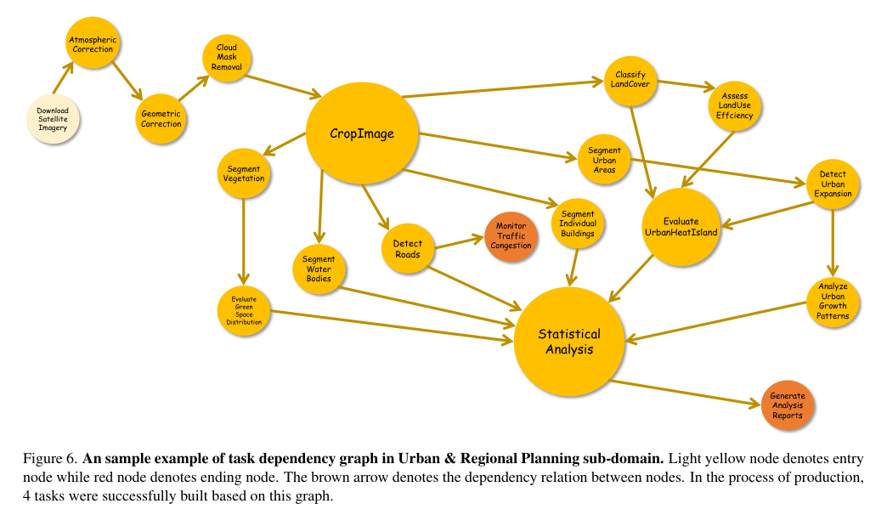

- **Table 4**（PDF 第 16 页）：Table 4. Distribution and Description of Sub-Agents within the EarthAgent Architecture.

  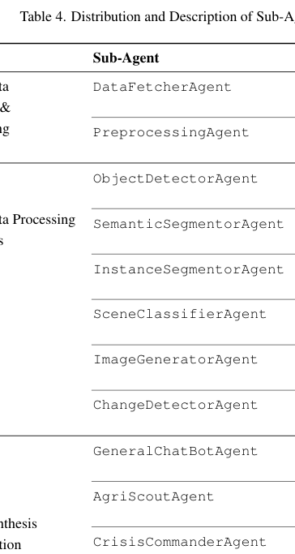

- **Figure 7**（PDF 第 18 页）：Figure 7. Illustration of 5 Agent Architectures. We show the inference processes of ReAct, Plan&Execute, CoT, Debate and AFlow.

  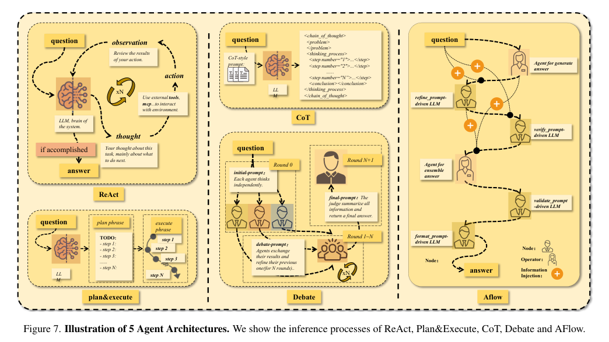

- **Table 5**（PDF 第 28 页）：Table 5. Detailed Experimental Results by Domain. Diff. stands for Difficulty. Arch. stands for Architecture. Rec. stands for Recallkey. Prec. stands for Precisionkey. F1. stands for F1key. Struct. stands for Structural. Hol. stands for Holistic.

  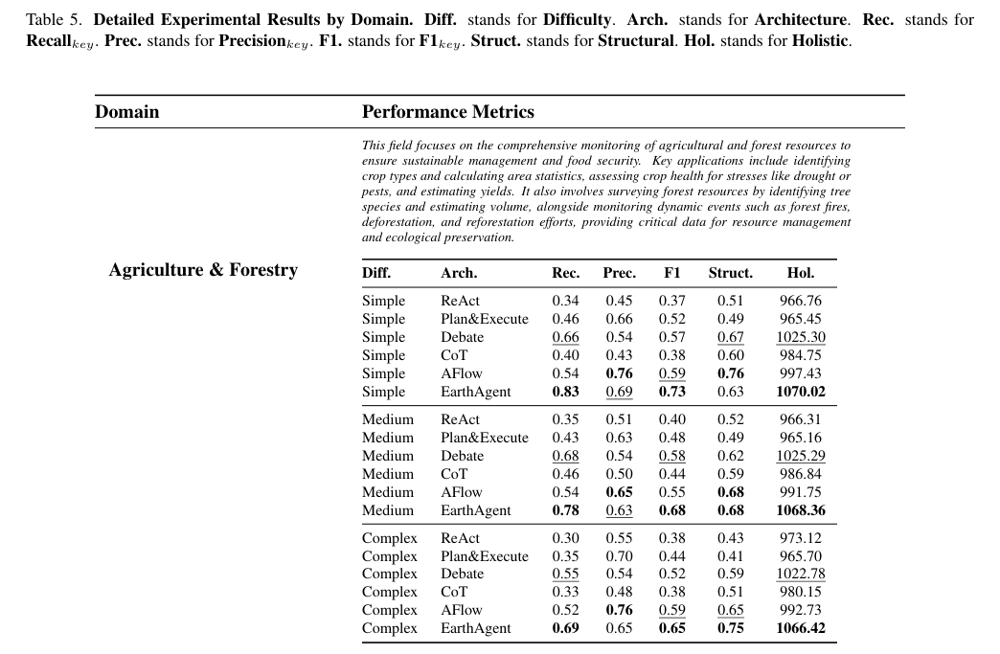

- **Table 5**（PDF 第 29 页）：Table 5 – continued from previous page

  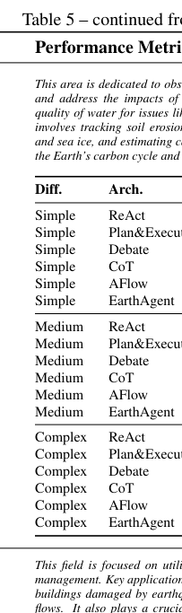

- **Table 5**（PDF 第 30 页）：Table 5 – continued from previous page

  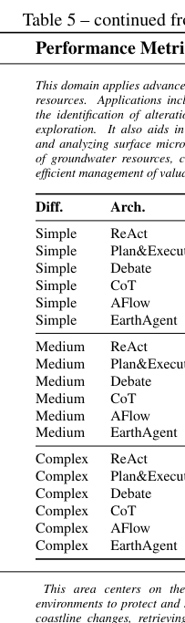

- **Table 5**（PDF 第 31 页）：Table 5 – continued from previous page

  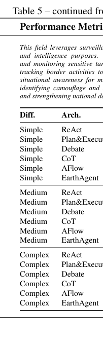

- **Table 6**（PDF 第 32 页）：Table 6. Top 10 Most Frequently Used Tools by the ReAct Architecture.

  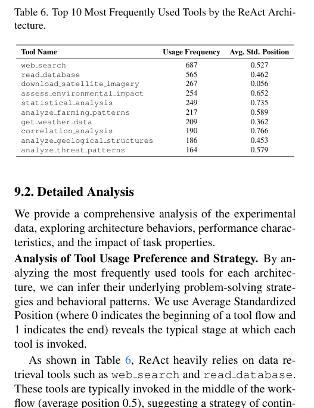

- **Table 7**（PDF 第 32 页）：Table 7. Top 10 Most Frequently Used Tools by the Plan&Execute Architecture.

  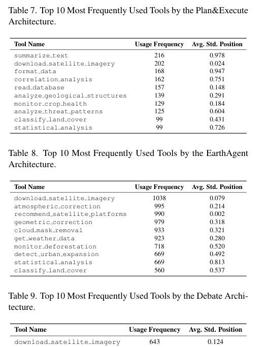

- **Table 8**（PDF 第 32 页）：Table 8. Top 10 Most Frequently Used Tools by the EarthAgent Architecture.

  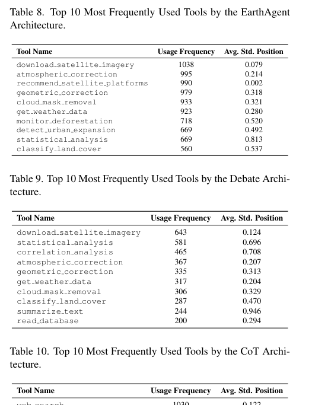

- **Table 9**（PDF 第 32 页）：Table 9. Top 10 Most Frequently Used Tools by the Debate Architecture.

  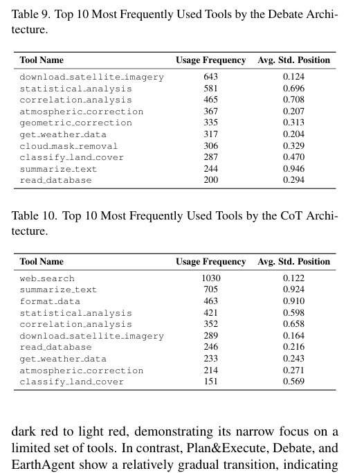

- **Table 10**（PDF 第 32 页）：Table 10. Top 10 Most Frequently Used Tools by the CoT Architecture.

  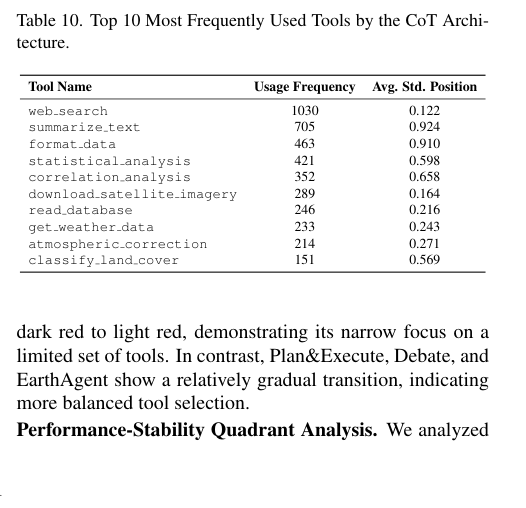

- **Figure 8**（PDF 第 33 页）：Figure 8. Heatmap of Tool Usage. The color scale ranges from dark (most frequently used tools) to light (least frequently used tools).

  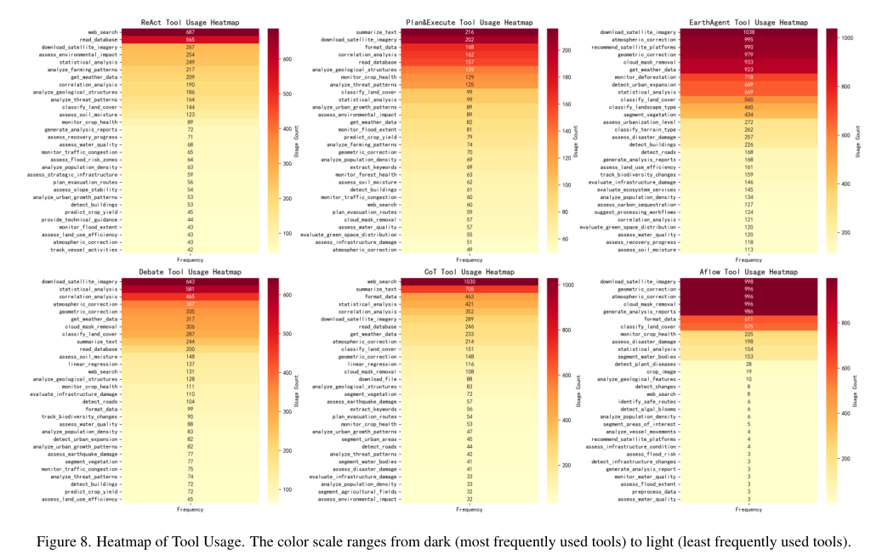

- **Table 11**（PDF 第 33 页）：Table 11. Top 10 Most Frequently Used Tools by the AFlow Architecture.

  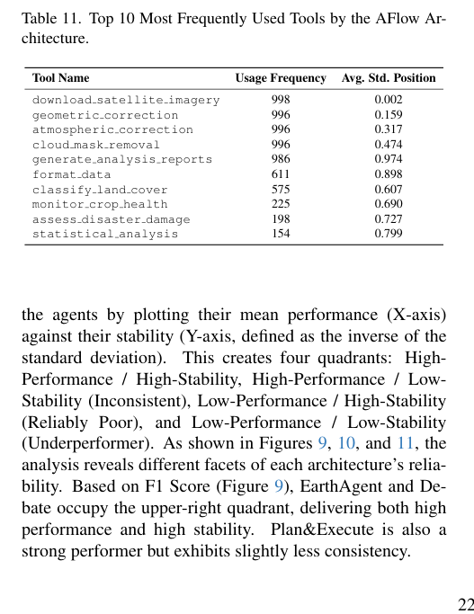

- **Figure 9**（PDF 第 33 页）：Figure 9. Quadrant Analysis based on Correctness Metric Score.

  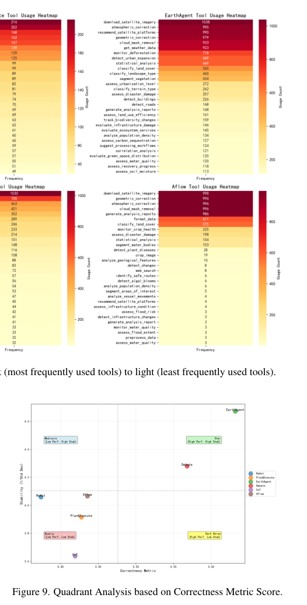

- **Table 12**（PDF 第 34 页）：Table 12. The 20 tools identified as ”rare” based on their low frequency in the ground truth dataset.

  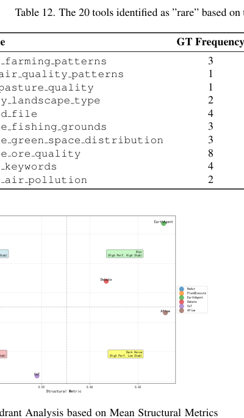

- **Figure 10**（PDF 第 34 页）：Figure 10. Quadrant Analysis based on Mean Structural Metrics Score.

  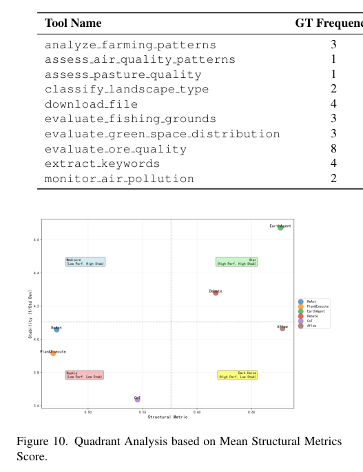

- **Figure 11**（PDF 第 34 页）：Figure 11. Quadrant Analysis based on Mean Completeness Score.

  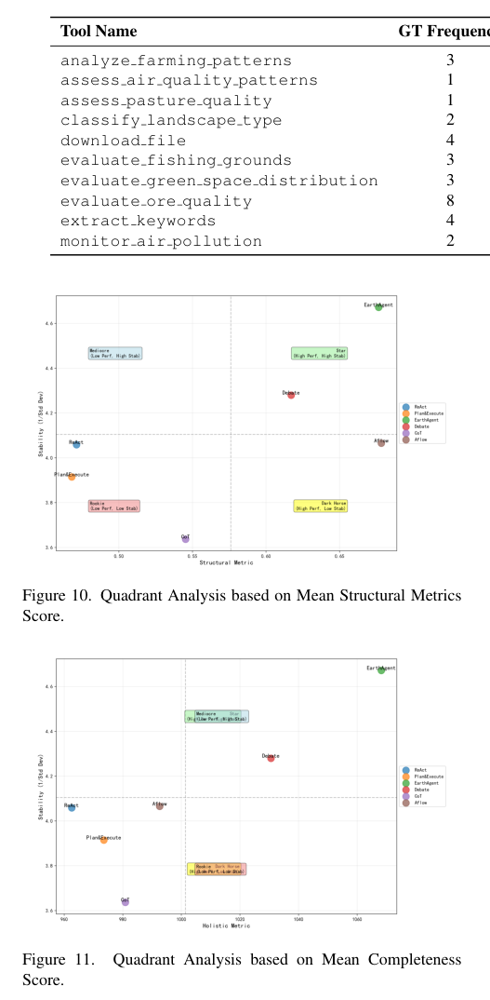

- **Table 13**（PDF 第 34 页）：Table 13. Correctness Metric Score on Tasks Grouped by the Number of Rare Tools in their Ground Truth. Sample size (n) is shown in parentheses.

  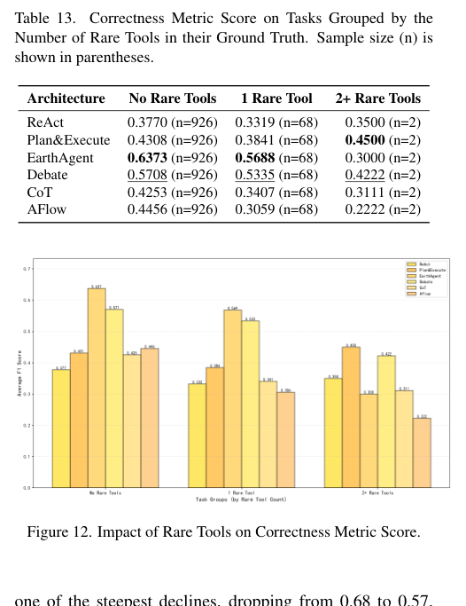

- **Figure 12**（PDF 第 34 页）：Figure 12. Impact of Rare Tools on Correctness Metric Score.

  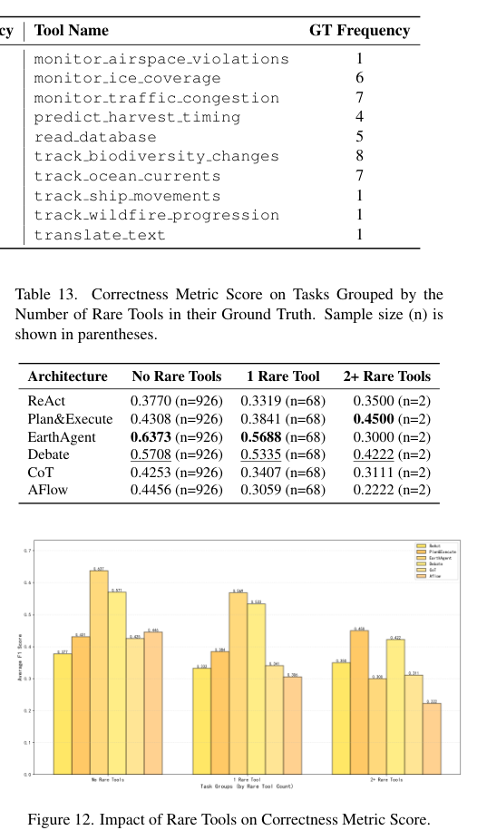

- **Table 14**（PDF 第 48 页）：Table 14. List of Available Tools

  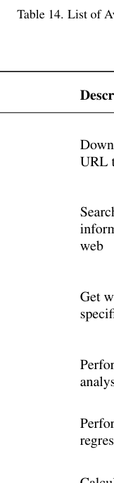

- **Table 14**（PDF 第 49 页）：Table 14 – continued from previous page

  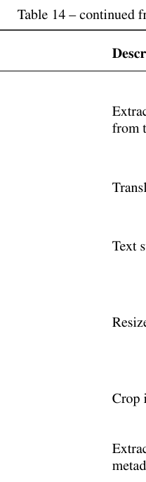

- **Table 14**（PDF 第 50 页）：Table 14 – continued from previous page

  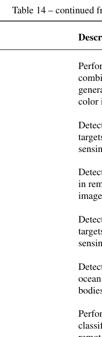

- **Table 14**（PDF 第 51 页）：Table 14 – continued from previous page

  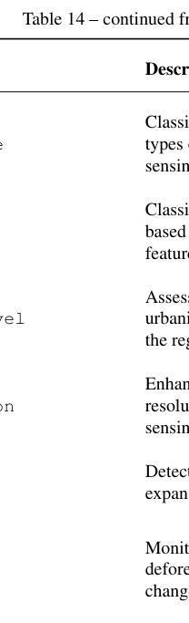

- **Table 14**（PDF 第 52 页）：Table 14 – continued from previous page

  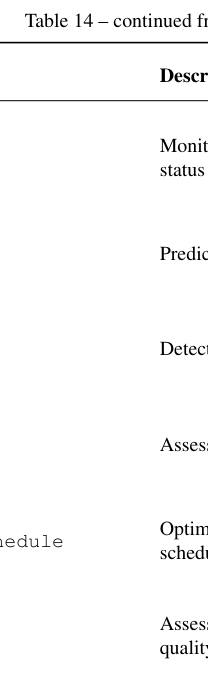

- **Table 14**（PDF 第 53 页）：Table 14 – continued from previous page

  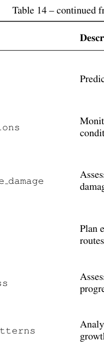

- **Table 14**（PDF 第 54 页）：Table 14 – continued from previous page

  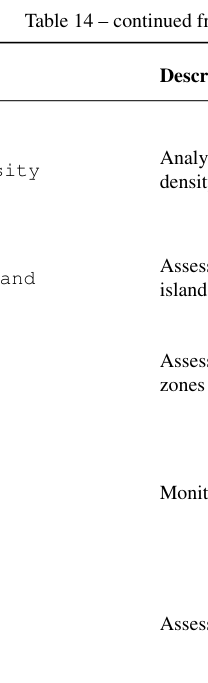

- **Table 14**（PDF 第 55 页）：Table 14 – continued from previous page

  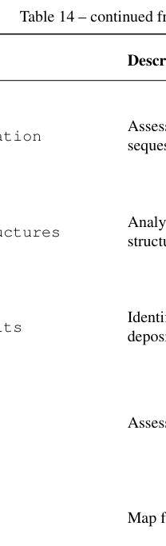

- **Table 14**（PDF 第 56 页）：Table 14 – continued from previous page

  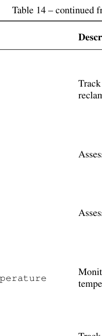

- **Table 14**（PDF 第 57 页）：Table 14 – continued from previous page

  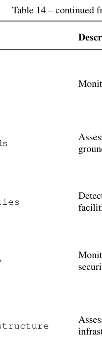

- **Table 14**（PDF 第 58 页）：Table 14 – continued from previous page

  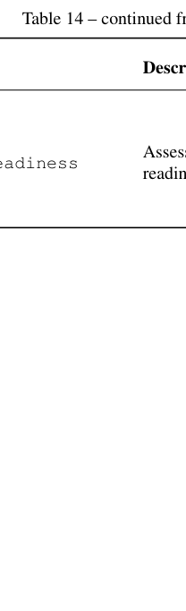

- **Table 15**（PDF 第 60 页）：Table 15. Statistics and Distribution of Frequently Shared Tools

  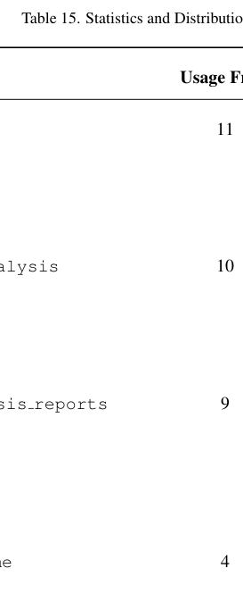

- **Table 16**（PDF 第 62 页）：Table 16. Tool Importance Score Evaluation

  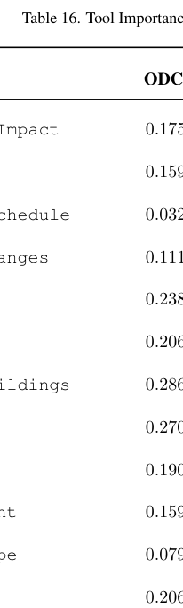

- **Table 16**（PDF 第 63 页）：Table 16. Tool Importance Score Evaluation

  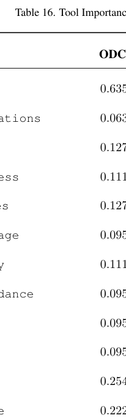

- **Table 16**（PDF 第 64 页）：Table 16. Tool Importance Score Evaluation

  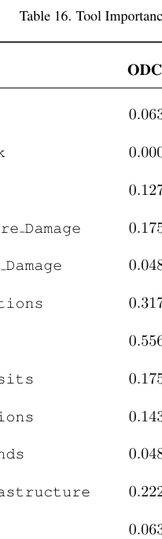

- **Table 16**（PDF 第 65 页）：Table 16. Tool Importance Score Evaluation

  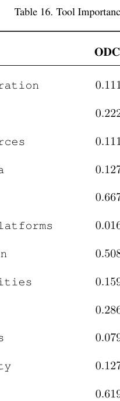

- **Table 16**（PDF 第 66 页）：Table 16. Tool Importance Score Evaluation

  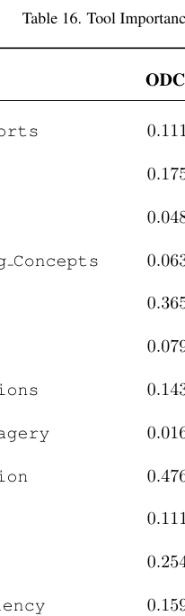

- **Figure 13**（PDF 第 68 页）：Figure 13. A snapshot of EarthAgent web-application. This image is taken from a comprehensive task on risk prediction for a large-scale concert. EarthAgent first analyzes the whole question and select sub-agents in each layer.

  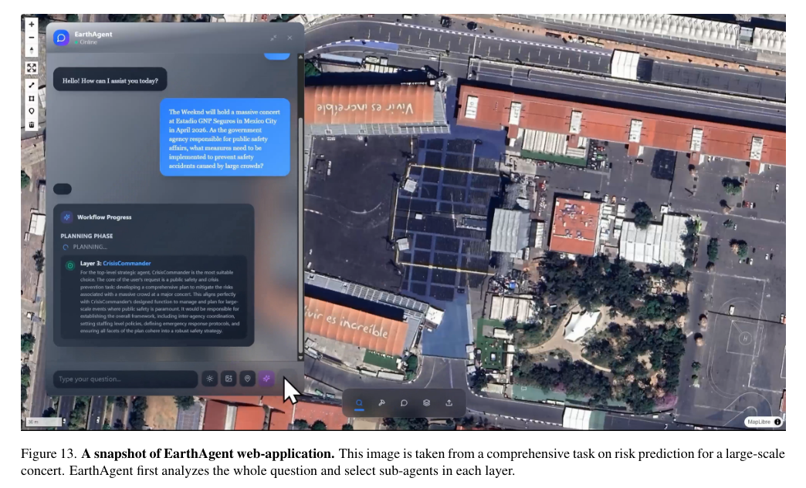

- **Figure 14**（PDF 第 68 页）：Figure 14. A snapshot of EarthAgent web-application. This image is taken from the same task scenario as Figure 13. EarthAgent calls agent from the first layer (Data Acquisition and Preprocessing Layer), who has acquired relevant ROIs successfully.

  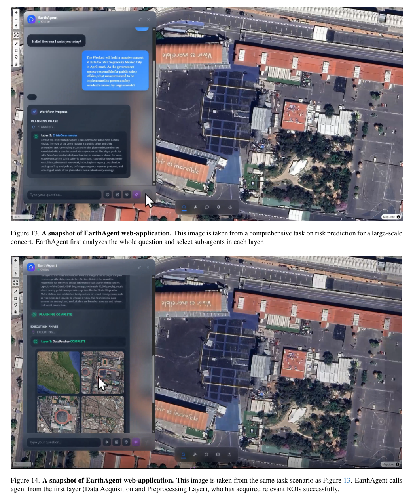

- **Figure 15**（PDF 第 69 页）：Figure 15. A snapshot of EarthAgent web-application. This image is also taken from the same task scenario as Figure 13. EarthAgent has currently progressed to layer 2 (Data Processing and Analysis Layer), where semantic segmentation of the regions of interest has been achieved.

  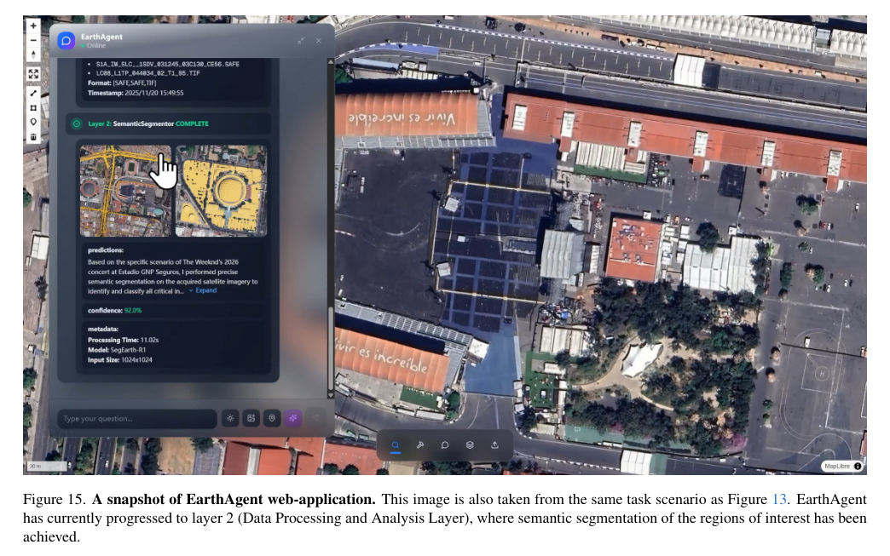

- **Figure 16**（PDF 第 69 页）：Figure 16. A Snapshot of EarthAgent Web-Application. Taken from the same task scenario as Figure 13, this image showcases agent from layer 3 (Synthesis and Application Layer) executes rigorous reasoning and synthesize to output a integrated technical report.

  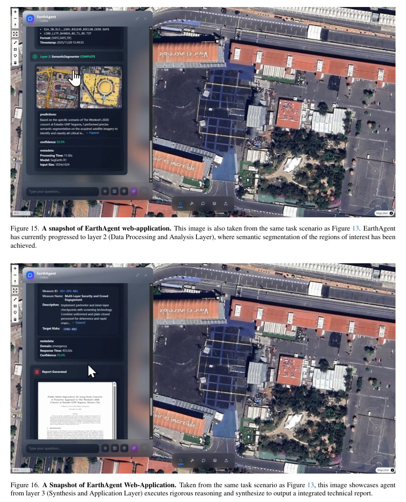
