# Designing Domain-Specific Agents via Hierarchical Task Abstraction Mechanism

> 逐页英语原文。文本依据上传 PDF 提取，尽量按双栏阅读顺序还原；图表中的文字请以对应截图为准。

**总页数：69；来源：用户上传 PDF。**

---

## PDF 第 001 页

Designing Domain-Specific Agents via Hierarchical Task Abstraction Mechanism

Kaiyu Li1∗, Jiayu Wang1∗, Zhi Wang1, Hui Qiao2, Weizhan Zhang1, Deyu Meng1, Xiangyong Cao1†

Abstract

LLM-driven agents, particularly those using general frameworks like ReAct or human-inspired role-playing, often struggle in specialized domains that necessitate rigorously structured workflows. Fields such as remote sensing, requiring specialized tools (e.g., correction, spectral indices calculation), and multi-step procedures (e.g., numerous intermediate products and optional steps), significantly challenge generalized approaches. To address this gap, we introduce a novel agent design framework centered on a Hierarchical Task Abstraction Mechanism (HTAM). Specifically, HTAM moves beyond emulating social roles, instead structuring multi-agent systems into a logical hierarchy that mirrors the intrinsic task-dependency graph of a given domain. This task-centric architecture thus enforces procedural correctness and decomposes complex problems into sequential layers, where each layer’s sub-agents operate on the outputs of the preceding layers. We instantiate this framework as EarthAgent, a multi-agent system tailored for complex geospatial analysis. To evaluate such complex planning capabilities, we build GeoPlan-bench, a comprehensive benchmark of realistic, multi-step geospatial planning tasks. It is accompanied by a suite of carefully designed metrics to evaluate tool selection, path similarity, and logical completeness. Experiments show that EarthAgent substantially outperforms a range of established single- and multi-agent systems. Our work demonstrates that aligning agent architecture with a domain’s intrinsic task structure is a critical step toward building robust and reliable specialized autonomous systems.

1. Introduction

The recent capabilities of Large Language Models (LLMs) have catalyzed the development of autonomous agents capable of complex reasoning, planning, and tool interaction [33, 47]. This evolution has led to the creation of

*Equal contribution †Corresponding author (caoxiangyong@mail.xjtu.edu.cn)

1

1Xi’an Jiaotong University 2 China Telecom Shaanxi Branch Project: https://earth-insights.github.io/EarthAgent

systems that can perceive their environment, formulate complex plans, and execute actions to achieve specified goals [38, 65]. While pioneering single-agent architectures like ReAct [62] have proven effective in general-purpose applications, the field is increasingly turning to Multi-Agent Systems (MAS) to solve problems of greater complexity [59]. A common approach in designing these systems is to organize collaboration based on human professional archetypes, assigning agents roles such as “project manager” or “software architect” [11, 17, 40, 41, 43, 44]. However, while this role-playing metaphor is intuitively appealing, its application to specialized domains like remote sensing reveals a critical mismatch. In remote sensing, expertise is not a monolithic role but a granular workflow of interdependent tasks. A simple remote sensing task, for instance, might involve sequential sub-tasks like data acquisition, geometric correction, and then change detection [28]. These sub-tasks have strict dependencies and each represents a distinct domain of expertise often handled by a different specialist. When an LLM is simply tasked to act as a single “remote sensing analyst”, it is forced to emulate this entire chain of specialized expertise. It often overlooks the detailed procedural knowledge and strict sequential constraints in geospatial workflows, as shown in Figure 1. Consequently, applying general frameworks like ReAct or generic role-based MASs to such specialized domains is similar to asking a generalist to perform intricate surgery; they lack the specialized knowledge and procedural awareness essential for success1. To address this issue, we propose a new framework for designing domain-specific agents, i.e., the Hierarchical Task Abstraction Mechanism (HTAM). Departing from the prevailing paradigm of socially inspired role-playing, HTAM constructs the agent system’s architecture to directly mirror the intrinsic task dependency graph, a structure often derived from expert knowledge and established procedural standards. It systematically decomposes a domain’s entire problem-solving process into a hierarchy of distinct functional layers, preserving the fine-grained and task-centric

1More applicable domains are discussed in Suppl.7.1.

本页原版截图（含所有图片、公式、表格）

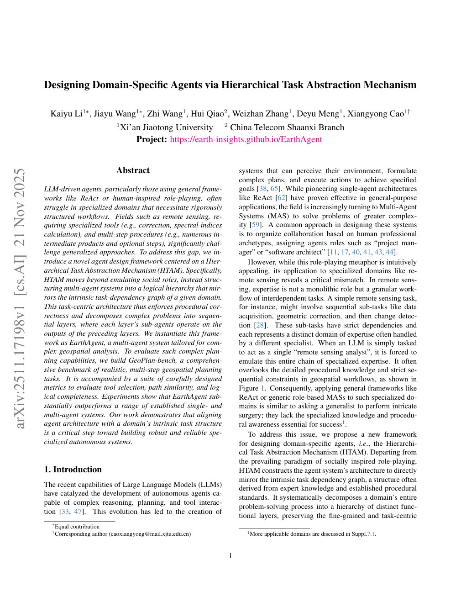

---

## PDF 第 002 页

QUESTION: Identify the most significant new congregation points and corridors for unauthorized vehicular activity that have emerged within a 50km radius of the Sasabe, Arizona border crossing during September 2023.

Thought

LLM: Make a Plan

Action:

TOOL

<TOOL>

The LLM outputs a plan and then strictly executes it item by item.

simplify

Observation

download_satellite_imagery

web_search

extract_keywords

This plan is coarse. It lacks the

ReAct begins with a plausible step, attempting

detailed expertise required to

to gather data for the task.

handle complex tasks.

web_search

analyze_threat_patterns

cloud_mask_removal detect_vehicles

detect_vehicles

detect_vehicles

extract_keywords

Lacking a high-level plan, it falls into a

chaotic loop, attempting analysis before

It rigidly executes these

proper preprocessing and violating key

broad steps, failing to adapt

procedural dependencies.

to intermediate results or data issues,

detect_vehicles detect_vehicles

leading to an incorrect outcome.

This unstructured process leads to an invalid sequence of actions, resulting in an incomplete

analyze_threat_patterns

and incorrect solution.

END END

monitor_traffic_congestion

detect_vehicles

web_search

(1) ReAct (2) Plan&Execute (3) HTAM (ours)

Sub-Agent 1

Thought

Sub-Agent 2

Action:

......

<TOOL> TOOL

simplify

simplify

Observation

Sub-Agent n

Layer 1

Layer 2 Layer 3

END

Synthesis and

Data Acquisition and

Data Processing

Application

Preprocessing

and Analysis

Figure 1. Comparative analysis of agent architectures on a complex geospatial query. (1) ReAct’s iterative, step-by-step process lacks a global strategy, leading to chaotic, redundant tool calls and incomplete solutions. (2) Plan&Execute adheres to a rigid, pre-determined plan, showing no capacity for correction even when encountering errors, ultimately failing the task. (3) HTAM demonstrates a structured, hierarchical decomposition, ensuring a logical progression from data acquisition (Layer 1) to analysis (Layer 2) and final synthesis (Layer 3), leading to a coherent and complete solution. Note that in (1) and (3), each tool-call denotes a thought-action-observation process.

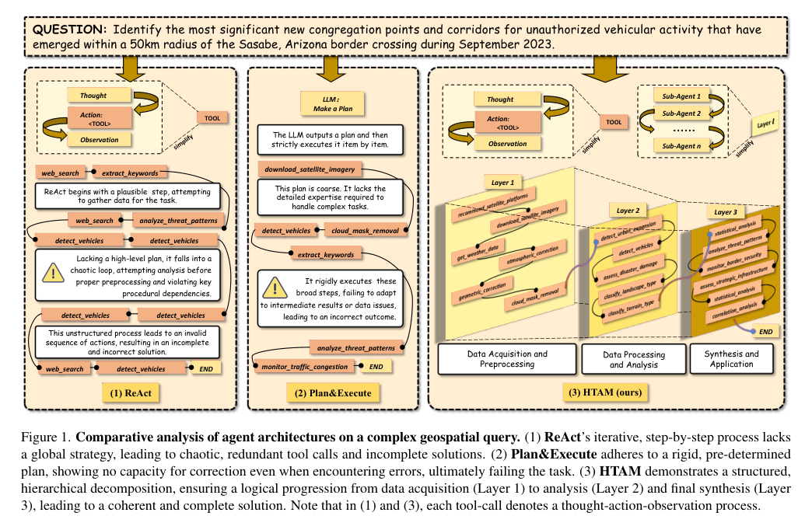

knowledge structure. Sub-agents within each layer are specialists designed to handle a specific stage of the workflow. This task-driven and hierarchical approach enforces logical consistency by design, enabling efficient and robust problem-solving. We then instantiate this framework for the remote sensing domain and introduce EarthAgent, a multiagent system where each layer is populated by specialized sub-agents designed to handle a specific stage of the geospatial analysis workflow.

Proving the advantages of different agent architectures for complex geospatial planning requires rigorous, fair, and domain-relevant evaluation. However, the current landscape of agent benchmarks is insufficient for this purpose. Existing benchmarks for evaluating task planning capabilities primarily focus on textual or natural image tasks [37, 45]. Remote sensing-specific benchmarks for task-planning like ThinkGeo [48] remain limited in scope: they lack complex, integrated task designs and only support evaluations of ReAct-style reasoning chains [62]. To fill this gap, we develop GeoPlan-bench, a benchmark designed specifically for complex task decomposition and planning in remote sensing. GeoPlan-bench provides a large corpus of realistic, multi-step tasks that mirror real-world geospatial challenges. To enable nuanced assessment, we also design an evaluation suite that employs fine-grained metrics

2

to assess key tool selections, structural path similarity, and logical completeness. In summary, our contributions are as follows: • We propose HTAM and its implementation in remote sensing field (i.e., EarthAgent), offering a domain-aware framework for building multi-agent systems that outperforms general agent architectures for specialized tasks. • We introduce GeoPlan-bench, a comprehensive benchmark and a suite of carefully designed, multi-faceted metrics. It provides a robust framework for evaluating complex geospatial task planning across diverse agents. • Through extensive experiments, we demonstrate that EarthAgent consistently outperforms a range of established agent systems, validating that aligning agent architecture with a domain’s intrinsic task dependencies is a superior strategy for building specialized agents.

2. Related Work

LLM-driven Agent Construction. The construction of LLM-driven agents has rapidly evolved. Initial efforts focused on enhancing single-agent capabilities in reasoning, planning, and acting. The ReAct framework [62] established a powerful iterative loop of thought, action and observation, a dynamic alternative to sequential Plan-andExecute paradigms [55]. To overcome the limitations of

本页原版截图（含所有图片、公式、表格）

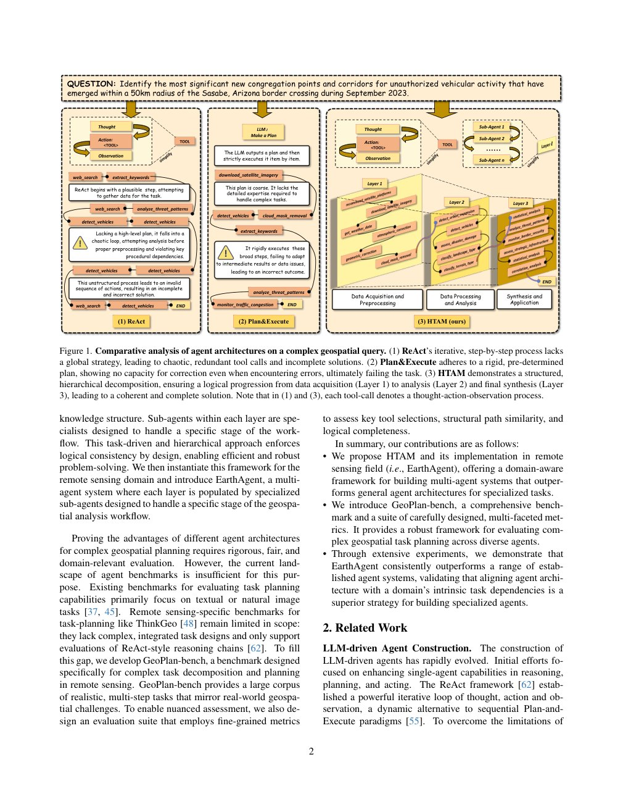

---

## PDF 第 003 页

(a) ReAct Trajectory (b) Plan&Execute Trajectory (c) HTAM Trajectory

Figure 2. Conceptual visualization of the planning processes of ReAct, Plan&Execute, and HTAM, inspired by gradient descent optimization. Starting from the same initial state, each architecture navigates the problem space differently. (a) ReAct takes noisy, stepby-step actions, analogous to stochastic gradient descent [4]; its path is highly reactive and can be inefficient. (b) Plan&Execute commits to a single, direct trajectory based on an initial global plan, similar to vanilla gradient descent [3], which can be brittle and fail if the initial direction is flawed. (c) HTAM operates in structured stages, providing a stable yet adaptive path analogous to mini-batch gradient descent [1], enabling efficient and robust convergence to the solution.

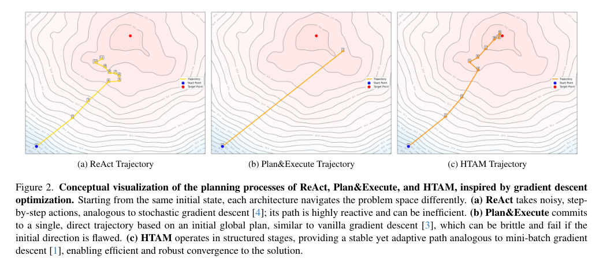

linear reasoning, more advanced strategies like Tree-ofThoughts [61] and Graph-of-Thoughts [2] were introduced to explore complex solution spaces. Concurrently, memory systems evolved from the simple context window to sophisticated architectures like MemGPT [39] for long-term adaptation, often augmented by external knowledge via RAG [14], while frameworks like Reflexion [52] enabled agents to learn from past failures. To tackle even greater complexity, the field embraced MAS [33]. A dominant design pattern has been socially-inspired role-playing, where agents with roles like “CEO” or “Programmer” collaborate in virtual companies [17, 44] or engage in structured debates [12]. Although effective for tasks that map well to human organizational structures, this paradigm fails to capture the rigid, task-centric nature of specialized workflows. Recent work like AFlow [64] automates workflow generation, treating it as a search problem to discover an optimal procedure. In contrast, our approach, HTAM, is based on a different philosophy. Instead of searching for a workflow, we explicitly model it by designing the agent architecture to mirror the domain’s known and intrinsic task hierarchy. This shifts the paradigm from black-box discovery to knowledge-driven structural design.

Agents in Specialized Application Domains. The ultimate test for agents lies in their real-world application. Researchers have developed agents for diverse, specialized domains, including software engineering on benchmarks like SWE-bench [21], scientific discovery with tools like SciAgents [15] and ChemCrow [5], and complex web navigation in environments like WebArena [67]. Remote sensing has emerged as a particularly challenging and active area [29, 35]. The trajectory has moved from early systems that used an LLM to orchestrate a fixed set of vision models [16], to more dynamic single-agent systems built on ReAct-

3

style architectures like RS-Agent [58], Change-Agent [34] and Earth-Agent [13]2. More recently, efforts have explored end-to-end trained models like RingMo-Agent [18] and decentralized collaborative MAS such as GeoLLMSquad [25]. While these represent significant progress, they largely import general agent architectures [57, 62] into the remote sensing domain. In contrast, our work posits that optimal performance requires an architecture, like HTAM, that is derived from the domain’s procedural necessities rather than being adapted to them. Agent Evaluation. Measuring the progress of agent capabilities requires robust and relevant benchmarks. A significant body of work has focused on benchmarking core capabilities. This includes assessing an agent’s ability to generate valid plans [53, 54], to use tools in interactive environments [36, 45], and to learn from feedback over time [7, 32]. Alongside these, application-specific benchmarks have become standard for gauging real-world performance. Notable examples include WebArena [67] for web navigation [22, 51], SWE-bench [21] for software engineering tasks, and LAB-bench [23] for simulated scientific procedures. Despite this progress, the remote sensing agents evaluation remains underdeveloped. ThinkGeo [48] stands as a pioneering effort in this area, but it has two main limitations that motivate our work. First, its task designs, while valuable, tend to focus on shorter, more isolated sub-problems. This does not fully capture the complexity of real-world geospatial analysis, which often involves long, multi-stage workflows chaining multiple tools together, for instance, progressing from raw data query all the way to a final analytical report. Second, its evaluation method is tightly coupled to the step-by-step reasoning

2A concurrent work shares a coincidentally similar name. We discuss the differences between the two work in Suppl.12

本页原版截图（含所有图片、公式、表格）

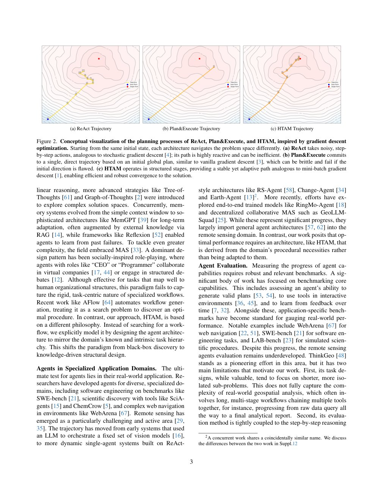

---

## PDF 第 004 页

trace of a ReAct-style agent. This makes it difficult to conduct fair comparisons against agents that use different planning approaches, e.g., Plan-and-Execute or our HTAM. Our work directly addresses these gaps by introducing GeoPlanbench, a benchmark focused on comprehensive, multi-step tasks and built upon an evaluation method that is independent of any specific agent architecture.

3. Methodology

The prevailing approach of designing Multi-Agent Systems (MAS) by imitating human social structures, while intuitive, proves fragile when applied to some specialized domains, as mentioned above. To move beyond this limitation, we introduce a paradigm shift in agent architecture design, i.e., HTAM. This framework departs from social analogies and instead derives its structure directly from the logical dependencies inherent to the problem domain.

3.1. HTAM

3.1.1. Hierarchical Architecture Construction

The architecture of an HTAM-based system is derived from a formal analysis of the domain’s task dependency graph3, denoted as G = (V, E). In this graph, the vertex set V represents all potential atomic operations, tools, or tasks available within the domain, and the edge set E represents the prerequisite constraints between them (i.e., an edge (vi, vj) exists if task vi must be completed before vj can begin). The hierarchical structure of HTAM is obtained through a topological stratification of this master graph G. This process partitions the vertex set V into an ordered sequence of L disjoint layers, V = SL l=1 Vl, such that for any edge (vi, vj) ∈E, if vi ∈Va and vj ∈Vb, then a ≤b. Each layer Vl thus represents a distinct level of operational abstraction, containing a group of tasks that are functionally related and share a similar position in the overall workflow. This condition architecturally enforces unidirectional progression from lower to higher layer, known as inter-layer dependencies (a < b), while allowing for multi-step workflows within a single layer of abstraction, referred to as intra-layer dependencies (a = b). Each layer Vl directly defines a functional layer within the agent system. Each layer is then populated by a set of specialized sub-agents, where each sub-agent is responsible for executing one or more of the atomic tasks or tools (vertices) contained within its assigned layer. The number of layers L, is not fixed but is an emergent property determined by the intrinsic complexity and structure of the domain’s task graph. This architectural design offers significant advantages: (1) Modularity: Agents designed for a specific layer can be developed and maintained

3In general, it is a directed acyclic graph. The graph’s structure is defined based on expert knowledge and established standards. A simple example can be found in Suppl. 8.1.1 Figure 6.

4

independently. (2) Logical Enforcement: The unidirectional dependency flow makes it architecturally impossible to generate logically invalid plans (e.g., performing analysis before data preprocessing). (3) Decomposition of Complexity: The stratification decomposes a single and complex planning problem into a sequence of smaller, more constrained sub-problems, one for each layer.

3.1.2. Top-Down Planning and Bottom-Up Execution

Once the hierarchical architecture is defined, the system operates through a dual-pass mechanism for the given user query: a top-down planning pass to select and configure sub-agents, followed by a bottom-up execution pass. Planning. For a given user query Q, the system first initiates a top-down planning process to translate the high-level intent into a concrete, multi-layered execution plan. This process begins at the highest layer (L) and proceeds downwards to the basic layer. At each layer l, a policy function πl (typically implemented via an LLM call) selects an appropriate set of sub-agents Sl, conditioned on the query and the selections made at higher layers. This cascade of decisions effectively decomposes the main query into a series of specialized sub-agents assigned to the appropriate layers. Formally, the sub-agent sets {S1, . . . , SL} are determined as follows:

SL = πL(Q) (1)

Sl = πl(Q, Sl+1, . . . , SL) for l = L −1, . . . , 1 (2)

Each policy function πl acts as a specialized manager for its layer, mapping the broader context to a specific team of subagents. This structured delegation transforms an ambiguous user request into a precise and executable hierarchical plan. Execution. Following planning, the execution phase begins, operating in the reverse direction. This process starts from the basic layer (l = 1) and moves upwards. Each selected sub-agent set, i.e., Sl, acts as a composite transformation function, fSl, processing the output from the layer below and producing the output for the layer above. The pipeline starts with initial inputs Qin from the query:

O1 = fS1(Qin) (3)

Ol = fSl(Ol−1) for l ∈[2, L] (4)

The final system response, R, is the output of the highest layer, OL. The entire process can be viewed as a nested functional composition:

R = OL = fSL(fSL−1(. . . fS1(Qin) . . . )) (5)

This bottom-up execution implements a strict data processing pipeline. The output of each layer serves as the

本页原版截图（含所有图片、公式、表格）

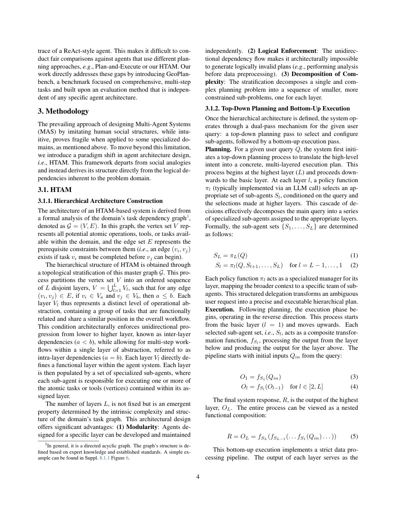

---

## PDF 第 005 页

Layer 3 Profile

Sub-agents Info

Equipped with sub-agents directory and layer 3 profile, Manager selects sub-agents.

Sub-agents Info

Layer 2 Profile

User Input

Equipped with sub-agents directory and layer 2 profile, Manager selects sub-agents.

QUESTION:Analyze the land use situation in this area. Provide recommendations for the future development of this type of zone based on the recent Central Urban Work Conference.

Attached Data:

#<metadata> ##<project>Urban_Traffic_An alysis_Project_2025 ##<resolution>3840 x 2160 ##<camera>Hikvision DS2CD4A26FWD-IZ(H)S ##<datatime>08:30:15.123 ......

Sub-agents Info

Layer 1 Profile

Equipped with sub-agents directory and layer 1 profile, Manager selects sub-agents.

Input Example

Domain Experts

×N

ANSWER:The extensive dark green areas in the image indicate that the region is predominantly farmland or vegetation... The fragmented distribution of the road network suggests limited transport accessibility... The recent Central Urban Work Conference outlined the following key principles... These concepts offer the following recommendations for the future development of this type of area.

Synthesis and Application Layer

Remote Sensing Models: RemoteCLIP, SegEarth, DynamicEarth, DescribeEarth, ... ...

work flow

×N

Data Processing and Analysis Layer

Report Log and Metadata

×N

Data Acquisition and Preprocessing Layer

Planning Output Example

Execution

Figure 3. Workflow of our EarthAgent. The process starts with a Top-Down Planning, where a user query is decomposed into a hierarchical plan across layers. This is followed by a Bottom-Up Execution, where specialized sub-agents process information.

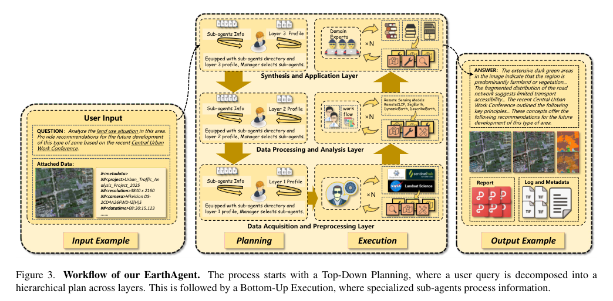

input for the next, ensuring that the final result is the product of a traceable and auditable sequence of transformations originating from the source data.

3.2. EarthAgent

To validate the efficacy and practicality of the HTAM model, we developed EarthAgent, a multi-agent system that serves as its implementation for the remote sensing domain, as shown in Figure 3. A typical remote sensing project progresses naturally from handling raw satellite data, to performing data processing and analysis, and finally to deriving high-level insights and conclusions. A topological analysis of the remote sensing task dependency graph yields a threelayer hierarchy, forming the architectural basis of EarthAgent, as shown in Suppl. 8.3 Table 4. Data Acquisition and Preprocessing Layer. This layer is EarthAgent’s interface with the vast geospatial data. The sub-agents in this layer are specialists in data I/O and preprocessing steps. The DataFetcherAgent, for example, queries and retrieves data from various sources, e.g., the Sentinel Hub API or commercial data providers. It handles the complexities of spatial-temporal queries and data access protocols. Then, the PreprocessingAgent transforms raw satellite sensor data into analysis-ready products. Its capabilities include essential radiometric calibration, atmospheric correction, denoising, etc. Data Processing and Analysis Layer. This layer functions as EarthAgent’s analytical engine, where preprocessed images are transformed into structured geospatial information. It contains a rich library of subagents, each an expert in a specific image interpretation task adapted for remote sensing. For example, the

5

SemanticSegmentorAgent utilizes deep learning or traditional models to perform pixel-level classification, generating land use/land cover maps or single-class maps [27, 30, 31], while the ChangeDetectorAgent compares bi-temporal images to highlight areas of change [26]. The outputs of this layer are typically intermediate data products like semantic masks or vector geometries. Synthesis and Application Layer. This is the highest and most abstract layer, responsible for synthesizing the intermediate data products from the lower layers into a final analysis that directly addresses the user’s query. The subagents at this layer are domain-specific “analysts”. For instance, the UrbanistAIAgent might take building and road detections from interpretation layer to analyze urban sprawl patterns. The AgriScoutAgent could use vegetation indices (a product of 2nd layer) to assess crop health, while the CrisisCommanderAgent might use building damage assessments to coordinate an emergency response. It is worth noting that there is a GeneralChatBotAgent serves as the default handler for simple informational queries that do not require deep analysis.

4. GeoPlan-bench: Evaluating Complex Agentic Planning in Remote Sensing

Evaluating an agent’s planning capability requires tasks that mirror real-world complexity. While recent benchmarks [48] have introduced valuable remote sensingspecific challenges, their tasks often consist of well-defined sub-problems, follow clear procedural paths, or are tightly coupled to the ReAct paradigm, making direct comparisons with other architectures challenging. This leaves a

本页原版截图（含所有图片、公式、表格）

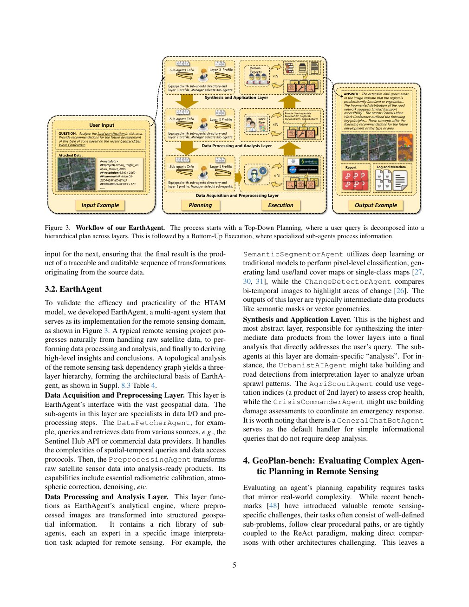

---

## PDF 第 006 页

#<domain> #<desciption> #<complexity> #<model> ...

Raw Tasks Set

Complexity Verification

Task Dependency Graph Generation

Stage 1

Tool Path Extraction

Domain Relevance Check

Stage 2

Tool Path Parameterization

Semantic Deduplication

Stage 3

Question: <String> Ground_truth: <List<String>>

Question: <String> Ground_truth: <List<String>>

Question: <String> Ground_truth: <List<String>>

Final Result

Question Formulation

Filtered Tasks Set

Task Generation Task Validation

Figure 4. The process of task construction and validation. All tasks were built, designed and filtered through this highlyautomatic but human-intervened pipeline

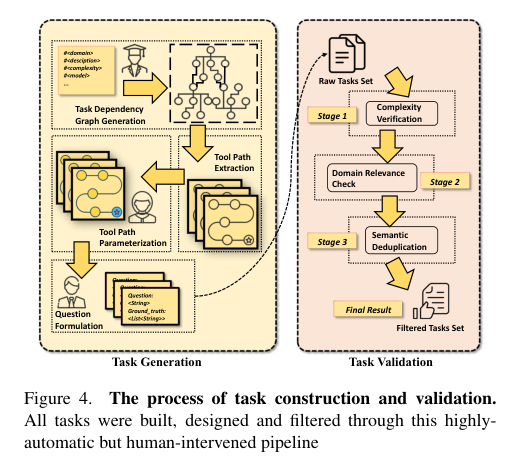

critical aspect untested: an agent’s planning ability to autonomously navigate a complex, end-to-end workflow from a high-level objective. To address this gap, we introduce GeoPlan-bench. Its design is built around complex and long-planning remote sensing tasks, where queries require agents to perform strategic decomposition, tool selection, and dependency management without explicit guidance.

4.1. Data Construction Pipeline

To ensure the complexity of tasks within GeoPlan-bench and support architecture-agnostic evaluation, we develop a semi-automated pipeline for task construction. The process is divided into two stages: task generation and task validation, as shown in Figure 4. Task Generation. The task generation pipeline first provides a list of hundreds of available tools4 and their dependencies for an LLM, to generate a comprehensive tool dependency graph for the sub-domain of remote sensing (e.g., agricultural monitoring, disaster response, etc.). From each graph, we extract multiple distinct tool paths (i.e., subgraphs), each representing a complete, self-contained solution template. To transform these abstract templates into concrete tasks, an LLM instantiates them by imagining a specific scenario, and populating the parameters for each tool with realistic values. Finally, we employ a reverseinference strategy. Given a fully specified and parameterized tool path, an LLM is tasked with formulating a concise, natural language user query for which the provided path is the correct procedural solution. This strategy guarantees that every question in GeoPlan-bench has a known, valid, and high-quality solution. Task Validation. To further ensure the benchmark’s quality and diversity, the generated tasks undergo a multi-stage

4See Suppl. 10 for the complete tool list.

6

validation process. The first step is complexity verification, where we ensure that the length and intricacy of each ground truth tool path align with the intended complexity level (e.g., simple, medium, complex) assigned during generation. This is followed by a domain relevance check using keyword filtering and a classifier model to discard any questions inconsistent with the designated remote sensing subdomain. Finally, to maximize conceptual diversity, we perform semantic deduplication by using vector embeddings to identify and prune functionally redundant questions. The final product of this pipeline is the GeoPlan-bench, a curated collection of 1,244 unique tasks. These are distributed across seven sub-domains and categorized into three distinct levels of difficulty, providing a robust benchmark for nuanced analysis of agent performance. See Suppl. 8.1 for more details of data construction.

4.2. Evaluation Metric

To realize a multi-faceted evaluation, we develop a suite of metrics designed to assess the quality of an agent’s generated plan from three perspectives: correctness, structure, and holistic completeness. Correctness Metrics. In complex workflows, not all steps carry equal weight. Our evaluation therefore prioritizes an agent’s ability to identify and use the indispensable “key tools” required for a solution. We measure this using Recallkey, which evaluates if the agent included all essential tools, and Precisionkey, which measures how many of the tools the agent proposed are necessary and penalizes redundant steps. Then, an F1-Score is calculated to provide a balanced measure of correctness. See Suppl. 8.2.1 for the detailed calculation process. Structural Metrics. Beyond individual tool choices, the structural coherence of the entire plan is critical. We measure this using a path similarity metric based on a weighted edit distance. Unlike plain Levenshtein distance [24], our cost functions are context-aware: adding or deleting a highly central tool incurs a greater penalty, while substituting a tool with a functionally similar one is penalized less. The final distance is normalized into a Path Similarity score, where 1 indicates identical plans. See Suppl. 8.2.2 for the detailed calculation process. Holistic Metrics. A plan may satisfy correctness and structural checks yet still be logically incomplete or flawed. To capture this holistic quality, we use LLM-as-a-judge and employ the Elo rating system [50, 66]. Judging the quality of a complex plan is a demanding cognitive task for an LLM, often leading to inconsistent results. In contrast, a pairwise comparison is a far simpler and more reliable judgment [50]. This approach alleviates the cognitive burden on the LLM judge, yielding more stable assessments. For each task, an LLM judge determines the winner between two agents’ plans. Each agent’s Elo rating is then updated,

本页原版截图（含所有图片、公式、表格）

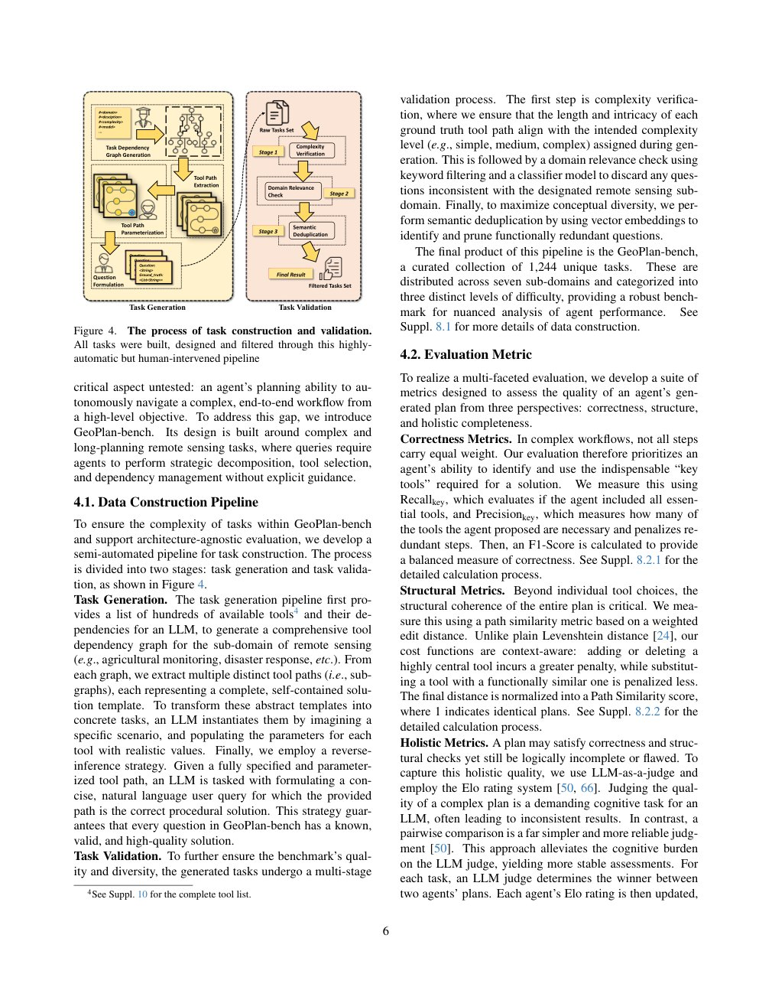

---

## PDF 第 007 页

Table 1. Results across different complexities and architectures in GeoPlan-bench. Bold indicates the best performance and underlined indicates the second-best performance.

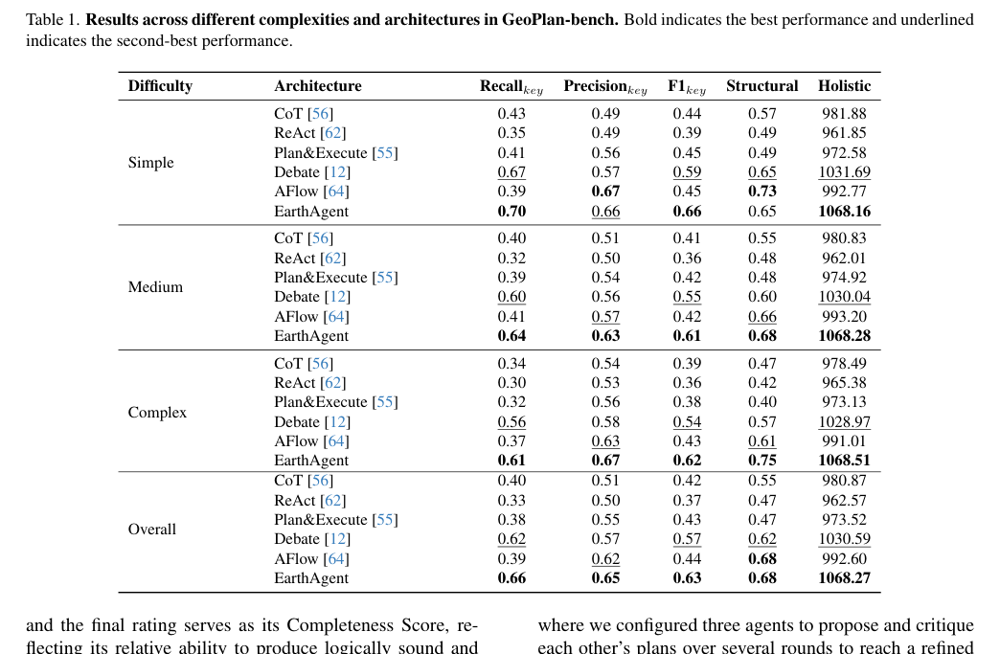

Difficulty Architecture Recallkey Precisionkey F1key Structural Holistic

Simple

Medium

Complex

Overall

and the final rating serves as its Completeness Score, reflecting its relative ability to produce logically sound and comprehensive plans. See Suppl. 8.2.3 for the details.

5. Experiment

5.1. Settings

To validate our proposed HTAM, we conducted a series of experiments on GeoPlan-bench. The primary objective was to compare the task planning performance of our EarthAgent against a representative set of established agent paradigms. The evaluation focused exclusively on the planning phase, assessing the generated tool sequences for their correctness and quality, independent of tool execution. We benchmarked EarthAgent against several key architectures, as shown in Suppl. 8 Figure 7: • A simple Chain-of-Thought (CoT) [56] prompt was used as a fundamental baseline, instructing the LLM to “think step-by-step” to generate a tool plan. • For single-agent paradigms, we implemented ReAct [62], which generates a plan through an iterative cycle of thought, action, and observation, allowing for dynamic adjustments; and Plan&Execute [55], which first generates a complete, multi-step plan and then proceeds to execute it without intermediate modifications. • For multi-agent paradigms5, we included Debate [12],

5See Suppl. 8.4 and 8.5 for our re-implementation details.

7

CoT [56] 0.43 0.49 0.44 0.57 981.88 ReAct [62] 0.35 0.49 0.39 0.49 961.85 Plan&Execute [55] 0.41 0.56 0.45 0.49 972.58 Debate [12] 0.67 0.57 0.59 0.65 1031.69 AFlow [64] 0.39 0.67 0.45 0.73 992.77 EarthAgent 0.70 0.66 0.66 0.65 1068.16

CoT [56] 0.40 0.51 0.41 0.55 980.83 ReAct [62] 0.32 0.50 0.36 0.48 962.01 Plan&Execute [55] 0.39 0.54 0.42 0.48 974.92 Debate [12] 0.60 0.56 0.55 0.60 1030.04 AFlow [64] 0.41 0.57 0.42 0.66 993.20 EarthAgent 0.64 0.63 0.61 0.68 1068.28

CoT [56] 0.34 0.54 0.39 0.47 978.49 ReAct [62] 0.30 0.53 0.36 0.42 965.38 Plan&Execute [55] 0.32 0.56 0.38 0.40 973.13 Debate [12] 0.56 0.58 0.54 0.57 1028.97 AFlow [64] 0.37 0.63 0.43 0.61 991.01 EarthAgent 0.61 0.67 0.62 0.75 1068.51

CoT [56] 0.40 0.51 0.42 0.55 980.87 ReAct [62] 0.33 0.50 0.37 0.47 962.57 Plan&Execute [55] 0.38 0.55 0.43 0.47 973.52 Debate [12] 0.62 0.57 0.57 0.62 1030.59 AFlow [64] 0.39 0.62 0.44 0.68 992.60 EarthAgent 0.66 0.65 0.63 0.68 1068.27

where we configured three agents to propose and critique each other’s plans over several rounds to reach a refined consensus. We also implemented AFlow [64], an agentic workflow generation system that we used to learn an optimized workflow from a subset (248 samples) of our benchmark, which was then evaluated on the remainder. To ensure a fair comparison, unless otherwise specified, all agent architectures were powered by the same LLM, GPT-4o-mini, and were provided with the exact same tools and their descriptions. 996 samples were used for evaluation (excluding AFlow’s training samples). In Sections 5.3 and 5.4, only 70 uniformly sampled tasks are utilized due to API costs. Each architecture’s system prompts and interaction structure were implemented to faithfully align with its original publication, ensuring a fair comparison in our planning-focused scenario. Our implementation of EarthAgent follows the 3-layer configuration detailed in Section 3.2. Performance was measured using the metric suite from Section 4.2. More details, including the specific prompts used for each agent, are in the Suppl. 8.6.4.

5.2. Main Results

As shown in Table 1, our HTAM-based EarthAgent significantly outperforms all established agent architectures across all metrics. A clear pattern in the results is that multiagent systems perform better than single-agent systems. Single-agent systems like ReAct and Plan&Execute strug-

本页原版截图（含所有图片、公式、表格）

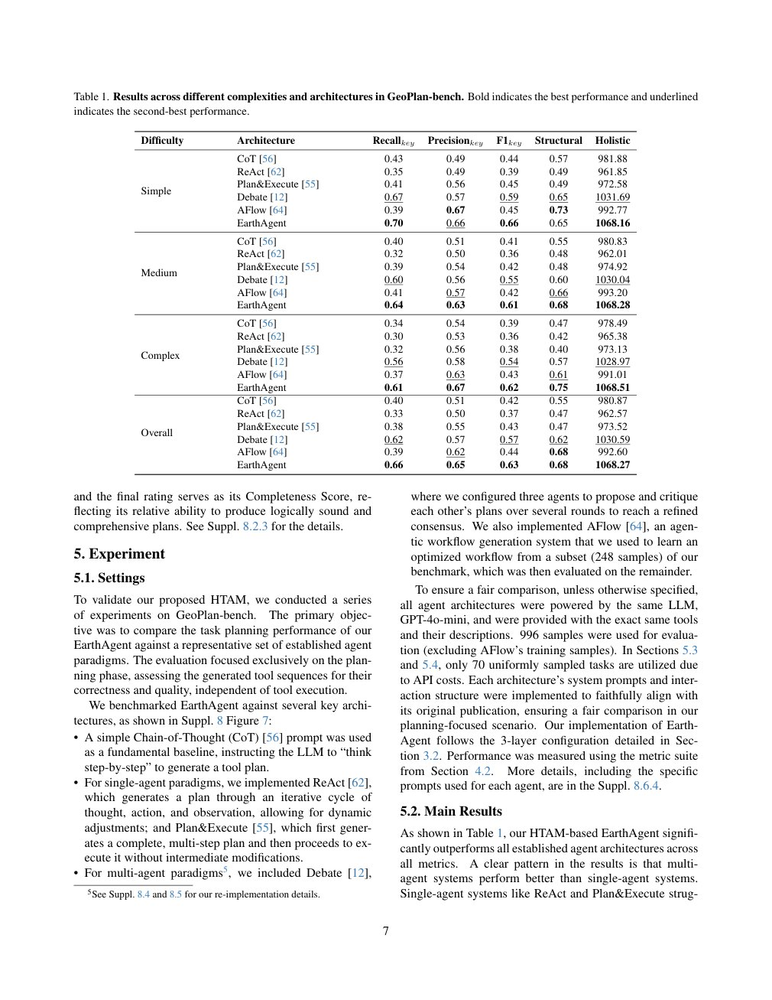

---

## PDF 第 008 页

Table 2. Performance of EarthAgent with various LLM.

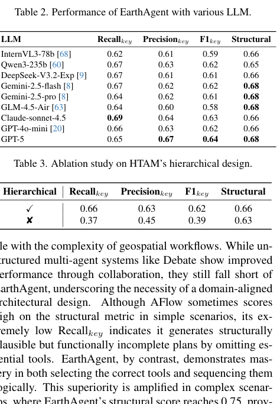

LLM Recallkey Precisionkey F1key Structural

InternVL3-78b [68] 0.62 0.61 0.59 0.66 Qwen3-235b [60] 0.67 0.63 0.62 0.65 DeepSeek-V3.2-Exp [9] 0.67 0.61 0.61 0.66 Gemini-2.5-flash [8] 0.67 0.62 0.62 0.68 Gemini-2.5-pro [8] 0.64 0.62 0.61 0.68 GLM-4.5-Air [63] 0.64 0.60 0.58 0.68 Claude-sonnet-4.5 0.69 0.64 0.63 0.66 GPT-4o-mini [20] 0.66 0.63 0.62 0.66 GPT-5 0.65 0.67 0.64 0.68

Table 3. Ablation study on HTAM’s hierarchical design.

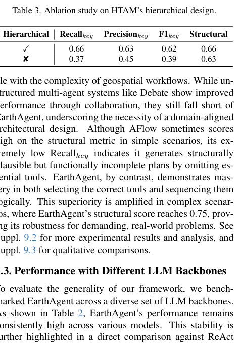

Hierarchical Recallkey Precisionkey F1key Structural

✓ 0.66 0.63 0.62 0.66 ✘ 0.37 0.45 0.39 0.63

gle with the complexity of geospatial workflows. While unstructured multi-agent systems like Debate show improved performance through collaboration, they still fall short of EarthAgent, underscoring the necessity of a domain-aligned architectural design. Although AFlow sometimes scores high on the structural metric in simple scenarios, its extremely low Recallkey indicates it generates structurally plausible but functionally incomplete plans by omitting essential tools. EarthAgent, by contrast, demonstrates mastery in both selecting the correct tools and sequencing them logically. This superiority is amplified in complex scenarios, where EarthAgent’s structural score reaches 0.75, proving its robustness for demanding, real-world problems. See Suppl. 9.2 for more experimental results and analysis, and Suppl. 9.3 for qualitative comparisons.

5.3. Performance with Different LLM Backbones

To evaluate the generality of our framework, we benchmarked EarthAgent across a diverse set of LLM backbones. As shown in Table 2, EarthAgent’s performance remains consistently high across various models. This stability is further highlighted in a direct comparison against ReAct (Figure 5), where EarthAgent’s scores are tightly clustered, in stark contrast to the wide performance variance exhibited by the ReAct-based agent. This suggests that the HTAM architecture itself provides the primary reasoning scaffold, making the system’s performance less dependent on the specific capabilities of the underlying LLM. This robustness stems from HTAM’s architectural design, which changes the LLM’s role. Instead of performing complex, end-to-end planning, the LLM is tasked with more constrained, layer-specific decisions, i.e., selecting and configuring sub-agents within a predefined logical flow. By offloading the primary cognitive burden of procedural reasoning to the architecture, HTAM ensures consistent and reliable performance, demonstrating its broad applicability across different LLMs.

8

(a) F1key (b) Structural Score

Figure 5. Performance stability of EarthAgent versus ReAct across multiple LLM backbones.

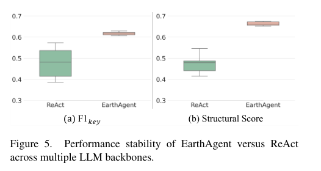

5.4. Ablation Study

To dissect HTAM’s core architectural components, we conducted an ablation study, as listed in Table 3. When we removed the hierarchical strategy, the system’s performance collapsed dramatically, with the F1key score dropping from 0.62 to 0.39. This result proves that the structured, hierarchical decomposition of a user’s query into a multi-layer plan is the foundational pillar of HTAM’s success. Interestingly, the Structural score sees a more modest decline from 0.66 to 0.63. This suggests that while a non-hierarchical approach might generate a superficially plausible sequence, it profoundly fails in selecting the correct tools for the task. This highlights that the primary value of our hierarchical mechanism lies not just in enforcing order, but more critically, in enabling correct, context-aware tool selection at each stage of the workflow.

6. Conclusion

In this work, we introduce HTAM, a novel framework for designing domain-specific multi-agent systems. Departing from prevalent socially-inspired paradigms, HTAM constructs an agent hierarchy that directly mirrors the domain’s intrinsic task dependency. This knowledge-driven structural design enforces procedural correctness and systematically decomposes complex problems, leading to more robust and reliable agent performance. We demonstrate the efficacy of this framework through EarthAgent, an HTAM-based system for geospatial analysis, and evaluate it on our proposed benchmark, GeoPlan-bench. Extensive experiments show that EarthAgent significantly outperforms established single- and multi-agent architectures. Our results validate a key principle: for specialized domains governed by structured workflows, aligning the agent architecture with the inherent task logic is not just beneficial, but essential. This work provides a concrete methodology for building the next generation of specialized autonomous systems6.

6We have built a practical EarthAgent system that can actually execute complex remote sensing workflows. Its basic version will be contributed to the community. See Suppl. 11 for more details.

本页原版截图（含所有图片、公式、表格）

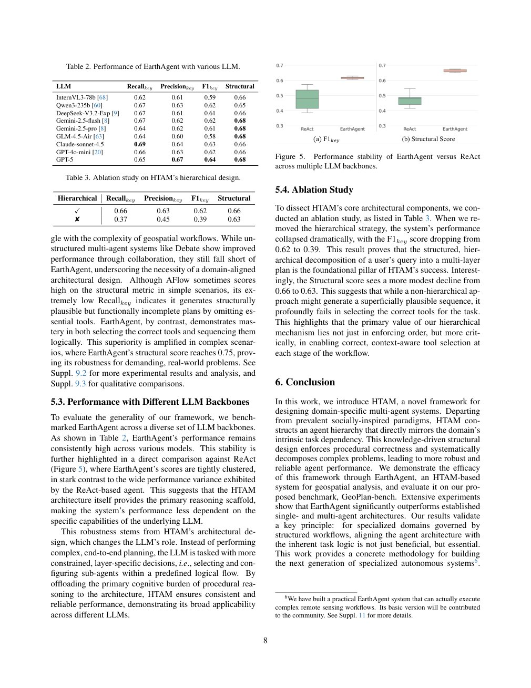

---

## PDF 第 009 页

References

[1] Yoshua Bengio, Ian Goodfellow, Aaron Courville, et al. Deep learning. MIT press Cambridge, MA, USA, 2017. 3 [2] Maciej Besta, Nils Blach, Ales Kubicek, Robert Gerstenberger, Michal Podstawski, Lukas Gianinazzi, Joanna Gajda, Tomasz Lehmann, Hubert Niewiadomski, Piotr Nyczyk, et al. Graph of thoughts: Solving elaborate problems with large language models. In Proceedings of the AAAI Conference on Artificial Intelligence, pages 17682–17690, 2024. 3 [3] Christopher M Bishop and Nasser M Nasrabadi. Pattern recognition and machine learning. Springer, 2006. 3 [4] L ́eon Bottou. Stochastic gradient descent tricks. In Neural networks: tricks of the trade: second edition, pages 421–436. Springer, 2012. 3 [5] Andres M Bran, Sam Cox, Oliver Schilter, Carlo Baldassari, Andrew D White, and Philippe Schwaller. Chemcrow: Augmenting large-language models with chemistry tools. arXiv preprint arXiv:2304.05376, 2023. 3 [6] Kelley Burton. ” think like a lawyer” using a legal reasoning grid and criterion-referenced assessment rubric on irac (issue, rule, application, conclusion). Journal of Learning Design, 10(2):57–68, 2017. 1 [7] Ching-An Cheng, Andrey Kolobov, Dipendra Misra, Allen Nie, and Adith Swaminathan. Llf-bench: Benchmark for interactive learning from language feedback. arXiv preprint arXiv:2312.06853, 2023. 3 [8] Gheorghe Comanici, Eric Bieber, Mike Schaekermann, Ice Pasupat, Noveen Sachdeva, Inderjit Dhillon, Marcel Blistein, Ori Ram, Dan Zhang, Evan Rosen, et al. Gemini 2.5: Pushing the frontier with advanced reasoning, multimodality, long context, and next generation agentic capabilities. arXiv preprint arXiv:2507.06261, 2025. 8 [9] DeepSeek-AI. Deepseek-v3.2-exp: Boosting long-context efficiency with deepseek sparse attention, 2025. 8 [10] Jean C Digitale, Jeffrey N Martin, and Medellena Maria Glymour. Tutorial on directed acyclic graphs. Journal of Clinical Epidemiology, 142:264–267, 2022. 1 [11] Vishnu Sashank Dorbala, James F Mullen, and Dinesh Manocha. Can an embodied agent find your “cat-shaped mug”? llm-based zero-shot object navigation. IEEE Robotics and Automation Letters, 9(5):4083–4090, 2023. 1 [12] Yilun Du, Shuang Li, Antonio Torralba, Joshua B Tenenbaum, and Igor Mordatch. Improving factuality and reasoning in language models through multiagent debate. In Fortyfirst International Conference on Machine Learning, 2023. 3, 7, 5 [13] Peilin Feng, Zhutao Lv, Junyan Ye, Xiaolei Wang, Xinjie Huo, Jinhua Yu, Wanghan Xu, Wenlong Zhang, Lei Bai, Conghui He, et al. Earth-agent: Unlocking the full landscape of earth observation with agents. arXiv preprint arXiv:2509.23141, 2025. 3, 56 [14] Yunfan Gao, Yun Xiong, Xinyu Gao, Kangxiang Jia, Jinliu Pan, Yuxi Bi, Yixin Dai, Jiawei Sun, Haofen Wang, and Haofen Wang. Retrieval-augmented generation for large language models: A survey. arXiv preprint arXiv:2312.10997, 2(1), 2023. 3

9

[15] Alireza Ghafarollahi and Markus J Buehler. Sciagents: automating scientific discovery through bioinspired multiagent intelligent graph reasoning. Advanced Materials, 37 (22):2413523, 2025. 3 [16] Haonan Guo, Xin Su, Chen Wu, Bo Du, Liangpei Zhang, and Deren Li. Remote sensing chatgpt: Solving remote sensing tasks with chatgpt and visual models. In IGARSS 2024-2024 IEEE International Geoscience and Remote Sensing Symposium, pages 11474–11478. IEEE, 2024. 3 [17] Sirui Hong, Mingchen Zhuge, Jonathan Chen, Xiawu Zheng, Yuheng Cheng, Ceyao Zhang, Jinlin Wang, Zili Wang, Steven Ka Shing Yau, Zijuan Lin, et al. Metagpt: Meta programming for a multi-agent collaborative framework. International Conference on Learning Representations, ICLR, 2024. 1, 3 [18] Huiyang Hu, Peijin Wang, Yingchao Feng, Kaiwen Wei, Wenxin Yin, Wenhui Diao, Mengyu Wang, Hanbo Bi, Kaiyue Kang, Tong Ling, et al. Ringmo-agent: A unified remote sensing foundation model for multi-platform and multimodal reasoning. arXiv preprint arXiv:2507.20776, 2025. 3 [19] James P Hughes, Stephen Rees, S Barrett Kalindjian, and Karen L Philpott. Principles of early drug discovery. British Journal of Pharmacology, 162(6):1239–1249, 2011. 1 [20] Aaron Hurst, Adam Lerer, Adam P Goucher, Adam Perelman, Aditya Ramesh, Aidan Clark, AJ Ostrow, Akila Welihinda, Alan Hayes, Alec Radford, et al. Gpt-4o system card. arXiv preprint arXiv:2410.21276, 2024. 8 [21] Carlos E Jimenez, John Yang, Alexander Wettig, Shunyu Yao, Kexin Pei, Ofir Press, and Karthik Narasimhan. Swebench: Can language models resolve real-world github issues? arXiv preprint arXiv:2310.06770, 2023. 3 [22] Jing Yu Koh, Robert Lo, Lawrence Jang, Vikram Duvvur, Ming Chong Lim, Po-Yu Huang, Graham Neubig, Shuyan Zhou, Ruslan Salakhutdinov, and Daniel Fried. Visualwebarena: Evaluating multimodal agents on realistic visual web tasks. arXiv preprint arXiv:2401.13649, 2024. 3 [23] Jon M Laurent, Joseph D Janizek, Michael Ruzo, Michaela M Hinks, Michael J Hammerling, Siddharth Narayanan, Manvitha Ponnapati, Andrew D White, and Samuel G Rodriques. Lab-bench: Measuring capabilities of language models for biology research. arXiv preprint arXiv:2407.10362, 2024. 3 [24] VI Lcvenshtcin. Binary coors capable or ‘correcting deletions, insertions, and reversals. In Soviet physics-doklady, 1966. 6, 3 [25] Chaehong Lee, Varatheepan Paramanayakam, Andreas Karatzas, Yanan Jian, Michael Fore, Heming Liao, Fuxun Yu, Ruopu Li, Iraklis Anagnostopoulos, and Dimitrios Stamoulis. Multi-agent geospatial copilots for remote sensing workflows. arXiv preprint arXiv:2501.16254, 2025. 3 [26] Kaiyu Li, Xiangyong Cao, Yupeng Deng, Chao Pang, Zepeng Xin, Deyu Meng, and Zhi Wang. Dynamicearth: How far are we from open-vocabulary change detection? arXiv preprint arXiv:2501.12931, 2025. 5 [27] Kaiyu Li, Xiangyong Cao, Ruixun Liu, Shihong Wang, Zixuan Jiang, Zhi Wang, and Deyu Meng. Annotation-free open-vocabulary segmentation for remote-sensing images. arXiv preprint arXiv:2508.18067, 2025. 5

本页原版截图（含所有图片、公式、表格）

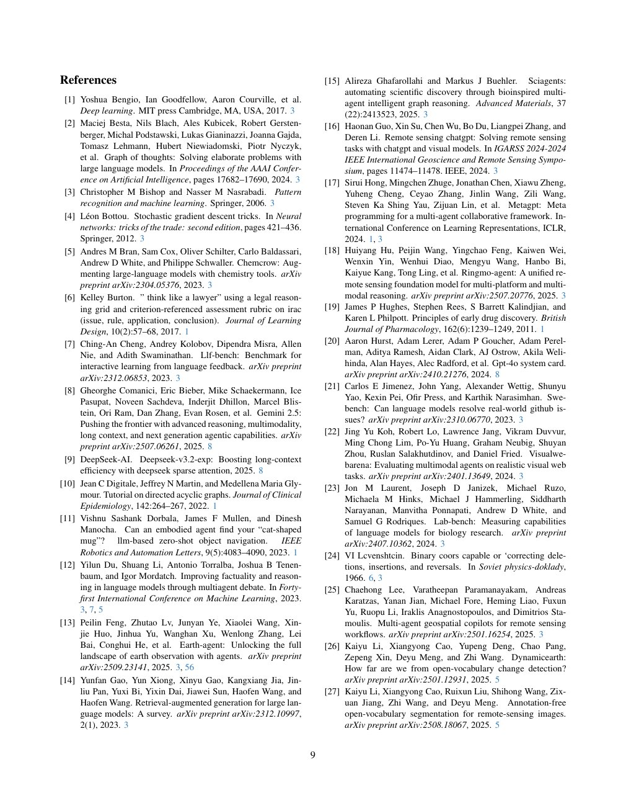

---

## PDF 第 010 页

[28] Kaiyu Li, Jiawei Jiang, Chengxi Han, Yupeng Deng, Keyan Chen, Zhuo Zheng, Hao Chen, Ziyuan Liu, Yuantao Gu, Zhengxia Zou, et al. Open-cd: A comprehensive toolbox for change detection. In Proceedings of the 33rd ACM International Conference on Multimedia, pages 13608–13612, 2025. 1 [29] Kaiyu Li, Zixuan Jiang, Xiangyong Cao, Jiayu Wang, Yuchen Xiao, Deyu Meng, and Zhi Wang. Describeearth: Describe anything for remote sensing images. arXiv preprint arXiv:2509.25654, 2025. 3 [30] Kaiyu Li, Ruixun Liu, Xiangyong Cao, Xueru Bai, Feng Zhou, Deyu Meng, and Zhi Wang. Segearth-ov: Towards training-free open-vocabulary segmentation for remote sensing images. In Proceedings of the Computer Vision and Pattern Recognition Conference, pages 10545–10556, 2025. 5 [31] Kaiyu Li, Zepeng Xin, Li Pang, Chao Pang, Yupeng Deng, Jing Yao, Guisong Xia, Deyu Meng, Zhi Wang, and Xiangyong Cao. Segearth-r1: Geospatial pixel reasoning via large language model. arXiv preprint arXiv:2504.09644, 2025. 5 [32] Lingyu Li, Yixu Wang, Haiquan Zhao, Shuqi Kong, Yan Teng, Chunbo Li, and Yingchun Wang. Reflection-bench: Evaluating epistemic agency in large language models. arXiv preprint arXiv:2410.16270, 2024. 3 [33] Xinyi Li, Sai Wang, Siqi Zeng, Yu Wu, and Yi Yang. A survey on llm-based multi-agent systems: workflow, infrastructure, and challenges. Vicinagearth, 1(1):9, 2024. 1, 3 [34] Chenyang Liu, Keyan Chen, Haotian Zhang, Zipeng Qi, Zhengxia Zou, and Zhenwei Shi. Change-agent: Towards interactive comprehensive remote sensing change interpretation and analysis. IEEE Transactions on Geoscience and Remote Sensing, 2024. 3 [35] Fan Liu, Delong Chen, Zhangqingyun Guan, Xiaocong Zhou, Jiale Zhu, Qiaolin Ye, Liyong Fu, and Jun Zhou. Remoteclip: A vision language foundation model for remote sensing. IEEE Transactions on Geoscience and Remote Sensing, 62:1–16, 2024. 3 [36] Jiarui Lu, Thomas Holleis, Yizhe Zhang, Bernhard Aumayer, Feng Nan, Felix Bai, Shuang Ma, Shen Ma, Mengyu Li, Guoli Yin, et al. Toolsandbox: A stateful, conversational, interactive evaluation benchmark for llm tool use capabilities. arXiv preprint arXiv:2408.04682, 2024. 3 [37] Gr ́egoire Mialon, Cl ́ementine Fourrier, Thomas Wolf, Yann LeCun, and Thomas Scialom. Gaia: a benchmark for general ai assistants. In The Twelfth International Conference on Learning Representations, 2023. 2 [38] Humza Naveed, Asad Ullah Khan, Shi Qiu, Muhammad Saqib, Saeed Anwar, Muhammad Usman, Naveed Akhtar, Nick Barnes, and Ajmal Mian. A comprehensive overview of large language models. ACM Transactions on Intelligent Systems and Technology, 16(5):1–72, 2025. 1 [39] Charles Packer, Vivian Fang, Shishir G Patil, Kevin Lin, Sarah Wooders, and Joseph E Gonzalez. Memgpt: Towards llms as operating systems. 2023. 3 [40] Bo Pan, Jiaying Lu, Ke Wang, Li Zheng, Zhen Wen, Yingchaojie Feng, Minfeng Zhu, and Wei Chen. Agentcoord: Visually exploring coordination strategy for llm-based multi-agent collaboration. Computers & Graphics, page 104338, 2025. 1

[41] Huy Nhat Phan, Tien N Nguyen, Phong X Nguyen, and Nghi DQ Bui. Hyperagent: Generalist software engineering agents to solve coding tasks at scale. arXiv preprint arXiv:2409.16299, 2024. 1 [42] Jerald E Pinto, Thomas R Robinson, and John D Stowe. Equity valuation: A survey of professional practice. Review of Financial Economics, 37(2):219–233, 2019. 1 [43] Chen Qian, Xin Cong, Cheng Yang, Weize Chen, Yusheng Su, Juyuan Xu, Zhiyuan Liu, and Maosong Sun. Communicative agents for software development. arXiv preprint arXiv:2307.07924, 6(3):1, 2023. 1 [44] Chen Qian, Wei Liu, Hongzhang Liu, Nuo Chen, Yufan Dang, Jiahao Li, Cheng Yang, Weize Chen, Yusheng Su, Xin Cong, et al. Chatdev: Communicative agents for software development. arXiv preprint arXiv:2307.07924, 2023. 1, 3 [45] Yujia Qin, Shihao Liang, Yining Ye, Kunlun Zhu, Lan Yan, Yaxi Lu, Yankai Lin, Xin Cong, Xiangru Tang, Bill Qian, et al. Toolllm: Facilitating large language models to master 16000+ real-world apis. arXiv preprint arXiv:2307.16789, 2023. 2, 3 [46] Winston W Royce. Managing the development of large software systems: concepts and techniques. In Proceedings of the 9th international conference on Software Engineering, pages 328–338, 1987. 1 [47] Jingqing Ruan, Yihong Chen, Bin Zhang, Zhiwei Xu, Tianpeng Bao, Hangyu Mao, Ziyue Li, Xingyu Zeng, Rui Zhao, et al. Tptu: Task planning and tool usage of large language model-based ai agents. In NeurIPS 2023 Foundation Models for Decision Making Workshop, 2023. 1 [48] Akashah Shabbir, Muhammad Akhtar Munir, Akshay Dudhane, Muhammad Umer Sheikh, Muhammad Haris Khan, Paolo Fraccaro, Juan Bernabe Moreno, Fahad Shahbaz Khan, and Salman Khan. Thinkgeo: Evaluating toolaugmented agents for remote sensing tasks. arXiv preprint arXiv:2505.23752, 2025. 2, 3, 5 [49] Minjie Shen, Yanshu Li, Lulu Chen, and Qikai Yang. From mind to machine: The rise of manus ai as a fully autonomous digital agent. arXiv preprint arXiv:2505.02024, 2025. 56 [50] Lin Shi, Chiyu Ma, Wenhua Liang, Xingjian Diao, Weicheng Ma, and Soroush Vosoughi. Judging the judges: A systematic study of position bias in llm-as-a-judge. arXiv preprint arXiv:2406.07791, 2024. 6, 4 [51] Tianlin Shi, Andrej Karpathy, Linxi Fan, Jonathan Hernandez, and Percy Liang. World of bits: An open-domain platform for web-based agents. In International Conference on Machine Learning, pages 3135–3144. PMLR, 2017. 3 [52] Noah Shinn, Federico Cassano, Beck Labash, Ashwin Gopinath, Karthik Narasimhan, and Shunyu Yao. Reflexion: Language agents with verbal reinforcement learning, 2023. arXiv preprint arXiv:2303.11366, 1, 2023. 3 [53] Katharina Stein, Daniel Fiˇser, J ̈org Hoffmann, and Alexander Koller. Autoplanbench: Automatically generating benchmarks for llm planners from pddl. arXiv preprint arXiv:2311.09830, 2023. 3 [54] Karthik Valmeekam, Matthew Marquez, Alberto Olmo, Sarath Sreedharan, and Subbarao Kambhampati. Planbench: An extensible benchmark for evaluating large language models on planning and reasoning about change. Advances in

10

本页原版截图（含所有图片、公式、表格）

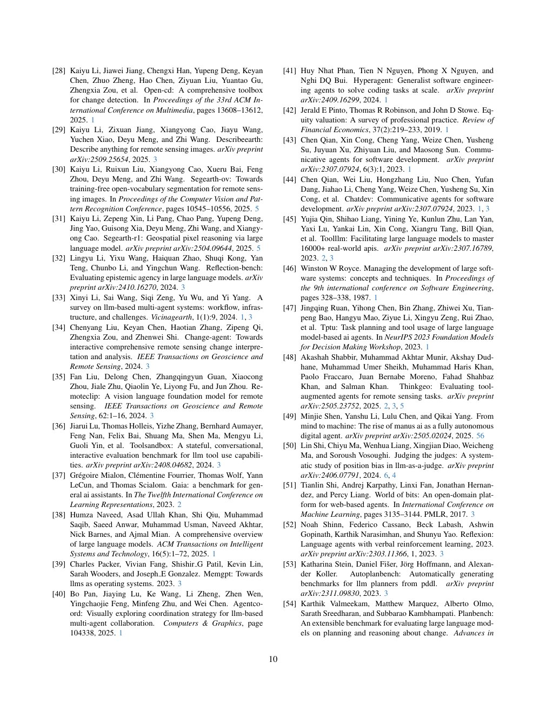

---

## PDF 第 011 页

Neural Information Processing Systems, 36:38975–38987, 2023. 3 [55] Lei Wang, Wanyu Xu, Yihuai Lan, Zhiqiang Hu, Yunshi Lan, Roy Ka-Wei Lee, and Ee-Peng Lim. Plan-and-solve prompting: Improving zero-shot chain-of-thought reasoning by large language models. arXiv preprint arXiv:2305.04091, 2023. 2, 7 [56] Jason Wei, Xuezhi Wang, Dale Schuurmans, Maarten Bosma, Fei Xia, Ed Chi, Quoc V Le, Denny Zhou, et al. Chain-of-thought prompting elicits reasoning in large language models. Advances in Neural Information Processing Systems, 35:24824–24837, 2022. 7 [57] Qingyun Wu, Gagan Bansal, Jieyu Zhang, Yiran Wu, Beibin Li, Erkang Zhu, Li Jiang, Xiaoyun Zhang, Shaokun Zhang, Jiale Liu, et al. Autogen: Enabling next-gen llm applications via multi-agent conversations. In First Conference on Language Modeling, 2024. 3 [58] Wenjia Xu, Zijian Yu, Boyang Mu, Zhiwei Wei, Yuanben Zhang, Guangzuo Li, and Mugen Peng. Rs-agent: Automating remote sensing tasks through intelligent agent. arXiv preprint arXiv:2406.07089, 2024. 3 [59] Bingyu Yan, Zhibo Zhou, Litian Zhang, Lian Zhang, Ziyi Zhou, Dezhuang Miao, Zhoujun Li, Chaozhuo Li, and Xiaoming Zhang. Beyond self-talk: A communication-centric survey of llm-based multi-agent systems. arXiv preprint arXiv:2502.14321, 2025. 1 [60] An Yang, Anfeng Li, Baosong Yang, Beichen Zhang, Binyuan Hui, Bo Zheng, Bowen Yu, Chang Gao, Chengen Huang, Chenxu Lv, et al. Qwen3 technical report. arXiv preprint arXiv:2505.09388, 2025. 8 [61] Shunyu Yao, Dian Yu, Jeffrey Zhao, Izhak Shafran, Tom Griffiths, Yuan Cao, and Karthik Narasimhan. Tree of thoughts: Deliberate problem solving with large language models. Advances in Neural Information Processing Systems, 36:11809–11822, 2023. 3 [62] Shunyu Yao, Jeffrey Zhao, Dian Yu, Nan Du, Izhak Shafran, Karthik Narasimhan, and Yuan Cao. React: Synergizing reasoning and acting in language models. In International Conference on Learning Representations (ICLR), 2023. 1, 2, 3, 7 [63] Aohan Zeng, Xin Lv, Qinkai Zheng, Zhenyu Hou, Bin Chen, Chengxing Xie, Cunxiang Wang, Da Yin, Hao Zeng, Jiajie Zhang, et al. Glm-4.5: Agentic, reasoning, and coding (arc) foundation models. arXiv preprint arXiv:2508.06471, 2025. 8 [64] Jiayi Zhang, Jinyu Xiang, Zhaoyang Yu, Fengwei Teng, Xiong-Hui Chen, Jiaqi Chen, Mingchen Zhuge, Xin Cheng, Sirui Hong, Jinlin Wang, Bingnan Zheng, Bang Liu, Yuyu Luo, and Chenglin Wu. AFlow: Automating agentic workflow generation. In The Thirteenth International Conference on Learning Representations, 2025. 3, 7 [65] Wayne Xin Zhao, Kun Zhou, Junyi Li, Tianyi Tang, Xiaolei Wang, Yupeng Hou, Yingqian Min, Beichen Zhang, Junjie Zhang, Zican Dong, et al. A survey of large language models. arXiv preprint arXiv:2303.18223, 1(2), 2023. 1 [66] Lianmin Zheng, Wei-Lin Chiang, Ying Sheng, Siyuan Zhuang, Zhanghao Wu, Yonghao Zhuang, Zi Lin, Zhuohan

Li, Dacheng Li, Eric Xing, et al. Judging llm-as-a-judge with mt-bench and chatbot arena. Advances in Neural Information Processing Systems, 36:46595–46623, 2023. 6, 4 [67] Shuyan Zhou, Frank F Kang, Jiatong Liu, Hussen Ilas, Srikar Potti, Michael R Glass, and Subbarao Kambhampati. Webarena: A realistic web environment for building autonomous agents. arXiv preprint arXiv:2307.13854, 2023. 3 [68] Jinguo Zhu, Weiyun Wang, Zhe Chen, Zhaoyang Liu, Shenglong Ye, Lixin Gu, Hao Tian, Yuchen Duan, Weijie Su, Jie Shao, et al. Internvl3: Exploring advanced training and test-time recipes for open-source multimodal models. arXiv preprint arXiv:2504.10479, 2025. 8

11

本页原版截图（含所有图片、公式、表格）

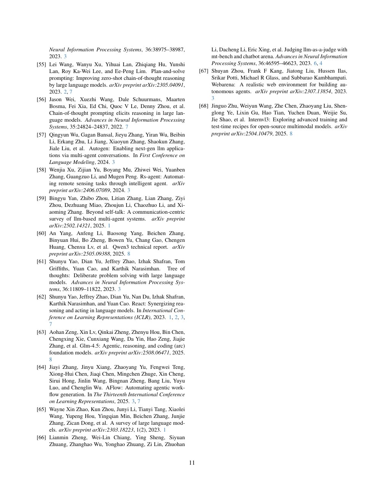

---

## PDF 第 012 页

Designing Domain-Specific Agents via Hierarchical Task Abstraction Mechanism

7. Discussion

7.1. Application domains of HTAM

While we introduced HTAM through its instantiation in the remote sensing domain as EarthAgent, the framework’s core principles are designed for broader applicability. The true strength of the HTAM lies in its application to any vertical domain where problem-solving workflows can be highly systematized and decomposed into a logical hierarchy. Many fields beyond remote sensing possess such characteristics and could benefit from our structured philosophy. Here we offer some insights, for instance, in the field of financial analysis, a complex query can normally be deconstructed into layers: data acquisition (fetching stock prices, quarterly reports, market news), quantitative analysis (calculating financial ratios, running valuation models), and qualitative synthesis (analyzing management commentary, competitive landscape, and generating a final recommendation) [42]. Similarly, in biomedical research, the drug discovery pipeline involves distinct stages of target identification, molecular screening, pre-clinical testing analysis, and clinical trial data interpretation—a process perfectly suited for a multi-layer agent system [19]. Other promising domains include legal case analysis, which requires a sequence of fact-finding, precedent research, and argument construction [6], and complex software engineering tasks that can be broken down into requirement analysis, architecture design, implementation, and testing [46]. In all these scenarios, HTAM provides a robust framework for creating specialized and efficient multi-agent systems that can navigate complex, domain-specific procedures with greater reliability than general agent architectures.

7.2. Limitation

EarthAgent represents our instantiation of the HTAM within remote sensing. However, there is still no perfect solution for how to instantiate HTAM in specific vertical fields. This process fundamentally depends on the users’ and designers’ comprehension of the specific industry or domain, as well as the associated business requirements. Although EarthAgent was developed through extensive research and in consultation with industry experts, we cannot assert that we have abstracted the complete set of tasksolving pathways into their optimal forms. As a result, in certain scenarios, rollbacks between layers may be needed, e.g., when mid- or high-level sub-agents require additional specialized data during processing. If more effective abstraction methods become available, this issue could be resolved. Thus, we regard this as an

1

Supplementary Material

open question and encourage future research to propose improved abstraction strategies and design more optimal instantiations of HTAM.

7.3. Expectation

As the development of LLM agents continues to accelerate, the focus of the research community is gradually broadening. While enhancing the intrinsic capabilities of foundational models remains a critical pursuit, it is becoming increasingly evident that the thoughtful definition of problems, scenarios, and interaction patterns is equally vital. The next frontier of progress lies not just in building more powerful models, but in architecting the ecosystems where these models can operate effectively. We hope that our work on HTAM and the GeoPlanbench benchmark represents a step in this direction. By structuring the problem space and defining clear, hierarchical interfaces, we can create a more predictable and robust environment for agent collaboration. This “applicationcentric” approach, which emphasizes the design of standardized tasks, interfaces, and evaluation protocols, serves as a crucial complement to model-centric research. The continued exploration and creation of LLM- and agentfriendly application scenarios will be paramount. Such efforts will not only guide the development of more capable and specialized agents but also accelerate the translation of AIGC technologies into practical, real-world solutions that can reliably handle complex, domain-specific challenges. We believe that this symbiotic relationship between model advancement and application-layer innovation will play a pivotal role in shaping the future of AI applications.

8. Implementation Details

8.1. Task Construction Details

This pipeline is designed to create and validate complex, realistic questions grounded in practical scenarios. The process is highly driven by LLMs but consists of human intervention after critical stages. The visualization of the process is shown in Figure 4.

8.1.1. Task Generation Details

Here, we present core details of task generation pipeline. Stage 1: Task Dependency Graph Generation. Initially, the LLM generates a task dependency graph based on specified domain information and a desired complexity level. This graph is structured as a Directed Acyclic Graph (DAG) [10], where each node represents a specific tool, and the directed edges between nodes signify the dependency

本页原版截图（含所有图片、公式、表格）

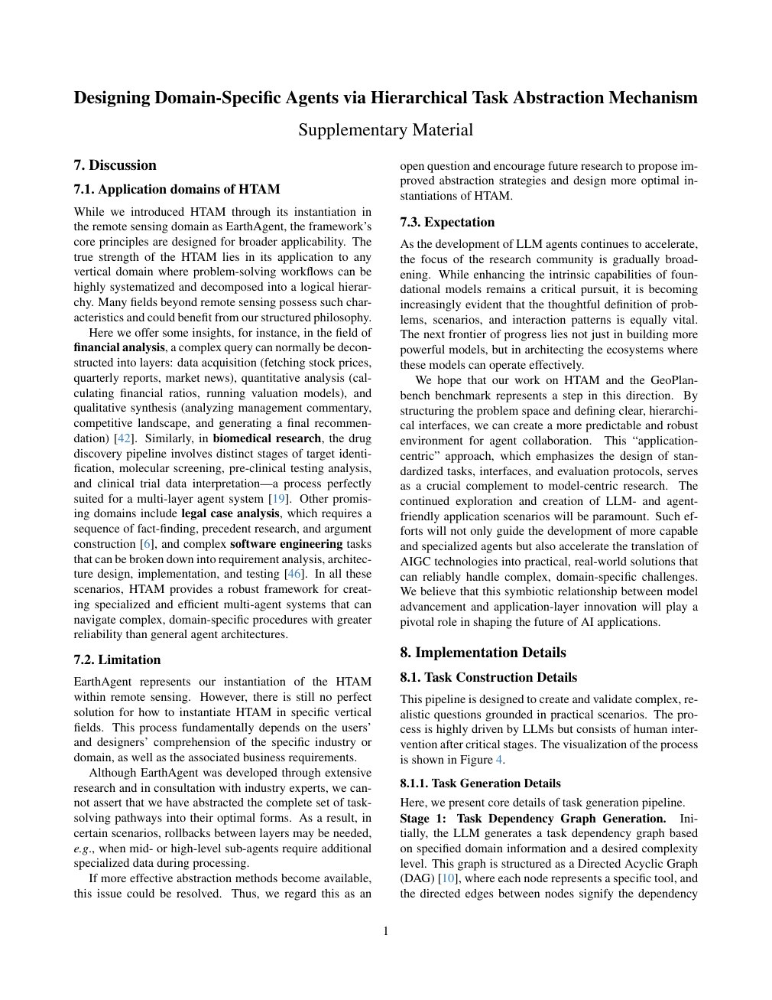

---

## PDF 第 013 页

Atmospheric

Cloud Mask Removal

Correction

Download

Geometric Correction

Satellite Imagery

CropImage

Segment Vegetation

Detect

Roads

Segment

Water Bodies

Evaluate

Green Space Distribution

Classify LandCover

Assess LandUse Effciency

Segment

Urban Areas

Detect

Urban Expansion

Segment Individual

Evaluate UrbanHeatIsland

Monitor Traffic Congestion

Buildings

Analyze

Urban Growth Patterns

Statistical

Analysis

Generate

Analysis Reports

Figure 6. An sample example of task dependency graph in Urban & Regional Planning sub-domain. Light yellow node denotes entry node while red node denotes ending node. The brown arrow denotes the dependency relation between nodes. In the process of production, 4 tasks were successfully built based on this graph.

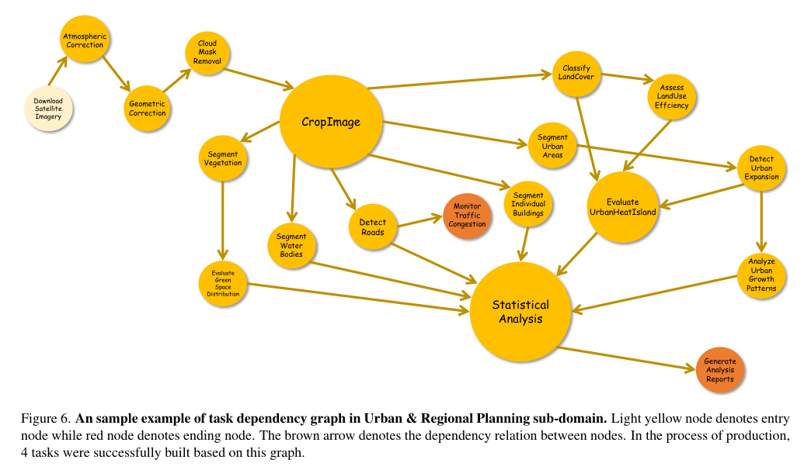

relationships between them. In practice, we use Gemini2.5-pro to generate these graphs. An example is shown in Figure 6. Stage 2: Tool Path Extraction. From this graph, we extract multiple valid tool paths. Each path is a sequence of connected nodes that begins at an initial node (entry point) and concludes at a terminal node, representing a complete workflow to solve a potential problem. Stage 3: Tool Path Parameterization. The extracted abstract tool paths are then parameterized. In this LLM-driven step, the model populates the input parameters for each tool in the sequence. This is accomplished by referencing the functional descriptions of the tools and logically inferring or imagining appropriate arguments that would be required in a real-world application. In this stage, we use GPT-4omini to fill in the parameters. Stage 4: Question Formulation. Finally, the LLM synthesizes a natural language question based on the fully parameterized tool path. This resulting question is designed so that its correct solution corresponds exactly to the parameterized path, which is subsequently stored as the “ground truth” answer for evaluation purposes. We use GPT-4o-mini to generate the question.

8.1.2. Task Validation Details

We have meticulously designed a set of validation and filtering mechanisms to ensure that the questions we produce meet expectations and are of high quality. Each task we pro-

2

duced has to go through three stages of filtering as below. Stage 1: Complexity Verification. We first filter out any questions where the complexity of the ground truth tool flow does not align with the intended complexity level specified during generation. This ensures that the difficulty of the solution matches the difficulty of the problem. Stage 2: Domain Relevance Check. Next, we discard questions that are not thematically consistent with the designated domain. This step maintains the focus of the dataset and its relevance to the target subject area. Stage 3: Semantic Deduplication. To enhance the diversity of the dataset, we identify and remove semantically repetitive questions using a word embedding-based model. This process involves three sub-steps:

• Word Embedding: All generated questions are converted into high-dimensional vector representations (word embeddings). • Similarity Calculation: We compute the cosine similarity between the vector embeddings of every pair of questions in the dataset. • Threshold-Based Filtering: Questions with a cosine similarity score exceeding a predefined threshold are considered semantic duplicates, and one of them is removed from the final dataset.

A total of 1,907 originally generated questions underwent a rigorous validation process, resulting in 1,244 high-quality questions being retained. This means 663 questions were

本页原版截图（含所有图片、公式、表格）

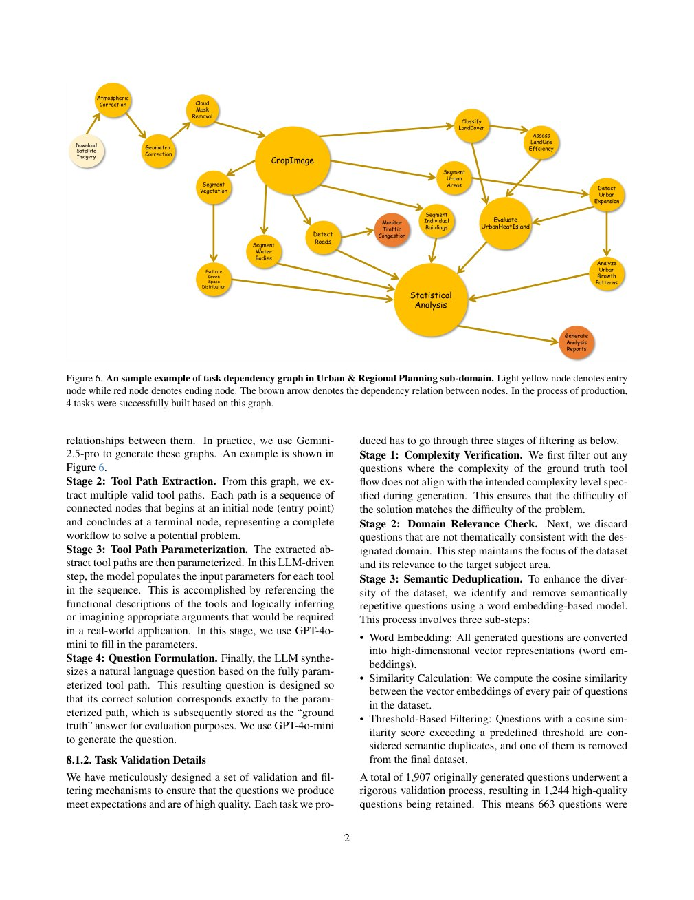

---

## PDF 第 014 页

removed by various filters. Most questions were filtered out based on Domain Relevance check, containing 306 questions. 241 questions were removed due to Complexity Verification. Among the final selected questions, the domain distribution is as follows: Agriculture & Forestry contains 213 questions, Urban & Regional Planning has 159, Environmental Monitoring & Climate Change accounts for 149, Disaster Emergency & Management represents the largest portion with 219, Earth Science & Resource Exploration includes 172, Marine & Water Resources comprises 175, and Defense & Security contains 157. In terms of complexity, the dataset is composed of 561 Simple, 441 Medium, and 242 Complex questions. This structured filtering has successfully ensured the production of a high-quality, domain-relevant, and appropriately complex question set.

8.2. Evaluation Metrics Details

To realize a diagnostic, multi-faceted evaluation, we developed a suite of metrics designed to assess the quality of an agent’s generated plan from three complementary perspectives: the correctness of its key decisions, the structural integrity, and its holistic logical completeness. It is important to reiterate that these metrics evaluate the generated plan (i.e., the sequence of tool calls) and do not depend on the successful execution of the tools themselves.

8.2.1. Correctness Metrics

Not all steps in a complex workflow are equally important. Some tools are indispensable for reaching a solution, while others might be auxiliary or interchangeable. A robust evaluation should focus on whether the agent correctly identified and utilized the most critical tools. To this end, we propose metrics based on the concept of “key tools.” First, for each task’s ground truth tool path, Sgt, an LLM acting as an expert identifies a subset of “key tools,” Skey gt ⊆Sgt. These are the tools deemed absolutely essential for solving the problem. Given an agent’s generated tool path, Sagent, we define “Key Tool Recall” as the fraction of these essential tools that the agent successfully included in its plan:

Recallkey = |Skey gt ∩Sagent|

|Skey gt| (6)

A high recall score indicates that the agent is proficient at recognizing and including the necessary components of a correct solution. Conversely, to measure the efficiency and relevance of the agent’s tool selection, we define “Key Tool Precision”. This metric answers the question: “Among the important tools proposed by the agent, how many are both correct and necessary?” To calculate this, the LLM evaluator first identifies the set of key tools from the agent’s generated path, Skey agent, reflecting the tools that the agent’s

3

internal logic prioritized. We then measure what proportion of these key tools are present in the complete ground truth path, Sgt:

Precisionkey = |Skey agent ∩Sgt|

|Skey agent| (7)

A high precision score suggests that the agent’s reasoning is not only effective but also concise, avoiding extraneous or hallucinated tool calls. The F1-Score is then calculated as the harmonic mean of Key Tool Recall and Precision to provide a balanced measure of correctness.

8.2.2. Structural Metrics

While correctness metrics focus on individual tool choices, it is equally important to evaluate the structural soundness of the entire plan. To this end, we propose a path similarity metric based on a weighted edit distance. This metric measures the “cost” of transforming the agent’s generated path, Sagent, into the ground truth path, Sgt. It enhances the classic Levenshtein distance [24] by using custom, contextaware cost functions for each edit operation (insertion, deletion, substitution). The cost functions are designed to be more intelligent than the uniform costs used in the standard Levenshtein algorithm. The cost for an “insertion” or “deletion” of a tool is not a fixed value but is weighted by the importance of that tool. A tool’s importance is derived from its structural role in a comprehensive, global tool dependency graph aggregating all solution templates. This importance is quantified using two graph centrality measures: normalized out-degree centrality (CD(v)) (Suppl. 10.3) and PageRank centrality (CP (v)) (Suppl. 10.3) for a given tool v. The cost for inserting or deleting a tool v is then formulated as: We quantify this importance using graph centrality measures, such as normalized out-degree centrality (CD(v)) and PageRank (CP (v)) for a given tool v. The cost for inserting or deleting a tool v is then formulated as:

Costins/del(v) = Costbase ×  1 + CD(v) + α · CP (v)



2

(8)

Here, Costbase is a hyperparameter representing the default minimum cost for any edit operation, set to 1. α is a weighting coefficient balancing the two centrality measures. This formulation ensures that omitting or incorrectly adding a critical, highly-connected tool incurs a higher penalty. The cost of a substitution operation between two tools, ai from Sagent and gj from Sgt, is based on their semantic similarity. This makes the metric robust to agents selecting functionally equivalent but non-identical tools. The cost is defined as:

本页原版截图（含所有图片、公式、表格）

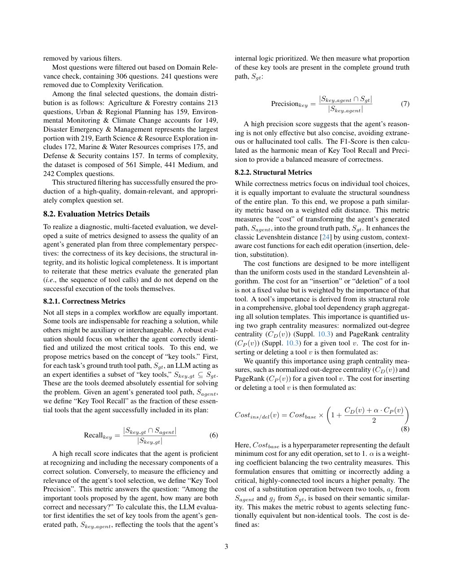

---

## PDF 第 015 页

Costsub(ai, gj) = 1 −SemanticSimilarity(ai, gj) (9)

where similarity is computed using the cosine similarity of their sentence embeddings, which are derived from the tool names and their functional descriptions. With these cost functions defined, the total minimum edit distance, D(m, n), is calculated using a dynamic programming approach following the standard Levenshtein recurrence relation. Let Sagent = a1, . . . , am and Sgt = g1, . . . , gn. Let D(i, j) be the minimum edit distance between the first i elements of Sagent and the first j elements of Sgt. The recurrence is given by:

  

D(i −1, j −1) if ai = gj

  

D(i −1, j) + Costdel(ai) D(i, j −1) + Costins(gj) D(i −1, j −1) + Costsub(ai, gj) if ai ̸= gj

D(i, j) =

min

 

 

(10)

The final value, D(m, n), represents the total minimum weighted cost to transform Sagent into Sgt. To convert this distance into a normalized path similarity score between 0 and 1, we use the formula:

PathSimilarity = 1 − D(m, n) MaxPossibleCost (11)

Here, MaxPossibleCost is a normalization factor, heuristically set to prevent scores from becoming negative. This ensures the similarity score is appropriately scaled, where a score of 1 indicates identical paths and lower scores indicate greater structural divergence.

8.2.3. Holistic Metrics

Correctness and structure are necessary but not sufficient conditions for a good plan. A plan can be structurally similar to the ground truth and contain all key tools, yet still be logically incomplete or flawed in its reasoning. To assess this holistic quality of logical comprehensiveness, we employ an evaluation based on the Elo rating system [50, 66]. We chose this approach over direct, absolute scoring because that judging the “absolute” quality of a complex plan on a numeric scale (e.g., 1 to 10) is a highly challenging cognitive task for any evaluator, including an LLM, often leading to inconsistent and poorly calibrated scores. Further, a pairwise comparison, i.e., determining which of two plans is better, is a much simpler and more reliable judgment to make. This approach significantly alleviates the cognitive burden on the LLM judge, leading to more stable and trustworthy relative assessments [50]. The evaluation process involves three main steps. First, all unique pairs of agents are formed to compete in headto-head “battles” for each task. The tool paths generated

4

by (Agent A, Agent B) for the same question are presented to a powerful LLM serving as an impartial judge. Second, guided by a specialized prompt, the LLM judge assesses which of the two plans is more comprehensive, logically sound, and complete in its approach to solving the problem, and declares a winner (Win=1, Loss=0, Draw=0.5). Finally, after each battle, the Elo ratings of both agents are updated based on the actual outcome and the expected outcome (which is a function of their rating difference). After all comparisons are completed, an agent’s final Elo rating serves as its Completeness Score. A higher score indicates a greater likelihood of producing a logically complete and well-reasoned plan compared to its peers, capturing a holistic quality that rule-based metrics often miss. The calculation and updating of Elo ratings are based on a straightforward yet effective mathematical foundation. Central to the system is the concept of the expected score, which is the probability of a player winning plus half the probability of drawing. For two agents, A and B, with current ratings RA and RB respectively, the expected scores EA and EB are calculated using the logistic function, with a scaling factor of 400. This factor, standard in chess, means a 200-point rating difference translates to an expected score of approximately 0.76 for the higher-rated player. The formulas are as follows:

EA = 1 1 + 10(RB−RA)/400 (12)

EB = 1 1 + 10(RA−RB)/400 (13)

Following a comparison, the ratings are updated based on the actual scores (SA and SB), where a win is 1, a loss is 0, and a draw is 0.5. The update rule incorporates a Kfactor, which determines the sensitivity of the rating change. A higher K-factor allows for more rapid rating adjustments, often used for new or less established players, while a lower K-factor leads to more stable ratings for experienced participants. The new rating R′ for each agent is calculated by adding the K-factor multiplied by the difference between the actual and expected scores to their old rating:

R′ A = RA + K(SA −EA) (14)

R′ B = RB + K(SB −EB) (15)

This update mechanism is self-correcting; an agent that performs better than expected will gain points, while one that underperforms will lose them, causing the ratings to converge over time to more accurately reflect the agents’ relative capabilities.

本页原版截图（含所有图片、公式、表格）

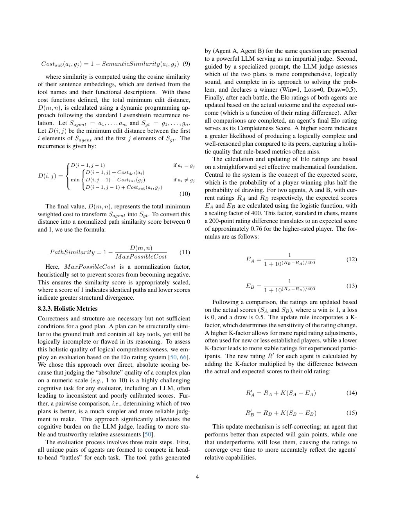

---

## PDF 第 016 页

Layer Sub-Agent Description

Layer 1: Data Acquisition & Preprocessing

Layer 2: Data Processing and Analysis

Layer 3: Synthesis and Application

8.3. Sub-Agent Distribution in EarthAgent

We have abstracted the complete set of tasks and identified 3 hierarchical levels essential for task resolution: Layer 1: Data Acquisition and Preprocessing, Layer 2: Data Processing and Analysis, and Layer 3: Synthesis and Application. Specialized sub-agents are configured for each layer. Each of them is paired with specific set of tools and job description. Their arrangement is shown in Table 4.

5

Table 4. Distribution and Description of Sub-Agents within the EarthAgent Architecture.

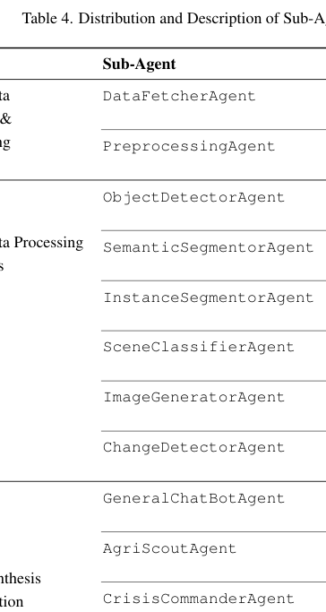

DataFetcherAgent Retrieves remote sensing data from various sources based on user queries.

PreprocessingAgent Performs standard preprocessing tasks like radiometric correction and georeferencing.

ObjectDetectorAgent Identifies and locates specific objects (e.g., vehicles, buildings) within an image.

SemanticSegmentorAgent Classifies each pixel of an image into a set of predefined land cover categories.

InstanceSegmentorAgent Detects and delineates individual object instances within an image.

SceneClassifierAgent Assigns a high-level label (e.g., ’urban’, ’forest’) to the entire image scene.

ImageGeneratorAgent Creates new image data, such as for super-resolution or inpainting.

ChangeDetectorAgent Compares multi-temporal images to identify and highlight areas of change.

GeneralChatBotAgent Provides general information and answers user questions based on the analyzed data.

AgriScoutAgent Specializes in agricultural applications like crop health monitoring.

CrisisCommanderAgent Focuses on disaster management by assessing damage for emergency response.

UrbanistAIAgent Analyzes urban environments for city planning and infrastructure monitoring.

EnvironmentalistAgent Monitors environmental indicators such as deforestation and pollution.

GeologistAgent Assists in geological surveys by identifying rock formations and mineral deposits.

MinerAgent Specializes in monitoring mining operations and estimating resources.

OceanographerAgent Analyzes marine environments by tracking oceanspecific variables.

DefenseSecurityAgent Provides intelligence for defense and security surveillance or reconnaissance.

8.4. Debate Inference Details

Debate [12] is a multi-agent system mimicking human debate activity. This part details a structured debate process involving M debaters and N rounds. The process begins with all debaters independently proposing initial answers. It then proceeds through multiple rounds of iterative refinement, where each debater revises their answer after reviewing the arguments of others. Finally, a neutral judge synthe-

本页原版截图（含所有图片、公式、表格）

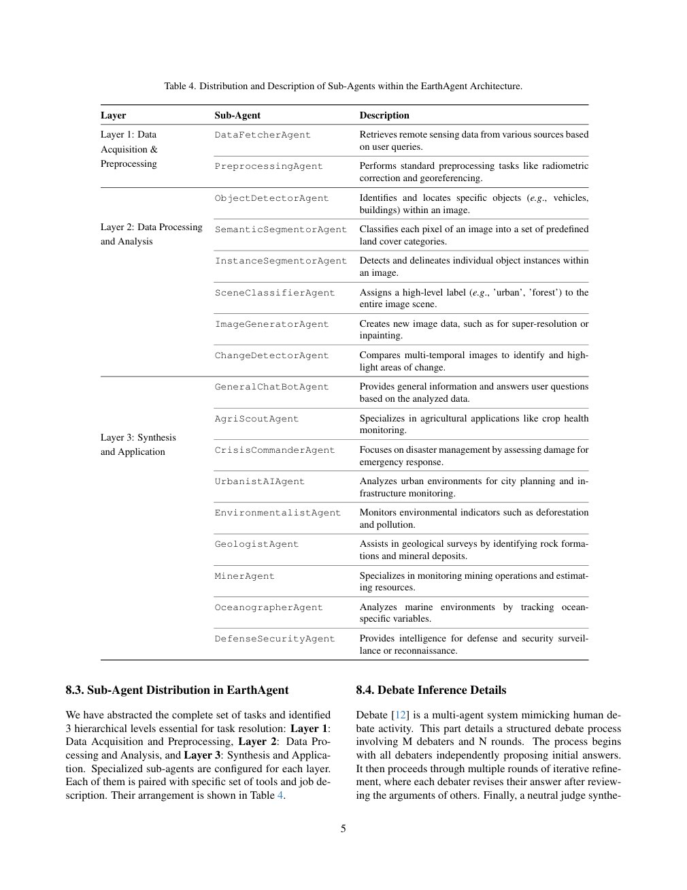

---

## PDF 第 017 页

sizes all outputs to produce a conclusive answer. The entire framework is designed to generate a more comprehensive and robust solution by leveraging collective intelligence. The entire debate process is divided into three main stages. To describe this process more precisely, we introduce the following definitions: • Let there be M debaters, represented by the set D = {D1, D2, . . . , DM}. • The process consists of N+1 rounds, indexed by r, where r ∈{0, 1, . . . , N}. • Ai,r denotes the answer output by debater Di at the end of round r. • Sr represents the set of all debaters’ answers at the end of round r, such that Sr = {A1,r, A2,r, . . . , AM,r}. Round 0: Initial Statement In the initial phase (Round 0), all M debaters independently analyze the given problem and propose a preliminary answer without influence from others. The goal of this stage is to gather a diverse set of initial viewpoints. For each debater Di ∈D, the initial answer Ai,0 is generated by an initial thought function f (0) i .

Ai,0 = f (0) i (Problem) (16)

At the conclusion of Round 0, we have the initial set of answers S0:

S0 = {A1,0, A2,0, . . . , AM,0} (17)

Round 1 to N-1: Iterative Debate The core of the process is the free debate phase, which spans from Round 1 to N1. In each round r (where 1 ≤r < N), every debater Di has the opportunity to review and analyze the complete set of answers from the previous round, Sr−1. Based on this new information, debater Di reflects upon, evaluates, and revises their own answer, producing a new answer Ai,r for the current round. This iterative process allows ideas to cross-pollinate, merge, and evolve. In round r, the new answer Ai,r from debater Di is the output of their update function f (r) i . This function takes the debater’s own previous answer Ai,r−1 and the set of all previous answers Sr−1 as input.

Ai,r = f (r) i (Ai,r−1, Sr−1) (18)

where Sr−1 = {A1,r−1, A2,r−1, . . . , AM,r−1}. This process continues until the end of Round N-1, which yields the final set of debater outputs, SN−1. Round N: Final Judgment In the final round, a neutral judge enters the process. The judge’s role is to review and synthesize the final answers submitted by all M debaters at the conclusion of the free debate phase (Round N-1). Using a global decision function, the judge integrates these potentially divergent viewpoints and arguments into a single, cohesive, and final answer, Afinal.

6

The judge’s decision-making process can be modeled as a summary function J. This function takes the set of all final answers from the debaters, SN−1, as its input and produces the final global answer.

Afinal = J(SN−1) = J({A1,N−1, A2,N−1, . . . , AM,N−1}) (19) In our experiment, we arrange three debaters with one round of opening statements, two rounds of free debate, and one round of concluding remarks. The relevant prompts in inference process have been shown in Listing 17, 18 and 19.

8.5. AFlow Inference Details

AFlow is a novel framework that leverages LLMs as optimizers within a variant of Monte Carlo Tree Search (MCTS) to search for optimal workflows. Generally, the input of this system is a set of samples (like training data), which involves question set and metrics. After learning and optimization, it outputs an agentic workflow that works best for this type of data, which is a python script. We used the recommended setup to configure our own workflow. In detail,following recommendation, we set Sample count as 4, Max iteration rounds as 20, Validation rounds as 5. It cost us approximately 44 US dollars to complete the learning process and get an optimized workflow as Figure 7. Core code generated by AFlow is shown in Listing 1. The relevant prompts generated by AFlow in this inference process have been shown in Listing 23, 24, 25, 27, and 28.

1 async def __call__(self, problem: str):

2 """

3 Implementation of the workflow

4 """

5 # Generate initial solution

6 initial_solution = await self.answer_generate

(input=problem)

7

8 # Get refined solution with custom operator

9 refined = await self.custom(input=problem + f

"\nInitial solution: {initial_solution[’ response’]}", instruction=prompt_custom. REFINE_PROMPT)

10

11 # Verify essential tools

12 verified = await self.custom(input=problem +

f"\nCurrent solution: {refined[’response’]}",

instruction=prompt_custom.VERIFY_PROMPT)

13

14 # Ensemble the solutions

15 solutions = [initial_solution[’response’],

refined[’response’], verified[’response’]]

16 ensemble_solution = await self.sc_ensemble(

solutions=solutions)

17

18 # Validate format and preprocessing steps

19 validated = await self.custom(input=

ensemble_solution[’response’], instruction= prompt_custom.VALIDATE_FORMAT_PROMPT)

20

本页原版截图（含所有图片、公式、表格）

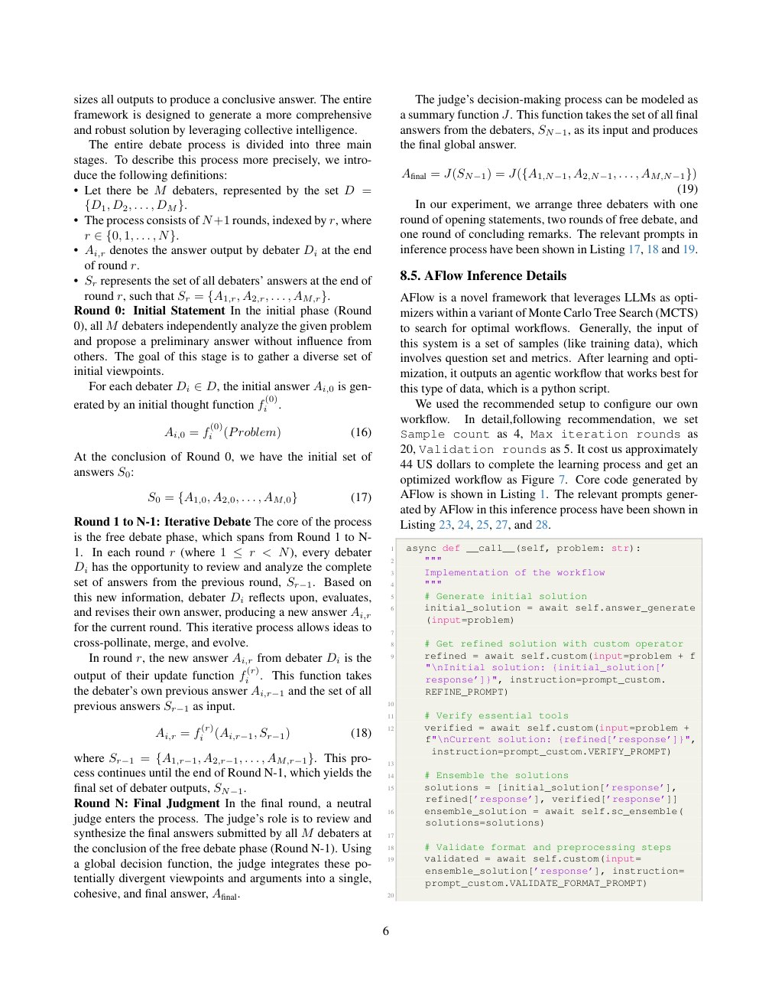

---

## PDF 第 018 页

question

question

observation

Review the results of your action.

CoT-style prompt:

action

LL M

xN

Use external tools, mcp...to interact with environment.

CoT

LLM, brain of the system.

thought

question

Your thought about this task, mainly about what to do next.

if accomplished

Round 0

answer

initial-prompt: Each agent thinks independently.

ReAct

question

plan phrase execute phrase

TODO: - step 1: - step 2: - step 3: ...... - step N:

step 1

debate-prompt: Agents exchange their results and refine their previous one(for N rounds).. xN

step 2

step 3

LL M

step N

plan&execute

<chain_of_thought> <problem> </problem> <thinking_process> <step number="1">...</step> <step number="2">...</step>

question

Agent for generate answer

...... <step number="N”>...</step> <conclusion></conclusion> </thinking_process> </chain_of_thought>

refine_promptdriven LLM

verify_promptdriven LLM

Round N+1

Agent for ensemble answer

final-prompt:The judge summarize all information and return a final answer.

validate_prompt -driven LLM

format_promptdriven LLM

Round 1~N

Node:

Operator: Node:

answer Information Injection:

Debate Aflow

Figure 7. Illustration of 5 Agent Architectures. We show the inference processes of ReAct, Plan&Execute, CoT, Debate and AFlow.

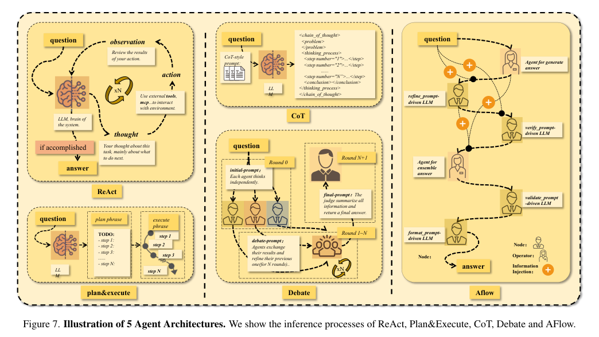

21 # Final formatting

22 formatted = await self.custom(input=validated

[’response’], instruction=prompt_custom. FORMAT_PROMPT)

23

24 return formatted[’response’], self.llm.

get_usage_summary()["total_cost"]

Listing 1. Selected source code generated by AFlow.

8.6. Prompts and Constants

8.6.1. Domain Information

DOMAINS=["Agriculture & Forestry", "Urban &

Regional Planning", "Environmental Monitoring & Climate Change", "Disaster Emergency & Management", "Earth Science & Resource Exploration", "Marine & Water

Resources", "Defense & Security"]

Listing 2. Domain category.

COMPLEXITIES=["Simple", "Medium", "Complex

"]

Listing 3. Complexity level.

DOMAIN_DESCRIPTIONS = { "Agriculture & Forestry": """

Crop type identification and area

statistics

7

Crop growth monitoring and stress analysis

(drought, flood, pests) Yield estimation Forest resource survey (species

identification, volume estimation) Forest fire monitoring and damage

assessment Deforestation and reforestation monitoring """, "Urban & Regional Planning": """

Urban expansion monitoring Land use/land cover (LULC) classification

and change analysis Building extraction and 3D modeling Transportation network planning (road

extraction, traffic flow estimation) Urban green space and water body

monitoring Urban heat island effect analysis """, "Environmental Monitoring & Climate Change

": """ Water quality monitoring (eutrophication,

suspended matter) Air quality monitoring (aerosols,

pollutants) Soil erosion and desertification

monitoring Glacier, snow, and sea ice change

monitoring Carbon storage estimation and carbon cycle

本页原版截图（含所有图片、公式、表格）

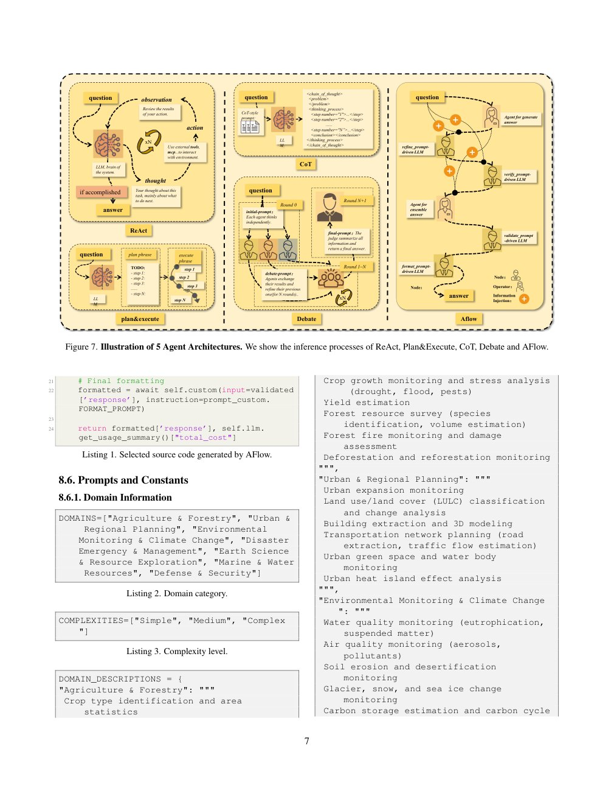

---

## PDF 第 019 页

research """, "Disaster Emergency & Management": """

Flood inundation extent assessment Earthquake-damaged building identification Landslide and debris flow hazard

investigation Drought monitoring Typhoon path and impact analysis """, "Earth Science & Resource Exploration": """

Geological structure interpretation Mineral resource exploration (alteration

mineral identification) Oil and gas exploration (hydrocarbon

seepage, surface micro-geomorphology) Groundwater resource investigation """, "Marine & Water Resources": """

Coastline change monitoring Sea surface temperature, salinity, and

chlorophyll concentration retrieval Maritime vessel and oil spill detection Algal bloom and red tide monitoring Watershed water resource assessment """, "Defense & Security": """

Sensitive target identification (airports,

ports, missile bases) Border activity monitoring Battlefield situational awareness Camouflage and counter-camouflage

identification """ }

Listing 4. Desciptions for each domain, applied in Task Dependency Graph Generation.

DOMAIN_KEYWORDS= { "Agriculture & Forestry": [ "crop", "agriculture", "forest", "

vegetation", "farming", "harvest", " yield", "deforestation", "plant", "soil ", "agricultural", "forestry", "cultivation",

"irrigation", "pesticide", "fertilizer",

"biomass", "photosynthesis", "canopy", "landsat", "ndvi", "chlorophyll",

"phenology", "agroforestry", " silviculture", "timber", "logging", "reforestation", "afforestation", "carbon

sequestration", "biodiversity", " ecosystem", "habitat", "wildlife", "pasture", "grassland", "rangeland", "

livestock", "grazing", "drought", " precipitation", "evapotranspiration", "leaf area index", "lai", "gpp", "npp", "

8

biomass estimation", "tree height", "dbh ", "forest inventory" ], "Urban & Regional Planning": [ "urban", "city", "building", "

infrastructure", "development", " planning", "construction", "residential ", "metropolitan", "suburban", "downtown", "

commercial", "industrial", "zoning", " land use", "lulc", "impervious", "built-up", "settlement", "population", "

density", "sprawl", "expansion", "growth ", "transportation", "road", "highway", "street", "transit", "mobility",

"accessibility", "pedestrian", "traffic ", "congestion", "parking", "housing", "neighborhood", "district", "

block", "parcel", "footprint", " elevation", "dem", "dsm", "3d modeling", "cadastral", "property", "real estate", "

gentrification", "sustainability", " smart city", "green space" ], "Environmental Monitoring & Climate Change

": [ "environment", "climate", "pollution", "air

quality", "water quality", "temperature ", "carbon", "emission", "environmental", "atmospheric", "greenhouse

gas", "co2", "methane", "aerosol", " particulate", "pm2.5", "pm10", "ozone", "nitrogen", "sulfur", "acid rain",

"smog", "visibility", "turbidity", " eutrophication", "algal bloom", "contamination", "toxic", "heavy metal", "

pesticide residue", "ph", "dissolved oxygen", "bod", "cod", "thermal pollution", "noise pollution", "

radiation", "uv", "solar", "albedo", " reflectance", "emissivity", "evaporation", "humidity", "precipitation",

"wind speed", "atmospheric pressure", " meteorological", "weather", "global warming", "climate change", "sea

level rise", "ice melting", "permafrost ", "desertification" ], "Disaster Emergency & Management": [ "disaster", "emergency", "flood", "

earthquake", "fire", "damage", " evacuation", "rescue", "hazard", "natural disaster", "catastrophe", "

calamity", "crisis", "risk assessment", "vulnerability", "resilience", "wildfire", "forest fire", "bushfire", "

burn scar", "burn severity", "seismic", "tsunami", "landslide",

本页原版截图（含所有图片、公式、表格）

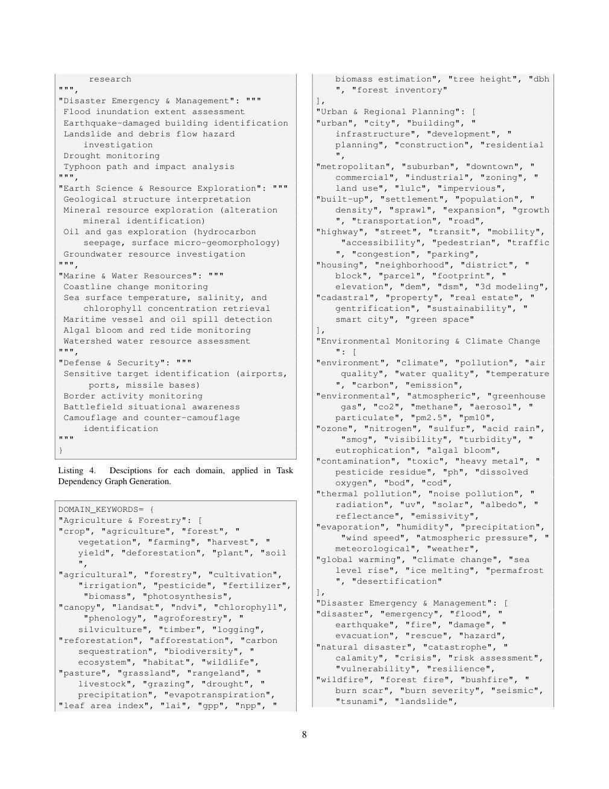

---

## PDF 第 020 页

"mudslide", "avalanche", "hurricane", "

typhoon", "cyclone", "tornado", "storm",

"lightning", "hail", "drought", "famine", "volcanic", "eruption

", "lava", "ash", "pyroclastic", "debris

flow", "rockfall", "subsidence", "sinkhole", "erosion", "

inundation", "surge", "breach", "levee",

"dam failure", "structural damage", "infrastructure damage", "building collapse

", "road closure", "bridge failure", " power outage", "communication" ], "Earth Science & Resource Exploration": [ "geological", "mineral", "resource", "

exploration", "mining", "oil", "gas", " groundwater", "geology", "geophysical", "geochemical", "petrology",

"mineralogy", "stratigraphy", "tectonics ", "fault", "fracture", "lithology", "sedimentary", "igneous", "

metamorphic", "ore", "deposit", "vein", "alteration", "hydrothermal", "geothermal", "petroleum", "hydrocarbon", "

reservoir", "basin", "anticline", " syncline", "unconformity", "aquifer", "water table", "hydraulic

conductivity", "porosity", "permeability ", "well", "borehole", "core", "outcrop", "exposure", "topography", "

elevation", "slope", "aspect", "drainage ", "watershed", "catchment", "lineament", "magnetic", "gravity", "

electromagnetic", "seismic", "reflection ", "refraction", "spectral analysis" ], "Marine & Water Resources": [ "marine", "ocean", "water", "coastal", "sea

", "maritime", "vessel", "algae", " salinity", "oceanographic", "hydrographic", "

bathymetry", "seafloor", "seabed", " continental shelf", "abyssal", "benthic ", "pelagic", "littoral", "estuary", "delta",

"lagoon", "bay", "gulf", "strait", " channel", "reef", "coral", "mangrove", "wetland", "marsh", "swamp", "

tide", "tidal", "current", "wave", " swell", "upwelling", "chlorophyll", "phytoplankton", "

zooplankton", "biomass", "productivity",

"eutrophication", "red tide", "oil spill", "pollution", "sediment", "

turbidity", "suspended matter", " dissolved organic matter", "nutrients", "phosphate", "nitrate", "silicate", "sea

surface temperature", "sst", "sea level

9

", "altimetry", "fisheries", "aquaculture", "shipping", "navigation", "

port", "harbor", "anchorage", "buoy", " lighthouse" ], "Defense & Security": [ "defense", "security", "military", "

surveillance", "border", "target", " threat", "reconnaissance", "intelligence", "strategic", "tactical", "

operational", "battlefield", "combat", " warfare", "conflict", "base", "facility", "installation", "

compound", "perimeter", "checkpoint", " patrol", "monitoring", "radar", "sonar", "satellite", "imagery", "

aerial", "drone", "uav", "aircraft", " helicopter", "fighter", "bomber", "transport", "runway", "airfield

", "airport", "hangar", "vehicle", "tank ", "armored", "convoy", "missile", "rocket", "launcher", "artillery

", "ammunition", "depot", "storage", " bunker", "fortification", "camouflage", "concealment", "detection", "

identification", "tracking", "movement",

"deployment", "logistics", "supply", "communication", "signal", "

electronic", "cyber", "homeland", " counterterrorism", "peacekeeping" ] }

Listing 5. Keywords for each domain, used for Domain Relevance Check during Task Validation.

8.6.2. Task Construction

DAG_TEMPLATE_PROMPT = """Generate a typical

task dependency template for remote sensing {domain} domain, represented as a Directed Acyclic Graph (DAG):

Domain application scope: {domain_desc}

Available tools: {tools_str}

Requirements: 1. Select {tools_number_range} most

relevant tools based on actual needs in {domain} domain 2. Define reasonable dependencies based on

tool functionality and data flow 3. Form a DAG structure that follows actual

remote sensing analysis workflow 4. Include complete analysis process from

data acquisition to result output

本页原版截图（含所有图片、公式、表格）

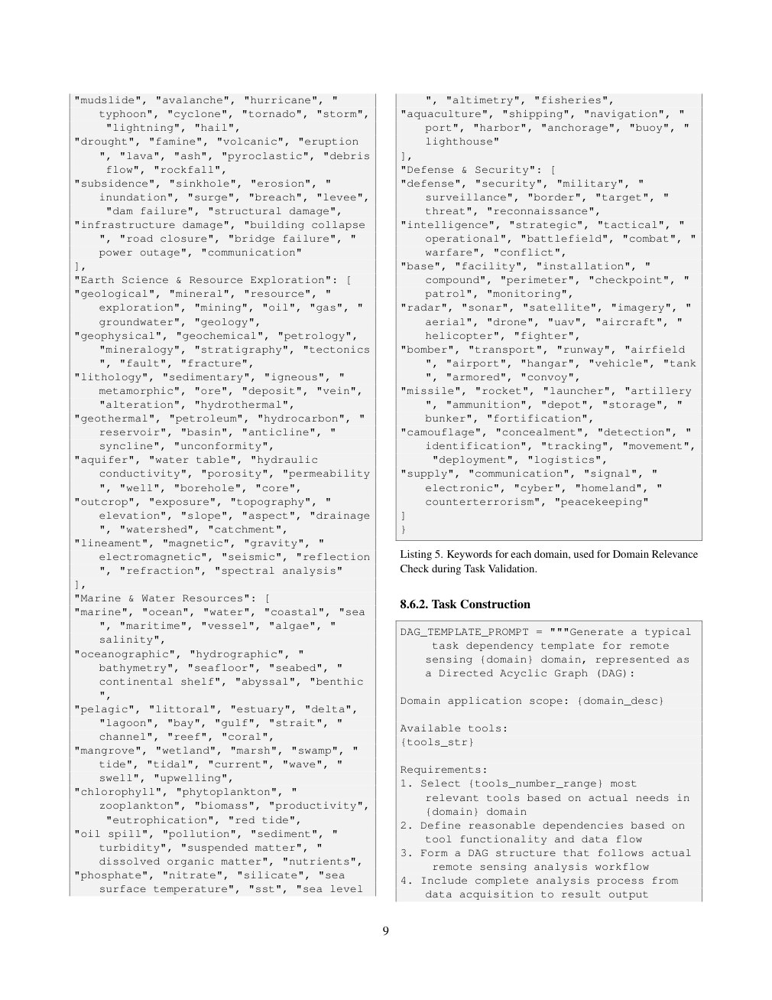

---

## PDF 第 021 页

5. Dependencies should reflect real remote

sensing workflows 6. Focus on typical task requirements

within the above domain scope

Output in JSON format: {{

"domain": "{domain}", "nodes": ["tool1", "tool2", "tool3",

...], "edges": [["source_tool_1", "

target_tool_1"], ["source_tool_2", " target_tool_2"], ...], "description": "DAG template based on

actual needs in {domain} domain" }}"""

Listing 6. Prompt for creating task dependency template with the format of DAG given domain information and task complexity.

PARAMETERIZE_FLOW_PROMPT = """Complete

parameters for the tool flow to generate

instantiated tool calls:

Tool sequence: {tools}

Tool details: {tools_str}

Requirements: 1. Use imagination to complete specific

parameters for each tool 2. Parameters should fit remote sensing

application scenarios 3. Maintain logical consistency between

parameters 4. Generate realistic and credible

parameter values

Output in JSON format: {{

"parameterized_tools": [

{{"tool": "tool1", "params": {{"param1

": "value1", "param2": "value2"}}}}, {{"tool": "tool2", "params": {{"param1

": "value1", "param2": "value2"}}}} ] }}"""

Listing 7. Prompt for parameterizing extracted tool flow.

GENERATE_TASK_PROMPT = """Generate a remote

sensing analysis task based on the instantiated tool flow:

Tool call sequence: {flow_str}

Requirements: 1. Question should be short and direct,

focusing on one core objective 2. Leverage your imagination to generate a

question that is highly contextual with specific entry point. 3. Do not explicitly mention any data

sources 4. Do not mention specific technical

methods or tools 5. Let agent infer what data and methods

are needed 6. Question should have implicit complexity

requiring deep analysis 7. Question should be specific and detailed

, not a broad topic

Output concise core question as a string (

one sentence): """

Listing 8. Prompt for generating final task based on the parameterized tool flow.

8.6.3. Evaluation

KEY_STEPS_EXTRACTION_PROMPT = """ Task question: {question} Ground truth tool path: {

ground_truth_tool_flow}

Please identify the key steps (

indispensable steps) from the golden path to solve this problem. Key steps should be core operations

essential for task completion, removing optional or redundant steps.

Requirements: 1. Select the most critical steps from the

given tool path 2. Key steps should be indispensable for

task completion 3. Remove duplicate or redundant steps 4. Don’t return an empty list

Return strictly in the following JSON

format without any additional explanation: {{

"key_steps": ["step1", "step2", "step3"] }} """

Listing 9. Prompt for extracting key steps from ground truth tool trajectory.

10

本页原版截图（含所有图片、公式、表格）

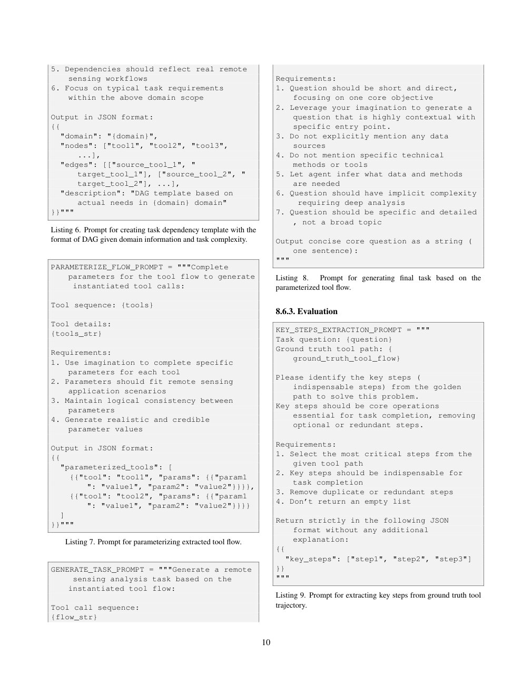

---

## PDF 第 022 页

KEY_TOOLS_EXTRACTION_PROMPT=""" Task question: {question} Agent’s tool path: {agent_tool_flow}

Please identify the key tools (

indispensable tools) from the agent’s tool path to solve this problem. Key tools should be core operations

essential for task completion, removing optional or redundant tools.

Requirements: 1. Select the most critical different tools

from the given tool path 2. Key tools should be indispensable for

task completion 3. Remove duplicate or redundant tools 4. Don’t return an empty list

Return strictly in the following JSON

format without any additional explanation: {{

"key_tools": ["tool1", "tool2", "tool3"] }} """

Listing 10. Prompt for extracting key tools from agents’ output.

COMPLETENESS_EVALUATION_PROMPT = """ Task question: {question}

Please compare the completeness of the

following two agents’ tool calling paths :

Agent A ({agent_a}): {tool_flow_a} Agent B ({agent_b}): {tool_flow_b}

Evaluation criteria: 1. Does it cover all key aspects required

by the problem? 2. Are important data acquisition and

processing steps missing? 3. Can it achieve the final results

required by the problem? 4. Is the overall solution comprehensive?

Please choose one of the following options: - "A": Agent A has better completeness - "B": Agent B has better completeness - "Tie": Both have equivalent completeness

Please **return only one string**: "A" or "

B" or "Tie" """

Listing 11. Prompt for logic and completeness evaluation.

8.6.4. Architecture Implementation

f"""{self.system_prompt}

Available tools: {tools_info}

User question: {query}

History: {history}

Your previous_tool_calls: {

previous_tool_calls}

**Strategic Thinking Guidelines**: 1. **Fresh Perspective**: If you’ve taken

certain approaches before, explore different angles or complementary information apart from your previous_tool_calls 2. **Progress Assessment**: Evaluate what

information you’ve gathered and identify

any gaps 3. **Completion Check**: If you have

sufficient information to provide a comprehensive answer, prepare to finish 4. **Diversification**: Avoid repeating

similar tool calls - seek variety in your information gathering.The tool you will call next should be different from your previous_tool_calls

**Decision Framework**: - If you have enough information, Think: "I

have gathered sufficient information and can provide a comprehensive answer to this question." - If you need more data, Think about what

specific information is still missing and how to obtain it differently - If you’re unsure, Think about what would

make you confident in your answer

**CRITICAL**: This is ONLY for thinking and

analysis. Do NOT include "Action:" statements here.

Please start with "Thought: " and provide

your strategic analysis in one clear sentence."""

Listing 12. ReAct: Get thought prompt.

11

本页原版截图（含所有图片、公式、表格）

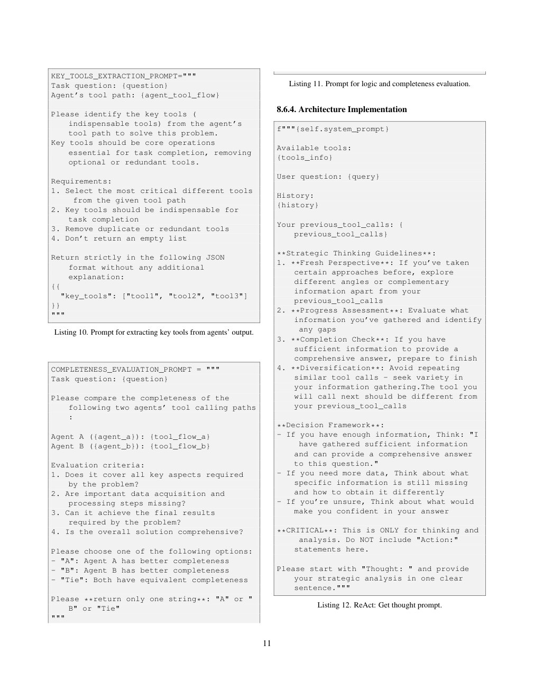

---

## PDF 第 023 页

f"""Based on your thinking,specifically

based on your **previous_tool_calls**, decide the next action using function calling.

User question: {query}

Your thought: {thought}

History: {history}

Your previous_tool_calls: {

previous_tool_calls}

**Decision Rules**: 1. Carefully check **previous_tool_calls**

to avoid repeating same tool call.The tool you will call next should be different from your previous_tool_calls 2. If sufficient information obtained to

answer the question, do NOT call any function (this will trigger FINISH) 3. If must call tools, ensure clear

distinction from previous calls ( different tools or significantly different parameters) 4. If you find yourself possibly entering a

loop, do NOT call any function

**Anti-loop check**: Review the last 2-3

actions in history, if similar tool call

patterns found, do NOT call any function.

**Action Decision**: - If you need more information: Call ONE

function with appropriate parameters - If you have enough information to answer:

Make NO function call (this will finish the task)"""

Listing 13. ReAct: Get action prompt.

f"""

You need to **fully imagine** the

execution result of this tool based on the current tool’s name, description and parameters. The result should be beneficial for solving the problem. Only describe in one sentence what the tool did, this sentence should be in past tense. Current scenario: {thought} Tool name: {tool_name} Tool description: {self.tools[tool_name

]["description"]} Tool parameters: {args} """

Listing 14. ReAct: Get tool result prompt.

f"""You are an intelligent assistant that

needs to solve user problems.

Available tools: {tools_info}

User question: {query}

Please analyze the user’s question and

create an execution plan. The plan is a tool chain that you need to carefully design to make the tool chain can solve the user’s question properly. Decide the

length of the tool chain based on the difficulty of the problem.

Please return the plan in JSON format as

follows: {{

"plan": [

{{

"tool": "tool_name_1", "parameters": {{"param_name": "

param_value"}}, }}, {{

"tool": "tool_name_2", "parameters": {{"param_name": "

param_value"}}, }} ] }}

"""

Listing 15. Plan&Execute: Get planning prompt.

f""" You are an intelligent assistant that needs

to solve user problems based on the tools provided. User question: {query} Available tools: {tools_info} Please think step by step,in each step,you

should choose one name of these tools to

call. Output in this format strictly: step1:thought_1;tool_1_name step2:thought_2;tool_2_name ...

12

本页原版截图（含所有图片、公式、表格）

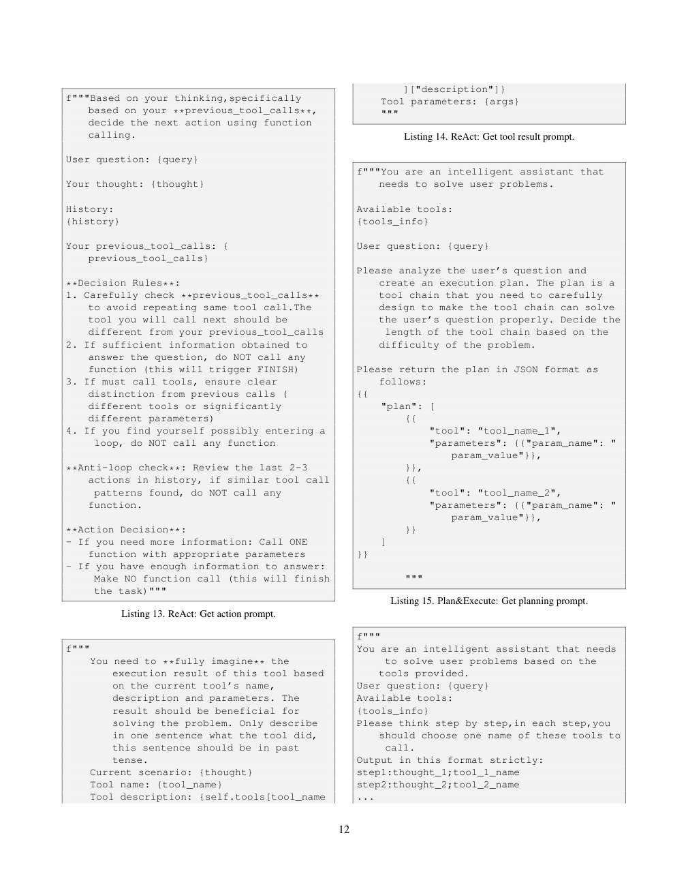

---

## PDF 第 024 页

stepn:thought_n;tool_n_name """

Listing 16. CoT: Get chain-of-thought prompt.

f"""You are participating in a multi-agent

debate. In this initial round, please think independently and provide your first answer to the question without seeing other agents’ responses.

Question: {question}

Available tools: {tools_info}

Please analyze the user’s question and

create an execution plan and corresponding initial_tool_trajectory. The plan is a paragraph of statement,the

initial_tool_trajectory is a list of tool names which can solve the question properly. Decide the length of the tool chain based on the difficulty of the problem.

Please return the plan in JSON format as

follows: {{

"plan": your plan to solve the question

, "initial_tool_trajectory": ["

tool_name_1","tool_name_2",...] }} """

Listing 17. Debate: Prompt for Round 0 - independent thinking.

f"""You are number {debater_index} debater

participating in a multi-agent debate. You have seen all previous responses and

now need to provide your perspective.

Question: {question}

your former response: {former_response}

Available tools: {tools_info}

Debate History: {history_str}

Based on the previous responses, please

analyze the strengths and weaknesses of previous arguments and improve your former tool trajectory.Return a breif

advice and the refined tool trajectory in JSON format as follows: {{ "advice": "your short advice to improve

your former tool trajectory", "refined_tool_trajectory": ["

tool_name_1","tool_name_2",...] }} """

Listing 18. Debate: Prompt for Round 1 to N - debate rounds.

f"""You are a judge/summarizer for a multi-

agent debate. Please analyze the entire debate and return a final tool trajectory.

Original Question: {question}

Available tools: {tools_info}

Complete Debate History: {history_str}

Please return a final tool_trajectory.

Follow the json format strictly and do not include any other text:

Json format: {{

"final_tool_trajectory": ["tool_name_1

","tool_name_2",...] }}

"""

Listing 19. Debate: Final prompt for summary round.

f"""You are an expert selection assistant.

Select the most suitable third layer expert based on user questions.

The third layer experts are responsible for

integration and output, handling more specific domain problems. Available experts: {layer3_agents_info}

User question: {query}

Selection logic: Choose a third layer agent

based on the industry and domain of the question. Select one from the third layer. For simple questions or daily Q&A , choose generalChatBotAgent.

Please return selection result in JSON

format:

13

本页原版截图（含所有图片、公式、表格）

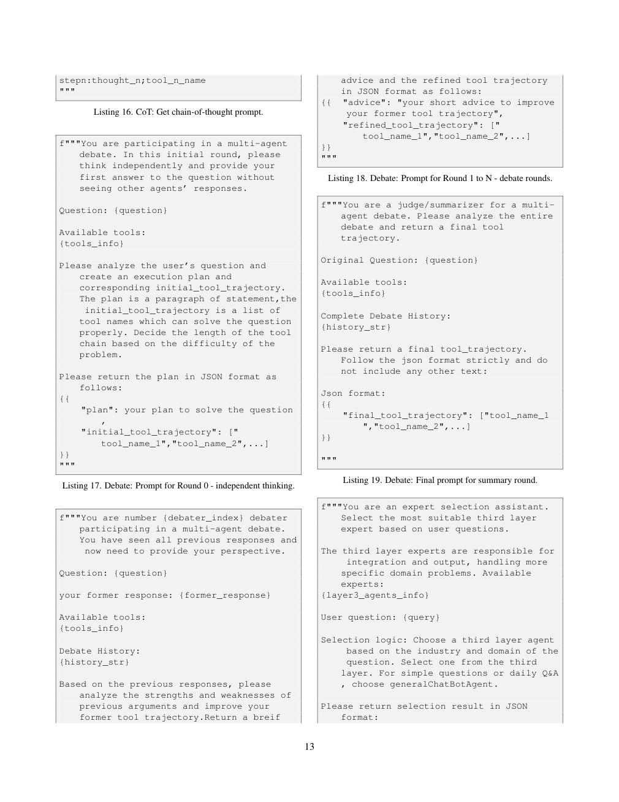

---

## PDF 第 025 页

{{

"selected_agent": "expert_name", "subtask": "specific subtask

description that this expert needs to complete." }}"""

Listing 20. EarthAgent: Prompt for selecting sub-expert from layer 3.

f"""You are an expert selection assistant.

Based on user questions and layer 3 expert selection, choose layer 2 experts .

Layer 2 experts are responsible for image

understanding work. Available experts: {layer2_agents_info}

User question: {query} Layer 3 selected expert: {layer3_selection.

get(’selected_agent’)} Layer 3 expert task: {layer3_selection.get

(’subtask’)}

Selection logic: Based on the question and

layer 3 agent, think about what visual operations need to be performed on remote sensing images to solve the problem, then select 1 to 3 agents from layer 2 as needed.

Please return selection result in JSON

format: {{ "selected_agents": [ {{

"name": "expert_name_1", "subtask": "specific subtask

description this expert needs to complete." }}, {{

"name": "expert_name_2", "subtask": "specific subtask

description this expert needs to complete." }} ] }}"""

Listing 21. EarthAgent: Prompt for selecting sub-expert from layer 2.

f"""You are an expert selection assistant.

Based on user questions and layer 2 & layer 3 expert selections, choose layer 1 experts.

Layer 1 experts are responsible for data

acquisition and preprocessing. Available

experts: {layer1_agents_info}

User question: {query} Layer 2 selected experts: {layer2_info} Layer 3 selected expert: {layer3_selection.

get(’selected_agent’)}

Selection logic: Combine the question with

layer 2 and layer 3 agent selections, see if the question contains remote sensing data, determine whether to additionally acquire remote sensing data

or images, and determine whether data preprocessing is needed (if needed, the question will hint that existing data has defects), select 1-2 layer 1 agents.

Please return selection result in JSON

format: {{

"selected_agents": [

{{

"name": "expert_name_1", "subtask": "specific subtask

description this expert needs to complete." }}, {{

"name": "expert_name_2", "subtask": "specific subtask

description this expert needs to complete." }} ] }}"""

Listing 22. EarthAgent: Prompt for selecting sub-expert from layer 1.

REFINE_PROMPT = """ Given the problem and initial solution,

output a refined tool flow as a list of tool names that can solve the problem. The output must be in the format: [’ tool1_name’,’tool2_name’,...].

Consider: 1. The logical sequence of tools 2. Required preprocessing steps 3. Necessary analysis tools 4. Data formatting and output tools

Only output the tool flow list, no other

text.

14

本页原版截图（含所有图片、公式、表格）

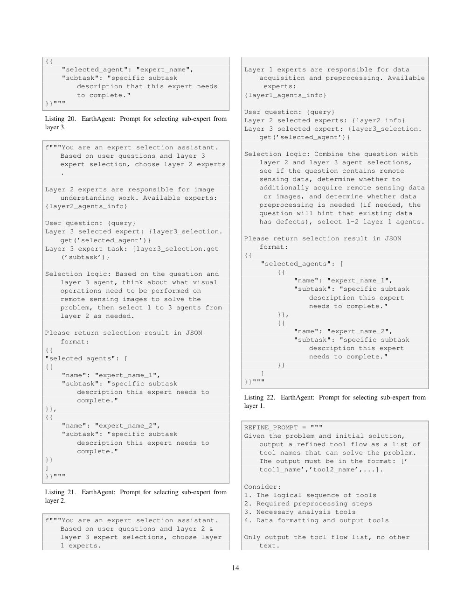

---

## PDF 第 026 页

"""

Listing 23. AFlow: Prompt for refining answer.

VERIFY_PROMPT = """ Review the current solution and ensure all

essential tools for the task type are included. Consider: 1. Data acquisition tools (web_search,

download_satellite_imagery) 2. Preprocessing tools (

geometric_correction, atmospheric_correction) 3. Analysis tools specific to the task 4. Data formatting and reporting tools

Add any missing essential tools and

maintain proper sequence. Output only the complete tool list in

format: [’tool1_name’,’tool2_name’,...] """

Listing 24. AFlow: Prompt for verifying answer.

VALIDATE_FORMAT_PROMPT = """ Validate and correct the tool list to

ensure: 1. All remote sensing tasks must include

download_satellite_imagery, geometric_correction, atmospheric_correction in correct order 2. Must include cloud_mask_removal after

corrections if using satellite imagery 3. Must end with format_data or

generate_analysis_reports 4. List must be in exact format: [’

tool1_name’,’tool2_name’,...]

Output the corrected list maintaining the

exact format, no other text. """

Listing 25. AFlow: Prompt for validating answer.

FORMAT_PROMPT = """ Format the tool flow into a proper Python

list string that matches the expected format. Rules: 1. Must be in exact format: [’tool1_name’,’

tool2_name’,...] 2. No spaces between commas 3. Single quotes for strings 4. Remove any extra whitespace or newlines 5. Include essential tools like format_data

or generate_analysis_reports at the end

Only output the formatted list string, no

other text. """

Listing 26. AFlow: Prompt for formatting answer.

ANSWER_GENERATION_PROMPT = """ You are an expert in remote sensing task

planning. Your goal is to generate an appropriate sequence of tools/operations

to solve the given remote sensing task.

Think step by step about what tools and

operations are needed: 1. Consider the type of remote sensing task

(agriculture, disaster management, environmental monitoring, etc.) 2. Think about the logical sequence of

operations (data acquisition, preprocessing, analysis, output) 3. Select appropriate tools for each step

Available tool categories include: - Data acquisition:

download_satellite_imagery, web_search, recommend_satellite_platforms - Preprocessing: geometric_correction,

atmospheric_correction, cloud_mask_removal, crop_image - Analysis: classify_land_cover,

segment_water_bodies, monitor_crop_health, detect_plant_diseases, assess_disaster_damage - Output: generate_analysis_reports,

format_data, statistical_analysis

Task: {input}

In the "thought" field, explain your step-

by-step reasoning process. In the "answer" field, provide a clear

sequence of tools/operations needed to complete the task. """

Listing 27. AFlow: Prompt for generating answer.

SC_ENSEMBLE_PROMPT = """ Several tool flow solutions have been

generated for the same remote sensing task planning problem. They are as follows: {solutions}

Identify the most consistent and

appropriate tool flow that appears most

15

本页原版截图（含所有图片、公式、表格）

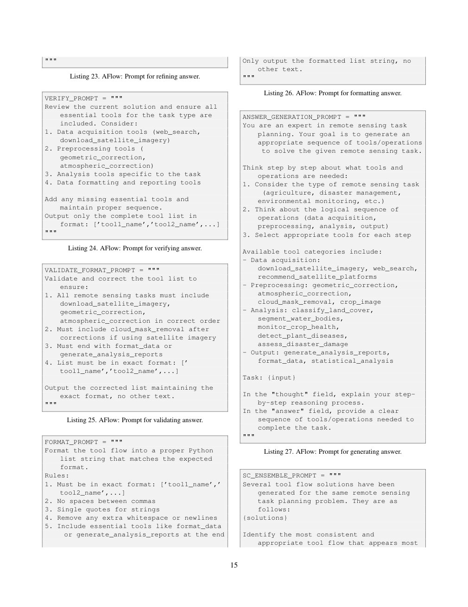

---

## PDF 第 027 页

frequently across them. Consider the logical sequence of remote sensing operations and the specific requirements

of the task.

In the "thought" field, provide a detailed

explanation of your analysis process. In

the "solution_letter" field, output only the single letter ID (A, B, C, etc .) corresponding to the most consistent solution. Do not include any additional text or explanation in the " solution_letter" field. """

Listing 28. AFlow: Prompt for ensenbling answer.

9. Further Analysis of Evaluation

9.1. Results on Each Sub-domain

The whole tasks are divided into 7 sub-domains as we mentioned in Section 8.1.1. In addition to analyzing the overall performance, we have also summarized the results on each sub-domain. Detailed information is shown in Table 5.

16

本页原版截图（含所有图片、公式、表格）

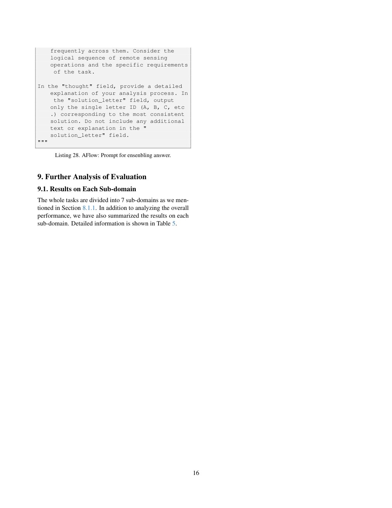

---

## PDF 第 028 页

Table 5. Detailed Experimental Results by Domain. Diff. stands for Difficulty. Arch. stands for Architecture. Rec. stands for Recallkey. Prec. stands for Precisionkey. F1. stands for F1key. Struct. stands for Structural. Hol. stands for Holistic.

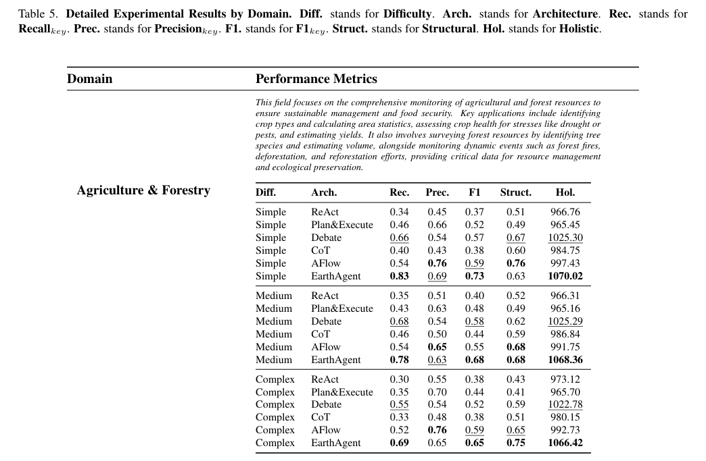

Domain Performance Metrics

Agriculture & Forestry

Urban & Regional Planning

This field focuses on the comprehensive monitoring of agricultural and forest resources to ensure sustainable management and food security. Key applications include identifying crop types and calculating area statistics, assessing crop health for stresses like drought or pests, and estimating yields. It also involves surveying forest resources by identifying tree species and estimating volume, alongside monitoring dynamic events such as forest fires, deforestation, and reforestation efforts, providing critical data for resource management and ecological preservation.

Diff. Arch. Rec. Prec. F1 Struct. Hol.

Simple ReAct 0.34 0.45 0.37 0.51 966.76 Simple Plan&Execute 0.46 0.66 0.52 0.49 965.45 Simple Debate 0.66 0.54 0.57 0.67 1025.30 Simple CoT 0.40 0.43 0.38 0.60 984.75 Simple AFlow 0.54 0.76 0.59 0.76 997.43 Simple EarthAgent 0.83 0.69 0.73 0.63 1070.02

Medium ReAct 0.35 0.51 0.40 0.52 966.31 Medium Plan&Execute 0.43 0.63 0.48 0.49 965.16 Medium Debate 0.68 0.54 0.58 0.62 1025.29 Medium CoT 0.46 0.50 0.44 0.59 986.84 Medium AFlow 0.54 0.65 0.55 0.68 991.75 Medium EarthAgent 0.78 0.63 0.68 0.68 1068.36

Complex ReAct 0.30 0.55 0.38 0.43 973.12 Complex Plan&Execute 0.35 0.70 0.44 0.41 965.70 Complex Debate 0.55 0.54 0.52 0.59 1022.78 Complex CoT 0.33 0.48 0.38 0.51 980.15 Complex AFlow 0.52 0.76 0.59 0.65 992.73 Complex EarthAgent 0.69 0.65 0.65 0.75 1066.42

This domain involves the detailed analysis and monitoring of urban and regional environments to guide sustainable development. It utilizes applications like tracking urban expansion, classifying land use and land cover changes over time, and extracting building data for 3D modeling. Additionally, it supports transportation network planning by extracting road data and estimating traffic flow, monitors vital urban green spaces and water bodies, and analyzes the urban heat island effect to improve city living conditions and environmental quality.

Diff. Arch. Rec. Prec. F1 Struct. Hol.

Simple ReAct 0.36 0.53 0.41 0.47 954.56 Simple Plan&Execute 0.43 0.52 0.46 0.53 972.19 Simple Debate 0.76 0.61 0.65 0.71 1029.89 Simple CoT 0.44 0.46 0.44 0.61 986.76 Simple AFlow 0.53 0.75 0.60 0.78 996.66 Simple EarthAgent 0.81 0.71 0.74 0.62 1069.65

Medium ReAct 0.33 0.49 0.38 0.45 959.11 Medium Plan&Execute 0.40 0.54 0.43 0.51 972.99 Medium Debate 0.60 0.48 0.51 0.63 1030.97 Medium CoT 0.37 0.44 0.38 0.57 981.33 Medium AFlow 0.41 0.50 0.40 0.69 1000.64 Medium EarthAgent 0.69 0.65 0.65 0.66 1069.27

Complex ReAct 0.22 0.43 0.28 0.38 964.32 Complex Plan&Execute 0.25 0.47 0.30 0.40 965.95 Complex Debate 0.56 0.50 0.51 0.58 1029.34 Complex CoT 0.31 0.45 0.34 0.47 982.34 Complex AFlow 0.41 0.65 0.49 0.62 989.44 Complex EarthAgent 0.70 0.72 0.70 0.77 1068.38

Continued on next page

17

本页原版截图（含所有图片、公式、表格）

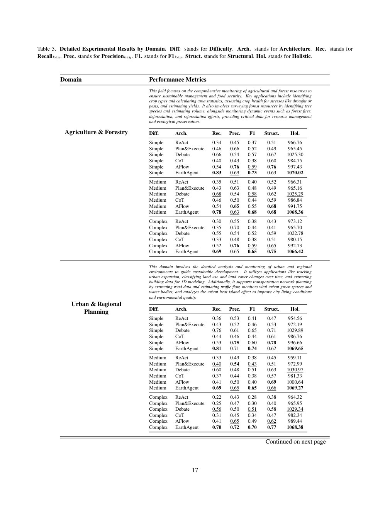

---

## PDF 第 029 页

Table 5 – continued from previous page

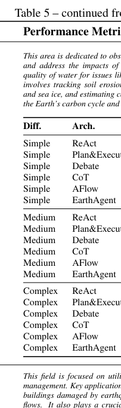

Domain Performance Metrics

Environmental Monitoring & Climate Change

Disaster Emergency & Management

This area is dedicated to observing and analyzing environmental conditions to understand and address the impacts of climate change. Core applications include monitoring the quality of water for issues like eutrophication and air for aerosols and pollutants. It also involves tracking soil erosion and desertification, monitoring changes in glaciers, snow, and sea ice, and estimating carbon storage. This research is fundamental to understanding the Earth’s carbon cycle and developing strategies to mitigate climate change.

Diff. Arch. Rec. Prec. F1 Struct. Hol.

Simple ReAct 0.31 0.46 0.34 0.47 955.65 Simple Plan&Execute 0.35 0.46 0.38 0.48 979.42 Simple Debate 0.66 0.53 0.56 0.68 1037.52 Simple CoT 0.40 0.46 0.40 0.56 981.25 Simple AFlow 0.41 0.68 0.47 0.74 1000.02 Simple EarthAgent 0.55 0.51 0.50 0.63 1062.75

Medium ReAct 0.31 0.47 0.35 0.48 954.62 Medium Plan&Execute 0.41 0.46 0.40 0.50 979.87 Medium Debate 0.63 0.52 0.55 0.65 1035.09 Medium CoT 0.39 0.46 0.41 0.57 981.03 Medium AFlow 0.40 0.57 0.43 0.70 989.76 Medium EarthAgent 0.58 0.59 0.56 0.66 1062.56

Complex ReAct 0.38 0.66 0.46 0.41 956.66 Complex Plan&Execute 0.37 0.62 0.44 0.43 972.30 Complex Debate 0.66 0.67 0.66 0.63 1031.95 Complex CoT 0.42 0.60 0.47 0.51 981.33 Complex AFlow 0.41 0.70 0.49 0.65 987.98 Complex EarthAgent 0.61 0.65 0.61 0.75 1064.76

This field is focused on utilizing timely data for effective natural disaster response and management. Key applications include assessing the inundation extent of floods, identifying buildings damaged by earthquakes, and investigating hazards from landslides and debris flows. It also plays a crucial role in monitoring the onset and severity of droughts and analyzing typhoon paths and their potential impacts. This information is vital for emergency responders to make informed decisions, minimize damage, and save lives.

Diff. Arch. Rec. Prec. F1 Struct. Hol.

Simple ReAct 0.40 0.54 0.43 0.55 968.40 Simple Plan&Execute 0.45 0.60 0.49 0.50 965.78 Simple Debate 0.71 0.54 0.59 0.63 1033.78 Simple CoT 0.54 0.61 0.56 0.60 984.28 Simple AFlow 0.33 0.66 0.39 0.69 980.19 Simple EarthAgent 0.64 0.61 0.61 0.60 1059.56

Medium ReAct 0.38 0.60 0.43 0.51 968.33 Medium Plan&Execute 0.43 0.63 0.48 0.46 971.39 Medium Debate 0.65 0.67 0.63 0.58 1027.46 Medium CoT 0.48 0.66 0.53 0.53 979.03 Medium AFlow 0.38 0.59 0.42 0.62 987.93 Medium EarthAgent 0.68 0.68 0.66 0.68 1062.86

Complex ReAct 0.27 0.52 0.33 0.43 966.49 Complex Plan&Execute 0.26 0.53 0.34 0.38 965.60 Complex Debate 0.58 0.58 0.56 0.58 1030.01 Complex CoT 0.35 0.63 0.43 0.46 980.55 Complex AFlow 0.48 0.70 0.52 0.58 993.63 Complex EarthAgent 0.69 0.77 0.71 0.75 1066.14

Continued on next page

18

本页原版截图（含所有图片、公式、表格）

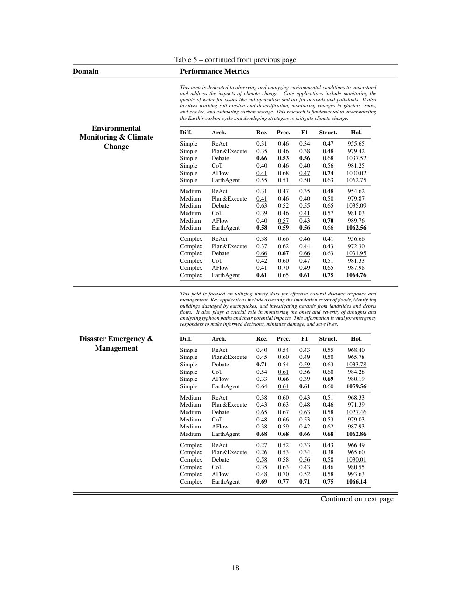

---

## PDF 第 030 页

Table 5 – continued from previous page

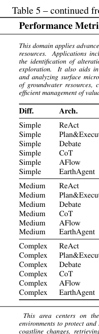

Domain Performance Metrics

Earth Science & Resource Exploration

Marine & Water Resources

This domain applies advanced analysis to study the Earth’s structure and discover natural resources. Applications include the detailed interpretation of geological structures and the identification of alteration minerals, which are key indicators for mineral resource exploration. It also aids in oil and gas exploration by detecting hydrocarbon seepage and analyzing surface micro-geomorphology. Furthermore, it supports the investigation of groundwater resources, contributing significantly to both geological science and the efficient management of valuable resources.

Diff. Arch. Rec. Prec. F1 Struct. Hol.

Simple ReAct 0.42 0.60 0.47 0.44 962.29 Simple Plan&Execute 0.49 0.67 0.55 0.42 972.48 Simple Debate 0.73 0.74 0.72 0.59 1031.79 Simple CoT 0.49 0.63 0.53 0.48 980.31 Simple AFlow 0.19 0.56 0.23 0.68 987.04 Simple EarthAgent 0.69 0.76 0.71 0.72 1069.42

Medium ReAct 0.35 0.51 0.38 0.46 962.85 Medium Plan&Execute 0.41 0.58 0.45 0.45 975.34 Medium Debate 0.58 0.60 0.57 0.56 1030.32 Medium CoT 0.38 0.57 0.42 0.51 980.32 Medium AFlow 0.32 0.50 0.32 0.61 984.86 Medium EarthAgent 0.50 0.66 0.54 0.70 1065.79

Complex ReAct 0.37 0.55 0.43 0.46 968.50 Complex Plan&Execute 0.44 0.58 0.48 0.43 976.31 Complex Debate 0.62 0.62 0.59 0.56 1032.06 Complex CoT 0.45 0.58 0.48 0.47 970.09 Complex AFlow 0.18 0.52 0.22 0.58 974.12 Complex EarthAgent 0.50 0.60 0.52 0.74 1065.20

This area centers on the monitoring and management of marine and freshwater environments to protect and sustain aquatic ecosystems. Its applications include tracking coastline changes, retrieving crucial ocean data like sea surface temperature, salinity, and chlorophyll concentration, and detecting maritime vessels and oil spills for security and environmental protection. It also involves monitoring harmful algal blooms and red tides and conducting assessments of watershed water resources, which are essential for maintaining ecological balance and managing water supplies.

Diff. Arch. Rec. Prec. F1 Struct. Hol.

Simple ReAct 0.29 0.43 0.33 0.47 961.47 Simple Plan&Execute 0.28 0.38 0.31 0.48 974.83 Simple Debate 0.60 0.57 0.56 0.65 1036.68 Simple CoT 0.33 0.41 0.35 0.56 985.17 Simple AFlow 0.37 0.65 0.43 0.74 1008.65 Simple EarthAgent 0.64 0.74 0.66 0.66 1062.88

Medium ReAct 0.20 0.40 0.23 0.45 952.79 Medium Plan&Execute 0.28 0.38 0.29 0.48 987.34 Medium Debate 0.56 0.54 0.52 0.61 1032.44 Medium CoT 0.35 0.46 0.36 0.56 980.47 Medium AFlow 0.42 0.51 0.40 0.69 1007.31 Medium EarthAgent 0.58 0.58 0.56 0.68 1064.90

Complex ReAct 0.27 0.52 0.33 0.38 960.13 Complex Plan&Execute 0.27 0.48 0.31 0.43 984.57 Complex Debate 0.56 0.55 0.52 0.55 1036.25 Complex CoT 0.30 0.49 0.34 0.47 975.57 Complex AFlow 0.33 0.53 0.36 0.62 1001.18 Complex EarthAgent 0.59 0.65 0.58 0.74 1060.78

Continued on next page

19

本页原版截图（含所有图片、公式、表格）

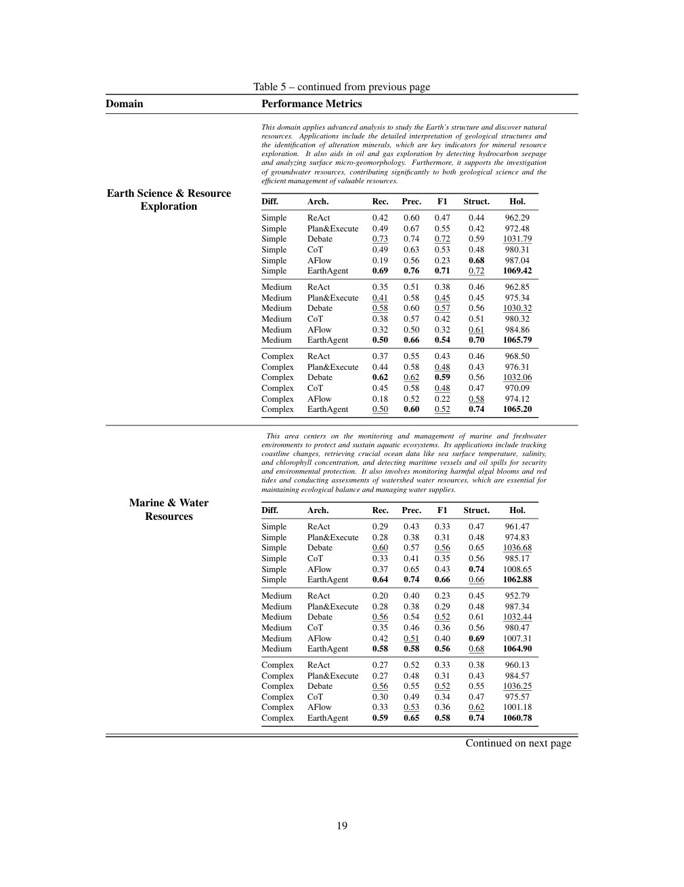

---

## PDF 第 031 页

Table 5 – continued from previous page

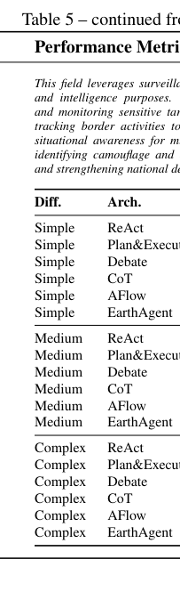

Domain Performance Metrics

Defense & Security

This field leverages surveillance and analysis technologies for critical national security and intelligence purposes. The applications are strategically focused on identifying and monitoring sensitive targets such as airports, ports, and missile bases, as well as tracking border activities to prevent illicit crossings. It provides enhanced battlefield situational awareness for military operations and includes sophisticated techniques for identifying camouflage and counter-camouflage, thereby supporting tactical advantages and strengthening national defense capabilities against potential threats.

Diff. Arch. Rec. Prec. F1 Struct. Hol.

Simple ReAct 0.26 0.38 0.30 0.46 960.80 Simple Plan&Execute 0.35 0.49 0.40 0.50 981.18 Simple Debate 0.58 0.49 0.51 0.62 1026.93 Simple CoT 0.27 0.35 0.29 0.52 973.01 Simple AFlow 0.34 0.60 0.41 0.69 985.56 Simple EarthAgent 0.67 0.61 0.62 0.67 1066.73

Medium ReAct 0.29 0.54 0.36 0.44 972.12 Medium Plan&Execute 0.32 0.56 0.38 0.43 973.49 Medium Debate 0.49 0.60 0.51 0.53 1029.36 Medium CoT 0.27 0.44 0.30 0.49 974.87 Medium AFlow 0.34 0.65 0.41 0.60 989.87 Medium EarthAgent 0.56 0.67 0.57 0.70 1065.50

Complex ReAct 0.26 0.48 0.31 0.42 967.01 Complex Plan&Execute 0.29 0.56 0.37 0.38 970.98 Complex Debate 0.41 0.54 0.45 0.50 1021.34 Complex CoT 0.24 0.43 0.28 0.43 984.80 Complex AFlow 0.35 0.59 0.40 0.58 998.31 Complex EarthAgent 0.57 0.67 0.59 0.74 1067.02

20

本页原版截图（含所有图片、公式、表格）

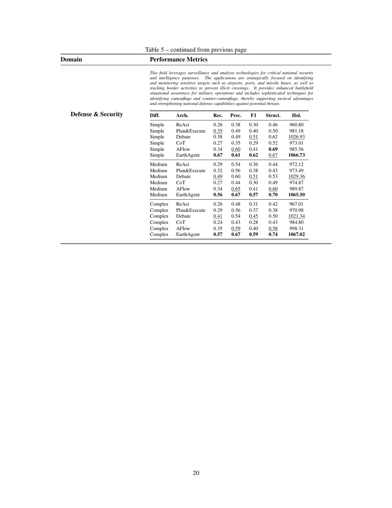

---

## PDF 第 032 页

Table 6. Top 10 Most Frequently Used Tools by the ReAct Architecture.

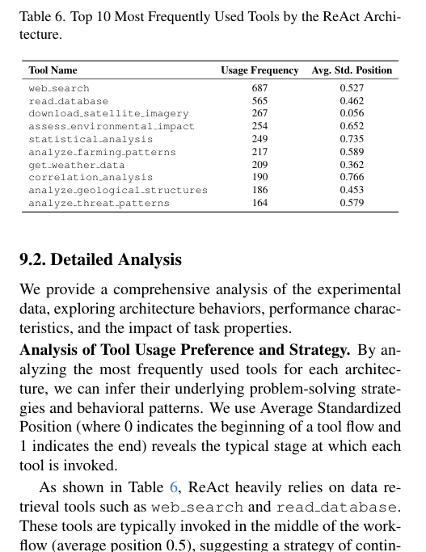

Tool Name Usage Frequency Avg. Std. Position

web search 687 0.527 read database 565 0.462 download satellite imagery 267 0.056 assess environmental impact 254 0.652 statistical analysis 249 0.735 analyze farming patterns 217 0.589 get weather data 209 0.362 correlation analysis 190 0.766 analyze geological structures 186 0.453 analyze threat patterns 164 0.579

9.2. Detailed Analysis

We provide a comprehensive analysis of the experimental data, exploring architecture behaviors, performance characteristics, and the impact of task properties. Analysis of Tool Usage Preference and Strategy. By analyzing the most frequently used tools for each architecture, we can infer their underlying problem-solving strategies and behavioral patterns. We use Average Standardized Position (where 0 indicates the beginning of a tool flow and 1 indicates the end) reveals the typical stage at which each tool is invoked. As shown in Table 6, ReAct heavily relies on data retrieval tools such as web search and read database. These tools are typically invoked in the middle of the workflow (average position 0.5), suggesting a strategy of continuous information gathering throughout the problem-solving process rather than a distinct initial data collection phase. The Plan&Execute agent exhibits a highly structured, phased approach (Table 7). It consistently begins with data acquisition (download satellite imagery, position 0.02) and concludes with formatting and summarization tools (format data and summarize text, positions 0.94). This pattern indicates a clear, logical “gatherprocess-report” workflow. EarthAgent, CoT, and AFlow exhibit distinct profiles. EarthAgent (Table 9) follows a logical, expert-like workflow for remote sensing, prioritizing preprocessing steps such as correction and cloud masking after data download. CoT (Table 10) adheres to a classic “researchthen-conclude” pattern, initiating with web search and concluding with summarize text. AFlow (Table 11) demonstrates template-based behavior, consistently starting with image download and preprocessing, and ending with report generation. Tool Usage Position Analysis via Heatmaps. To visualize the strategic differences in tool positioning, we generated the heatmap that plots the average standardized position for the top tools of each agent, as shown in Figure 8. The heatmap clearly illustrates the behavioral patterns identified earlier. ReAct exhibits a steep transition from

Table 7. Top 10 Most Frequently Used Tools by the Plan&Execute Architecture.

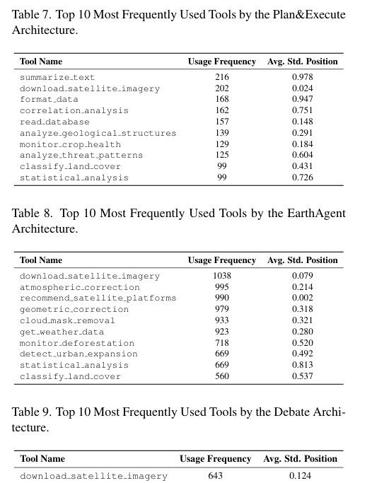

Tool Name Usage Frequency Avg. Std. Position

summarize text 216 0.978 download satellite imagery 202 0.024 format data 168 0.947 correlation analysis 162 0.751 read database 157 0.148 analyze geological structures 139 0.291 monitor crop health 129 0.184 analyze threat patterns 125 0.604 classify land cover 99 0.431 statistical analysis 99 0.726

Table 8. Top 10 Most Frequently Used Tools by the EarthAgent Architecture.

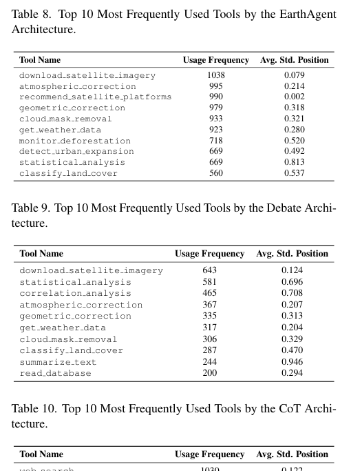

Tool Name Usage Frequency Avg. Std. Position

download satellite imagery 1038 0.079 atmospheric correction 995 0.214 recommend satellite platforms 990 0.002 geometric correction 979 0.318 cloud mask removal 933 0.321 get weather data 923 0.280 monitor deforestation 718 0.520 detect urban expansion 669 0.492 statistical analysis 669 0.813 classify land cover 560 0.537

Table 9. Top 10 Most Frequently Used Tools by the Debate Architecture.

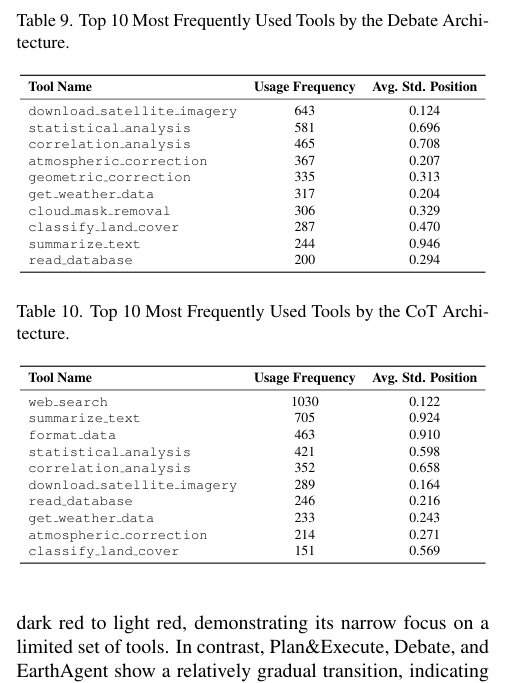

Tool Name Usage Frequency Avg. Std. Position

download satellite imagery 643 0.124 statistical analysis 581 0.696 correlation analysis 465 0.708 atmospheric correction 367 0.207 geometric correction 335 0.313 get weather data 317 0.204 cloud mask removal 306 0.329 classify land cover 287 0.470 summarize text 244 0.946 read database 200 0.294

Table 10. Top 10 Most Frequently Used Tools by the CoT Architecture.

Tool Name Usage Frequency Avg. Std. Position

web search 1030 0.122 summarize text 705 0.924 format data 463 0.910 statistical analysis 421 0.598 correlation analysis 352 0.658 download satellite imagery 289 0.164 read database 246 0.216 get weather data 233 0.243 atmospheric correction 214 0.271 classify land cover 151 0.569

dark red to light red, demonstrating its narrow focus on a limited set of tools. In contrast, Plan&Execute, Debate, and EarthAgent show a relatively gradual transition, indicating more balanced tool selection. Performance-Stability Quadrant Analysis. We analyzed

21

本页原版截图（含所有图片、公式、表格）

---

## PDF 第 033 页

Figure 8. Heatmap of Tool Usage. The color scale ranges from dark (most frequently used tools) to light (least frequently used tools).

Table 11. Top 10 Most Frequently Used Tools by the AFlow Architecture.

Tool Name Usage Frequency Avg. Std. Position

download satellite imagery 998 0.002 geometric correction 996 0.159 atmospheric correction 996 0.317 cloud mask removal 996 0.474 generate analysis reports 986 0.974 format data 611 0.898 classify land cover 575 0.607 monitor crop health 225 0.690 assess disaster damage 198 0.727 statistical analysis 154 0.799

the agents by plotting their mean performance (X-axis) against their stability (Y-axis, defined as the inverse of the standard deviation). This creates four quadrants: HighPerformance / High-Stability, High-Performance / LowStability (Inconsistent), Low-Performance / High-Stability (Reliably Poor), and Low-Performance / Low-Stability (Underperformer). As shown in Figures 9, 10, and 11, the analysis reveals different facets of each architecture’s reliability. Based on F1 Score (Figure 9), EarthAgent and Debate occupy the upper-right quadrant, delivering both high performance and high stability. Plan&Execute is also a strong performer but exhibits slightly less consistency.

Figure 9. Quadrant Analysis based on Correctness Metric Score.

Impact of Rare Tools on Performance. To understand how architectures handle tasks requiring specialized or domain-specific knowledge, we identified 20 “rare tools” which are the 20 least frequently occurring tools in the ground truth of all tasks (Table 12). We then compared all architectures’ performance on tasks containing zero, one, or two or more of these rare tools.

The results, shown in Table 13 and visualized in Figure 12, demonstrate a significant performance drop for all ar-

22

本页原版截图（含所有图片、公式、表格）

---

## PDF 第 034 页

Table 12. The 20 tools identified as ”rare” based on their low frequency in the ground truth dataset.

Tool Name GT Frequency Tool Name GT Frequency

analyze farming patterns 3 monitor airspace violations 1 assess air quality patterns 1 monitor ice coverage 6 assess pasture quality 1 monitor traffic congestion 7 classify landscape type 2 predict harvest timing 4 download file 4 read database 5 evaluate fishing grounds 3 track biodiversity changes 8 evaluate green space distribution 3 track ocean currents 7 evaluate ore quality 8 track ship movements 1 extract keywords 4 track wildfire progression 1 monitor air pollution 2 translate text 1

Figure 10. Quadrant Analysis based on Mean Structural Metrics Score.

Figure 11. Quadrant Analysis based on Mean Completeness Score.

chitectures when faced with tasks requiring rare tools. This analysis strongly suggests that the architectures’ “knowledge” is concentrated on common tools and workflows. When a task requires specialized, domain-specific tools (the “long tail”), their ability to generate correct plans decreases significantly. Notably, EarthAgent experiences

Table 13. Correctness Metric Score on Tasks Grouped by the Number of Rare Tools in their Ground Truth. Sample size (n) is shown in parentheses.

Architecture No Rare Tools 1 Rare Tool 2+ Rare Tools

ReAct 0.3770 (n=926) 0.3319 (n=68) 0.3500 (n=2) Plan&Execute 0.4308 (n=926) 0.3841 (n=68) 0.4500 (n=2) EarthAgent 0.6373 (n=926) 0.5688 (n=68) 0.3000 (n=2) Debate 0.5708 (n=926) 0.5335 (n=68) 0.4222 (n=2) CoT 0.4253 (n=926) 0.3407 (n=68) 0.3111 (n=2) AFlow 0.4456 (n=926) 0.3059 (n=68) 0.2222 (n=2)

Figure 12. Impact of Rare Tools on Correctness Metric Score.

one of the steepest declines, dropping from 0.68 to 0.57, while AFlow also suffers considerable performance degradation. This underscores the challenge of generalization and the critical importance of domain-specific knowledge in complex task planning. Notice that the 2+ Rare Tools category has a very small sample size, so we don’t include it into our analysis.

9.3. Case Study

In this part, we provide some representative example in evaluation process.

23

本页原版截图（含所有图片、公式、表格）

---

## PDF 第 035 页

9.3.1. Observation of EarthAgent in Structural Metric

Here, we present the 5 worst-performing cases of EarthAgent method on structural metric. We find that these tasks basically are simple and have relatively short gournd truth. The low EarthAgent scores stem from its tendency to overcomplicate the questions.

task_id: 28a25feb-131c-4fff-bf1e-0

f82c4b849b9 question: Following the severe winter

storms, determine the total land area lost from the coastal bluffs at Miramar Beach in Half Moon Bay from the beginning of the year until October 1st,

2023. domain: Marine & Water Resources complexity: Simple ground_truth: [’get_current_time’, ’

calculate_time_difference’, ’ assess_coastal_erosion’, ’ generate_analysis_reports’] --------------------------------------- ReAct: [’download_satellite_imagery’, ’

geometric_correction’, ’ classify_land_cover’, ’read_database’] Structural Metric: 0.7519181314855814 --------------------------------------- Plan&Execute: [’monitor_coastal_erosion’, ’

analyze_geological_structures’, ’ format_data’] Structural Metric: 0.5492723754137505 --------------------------------------- CoT: [’web_search’, ’web_search’, ’

statistical_analysis’, ’ download_satellite_imagery’, ’ classify_land_cover’, ’format_data’] Structural Metric: 0.6520651606196051 --------------------------------------- Debate: [’download_satellite_imagery’, ’

cloud_mask_removal’, ’ atmospheric_correction’, ’ geometric_correction’, ’ classify_land_cover’, ’ assess_coastal_erosion’, ’ statistical_analysis’] Structural Metric: 0.5356477422539736 --------------------------------------- AFlow: [’download_satellite_imagery’, ’

geometric_correction’, ’ atmospheric_correction’, ’ cloud_mask_removal’, ’ classify_land_cover’, ’detect_changes’, ’format_data’, ’ generate_analysis_reports’] Structural Metric: 0.5211968036443684 --------------------------------------- EarthAgent: [’recommend_satellite_platforms

’, ’download_satellite_imagery’, ’

get_weather_data’, ’ atmospheric_correction’, ’ geometric_correction’, ’ cloud_mask_removal’, ’ assess_disaster_damage’, ’ detect_urban_expansion’, ’ classify_land_cover’, ’ segment_vegetation’, ’ classify_landscape_type’, ’ classify_terrain_type’, ’ monitor_flood_extent’, ’ evaluate_infrastructure_damage’, ’ generate_analysis_reports’, ’ statistical_analysis’] Structural Metric: 0.3833063380272993 ============================================

task_id: 7f9c6c7a-df06-4955-b845-487

dafc5079d question: Assess the concentrations and

distribution of heavy metals, microplastics, and nutrients in the San Francisco Bay following the first significant rainfall during the first week of October 2023. domain: Marine & Water Resources complexity: Simple ground_truth: [’get_weather_data’, ’

assess_marine_pollution’, ’format_data’,

’generate_analysis_reports’] --------------------------------------- [’

web_search’, ’analyze_farming_patterns’,

’analyze_farming_patterns’, ’ statistical_analysis’, ’web_search’, ’ statistical_analysis’] Structural Metric: 0.6648747760559397 --------------------------------------- Plan&Execute: [’web_search’, ’

monitor_water_quality’, ’format_data’, ’ statistical_analysis’] Structural Metric: 0.7290138204892476 --------------------------------------- CoT: [’get_weather_data’, ’web_search’, ’

download_file’, ’statistical_analysis’, ’format_data’] Structural Metric: 0.7085224305041438 --------------------------------------- Debate: [’get_weather_data’, ’web_search’,

’read_database’, ’statistical_analysis’,

’summarize_text’] Structural Metric: 0.7237562433757787 --------------------------------------- AFlow: [’download_satellite_imagery’, ’

geometric_correction’, ’ atmospheric_correction’, ’ cloud_mask_removal’, ’ segment_water_bodies’, ’ analyze_pollutants’, ’format_data’, ’

24

本页原版截图（含所有图片、公式、表格）

---

## PDF 第 036 页

generate_analysis_reports’] Structural Metric: 0.5460570069461403 --------------------------------------- EarthAgent: [’recommend_satellite_platforms

’, ’download_satellite_imagery’, ’ get_weather_data’, ’ atmospheric_correction’, ’ geometric_correction’, ’ cloud_mask_removal’, ’ detect_urban_expansion’, ’ monitor_deforestation’, ’ classify_land_cover’, ’ segment_vegetation’, ’ classify_landscape_type’, ’ classify_terrain_type’, ’ assess_water_quality’, ’ track_biodiversity_changes’, ’ evaluate_ecosystem_services’, ’ monitor_forest_health’, ’ assess_wetland_conditions’] Structural Metric: 0.3826746628523331 ============================================

task_id: 6d35f8c7-c6c9-451a-bfa3-5420

aa5a920d question: Considering the peak growing

season in mid-June 2023, which residential neighborhoods in Manhattan exhibit the most significant deficit in public green space accessibility? domain: Urban & Regional Planning complexity: Medium ground_truth: [’web_search’, ’

recommend_satellite_platforms’, ’ download_satellite_imagery’, ’ extract_image_metadata’] --------------------------------------- [’

evaluate_green_space_distribution’, ’ read_database’, ’correlation_analysis’] Structural Metric: 0.6220541343342956 --------------------------------------- Plan&Execute: [’analyze_population_density

’, ’evaluate_green_space_distribution’, ’assess_land_use_efficiency’, ’ assess_urbanization_level’, ’ summarize_text’] Structural Metric: 0.6318968263426029 --------------------------------------- CoT: [’read_database’, ’

evaluate_green_space_distribution’, ’ statistical_analysis’, ’summarize_text’] Structural Metric: 0.7243667108317215 --------------------------------------- Debate: [’read_database’, ’

evaluate_green_space_distribution’, ’ analyze_population_density’, ’ assess_land_use_efficiency’, ’ correlation_analysis’, ’summarize_text’]

Structural Metric: 0.5707047106620089 --------------------------------------- AFlow: [’download_satellite_imagery’, ’

geometric_correction’, ’ atmospheric_correction’, ’ cloud_mask_removal’, ’ classify_land_cover’, ’ assess_green_space_accessibility’, ’ generate_analysis_reports’, ’format_data ’] Structural Metric: 0.5080498688191866 --------------------------------------- EarthAgent: [’recommend_satellite_platforms

’, ’download_satellite_imagery’, ’ get_weather_data’, ’ atmospheric_correction’, ’ geometric_correction’, ’ statistical_analysis’, ’ classify_landscape_type’, ’ assess_urbanization_level’, ’ classify_land_cover’, ’ segment_vegetation’, ’ detect_urban_expansion’, ’ monitor_deforestation’, ’ evaluate_green_space_distribution’, ’ analyze_population_density’, ’ assess_land_use_efficiency’, ’ assess_air_quality_patterns’, ’ correlation_analysis’] Structural Metric: 0.3813096139548148 ============================================

task_id: d95da39a-9e37-428c-8ce2-0

d7f636c9d4d question: To what extent has Central Texas

rebuilt its infrastructure and recovered

its agricultural land following the severe flooding event in mid-September 2023? domain: Disaster Emergency & Management complexity: Medium ground_truth: [’assess_flood_risk_zones’, ’

monitor_flood_extent’, ’ assess_disaster_damage’, ’ assess_recovery_progress’] --------------------------------------- [’

monitor_flood_extent’, ’ assess_recovery_progress’, ’ monitor_crop_health’, ’ evaluate_infrastructure_damage’, ’ assess_environmental_impact’, ’ analyze_threat_patterns’, ’ assess_slope_stability’, ’ assess_urbanization_level’] Structural Metric: 0.5677680325256582 --------------------------------------- Plan&Execute: [’monitor_flood_extent’, ’

assess_infrastructure_damage’, ’

25

本页原版截图（含所有图片、公式、表格）

---

## PDF 第 037 页

assess_recovery_progress’, ’ monitor_crop_health’, ’ assess_soil_moisture’, ’ predict_crop_yield’] Structural Metric: 0.629565405348949 --------------------------------------- CoT: [’web_search’, ’web_search’, ’

web_search’, ’web_search’, ’ assess_infrastructure_damage’, ’ monitor_flood_extent’, ’ assess_recovery_progress’, ’ summarize_text’] Structural Metric: 0.7181785252865864 --------------------------------------- Debate: [’monitor_flood_extent’, ’

evaluate_infrastructure_damage’, ’ assess_recovery_progress’, ’ monitor_crop_health’, ’ analyze_farming_patterns’, ’ classify_land_cover’, ’ statistical_analysis’] Structural Metric: 0.5856316607624632 --------------------------------------- AFlow: [’download_satellite_imagery’, ’

geometric_correction’, ’ atmospheric_correction’, ’ cloud_mask_removal’, ’ classify_land_cover’, ’ assess_disaster_damage’, ’format_data’, ’generate_analysis_reports’] Structural Metric: 0.4995047243114492 --------------------------------------- EarthAgent: [’recommend_satellite_platforms

’, ’download_satellite_imagery’, ’ get_weather_data’, ’ atmospheric_correction’, ’ geometric_correction’, ’ cloud_mask_removal’, ’ assess_disaster_damage’, ’ monitor_deforestation’, ’ classify_land_cover’, ’ segment_vegetation’, ’ evaluate_infrastructure_damage’, ’ assess_recovery_progress’, ’ statistical_analysis’, ’ monitor_drought_conditions’, ’ generate_analysis_reports’] Structural Metric: 0.37995968634487254 ============================================

task_id: 12f3964d-c0a8-46fe-9070-8

d6a48fb49a3 question: Considering the current

environmental risks and population distribution in Mountain View, what is the safest vehicle evacuation route from

the vulnerable residential area at 45.3839, -122.4836 to the designated

emergency shelter at 45.3941, -122.4930? domain: Disaster Emergency & Management complexity: Simple ground_truth: [’analyze_population_density

’, ’predict_landslide_risk’, ’ plan_evacuation_routes’, ’ generate_analysis_reports’] --------------------------------------- [’

assess_flood_risk_zones’, ’ analyze_population_density’, ’ plan_evacuation_routes’, ’ monitor_traffic_congestion’] Structural Metric: 0.8181467528144518 --------------------------------------- Plan&Execute: [’evaluate_flood_risk_zones’,

’monitor_traffic_congestion’, ’ plan_evacuation_routes’] Structural Metric: 0.5690546123325106 --------------------------------------- CoT: [’assess_environmental_impact’, ’

analyze_population_density’, ’ plan_evacuation_routes’, ’ get_weather_data’, ’format_data’] Structural Metric: 0.7148938120542967 --------------------------------------- Debate: [’detect_roads’, ’

assess_flood_risk_zones’, ’ track_wildfire_progression’, ’ monitor_traffic_congestion’, ’ assess_road_conditions’, ’ predict_landslide_risk’, ’ assess_earthquake_damage’, ’ plan_evacuation_routes’] Structural Metric: 0.5495748485005734 --------------------------------------- AFlow: [’download_satellite_imagery’, ’

geometric_correction’, ’ atmospheric_correction’, ’ cloud_mask_removal’, ’ assess_disaster_risks’, ’ identify_evacuations_routes’, ’ generate_analysis_reports’] Structural Metric: 0.5696155175193354 --------------------------------------- EarthAgent: [’recommend_satellite_platforms

’, ’download_satellite_imagery’, ’ get_weather_data’, ’ atmospheric_correction’, ’ cloud_mask_removal’, ’ geometric_correction’, ’ monitor_deforestation’, ’ detect_urban_expansion’, ’ classify_landscape_type’, ’ assess_urbanization_level’, ’ detect_roads’, ’detect_buildings’, ’ monitor_flood_extent’, ’ track_wildfire_progression’, ’ statistical_analysis’, ’

26

本页原版截图（含所有图片、公式、表格）

---

## PDF 第 038 页

evaluate_infrastructure_damage’] Structural Metric: 0.37793323951852476

Meanwhile, there are tasks where EarthAgent are good at. We show 5 of them.

task_id: fd5cd797-e422-41f4-a5a9-

fa205472416b question: Quantify the statistically

significant trend of coastal erosion along the shoreline between latitudes 34 N and 35N for the year 2023. domain: Marine & Water Resources complexity: Medium ground_truth: [’

recommend_satellite_platforms’, ’ download_satellite_imagery’, ’ geometric_correction’, ’ atmospheric_correction’, ’ cloud_mask_removal’, ’crop_image’, ’ segment_water_bodies’, ’ calculate_time_difference’, ’ assess_coastal_erosion’, ’ statistical_analysis’, ’format_data’, ’ generate_analysis_reports’] --------------------------------------- ReAct: [’download_satellite_imagery’, ’

statistical_analysis’, ’ statistical_analysis’, ’ generate_analysis_reports’] Structural Metric: 0.3803773766006371 --------------------------------------- Plan&Execute: [’download_satellite_imagery

’, ’atmospheric_correction’, ’ geometric_correction’, ’ detect_military_facilities’, ’ segment_coastal_erosion’, ’ statistical_analysis’] Structural Metric: 0.5234263483593165 --------------------------------------- CoT: [’web_search’, ’web_search’, ’I will

download the dataset for analysis’, ’ format_data’, ’statistical_analysis’, ’ linear_regression’, ’summarize_text’] Structural Metric: 0.4564959376866067 --------------------------------------- Debate: [’download_satellite_imagery’, ’

atmospheric_correction’, ’ geometric_correction’, ’ cloud_mask_removal’, ’ classify_land_cover’, ’ assess_coastal_erosion’, ’ statistical_analysis’, ’ temporal_analysis’] Structural Metric: 0.6554164563067398 --------------------------------------- AFlow: [’download_satellite_imagery’, ’

geometric_correction’, ’ atmospheric_correction’, ’

cloud_mask_removal’, ’ segment_water_bodies’, ’ classify_land_cover’, ’ statistical_analysis’, ’ generate_analysis_reports’] Structural Metric: 0.7207758695382465 --------------------------------------- EarthAgent: [’recommend_satellite_platforms

’, ’download_satellite_imagery’, ’ get_weather_data’, ’ atmospheric_correction’, ’ cloud_mask_removal’, ’ geometric_correction’, ’ classify_landscape_type’, ’ classify_terrain_type’, ’ assess_coastal_erosion’, ’ statistical_analysis’, ’ linear_regression’, ’ generate_analysis_reports’] Structural Metric: 0.8962936784244246

task_id: 14c50a12-f2cf-4181-b44f-

f0935dd79ee3 question: Assess the health of corn,

soybean, and wheat crops in the agricultural plots just east of downtown

Los Angeles during January 2023, pinpointing any areas showing highconfidence indicators of specific plant diseases. domain: Agriculture & Forestry complexity: Complex ground_truth: [’

recommend_satellite_platforms’, ’ download_satellite_imagery’, ’ geometric_correction’, ’ atmospheric_correction’, ’ cloud_mask_removal’, ’crop_image’, ’ enhance_image_resolution’, ’ segment_vegetation’, ’ classify_land_cover’, ’ monitor_crop_health’, ’ detect_plant_diseases’] --------------------------------------- ReAct: [’download_satellite_imagery’, ’

atmospheric_correction’, ’ detect_plant_diseases’] Structural Metric: 0.3809054440290979 --------------------------------------- Plan&Execute: [’monitor_crop_health’, ’

detect_plant_diseases’] Structural Metric: 0.2982246972559247 --------------------------------------- CoT: [’download_satellite_imagery’, ’

atmospheric_correction’, ’ geometric_correction’, ’ segment_agricultural_fields’, ’ monitor_crop_health’, ’

27

本页原版截图（含所有图片、公式、表格）

---

## PDF 第 039 页

detect_plant_diseases’, ’summarize_text ’] Structural Metric: 0.6319789365923533 --------------------------------------- Debate: [’download_satellite_imagery’, ’

atmospheric_correction’, ’ geometric_correction’, ’ assess_soil_moisture’, ’get_weather_data ’, ’segment_agricultural_fields’, ’ classify_land_cover’, ’ monitor_crop_health’, ’ detect_plant_diseases’, ’summarize_text ’] Structural Metric: 0.781518882364096 --------------------------------------- AFlow: [’download_satellite_imagery’, ’

geometric_correction’, ’ atmospheric_correction’, ’ cloud_mask_removal’, ’ monitor_crop_health’, ’ detect_plant_diseases’, ’format_data’, ’ generate_analysis_reports’] Structural Metric: 0.7246626350376182 --------------------------------------- EarthAgent: [’recommend_satellite_platforms

’, ’download_satellite_imagery’, ’ suggest_processing_workflows’, ’ atmospheric_correction’, ’ geometric_correction’, ’ cloud_mask_removal’, ’ classify_land_cover’, ’ segment_vegetation’, ’ monitor_crop_health’, ’ detect_plant_diseases’, ’ monitor_crop_health’, ’ monitor_crop_health’, ’ detect_plant_diseases’] Structural Metric: 0.8638882881783954

task_id: b591986a-38c5-4a1f-a775-2

b38a48efa44 question: For the agricultural fields

within the Los Angeles basin, quantify the relationship between individual field size, peak vegetation health during the summer 2023 growing season, and the resulting predicted crop yield. domain: Agriculture & Forestry complexity: Medium ground_truth: [’web_search’, ’

recommend_satellite_platforms’, ’ download_satellite_imagery’, ’ cloud_mask_removal’, ’ geometric_correction’, ’ atmospheric_correction’, ’crop_image’, ’ segment_vegetation’, ’ segment_agricultural_fields’, ’ statistical_analysis’, ’

predict_crop_yield’, ’ correlation_analysis’, ’ linear_regression’] --------------------------------------- ReAct: [’read_database’, ’

statistical_analysis’, ’ statistical_analysis’, ’ correlation_analysis’, ’ correlation_analysis’, ’read_database’] Structural Metric: 0.3971436873952484 --------------------------------------- Plan&Execute: [’monitor_crop_health’, ’

predict_crop_yield’, ’ analyze_farming_patterns’, ’ correlation_analysis’] Structural Metric: 0.4188257513782573 --------------------------------------- CoT: [’read_database’, ’

statistical_analysis’, ’ correlation_analysis’, ’ linear_regression’, ’summarize_text’] Structural Metric: 0.4319192084485427 --------------------------------------- Debate: [’download_satellite_imagery’, ’

atmospheric_correction’, ’ cloud_mask_removal’, ’ segment_agricultural_fields’, ’ monitor_crop_health’, ’format_data’, ’ statistical_analysis’, ’ correlation_analysis’, ’ linear_regression’, ’predict_crop_yield ’] Structural Metric: 0.6972034412143604 --------------------------------------- AFlow: [’download_satellite_imagery’, ’

geometric_correction’, ’ atmospheric_correction’, ’ cloud_mask_removal’, ’ monitor_crop_health’, ’ statistical_analysis’, ’ generate_analysis_reports’, ’format_data ’] Structural Metric: 0.633400521092164 --------------------------------------- EarthAgent: [’recommend_satellite_platforms

’, ’download_satellite_imagery’, ’ get_weather_data’, ’ atmospheric_correction’, ’ geometric_correction’, ’ cloud_mask_removal’, ’ classify_land_cover’, ’ segment_vegetation’, ’ monitor_crop_health’, ’ predict_crop_yield’, ’ statistical_analysis’, ’ correlation_analysis’, ’ linear_regression’] Structural Metric: 0.8613930069483243

28

本页原版截图（含所有图片、公式、表格）

---

## PDF 第 040 页

task_id: 5757265e-e1b5-4cdb-bb41-

a2f7c085d464 question: Following the recent seismic

event in Humboldt County, California, produce a detailed building-level damage

assessment and an evaluation of initial recovery activities observed during early August 2023. domain: Disaster Emergency & Management complexity: Medium ground_truth: [’web_search’, ’

download_satellite_imagery’, ’ extract_image_metadata’, ’ atmospheric_correction’, ’ cloud_mask_removal’, ’ geometric_correction’, ’crop_image’, ’ enhance_image_resolution’, ’ segment_individual_buildings’, ’ assess_earthquake_damage’, ’ assess_disaster_damage’, ’ assess_recovery_progress’, ’ generate_analysis_reports’, ’format_data ’] --------------------------------------- ReAct: [’assess_disaster_damage’, ’

assess_recovery_progress’, ’ analyze_population_density’, ’ assess_environmental_impact’, ’ assess_environmental_impact’, ’ monitor_air_pollution’, ’ assess_environmental_impact’, ’ assess_environmental_impact’, ’ assess_environmental_impact’, ’ assess_environmental_impact’] Structural Metric: 0.463475499035262 --------------------------------------- Plan&Execute: [’assess_earthquake_damage’,

’assess_recovery_progress’] Structural Metric: 0.30108128142281765 --------------------------------------- CoT: [’web_search’, ’web_search’, ’

assess_earthquake_damage’, ’ assess_recovery_progress’, ’format_data ’] Structural Metric: 0.4111871575296303 --------------------------------------- Debate: [’download_satellite_imagery’, ’

cloud_mask_removal’, ’ geometric_correction’, ’ atmospheric_correction’, ’ detect_individual_buildings’, ’ assess_earthquake_damage’, ’ assess_infrastructure_damage’, ’ assess_recovery_progress’, ’ monitor_traffic_congestion’, ’ analyze_urban_growth_patterns’, ’ classify_land_cover’]

Structural Metric: 0.6371590403326893 --------------------------------------- AFlow: [’download_satellite_imagery’, ’

geometric_correction’, ’ atmospheric_correction’, ’ cloud_mask_removal’, ’ assess_disaster_damage’, ’ monitor_crop_health’, ’ generate_analysis_reports’] Structural Metric: 0.5766079862654101 --------------------------------------- EarthAgent: [’recommend_satellite_platforms

’, ’download_satellite_imagery’, ’ get_weather_data’, ’ atmospheric_correction’, ’ cloud_mask_removal’, ’ geometric_correction’, ’detect_buildings ’, ’extract_image_metadata’, ’ segment_individual_buildings’, ’ segment_individual_buildings’, ’ assess_disaster_damage’, ’ monitor_deforestation’, ’ assess_earthquake_damage’, ’ assess_recovery_progress’, ’ statistical_analysis’] Structural Metric: 0.859065704757259

task_id: e094fa9a-2e60-4bc4-aaed-

ab15a70754c5 question: Quantify the average shoreline

retreat along the urbanized coast of Mykonos, Greece, by comparing the waterfront position of January 2022 to that of January 2021. domain: Marine & Water Resources complexity: Simple ground_truth: [’download_satellite_imagery

’, ’geometric_correction’, ’ atmospheric_correction’, ’ cloud_mask_removal’, ’crop_image’, ’ segment_water_bodies’, ’ calculate_time_difference’, ’ assess_coastal_erosion’, ’ statistical_analysis’, ’ generate_analysis_reports’] --------------------------------------- ReAct: [’download_satellite_imagery’, ’

download_satellite_imagery’, ’ detect_ships’, ’detect_ships’, ’ detect_ships’, ’detect_ships’, ’ detect_buildings’, ’detect_buildings’, ’ detect_buildings’, ’detect_ships’] Structural Metric: 0.4431240695754549 --------------------------------------- Plan&Execute: [’download_satellite_imagery

’, ’download_satellite_imagery’, ’ geometric_correction’, ’ geometric_correction’, ’

29

本页原版截图（含所有图片、公式、表格）

---

## PDF 第 041 页

extract_image_metadata’, ’ extract_image_metadata’, ’detect_roads’,

’detect_roads’, ’correlation_analysis’, ’format_data’] Structural Metric: 0.5899371128885651 --------------------------------------- CoT: [’download_satellite_imagery’, ’

atmospheric_correction’, ’ geometric_correction’, ’ segment_water_bodies’, ’ statistical_analysis’, ’ statistical_analysis’, ’format_data’] Structural Metric: 0.6189795057360581 --------------------------------------- Debate: [’download_satellite_imagery’, ’

geometric_correction’, ’ atmospheric_correction’, ’ cloud_mask_removal’, ’ classify_land_cover’, ’ segment_water_bodies’, ’ statistical_analysis’] Structural Metric: 0.7455656458466684 --------------------------------------- AFlow: [’download_satellite_imagery’, ’

geometric_correction’, ’ atmospheric_correction’, ’ cloud_mask_removal’, ’ classify_land_cover’, ’ statistical_analysis’, ’ generate_analysis_reports’] Structural Metric: 0.7413091656675803 --------------------------------------- EarthAgent: [’recommend_satellite_platforms

’, ’download_satellite_imagery’, ’ download_satellite_imagery’, ’ atmospheric_correction’, ’ cloud_mask_removal’, ’ geometric_correction’, ’ classify_landscape_type’, ’ assess_urbanization_level’, ’ analyze_urban_growth_patterns’, ’ statistical_analysis’, ’ correlation_analysis’] Structural Metric: 0.8558551256855329

9.3.2. Cases Debate Do Well in

we present the 5 best-performing cases of Debate method on structural metric. Debate can leverage several LLMdriven debator agent to refine the answer over and over again. We find it does well on tasks that have medium length of ground truth and need little more reasoning and comprehensive skills.

task_id: 7f86fe57-67e6-4f1d-979b-

b5057ef3883e question: Quantify the total carbon

sequestration loss in metric tons from

forest reduction within the area bounded

by 45.0N, 44.5N, -73.0E, and -73.5W for the three-year period beginning January 1, 2020. domain: Agriculture & Forestry complexity: Simple ground_truth: [’download_satellite_imagery

’, ’geometric_correction’, ’ atmospheric_correction’, ’ cloud_mask_removal’, ’crop_image’, ’ classify_land_cover’, ’ monitor_deforestation’, ’ assess_carbon_sequestration’, ’ generate_analysis_reports’] --------------------------------------- ReAct: [’download_satellite_imagery’, ’

classify_land_cover’, ’web_search’, ’ statistical_analysis’] Structural Metric: 0.4826636062742867 --------------------------------------- Plan&Execute: [’monitor_forest_health’, ’

assess_carbon_sequestration’] Structural Metric: 0.31060735321796074 --------------------------------------- CoT: [’download_satellite_imagery’, ’

classify_land_cover’, ’ monitor_deforestation’, ’ assess_carbon_sequestration’, ’ format_data’] Structural Metric: 0.5711478990381471 --------------------------------------- Debate: [’download_satellite_imagery’, ’

atmospheric_correction’, ’ geometric_correction’, ’ cloud_mask_removal’, ’band_combination’,

’segment_vegetation’, ’ monitor_deforestation’, ’ assess_carbon_sequestration’, ’ statistical_analysis’] Structural Metric: 0.9254394035648417 --------------------------------------- AFlow: [’download_satellite_imagery’, ’

geometric_correction’, ’ atmospheric_correction’, ’ cloud_mask_removal’, ’ classify_land_cover’, ’format_data’, ’ generate_analysis_reports’] Structural Metric: 0.7841913067497179 --------------------------------------- EarthAgent: [’recommend_satellite_platforms

’, ’atmospheric_correction’, ’ geometric_correction’, ’ cloud_mask_removal’, ’ monitor_deforestation’, ’ assess_disaster_damage’, ’ classify_land_cover’, ’ segment_vegetation’, ’ classify_landscape_type’, ’

30

本页原版截图（含所有图片、公式、表格）

---

## PDF 第 042 页

assess_urbanization_level’, ’ monitor_forest_health’, ’ assess_carbon_sequestration’, ’ track_biodiversity_changes’, ’ detect_illegal_logging’, ’ evaluate_ecosystem_services’] Structural Metric: 0.6513509848247034

task_id: 385a42c1-6292-4a09-93b3-22

bbec4a9ec7 question: For the Presidio Trust’s 2023

land use assessment, provide a detailed architectural footprint analysis of structures between the Presidio Golf Course and eastern Golden Gate Park, including a statistical breakdown of building counts and average sizes categorized by type. domain: Urban & Regional Planning complexity: Simple ground_truth: [’download_satellite_imagery

’, ’cloud_mask_removal’, ’ geometric_correction’, ’crop_image’, ’ atmospheric_correction’, ’ detect_buildings’, ’ segment_individual_buildings’, ’ statistical_analysis’, ’ generate_analysis_reports’] --------------------------------------- ReAct: [’download_satellite_imagery’, ’

detect_buildings’, ’statistical_analysis ’] Structural Metric: 0.4258193318765149 --------------------------------------- Plan&Execute: [’download_satellite_imagery

’, ’geometric_correction’, ’ cloud_mask_removal’, ’detect_buildings’,

’classify_land_cover’, ’ extract_image_metadata’, ’ statistical_analysis’] Structural Metric: 0.7191934120716232 --------------------------------------- CoT: [’download_satellite_imagery’, ’

geometric_correction’, ’detect_buildings ’, ’segment_individual_buildings’, ’ format_data’, ’statistical_analysis’, ’ format_data’] Structural Metric: 0.701682978215084 --------------------------------------- Debate: [’download_satellite_imagery’, ’

atmospheric_correction’, ’ geometric_correction’, ’ cloud_mask_removal’, ’detect_buildings’,

’segment_urban_areas’, ’ segment_individual_buildings’, ’ statistical_analysis’, ’format_data’] Structural Metric: 0.8970724741617838 ---------------------------------------

AFlow: [’download_satellite_imagery’, ’

geometric_correction’, ’ atmospheric_correction’, ’ cloud_mask_removal’, ’ classify_land_cover’, ’ statistical_analysis’, ’ generate_analysis_reports’] Structural Metric: 0.759859128691575 --------------------------------------- EarthAgent: [’recommend_satellite_platforms

’, ’download_satellite_imagery’, ’ get_weather_data’, ’ atmospheric_correction’, ’ geometric_correction’, ’ statistical_analysis’, ’detect_buildings ’, ’detect_roads’, ’ segment_individual_buildings’, ’ segment_agricultural_fields’, ’ classify_land_cover’, ’ segment_vegetation’, ’ assess_land_use_efficiency’, ’ statistical_analysis’, ’ evaluate_green_space_distribution’, ’ analyze_population_density’, ’ analyze_population_density’] Structural Metric: 0.6034446646374529

task_id: 42a99dbb-7d54-44fe-bd88-54489937

b8a9 question: Assess the 2022 carbon

sequestration capacity of the varied ecosystems within the California region stretching from the Central Valley floor

to the high elevations of the southern Sierra Nevada. domain: Agriculture & Forestry complexity: Simple ground_truth: [’download_satellite_imagery

’, ’geometric_correction’, ’ atmospheric_correction’, ’ cloud_mask_removal’, ’crop_image’, ’ segment_vegetation’, ’ classify_land_cover’, ’ assess_carbon_sequestration’] --------------------------------------- ReAct: [’assess_carbon_sequestration’, ’

assess_carbon_sequestration’, ’ analyze_farming_patterns’, ’ assess_land_use_efficiency’, ’ monitor_forest_health’, ’ evaluate_ecosystem_services’, ’ assess_carbon_sequestration’, ’ assess_soil_moisture’, ’ analyze_farming_patterns’, ’ track_biodiversity_changes’] Structural Metric: 0.693135573687668 --------------------------------------- Plan&Execute: [’assess_carbon_sequestration

31

本页原版截图（含所有图片、公式、表格）

---

## PDF 第 043 页

’, ’summarize_text’] Structural Metric: 0.3044321291012029 --------------------------------------- CoT: [’web_search’, ’web_search’, ’

summarize_text’, ’statistical_analysis’,

’correlation_analysis’, ’format_data’] Structural Metric: 0.5203244053992784 --------------------------------------- Debate: [’download_satellite_imagery’, ’

atmospheric_correction’, ’ geometric_correction’, ’ cloud_mask_removal’, ’ classify_land_cover’, ’ segment_vegetation’, ’ assess_carbon_sequestration’, ’ statistical_analysis’] Structural Metric: 0.8968025321761767 --------------------------------------- AFlow: [’download_satellite_imagery’, ’

geometric_correction’, ’ atmospheric_correction’, ’ cloud_mask_removal’, ’ classify_land_cover’, ’ statistical_analysis’, ’ generate_analysis_reports’] Structural Metric: 0.8224986597176879 --------------------------------------- EarthAgent: [’recommend_satellite_platforms

’, ’download_satellite_imagery’, ’ get_weather_data’, ’ atmospheric_correction’, ’ geometric_correction’, ’ cloud_mask_removal’, ’ classify_landscape_type’, ’ classify_terrain_type’, ’ monitor_deforestation’, ’ detect_urban_expansion’, ’ classify_land_cover’, ’ segment_vegetation’, ’ assess_carbon_sequestration’, ’ evaluate_ecosystem_services’, ’ track_biodiversity_changes’, ’ monitor_forest_health’, ’ assess_water_quality’] Structural Metric: 0.5801916555758977

task_id: 75f963f1-0746-42ca-bae3-

e1a971efb4cd question: Pinpoint the hotspots and

quantify the spatial intensity of urban expansion in Lower Manhattan from 2010 to 2020. domain: Urban & Regional Planning complexity: Simple ground_truth: [’download_satellite_imagery

’, ’geometric_correction’, ’ atmospheric_correction’, ’ cloud_mask_removal’, ’crop_image’, ’

classify_land_cover’, ’ detect_urban_expansion’, ’ analyze_urban_growth_patterns’, ’ statistical_analysis’, ’ generate_analysis_reports’] --------------------------------------- ReAct: [’download_satellite_imagery’, ’

download_satellite_imagery’, ’ classify_land_cover’, ’ classify_land_cover’, ’ correlation_analysis’] Structural Metric: 0.3990976384140391 --------------------------------------- Plan&Execute: [’download_satellite_imagery

’, ’atmospheric_correction’, ’ geometric_correction’, ’ classify_land_cover’, ’ detect_urban_expansion’, ’ analyze_urban_growth_patterns’, ’ assess_land_use_efficiency’] Structural Metric: 0.7012794784075258 --------------------------------------- CoT: [’download_satellite_imagery’, ’

atmospheric_correction’, ’ geometric_correction’, ’ segment_urban_areas’, ’ detect_urban_expansion’, ’ assess_urbanization_level’, ’ analyze_urban_growth_patterns’] Structural Metric: 0.6824979742013693 --------------------------------------- Debate: [’download_satellite_imagery’, ’

atmospheric_correction’, ’ geometric_correction’, ’ cloud_mask_removal’, ’ classify_land_cover’, ’ segment_urban_areas’, ’ detect_urban_expansion’, ’ analyze_urban_growth_patterns’, ’ statistical_analysis’, ’ temporal_analysis’] Structural Metric: 0.8885315597057343 --------------------------------------- AFlow: [’download_satellite_imagery’, ’

geometric_correction’, ’ atmospheric_correction’, ’ cloud_mask_removal’, ’ classify_land_cover’, ’quantify_changes ’, ’format_data’, ’ generate_analysis_reports’] Structural Metric: 0.7426862084609933 --------------------------------------- EarthAgent: [’recommend_satellite_platforms

’, ’download_satellite_imagery’, ’ download_satellite_imagery’, ’ atmospheric_correction’, ’ geometric_correction’, ’ statistical_analysis’, ’

32

本页原版截图（含所有图片、公式、表格）

---

## PDF 第 044 页

detect_urban_expansion’, ’ monitor_deforestation’, ’ classify_land_cover’, ’ segment_urban_areas’, ’ analyze_urban_growth_patterns’, ’ statistical_analysis’, ’ assess_land_use_efficiency’, ’ evaluate_green_space_distribution’, ’ assess_air_quality_patterns’] Structural Metric: 0.7202834741050391

task_id: 5ab85e87-cb9d-4e6f-be92-28

adfb44acb4 question: To what extent did the

environmental repercussions of vegetation loss during 2023, particularly on carbon emissions and biodiversity, vary between different districts of Los Angeles? domain: Environmental Monitoring & Climate

Change complexity: Simple ground_truth: [’download_satellite_imagery

’, ’geometric_correction’, ’ atmospheric_correction’, ’ cloud_mask_removal’, ’ classify_land_cover’, ’ monitor_deforestation’, ’ assess_environmental_impact’, ’ statistical_analysis’, ’ generate_analysis_reports’] --------------------------------------- ReAct: [’read_database’, ’

statistical_analysis’, ’ generate_analysis_reports’] Structural Metric: 0.42368791612803935 --------------------------------------- Plan&Execute: [’monitor_forest_health’, ’

assess_carbon_sequestration’, ’ track_biodiversity_changes’, ’ analyze_population_density’, ’ assess_environmental_impact’, ’ evaluate_ecosystem_services’, ’ summarize_text’] Structural Metric: 0.6476911148752748 --------------------------------------- CoT: [’web_search’, ’web_search’, ’

read_database’, ’statistical_analysis’, ’correlation_analysis’, ’summarize_text ’] Structural Metric: 0.509136391560046 --------------------------------------- Debate: [’download_satellite_imagery’, ’

atmospheric_correction’, ’ geometric_correction’, ’ cloud_mask_removal’, ’segment_vegetation ’, ’classify_land_cover’, ’ assess_carbon_sequestration’, ’

track_biodiversity_changes’, ’ correlation_analysis’] Structural Metric: 0.8743224684838895 --------------------------------------- AFlow: [’download_satellite_imagery’, ’

geometric_correction’, ’ atmospheric_correction’, ’ cloud_mask_removal’, ’crop_image’, ’ classify_land_cover’, ’ assess_disaster_damage’, ’format_data’, ’generate_analysis_reports’] Structural Metric: 0.9129544281297259 --------------------------------------- EarthAgent: [’recommend_satellite_platforms

’, ’download_satellite_imagery’, ’ get_weather_data’, ’ atmospheric_correction’, ’ geometric_correction’, ’ statistical_analysis’, ’ monitor_deforestation’, ’ detect_urban_expansion’, ’ classify_land_cover’, ’ segment_vegetation’, ’ assess_carbon_sequestration’, ’ track_biodiversity_changes’, ’ evaluate_ecosystem_services’, ’ assess_water_quality’, ’ monitor_air_pollution’] Structural Metric: 0.6284940975578261

9.3.3. Cases Where AFlow Behave Brilliant

we present the 5 best-performing cases of AFlow method on structural metric. AFlow is a powerful workflow trained by 248 tasks in our GeoPlan-bench. Partly because of this, it achieves great results in our evaluation. One thing that is worth noticing is that in the cases below, AFlow gets much higher scores than other architectures.

task_id: 7e112f37-780a-44dc-9ce8-

dd6c5051dc2e question: Assess the early summer

ecological health of California’s major reservoirs by characterizing the prevalence of algal content and sediment

levels throughout June 2023. domain: Marine & Water Resources complexity: Simple ground_truth: [’download_satellite_imagery

’, ’geometric_correction’, ’ atmospheric_correction’, ’ cloud_mask_removal’, ’ segment_water_bodies’, ’ assess_water_quality’, ’ statistical_analysis’, ’ generate_analysis_reports’] --------------------------------------- ReAct: [’web_search’, ’summarize_text’]

33

本页原版截图（含所有图片、公式、表格）

---

## PDF 第 045 页

Structural Metric: 0.31720570644298307 --------------------------------------- Plan&Execute: [’monitor_algae_blooms’, ’

assess_water_quality’] Structural Metric: 0.3478217087703318 --------------------------------------- CoT: [’web_search’, ’web_search’, ’

download_file’, ’format_data’, ’ statistical_analysis’, ’summarize_text’] Structural Metric: 0.556981332423482 --------------------------------------- Debate: [’web_search’, ’

download_satellite_imagery’, ’ monitor_algae_blooms’, ’ assess_water_quality’, ’read_database’, ’statistical_analysis’, ’ correlation_analysis’, ’summarize_text’] Structural Metric: 0.7603195278594891 --------------------------------------- AFlow: [’download_satellite_imagery’, ’

geometric_correction’, ’ atmospheric_correction’, ’ cloud_mask_removal’, ’ segment_water_bodies’, ’ classify_land_cover’, ’ statistical_analysis’, ’ generate_analysis_reports’] Structural Metric: 0.9701370671391487 --------------------------------------- EarthAgent: [’recommend_satellite_platforms

’, ’download_satellite_imagery’, ’ get_weather_data’, ’ atmospheric_correction’, ’ geometric_correction’, ’ cloud_mask_removal’, ’ monitor_deforestation’, ’ detect_urban_expansion’, ’ classify_land_cover’, ’ segment_vegetation’, ’ assess_water_quality’, ’ assess_wetland_conditions’, ’ track_biodiversity_changes’, ’ evaluate_ecosystem_services’, ’ assess_carbon_sequestration’] Structural Metric: 0.5940126967061672

task_id: cb00ef56-5528-41a8-ab2c-11

ff567dc835 question: Based on a full analysis of 2023,

determine the level of urban dominance within a 10km radius of downtown Los Angeles. domain: Urban & Regional Planning complexity: Simple ground_truth: [’download_satellite_imagery

’, ’geometric_correction’, ’ atmospheric_correction’, ’ cloud_mask_removal’, ’

classify_land_cover’, ’ assess_urbanization_level’, ’ generate_analysis_reports’] --------------------------------------- ReAct: [’analyze_urban_growth_patterns’, ’

assess_land_use_efficiency’, ’ analyze_population_density’] Structural Metric: 0.4351399434383397 --------------------------------------- Plan&Execute: [’segment_urban_areas’, ’

classify_land_cover’, ’ assess_urbanization_level’] Structural Metric: 0.506461112466987 --------------------------------------- CoT: [’download_satellite_imagery’, ’

atmospheric_correction’, ’ geometric_correction’, ’ segment_urban_areas’, ’ assess_urbanization_level’, ’ analyze_urban_growth_patterns’, ’ format_data’] Structural Metric: 0.8660623771803719 --------------------------------------- Debate: [’download_satellite_imagery’, ’

classify_land_cover’, ’ segment_urban_areas’, ’ analyze_population_density’, ’ evaluate_green_space_distribution’, ’ assess_land_use_efficiency’, ’ analyze_urban_growth_patterns’, ’ detect_urban_expansion’, ’ assess_air_quality_patterns’, ’ evaluate_infrastructure_damage’] Structural Metric: 0.6761787158402515 --------------------------------------- AFlow: [’download_satellite_imagery’, ’

geometric_correction’, ’ atmospheric_correction’, ’ cloud_mask_removal’, ’ classify_land_cover’, ’ statistical_analysis’, ’ generate_analysis_reports’] Structural Metric: 0.968482202007657 --------------------------------------- EarthAgent: [’recommend_satellite_platforms

’, ’download_satellite_imagery’, ’ get_weather_data’, ’ atmospheric_correction’, ’ cloud_mask_removal’, ’ geometric_correction’, ’ classify_land_cover’, ’ segment_urban_areas’, ’ assess_urbanization_level’, ’ classify_landscape_type’, ’ detect_urban_expansion’, ’ monitor_deforestation’, ’ assess_land_use_efficiency’, ’ analyze_population_density’, ’

34

本页原版截图（含所有图片、公式、表格）

---

## PDF 第 046 页

analyze_urban_growth_patterns’, ’ evaluate_green_space_distribution’, ’ assess_air_quality_patterns’] Structural Metric: 0.5394293566352928

task_id: 5fbfd4c8-8d88-4b02-8f8f-

a66e7d6e754e question: To inform a new urban heat island

mitigation strategy, determine the proportional land cover distribution of impervious surfaces, vegetation, and water bodies within the city’s jurisdiction for January 2023. domain: Agriculture & Forestry complexity: Simple ground_truth: [’download_satellite_imagery

’, ’geometric_correction’, ’ atmospheric_correction’, ’ cloud_mask_removal’, ’ classify_land_cover’, ’ statistical_analysis’, ’ generate_analysis_reports’] --------------------------------------- ReAct: [’download_satellite_imagery’, ’

classify_land_cover’] Structural Metric: 0.3996067886234683 --------------------------------------- Plan&Execute: [’download_satellite_imagery

’, ’perform_land_cover_classification’, ’calculate_land_cover_distribution’, ’ format_data’] Structural Metric: 0.42131372720945826 --------------------------------------- CoT: [’download_satellite_imagery’, ’

atmospheric_correction’, ’ geometric_correction’, ’ classify_land_cover’, ’ segment_urban_areas’, ’ segment_vegetation’, ’ segment_water_bodies’, ’ statistical_analysis’, ’format_data’] Structural Metric: 0.7455285880239504 --------------------------------------- Debate: [’download_satellite_imagery’, ’

atmospheric_correction’, ’ geometric_correction’, ’ cloud_mask_removal’, ’band_combination’,

’classify_land_cover’, ’ statistical_analysis’, ’validation’] Structural Metric: 0.8162889877955118 --------------------------------------- AFlow: [’download_satellite_imagery’, ’

geometric_correction’, ’ atmospheric_correction’, ’ cloud_mask_removal’, ’ classify_land_cover’, ’format_data’, ’ generate_analysis_reports’] Structural Metric: 0.9616162925958633

--------------------------------------- EarthAgent: [’recommend_satellite_platforms

’, ’download_satellite_imagery’, ’ suggest_processing_workflows’, ’ atmospheric_correction’, ’ geometric_correction’, ’ cloud_mask_removal’, ’ classify_land_cover’, ’ segment_vegetation’, ’ detect_urban_expansion’, ’ monitor_deforestation’, ’ assess_land_use_efficiency’, ’ generate_analysis_reports’, ’ correlation_analysis’] Structural Metric: 0.6346183194267676

task_id: d852e006-91ba-4ec1-8716-

f8f670e2d313 question: To what extent did the health of

the Ballona Wetlands’ vegetation depend on the size of its open water areas during the 2023 growing season? domain: Marine & Water Resources complexity: Simple ground_truth: [’download_satellite_imagery

’, ’geometric_correction’, ’ atmospheric_correction’, ’ cloud_mask_removal’, ’ segment_water_bodies’, ’ assess_wetland_conditions’, ’ statistical_analysis’, ’ generate_analysis_reports’] --------------------------------------- ReAct: [’monitor_crop_health’, ’

segment_water_bodies’, ’ correlation_analysis’, ’ assess_soil_moisture’, ’get_weather_data ’] Structural Metric: 0.5621206885732097 --------------------------------------- Plan&Execute: [’extract_keywords’, ’

web_search’, ’statistical_analysis’, ’ correlation_analysis’, ’summarize_text’] Structural Metric: 0.5357869020323358 --------------------------------------- CoT: [’web_search’, ’web_search’, ’

web_search’, ’download_file’, ’ correlation_analysis’, ’ linear_regression’, ’summarize_text’] Structural Metric: 0.5402543879495068 --------------------------------------- Debate: [’download_satellite_imagery’, ’

atmospheric_correction’, ’ geometric_correction’, ’ classify_land_cover’, ’ segment_vegetation’, ’ segment_water_bodies’, ’ calculate_vegetation_indices’, ’

35

本页原版截图（含所有图片、公式、表格）

---

## PDF 第 047 页

correlation_analysis’, ’ linear_regression’] Structural Metric: 0.8116500543223487 --------------------------------------- AFlow: [’download_satellite_imagery’, ’

geometric_correction’, ’ atmospheric_correction’, ’ cloud_mask_removal’, ’ segment_water_bodies’, ’ monitor_crop_health’, ’format_data’, ’ generate_analysis_reports’] Structural Metric: 0.9380514131238064 --------------------------------------- EarthAgent: [’recommend_satellite_platforms

’, ’download_satellite_imagery’, ’ suggest_processing_workflows’, ’ atmospheric_correction’, ’ cloud_mask_removal’, ’ geometric_correction’, ’ classify_landscape_type’, ’ assess_urbanization_level’, ’ segment_vegetation’, ’ segment_water_bodies’, ’ monitor_deforestation’, ’ detect_urban_expansion’, ’ assess_wetland_conditions’, ’ track_biodiversity_changes’, ’ assess_carbon_sequestration’, ’ evaluate_ecosystem_services’, ’ monitor_forest_health’] Structural Metric: 0.5651216049354615

task_id: bc9bb181-88f2-4f3f-8491-

c1b16ae19575 question: For May 2023, generate a health

assessment for the vegetation in San Francisco’s central community garden, distinguishing between general plant stress and specific infections from common fungal pathogens. domain: Agriculture & Forestry complexity: Medium ground_truth: [’download_satellite_imagery

’, ’geometric_correction’, ’ atmospheric_correction’, ’ cloud_mask_removal’, ’crop_image’, ’ monitor_crop_health’, ’ detect_plant_diseases’] --------------------------------------- ReAct: [’monitor_crop_health’, ’

detect_plant_diseases’, ’ assess_soil_moisture’, ’get_weather_data ’] Structural Metric: 0.5226671627364606 --------------------------------------- Plan&Execute: [’monitor_crop_health’, ’

detect_plant_diseases’] Structural Metric: 0.37084967474084574

--------------------------------------- CoT: [’get_weather_data’, ’

statistical_analysis’, ’ download_satellite_imagery’, ’ atmospheric_correction’, ’ segment_vegetation’, ’ monitor_crop_health’, ’ detect_plant_diseases’, ’format_data’] Structural Metric: 0.7985784836391487 --------------------------------------- Debate: [’get_weather_data’, ’

download_satellite_imagery’, ’ cloud_mask_removal’, ’ atmospheric_correction’, ’ geometric_correction’, ’ assess_soil_moisture’, ’ monitor_crop_health’, ’ detect_plant_diseases’] Structural Metric: 0.8157820831399438 --------------------------------------- AFlow: [’download_satellite_imagery’, ’

geometric_correction’, ’ atmospheric_correction’, ’ cloud_mask_removal’, ’ monitor_crop_health’, ’ detect_plant_diseases’, ’ generate_analysis_reports’] Structural Metric: 0.9277569069748833 --------------------------------------- EarthAgent: [’recommend_satellite_platforms

’, ’download_satellite_imagery’, ’ suggest_processing_workflows’, ’ atmospheric_correction’, ’ cloud_mask_removal’, ’ geometric_correction’, ’ segment_vegetation’, ’ classify_land_cover’, ’ monitor_deforestation’, ’ detect_urban_expansion’, ’ monitor_crop_health’, ’ detect_plant_diseases’] Structural Metric: 0.6436540071265643

10. Tool Pool Details

10.1. Overview

We have developed a large set of tools that provide comprehensive coverage across the field of remote sensing and geographic information science. These tools span the full technological spectrum, covering data acquisition, data processing, spatial analysis, and diverse application areas. Our evaluation aims to assess the capabilities of different architectures in problem analysis and task planning. An overview of the tool set is presented in Table 14.

36

本页原版截图（含所有图片、公式、表格）

---

## PDF 第 048 页

Tool Name Description Parameters

download file Download file from URL to local storage

web search Search for relevant information on the web

get weather data Get weather data for specified location

statistical analysis Perform statistical analysis on data

Table 14. List of Available Tools

url: str, save path: str, file type: str = "auto"

query: str, search engine: str = "google", max results: int = 10

location: str, date range: str = "current"

data: list, analysis type: str = "basic"

linear regression Perform linear regression analysis x data: list, y data: list

correlation analysis Calculate correlation between two datasets

convert coordinates Convert coordinate systems

data1: list, data2: list, method: str = "pearson"

coordinates: tuple, from system: str, to system: str

format data Format data output data: dict, output format: str = "json"

read database Execute database queries

connection string: str, query: str, query type: str = "SELECT"

get current time Get current time timezone: str = "UTC", format: str = "%Y-%m-%d %H:%M:%S"

calculate time difference Calculate time difference

start time: str, end time: str, unit: str = "days"

Continued on next page

37

本页原版截图（含所有图片、公式、表格）

---

## PDF 第 049 页

Tool Name Description Parameters

extract keywords Extract keywords from text

Table 14 – continued from previous page

text: str, max keywords: int = 10, method: str = "frequency"

translate text Translate text text: str, from lang: str, to lang: str

summarize text Text summarization text: str, max length: int = 200, method: str = "extractive"

resize image Resize image

crop image Crop image image path: str, crop box: tuple, save path: str

extract image metadata Extract image metadata image path: str

generate analysis reports Generate analysis report

download satellite imagery

atmospheric correction Perform atmospheric correction on remote sensing imagery

geometric correction Perform geometric correction on remote sensing imagery

cloud mask removal Remove cloud cover from remote sensing imagery

image path: str, new size: tuple, method: str = "bilinear"

analysis results: dict, report format: str = "PDF"

Download remote sensing imagery from specified satellite platform

satellite: str, region: str, date range: str

image path: str, method: str = "DOS"

image path: str, reference image: str

image path: str, cloud threshold: float = 0.3

Continued on next page

38

本页原版截图（含所有图片、公式、表格）

---

## PDF 第 050 页

Tool Name Description Parameters

band combination

detect buildings Detect building targets in remote sensing imagery

detect roads Detect road networks in remote sensing imagery

detect vehicles Detect vehicle targets in remote sensing imagery

detect ships Detect ship targets in ocean or water bodies

classify land cover

segment vegetation Segment vegetation areas in remote sensing imagery

segment water bodies Segment water body areas in remote sensing imagery

segment urban areas

segment individual buildings Segment individual building instances image path: str, building mask: str

segment agricultural fields Segment agricultural field instances

Table 14 – continued from previous page

image path: str, band indices: list, combination type: str = "RGB"

Perform band combination to generate false/true color imagery

image path: str, min size: int = 50

image path: str, road width threshold: float = 3.0

image path: str, vehicle type: str = "all"

image path: str, water mask: str

Perform land cover classification on remote sensing imagery

image path: str, classification scheme: str = "CORINE"

image path: str, vegetation index: str = "NDVI"

image path: str, water index: str = "NDWI"

Segment urban built-up areas in remote sensing imagery

image path: str, urban index: str = "NDBI"

image path: str, field boundary method: str = "watershed"

Continued on next page

39

本页原版截图（含所有图片、公式、表格）

---

## PDF 第 051 页

Tool Name Description Parameters

classify landscape type Classify landscape types of remote sensing imagery

classify terrain type Classify terrain types based on terrain features

assess urbanization level Assess the urbanization level of the region

enhance image resolution Enhance the spatial resolution of remote sensing imagery

detect urban expansion Detect urban expansion changes image before: str, image after: str

monitor deforestation Monitor forest deforestation changes

assess disaster damage Assess disaster damage

explain remote sensing concepts Explain remote sensing concepts and principles

recommend satellite platforms Recommend suitable satellite platforms application: str, requirements: dict

suggest processing workflows

provide technical guidance Provide remote sensing technical guidance

Table 14 – continued from previous page

image path: str, landscape categories: list

image path: str, dem data: str

image path: str, urban indicators: list

image path: str, scale factor: int = 2

image before: str, image after: str, forest threshold: float = 0.5

image before: str, image after: str, disaster type: str

concept: str, detail level: str = "intermediate"

Suggest remote sensing data processing workflows

data type: str, analysis goal: str

problem: str, context: str

Continued on next page

40

本页原版截图（含所有图片、公式、表格）

---

## PDF 第 052 页

Tool Name Description Parameters

monitor crop health Monitor crop health status

predict crop yield Predict crop yield image path: str, crop type: str, growth stage: str

Table 14 – continued from previous page

image path: str, crop type: str, health indicators: list

detect plant diseases Detect plant diseases image path: str, crop type: str, disease library: str

assess soil moisture Assess soil moisture image path: str, soil type: str, depth: str = "surface"

optimize irrigation schedule Optimize irrigation schedule

assess pasture quality Assess pasture quality

predict harvest timing Predict harvest timing

analyze farming patterns Analyze agricultural farming patterns

monitor flood extent Monitor flood extent

track wildfire progression Track wildfire progression

assess earthquake damage Assess earthquake damage

field data: dict, weather forecast: str, crop requirements: dict

image path: str, vegetation indices: list, season: str

image path: str, crop type: str, maturity indicators: list

image series: list, region: str, time span: str

image path: str, water level threshold: float, affected areas: list

image series: list, fire detection algorithm: str

image before: str, image after: str, damage categories: list

Continued on next page

41

本页原版截图（含所有图片、公式、表格）

---

## PDF 第 053 页

Tool Name Description Parameters

Table 14 – continued from previous page

predict landslide risk Predict landslide risk image path: str, slope data: str, precipitation data: str

monitor drought conditions Monitor drought conditions

evaluate infrastructure damage Assess infrastructure damage

plan evacuation routes Plan evacuation routes

assess recovery progress Assess recovery progress

analyze urban growth patterns Analyze urban growth patterns

assess land use efficiency Assess land use efficiency

monitor traffic congestion Monitor traffic congestion

evaluate green space distribution Assess green space distribution

assess air quality patterns Assess air quality patterns

image series: list, drought indices: list, region: str

image before: str, image after: str, infrastructure type: str

road network: dict, safe zones: list, population density: str

image series: list, recovery indicators: list, time period: str

image series: list, city name: str, growth indicators: list

image path: str, zoning data: str, efficiency metrics: list

image path: str, road network: str, time period: str

image path: str, green indices: list, accessibility threshold: float

image path: str, pollutant types: list, meteorological data: str

Continued on next page

42

本页原版截图（含所有图片、公式、表格）

---

## PDF 第 054 页

Tool Name Description Parameters

analyze population density Analyze population density

evaluate urban heat island Assess urban heat island effect

assess flood risk zones Assess flood risk zones

monitor air pollution Monitor air pollution

assess water quality Assess water quality

track biodiversity changes Track biodiversity changes

Table 14 – continued from previous page

image path: str, census data: str, density estimation method: str

image path: str, temperature data: str, urban morphology: dict

image path: str, elevation data: str, drainage network: str

image path: str, pollutant sensors: list, atmospheric conditions: str

image path: str, water body type: str, quality parameters: list

image series: list, species indicators: list, habitat types: list

monitor forest health Monitor forest health image path: str, health indicators: list, forest type: str

detect illegal logging Detect illegal logging

assess wetland conditions Assess wetland conditions

evaluate ecosystem services Assess ecosystem services

image before: str, image after: str, forest boundary: str

image path: str, wetland type: str, ecological indicators: list

image path: str, service types: list, valuation method: str

Continued on next page

43

本页原版截图（含所有图片、公式、表格）

---

## PDF 第 055 页

Tool Name Description Parameters

assess carbon sequestration Assess carbon sequestration

analyze geological structures Analyze geological structures

identify mineral deposits Identify mineral deposits

assess slope stability Assess slope stability

map fault systems Map fault systems

evaluate groundwater resources Assess groundwater resources

assess volcanic activity Assess volcanic activity

explore mineral resources Explore mineral resources

monitor mining operations Monitor mining operations

assess environmental impact Assess environmental impact

Table 14 – continued from previous page

image path: str, vegetation type: str, biomass estimation method: str

image path: str, geological features: list, analysis method: str

image path: str, mineral types: list, spectral signatures: dict

image path: str, slope angle threshold: float, stability factors: list

image path: str, fault detection method: str, tectonic context: str

image path: str, hydrogeological data: str, aquifer characteristics: dict

image path: str, thermal data: str, gas emission data: str

image path: str, target minerals: list, exploration method: str

image path: str, mine location: str, operation type: str

image before: str, image after: str, impact indicators: list

Continued on next page

44

本页原版截图（含所有图片、公式、表格）

---

## PDF 第 056 页

Tool Name Description Parameters

track land reclamation Track land reclamation

evaluate ore quality Assess ore quality

assess mining safety Assess mining safety

monitor sea surface temperature Monitor sea surface temperature

Table 14 – continued from previous page

image series: list, reclamation standards: dict, progress indicators: list

image path: str, ore type: str, quality parameters: list

image path: str, safety indicators: list, risk factors: list

image path: str, temperature range: tuple, seasonal variation: bool

track ocean currents Track ocean currents image series: list, current vectors: dict, tracking method: str

assess marine pollution Assess marine pollution

monitor algae blooms Monitor algae blooms

track ship movements Track ship movements

assess coastal erosion Assess coastal erosion

image path: str, pollution types: list, contamination levels: dict

image path: str, bloom indicators: list, water quality threshold: float

image path: str, vessel types: list, tracking duration: str

image before: str, image after: str, erosion rate threshold: float

Continued on next page

45

本页原版截图（含所有图片、公式、表格）

---

## PDF 第 057 页

Tool Name Description Parameters

monitor ice coverage Monitor ice coverage

evaluate fishing grounds Assess fishing grounds

detect military facilities Detect military facilities

monitor border security Monitor border security

assess strategic infrastructure Assess strategic infrastructure

track vessel activities Track suspicious vessel activities

monitor airspace violations Monitor airspace violations

analyze threat patterns Analyze threat patterns

assess force deployment Assess force deployment

Table 14 – continued from previous page

image path: str, ice type: str, coverage percentage: float

image path: str, fish species: list, productivity indicators: list

image path: str, facility types: list, classification level: str = "standard"

image path: str, border segment: str, detection sensitivity: float = 0.8

image path: str, infrastructure categories: list, vulnerability analysis: bool = True

image path: str, vessel types: list, suspicious behavior threshold: float = 0.7

image path: str, restricted zones: list, aircraft detection method: str = "radar fusion"

image series: list, threat indicators: list, risk assessment model: str

image path: str, deployment areas: list, asset types: list

Continued on next page

46

本页原版截图（含所有图片、公式、表格）

---

## PDF 第 058 页

Tool Name Description Parameters

evaluate operational readiness Assess operational readiness

Table 14 – continued from previous page

image path: str, readiness indicators: list, assessment criteria: dict

47

本页原版截图（含所有图片、公式、表格）

---

## PDF 第 059 页

10.2. Shared Tool Set

In EarthAgent’s implementation, a certain set of tools are frequently shared across different specialized subagents. These common tools typically provide foundational, general-purpose, or cross-domain functionalities, which are crucial for building a collaborative and efficient multi-agent system. Table 15 highlights the most frequently shared tools based on the provided setup. The rationale for their shared nature is analyzed below. format data: The universal need for data formatting. This tool is responsible for processing and converting data formats. In a complex workflow, the output from one agent (e.g., a JSON file with detection results) might need to be converted into an input format acceptable to the next agent (e.g., a CSV file for statistical analysis). Data format alignment is a fundamental requirement for nearly every agent involved in data processing, analysis, or reporting. It ensures interoperability and allows data to flow smoothly through multi-step tasks. Its widespread sharing is a logical consequence of building a modular system where different agents must communicate and exchange data effectively. statistical analysis: A core competency for data interpretation. Remote sensing is inherently datadriven. Statistical analysis is essential for extracting meaningful information from raw data or model outputs. Whether it involves analyzing pixel value distributions (PreprocessingAgent), counting detected objects (ObjectDetectorAgent), or quantifying metrics for specific applications like agriculture or urban planning (AgriScoutAgent, UrbanistAIAgent), this tool is a cornerstone of quantitative analysis. Sharing it across agents ensures that all analytical agents have access to this core capability. generate analysis reports: The standardized endpoint for deliverables. The ultimate goal for most application-oriented agents is to deliver a clear and comprehensive report to the user. Instead of each agent implementing its own reporting logic, a shared tool ensures consistency in output format and quality. It serves as a standardized “exit point” for presenting findings from diverse tasks like disaster assessment or environmental monitoring, reflecting a sound design principle of reusability. get current time: Providing temporal context. Time is a critical dimension in remote sensing. A timestamp is necessary when acquiring data (DataFetcherAgent), establishing a baseline for time-series analysis (AgriScoutAgent), or logging events for traceability. This simple yet vital utility provides essential temporal context to data and operations across different agents. get weather data: A key ancillary data source. Weather is a critical external variable that influences both the quality of remote sensing imagery (e.g., cloud cover)

and the state of ground features (e.g., soil moisture). For domains highly sensitive to atmospheric conditions—such as data acquisition, agriculture, and oceanography—access to weather data is a prerequisite for accurate analysis. Therefore, it is logically shared among agents operating in these fields. read database: A universal interface to structured data. Remote sensing analysis often needs to be augmented with auxiliary information stored in structured databases, such as GIS vector data, historical records, or demographic statistics. For example, an agent might need to query mission parameters (DataFetcherAgent), population data (UrbanistAIAgent), or intelligence databases (DefenseSecurityAgent). Providing a common tool for database access enables various agents to seamlessly integrate with external structured data sources.

48

本页原版截图（含所有图片、公式、表格）

---

## PDF 第 060 页

Tool Name Usage Freq. Shared by Agents

format data 11 PreprocessingAgent, ObjectDetectorAgent, AgriScoutAgent, CrisisCommanderAgent, UrbanistAIAgent, etc.

statistical analysis 10 PreprocessingAgent, ObjectDetectorAgent, GeneralChatBotAgent, AgriScoutAgent, UrbanistAIAgent, etc.

generate analysis reports 9 GeneralChatBotAgent, AgriScoutAgent, CrisisCommanderAgent, UrbanistAIAgent, EnvironmentalistAgent, etc.

get current time 4 DataFetcherAgent, AgriScoutAgent, OceanographerAgent, DefenseSecurityAgent

get weather data 3 DataFetcherAgent, AgriScoutAgent, OceanographerAgent

read database 3 DataFetcherAgent, UrbanistAIAgent, DefenseSecurityAgent

Table 15. Statistics and Distribution of Frequently Shared Tools

49

本页原版截图（含所有图片、公式、表格）

---

## PDF 第 061 页

10.3. Importance Analysis

Here we clarify how we compute Out-degree Centrality (ODC) and PageRank Centrality (PRC), which are the foundation of Combined Importance (CI) and Combined Cost (CC). These transform standard Levenshtein distance into a weighted one, which makes our Structural Metrics (Section 8.2.2) more intelligent and adaptable. We design a process as below to determine the ultimate CI and CC. Out-degree Centrality (ODC). This metric quantifies a tool’s direct, immediate influence. It operates on the principle that a tool which serves as a direct prerequisite for many other tools is a fundamental building block of the system. Its importance is measured by the breadth of its direct utility. The calculation first involves counting the number of outgoing connections for each tool in the dependency graph. To ensure comparability across all tools, this raw count is then normalized by dividing it by the highest outdegree found within the entire network. This process yields a score between 0 and 1.

ODC = Degout MaxDegout (20)

A score of 1 signifies that the tool has the most direct outgoing connections, marking it as a primary foundational component. PageRank Centrality (PRC). This metric assesses a tool’s holistic, or indirect, influence throughout the network. It is based on the idea of transitive importance: a tool is considered significant if other important tools rely on it. This functions as a “vote of confidence,” where endorsements from highly influential peers carry more weight than those from peripheral ones. PRC is determined through an iterative algorithm that simulates the flow of influence through the network. A tool’s score is a sum of the scores of all tools that connect to it, weighted by the importance of those linking tools. The process is repeated until the scores stabilize. In more advanced versions, the frequency or strength of a connection can be used as a weight, meaning a more frequently used dependency path contributes more to the target tool’s score. Out-degree Cost (ODCt). This metric translates the direct influence of a tool into an associated cost. The underlying assumption is that a tool with a higher number of direct dependents will incur a greater cost to modify, deprecate, or replace, due to the larger number of immediate downstream components that would be affected. The cost is modeled as a linear function of the tool’s ODC score. It begins with a universal base cost, which represents the intrinsic cost of any tool, and adds to it an amount proportional to its ODC score.

ODCt = Costbase × (1 + ODCscore) (21)

PageRank Cost (PRCt). This metric models the cost associated with a tool’s systemic importance. The principle is that altering a tool with high global influence (a high PRC score) carries a greater risk and potential cost, as the changes could have far-reaching and unpredictable effects across the entire network ecosystem. Similar to ODCt, this cost is modeled as a linear function of the tool’s PRC score. It also starts with a base cost, to which a value proportional to the PRC score is added. A weighting coefficient can be introduced to adjust how strongly the PRC score impacts the final cost.

PRCt = Costbase × (1 + α × PRCScore) (22)

Here, α is a coefficient that can tune the sensitivity of the cost to the PageRank score. Combined Importance (CI). To simplify analysis, this metric provides a single, unified score for a tool’s overall significance. It synthesizes the two different facets of influence—direct ODC and indirect PRC—into one holistic measure. The combined importance is typically calculated as the arithmetic mean of the normalized ODC and PRC scores. This gives equal consideration to both the tool’s role as a fundamental building block and its role as a central hub within the network. Combined Cost (CC). This metric provides a corresponding aggregated cost that reflects a tool’s overall operational and systemic liabilities. It merges the costs associated with both direct and indirect influence into a single, comprehensive figure. The combined cost is calculated as the arithmetic mean of ODC and PRC. This approach provides a balanced estimate of the total cost associated with maintaining or altering a tool, taking into account both its immediate and network-wide dependencies.

CC = ODCt + PRCt

2 (23)

Together, CI and CC allow for a direct assessment of a tool’s overall value proposition by comparing its comprehensive importance against its comprehensive cost.

50

本页原版截图（含所有图片、公式、表格）

---

## PDF 第 062 页

Table 16. Tool Importance Score Evaluation

Tool Name ODC. PRC. ODCt. PRCt. CI. CC.

Assess Environmental Impact 0.175 0.016 1.175 1.016 0.095 1.095

Monitor Forest Health 0.159 0.002 1.159 1.002 0.080 1.080

Optimize Irrigation Schedule 0.032 0.002 1.032 1.002 0.017 1.017

Track Biodiversity Changes 0.111 0.003 1.111 1.003 0.057 1.057

Classify Terrain Type 0.238 0.003 1.238 1.003 0.120 1.120

Summarize Text 0.206 0.048 1.206 1.048 0.127 1.127

Segment Individual Buildings 0.286 0.003 1.286 1.003 0.144 1.144

Detect Roads 0.270 0.002 1.270 1.002 0.136 1.136

Detect Vehicles 0.190 0.002 1.190 1.002 0.096 1.096

Assess Force Deployment 0.159 0.003 1.159 1.003 0.081 1.081

Classify Landscape Type 0.079 0.002 1.079 1.002 0.040 1.040

Assess Water Quality 0.206 0.004 1.206 1.004 0.105 1.105

Monitor Traffic Congestion 0.127 0.002 1.127 1.002 0.064 1.064

Predict Crop Yield 0.143 0.005 1.143 1.005 0.074 1.074

Track Land Reclamation 0.063 0.003 1.063 1.003 0.033 1.033

Assess Operational Readiness 0.016 0.002 1.016 1.002 0.009 1.009

Evaluate Urban Heat Island 0.111 0.003 1.111 1.003 0.057 1.057

Analyze Population Density 0.286 0.003 1.286 1.003 0.144 1.144

Assess Pasture Quality 0.048 0.002 1.048 1.002 0.025 1.025

Evaluate Groundwater Resources 0.127 0.004 1.127 1.004 0.066 1.066

Monitor Ice Coverage 0.143 0.002 1.143 1.002 0.072 1.072

Web Search 0.365 0.001 1.365 1.001 0.183 1.183

Download Satellite Imagery 0.365 0.016 1.365 1.016 0.191 1.191

Download File 0.429 0.002 1.429 1.002 0.215 1.215

51

本页原版截图（含所有图片、公式、表格）

---

## PDF 第 063 页

Table 16. Tool Importance Score Evaluation

Tool Name ODC. PRC. ODCt. PRCt. CI. CC.

Get Weather Data 0.635 0.002 1.635 1.002 0.318 1.318

Monitor Airspace Violations 0.063 0.002 1.063 1.002 0.033 1.033

Extract Keywords 0.127 0.010 1.127 1.010 0.068 1.068

Assess Recovery Progress 0.111 0.005 1.111 1.005 0.058 1.058

Assess Flood Risk Zones 0.127 0.002 1.127 1.002 0.065 1.065

Assess Earthquake Damage 0.095 0.003 1.095 1.003 0.049 1.049

Assess Slope Stability 0.111 0.004 1.111 1.004 0.057 1.057

Provide Technical Guidance 0.095 0.020 1.095 1.020 0.058 1.058

Linear Regression 0.095 0.007 1.095 1.007 0.051 1.051

Detect Plant Diseases 0.095 0.002 1.095 1.002 0.049 1.049

Monitor Flood Extent 0.254 0.003 1.254 1.003 0.128 1.128

Assess Disaster Damage 0.222 0.011 1.222 1.011 0.116 1.116

Segment Water Bodies 0.508 0.004 1.508 1.004 0.256 1.256

Segment Vegetation 0.508 0.003 1.508 1.003 0.256 1.256

Assess Mining Safety 0.032 0.002 1.032 1.002 0.017 1.017

Track Ship Movments 0.016 0.001 1.016 1.001 0.009 1.009

Segment Urban Areas 0.349 0.002 1.349 1.002 0.176 1.176

Assess Soil Moisture 0.222 0.003 1.222 1.003 0.113 1.113

Assess Marine Pollution 0.111 0.003 1.111 1.003 0.057 1.057

Classify Land Cover 0.921 0.004 1.921 1.004 0.463 1.463

Segment Agricultural Fields 0.190 0.002 1.190 1.002 0.096 1.096

Correlation Analysis 0.238 0.017 1.238 1.017 0.127 1.127

Suggest Processing Workflows 0.048 0.007 1.048 1.007 0.027 1.027

Analyze Urban Growth Patterns 0.190 0.003 1.190 1.003 0.097 1.097

52

本页原版截图（含所有图片、公式、表格）

---

## PDF 第 064 页

Table 16. Tool Importance Score Evaluation

Tool Name ODC. PRC. ODCt. PRCt. CI. CC.

Translate Text 0.063 0.003 1.063 1.003 0.033 1.033

Predict Landslide Risk 0.000 0.001 1.000 1.001 0.001 1.001

Monitor Algae Blooms 0.127 0.003 1.127 1.003 0.065 1.065

Evaluate Infrastructure Damage 0.175 0.005 1.175 1.005 0.090 1.090

Assess Infrastructure Damage 0.048 0.001 1.048 1.001 0.025 1.025

Monitor Drought Conditions 0.317 0.004 1.317 1.004 0.161 1.161

Band Combination 0.556 0.004 1.556 1.004 0.280 1.280

Identify Mineral Deposits 0.175 0.004 1.175 1.004 0.089 1.089

Assess Wetland Conditions 0.143 0.002 1.143 1.002 0.072 1.072

Evaluate Fishing Grounds 0.048 0.003 1.048 1.003 0.025 1.025

Assess Strategic Infrastructure 0.222 0.004 1.222 1.004 0.113 1.113

Evaluate Ore Quality 0.063 0.002 1.063 1.002 0.033 1.033

Evaluate Green Space Distribution 0.127 0.002 1.127 1.002 0.064 1.064

Resize Image 0.508 0.002 1.508 1.002 0.255 1.255

Assess Urbanization Level 0.238 0.003 1.238 1.003 0.120 1.120

Calculate Time Difference 0.540 0.006 1.540 1.006 0.273 1.273

Track Vessel Activities 0.175 0.004 1.175 1.004 0.089 1.089

Analyze Farming Patterns 0.095 0.002 1.095 1.002 0.049 1.049

Track Ocean Currents 0.175 0.002 1.175 1.002 0.088 1.088

Track Wildfire Progression 0.127 0.002 1.127 1.002 0.064 1.064

Evaluate Operational Readiness 0.095 0.004 1.095 1.004 0.050 1.050

Assess Air Quality Patterns 0.111 0.003 1.111 1.003 0.057 1.057

Monitor Sea Surface Temperature 0.270 0.002 1.270 1.002 0.136 1.136

Evaluate Ecosystem Services 0.111 0.006 1.111 1.006 0.058 1.058

53

本页原版截图（含所有图片、公式、表格）

---

## PDF 第 065 页

Table 16. Tool Importance Score Evaluation

Tool Name ODC. PRC. ODCt. PRCt. CI. CC.

Assess Carbon Sequestration 0.111 0.004 1.111 1.004 0.057 1.057

Monitor Crop Health 0.222 0.003 1.222 1.003 0.112 1.112

Explore Mineral Resources 0.111 0.004 1.111 1.004 0.057 1.057

Extract Image Metadata 0.127 0.007 1.127 1.007 0.067 1.067

Cloud Mask Removal 0.667 0.009 1.667 1.009 0.338 1.338

Recommend Satellite Platforms 0.016 0.015 1.016 1.015 0.016 1.016

Atmospheric Correction 0.508 0.010 1.508 1.010 0.259 1.259

Detect Military Facilities 0.159 0.002 1.159 1.002 0.080 1.080

Monitor Deforestation 0.286 0.003 1.286 1.003 0.144 1.144

Plan Evacuation Routes 0.079 0.006 1.079 1.006 0.043 1.043

Monitor Border Security 0.127 0.004 1.127 1.004 0.065 1.065

Geometric Correction 0.619 0.011 1.619 1.011 0.315 1.315

Track Ship Movements 0.206 0.003 1.206 1.003 0.105 1.105

Crop Image 1.000 0.008 2.000 1.008 0.504 1.504

Detect Urban Expansion 0.143 0.003 1.143 1.003 0.073 1.073

Map Fault Systems 0.190 0.003 1.190 1.003 0.097 1.097

Convert Coordinates 0.778 0.013 1.778 1.013 0.395 1.395

Analyze Geological Structures 0.190 0.003 1.190 1.003 0.097 1.097

Detect Illegal Logging 0.048 0.002 1.048 1.002 0.025 1.025

Predict Harvest Timing 0.048 0.002 1.048 1.002 0.025 1.025

Read Database 0.524 0.001 1.524 1.001 0.263 1.263

Assess Coastal Erosion 0.127 0.003 1.127 1.003 0.065 1.065

Predict Landslide Risk 0.159 0.005 1.159 1.005 0.082 1.082

Analyze Threat Patterns 0.127 0.014 1.127 1.014 0.071 1.071

54

本页原版截图（含所有图片、公式、表格）

---

## PDF 第 066 页

Table 16. Tool Importance Score Evaluation

Tool Name ODC. PRC. ODCt. PRCt. CI. CC.

Generate Analysis Reports 0.111 0.273 1.111 1.273 0.192 1.192

Detect Ships 0.175 0.002 1.175 1.002 0.088 1.088

Format Data 0.048 0.210 1.048 1.210 0.129 1.129

Explain Remote Sensing Concepts 0.063 0.001 1.063 1.001 0.032 1.032

Statistical Analysis 0.365 0.036 1.365 1.036 0.201 1.201

Monitor Air Pollution 0.079 0.002 1.079 1.002 0.041 1.041

Monitor Mining Operations 0.143 0.002 1.143 1.002 0.073 1.073

Download Satellite Imagery 0.016 0.001 1.016 1.001 0.009 1.009

Enhance Image Resolution 0.476 0.003 1.476 1.003 0.239 1.239

Get Current Time 0.111 0.001 1.111 1.001 0.056 1.056

Detect Buildings 0.254 0.002 1.254 1.002 0.128 1.128

Assess Land Use Efficiency 0.159 0.003 1.159 1.003 0.081 1.081

55

本页原版截图（含所有图片、公式、表格）

---

## PDF 第 067 页

11. A Basic Release Version of EarthAgent

EarthAgent is built upon an HTAM-style multi-agent architecture and has demonstrated significant robustness and efficacy. To facilitate practical deployment, we have developed EarthAgent into a web-based application capable of addressing complex real-world challenges. A video demonstration of the inference process is available on our project page and code repository. A snapshot of the system interface is illustrated in Figure 13, Figure 14, Figure 15, and Figure 16.

12. A Note on Concurrent Work with a Similar Title

During the final preparation of this paper, we became aware of a concurrently released work, “Earth-Agent: Unlocking the Full Landscape of Earth Observation with Agents” [13]. We acknowledge the similarity in our titles, which may potentially lead to confusion. We assure that the similarity in the titles of the two papers is purely coincidental. This section aims to clarify the distinct focuses and contributions of the two works. The “Earth-Agent” [13] introduces an agentic framework using a ReAct-style reasoning loop and leveraging Model Context Protocol (MCP). It is designed specifically for Earth Observation (EO), addressing key limitations of existing MLLMs and early EO agents. Earth-Agent’s core focus is supporting RGB and multi-spectral data, enabling it to perform complex scientific tasks such as geophysical parameter retrieval, trend analysis, and change detection. In contrast, our work, “Designing Domain-Specific Agents via Hierarchical Task Abstraction Mechanism”, investigates a new framework for designing domain-specific agents, i.e., HTAM. Briefly speaking, it moves beyond social role assignments and instead organizes agents into a logical hierarchy derived from the intrinsic dependencies of a domain’s tasks. As a new agent design paradigm, HTAM stands alongside other famous agent architectures like ReAct, Plan&Execute, AFlow, etc. Based on that, we present its implementation called EarthAgent. Experiments show that it substantially outperforms a range of established single- and multi-agent systems. To further elucidate the differences, we provide a concise comparison below: Differences of Agentic System. EarthAgent is an implementation for HTAM for remote sensing tasks. In other words, EarthAgent is an HTAM-style multi-agent system, while the concurrent “Earth-Agent” is a ReAct-style singleagent framework. Differences of Comparison Items. We conducted numerous experiments and compared our EarthAgent with instantiations of other agent design paradigms like ReAct, Plan&Execute and Debate etc. While “Earth-Agent” was evaluated with general agents such as Operator by OpenAI

and Manus [49] on Earth-specific tasks and other remote sensing MLLMs which are basically ReAct-style agent or agentic workflow. Finally, we would like to explicitly acknowledge that the concurrent work “Earth-Agent: Unlocking the Full Landscape of Earth Observation with Agents” represents a valuable contribution to the field, presenting a robust and thoughtful methodology. We wish to state unequivocally that the striking similarity in the nomenclature between their “Earth-Agent” and our “EarthAgent” is purely a coincidence in naming conventions rather than any substantive overlap. Fundamentally, the two works diverge in their core motivation and methodology. By providing this part, we sincerely hope to preempt any potential for misinterpretation within the community and ensure that both bodies of work are evaluated fairly.

56

本页原版截图（含所有图片、公式、表格）

---

## PDF 第 068 页

Figure 13. A snapshot of EarthAgent web-application. This image is taken from a comprehensive task on risk prediction for a large-scale concert. EarthAgent first analyzes the whole question and select sub-agents in each layer.

Figure 14. A snapshot of EarthAgent web-application. This image is taken from the same task scenario as Figure 13. EarthAgent calls agent from the first layer (Data Acquisition and Preprocessing Layer), who has acquired relevant ROIs successfully.

57

本页原版截图（含所有图片、公式、表格）

---

## PDF 第 069 页

Figure 15. A snapshot of EarthAgent web-application. This image is also taken from the same task scenario as Figure 13. EarthAgent has currently progressed to layer 2 (Data Processing and Analysis Layer), where semantic segmentation of the regions of interest has been achieved.

Figure 16. A Snapshot of EarthAgent Web-Application. Taken from the same task scenario as Figure 13, this image showcases agent from layer 3 (Synthesis and Application Layer) executes rigorous reasoning and synthesize to output a integrated technical report.

58

本页原版截图（含所有图片、公式、表格）

