# MapAgent: A Hierarchical Agent for Geospatial Reasoning with Dynamic Map Tool Integration — 逐页原文及配图

> **保真说明**：原文来自 PDF 文本层；文中跨栏文字顺序可能与视觉阅读顺序不同，页面原版截图是排版及公式的最终核对依据。


---

## 第 1 页（Page 1）

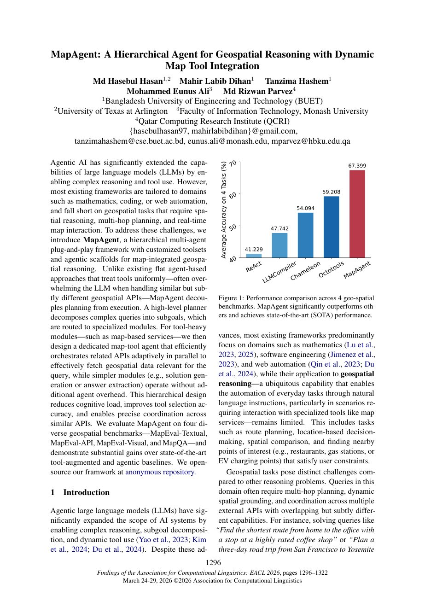


**原论文 Figure 1 · PDF p.1**

Figure 1: Performance comparison across 4 geo-spatial benchmarks. MapAgent significantly outperforms oth- ers and achieves state-of-the-art (SOTA) performance.


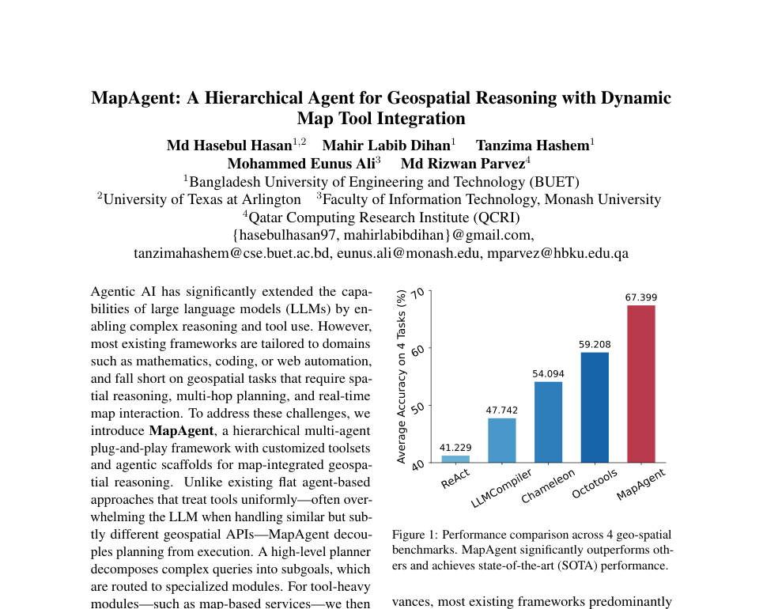


### 本页英文全文

```text
MapAgent: A Hierarchical Agent for Geospatial Reasoning with Dynamic
                 Map Tool Integration
       Md Hasebul Hasan1,2  Mahir Labib Dihan1  Tanzima Hashem1
              Mohammed Eunus Ali3  Md Rizwan Parvez4
             1Bangladesh University of Engineering and Technology (BUET)
 2University of Texas at Arlington  3Faculty of Information Technology, Monash University
                       4Qatar Computing Research Institute (QCRI)
                     {hasebulhasan97, mahirlabibdihan}@gmail.com,
      tanzimahashem@cse.buet.ac.bd, eunus.ali@monash.edu, mparvez@hbku.edu.qa

Agentic AI has significantly extended the capa-                                                   (%)70                                     67.399
bilities of large language models (LLMs) by en-
abling complex reasoning and tool use. However,                                                                                    Tasks
most existing frameworks are tailored to domains 4                               59.208                               60such as mathematics, coding, or web automation,  on
                                                                                  54.094and fall short on geospatial tasks that require spa-
tial reasoning, multi-hop planning, and real-time                                                                                                                                       Accuracy50           47.742map interaction. To address these challenges, we
introduce MapAgent, a hierarchical multi-agent
plug-and-play framework with customized toolsets             41.229                                                                                                                      Average
and agentic scaffolds for map-integrated geospa-   40
tial    reasoning.               Unlike                         existing                                         flat agent-based
approaches             that treat                      tools                       uniformly—often                                            over-                                                 ReActLLMCompilerChameleonOctotoolsMapAgent
whelming the LLM when handling similar but sub-
tly different geospatial APIs—MapAgent decou-    Figure 1: Performance comparison across 4 geo-spatial
ples planning from execution. A high-level planner    benchmarks. MapAgent significantly outperforms oth-
decomposes complex queries into subgoals, which    ers and achieves state-of-the-art (SOTA) performance.
are routed to specialized modules. For tool-heavy
modules—such as map-based services—we then    vances, most existing frameworks predominantly
design a dedicated map-tool agent that efficiently   focus on domains such as mathematics (Lu et al.,
orchestrates related APIs adaptively in parallel to   2023, 2025), software engineering (Jimenez et al.,
effectively fetch geospatial data relevant for the    2023), and web automation (Qin et al., 2023; Du
query, while simpler modules (e.g., solution gen-    et al., 2024), while their application to geospatial
eration or answer extraction) operate without ad-   reasoning—a ubiquitous capability that enables
ditional agent overhead. This hierarchical design    the automation of everyday tasks through natural
reduces cognitive load, improves tool selection ac-   language instructions, particularly in scenarios re-
curacy, and enables precise coordination across    quiring interaction with specialized tools like map
similar APIs. We evaluate MapAgent on four di-   services—remains limited.  This includes tasks
verse geospatial benchmarks—MapEval-Textual,   such as route planning, location-based decision-
MapEval-API, MapEval-Visual, and MapQA—and   making, spatial comparison, and finding nearby
demonstrate substantial gains over state-of-the-art    points of interest (e.g., restaurants, gas stations, or
tool-augmented and agentic baselines. We open-  EV charging points) that satisfy user constraints.
source our framwork at anonymous repository.         Geospatial tasks pose distinct challenges com-
                                                 pared to other reasoning problems. Queries in this
1  Introduction                            domain often require multi-hop planning, dynamic
                                                           spatial grounding, and coordination across multiple
Agentic large language models (LLMs) have sig-   external APIs with overlapping but subtly differ-
nificantly expanded the scope of AI systems by    ent capabilities. For instance, solving queries like
enabling complex reasoning, subgoal decomposi-  “Find the shortest route from home to the office with
tion, and dynamic tool use (Yao et al., 2023; Kim   a stop at a highly rated coffee shop” or “Plan a
et al., 2024; Du et al., 2024). Despite these ad-   three-day road trip from San Francisco to Yosemite
                                        1296
                 Findings of the Association for Computational Linguistics: EACL 2026, pages 1296–1322
                      March 24-29, 2026 ©2026 Association for Computational Linguistics
```


---

## 第 2 页（Page 2）

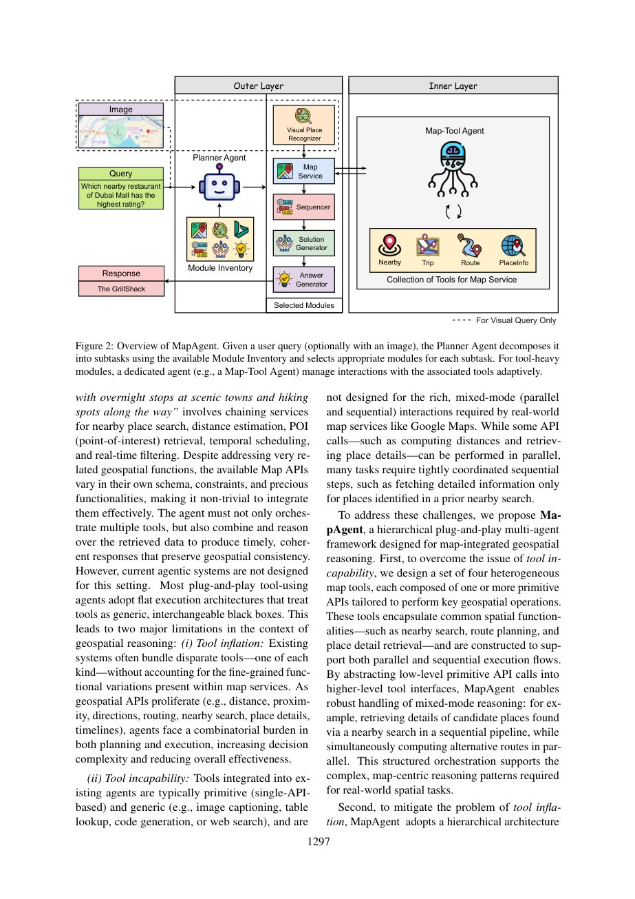


**原论文 Figure 2 · PDF p.2**

Figure 2: Overview of MapAgent. Given a user query (optionally with an image), the Planner Agent decomposes it into subtasks using the available Module Inventory and selects appropriate modules for each subtask. For tool-heavy modules, a dedicated agent (e.g., a Map-Tool Agent) manage interactions with the associated tools adaptively.


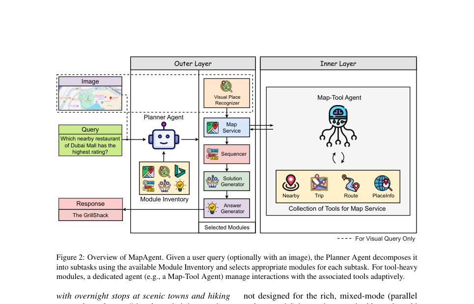


### 本页英文全文

```text
                                Outer Layer                                Inner Layer

       Image

                                                                         Visual Place                        Map-Tool Agent
                                                                  Recognizer

                            Planner Agent
                                                Map
       Query                                                Service
 Which nearby restaurant
    of Dubai Mall has the
      highest rating?                                        Sequencer


                                                                       Solution
                                                               Generator

                                                                                 Nearby       Trip       Route      PlaceInfo
                        Module Inventory
      Response                                         Answer
                                                                                    Collection of Tools for Map Service                                                               Generator
     The GrillShack

                                                      Selected Modules

                                                                                                  For Visual Query Only

Figure 2: Overview of MapAgent. Given a user query (optionally with an image), the Planner Agent decomposes it
into subtasks using the available Module Inventory and selects appropriate modules for each subtask. For tool-heavy
modules, a dedicated agent (e.g., a Map-Tool Agent) manage interactions with the associated tools adaptively.

with overnight stops at scenic towns and hiking    not designed for the rich, mixed-mode (parallel
spots along the way” involves chaining services   and sequential) interactions required by real-world
for nearby place search, distance estimation, POI   map services like Google Maps. While some API
(point-of-interest) retrieval, temporal scheduling,   calls—such as computing distances and retriev-
and real-time filtering. Despite addressing very re-   ing place details—can be performed in parallel,
lated geospatial functions, the available Map APIs   many tasks require tightly coordinated sequential
vary in their own schema, constraints, and precious    steps, such as fetching detailed information only
functionalities, making it non-trivial to integrate    for places identified in a prior nearby search.
them effectively. The agent must not only orches-     To address these challenges, we propose Ma-
trate multiple tools, but also combine and reason   pAgent, a hierarchical plug-and-play multi-agent
over the retrieved data to produce timely, coher-   framework designed for map-integrated geospatial
ent responses that preserve geospatial consistency.   reasoning. First, to overcome the issue of tool in-
However, current agentic systems are not designed    capability, we design a set of four heterogeneous
for this setting. Most plug-and-play tool-using   map tools, each composed of one or more primitive
agents adopt flat execution architectures that treat   APIs tailored to perform key geospatial operations.
tools as generic, interchangeable black boxes. This   These tools encapsulate common spatial function-
leads to two major limitations in the context of    alities—such as nearby search, route planning, and
geospatial reasoning: (i) Tool inflation: Existing    place detail retrieval—and are constructed to sup-
systems often bundle disparate tools—one of each    port both parallel and sequential execution flows.
kind—without accounting for the fine-grained func-  By abstracting low-level primitive API calls into
tional variations present within map services. As    higher-level tool interfaces, MapAgent  enables
geospatial APIs proliferate (e.g., distance, proxim-   robust handling of mixed-mode reasoning: for ex-
ity, directions, routing, nearby search, place details,   ample, retrieving details of candidate places found
timelines), agents face a combinatorial burden in    via a nearby search in a sequential pipeline, while
both planning and execution, increasing decision    simultaneously computing alternative routes in par-
complexity and reducing overall effectiveness.         allel. This structured orchestration supports the
   (ii) Tool incapability: Tools integrated into ex-   complex, map-centric reasoning patterns required
isting agents are typically primitive (single-API-    for real-world spatial tasks.
based) and generic (e.g., image captioning, table     Second, to mitigate the problem of tool infla-
lookup, code generation, or web search), and are    tion, MapAgent adopts a hierarchical architecture
                                        1297
```


---

## 第 3 页（Page 3）

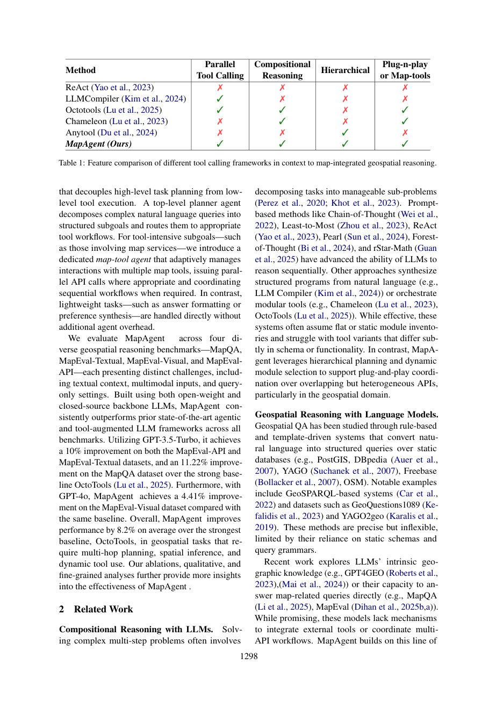


**原论文 Table 1 · PDF p.3**

Table 1: Feature comparison of different tool calling frameworks in context to map-integrated geospatial reasoning.


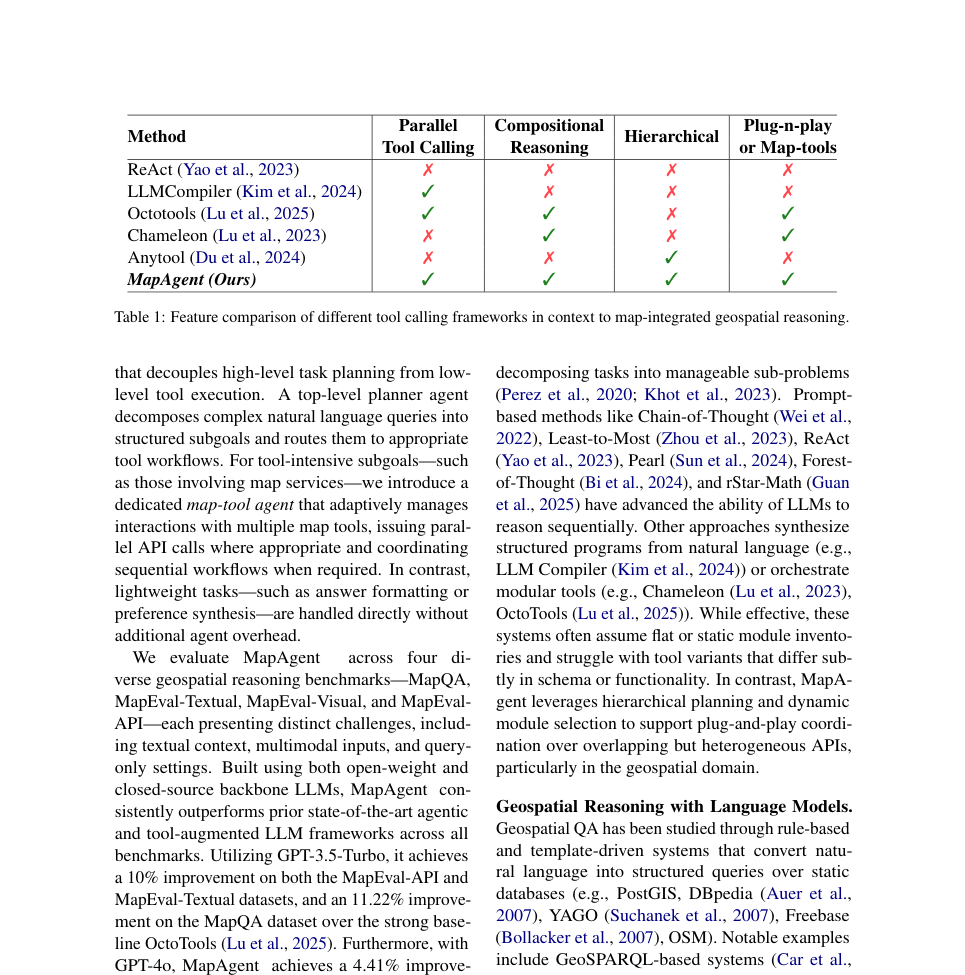


### 本页英文全文

```text
                                       Parallel    Compositional                 Plug-n-play Method                                                       Hierarchical                                 Tool Calling    Reasoning                  or Map-tools
 ReAct (Yao et al., 2023)            ✗           ✗           ✗           ✗
 LLMCompiler (Kim et al., 2024)    ✓           ✗           ✗           ✗
  Octotools (Lu et al., 2025)        ✓        ✓           ✗        ✓
 Chameleon (Lu et al., 2023)          ✗        ✓           ✗        ✓
  Anytool (Du et al., 2024)            ✗           ✗        ✓          ✗
 MapAgent (Ours)            ✓        ✓        ✓        ✓

Table 1: Feature comparison of different tool calling frameworks in context to map-integrated geospatial reasoning.


that decouples high-level task planning from low-   decomposing tasks into manageable sub-problems
level tool execution. A top-level planner agent    (Perez et al., 2020; Khot et al., 2023). Prompt-
decomposes complex natural language queries into   based methods like Chain-of-Thought (Wei et al.,
structured subgoals and routes them to appropriate    2022), Least-to-Most (Zhou et al., 2023), ReAct
tool workflows. For tool-intensive subgoals—such   (Yao et al., 2023), Pearl (Sun et al., 2024), Forest-
as those involving map services—we introduce a   of-Thought (Bi et al., 2024), and rStar-Math (Guan
dedicated map-tool agent that adaptively manages    et al., 2025) have advanced the ability of LLMs to
interactions with multiple map tools, issuing paral-   reason sequentially. Other approaches synthesize
lel API calls where appropriate and coordinating    structured programs from natural language (e.g.,
sequential workflows when required. In contrast,  LLM Compiler (Kim et al., 2024)) or orchestrate
lightweight tasks—such as answer formatting or   modular tools (e.g., Chameleon (Lu et al., 2023),
preference synthesis—are handled directly without   OctoTools (Lu et al., 2025)). While effective, these
additional agent overhead.                         systems often assume flat or static module invento-
  We  evaluate MapAgent    across  four  di-    ries and struggle with tool variants that differ sub-
verse geospatial reasoning benchmarks—MapQA,    tly in schema or functionality. In contrast, MapA-
MapEval-Textual, MapEval-Visual, and MapEval-   gent leverages hierarchical planning and dynamic
API—each presenting distinct challenges, includ-   module selection to support plug-and-play coordi-
ing textual context, multimodal inputs, and query-   nation over overlapping but heterogeneous APIs,
only settings. Built using both open-weight and    particularly in the geospatial domain.
closed-source backbone LLMs, MapAgent con-
sistently outperforms prior state-of-the-art agentic   Geospatial Reasoning with Language Models.
                                                    Geospatial QA has been studied through rule-basedand tool-augmented LLM frameworks across all
                                            and template-driven systems that convert natu-benchmarks. Utilizing GPT-3.5-Turbo, it achieves
                                                            ral language into structured queries over statica 10% improvement on both the MapEval-API and
                                                  databases (e.g., PostGIS, DBpedia (Auer et al.,MapEval-Textual datasets, and an 11.22% improve-
                                                 2007), YAGO (Suchanek et al., 2007), Freebasement on the MapQA dataset over the strong base-
                                                   (Bollacker et al., 2007), OSM). Notable examplesline OctoTools (Lu et al., 2025). Furthermore, with
                                                  include GeoSPARQL-based systems (Car et al.,GPT-4o, MapAgent  achieves a 4.41% improve-
                                               2022) and datasets such as GeoQuestions1089 (Ke-ment on the MapEval-Visual dataset compared with
                                                            falidis et al., 2023) and YAGO2geo (Karalis et al.,the same baseline. Overall, MapAgent improves
                                                 2019). These methods are precise but inflexible,performance by 8.2% on average over the strongest
                                                    limited by their reliance on static schemas andbaseline, OctoTools, in geospatial tasks that re-
                                               query grammars.quire multi-hop planning, spatial inference, and
dynamic tool use. Our ablations, qualitative, and     Recent work explores LLMs’ intrinsic geo-
fine-grained analyses further provide more insights    graphic knowledge (e.g., GPT4GEO (Roberts et al.,
into the effectiveness of MapAgent .               2023),(Mai et al., 2024)) or their capacity to an-
                                             swer map-related queries directly (e.g., MapQA
2  Related Work                                 (Li et al., 2025), MapEval (Dihan et al., 2025b,a)).
                                           While promising, these models lack mechanisms
Compositional Reasoning with LLMs.  Solv-    to integrate external tools or coordinate multi-
ing complex multi-step problems often involves   API workflows. MapAgent builds on this line of
                                        1298
```


---

## 第 4 页（Page 4）

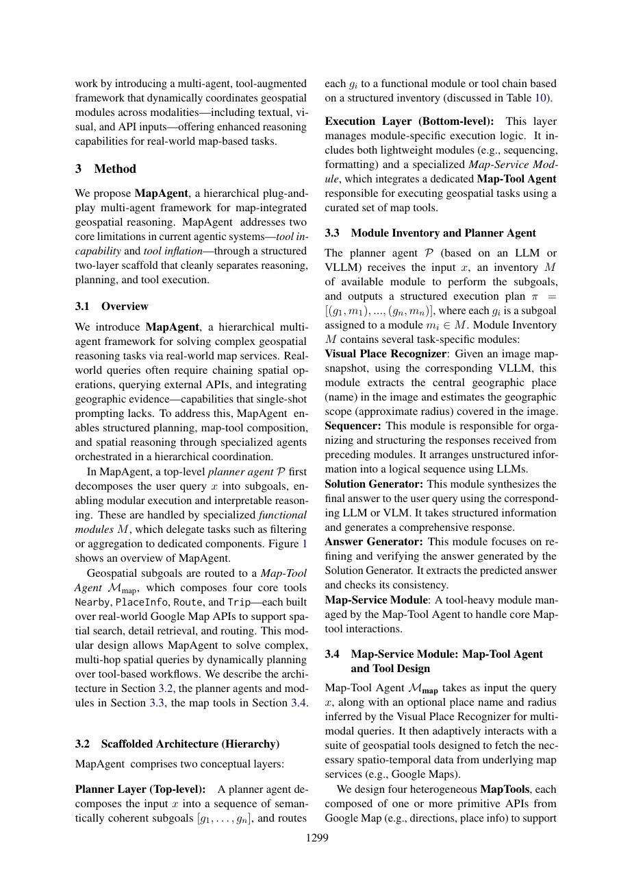


### 本页英文全文

```text
work by introducing a multi-agent, tool-augmented   each gi to a functional module or tool chain based
framework that dynamically coordinates geospatial   on a structured inventory (discussed in Table 10).
modules across modalities—including textual, vi-
                                             Execution Layer (Bottom-level):  This layersual, and API inputs—offering enhanced reasoning
                                          manages module-specific execution logic.  It in-capabilities for real-world map-based tasks.
                                                   cludes both lightweight modules (e.g., sequencing,
3  Method                                       formatting) and a specialized Map-Service Mod-
                                                            ule, which integrates a dedicated Map-Tool Agent
We propose MapAgent, a hierarchical plug-and-   responsible for executing geospatial tasks using a
play multi-agent framework for map-integrated    curated set of map tools.
geospatial reasoning. MapAgent  addresses two
core limitations in current agentic systems—tool in-   3.3  Module Inventory and Planner Agent
capability and tool inflation—through a structured   The planner agent    (based on an LLM or                                           Ptwo-layer scaffold that cleanly separates reasoning,  VLLM) receives the input x, an inventory M
planning, and tool execution.                       of available module to perform the subgoals,
                                            and outputs a structured execution plan π =
3.1  Overview                                                          [(g1, m1), ..., (gn, mn)], where each gi is a subgoal
We introduce MapAgent, a hierarchical multi-   assigned to a module mi ∈M. Module Inventory
agent framework for solving complex geospatial  M contains several task-specific modules:
reasoning tasks via real-world map services. Real-   Visual Place Recognizer: Given an image map-
world queries often require chaining spatial op-   snapshot, using the corresponding VLLM, this
erations, querying external APIs, and integrating   module  extracts the  central geographic place
geographic evidence—capabilities that single-shot   (name) in the image and estimates the geographic
prompting lacks. To address this, MapAgent en-   scope (approximate radius) covered in the image.
ables structured planning, map-tool composition,   Sequencer: This module is responsible for orga-
and spatial reasoning through specialized agents    nizing and structuring the responses received from
orchestrated in a hierarchical coordination.          preceding modules. It arranges unstructured infor-
   In MapAgent, a top-level planner agent    first   mation into a logical sequence using LLMs.                         Pdecomposes the user query x into subgoals, en-   Solution Generator: This module synthesizes the
abling modular execution and interpretable reason-    final answer to the user query using the correspond-
ing. These are handled by specialized functional    ing LLM or VLM. It takes structured information
modules M, which delegate tasks such as filtering   and generates a comprehensive response.
or aggregation to dedicated components. Figure 1   Answer Generator: This module focuses on re-
shows an overview of MapAgent.                    fining and verifying the answer generated by the
  Geospatial subgoals are routed to a Map-Tool    Solution Generator. It extracts the predicted answer
Agent Mmap, which composes four core tools   and checks its consistency.Nearby, PlaceInfo, Route, and Trip—each built   Map-Service Module: A tool-heavy module man-
over real-world Google Map APIs to support spa-   aged by the Map-Tool Agent to handle core Map-
tial search, detail retrieval, and routing. This mod-    tool interactions.
ular design allows MapAgent to solve complex,
                                                    3.4  Map-Service Module: Map-Tool Agentmulti-hop spatial queries by dynamically planning
                                            and Tool Designover tool-based workflows. We describe the archi-
tecture in Section 3.2, the planner agents and mod-   Map-Tool Agent Mmap takes as input the queryules in Section 3.3, the map tools in Section 3.4.   x, along with an optional place name and radius
                                                      inferred by the Visual Place Recognizer for multi-
                                          modal queries. It then adaptively interacts with a
3.2  Scaffolded Architecture (Hierarchy)          suite of geospatial tools designed to fetch the nec-
                                                   essary spatio-temporal data from underlying mapMapAgent comprises two conceptual layers:
                                                      services (e.g., Google Maps).
Planner Layer (Top-level): A planner agent de-    We design four heterogeneous MapTools, each
composes the input x into a sequence of seman-   composed of one or more primitive APIs from
tically coherent subgoals [g1, . . . , gn], and routes   Google Map (e.g., directions, place info) to support
                                        1299
```


---

## 第 5 页（Page 5）


**原论文 Table 2 · PDF p.5**

Table 2: Accuracy (%) of different methods and backbones on the MapEval-API Dataset.


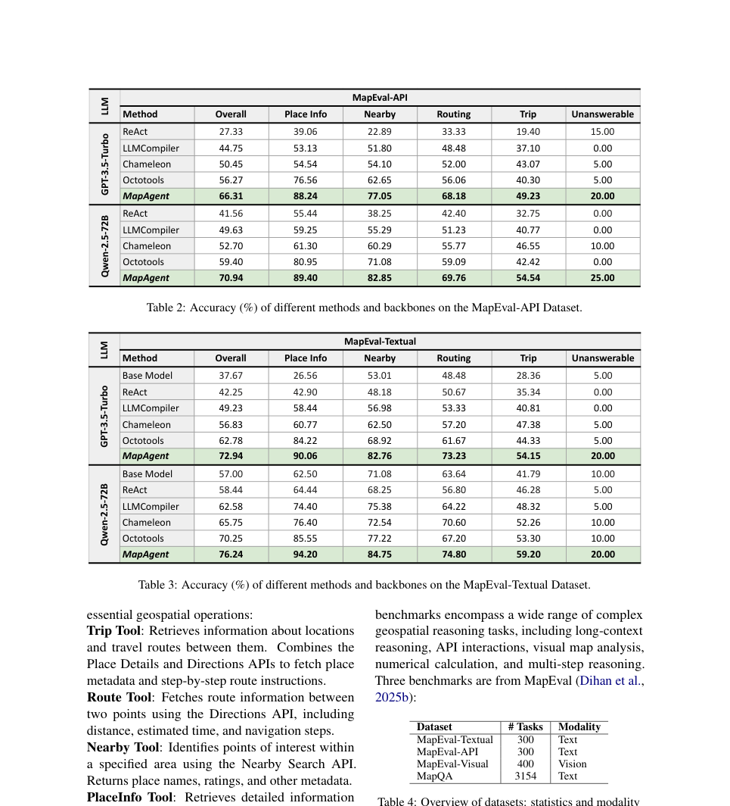


**原论文 Table 3 · PDF p.5**

Table 3: Accuracy (%) of different methods and backbones on the MapEval-Textual Dataset.


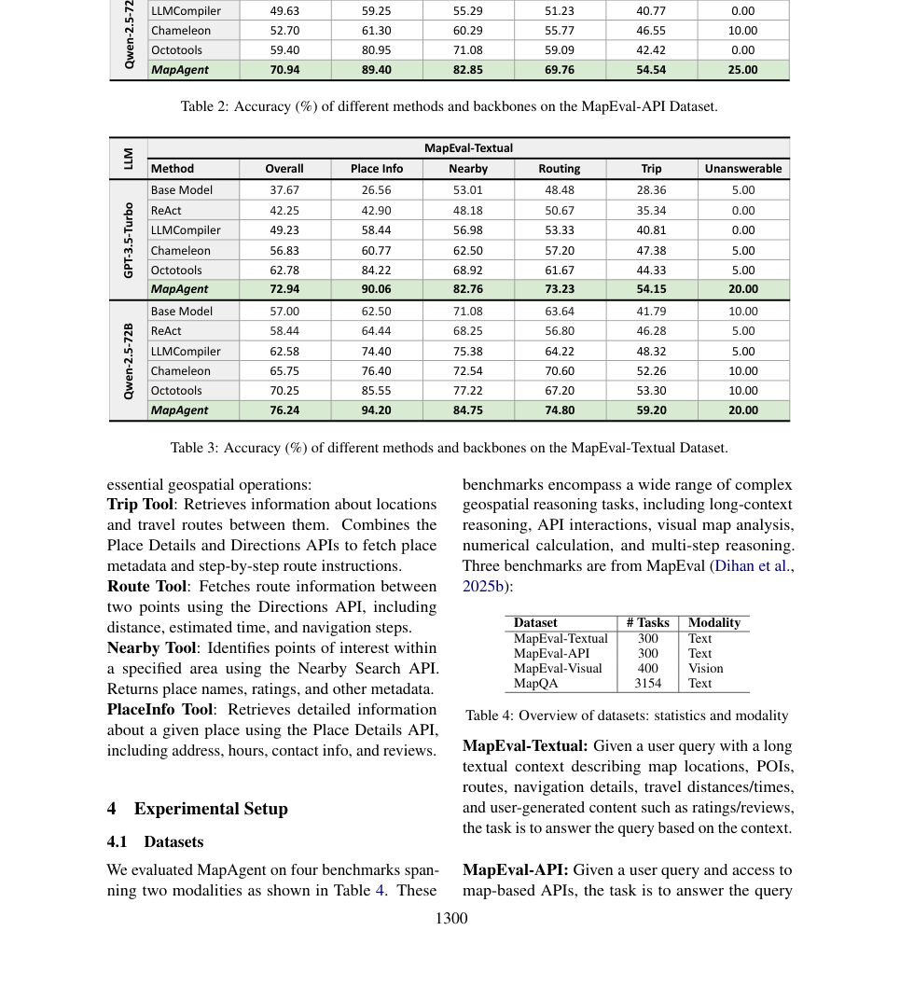


**原论文 Table 4 · PDF p.5**

Table 4: Overview of datasets: statistics and modality


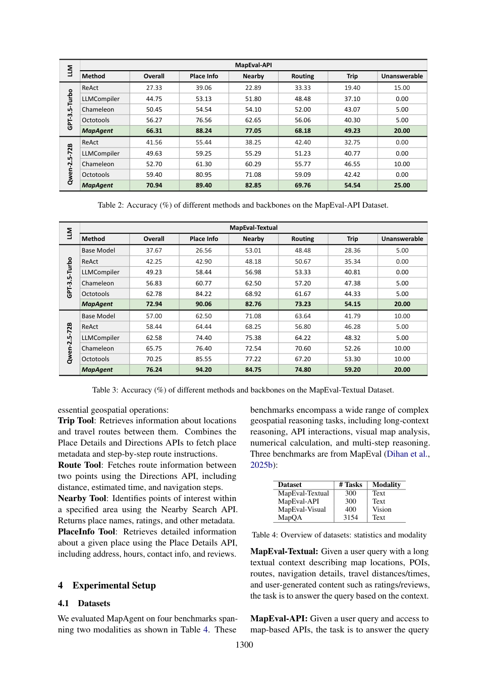


### 本页英文全文

```text
                                                     MapEval-API
    LLM      Method             Overall        Place Info       Nearby         Routing            Trip       Unanswerable

       ReAct               27.33           39.06           22.89           33.33           19.40           15.00

       LLMCompiler        44.75           53.13           51.80           48.48           37.10           0.00

       Chameleon          50.45           54.54           54.10           52.00           43.07           5.00

        Octotools           56.27           76.56           62.65           56.06           40.30           5.00                 GPT-3.5-Turbo
      MapAgent          66.31          88.24          77.05          68.18          49.23          20.00

       ReAct               41.56           55.44           38.25           42.40           32.75           0.00

       LLMCompiler        49.63           59.25           55.29           51.23           40.77           0.00

       Chameleon          52.70           61.30           60.29           55.77           46.55           10.00

        Octotools           59.40           80.95           71.08           59.09           42.42           0.00                Qwen-2.5-72B
      MapAgent          70.94          89.40          82.85          69.76          54.54          25.00

           Table 2: Accuracy (%) of different methods and backbones on the MapEval-API Dataset.


                                                      MapEval-Textual
    LLM      Method             Overall        Place Info       Nearby         Routing            Trip       Unanswerable

       Base Model          37.67           26.56           53.01           48.48           28.36           5.00

       ReAct               42.25           42.90           48.18           50.67           35.34           0.00

       LLMCompiler        49.23           58.44           56.98           53.33           40.81           0.00

       Chameleon          56.83           60.77           62.50           57.20           47.38           5.00                 GPT-3.5-Turbo   Octotools           62.78           84.22           68.92           61.67           44.33           5.00
      MapAgent          72.94          90.06          82.76          73.23          54.15          20.00

       Base Model          57.00           62.50           71.08           63.64           41.79           10.00

       ReAct               58.44           64.44           68.25           56.80           46.28           5.00

       LLMCompiler        62.58           74.40           75.38           64.22           48.32           5.00

       Chameleon          65.75           76.40           72.54           70.60           52.26           10.00               Qwen-2.5-72B   Octotools           70.25           85.55           77.22           67.20           53.30           10.00
      MapAgent          76.24          94.20          84.75          74.80          59.20          20.00

          Table 3: Accuracy (%) of different methods and backbones on the MapEval-Textual Dataset.

essential geospatial operations:                   benchmarks encompass a wide range of complex
Trip Tool: Retrieves information about locations    geospatial reasoning tasks, including long-context
and travel routes between them. Combines the    reasoning, API interactions, visual map analysis,
Place Details and Directions APIs to fetch place   numerical calculation, and multi-step reasoning.
metadata and step-by-step route instructions.        Three benchmarks are from MapEval (Dihan et al.,
Route Tool: Fetches route information between    2025b):
two points using the Directions API, including
distance, estimated time, and navigation steps.                Dataset          # Tasks   Modality
                                                                 MapEval-Textual    300     Text
Nearby Tool: Identifies points of interest within           MapEval-API       300     Text
a specified area using the Nearby Search API.            MapEval-Visual     400     Vision
Returns place names, ratings, and other metadata.         MapQA           3154    Text
PlaceInfo Tool: Retrieves detailed information    Table 4: Overview of datasets: statistics and modality
about a given place using the Place Details API,
including address, hours, contact info, and reviews.   MapEval-Textual: Given a user query with a long
                                                       textual context describing map locations, POIs,
                                                       routes, navigation details, travel distances/times,
4  Experimental Setup                      and user-generated content such as ratings/reviews,
                                                      the task is to answer the query based on the context.
4.1  Datasets
We evaluated MapAgent on four benchmarks span-   MapEval-API: Given a user query and access to
ning two modalities as shown in Table 4. These   map-based APIs, the task is to answer the query
                                        1300
```


---

## 第 6 页（Page 6）

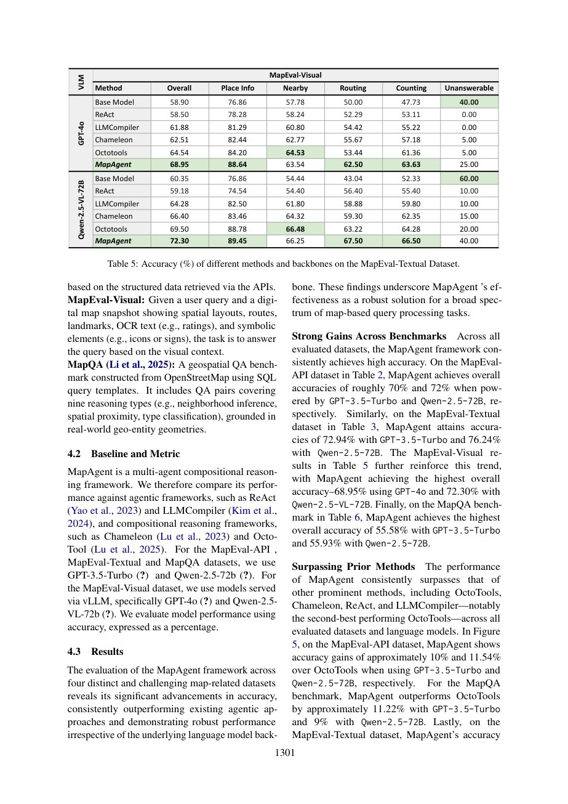


**原论文 Table 5 · PDF p.6**

Table 5: Accuracy (%) of different methods and backbones on the MapEval-Textual Dataset.


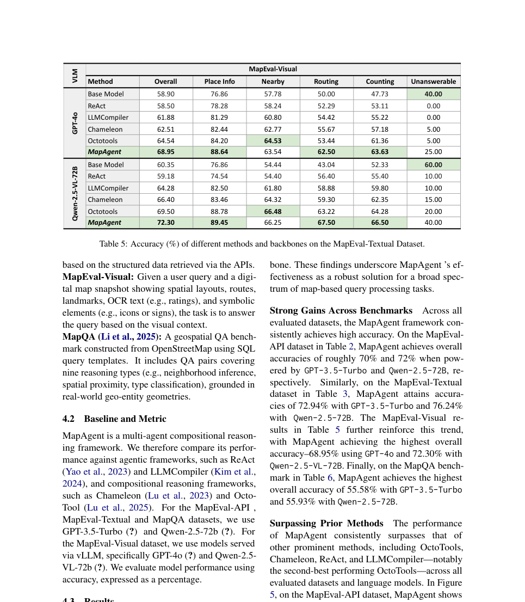


### 本页英文全文

```text
                                                      MapEval-Visual
    VLM      Method             Overall        Place Info       Nearby         Routing        Counting    Unanswerable

       Base Model          58.90           76.86           57.78           50.00           47.73          40.00

       ReAct               58.50           78.28           58.24           52.29           53.11           0.00
       GPT-4o  LLMCompilerChameleon          61.8862.51           81.2982.44           60.8062.77           54.4255.67           55.2257.18           0.005.00
        Octotools           64.54           84.20          64.53          53.44           61.36           5.00
      MapAgent          68.95          88.64          63.54          62.50          63.63          25.00

       Base Model          60.35           76.86           54.44           43.04           52.33          60.00

       ReAct               59.18           74.54           54.40           56.40           55.40           10.00

       LLMCompiler        64.28           82.50           61.80           58.88           59.80           10.00

       Chameleon          66.40           83.46           64.32           59.30           62.35           15.00

        Octotools           69.50           88.78          66.48          63.22           64.28           20.00                   Qwen-2.5-VL-72B
      MapAgent          72.30          89.45          66.25          67.50          66.50          40.00

          Table 5: Accuracy (%) of different methods and backbones on the MapEval-Textual Dataset.

based on the structured data retrieved via the APIs.   bone. These findings underscore MapAgent ’s ef-
MapEval-Visual: Given a user query and a digi-   fectiveness as a robust solution for a broad spec-
tal map snapshot showing spatial layouts, routes,   trum of map-based query processing tasks.
landmarks, OCR text (e.g., ratings), and symbolic
elements (e.g., icons or signs), the task is to answer   Strong Gains Across Benchmarks  Across all
the query based on the visual context.               evaluated datasets, the MapAgent framework con-
MapQA (Li et al., 2025): A geospatial QA bench-    sistently achieves high accuracy. On the MapEval-
mark constructed from OpenStreetMap using SQL   API dataset in Table 2, MapAgent achieves overall
query templates.  It includes QA pairs covering    accuracies of roughly 70% and 72% when pow-
nine reasoning types (e.g., neighborhood inference,   ered by GPT-3.5-Turbo and Qwen-2.5-72B, re-
spatial proximity, type classification), grounded in    spectively.  Similarly, on the MapEval-Textual
real-world geo-entity geometries.                    dataset in Table 3, MapAgent  attains accura-
                                                      cies of 72.94% with GPT-3.5-Turbo and 76.24%
4.2  Baseline and Metric                        with Qwen-2.5-72B. The MapEval-Visual  re-
                                                          sults  in Table 5  further  reinforce  this  trend,
MapAgent is a multi-agent compositional reason-
                                                with MapAgent achieving the highest overall
ing framework. We therefore compare its perfor-
                                             accuracy–68.95% using GPT-4o and 72.30% with
mance against agentic frameworks, such as ReAct
                                             Qwen-2.5-VL-72B. Finally, on the MapQA bench-
(Yao et al., 2023) and LLMCompiler (Kim et al.,
                                         mark in Table 6, MapAgent achieves the highest
2024), and compositional reasoning frameworks,
                                                      overall accuracy of 55.58% with GPT-3.5-Turbo
such as Chameleon (Lu et al., 2023) and Octo-
                                             and 55.93% with Qwen-2.5-72B.
Tool (Lu et al., 2025).  For the MapEval-API  ,
MapEval-Textual and MapQA datasets, we use                                             Surpassing Prior Methods  The performance
GPT-3.5-Turbo (?) and Qwen-2.5-72b (?). For                                                   of MapAgent  consistently  surpasses  that  of
the MapEval-Visual dataset, we use models served                                                    other prominent methods, including OctoTools,
via vLLM, specifically GPT-4o (?) and Qwen-2.5-                                            Chameleon, ReAct, and LLMCompiler—notably
VL-72b (?). We evaluate model performance using                                                     the second-best performing OctoTools—across all
accuracy, expressed as a percentage.                                                    evaluated datasets and language models. In Figure
                                                         5, on the MapEval-API dataset, MapAgent shows
4.3  Results                                                 accuracy gains of approximately 10% and 11.54%
The evaluation of the MapAgent framework across   over OctoTools when using GPT-3.5-Turbo and
four distinct and challenging map-related datasets   Qwen-2.5-72B, respectively.  For the MapQA
reveals its significant advancements in accuracy,   benchmark, MapAgent outperforms OctoTools
consistently outperforming existing agentic ap-   by approximately 11.22% with GPT-3.5-Turbo
proaches and demonstrating robust performance   and 9% with Qwen-2.5-72B.  Lastly,  on  the
irrespective of the underlying language model back-   MapEval-Textual dataset, MapAgent’s accuracy
                                        1301
```


---

## 第 7 页（Page 7）

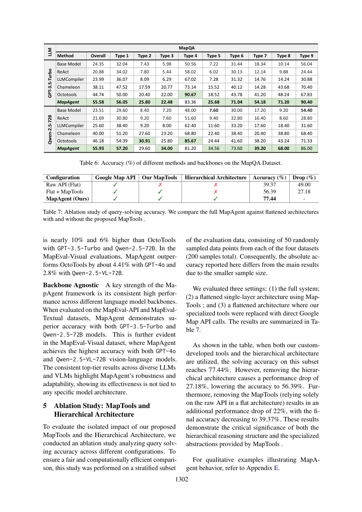


**原论文 Table 6 · PDF p.7**

Table 6: Accuracy (%) of different methods and backbones on the MapQA Dataset.


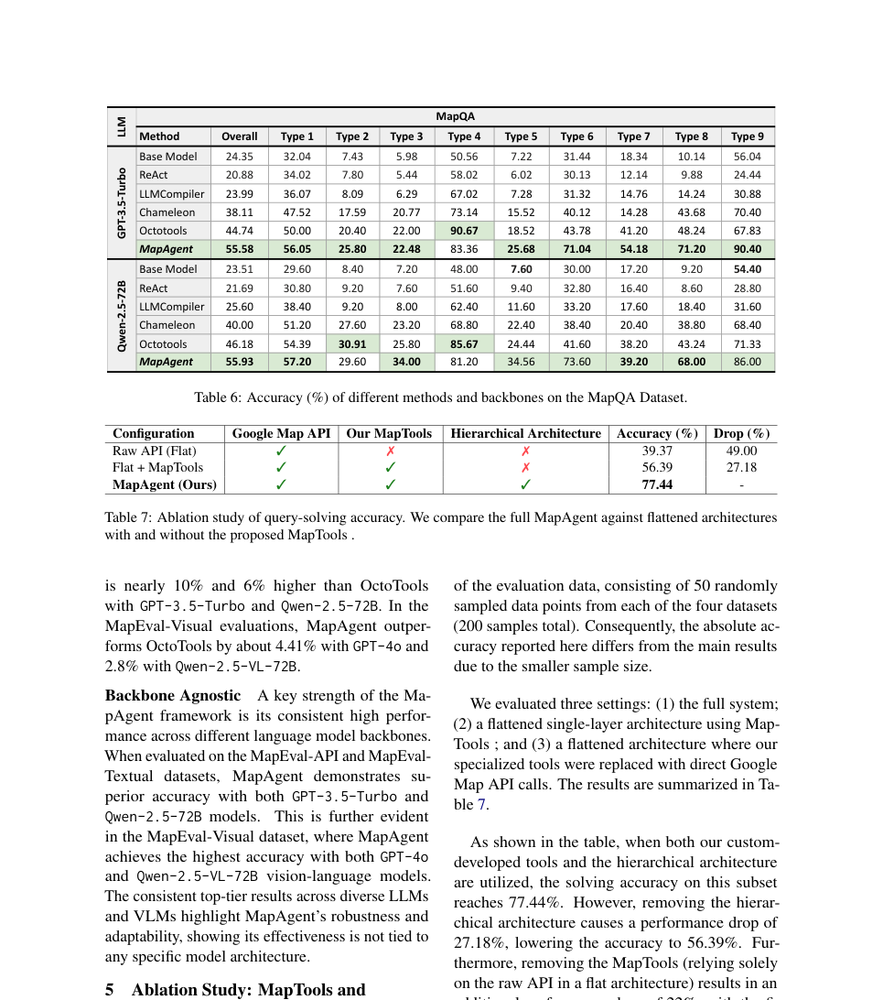


**原论文 Table 7 · PDF p.7**

Table 7: Ablation study of query-solving accuracy. We compare the full MapAgent against flattened architectures with and without the proposed MapTools .


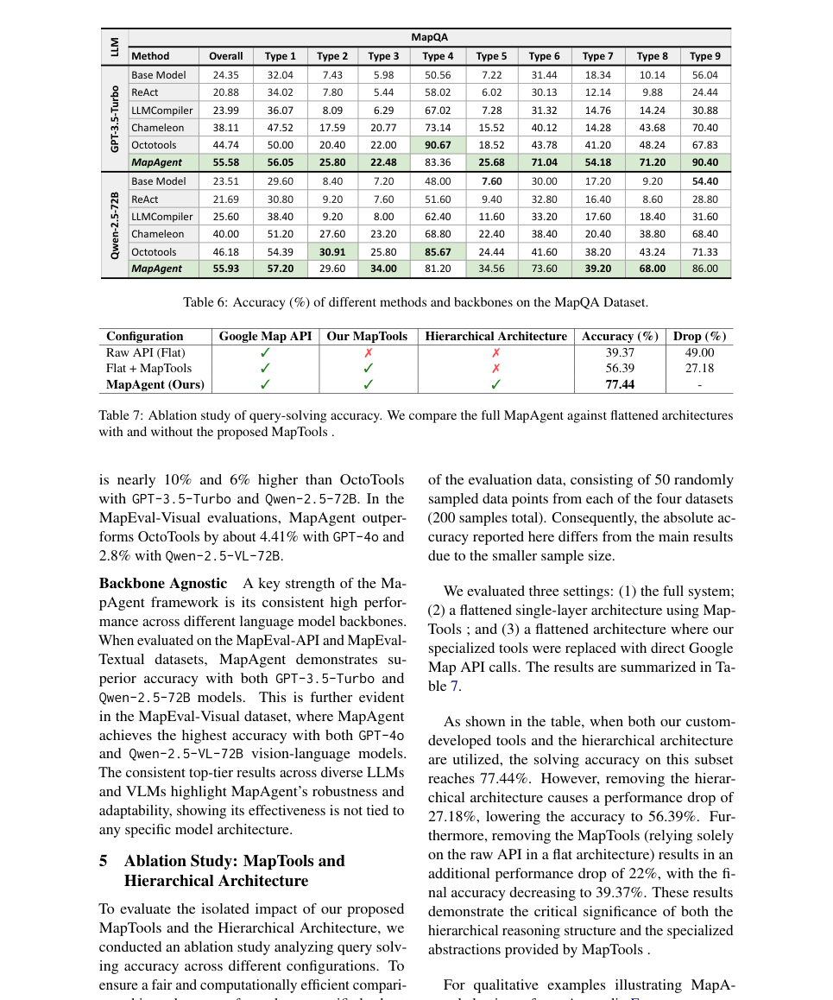


### 本页英文全文

```text
                                           MapQA
   LLM     Method        Overall    Type 1    Type 2    Type 3    Type 4    Type 5    Type 6    Type 7    Type 8    Type 9

      Base Model     24.35     32.04      7.43      5.98      50.56      7.22      31.44     18.34     10.14     56.04

      ReAct          20.88     34.02      7.80      5.44      58.02      6.02      30.13     12.14      9.88      24.44

      LLMCompiler    23.99     36.07      8.09      6.29      67.02      7.28      31.32     14.76     14.24     30.88

      Chameleon      38.11     47.52     17.59     20.77     73.14     15.52     40.12     14.28     43.68     70.40             GPT-3.5-Turbo  Octotools       44.74     50.00     20.40     22.00     90.67     18.52     43.78     41.20     48.24     67.83
     MapAgent      55.58     56.05     25.80     22.48     83.36     25.68     71.04     54.18     71.20     90.40

      Base Model     23.51     29.60      8.40      7.20      48.00      7.60      30.00     17.20      9.20      54.40

      ReAct          21.69     30.80      9.20      7.60      51.60      9.40      32.80     16.40      8.60      28.80

      LLMCompiler    25.60     38.40      9.20      8.00      62.40     11.60     33.20     17.60     18.40     31.60

      Chameleon      40.00     51.20     27.60     23.20     68.80     22.40     38.40     20.40     38.80     68.40            Qwen-2.5-72B  Octotools       46.18     54.39     30.91     25.80     85.67     24.44     41.60     38.20     43.24     71.33
     MapAgent      55.93     57.20     29.60     34.00     81.20     34.56     73.60     39.20     68.00     86.00

              Table 6: Accuracy (%) of different methods and backbones on the MapQA Dataset.

 Configuration      Google Map API  Our MapTools   Hierarchical Architecture  Accuracy (%)  Drop (%)
 Raw API (Flat)        ✓             ✗                ✗                  39.37         49.00
  Flat + MapTools       ✓          ✓                ✗                  56.39         27.18
 MapAgent (Ours)      ✓          ✓            ✓                  77.44               -

Table 7: Ablation study of query-solving accuracy. We compare the full MapAgent against flattened architectures
with and without the proposed MapTools .


is nearly 10% and 6% higher than OctoTools    of the evaluation data, consisting of 50 randomly
with GPT-3.5-Turbo and Qwen-2.5-72B. In the   sampled data points from each of the four datasets
MapEval-Visual evaluations, MapAgent outper-   (200 samples total). Consequently, the absolute ac-
forms OctoTools by about 4.41% with GPT-4o and   curacy reported here differs from the main results
2.8% with Qwen-2.5-VL-72B.                    due to the smaller sample size.
Backbone Agnostic A key strength of the Ma-                                   We evaluated three settings: (1) the full system;
pAgent framework is its consistent high perfor-                                                        (2) a flattened single-layer architecture using Map-
mance across different language model backbones.                                                Tools ; and (3) a flattened architecture where our
When evaluated on the MapEval-API and MapEval-                                                      specialized tools were replaced with direct Google
Textual  datasets, MapAgent demonstrates  su-                                   Map API calls. The results are summarized in Ta-
perior accuracy with both GPT-3.5-Turbo and                                                     ble 7.
Qwen-2.5-72B models.  This is further evident
in the MapEval-Visual dataset, where MapAgent                                        As shown in the table, when both our custom-
achieves the highest accuracy with both GPT-4o                                               developed tools and the hierarchical architecture
and Qwen-2.5-VL-72B vision-language models.                                                    are utilized, the solving accuracy on this subset
The consistent top-tier results across diverse LLMs                                                 reaches 77.44%. However, removing the hierar-
and VLMs highlight MapAgent’s robustness and                                                     chical architecture causes a performance drop of
adaptability, showing its effectiveness is not tied to                                             27.18%, lowering the accuracy to 56.39%. Fur-
any specific model architecture.                                                  thermore, removing the MapTools (relying solely
                                          on the raw API in a flat architecture) results in an5  Ablation Study: MapTools and
                                                     additional performance drop of 22%, with the fi-   Hierarchical Architecture
                                                    nal accuracy decreasing to 39.37%. These results
To evaluate the isolated impact of our proposed   demonstrate the critical significance of both the
MapTools and the Hierarchical Architecture, we    hierarchical reasoning structure and the specialized
conducted an ablation study analyzing query solv-   abstractions provided by MapTools .
ing accuracy across different configurations. To
ensure a fair and computationally efficient compari-     For qualitative examples  illustrating MapA-
son, this study was performed on a stratified subset    gent behavior, refer to Appendix E.
                                        1302
```


---

## 第 8 页（Page 8）

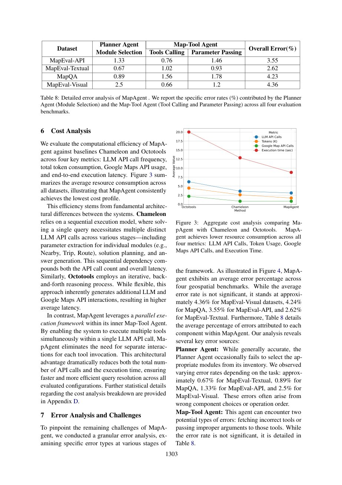


**原论文 Table 8 · PDF p.8**

Table 8: Detailed error analysis of MapAgent . We report the specific error rates (%) contributed by the Planner Agent (Module Selection) and the Map-Tool Agent (Tool Calling and Parameter Passing) across all four evaluation benchmarks.


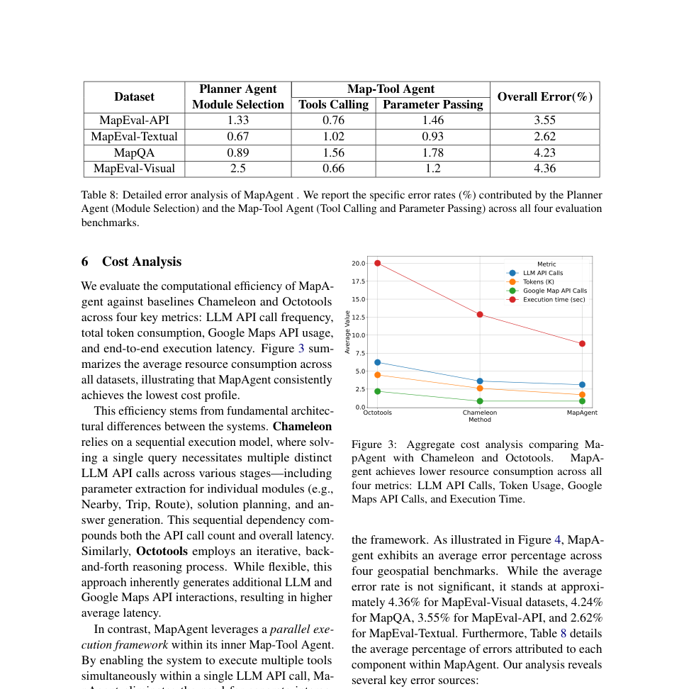


**原论文 Figure 3 · PDF p.8**

Figure 3: Aggregate cost analysis comparing Ma- pAgent with Chameleon and Octotools. MapA- gent achieves lower resource consumption across all four metrics: LLM API Calls, Token Usage, Google Maps API Calls, and Execution Time.


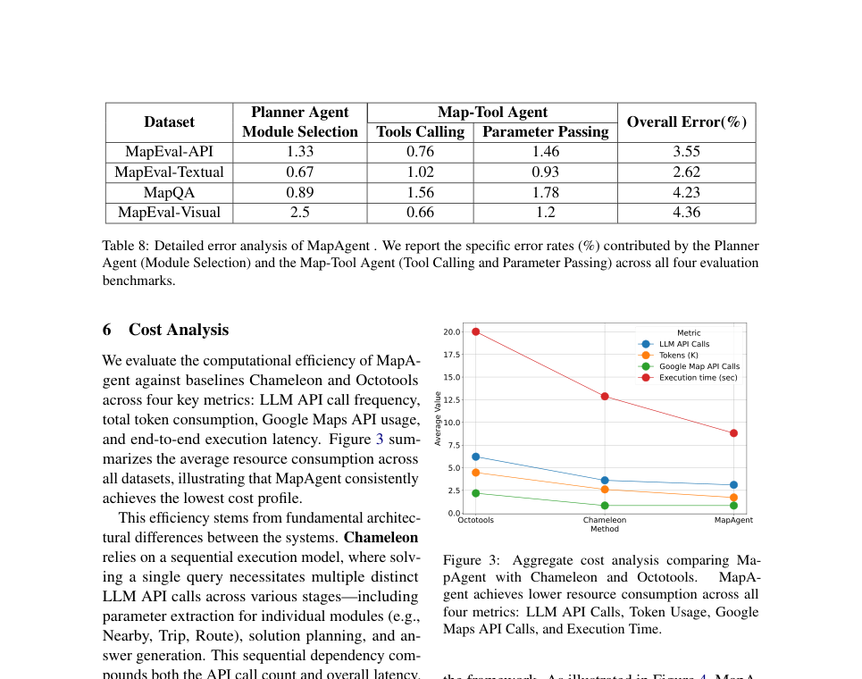


### 本页英文全文

```text
                    Planner Agent           Map-Tool Agent      Dataset                                                            Overall Error(%)                Module Selection   Tools Calling  Parameter Passing
   MapEval-API           1.33             0.76              1.46                3.55
  MapEval-Textual         0.67             1.02              0.93                2.62
    MapQA             0.89             1.56              1.78                4.23
  MapEval-Visual           2.5              0.66               1.2                 4.36

Table 8: Detailed error analysis of MapAgent . We report the specific error rates (%) contributed by the Planner
Agent (Module Selection) and the Map-Tool Agent (Tool Calling and Parameter Passing) across all four evaluation
benchmarks.

6  Cost Analysis                                                   20.0                                                       Metric
                                                                                                               LLM API Calls
We evaluate the computational efficiency of MapA-     17.5                                               TokensGoogle (K)Map API Calls
gent against baselines Chameleon and Octotools      15.0                                                Execution time (sec)
across four key metrics: LLM API call frequency,    Value12.5
total token consumption, Google Maps API usage,     10.0
and end-to-end execution latency. Figure 3 sum-     Average 7.5
marizes the average resource consumption across                                                                                      5.0
all datasets, illustrating that MapAgent consistently
                                                                                      2.5
achieves the lowest cost profile.
  This efficiency stems from fundamental architec-       0.0Octotools                   Chameleon                  MapAgent
                                                                                                       Method
tural differences between the systems. Chameleon
relies on a sequential execution model, where solv-   Figure 3:  Aggregate cost analysis comparing Ma-
ing a single query necessitates multiple distinct   pAgent with Chameleon and Octotools.  MapA-
LLM API calls across various stages—including    gent achieves lower resource consumption across all
parameter extraction for individual modules (e.g.,    four metrics: LLM API Calls, Token Usage, Google
                                           Maps API Calls, and Execution Time.Nearby, Trip, Route), solution planning, and an-
swer generation. This sequential dependency com-
pounds both the API call count and overall latency.                                                    the framework. As illustrated in Figure 4, MapA-
Similarly, Octotools employs an iterative, back-                                                 gent exhibits an average error percentage across
and-forth reasoning process. While flexible, this                                                   four geospatial benchmarks. While the average
approach inherently generates additional LLM and                                                       error rate is not significant, it stands at approxi-
Google Maps API interactions, resulting in higher                                                mately 4.36% for MapEval-Visual datasets, 4.24%
average latency.                                                       for MapQA, 3.55% for MapEval-API, and 2.62%
  In contrast, MapAgent leverages a parallel exe-                                                        for MapEval-Textual. Furthermore, Table 8 details
cution framework within its inner Map-Tool Agent.                                                     the average percentage of errors attributed to each
By enabling the system to execute multiple tools                                             component within MapAgent. Our analysis reveals
simultaneously within a single LLM API call, Ma-                                                      several key error sources:
pAgent eliminates the need for separate interac-                                            Planner Agent: While generally accurate, the
tions for each tool invocation. This architectural                                                 Planner Agent occasionally fails to select the ap-
advantage dramatically reduces both the total num-                                                       propriate modules from its inventory. We observed
ber of API calls and the execution time, ensuring                                                 varying error rates depending on the task: approx-
faster and more efficient query resolution across all                                                 imately 0.67% for MapEval-Textual, 0.89% for
evaluated configurations. Further statistical details                                    MapQA, 1.33% for MapEval-API, and 2.5% for
regarding the cost analysis breakdown are provided                                               MapEval-Visual. These errors often arise from
in Appendix D.                                          wrong component choices or operation order.
                                        Map-Tool Agent: This agent can encounter two7  Error Analysis and Challenges
                                                         potential types of errors: fetching incorrect tools or
To pinpoint the remaining challenges of MapA-   passing improper arguments to those tools. While
gent, we conducted a granular error analysis, ex-   the error rate is not significant, it is detailed in
amining specific error types at various stages of   Table 8.
                                        1303
```


---

## 第 9 页（Page 9）

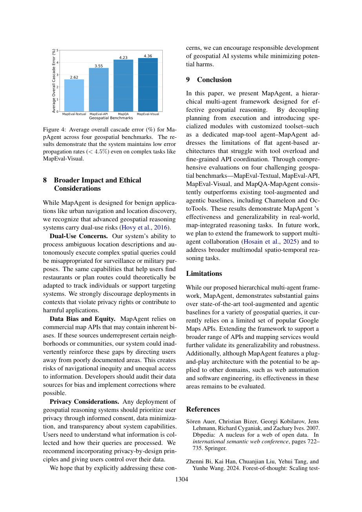


**原论文 Figure 4 · PDF p.9**

Figure 4: Average overall cascade error (%) for Ma- pAgent across four geospatial benchmarks. The re- sults demonstrate that the system maintains low error propagation rates (< 4.5%) even on complex tasks like MapEval-Visual.


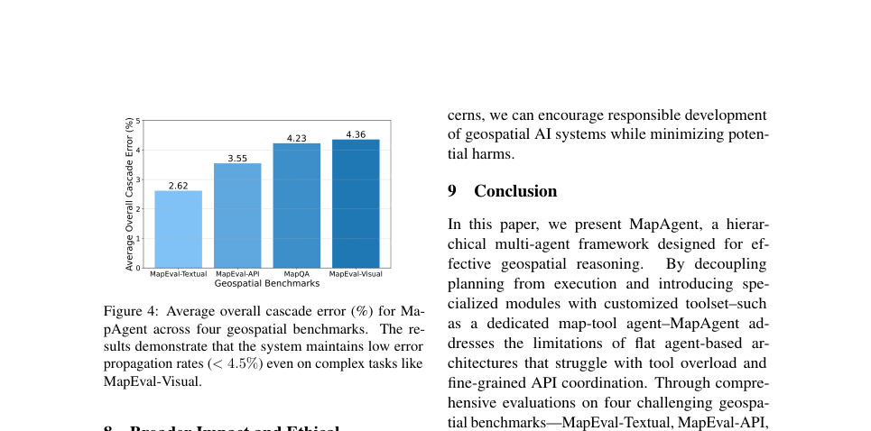


### 本页英文全文

```text
       5                                                 cerns, we can encourage responsible development    (%)
                                     4.23        4.36            of geospatial AI systems while minimizing poten-
      Error4                         3.55                                       tial harms.

       3             2.62         Cascade                                       9  Conclusion
         Overall2                                             In this paper, we present MapAgent, a hierar-
         Average10                                               chicalfective multi-agentgeospatial reasoning.framework designedBy decouplingfor ef-            MapEval-Textual  MapEval-API     MapQA     MapEval-Visual
                        Geospatial Benchmarks                  planning from execution and introducing spe-
                                                       cialized modules with customized toolset–suchFigure 4: Average overall cascade error (%) for Ma-
                                                   as a dedicated map-tool agent–MapAgent ad-pAgent across four geospatial benchmarks. The re-
sults demonstrate that the system maintains low error    dresses the limitations of  flat agent-based  ar-
propagation rates (< 4.5%) even on complex tasks like    chitectures that struggle with tool overload and
MapEval-Visual.                                     fine-grained API coordination. Through compre-
                                                 hensive evaluations on four challenging geospa-
                                                                     tial benchmarks—MapEval-Textual, MapEval-API,
8  Broader Impact and Ethical                                               MapEval-Visual, and MapQA-MapAgent consis-
   Considerations                                                        tently outperforms existing tool-augmented and
                                                   agentic baselines, including Chameleon and Oc-While MapAgent is designed for benign applica-
                                                     toTools. These results demonstrate MapAgent ’stions like urban navigation and location discovery,
                                                     effectiveness and generalizability in real-world,we recognize that advanced geospatial reasoning
                                                 map-integrated reasoning tasks.  In future work,systems carry dual-use risks (Hovy et al., 2016).
                                     we plan to extend the framework to support multi-  Dual-Use Concerns. Our system’s ability to
                                                 agent collaboration (Hosain et al., 2025) and toprocess ambiguous location descriptions and au-
                                                 address broader multimodal spatio-temporal rea-tonomously execute complex spatial queries could
                                                 soning tasks.be misappropriated for surveillance or military pur-
poses. The same capabilities that help users find
                                            Limitationsrestaurants or plan routes could theoretically be
adapted to track individuals or support targeting                                             While our proposed hierarchical multi-agent frame-
systems. We strongly discourage deployments in                                              work, MapAgent, demonstrates substantial gains
contexts that violate privacy rights or contribute to                                                over state-of-the-art tool-augmented and agentic
harmful applications.                                                     baselines for a variety of geospatial queries, it cur-
  Data Bias and Equity. MapAgent relies on    rently relies on a limited set of popular Google
commercial map APIs that may contain inherent bi-   Maps APIs. Extending the framework to support a
ases. If these sources underrepresent certain neigh-   broader range of APIs and mapping services would
borhoods or communities, our system could inad-    further validate its generalizability and robustness.
vertently reinforce these gaps by directing users    Additionally, although MapAgent features a plug-
away from poorly documented areas. This creates   and-play architecture with the potential to be ap-
risks of navigational inequity and unequal access    plied to other domains, such as web automation
to information. Developers should audit their data   and software engineering, its effectiveness in these
sources for bias and implement corrections where    areas remains to be evaluated.
possible.
  Privacy Considerations. Any deployment of
geospatial reasoning systems should prioritize user   References
privacy through informed consent, data minimiza-                                                  Sören Auer, Christian Bizer, Georgi Kobilarov, Jens
tion, and transparency about system capabilities.     Lehmann, Richard Cyganiak, and Zachary Ives. 2007.
Users need to understand what information is col-      Dbpedia: A nucleus for a web of open data.  In
lected and how their queries are processed. We       international semantic web conference, pages 722–
                                                         735. Springer.recommend incorporating privacy-by-design prin-
ciples and giving users control over their data.                                                 Zhenni Bi, Kai Han, Chuanjian Liu, Yehui Tang, and
  We hope that by explicitly addressing these con-     Yunhe Wang. 2024. Forest-of-thought: Scaling test-
                                        1304
```


---

## 第 10 页（Page 10）

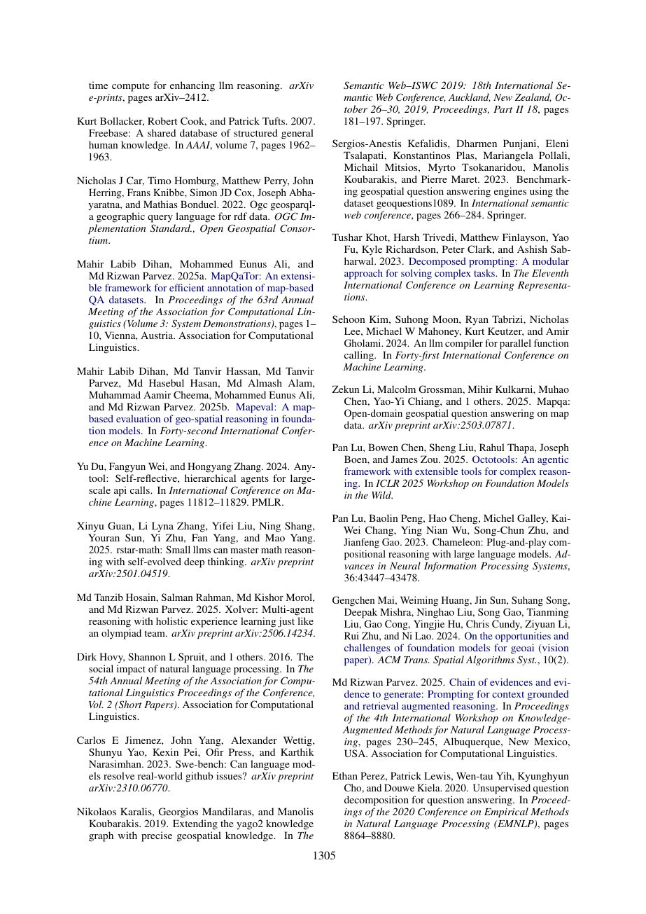


### 本页英文全文

```text
  time compute for enhancing llm reasoning. arXiv      Semantic Web–ISWC 2019: 18th International Se-
   e-prints, pages arXiv–2412.                            mantic Web Conference, Auckland, New Zealand, Oc-
                                                         tober 26–30, 2019, Proceedings, Part II 18, pages
Kurt Bollacker, Robert Cook, and Patrick Tufts. 2007.     181–197. Springer.
   Freebase: A shared database of structured general
  human knowledge. In AAAI, volume 7, pages 1962–    Sergios-Anestis Kefalidis, Dharmen Punjani, Eleni
  1963.                                                      Tsalapati, Konstantinos Plas, Mariangela Pollali,
                                                       Michail Mitsios, Myrto Tsokanaridou, Manolis
Nicholas J Car, Timo Homburg, Matthew Perry, John      Koubarakis, and Pierre Maret. 2023. Benchmark-
   Herring, Frans Knibbe, Simon JD Cox, Joseph Abha-      ing geospatial question answering engines using the
   yaratna, and Mathias Bonduel. 2022. Ogc geosparql-       dataset geoquestions1089. In International semantic
  a geographic query language for rdf data. OGC Im-     web conference, pages 266–284. Springer.
  plementation Standard., Open Geospatial Consor-
   tium.                                            Tushar Khot, Harsh Trivedi, Matthew Finlayson, Yao
                                                        Fu, Kyle Richardson, Peter Clark, and Ashish Sab-
Mahir Labib Dihan, Mohammed Eunus  Ali, and      harwal. 2023. Decomposed prompting: A modular
  Md Rizwan Parvez. 2025a. MapQaTor: An extensi-      approach for solving complex tasks. In The Eleventh
   ble framework for efficient annotation of map-based       International Conference on Learning Representa-
 QA datasets.  In Proceedings of the 63rd Annual        tions.
  Meeting of the Association for Computational Lin-
                                              Sehoon Kim, Suhong Moon, Ryan Tabrizi, Nicholas   guistics (Volume 3: System Demonstrations), pages 1–
                                                       Lee, Michael W Mahoney, Kurt Keutzer, and Amir  10, Vienna, Austria. Association for Computational
                                                      Gholami. 2024. An llm compiler for parallel function   Linguistics.
                                                                 calling. In Forty-first International Conference on
                                                  Machine Learning.Mahir Labib Dihan, Md Tanvir Hassan, Md Tanvir
   Parvez, Md Hasebul Hasan, Md Almash Alam,
                                              Zekun Li, Malcolm Grossman, Mihir Kulkarni, Muhao  Muhammad Aamir Cheema, Mohammed Eunus Ali,
                                                   Chen, Yao-Yi Chiang, and 1 others. 2025. Mapqa:  and Md Rizwan Parvez. 2025b. Mapeval: A map-
                                                  Open-domain geospatial question answering on map  based evaluation of geo-spatial reasoning in founda-
                                                                data. arXiv preprint arXiv:2503.07871.   tion models. In Forty-second International Confer-
  ence on Machine Learning.                                                Pan Lu, Bowen Chen, Sheng Liu, Rahul Thapa, Joseph
                                                    Boen, and James Zou. 2025. Octotools: An agentic
Yu Du, Fangyun Wei, and Hongyang Zhang. 2024. Any-                                                    framework with extensible tools for complex reason-
   tool:  Self-reflective, hierarchical agents for large-                                                                 ing. In ICLR 2025 Workshop on Foundation Models
   scale api calls. In International Conference on Ma-                                                                in the Wild.
   chine Learning, pages 11812–11829. PMLR.
                                               Pan Lu, Baolin Peng, Hao Cheng, Michel Galley, Kai-
Xinyu Guan, Li Lyna Zhang, Yifei Liu, Ning Shang,                                              Wei Chang, Ying Nian Wu, Song-Chun Zhu, and
  Youran Sun, Yi Zhu, Fan Yang, and Mao Yang.                                                           Jianfeng Gao. 2023. Chameleon: Plug-and-play com-
  2025. rstar-math: Small llms can master math reason-                                                                positional reasoning with large language models. Ad-
   ing with self-evolved deep thinking. arXiv preprint                                                     vances in Neural Information Processing Systems,
  arXiv:2501.04519.                                                     36:43447–43478.
Md Tanzib Hosain, Salman Rahman, Md Kishor Morol,   Gengchen Mai, Weiming Huang, Jin Sun, Suhang Song,
  and Md Rizwan Parvez. 2025. Xolver: Multi-agent     Deepak Mishra, Ninghao Liu, Song Gao, Tianming
   reasoning with holistic experience learning just like       Liu, Gao Cong, Yingjie Hu, Chris Cundy, Ziyuan Li,
  an olympiad team. arXiv preprint arXiv:2506.14234.      Rui Zhu, and Ni Lao. 2024. On the opportunities and
                                                         challenges of foundation models for geoai (vision
Dirk Hovy, Shannon L Spruit, and 1 others. 2016. The       paper). ACM Trans. Spatial Algorithms Syst., 10(2).
   social impact of natural language processing. In The
  54th Annual Meeting of the Association for Compu-  Md Rizwan Parvez. 2025. Chain of evidences and evi-
   tational Linguistics Proceedings of the Conference,      dence to generate: Prompting for context grounded
   Vol. 2 (Short Papers). Association for Computational      and retrieval augmented reasoning. In Proceedings
   Linguistics.                                                of the 4th International Workshop on Knowledge-
                                                 Augmented Methods for Natural Language Process-
Carlos E Jimenez, John Yang, Alexander Wettig,       ing, pages 230–245, Albuquerque, New Mexico,
  Shunyu Yao, Kexin Pei, Ofir Press, and Karthik     USA. Association for Computational Linguistics.
  Narasimhan. 2023. Swe-bench: Can language mod-
   els resolve real-world github issues? arXiv preprint    Ethan Perez, Patrick Lewis, Wen-tau Yih, Kyunghyun
  arXiv:2310.06770.                                  Cho, and Douwe Kiela. 2020. Unsupervised question
                                                      decomposition for question answering. In Proceed-
Nikolaos Karalis, Georgios Mandilaras, and Manolis       ings of the 2020 Conference on Empirical Methods
  Koubarakis. 2019. Extending the yago2 knowledge       in Natural Language Processing (EMNLP), pages
  graph with precise geospatial knowledge.  In The      8864–8880.
                                        1305
```


---

## 第 11 页（Page 11）

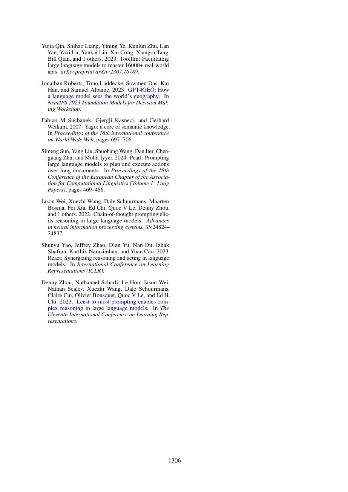


### 本页英文全文

```text
Yujia Qin, Shihao Liang, Yining Ye, Kunlun Zhu, Lan
  Yan, Yaxi Lu, Yankai Lin, Xin Cong, Xiangru Tang,
   Bill Qian, and 1 others. 2023. Toolllm: Facilitating
   large language models to master 16000+ real-world
   apis. arXiv preprint arXiv:2307.16789.

Jonathan Roberts, Timo Lüddecke, Sowmen Das, Kai
  Han, and Samuel Albanie. 2023. GPT4GEO: How
  a language model sees the world’s geography.  In
  NeurIPS 2023 Foundation Models for Decision Mak-
   ing Workshop.

Fabian M Suchanek, Gjergji Kasneci, and Gerhard
  Weikum. 2007. Yago: a core of semantic knowledge.
   In Proceedings of the 16th international conference
  on World Wide Web, pages 697–706.

Simeng Sun, Yang Liu, Shuohang Wang, Dan Iter, Chen-
  guang Zhu, and Mohit Iyyer. 2024. Pearl: Prompting
   large language models to plan and execute actions
  over long documents.  In Proceedings of the 18th
  Conference of the European Chapter of the Associa-
   tion for Computational Linguistics (Volume 1: Long
   Papers), pages 469–486.

Jason Wei, Xuezhi Wang, Dale Schuurmans, Maarten
  Bosma, Fei Xia, Ed Chi, Quoc V Le, Denny Zhou,
  and 1 others. 2022. Chain-of-thought prompting elic-
   its reasoning in large language models. Advances
   in neural information processing systems, 35:24824–
  24837.

Shunyu Yao, Jeffrey Zhao, Dian Yu, Nan Du, Izhak
   Shafran, Karthik Narasimhan, and Yuan Cao. 2023.
   React: Synergizing reasoning and acting in language
  models. In International Conference on Learning
  Representations (ICLR).

Denny Zhou, Nathanael Schärli, Le Hou, Jason Wei,
  Nathan Scales, Xuezhi Wang, Dale Schuurmans,
   Claire Cui, Olivier Bousquet, Quoc V Le, and Ed H.
   Chi. 2023. Least-to-most prompting enables com-
   plex reasoning in large language models.  In The
  Eleventh International Conference on Learning Rep-
   resentations.


                                        1306
```


---

## 第 12 页（Page 12）

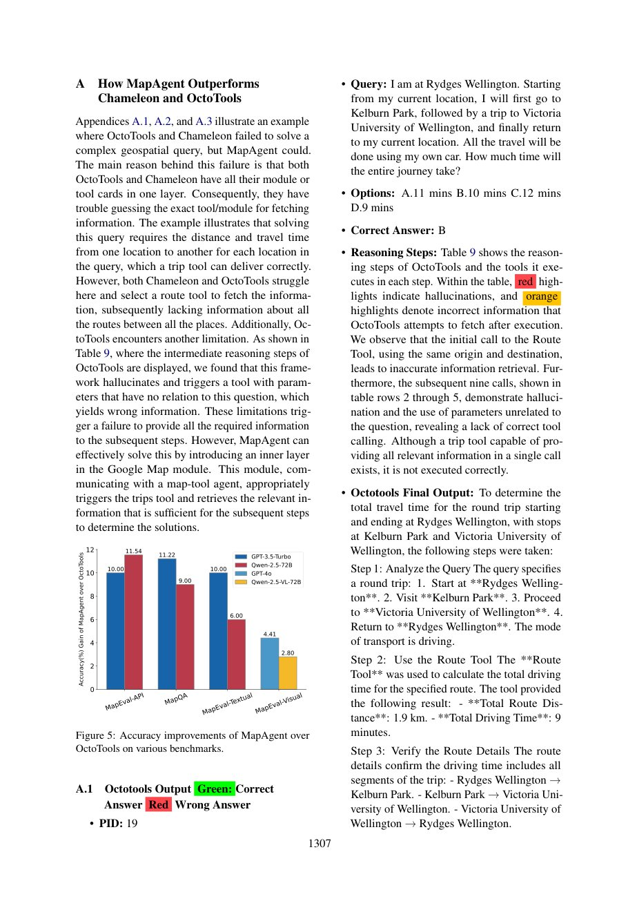


**原论文 Figure 5 · PDF p.12**

Figure 5: Accuracy improvements of MapAgent over OctoTools on various benchmarks.


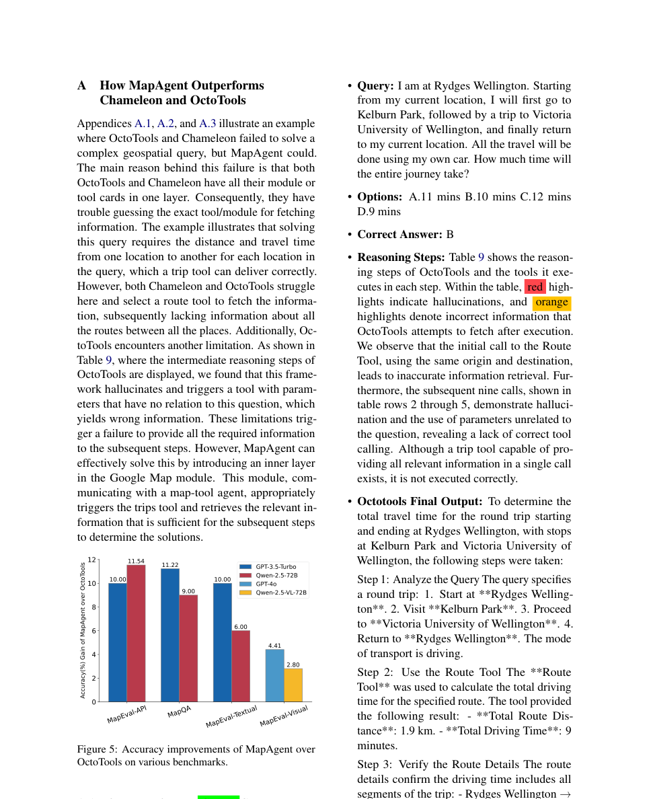


### 本页英文全文

```text
A  How MapAgent Outperforms                    • Query: I am at Rydges Wellington. Starting
   Chameleon and OctoTools                   from my current location, I will first go to
                                                  Kelburn Park, followed by a trip to Victoria
Appendices A.1, A.2, and A.3 illustrate an example                                                       University of Wellington, and finally return
where OctoTools and Chameleon failed to solve a                                                           to my current location. All the travel will be
complex geospatial query, but MapAgent could.                                                 done using my own car. How much time will
The main reason behind this failure is that both                                                          the entire journey take?
OctoTools and Chameleon have all their module or
tool cards in one layer. Consequently, they have        • Options: A.11 mins B.10 mins C.12 mins
trouble guessing the exact tool/module for fetching       D.9 mins
information. The example illustrates that solving
                                                                 • Correct Answer: Bthis query requires the distance and travel time
from one location to another for each location in        • Reasoning Steps: Table 9 shows the reason-
the query, which a trip tool can deliver correctly.        ing steps of OctoTools and the tools it exe-
However, both Chameleon and OctoTools struggle         cutes in each step. Within the table, red high-
here and select a route tool to fetch the informa-         lights indicate hallucinations, and  orange
tion, subsequently lacking information about all         highlights denote incorrect information that
the routes between all the places. Additionally, Oc-       OctoTools attempts to fetch after execution.
toTools encounters another limitation. As shown in     We observe that the initial call to the Route
Table 9, where the intermediate reasoning steps of        Tool, using the same origin and destination,
OctoTools are displayed, we found that this frame-        leads to inaccurate information retrieval. Fur-
work hallucinates and triggers a tool with param-        thermore, the subsequent nine calls, shown in
eters that have no relation to this question, which         table rows 2 through 5, demonstrate halluci-
yields wrong information. These limitations trig-        nation and the use of parameters unrelated to
ger a failure to provide all the required information         the question, revealing a lack of correct tool
to the subsequent steps. However, MapAgent can         calling. Although a trip tool capable of pro-
effectively solve this by introducing an inner layer        viding all relevant information in a single call
in the Google Map module. This module, com-         exists, it is not executed correctly.
municating with a map-tool agent, appropriately
                                                                 • Octotools Final Output: To determine thetriggers the trips tool and retrieves the relevant in-
                                                                 total travel time for the round trip startingformation that is sufficient for the subsequent steps
                                                 and ending at Rydges Wellington, with stopsto determine the solutions.
                                                                at Kelburn Park and Victoria University of
   12         11.54                                                       Wellington, the following steps were taken:                         11.22                         GPT-3.5-Turbo
                                                    Qwen-2.5-72B          10.00                          10.00                                                    GPT-4o                Step 1: Analyze the Query The query specifies OctoTools 10
                                9.00                  Qwen-2.5-VL-72B         a round trip: 1. Start at **Rydges Welling-over
    8                                                     ton**. 2. Visit **Kelburn Park**. 3. Proceed
                                                6.00                       to **Victoria University of Wellington**. 4. MapAgent 6
of                                                   Return to **Rydges Wellington**. The mode
                                                           4.41
Gain 4                                                     of transport is driving.
                                                                2.80
                                                    Step 2: Use the Route Tool The **Route    2
                                                   Tool** was used to calculate the total driving Accuracy(%)
    0                                                  time for the specified route. The tool provided
                                                         the following result:  - **Total Route Dis-       MapEval-API   MapQA   MapEval-TextualMapEval-Visual                                                         tance**: 1.9 km. - **Total Driving Time**: 9
Figure 5: Accuracy improvements of MapAgent over        minutes.
OctoTools on various benchmarks.                        Step 3: Verify the Route Details The route
                                                              details confirm the driving time includes all
                                                   segments of the trip: - Rydges Wellington →
A.1  Octotools Output Green: Correct                                                    Kelburn Park. - Kelburn Park →Victoria Uni-
     Answer Red Wrong Answer                                                              versity of Wellington. - Victoria University of
    • PID: 19                                         Wellington →Rydges Wellington.
                                        1307
```


---

## 第 13 页（Page 13）

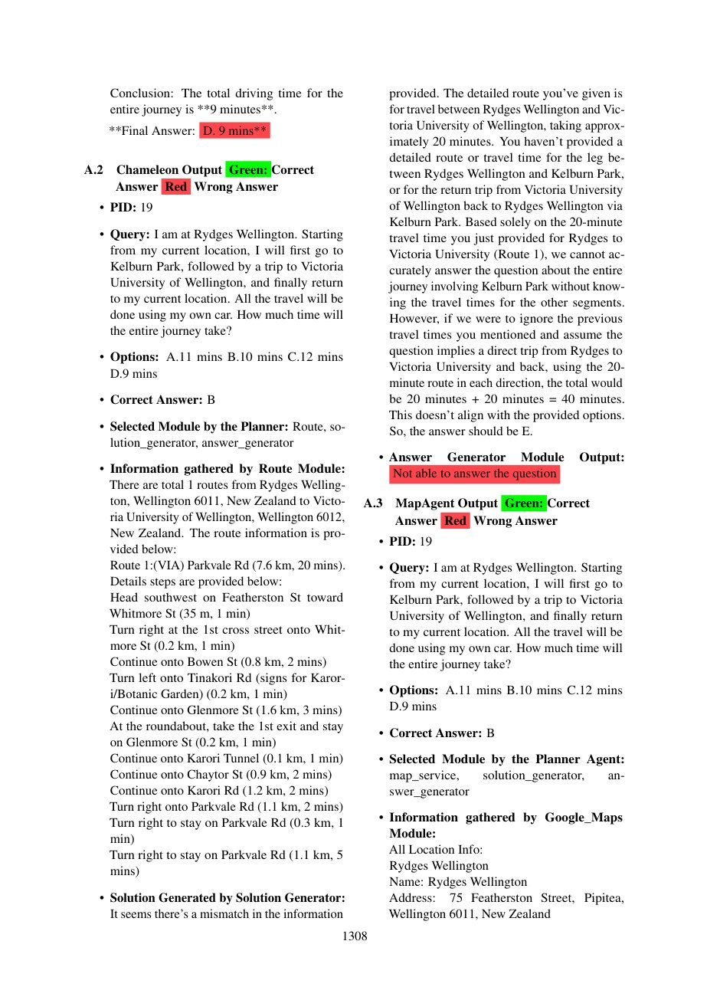


### 本页英文全文

```text
    Conclusion: The total driving time for the        provided. The detailed route you’ve given is
     entire journey is **9 minutes**.                       for travel between Rydges Wellington and Vic-
                                                                 toria University of Wellington, taking approx-    **Final Answer: D. 9 mins**
                                                      imately 20 minutes. You haven’t provided a
                                                          detailed route or travel time for the leg be-
A.2  Chameleon Output Green: Correct            tween Rydges Wellington and Kelburn Park,
    Answer Red Wrong Answer                     or for the return trip from Victoria University
   • PID: 19                                            of Wellington back to Rydges Wellington via
                                                   Kelburn Park. Based solely on the 20-minute
   • Query: I am at Rydges Wellington. Starting         travel time you just provided for Rydges to
    from my current location, I will first go to                                                         Victoria University (Route 1), we cannot ac-
    Kelburn Park, followed by a trip to Victoria                                                          curately answer the question about the entire
     University of Wellington, and finally return                                                       journey involving Kelburn Park without know-
     to my current location. All the travel will be                                                      ing the travel times for the other segments.
    done using my own car. How much time will                                                However, if we were to ignore the previous
     the entire journey take?                                                              travel times you mentioned and assume the
                                                       question implies a direct trip from Rydges to   • Options: A.11 mins B.10 mins C.12 mins
                                                         Victoria University and back, using the 20-    D.9 mins
                                                    minute route in each direction, the total would
   • Correct Answer: B                            be 20 minutes + 20 minutes = 40 minutes.
                                                    This doesn’t align with the provided options.
   • Selected Module by the Planner: Route, so-                                                      So, the answer should be E.
     lution_generator, answer_generator
                                                                 • Answer  Generator  Module  Output:
   • Information gathered by Route Module:                                                Not able to answer the question
    There are total 1 routes from Rydges Welling-
     ton, Wellington 6011, New Zealand to Victo-   A.3  MapAgent Output Green: Correct
      ria University of Wellington, Wellington 6012,       Answer Red Wrong Answer
   New Zealand. The route information is pro-
                                                                 • PID: 19    vided below:
    Route 1:(VIA) Parkvale Rd (7.6 km, 20 mins).       • Query: I am at Rydges Wellington. Starting
     Details steps are provided below:                 from my current location, I will first go to
    Head southwest on Featherston St toward        Kelburn Park, followed by a trip to Victoria
    Whitmore St (35 m, 1 min)                         University of Wellington, and finally return
    Turn right at the 1st cross street onto Whit-         to my current location. All the travel will be
    more St (0.2 km, 1 min)                         done using my own car. How much time will
    Continue onto Bowen St (0.8 km, 2 mins)            the entire journey take?
    Turn left onto Tinakori Rd (signs for Karor-
                                                                 • Options: A.11 mins B.10 mins C.12 mins     i/Botanic Garden) (0.2 km, 1 min)
                                                D.9 mins    Continue onto Glenmore St (1.6 km, 3 mins)
    At the roundabout, take the 1st exit and stay                                                                 • Correct Answer: B
    on Glenmore St (0.2 km, 1 min)
    Continue onto Karori Tunnel (0.1 km, 1 min)        • Selected Module by the Planner Agent:
    Continue onto Chaytor St (0.9 km, 2 mins)          map_service,    solution_generator,    an-
    Continue onto Karori Rd (1.2 km, 2 mins)           swer_generator
    Turn right onto Parkvale Rd (1.1 km, 2 mins)
                                                                 • Information gathered by Google_Maps    Turn right to stay on Parkvale Rd (0.3 km, 1
                                              Module:    min)
                                                       All Location Info:    Turn right to stay on Parkvale Rd (1.1 km, 5
                                               Rydges Wellington    mins)
                                            Name: Rydges Wellington
   • Solution Generated by Solution Generator:       Address:  75 Featherston  Street,  Pipitea,
       It seems there’s a mismatch in the information        Wellington 6011, New Zealand
                                        1308
```


---

## 第 14 页（Page 14）

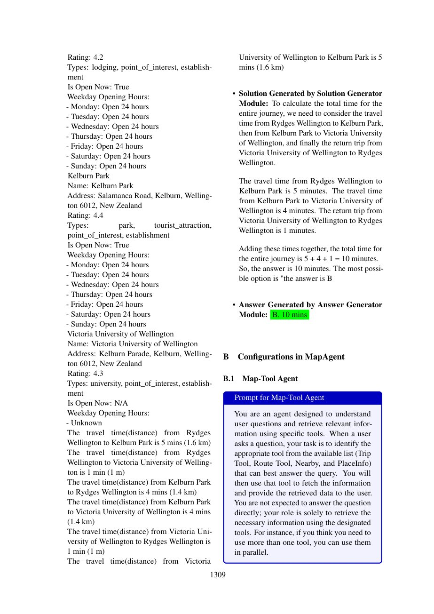


### 本页英文全文

```text
Rating: 4.2                                         University of Wellington to Kelburn Park is 5
Types: lodging, point_of_interest, establish-       mins (1.6 km)
ment
Is Open Now: True
                                                            • Solution Generated by Solution GeneratorWeekday Opening Hours:
                                         Module: To calculate the total time for the- Monday: Open 24 hours
                                                         entire journey, we need to consider the travel- Tuesday: Open 24 hours
                                                  time from Rydges Wellington to Kelburn Park,- Wednesday: Open 24 hours
                                                    then from Kelburn Park to Victoria University- Thursday: Open 24 hours
                                                     of Wellington, and finally the return trip from- Friday: Open 24 hours
                                                     Victoria University of Wellington to Rydges- Saturday: Open 24 hours
                                                   Wellington.- Sunday: Open 24 hours
Kelburn Park
                                         The travel time from Rydges Wellington toName: Kelburn Park
                                              Kelburn Park is 5 minutes. The travel timeAddress: Salamanca Road, Kelburn, Welling-
                                            from Kelburn Park to Victoria University ofton 6012, New Zealand
                                                 Wellington is 4 minutes. The return trip fromRating: 4.4
                                                     Victoria University of Wellington to RydgesTypes:         park,      tourist_attraction,
                                                 Wellington is 1 minutes.point_of_interest, establishment
Is Open Now: True                                            Adding these times together, the total time for
Weekday Opening Hours:                                                     the entire journey is 5 + 4 + 1 = 10 minutes.
- Monday: Open 24 hours                                                   So, the answer is 10 minutes. The most possi-
- Tuesday: Open 24 hours                                                     ble option is "the answer is B
- Wednesday: Open 24 hours
- Thursday: Open 24 hours
- Friday: Open 24 hours                                • Answer Generated by Answer Generator
- Saturday: Open 24 hours                      Module: B. 10 mins
- Sunday: Open 24 hours
Victoria University of Wellington
Name: Victoria University of Wellington
Address: Kelburn Parade, Kelburn, Welling-                           B  Configurations in MapAgent
ton 6012, New Zealand
Rating: 4.3
                                          B.1  Map-Tool AgentTypes: university, point_of_interest, establish-
ment                                           Prompt for Map-Tool Agent
Is Open Now: N/A
Weekday Opening Hours:                   You are an agent designed to understand
- Unknown                                       user questions and retrieve relevant infor-
The  travel  time(distance)  from  Rydges      mation using specific tools. When a user
Wellington to Kelburn Park is 5 mins (1.6 km)       asks a question, your task is to identify the
The  travel  time(distance)  from  Rydges       appropriate tool from the available list (Trip
Wellington to Victoria University of Welling-       Tool, Route Tool, Nearby, and PlaceInfo)
ton is 1 min (1 m)                                    that can best answer the query. You will
The travel time(distance) from Kelburn Park       then use that tool to fetch the information
to Rydges Wellington is 4 mins (1.4 km)          and provide the retrieved data to the user.
The travel time(distance) from Kelburn Park      You are not expected to answer the question
to Victoria University of Wellington is 4 mins        directly; your role is solely to retrieve the
(1.4 km)                                         necessary information using the designated
The travel time(distance) from Victoria Uni-        tools. For instance, if you think you need to
versity of Wellington to Rydges Wellington is       use more than one tool, you can use them
1 min (1 m)                                          in parallel.
The  travel  time(distance)  from  Victoria
                                    1309
```


---

## 第 15 页（Page 15）

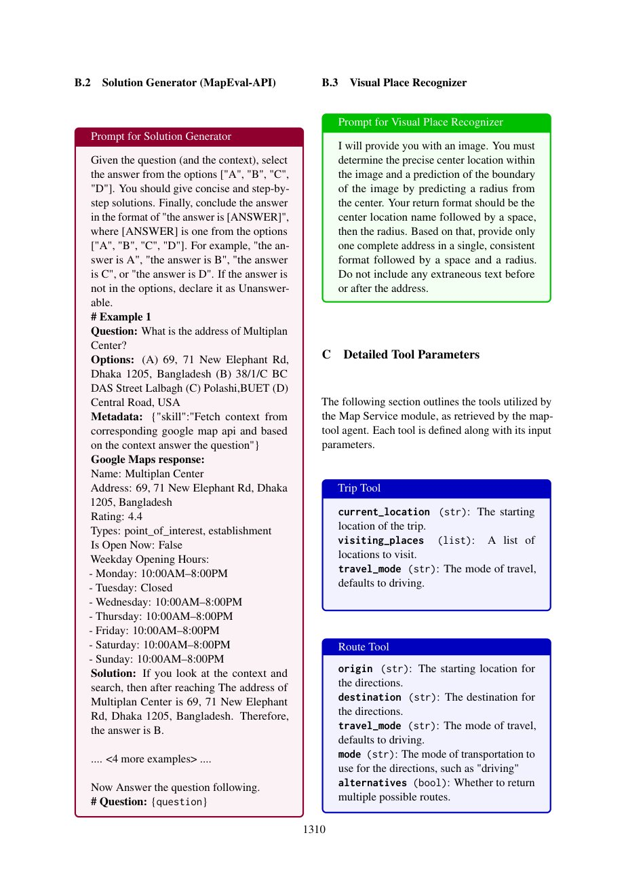


### 本页英文全文

```text
B.2  Solution Generator (MapEval-API)        B.3  Visual Place Recognizer


                                               Prompt for Visual Place Recognizer
   Prompt for Solution Generator
                                                                      I will provide you with an image. You must
   Given the question (and the context), select          determine the precise center location within
    the answer from the options ["A", "B", "C",           the image and a prediction of the boundary
   "D"]. You should give concise and step-by-          of the image by predicting a radius from
    step solutions. Finally, conclude the answer           the center. Your return format should be the
    in the format of "the answer is [ANSWER]",          center location name followed by a space,
   where [ANSWER] is one from the options          then the radius. Based on that, provide only
   ["A", "B", "C", "D"]. For example, "the an-         one complete address in a single, consistent
   swer is A", "the answer is B", "the answer          format followed by a space and a radius.
    is C", or "the answer is D". If the answer is       Do not include any extraneous text before
   not in the options, declare it as Unanswer-          or after the address.
    able.
   # Example 1
   Question: What is the address of Multiplan
   Center?
                           C  Detailed Tool Parameters   Options: (A) 69, 71 New Elephant Rd,
   Dhaka 1205, Bangladesh (B) 38/1/C BC
  DAS Street Lalbagh (C) Polashi,BUET (D)
   Central Road, USA                        The following section outlines the tools utilized by
   Metadata:  {"skill":"Fetch context from       the Map Service module, as retrieved by the map-
   corresponding google map api and based        tool agent. Each tool is defined along with its input
   on the context answer the question"}             parameters.
   Google Maps response:
   Name: Multiplan Center
   Address: 69, 71 New Elephant Rd, Dhaka          Trip Tool
   1205, Bangladesh
                                              current_location  (str): The starting   Rating: 4.4
                                                         location of the trip.   Types: point_of_interest, establishment
                                              visiting_places  (list): A  list  of    Is Open Now: False
                                                         locations to visit.   Weekday Opening Hours:
                                              travel_mode (str): The mode of travel,    - Monday: 10:00AM–8:00PM
                                                          defaults to driving.    - Tuesday: Closed
    - Wednesday: 10:00AM–8:00PM
    - Thursday: 10:00AM–8:00PM
    - Friday: 10:00AM–8:00PM
    - Saturday: 10:00AM–8:00PM                    Route Tool
    - Sunday: 10:00AM–8:00PM
                                              origin (str): The starting location for   Solution:  If you look at the context and
                                                        the directions.   search, then after reaching The address of
                                              destination (str): The destination for   Multiplan Center is 69, 71 New Elephant
                                                        the directions.   Rd, Dhaka 1205, Bangladesh. Therefore,
                                              travel_mode (str): The mode of travel,    the answer is B.
                                                          defaults to driving.
                                              mode (str): The mode of transportation to      .... <4 more examples> ....
                                                    use for the directions, such as "driving"
                                              alternatives (bool): Whether to return  Now Answer the question following.
                                                       multiple possible routes.   # Question: {question}

                                        1310
```


---

## 第 16 页（Page 16）

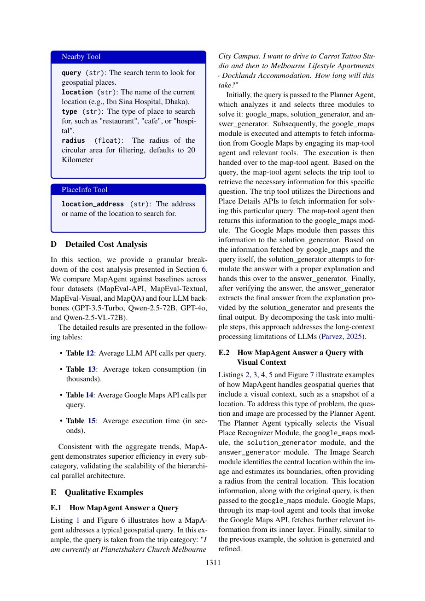


### 本页英文全文

```text
   Nearby Tool                                    City Campus. I want to drive to Carrot Tattoo Stu-
                                                  dio and then to Melbourne Lifestyle Apartments
   query (str): The search term to look for                                                               - Docklands Accommodation. How long will this
    geospatial places.                                                   take?"
   location (str): The name of the current                                                                     Initially, the query is passed to the Planner Agent,
    location (e.g., Ibn Sina Hospital, Dhaka).                                           which analyzes  it and selects three modules to
   type (str): The type of place to search                                                    solve it: google_maps, solution_generator, and an-
    for, such as "restaurant", "cafe", or "hospi-                                                  swer_generator. Subsequently, the google_maps
    tal".                                           module is executed and attempts to fetch informa-
   radius  (float):  The  radius  of  the                                                      tion from Google Maps by engaging its map-tool
    circular area for filtering, defaults to 20                                                 agent and relevant tools. The execution is then
   Kilometer                                            handed over to the map-tool agent. Based on the
                                                    query, the map-tool agent selects the trip tool to
                                                         retrieve the necessary information for this specific
   PlaceInfo Tool                                   question. The trip tool utilizes the Directions and
                                                 Place Details APIs to fetch information for solv-   location_address  (str): The address
                                                  ing this particular query. The map-tool agent then    or name of the location to search for.
                                                      returns this information to the google_maps mod-
                                                          ule. The Google Maps module then passes this
                                                 information to the solution_generator. Based onD  Detailed Cost Analysis                                                    the information fetched by google_maps and the
In  this section, we provide a granular break-   query itself, the solution_generator attempts to for-
down of the cost analysis presented in Section 6.   mulate the answer with a proper explanation and
We compare MapAgent against baselines across   hands this over to the answer_generator. Finally,
four datasets (MapEval-API, MapEval-Textual,    after verifying the answer, the answer_generator
MapEval-Visual, and MapQA) and four LLM back-    extracts the final answer from the explanation pro-
bones (GPT-3.5-Turbo, Qwen-2.5-72B, GPT-4o,   vided by the solution_generator and presents the
and Qwen-2.5-VL-72B).                                final output. By decomposing the task into multi-
  The detailed results are presented in the follow-   ple steps, this approach addresses the long-context
ing tables:                                         processing limitations of LLMs (Parvez, 2025).

    • Table 12: Average LLM API calls per query.   E.2  How MapAgent Answer a Query with
                                                      Visual Context
    • Table 13: Average token consumption (in
                                                      Listings 2, 3, 4, 5 and Figure 7 illustrate examples     thousands).
                                                   of how MapAgent handles geospatial queries that
    • Table 14: Average Google Maps API calls per    include a visual context, such as a snapshot of a
     query.                                             location. To address this type of problem, the ques-
                                                         tion and image are processed by the Planner Agent.
    • Table 15: Average execution time (in sec-   The Planner Agent typically selects the Visual
     onds).                                       Place Recognizer Module, the google_maps mod-
                                                          ule, the solution_generator module, and the  Consistent with the aggregate trends, MapA-
                                           answer_generator module. The Image Searchgent demonstrates superior efficiency in every sub-
                                            module identifies the central location within the im-category, validating the scalability of the hierarchi-
                                              age and estimates its boundaries, often providingcal parallel architecture.
                                                a radius from the central location. This location
E  Qualitative Examples                       information, along with the original query, is then
                                                  passed to the google_maps module. Google Maps,
E.1  How MapAgent Answer a Query           through its map-tool agent and tools that invoke
Listing 1 and Figure 6 illustrates how a MapA-   the Google Maps API, fetches further relevant in-
gent addresses a typical geospatial query. In this ex-   formation from its inner layer. Finally, similar to
ample, the query is taken from the trip category: "I    the previous example, the solution is generated and
am currently at Planetshakers Church Melbourne    refined.
                                        1311
```


---

## 第 17 页（Page 17）

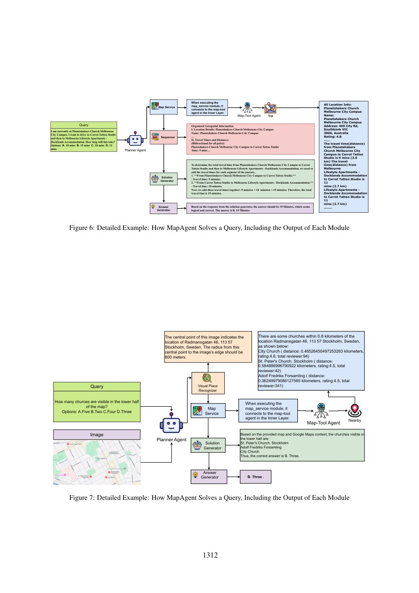


**原论文 Figure 6 · PDF p.17**

Figure 6: Detailed Example: How MapAgent Solves a Query, Including the Output of Each Module


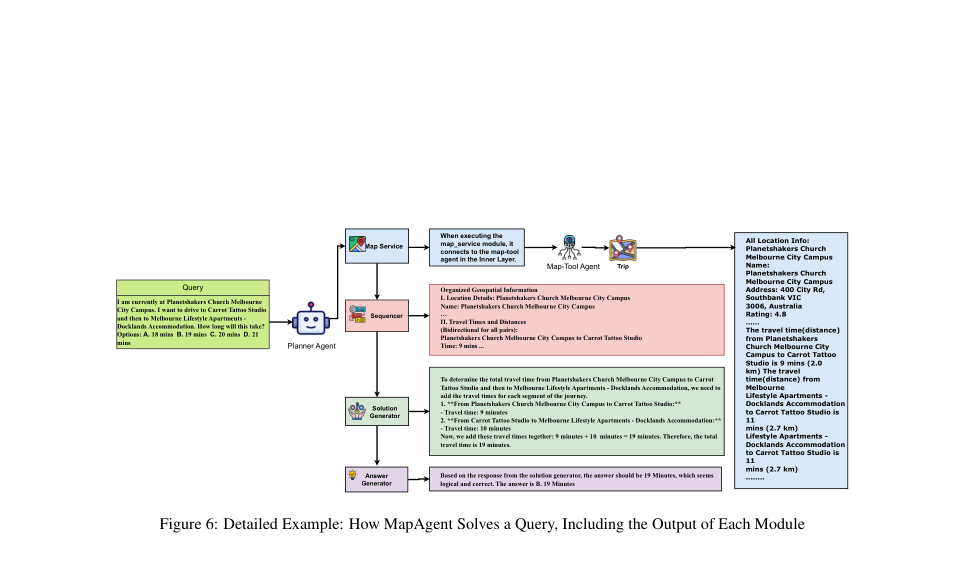


**原论文 Figure 7 · PDF p.17**

Figure 7: Detailed Example: How MapAgent Solves a Query, Including the Output of Each Module


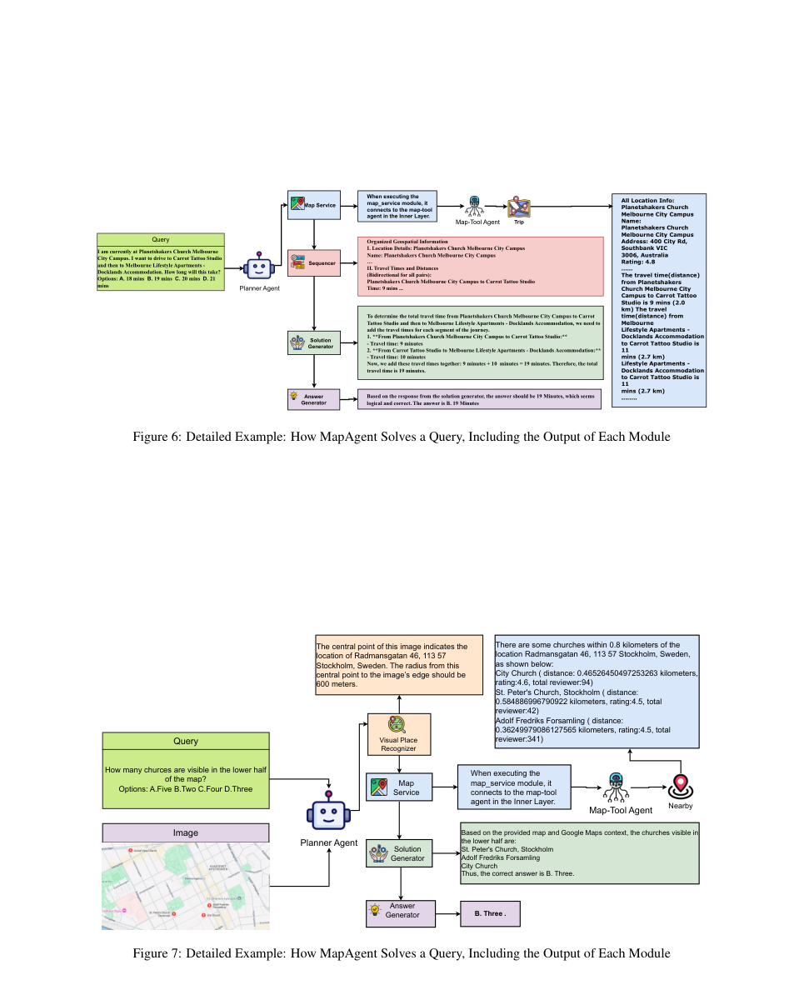


### 本页英文全文

```text
                                                                        When                                                                                                     executing                                                                                                                  the
                                                                                                                                                                   Location Info:                                                                                         map_service                                                                                                     module,                                                                                                                                                                                                   it                                                                         All                                                        Map Service                                                                                                                                                            Planetshakers                                                                                                                                                              Church                                                                                          connects                                                                                                                  to the                                                                                                            map-tool
                                                                                            agent in the Inner Layer.                                                     Melbourne City Campus
                                                                                                              Map-Tool Agent      Trip                        Name:
                                                                                                                                                            Planetshakers Church
                                                                                                                                                 Melbourne City Campus
                Query                                                                        Organized Geospatial Information                                                   Address: 400 City Rd,
                                                                                                                                               Southbank                                                                                                                                                      VIC                                                                                                                                                          I.                                                                                                          Location                                                                                                                                    Details:                                                                                                                             Planetshakers                                                                                                                      Church                                                                                                                                Melbourne                                                                                                                                                              City                                                                                                                              Campus
I am     currently               at                Planetshakers                         Church                                 Melbourne
                                                                                                                                                     3006,                                                                                                                                                                                 Australia                                                                                       Name:                                                                                                                 Planetshakers                                                                                                            Church                                                                                                                      Melbourne                                                                                                                                                  City                                                                                                                     Campus
City    Campus.                I             want                      to                       drive                              to Carrot                                     Tattoo                                           Studio
                                                 …                                                                                                                                                                     Rating:                                                                                                                                                                        4.8                                                                       Sequencerand    then          to          Melbourne                         Lifestyle                           Apartments                                                          -
                                                                                                                                                II.                                                                                                              Travel                                                                                                       Times                                                                                                         and                                                                                                                                 Distances                                                                                           ……
Docklands         Accommodation.                  How                                long                                          will                                               this                                           take?                                                                                                                     (Bidirectional                                                                                                                                  for                                                                                                                                                                 all                                                                                                                                                pairs):                                                                                                                                           The                                                                                                                                                                                   travel                                                                                                                                                                           time(distance)
        A.                  B.                            C.                                      D.Options:           18             mins                     19 mins                               20                                mins                                         21                                                                                                           Planetshakers                                                                                                      Church                                                                                                                Melbourne                                                                                                                                            City Campus                                                                                                                                                                        to Carrot                                                                                                                                                                  Tattoo                                                                                                                                                                      Studio                                                                                                                                                from                                                                                                                                                                 Planetshakers
mins                                                                                                 Time:                                                                                                        9                                                                                                       mins                                                                                                                                                                                                                            ...                                             Planner Agent                                                                                                                                                 Church                                                                                                                                                        Melbourne                                                                                                                                                                                                   City
                                                                                                                                 Campus to Carrot Tattoo
                                                                                                                                                               Studio is 9 mins (2.0
                                                                                                                              km) The travel
                                                                                            To determine the total travel time from Planetshakers Church Melbourne City Campus to Carrot        time(distance) from
                                                                                                            Tattoo Studio and then to Melbourne Lifestyle Apartments - Docklands Accommodation, we need to      Melbourne
                                                                                            add the travel times for each segment of the journey.                                             Lifestyle Apartments -
                                                                                                                                                     Docklands                                                                                                                                                   Accommodation                                                                                         **From                                                                                                                     Planetshakers                                                                                                               Church                                                                                                                         Melbourne                                                                                                                                                      City                                                                                                                       Campus                                                                                                                                                                                   to Carrot                                                                                                                                                                            Tattoo                                                                                                                                                                                   Studio:**
                                                                                                                                                                       to                                                                                                                                                                     Carrot Tattoo                                                                                                                                                                               Studio is                                                                                 Solution                 1.-                                                                                                            Travel                                                                                                                       time:                                                                                                              9 minutes
                                                                           Generator
                                                                                                                                      11                                                                                                                                   2.                                                                                         **From                                                                                                              Carrot                                                                                                                             Tattoo Studio                                                                                                                                                       to                                                                                                                          Melbourne                                                                                                                                                                          Lifestyle                                                                                                                                               Apartments                                                                                                                                                                                                                                           -                                                                                                                                                              Docklands                                                                                                                                                                Accommodation:**
                                                                                                                                                    - Travel time: 10 minutes                                                     mins (2.7 km)
                                                                                            Now, we add these travel times together: 9 minutes + 10 minutes = 19 minutes. Therefore, the total        Lifestyle Apartments -
                                                                                                                      travel time is 19 minutes.                                                        Docklands Accommodation
                                                                                                                                                                       to Carrot Tattoo Studio is
                                                                                                                                      11
                                                                                                                                             mins (2.7 km)
                                                                 Answer                Based on the response from the solution generator, the answer should be 19 Minutes, which seems              ........
                                                                         Generator                   logical and correct. The answer is B. 19 Minutes

      Figure 6: Detailed Example: How MapAgent Solves a Query, Including the Output of Each Module


                                                 The central point of this image indicates the       There are some churches within 0.8 kilometers of the
                                                                 location of Radmansgatan 46, 113 57               location Radmansgatan 46, 113 57 Stockholm, Sweden,
                                                        Stockholm, Sweden. The radius from this         as shown below:
                                                                 central point to the image’s edge should be         City Church ( distance: 0.46526450497253263 kilometers,
                                                  600 meters.                                           rating:4.6, total reviewer:94)
                                                                                                                            St. Peter's Church, Stockholm ( distance:
                                                                                              0.584886996790922 kilometers, rating:4.5, total
                                                                                                               reviewer:42)
                                                                                                               Adolf Fredriks Forsamling ( distance:
                                                                                              0.36249979086127565 kilometers, rating:4.5, total
               Query                                                          Visual Place                     reviewer:341)
                                                                                 Recognizer

 How many churces are visible in the lower half                                        When executing the
                     of the map?                                      Map              map_service module, it
      Options: A.Five B.Two C.Four D.Three                                      Service             connects to the map-tool
                                                                                               agent in the Inner Layer.                            Nearby
                                                                                                         Map-Tool Agent

               Image                                                                   Based on the provided map and Google Maps context, the churches visible in
                                             Planner Agent                                the lower half are:
                                                                                       Solution              St. Peter's Church, Stockholm
                                                                              Generator            Adolf Fredriks Forsamling
                                                                                                                          City Church
                                                                                                         Thus, the correct answer is B. Three.


                                                                      Answer
                                                                            Generator                B. Three .


      Figure 7: Detailed Example: How MapAgent Solves a Query, Including the Output of Each Module


                                        1312
```


---

## 第 18 页（Page 18）

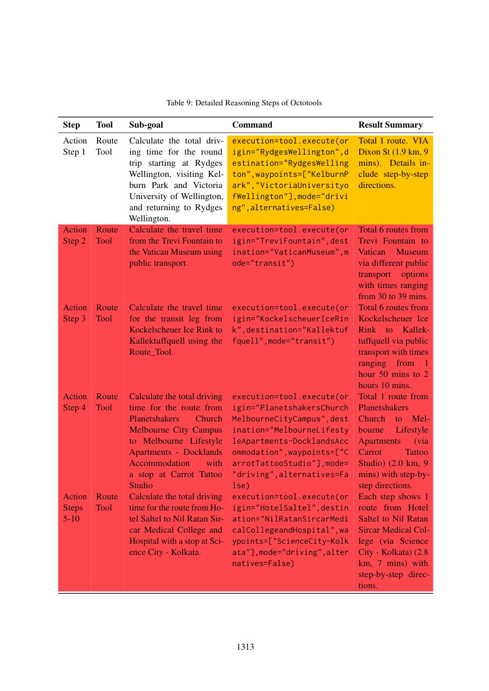


**原论文 Table 9 · PDF p.18**

Table 9: Detailed Reasoning Steps of Octotools


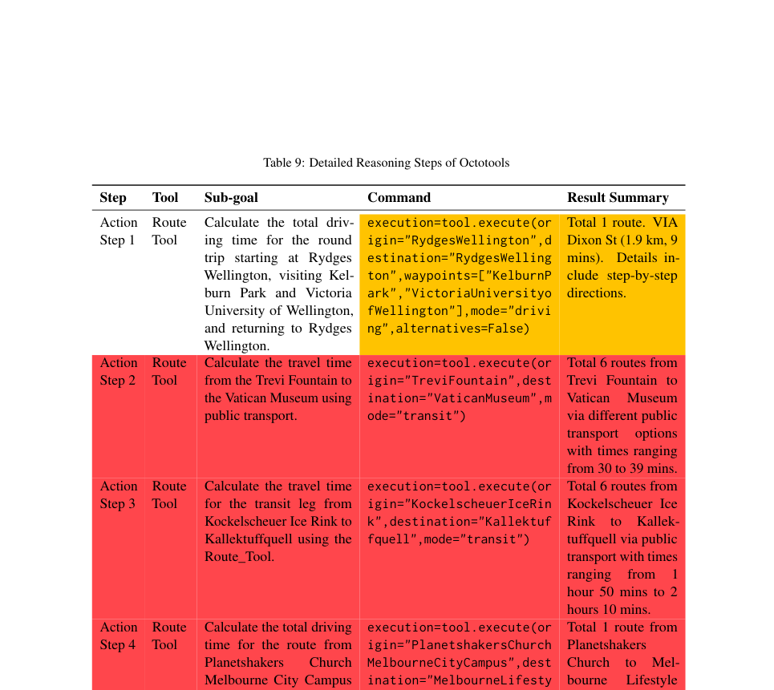


### 本页英文全文

```text
                             Table 9: Detailed Reasoning Steps of Octotools

Step    Tool    Sub-goal            Command                     Result Summary
Action  Route   Calculate the  total driv-  execution=tool.execute(or   Total 1 route. VIA
Step 1   Tool    ing time  for the round  igin="RydgesWellington",d  Dixon St (1.9 km, 9
                     trip  starting  at Rydges  estination="RydgesWelling   mins).  Details in-
                 Wellington, visiting Kel-  ton",waypoints=["KelburnP  clude step-by-step
                burn Park and  Victoria  ark","VictoriaUniversityo   directions.
                 University of Wellington,  fWellington"],mode="drivi
               and returning to Rydges  ng",alternatives=False)
                 Wellington.
Action  Route   Calculate the travel time  execution=tool.execute(or   Total 6 routes from
Step 2   Tool    from the Trevi Fountain to  igin="TreviFountain",dest  Trevi Fountain  to
                   the Vatican Museum using  ination="VaticanMuseum",m  Vatican  Museum
                  public transport.          ode="transit")                 via different public
                                                                                  transport   options
                                                                         with times ranging
                                                                     from 30 to 39 mins.
Action  Route   Calculate the travel time  execution=tool.execute(or   Total 6 routes from
Step 3   Tool     for the  transit leg from  igin="KockelscheuerIceRin  Kockelscheuer Ice
                 Kockelscheuer Ice Rink to  k",destination="Kallektuf  Rink   to  Kallek-
                  Kallektuffquell using the  fquell",mode="transit")       tuffquell via public
                Route_Tool.                                                     transport with times
                                                                          ranging  from  1
                                                                       hour 50 mins to 2
                                                                          hours 10 mins.
Action  Route   Calculate the total driving  execution=tool.execute(or   Total 1 route from
Step 4   Tool    time for the route from  igin="PlanetshakersChurch   Planetshakers
                 Planetshakers    Church  MelbourneCityCampus",dest  Church   to  Mel-
               Melbourne City Campus  ination="MelbourneLifesty  bourne   Lifestyle
                   to  Melbourne  Lifestyle  leApartments-DocklandsAcc  Apartments    (via
               Apartments - Docklands  ommodation",waypoints=["C   Carrot      Tattoo
              Accommodation    with  arrotTattooStudio"],mode=   Studio) (2.0 km, 9
                a stop  at Carrot Tattoo  "driving",alternatives=Fa  mins) with step-by-
                 Studio                  lse)                              step directions.
Action  Route   Calculate the total driving  execution=tool.execute(or  Each step shows 1
Steps   Tool    time for the route from Ho-  igin="HotelSaltel",destin   route from  Hotel
5-10                tel Saltel to Nil Ratan Sir-  ation="NilRatanSircarMedi   Saltel to Nil Ratan
                  car Medical College and  calCollegeandHospital",wa   Sircar Medical Col-
                  Hospital with a stop at Sci-  ypoints=["ScienceCity-Kolk   lege  (via Science
                ence City - Kolkata.       ata"],mode="driving",alter   City - Kolkata) (2.8
                                      natives=False)              km, 7 mins) with
                                                                               step-by-step  direc-
                                                                                          tions.


                                       1313
```


---

## 第 19 页（Page 19）

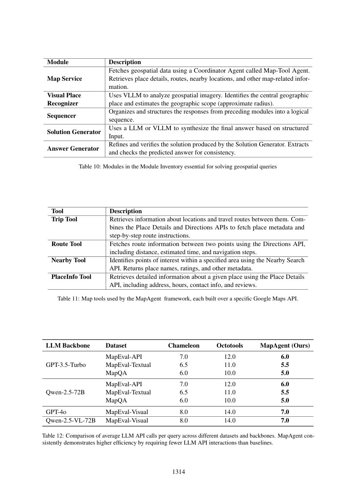


**原论文 Table 10 · PDF p.19**

Table 10: Modules in the Module Inventory essential for solving geospatial queries


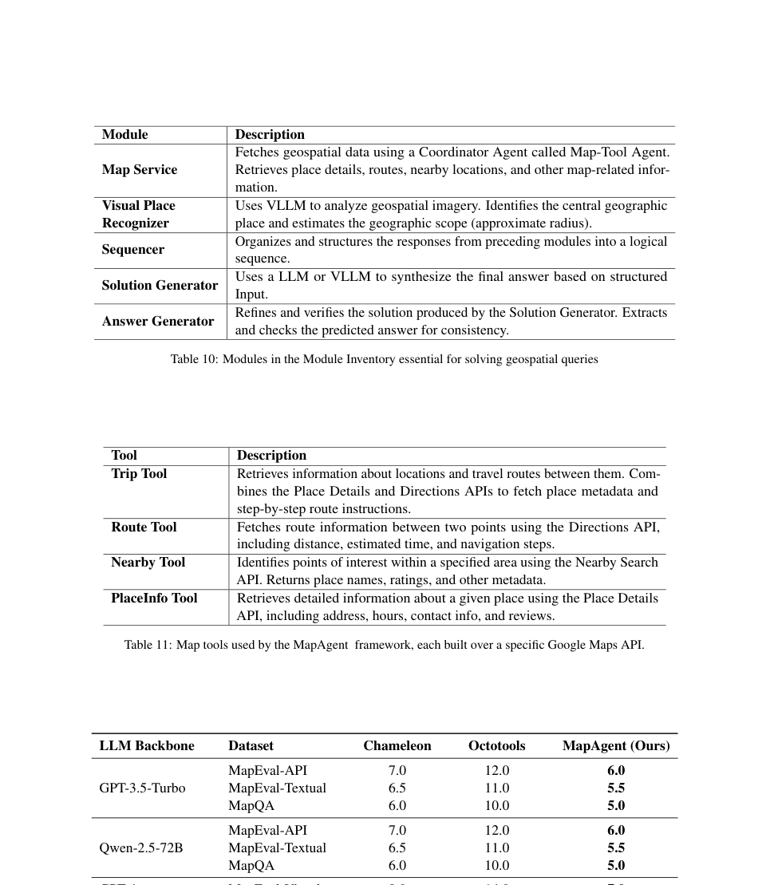


**原论文 Table 11 · PDF p.19**

Table 11: Map tools used by the MapAgent framework, each built over a specific Google Maps API.


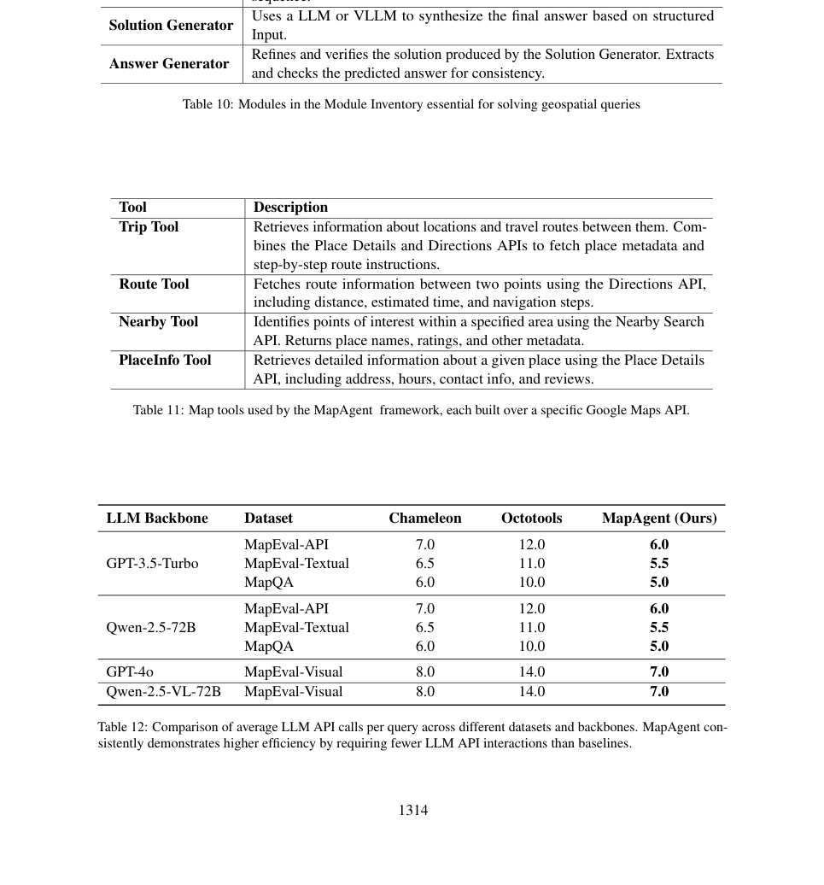


**原论文 Table 12 · PDF p.19**

Table 12: Comparison of average LLM API calls per query across different datasets and backbones. MapAgent con- sistently demonstrates higher efficiency by requiring fewer LLM API interactions than baselines.


### 本页英文全文

```text
 Module              Description
                       Fetches geospatial data using a Coordinator Agent called Map-Tool Agent.
 Map Service          Retrieves place details, routes, nearby locations, and other map-related infor-
                        mation.
  Visual Place         Uses VLLM to analyze geospatial imagery. Identifies the central geographic
  Recognizer           place and estimates the geographic scope (approximate radius).
                       Organizes and structures the responses from preceding modules into a logical
  Sequencer                       sequence.
                     Uses a LLM or VLLM to synthesize the final answer based on structured
  Solution Generator                          Input.
                        Refines and verifies the solution produced by the Solution Generator. Extracts
 Answer Generator                     and checks the predicted answer for consistency.

              Table 10: Modules in the Module Inventory essential for solving geospatial queries


   Tool                Description
   Trip Tool            Retrieves information about locations and travel routes between them. Com-
                        bines the Place Details and Directions APIs to fetch place metadata and
                         step-by-step route instructions.
   Route Tool          Fetches route information between two points using the Directions API,
                         including distance, estimated time, and navigation steps.
   Nearby Tool          Identifies points of interest within a specified area using the Nearby Search
                      API. Returns place names, ratings, and other metadata.
   PlaceInfo Tool       Retrieves detailed information about a given place using the Place Details
                      API, including address, hours, contact info, and reviews.

      Table 11: Map tools used by the MapAgent framework, each built over a specific Google Maps API.


 LLM Backbone     Dataset            Chameleon      Octotools     MapAgent (Ours)
                   MapEval-API              7.0             12.0                 6.0
 GPT-3.5-Turbo       MapEval-Textual           6.5             11.0                 5.5
               MapQA                   6.0             10.0                 5.0
                   MapEval-API              7.0             12.0                 6.0
 Qwen-2.5-72B       MapEval-Textual           6.5             11.0                 5.5
               MapQA                   6.0             10.0                 5.0
 GPT-4o             MapEval-Visual            8.0             14.0                 7.0
 Qwen-2.5-VL-72B   MapEval-Visual            8.0             14.0                 7.0

Table 12: Comparison of average LLM API calls per query across different datasets and backbones. MapAgent con-
sistently demonstrates higher efficiency by requiring fewer LLM API interactions than baselines.


                                        1314
```


---

## 第 20 页（Page 20）

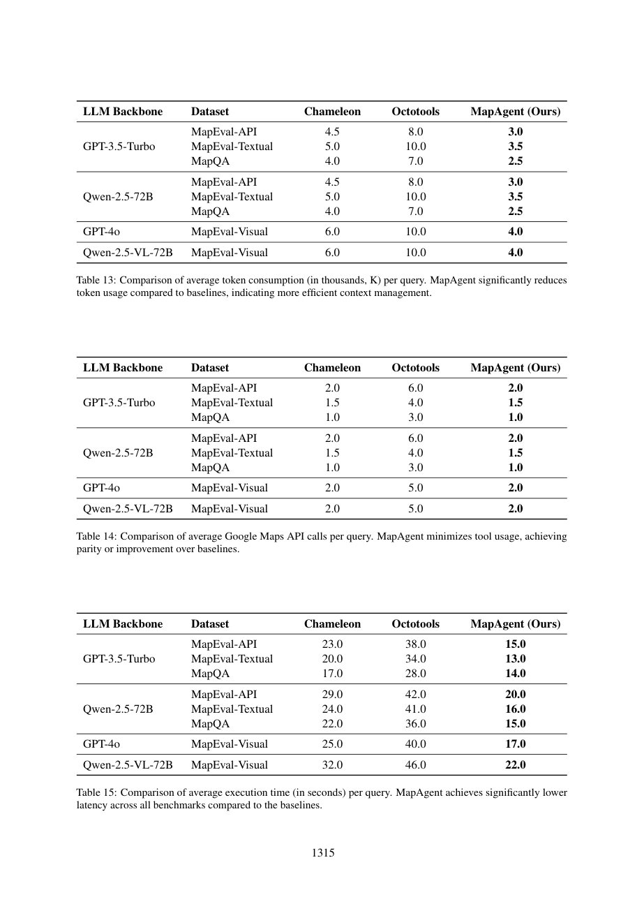


**原论文 Table 13 · PDF p.20**

Table 13: Comparison of average token consumption (in thousands, K) per query. MapAgent significantly reduces token usage compared to baselines, indicating more efficient context management.


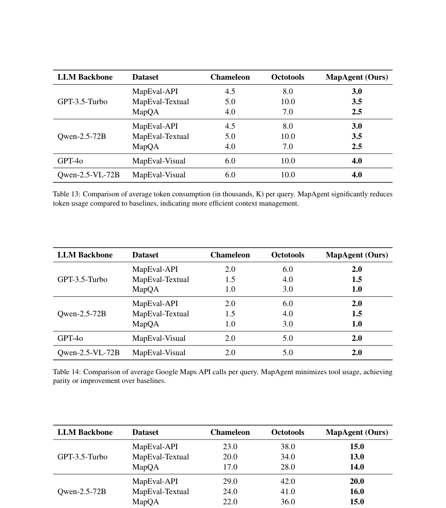


**原论文 Table 14 · PDF p.20**

Table 14: Comparison of average Google Maps API calls per query. MapAgent minimizes tool usage, achieving parity or improvement over baselines.


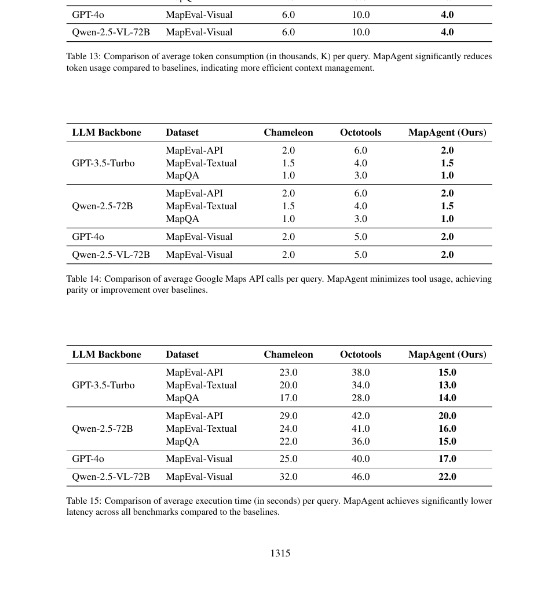


**原论文 Table 15 · PDF p.20**

Table 15: Comparison of average execution time (in seconds) per query. MapAgent achieves significantly lower latency across all benchmarks compared to the baselines.


### 本页英文全文

```text
 LLM Backbone     Dataset            Chameleon      Octotools     MapAgent (Ours)
                   MapEval-API              4.5              8.0                 3.0
 GPT-3.5-Turbo       MapEval-Textual           5.0             10.0                 3.5
               MapQA                   4.0              7.0                 2.5
                   MapEval-API              4.5              8.0                 3.0
 Qwen-2.5-72B       MapEval-Textual           5.0             10.0                 3.5
               MapQA                   4.0              7.0                 2.5
 GPT-4o             MapEval-Visual            6.0             10.0                 4.0
 Qwen-2.5-VL-72B   MapEval-Visual            6.0             10.0                 4.0

Table 13: Comparison of average token consumption (in thousands, K) per query. MapAgent significantly reduces
token usage compared to baselines, indicating more efficient context management.


 LLM Backbone     Dataset            Chameleon      Octotools     MapAgent (Ours)
                   MapEval-API              2.0              6.0                 2.0
 GPT-3.5-Turbo       MapEval-Textual           1.5              4.0                 1.5
               MapQA                   1.0              3.0                 1.0
                   MapEval-API              2.0              6.0                 2.0
 Qwen-2.5-72B       MapEval-Textual           1.5              4.0                 1.5
               MapQA                   1.0              3.0                 1.0
 GPT-4o             MapEval-Visual            2.0              5.0                 2.0
 Qwen-2.5-VL-72B   MapEval-Visual            2.0              5.0                 2.0

Table 14: Comparison of average Google Maps API calls per query. MapAgent minimizes tool usage, achieving
parity or improvement over baselines.


 LLM Backbone     Dataset            Chameleon      Octotools     MapAgent (Ours)
                   MapEval-API             23.0            38.0               15.0
 GPT-3.5-Turbo       MapEval-Textual          20.0            34.0               13.0
               MapQA                  17.0            28.0               14.0
                   MapEval-API             29.0            42.0               20.0
 Qwen-2.5-72B       MapEval-Textual          24.0            41.0               16.0
               MapQA                  22.0            36.0               15.0
 GPT-4o             MapEval-Visual          25.0            40.0               17.0
 Qwen-2.5-VL-72B   MapEval-Visual          32.0            46.0               22.0

Table 15: Comparison of average execution time (in seconds) per query. MapAgent achieves significantly lower
latency across all benchmarks compared to the baselines.


                                        1315
```


---

## 第 21 页（Page 21）

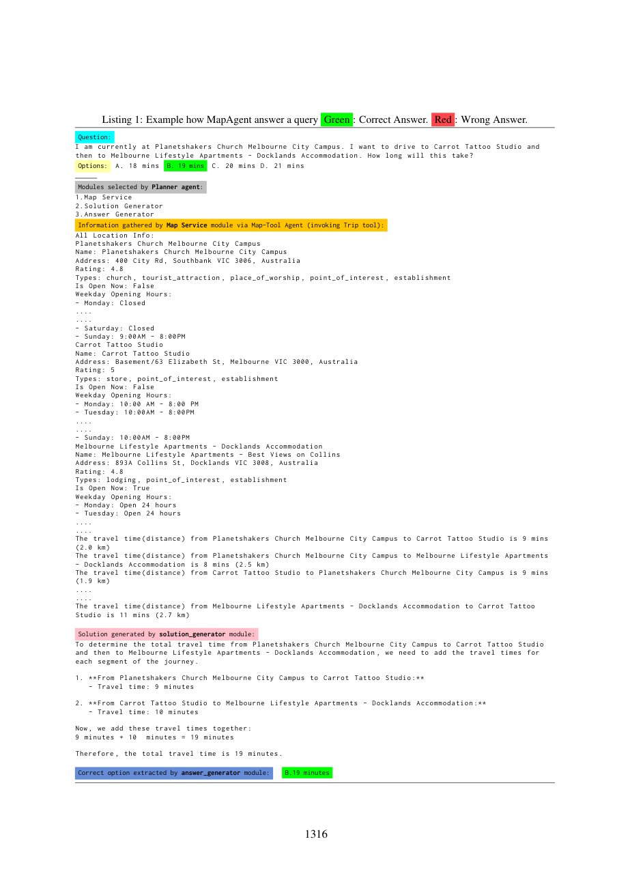


### 本页英文全文

```text
      Listing 1: Example how MapAgent answer a query Green : Correct Answer. Red : Wrong Answer.

 Question:
I am currently at Planetshakers Church Melbourne City Campus. I want to drive to Carrot Tattoo Studio and
then to Melbourne Lifestyle Apartments  - Docklands Accommodation. How long will this take?
 Options:  A. 18 mins  B. 19 mins  C. 20 mins D. 21 mins


 Modules selected by Planner agent:
1.Map Service
2. Solution Generator
3. Answer Generator
 Information gathered by Map Service module via Map-Tool Agent (invoking Trip tool):
All Location Info:
Planetshakers Church Melbourne City Campus
Name: Planetshakers Church Melbourne City Campus
Address: 400 City Rd, Southbank VIC 3006, Australia
Rating: 4.8
Types: church , tourist_attraction , place_of_worship , point_of_interest , establishment
Is Open Now: False
Weekday Opening Hours:
- Monday: Closed
....
....
- Saturday: Closed
- Sunday: 9:00AM - 8:00PM
Carrot Tattoo Studio
Name: Carrot Tattoo Studio
Address: Basement /63 Elizabeth St, Melbourne VIC 3000, Australia
Rating: 5
Types: store , point_of_interest , establishment
Is Open Now: False
Weekday Opening Hours:
- Monday: 10:00 AM - 8:00 PM
- Tuesday: 10:00AM - 8:00PM
....
....
- Sunday: 10:00AM - 8:00PM
Melbourne Lifestyle Apartments  - Docklands Accommodation
Name: Melbourne Lifestyle Apartments  - Best Views on Collins
Address: 893A Collins St, Docklands VIC 3008, Australia
Rating: 4.8
Types: lodging , point_of_interest , establishment
Is Open Now: True
Weekday Opening Hours:
- Monday: Open 24 hours
- Tuesday: Open 24 hours
....
....
The travel time(distance) from Planetshakers Church Melbourne City Campus to Carrot Tattoo Studio is 9 mins
(2.0 km)
The travel time(distance) from Planetshakers Church Melbourne City Campus to Melbourne Lifestyle Apartments
- Docklands Accommodation is 8 mins (2.5 km)
The travel time(distance) from Carrot Tattoo Studio to Planetshakers Church Melbourne City Campus is 9 mins
(1.9 km)
....
....
The travel time(distance) from Melbourne Lifestyle Apartments  - Docklands Accommodation to Carrot Tattoo
Studio is 11 mins (2.7 km)

 Solution generated by solution_generator module:
To determine the total travel time from Planetshakers Church Melbourne City Campus to Carrot Tattoo Studio
and then to Melbourne Lifestyle Apartments  - Docklands Accommodation , we need to add the travel times for
each segment of the journey.

1. **From Planetshakers Church Melbourne City Campus to Carrot Tattoo Studio :**
    - Travel time: 9 minutes

2. **From Carrot Tattoo Studio to Melbourne Lifestyle Apartments  - Docklands Accommodation :**
    - Travel time: 10 minutes

Now , we add these travel times together:
9 minutes + 10  minutes = 19 minutes

Therefore , the total travel time is 19 minutes.

 Correct option extracted by answer_generator module:    B.19 minutes


                                        1316
```


---

## 第 22 页（Page 22）

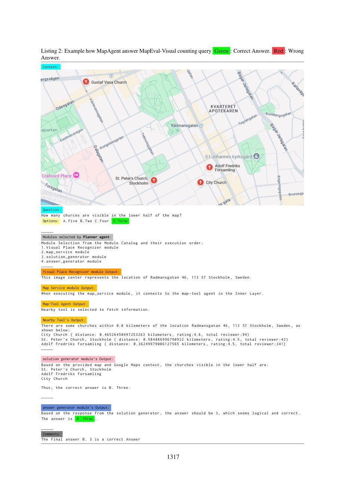


### 本页英文全文

```text
Listing 2: Example how MapAgent answer MapEval-Visual counting query Green : Correct Answer. Red : Wrong
Answer.

 Context:


 Question:
How many churces are visible in the lower half of the map?
 Options:  A.Five B.Two C.Four  D.Three


 Modules selected by Planner agent:
Module Selection from the Module Catalog and their execution order:
1. Visual Place Recognizer module
2. map_service module
3. solution_generator module
4. answer_generator module


 Visual Place Recognizer module Output:
This image center represents the location of Radmansgatan 46, 113 57 Stockholm , Sweden.


 Map Service module Output:
When executing the map_service module , it connects to the map -tool agent in the Inner Layer.


 Map-Tool Agent Output:
Nearby tool is selected to fetch information.


 Nearby Tool’s Output:
There are some churches within 0.8 kilometers of the location Radmansgatan 46, 113 57 Stockholm , Sweden , as
shown below:
City Church ( distance: 0.46526450497253263 kilometers , rating :4.6, total reviewer :94)
St. Peter ’s Church , Stockholm ( distance: 0.584886996790922 kilometers , rating :4.5, total reviewer :42)
Adolf Fredriks Forsamling ( distance: 0.36249979086127565 kilometers , rating :4.5, total reviewer :341)


 solution generator module’s Output:
Based on the provided map and Google Maps context , the churches visible in the lower half are:
St. Peter ’s Church , Stockholm
Adolf Fredriks Forsamling
City Church

Thus , the correct answer is B. Three.


 answer generator module’s Output:
Based on the response from the solution generator , the answer should be 3, which seems logical and correct.
The answer is  B. Three .


 Comments:
The Final answer B. 3 is a correct Answer


                                        1317
```


---

## 第 23 页（Page 23）

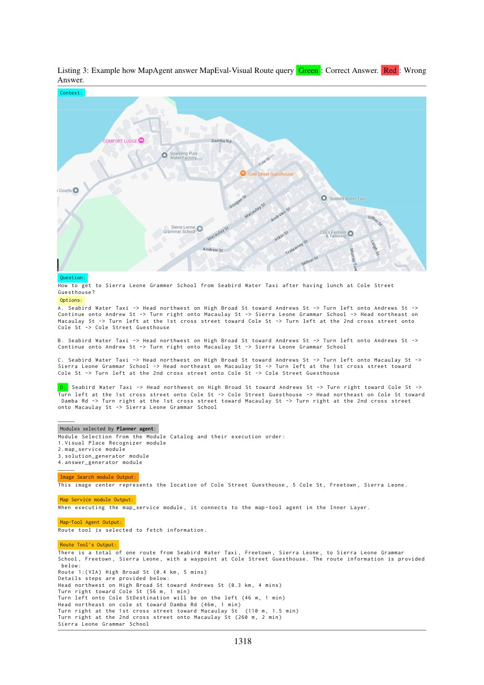


### 本页英文全文

```text
Listing 3: Example how MapAgent answer MapEval-Visual Route query Green : Correct Answer. Red : Wrong
Answer.

 Context:


 Question:
How to get to Sierra Leone Grammer School from Seabird Water Taxi after having lunch at Cole Street
Guesthouse?
 Options:
A. Seabird Water Taxi -> Head northwest on High Broad St toward Andrews St -> Turn left onto Andrews St ->
Continue onto Andrew St -> Turn right onto Macaulay St -> Sierra Leone Grammar School -> Head northeast on
Macaulay St -> Turn left at the 1st cross street toward Cole St -> Turn left at the 2nd cross street onto
Cole St -> Cole Street Guesthouse

B. Seabird Water Taxi -> Head northwest on High Broad St toward Andrews St -> Turn left onto Andrews St ->
Continue onto Andrew St -> Turn right onto Macaulay St -> Sierra Leone Grammar School

C. Seabird Water Taxi -> Head northwest on High Broad St toward Andrews St -> Turn left onto Macaulay St ->
Sierra Leone Grammar School -> Head northeast on Macaulay St -> Turn left at the 1st cross street toward
Cole St -> Turn left at the 2nd cross street onto Cole St -> Cole Street Guesthouse


 D.  Seabird Water Taxi -> Head northwest on High Broad St toward Andrews St -> Turn right toward Cole St ->
Turn left at the 1st cross street onto Cole St -> Cole Street Guesthouse -> Head northeast on Cole St toward
 Damba Rd -> Turn right at the 1st cross street toward Macaulay St -> Turn right at the 2nd cross street
onto Macaulay St -> Sierra Leone Grammar School


 Modules selected by Planner agent:
Module Selection from the Module Catalog and their execution order:
1. Visual Place Recognizer module
2. map_service module
3. solution_generator module
4. answer_generator module


 Image Search module Output:
This image center represents the location of Cole Street Guesthouse , 5 Cole St , Freetown , Sierra Leone.


 Map Service module Output:
When executing the map_service module , it connects to the map -tool agent in the Inner Layer.


 Map-Tool Agent Output:
Route tool is selected to fetch information.


 Route Tool’s Output:
There is a total of one route from Seabird Water Taxi , Freetown , Sierra Leone , to Sierra Leone Grammar
School , Freetown , Sierra Leone , with a waypoint at Cole Street Guesthouse. The route information is provided
 below:
Route 1:( VIA) High Broad St (0.4 km, 5 mins)
Details steps are provided below:
Head northwest on High Broad St toward Andrews St (0.3 km , 4 mins)
Turn right toward Cole St (56 m, 1 min)
Turn left onto Cole StDestination will be on the left (46 m, 1 min)
Head northeast on cole st toward Damba Rd (46m, 1 min)
Turn right at the 1st cross street toward Macaulay St  (110 m, 1.5 min)
Turn right at the 2nd cross street onto Macaulay St (260 m, 2 min)
Sierra Leone Grammar School

                                        1318
```


---

## 第 24 页（Page 24）

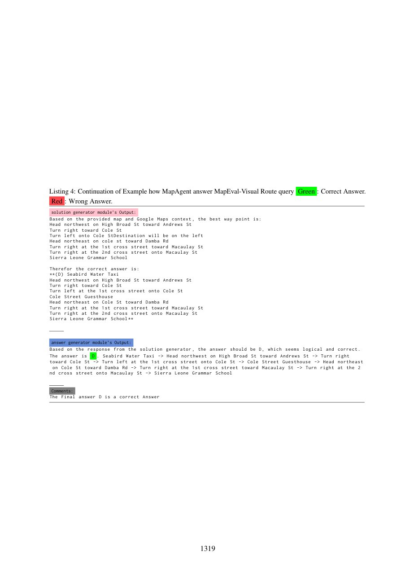


### 本页英文全文

```text
Listing 4: Continuation of Example how MapAgent answer MapEval-Visual Route query Green : Correct Answer.
 Red : Wrong Answer.

 solution generator module’s Output:
Based on the provided map and Google Maps context , the best way point is:
Head northwest on High Broad St toward Andrews St
Turn right toward Cole St
Turn left onto Cole StDestination will be on the left
Head northeast on cole st toward Damba Rd
Turn right at the 1st cross street toward Macaulay St
Turn right at the 2nd cross street onto Macaulay St
Sierra Leone Grammar School

Therefor the correct answer is:
**(D) Seabird Water Taxi
Head northwest on High Broad St toward Andrews St
Turn right toward Cole St
Turn left at the 1st cross street onto Cole St
Cole Street Guesthouse
Head northeast on Cole St toward Damba Rd
Turn right at the 1st cross street toward Macaulay St
Turn right at the 2nd cross street onto Macaulay St
Sierra Leone Grammar School **


 answer generator module’s Output:
Based on the response from the solution generator , the answer should be D, which seems logical and correct.
The answer is  D . Seabird Water Taxi -> Head northwest on High Broad St toward Andrews St -> Turn right
toward Cole St -> Turn left at the 1st cross street onto Cole St -> Cole Street Guesthouse -> Head northeast
 on Cole St toward Damba Rd -> Turn right at the 1st cross street toward Macaulay St -> Turn right at the 2
nd cross street onto Macaulay St -> Sierra Leone Grammar School


 Comments:
The Final answer D is a correct Answer


                                        1319
```


---

## 第 25 页（Page 25）

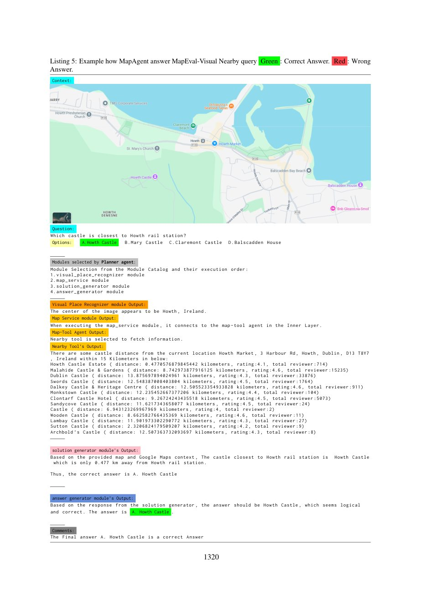


### 本页英文全文

```text
Listing 5: Example how MapAgent answer MapEval-Visual Nearby query Green : Correct Answer. Red : Wrong
Answer.

 Context:


 Question:
Which castle is closest to Howth rail station?
 Options:    A.Howth Castle   B.Mary Castle  C.Claremont Castle  D.Balscadden House


 Modules selected by Planner agent:
Module Selection from the Module Catalog and their execution order:
1. visual_place_recognizer module
2. map_service module
3. solution_generator module
4. answer_generator module


 Visual Place Recognizer module Output:
The center of the image appears to be Howth , Ireland.
 Map Service module Output:
When executing the map_service module , it connects to the map -tool agent in the Inner Layer.
 Map-Tool Agent Output:
Nearby tool is selected to fetch information.
 Nearby Tool’s Output:
There are some castle distance from the current location Howth Market , 3 Harbour Rd , Howth , Dublin , D13 T8Y7
, Ireland within 15 Kilometers in below:
Howth Castle Estate ( distance: 0.4770576879845442 kilometers , rating :4.1, total reviewer :714)
Malahide Castle & Gardens ( distance: 8.742973877916125 kilometers , rating :4.6, total reviewer :15235)
Dublin Castle ( distance: 13.875697894024961 kilometers , rating :4.3, total reviewer :33876)
Swords Castle ( distance: 12.548387008403804 kilometers , rating :4.5, total reviewer :1764)
Dalkey Castle & Heritage Centre ( distance: 12.505523354933828 kilometers , rating :4.6, total reviewer :911)
Monkstown Castle ( distance: 12.235452667377206 kilometers , rating :4.4, total reviewer :104)
Clontarf Castle Hotel ( distance: 9.26724243435518 kilometers , rating :4.5, total reviewer :5073)
Sandycove Castle ( distance: 11.6217343658077 kilometers , rating :4.5, total reviewer :24)
Castle ( distance: 6.943123269967969 kilometers , rating:4, total reviewer :2)
Wooden Castle ( distance: 8.662582766435369 kilometers , rating :4.6, total reviewer :11)
Lambay Castle ( distance: 11.901973302290772 kilometers , rating :4.3, total reviewer :27)
Sutton Castle ( distance: 2.3206824179509207 kilometers , rating :4.2, total reviewer :9)
Archbold ’s Castle ( distance: 12.507363732093697 kilometers , rating :4.3, total reviewer :8)


 solution generator module’s Output:
Based on the provided map and Google Maps context , The castle closest to Howth rail station is  Howth Castle
 which is only 0.477 km away from Howth rail station.

Thus , the correct answer is A. Howth Castle


 answer generator module’s Output:
Based on the response from the solution generator , the answer should be Howth Castle , which seems logical
and correct. The answer is  A. Howth Castle .


 Comments:
The Final answer A. Howth Castle is a correct Answer

                                        1320
```


---

## 第 26 页（Page 26）

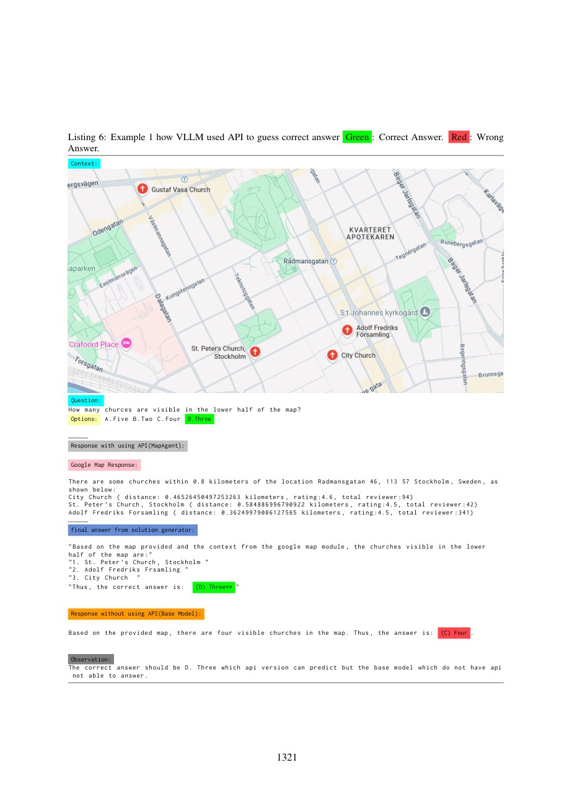


### 本页英文全文

```text
Listing 6: Example 1 how VLLM used API to guess correct answer Green : Correct Answer.  Red : Wrong
Answer.

 Context:


 Question:
How many churces are visible in the lower half of the map?
 Options:  A.Five B.Two C.Four  D.Three


 Response with using API(MapAgent):


 Google Map Response:


There are some churches within 0.8 kilometers of the location Radmansgatan 46, 113 57 Stockholm , Sweden , as
shown below:
City Church ( distance: 0.46526450497253263 kilometers , rating :4.6, total reviewer :94)
St. Peter ’s Church , Stockholm ( distance: 0.584886996790922 kilometers , rating :4.5, total reviewer :42)
Adolf Fredriks Forsamling ( distance: 0.36249979086127565 kilometers , rating :4.5, total reviewer :341)


 final answer from solution generator:


"Based on the map provided and the context from the google map module , the churches visible in the lower
half of the map are:"
"1. St. Peter ’s Church , Stockholm "
"2. Adolf Fredriks Frsamling "
"3. City Church   "
"Thus , the correct answer is:   (D) Three** "


 Response without using API(Base Model):


Based on the provided map , there are four visible churches in the map. Thus , the answer is:  (C) Four .


 Observation:
The correct answer should be D. Three which api version can predict but the base model which do not have api
 not able to answer.


                                        1321
```


---

## 第 27 页（Page 27）

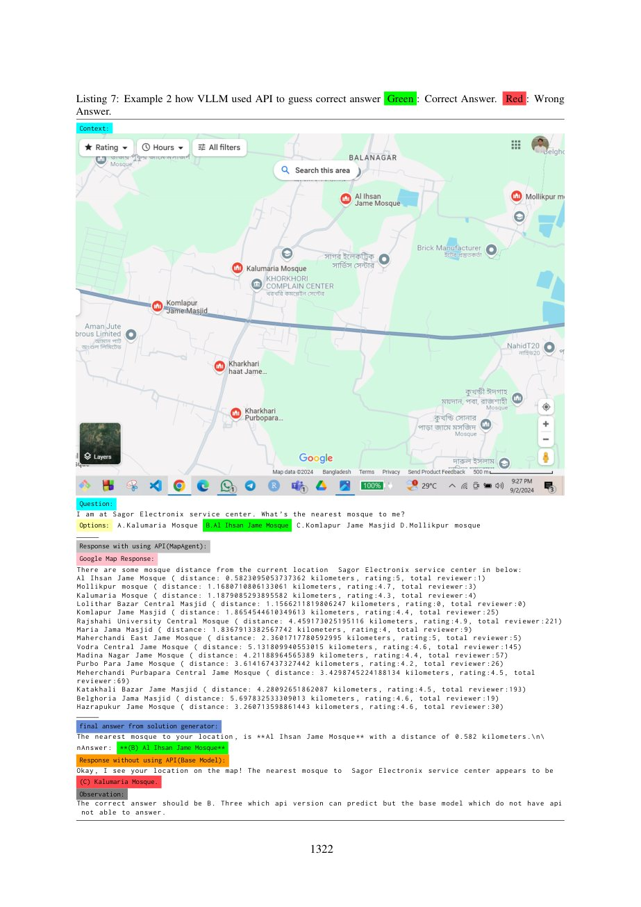


### 本页英文全文

```text
Listing 7: Example 2 how VLLM used API to guess correct answer Green : Correct Answer.  Red : Wrong
Answer.

 Context:


 Question:
I am at Sagor Electronix service center. What ’s the nearest mosque to me?
 Options:  A.Kalumaria Mosque  B.Al Ihsan Jame Mosque  C.Komlapur Jame Masjid D.Mollikpur mosque


 Response with using API(MapAgent):

 Google Map Response:
There are some mosque distance from the current location  Sagor Electronix service center in below:
Al Ihsan Jame Mosque ( distance: 0.5823095053737362 kilometers , rating:5, total reviewer :1)
Mollikpur mosque ( distance: 1.1680710806133061 kilometers , rating :4.7, total reviewer :3)
Kalumaria Mosque ( distance: 1.1879085293895582 kilometers , rating :4.3, total reviewer :4)
Lolithar Bazar Central Masjid ( distance: 1.1566211819806247 kilometers , rating:0, total reviewer :0)
Komlapur Jame Masjid ( distance: 1.8654544610349613 kilometers , rating :4.4, total reviewer :25)
Rajshahi University Central Mosque ( distance: 4.459173025195116 kilometers , rating :4.9, total reviewer :221)
Maria Jama Masjid ( distance: 1.8367913382567742 kilometers , rating:4, total reviewer :9)
Maherchandi East Jame Mosque ( distance: 2.3601717780592995 kilometers , rating:5, total reviewer :5)
Vodra Central Jame Mosque ( distance: 5.131809940553015 kilometers , rating :4.6, total reviewer :145)
Madina Nagar Jame Mosque ( distance: 4.21188964565389 kilometers , rating :4.4, total reviewer :57)
Purbo Para Jame Mosque ( distance: 3.614167437327442 kilometers , rating :4.2, total reviewer :26)
Meherchandi Purbapara Central Jame Mosque ( distance: 3.4298745224188134 kilometers , rating :4.5, total
reviewer :69)
Katakhali Bazar Jame Masjid ( distance: 4.28092651862087 kilometers , rating :4.5, total reviewer :193)
Belghoria Jama Masjid ( distance: 5.697832533309013 kilometers , rating :4.6, total reviewer :19)
Hazrapukur Jame Mosque ( distance: 3.260713598861443 kilometers , rating :4.6, total reviewer :30)


 final answer from solution generator:
The nearest mosque to your location , is **Al Ihsan Jame Mosque ** with a distance of 0.582 kilometers .\n\
nAnswer:  **(B) Al Ihsan Jame Mosque**

 Response without using API(Base Model):
Okay , I see your location on the map! The nearest mosque to  Sagor Electronix service center appears to be
 (C) Kalumaria Mosque.

 Observation:
The correct answer should be B. Three which api version can predict but the base model which do not have api
 not able to answer.


                                        1322
```
