# 测量真正重要的内容：大语言模型基准测试中的构念效度

**英文题名**：*Measuring What Matters: Construct Validity in Large Language Model Benchmarks*  
**作者**：Andrew M. Bean、Ryan Othniel Kearns、Angelika Romanou 等  
**来源**：NeurIPS 2025 Datasets and Benchmarks Track  
**原稿**：82 页，包括正文、参考文献与大量补充材料。

> **翻译覆盖范围**：摘要、构念效度概念、研究设计、主要结果、八项建议与结论已按原文译述，并对检查清单逐项给出中文表述。**附录中很长的分类代码本、逐篇文献分类表、参考文献尚未逐句翻译**；原文已完整提取至 `英文原文_逐页完整提取.md`，原稿图与长表保存在 `images/` 和 `source_pages/`。下面的中文正文不能替代严格的全 82 页逐句译本。

## 摘要（中文翻译）

对大语言模型（LLM）进行评价，对于判断模型能力，以及在部署前发现安全性或鲁棒性问题都至关重要。可靠测量“安全性”“鲁棒性”等抽象而复杂的现象，要求评价具有较高的**构念效度（Construct Validity）**，也就是评价指标确实代表了所要关注的现象。作者组织一支由 **29 位专家审查者**组成的团队，对自然语言处理和机器学习主要学术会议的 **445 项大语言模型基准**开展系统综述。研究发现，所考察论文在被测现象、任务与评分指标方面存在一些常见模式，削弱了相应评价结论的效度。为应对这些不足，作者向研究者和实践者提出 **八项关键建议**，并提供具体、可执行的基准设计指导。

## 1 引言

基准测试深刻影响着大语言模型的研发方向：它规定哪些改进被认为是有价值的，也帮助人们在多个模型之间做出比较。然而，建立一个基准的过程本质上是将难以直接观察的抽象现象转化为能够操作与测量的任务、数据和指标。例如，“智能”不能直接被一个数字测量，只能借助各种代理任务（proxy tasks）间接反映。评价基准是否有价值，取决于这些代理能否充分代表现实中真正想衡量的能力。

这种从目标现象到测量分数的对应关系就是构念效度。一个模型在某项测验中得到高分，并不必然意味着它具备测验名称所指的广义能力。如果任务实际要求的是记忆知识、遵循格式或利用捷径，高分就可能无法支持关于“推理能力”的宽泛结论。

作者指出，现有基准虽然在复现性、成本和统计分析方面得到部分改善，但围绕构念效度的系统化设计建议仍不充分。评估任务与目标现象之间的连接一旦薄弱，就可能引发不可靠的科学结论、错误的研究投入与缺乏证据支持的政策判断。

### 图 1：系统综述流程

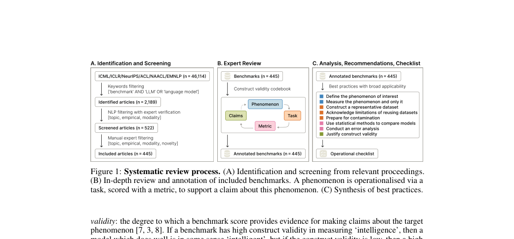

**中文图注**：A 为文献识别与筛选；B 为专家依据构念效度代码本开展的详细标注；C 为分析、建议和可操作清单的形成。整体路径为：从 46,114 篇会议论文中筛选出 445 个基准，记录其目标现象、任务、评分指标及作者提出的能力主张，再综合形成最佳实践。

## 2 理论背景：构念效度是什么

构念效度衡量一个实证测验是否真正测量它声称测量的现象。其理论来源可追溯至心理测量学，最初用于人格等无法直接验证的抽象概念。作者回顾了若干相互关联的效度概念：

- **表面效度（Face Validity）**：测验从直观上看是否似乎能够代表目标现象。
- **内容效度（Content Validity）**：任务内容是否覆盖目标现象的重要方面，是否存在明显遗漏。
- **生态效度（Ecological Validity）**：测验是否与实际应用情境相吻合。
- **预测效度（Predictive Validity）**：测验结果能否预测模型在未来或现实任务中的表现。
- **聚合效度（Convergent Validity）**：基准结果是否与测量相同或相近能力的其他评价一致。
- **区分效度（Discriminant Validity）**：基准是否能与测量不同能力的评价区分开，避免把无关能力混为一谈。
- **效标效度（Criterion Validity）**：基准结果与具有外部意义的效标之间是否存在恰当关系。

对“推理”“自主性”“安全性”等复杂能力而言，这些维度尤其重要。只报告模型在一组题目上的平均准确率，往往不足以说明该模型究竟具备何种能力。

## 3 研究方法

### 3.1 论文筛选

研究从 2018–2024 年的 ICML、ICLR、NeurIPS 与 2020–2024 年的 ACL、NAACL、EMNLP 会议论文中收集 **46,114 篇**文献。作者筛选标题或摘要包含“benchmark”且包含“LLM”或“language model”的文章，得到 **2,189 篇**候选文献。

筛选标准包括：论文是否研究 LLM 能力而非仅仅讨论推理速度等技术性能；是否实际构建、修改和报告了一个实证基准；是否属于支持文本或视觉模型的评价；是否属于新的基准或对已有基准有实质修改。作者先用 GPT-4o mini 依据前三项进行辅助筛选，对 50 篇人工标注文献的验证得出 **F1=84%**，候选文献减至 **522 篇**。之后由 29 位领域匹配的审查者人工复核，最终纳入 **445 篇**。

### 3.2 代码本与专家标注

作者围绕四个层面制定代码本（Codebook）：

1. **Phenomenon（目标现象／构念）**：基准声称测量的抽象能力是什么？是否具有清晰、被普遍接受的定义？
2. **Task（任务）**：论文如何把该现象操作化为问题与环境？任务数据从何而来、如何采样？
3. **Metric（评分指标）**：如何把模型输出映射为分数？统计分析及不确定性如何处理？
4. **Claim（研究主张）**：作者如何解释分数？评价证据是否足以支持关于目标现象的结论？

每篇由主审查者标注，第二位审查者把答案映射到标准化选项，再由主审查者核验。对 46 篇论文进行双重独立审查，30 个类别型问题的平均 **Brennan–Prediger Kappa 为 0.524**。随后通过开放编码与多人迭代讨论，将发现提炼为建议。

## 4 主要研究结果

### 4.1 被测现象定义不清与复合能力混淆

在 445 项基准中，**78.2%** 对目标现象给出了某种定义。但在提供定义的论文里，只有 **52.2%** 使用广泛被接受的概念，另有 **47.8%** 采用存在争议的定义。基准常常把一组互不相同的子能力合并为一个总分，导致不同能力之间的边界变模糊。作者指出，**61.2%** 的研究把目标现象定义为包含多种子能力的复合概念。

### 4.2 任务设计与抽样缺乏代表性

研究中的任务来源相当复杂：**43.3%** 的基准包含人工编写的新题目，**42.6%** 复用现有基准的数据，**31.2%** 使用 LLM 生成题目。**40.7%** 的基准至少包含部分人工构造任务，**28.5%** 则完全使用人工构造任务。仅有不足 **10%** 的基准使用完整、现实世界中的任务。

作者进一步区分目标抽样、标准抽样、随机抽样及便利抽样。便利抽样的危险在于，研究者使用容易获取的数据，并默认这些数据能够代表整个任务空间。审查结果显示，**12.3%** 的基准完全采用便利抽样，另外 **27.0%** 部分采用便利抽样。相比单纯增加样本量，针对目标任务空间的代表性抽样通常更有助于提高构念效度。

### 4.3 评分指标的选择与统计比较不足

最普遍的评分方式是 **Exact Match（严格匹配）**：**81.3%** 的研究至少部分使用它，其中 **40.7%** 完全依赖这种方式。其他方法包括软匹配分数、LLM-as-a-Judge（大模型裁判）和人类评分。不同方法各有局限：严格匹配易实现但可能忽略语义等价，开放式评分更贴近真实任务却可能引入主观偏差。

只约 **16.0%** 的基准使用统计检验或不确定性估计来比较模型。在解释某些模型之间十分微小的分数差异时，缺少置信区间或重复试验会削弱结论的稳健性。

### 4.4 对结果主张的效度论证仍不充分

仅 **53.4%** 的文章对其基准为何能代表目标现象提出某种构念效度证据；**35.2%** 与其他相似能力基准作比较，**32.4%** 与人类表现比较，**31.2%** 与更贴近真实情境的测试比较。作者发现，几乎每篇论文都至少在现象定义、任务、指标或结论推断之一存在不足。

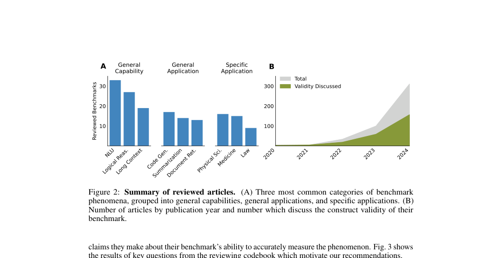

**图 2 中文说明**：纳入基准的主题分布与出版年份变化。

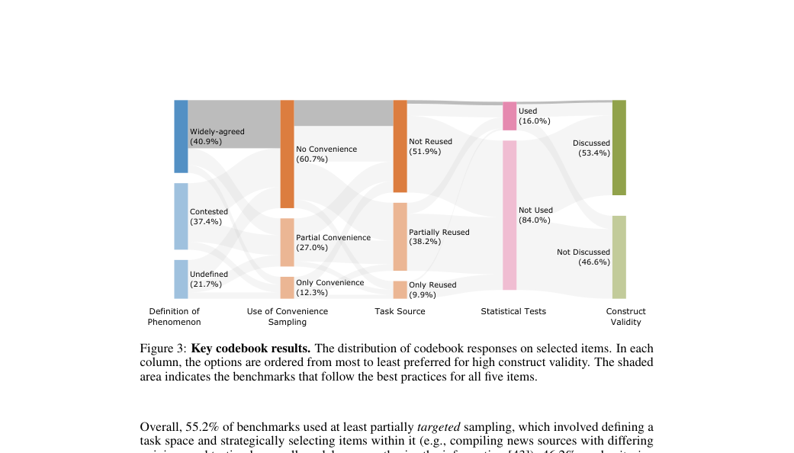

**图 3 中文说明**：五项关键审查问题的分布，包括现象定义、便利抽样、任务来源、统计检验以及是否讨论构念效度。图中还以不同颜色突出符合良好实践的部分。

## 5 提升构念效度的八项建议（与原论文检查清单逐项对应）

以下内容依据原文第 5.1–5.8 节给出中文对照，保留原始建议的适用范围，不把它们解释为必须同时满足的绝对条件。

### 5.1 明确定义目标现象（Define the Phenomenon）

- 给出被测现象清晰、可操作的定义。
- 明确基准覆盖该现象的哪些方面，并承认未覆盖的方面。
- 若构念包含不同子能力，应识别这些组成部分，并尽可能分别测量。

在多种定义并存的情况下，应明确所使用的定义。必要时可通过排除式定义划定边界，例如说明“复述记忆答案不等于推理”。对多维构念分别评分，有助于避免总分掩盖模型的具体强弱项。

### 5.2 测量目标现象，而且只测量该现象（Measure the Phenomenon and Only the Phenomenon）

- 控制与目标构念无关、却可能改变成绩的附属任务。
- 分析输出格式约束是否影响模型性能。
- 验证任何自动输出解析技术的准确性、一致性和潜在偏差。

任务往往同时要求指令遵循、知识记忆、阅读理解、计算、代码格式等能力。若这些能力并非评价目标，研究者应通过独立子任务、额外基线或重试机制控制其混杂影响。例如，在常识推理测验中，知识不足与推理失败并不是同一回事；在严格 JSON 输出的测验中，格式错误也不总等于目标能力不足。

### 5.3 构建能代表任务空间的数据集（Construct a Representative Dataset）

- 采用能够保证任务样本代表性的抽样策略。
- 验证题目质量及其与目标任务的关联，尤其重视大规模自动生成数据。
- 有意识加入检验模型已知敏感性的题目，例如输入顺序、表述或格式变化。

有限的数据集只是潜在任务全集的一个样本。只使用某些考试中特意挑选得便于心算的小数字，无法可靠预测模型面对更大数字时的推理表现。随机抽样、分层抽样和针对性抽样可改善覆盖面；仔细设计的小数据集可能比规模更大但抽样失衡的数据集更有效。

### 5.4 承认复用现有数据集的限制（Acknowledge Limitations of Reusing Datasets）

- 说明是否从既有数据集或基准改编。
- 分析被复用数据的优点与缺陷。
- 在适用时比较新旧基准上的模型表现。
- 解释修改内容及其为何能够改善构念效度。

复用数据虽然节约成本，却可能继承旧基准的偏差、限制任务和指标的重新设计，并增大训练数据污染风险。因此，不能仅因为新数据集来自成熟基准，就默认它具有足够效度。

### 5.5 预防数据污染（Prepare for Contamination）

- 构建并执行检测数据污染的测试。
- 保留未公开的留出题目，以支持持续评价。
- 检查源材料及相似资料是否可能提前出现在常用 LLM 训练语料中。

训练集和测试集的直接重叠并不是唯一风险。即使开发者没有刻意泄露题目，围绕固定公开基准的长期反复优化也可能使研究整体逐渐针对该基准过拟合。作者讨论了动态基准、程序化生成和保留测试集等解决思路。

### 5.6 使用统计方法比较模型（Use Statistical Methods to Compare Models）

- 报告样本量并说明统计功效。
- 对主要结果报告不确定性估计，以支持稳健比较。
- 若依赖人类评分，报告评分者人口背景，并尽力降低招募与指导过程中的偏差。
- 选用能够反映主观标签本身变异程度的指标，而不是盲目依赖单一聚合值或严格匹配。

当模型结果差距较小时，均值并不能替代显著性检验、置信区间或多次运行。涉及社会、文化或规范判断的任务，更应考虑不同评分者之间真实存在的偏好差异。

### 5.7 开展错误分析（Conduct an Error Analysis）

- 对常见失败模式开展定性与定量分析。
- 检查失败是否与目标构念之外的混杂因素有关。
- 若发现混杂，应讨论相关的评分偏差。

错误分析可以验证基准是否真正测到了声称测量的能力：如果失败原因主要是与目标相关的能力不足，那么评价具有较好的解释意义；如果失败主要源于无关格式限制、解析器错误或数据噪声，就有必要修改测量方法。

### 5.8 论证构念效度（Justify Construct Validity）

- 说明基准对现实应用和目标现象的相关性。
- 把构念定义与任务、评价指标的选择联系起来，给出明确设计依据。
- 与测量相近现象的已有评价比较异同。
- 讨论与构念效度有关的设计权衡和局限性。

作者要求研究者建立一条清晰的**论证链**：目标现象的定义 → 任务操作化 → 题目选择 → 评分实现 → 结论解释。多项选择题便于评分但可能有捷径，开放回答更贴近真实应用但评分较困难；这些选择和所牺牲的效度维度都应清楚说明。

## 6 案例：将八项建议用于 GSM8K

作者用 GSM8K 演示清单的应用。GSM8K 清楚表述了小学数学文字题这一任务，但其对“非形式化推理”能力的主张同时涉及阅读理解、数学计算与逻辑推断。研究者可以进一步划分不同子能力，并控制计算器工具、答案格式与分词方式等因素。由于 GSM8K 是为该项目新构建的数据集，复用旧数据的问题较小，但仍应加入污染检测、未公开的题目和问题改写测试。

作者认为，GSM8K 总体上可以有效测量小学数学问题上的表现；但从这个较窄的成绩推断到广义“逻辑推理能力”时，仍应提供更充分的理论和实证论证。缺少针对错误类型的系统性分析，也降低了基准作为研究诊断工具的潜在价值。

## 7 讨论与结论

通过系统审查 445 项基准，作者发现抽象目标没有得到充分操作化、任务抽样不够代表性、统计分析不足，以及效度论证不充分等常见问题。八项建议覆盖目标定义、任务、样本、指标、污染、统计分析、错误诊断和研究结论，构成贯穿整个基准生命周期的设计清单。

作者强调：不要求每项基准在任何情境下都满足所有建议；现实研究可能存在成本与效度之间的权衡。更合理的做法是在附录公开完整检查清单，为未执行的项目说明原因，使读者能够判断基准与具体使用目的是否匹配。

本研究也存在局限：样本来自主流学术会议，可能漏掉工业界未经同行评审发布的基准或某些专业领域基准；初筛使用 GPT-4o mini，虽然通过小样本人类校验，但仍可能引入系统性漏筛；审查规模大，导致部分条目无法由多人进行完全独立编码。

## 补充材料（原稿第 23–82 页）

补充材料包含构念效度检查清单、现象／任务／指标分类代码本、筛选流程、LLM 初筛提示词、人工一致性检验、长篇分类表及参考资料。这里保留各页的原始文本和页面截图，并依据原始图表标题建立索引。**其中的整段代码本表格和多数长篇文献条目仍是英文，尚未完成逐句汉化。**

## 重要术语对照

| English | 中文术语 |
|---|---|
| Construct Validity | 构念效度 |
| Phenomenon / Construct | 目标现象／构念 |
| Operationalisation | 操作化 |
| Proxy Task | 代理任务 |
| Face / Content Validity | 表面效度／内容效度 |
| Ecological / Predictive Validity | 生态效度／预测效度 |
| Convergent / Discriminant Validity | 聚合效度／区分效度 |
| Convenience Sampling | 便利抽样 |
| Targeted / Criterion / Random Sampling | 目标抽样／标准抽样／随机抽样 |
| Confounding Factor | 混杂因素 |
| Data Contamination | 数据污染 |
| Exact Match | 严格匹配 |
| LLM-as-a-Judge | 大模型裁判 |
| Statistical Power | 统计功效 |
| Error Analysis | 错误分析 |
| Codebook | 标注代码本 |
| Claim / Evidence | 研究主张／支持证据 |

## 参考文献及英文原文

原始参考文献和附录文献引用完整保留在 `英文原文_逐页完整提取.md`。独立图、长表与原稿截图见下文的自动图表索引；对于一个表跨越多页的情形，以 `source_pages/` 全页图为最终核对依据。

---

## 原论文图表逐项索引（原始截图）

> 本节按照原稿页码与图表编号排列，供逐图检查与复现。表格截图使用完整原稿页，以避免跨栏或表格较长时遗漏关键列；原稿全部页面还保存于 `source_pages/`。

### 图1（PDF 第 2 页）

**原文标题摘录**：Figure 1: Systematic review process. (A) Identification and screening from relevant proceedings.

[查看该页的完整原稿](./source_pages/page-002.jpg)

### 图2（PDF 第 4 页）

**原文标题摘录**：Figure 2: Summary of reviewed articles. (A) Three most common categories of benchmark

[查看该页的完整原稿](./source_pages/page-004.jpg)

### 图3（PDF 第 5 页）

**原文标题摘录**：Figure 3: Key codebook results. The distribution of codebook responses on selected items. In each

[查看该页的完整原稿](./source_pages/page-005.jpg)

### 表1（PDF 第 29 页）

**原文标题摘录**：Table 1: Descriptive Taxonomy of LLM Benchmark Target General Capabilities.

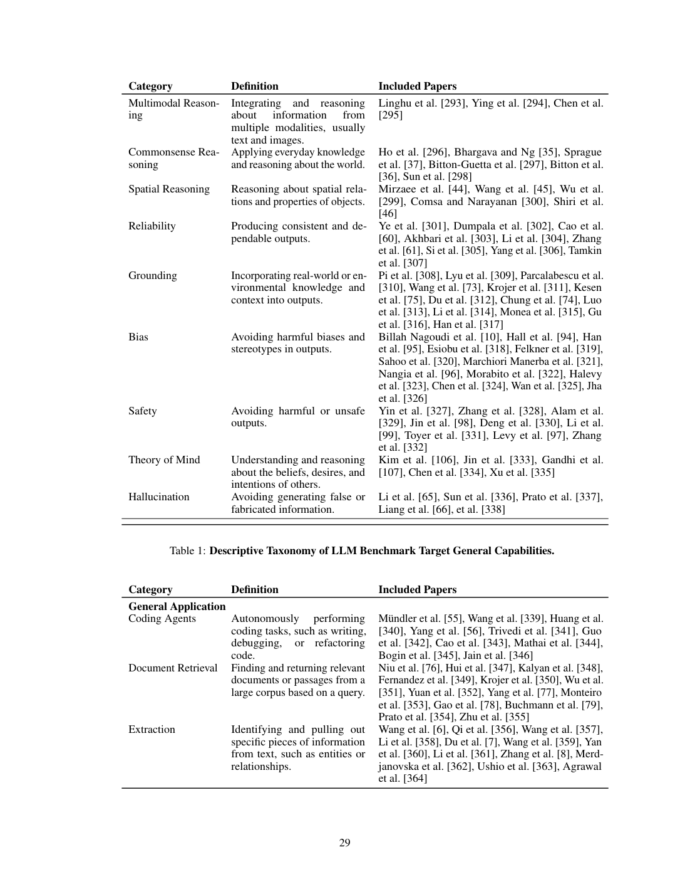

[查看该页的完整原稿](./source_pages/page-029.jpg)

### 表2（PDF 第 30 页）

**原文标题摘录**：Table 2: Descriptive Taxonomy of LLM Benchmark Target General Applications.

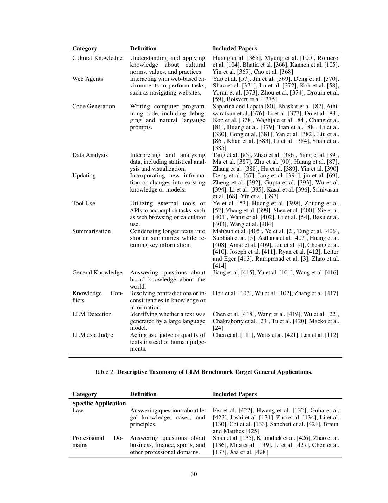

[查看该页的完整原稿](./source_pages/page-030.jpg)

### 表3（PDF 第 31 页）

**原文标题摘录**：Table 3: Descriptive Taxonomy of LLM Benchmark Target Specific Applications.

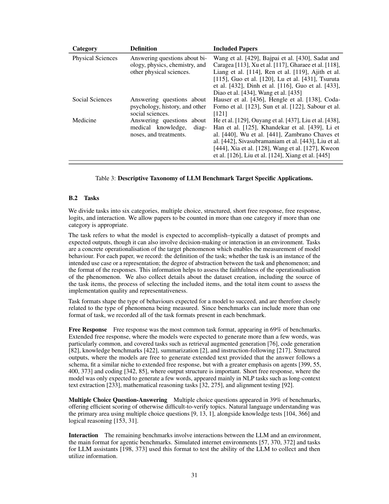

[查看该页的完整原稿](./source_pages/page-031.jpg)

### 表4（PDF 第 35 页）

**原文标题摘录**：Table 4: Descriptive Taxonomy of LLM Benchmark Task Definitions.

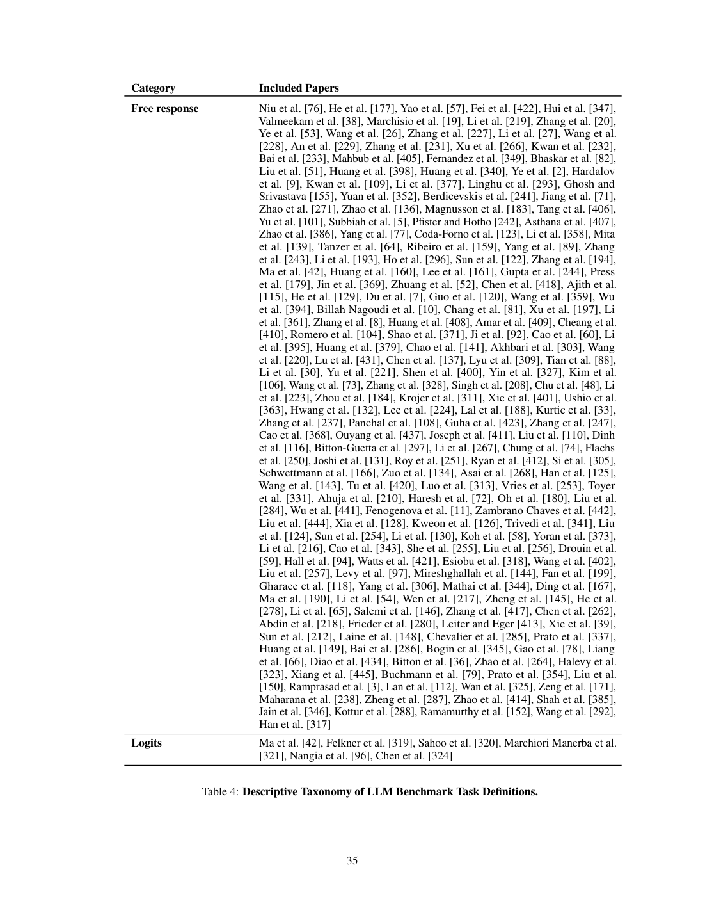

[查看该页的完整原稿](./source_pages/page-035.jpg)

### 表5（PDF 第 40 页）

**原文标题摘录**：Table 5: Descriptive Taxonomy of LLM Benchmark Metric Definitions.

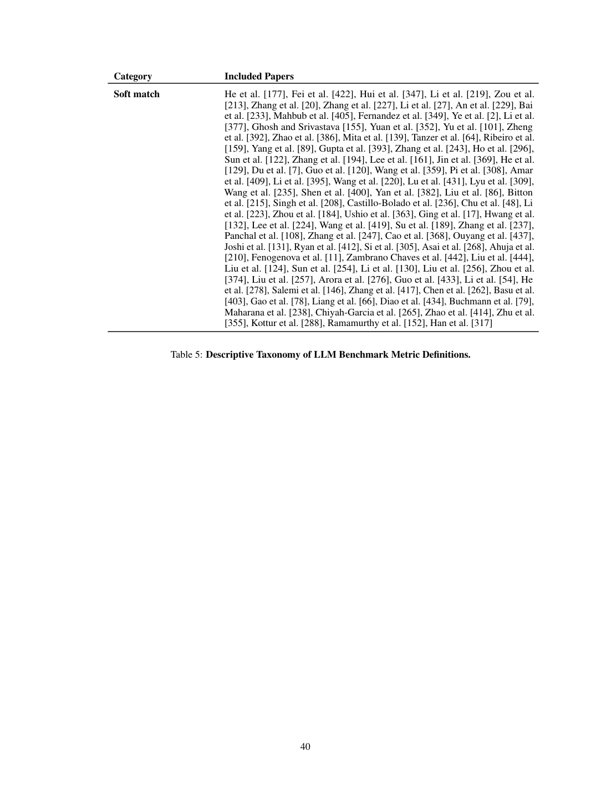

[查看该页的完整原稿](./source_pages/page-040.jpg)

### 图4（PDF 第 48 页）

**原文标题摘录**：Figure 4: Flowchart of the systematic review process. Searching across EMNLP, NAACL, ACL,

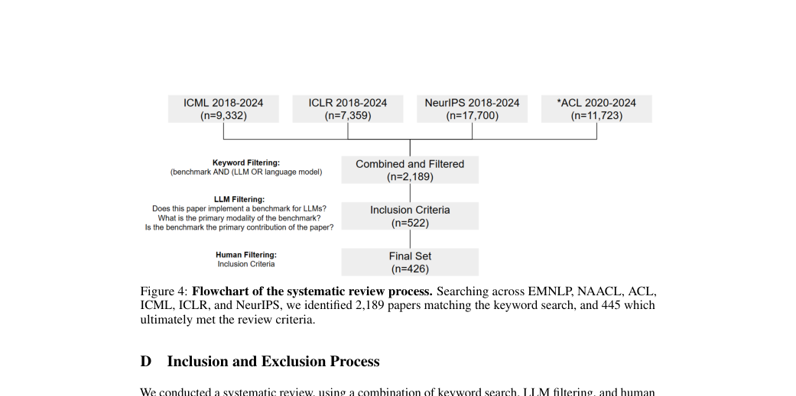

[查看该页的完整原稿](./source_pages/page-048.jpg)

### 表12（PDF 第 49 页）

**原文标题摘录**：Table 12: LLM Filtering Steps. The prompts used for progressive filtering of the articles to be

[查看该页的完整原稿](./source_pages/page-049.jpg)

### 表13（PDF 第 49 页）

**原文标题摘录**：Table 13: LLM Filtering Human Validation. A comparison between human and LLM filtering on a

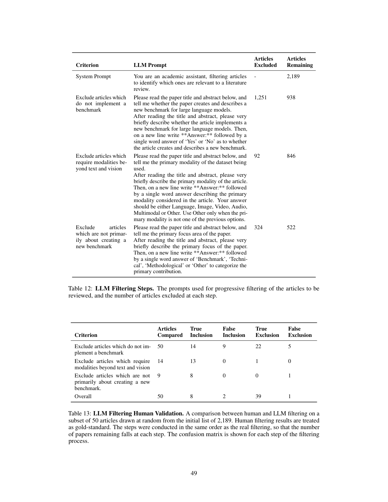

[查看该页的完整原稿](./source_pages/page-049.jpg)

## 原论文逐页视觉核查入口

下面提供全部 PDF 页面的图像链接。部分公式、代码、图内字体或双栏段落可能不适宜由纯文本抽取核对，以这些原稿页图为最终依据。

第 001 页：[查看原始页图](./source_pages/page-001.jpg)  
第 002 页：[查看原始页图](./source_pages/page-002.jpg)  
第 003 页：[查看原始页图](./source_pages/page-003.jpg)  
第 004 页：[查看原始页图](./source_pages/page-004.jpg)  
第 005 页：[查看原始页图](./source_pages/page-005.jpg)  
第 006 页：[查看原始页图](./source_pages/page-006.jpg)  
第 007 页：[查看原始页图](./source_pages/page-007.jpg)  
第 008 页：[查看原始页图](./source_pages/page-008.jpg)  
第 009 页：[查看原始页图](./source_pages/page-009.jpg)  
第 010 页：[查看原始页图](./source_pages/page-010.jpg)  
第 011 页：[查看原始页图](./source_pages/page-011.jpg)  
第 012 页：[查看原始页图](./source_pages/page-012.jpg)  
第 013 页：[查看原始页图](./source_pages/page-013.jpg)  
第 014 页：[查看原始页图](./source_pages/page-014.jpg)  
第 015 页：[查看原始页图](./source_pages/page-015.jpg)  
第 016 页：[查看原始页图](./source_pages/page-016.jpg)  
第 017 页：[查看原始页图](./source_pages/page-017.jpg)  
第 018 页：[查看原始页图](./source_pages/page-018.jpg)  
第 019 页：[查看原始页图](./source_pages/page-019.jpg)  
第 020 页：[查看原始页图](./source_pages/page-020.jpg)  
第 021 页：[查看原始页图](./source_pages/page-021.jpg)  
第 022 页：[查看原始页图](./source_pages/page-022.jpg)  
第 023 页：[查看原始页图](./source_pages/page-023.jpg)  
第 024 页：[查看原始页图](./source_pages/page-024.jpg)  
第 025 页：[查看原始页图](./source_pages/page-025.jpg)  
第 026 页：[查看原始页图](./source_pages/page-026.jpg)  
第 027 页：[查看原始页图](./source_pages/page-027.jpg)  
第 028 页：[查看原始页图](./source_pages/page-028.jpg)  
第 029 页：[查看原始页图](./source_pages/page-029.jpg)  
第 030 页：[查看原始页图](./source_pages/page-030.jpg)  
第 031 页：[查看原始页图](./source_pages/page-031.jpg)  
第 032 页：[查看原始页图](./source_pages/page-032.jpg)  
第 033 页：[查看原始页图](./source_pages/page-033.jpg)  
第 034 页：[查看原始页图](./source_pages/page-034.jpg)  
第 035 页：[查看原始页图](./source_pages/page-035.jpg)  
第 036 页：[查看原始页图](./source_pages/page-036.jpg)  
第 037 页：[查看原始页图](./source_pages/page-037.jpg)  
第 038 页：[查看原始页图](./source_pages/page-038.jpg)  
第 039 页：[查看原始页图](./source_pages/page-039.jpg)  
第 040 页：[查看原始页图](./source_pages/page-040.jpg)  
第 041 页：[查看原始页图](./source_pages/page-041.jpg)  
第 042 页：[查看原始页图](./source_pages/page-042.jpg)  
第 043 页：[查看原始页图](./source_pages/page-043.jpg)  
第 044 页：[查看原始页图](./source_pages/page-044.jpg)  
第 045 页：[查看原始页图](./source_pages/page-045.jpg)  
第 046 页：[查看原始页图](./source_pages/page-046.jpg)  
第 047 页：[查看原始页图](./source_pages/page-047.jpg)  
第 048 页：[查看原始页图](./source_pages/page-048.jpg)  
第 049 页：[查看原始页图](./source_pages/page-049.jpg)  
第 050 页：[查看原始页图](./source_pages/page-050.jpg)  
第 051 页：[查看原始页图](./source_pages/page-051.jpg)  
第 052 页：[查看原始页图](./source_pages/page-052.jpg)  
第 053 页：[查看原始页图](./source_pages/page-053.jpg)  
第 054 页：[查看原始页图](./source_pages/page-054.jpg)  
第 055 页：[查看原始页图](./source_pages/page-055.jpg)  
第 056 页：[查看原始页图](./source_pages/page-056.jpg)  
第 057 页：[查看原始页图](./source_pages/page-057.jpg)  
第 058 页：[查看原始页图](./source_pages/page-058.jpg)  
第 059 页：[查看原始页图](./source_pages/page-059.jpg)  
第 060 页：[查看原始页图](./source_pages/page-060.jpg)  
第 061 页：[查看原始页图](./source_pages/page-061.jpg)  
第 062 页：[查看原始页图](./source_pages/page-062.jpg)  
第 063 页：[查看原始页图](./source_pages/page-063.jpg)  
第 064 页：[查看原始页图](./source_pages/page-064.jpg)  
第 065 页：[查看原始页图](./source_pages/page-065.jpg)  
第 066 页：[查看原始页图](./source_pages/page-066.jpg)  
第 067 页：[查看原始页图](./source_pages/page-067.jpg)  
第 068 页：[查看原始页图](./source_pages/page-068.jpg)  
第 069 页：[查看原始页图](./source_pages/page-069.jpg)  
第 070 页：[查看原始页图](./source_pages/page-070.jpg)  
第 071 页：[查看原始页图](./source_pages/page-071.jpg)  
第 072 页：[查看原始页图](./source_pages/page-072.jpg)  
第 073 页：[查看原始页图](./source_pages/page-073.jpg)  
第 074 页：[查看原始页图](./source_pages/page-074.jpg)  
第 075 页：[查看原始页图](./source_pages/page-075.jpg)  
第 076 页：[查看原始页图](./source_pages/page-076.jpg)  
第 077 页：[查看原始页图](./source_pages/page-077.jpg)  
第 078 页：[查看原始页图](./source_pages/page-078.jpg)  
第 079 页：[查看原始页图](./source_pages/page-079.jpg)  
第 080 页：[查看原始页图](./source_pages/page-080.jpg)  
第 081 页：[查看原始页图](./source_pages/page-081.jpg)  
第 082 页：[查看原始页图](./source_pages/page-082.jpg)  

### 补核图表 table 14（原稿第 51 页）

Table 14: Inter-rater agreement across all fields.

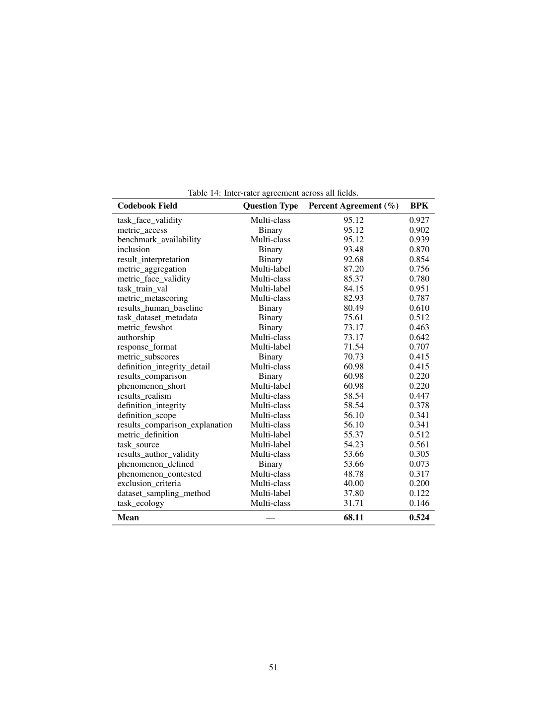
