# 论文全部图表题名：中英对照

> 以原论文图号、表号和所在页作为唯一定位。部分英文原题较长，保留原文标题首行；中文为其意义概括，非图内全部文字翻译。

### 图1｜原稿第 2 页

**中文题名：** 系统综述流程：文献筛选、专家审查、建议与清单形成

**英文题名首行：** Figure 1: Systematic review process. (A) Identification and screening from relevant proceedings.

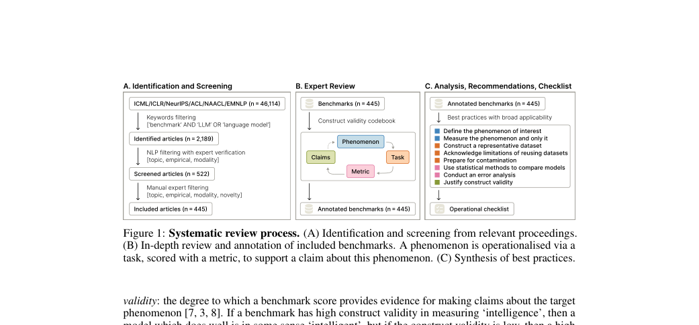

### 图2｜原稿第 4 页

**中文题名：** 纳入研究的类别分布和发表年份分布

**英文题名首行：** Figure 2: Summary of reviewed articles. (A) Three most common categories of benchmark

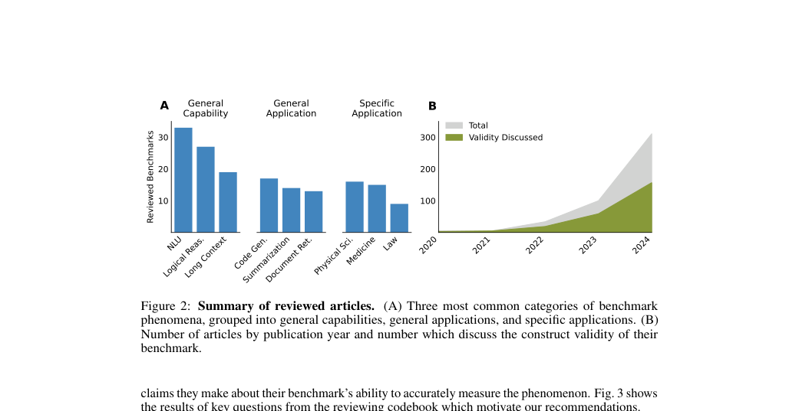

### 图3｜原稿第 5 页

**中文题名：** 构念效度代码本中关键问题的审查结果

**英文题名首行：** Figure 3: Key codebook results. The distribution of codebook responses on selected items. In each

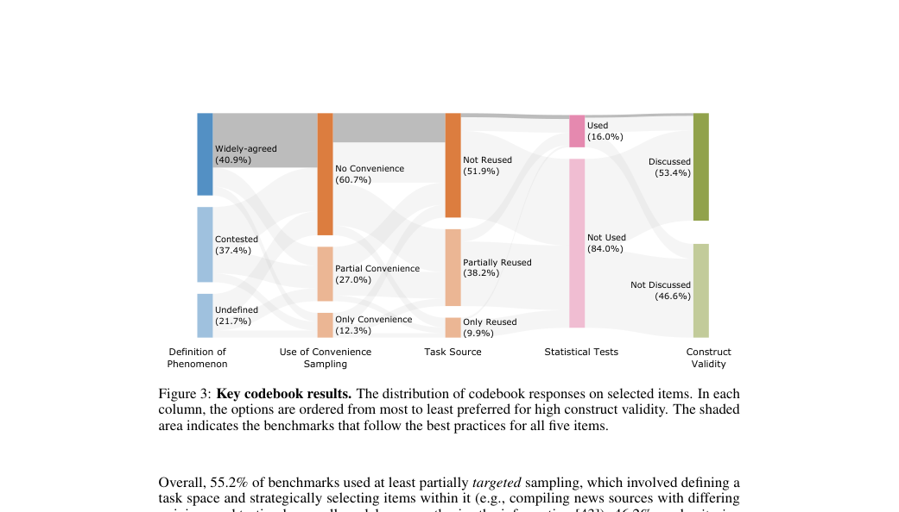

### 表1｜原稿第 29 页

**中文题名：** LLM 基准目标之通用能力的描述性分类体系

**英文题名首行：** Table 1: Descriptive Taxonomy of LLM Benchmark Target General Capabilities.

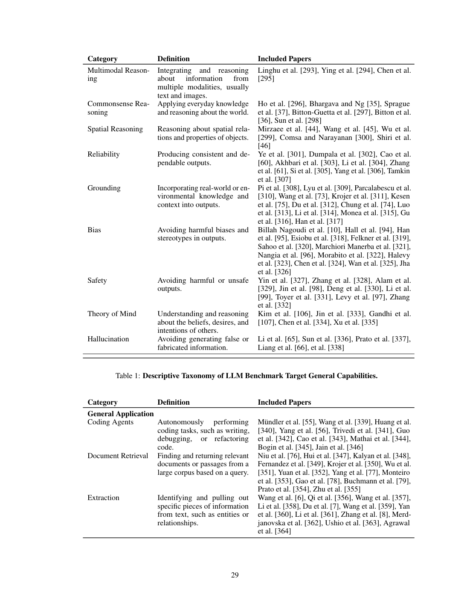

### 表2｜原稿第 30 页

**中文题名：** LLM 基准目标之通用应用的描述性分类体系

**英文题名首行：** Table 2: Descriptive Taxonomy of LLM Benchmark Target General Applications.

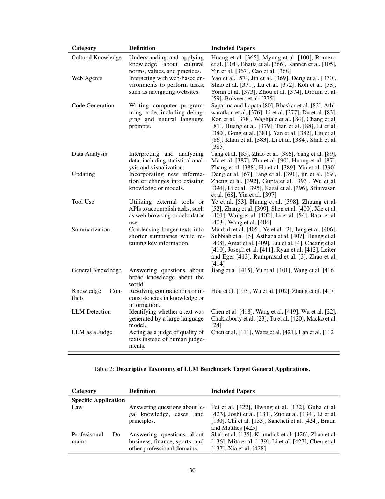

### 表3｜原稿第 31 页

**中文题名：** LLM 基准目标之特定应用的描述性分类体系

**英文题名首行：** Table 3: Descriptive Taxonomy of LLM Benchmark Target Specific Applications.

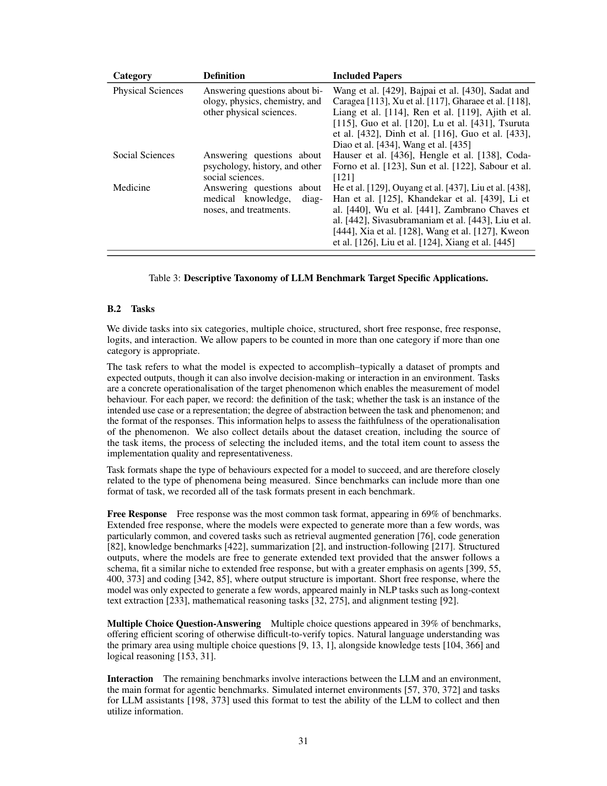

### 表4｜原稿第 35 页

**中文题名：** LLM 基准测试任务定义的描述性分类体系

**英文题名首行：** Table 4: Descriptive Taxonomy of LLM Benchmark Task Definitions.

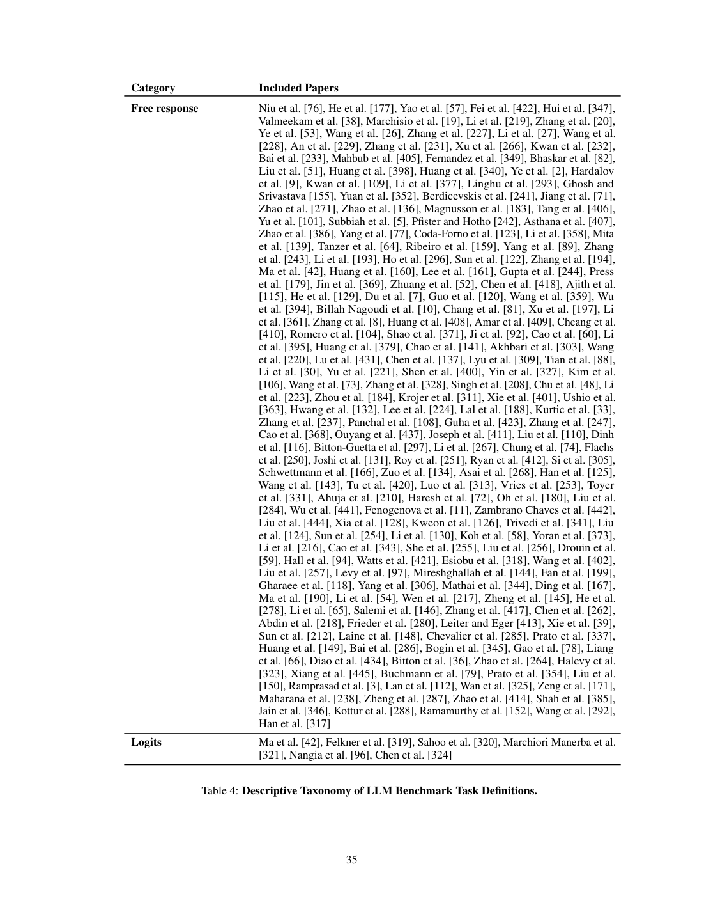

### 表5｜原稿第 40 页

**中文题名：** LLM 基准评分指标定义的描述性分类体系

**英文题名首行：** Table 5: Descriptive Taxonomy of LLM Benchmark Metric Definitions.

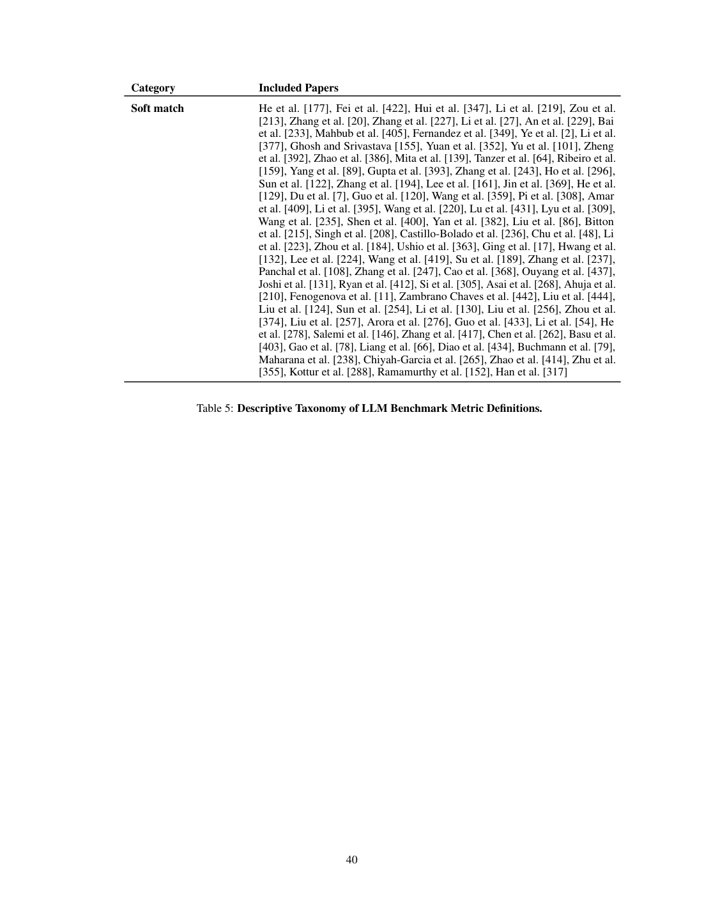

### 图4｜原稿第 48 页

**中文题名：** 系统综述的详细文献搜索与筛选流程图

**英文题名首行：** Figure 4: Flowchart of the systematic review process. Searching across EMNLP, NAACL, ACL,

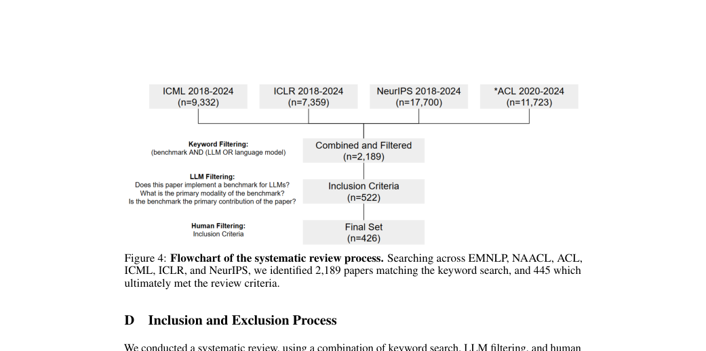

### 表12｜原稿第 49 页

**中文题名：** LLM 辅助文献筛选步骤与提示词

**英文题名首行：** Table 12: LLM Filtering Steps. The prompts used for progressive filtering of the articles to be

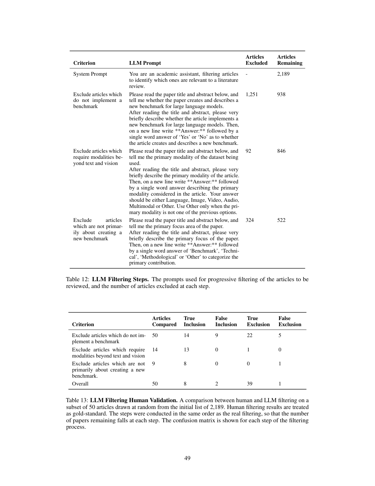

### 表13｜原稿第 49 页

**中文题名：** LLM 筛选结果与人工核验的对照

**英文题名首行：** Table 13: LLM Filtering Human Validation. A comparison between human and LLM filtering on a

### 表14｜原稿第 51 页

**中文题名：** 所有标注字段的评审者间一致性

**英文题名首行：** Table 14: Inter-rater agreement across all fields.

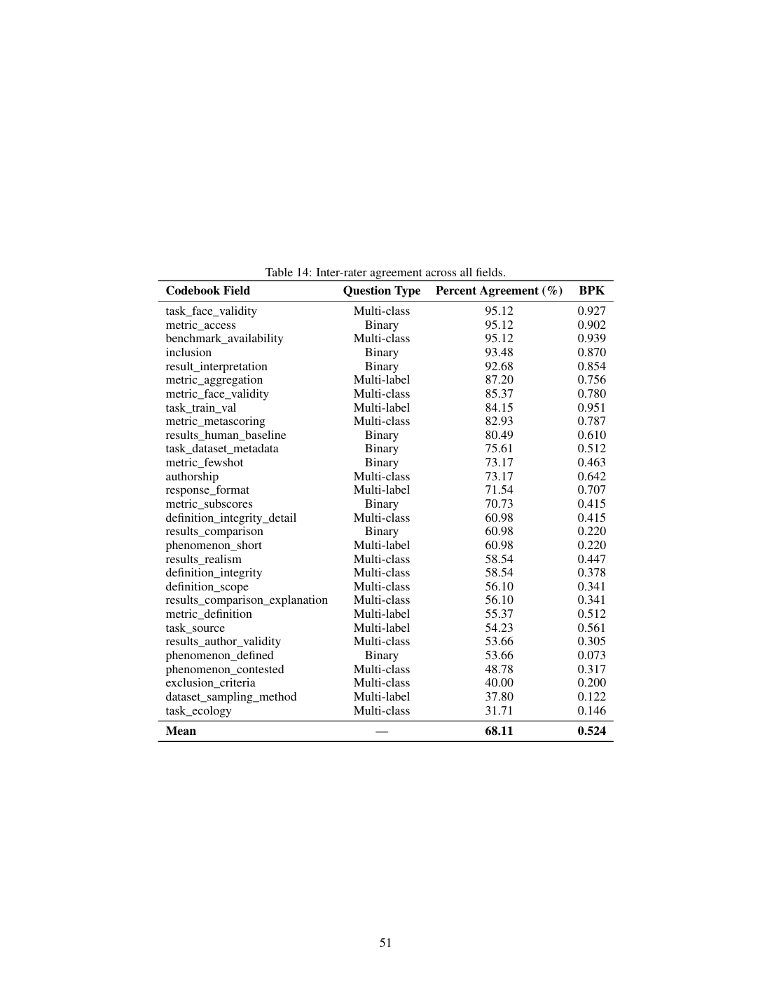
