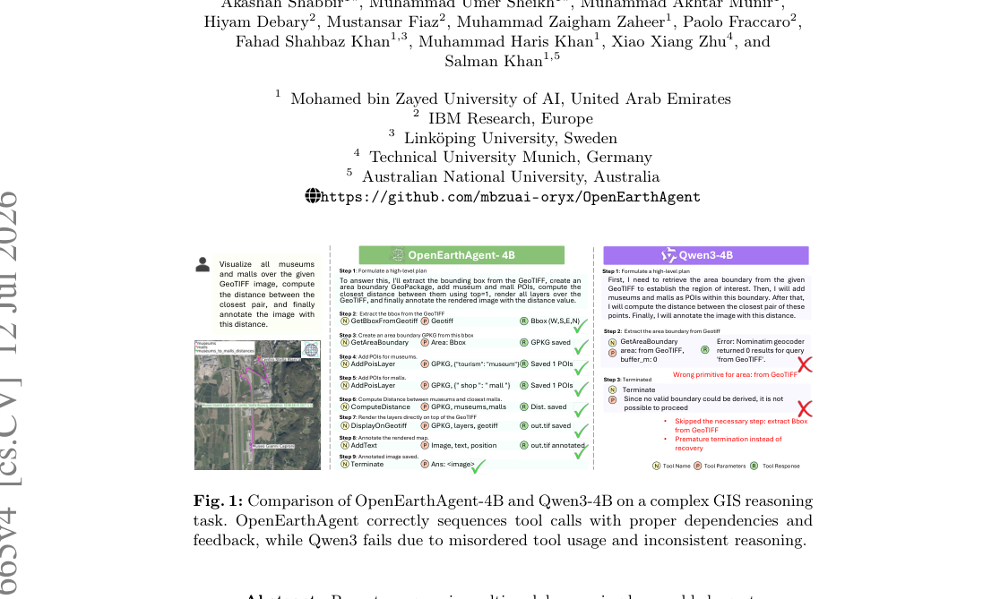
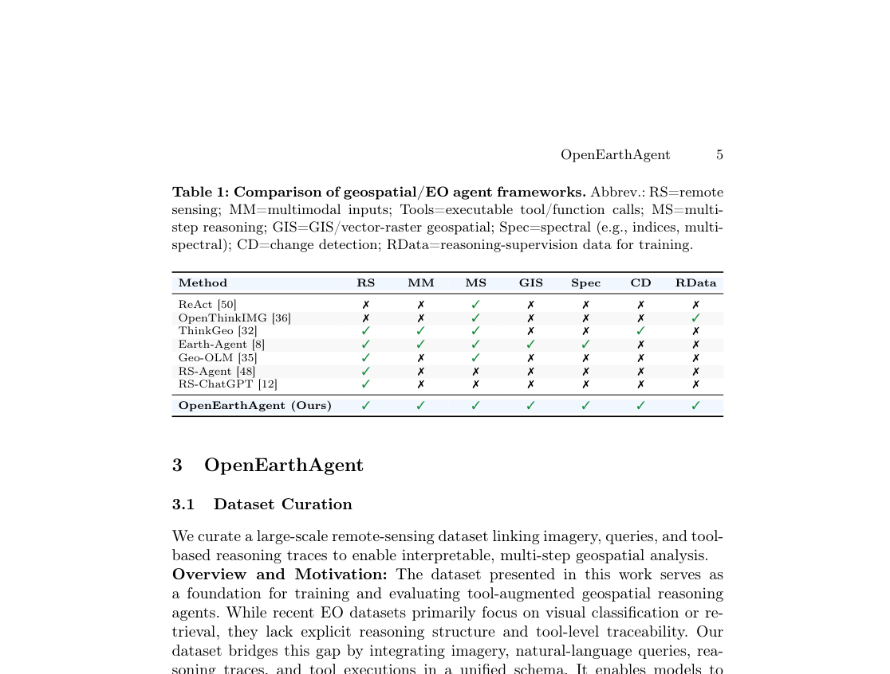
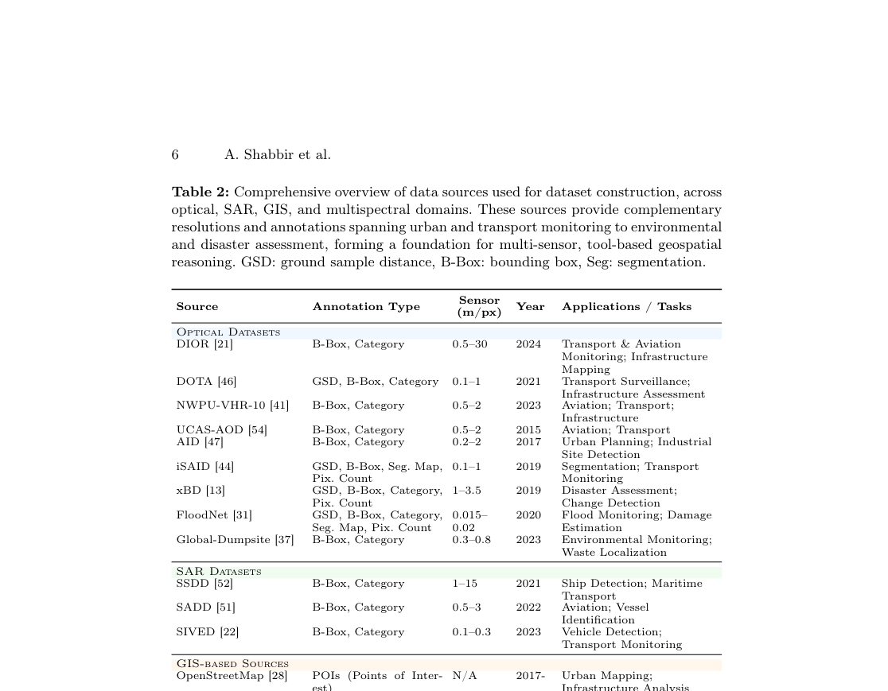
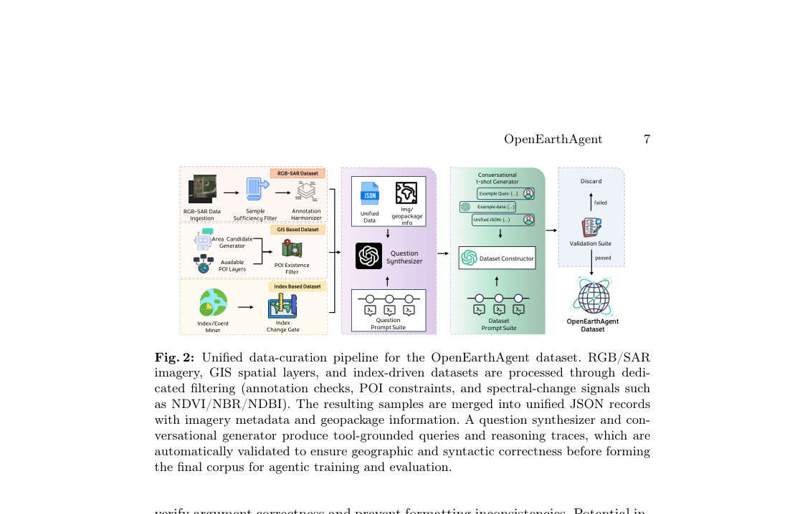
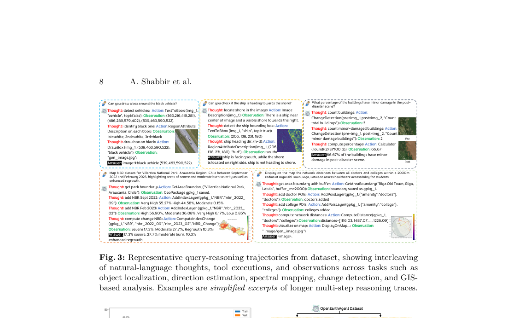
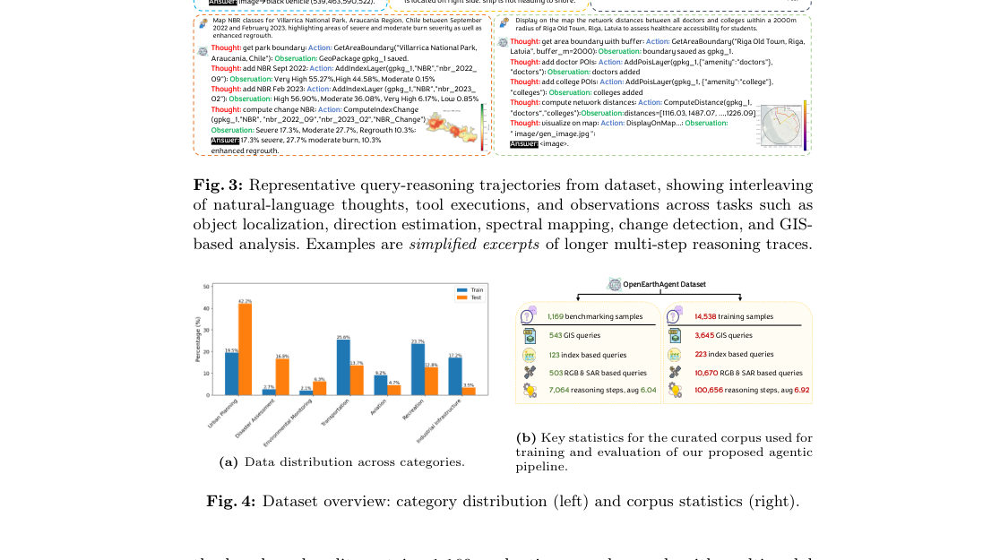
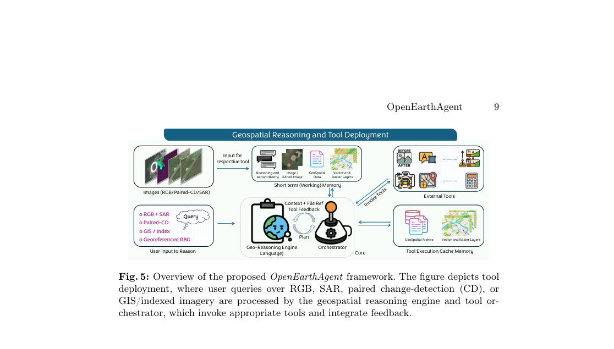
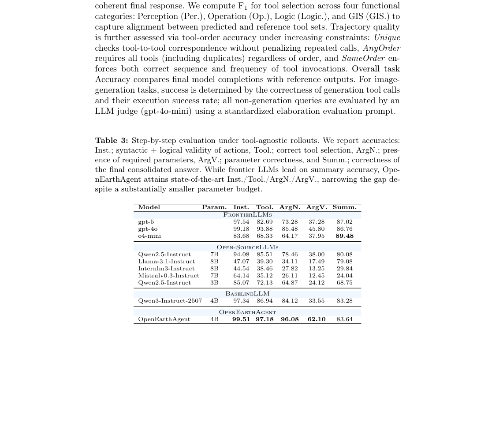

# OpenEarthAgent：工具增强地理空间智能体的统一框架

**原文题目：** OpenEarthAgent: A Unified Framework for Tool-Augmented Geospatial Agents

**原始 PDF：** [原始论文](./原始论文.pdf)（共 39 页）

> **翻译覆盖声明（请先阅读）**：本文件提供**摘要完整中文翻译**及主要研究章节的**中文学术译述**，不等同于逐字逐句的全文译本。为避免遗漏资料，原 PDF 全部页面的英文文字与附录、参考文献均已收录在 `英文原文_逐页.md` 和 `英文全文_保留版面.txt`，图、表另见 `图表索引.md`。不可把本文档当作全部正文及附录均已翻译的材料。

---

## 摘要（完整中文翻译）

多模态推理的发展，使智能体能够理解影像、关联语言信息并执行结构化分析任务；但将这些能力拓展至遥感仍然困难，因为模型必须处理空间尺度、地理结构和多光谱指数，同时维持一致的多步骤逻辑。为解决这一问题，本文提出 OpenEarthAgent：一个面向工具增强地理空间推理的统一框架，通过卫星影像、自然语言查询和结构化推理轨迹进行训练。OpenEarthAgent 不仅提供评测基准，还构建了集统一可执行工具注册表与轨迹策略学习于一体的智能体架构。框架将不同来源的视觉、光谱、GIS 和带地理参考的栅格操作规范化为一致的可调用接口，使其能够模块化编排和确定性执行。训练采用结构化推理轨迹监督微调，并使用确定性重放验证检查可执行性和空间正确性。配套数据集包含 14,538 个训练样本和 1,169 个评测样本，累计超过 10.7 万个推理步骤，覆盖城市、环境、灾害和基础设施等应用场景，并融合 GIS 操作以及 NDVI、NBR、NDBI 等指数分析。基于显式推理轨迹的模型表现出结构化的决策过程、更稳定的空间理解能力和可解释的工具使用行为，在强基线之上持续取得改进，并与近期部分开源、闭源模型表现接近。

## 主要研究章节（中文学术译述）

### 研究动机

传统视觉基础模型和遥感视觉语言模型擅长静态识别与图文理解，但缺乏将复杂任务分解为一系列可执行地理空间操作的能力。真实业务任务可能需要读取 GeoTIFF 的空间范围、创建矢量边界、添加 POI、测距、叠加可视化并标注结果。若工具选错、参数类型不匹配或执行顺序颠倒，智能体即使写出了合理的文字计划，也可能在运行中失败。

### 数据构建与监督信号

研究提供统一组织的影像—问题—推理轨迹样本。训练集 14,538 条，评测集 1,169 条，总计超过 107,000 个推理步骤。轨迹连接自然语言问题、具体工具调用、中间状态及最终输出，涉及城市基础设施、环境、灾害、土地利用和交通等场景。作者不仅提供答案，也将可执行的过程作为学习和评测对象。

### 统一工具注册表

框架通过统一的可调用工具接口，整合感知、GIS 空间运算、光谱指数计算和地理参考栅格处理。统一接口有助于减少工具参数格式不一致造成的调用失败，也便于在多种任务中复用子步骤。典型运算包括区域边界提取、几何测距、面积和分区统计，以及 NDVI、NBR、NDBI 指数计算。

### 训练与确定性重放

作者使用监督微调学习显式的多步骤推理轨迹，随后通过确定性重放（deterministic replay）验证这些轨迹能否在相应工具环境中执行，并检查空间与逻辑一致性。该设计将“语言形式的合理解释”与“运行环境中的有效行为”区分开来，强调训练信号应与工具的真实行为相联系。

### 研究结果与适用范围

实验对比了基础模型与不同大语言模型/多模态模型的表现，分别考察逐步骤工具使用和端到端任务表现。论文报告 OpenEarthAgent 在结构化工具调用、空间理解和可解释性方面改善。对于论文定量结论应直接使用原文相应表格，不应仅凭表述推断跨所有任务均有优势。

### 对 Benchmark 审计的启示

OpenEarthAgent 的价值在于将轨迹训练、运行时反馈、确定性重放和评估联系起来。可以考查的可靠性问题包括：GT 轨迹是否覆盖多条有效替代路径；中间状态的等价性如何判断；严格调用顺序是否错判功能等价解；任务最终正确性是否能弥补轨迹级误差，以及不同 GIS 数据类型是否存在系统性评分偏差。

## 专业术语中英对照

| English | 中文术语 |
|---|---|
| tool-augmented | 工具增强 |
| unified tool registry | 统一工具注册表 |
| deterministic replay validation | 确定性重放验证 |
| reasoning trajectory | 推理轨迹 |
| georeferenced raster | 地理参考栅格 |
| zonal statistics | 分区统计 |
| tool-agnostic rollout | 工具无关的展开执行 |

## 图表与逐页原文导航

独立裁图共 **27** 张；完整原版页面截图共 **39** 张。

- [全部图表索引](./图表索引.md)
- [逐页原文与对应图表](./逐页原文与配图.md)
- [英文原文逐页](./英文原文_逐页.md)
- [参考文献英文原文](./参考文献_英文原文.md)
- [QA 逐页核查报告](./QA_逐页核查报告.md)

### 代表性原始图表

**图1（第 1 页）**

> Fig. 1: Comparison of OpenEarthAgent-4B and Qwen3-4B on a complex GIS reasoning task. OpenEarthAgent correctly sequences tool calls with proper dependencies and feedback, while Qwen3 fails due to misordered tool usage and inconsistent reasoning.

**表1（第 5 页）**

> Table 1: Comparison of geospatial/EO agent frameworks. Abbrev.: RS=remote sensing; MM=multimodal inputs; Tools=executable tool/function calls; MS=multi- step reasoning; GIS=GIS/vector-raster geospatial; Spec=spectral (e.g., indices, multi- spectral); CD=change detection; RData=reasoning-supervision data for training.

**表2（第 6 页）**

> Table 2: Comprehensive overview of data sources used for dataset construction, across optical, SAR, GIS, and multispectral domains. These sources provide complementary resolutions and annotations spanning urban and transport monitoring to environmental and disaster assessment, forming a foundation for multi-sensor, tool-based geospatial reasoning. GSD: ground sample distance, B-Box: bounding box, Seg: segmentation.

**图2（第 7 页）**

> Fig. 2: Unified data-curation pipeline for the OpenEarthAgent dataset. RGB/SAR imagery, GIS spatial layers, and index-driven datasets are processed through dedi- cated filtering (annotation checks, POI constraints, and spectral-change signals such as NDVI/NBR/NDBI). The resulting samples are merged into unified JSON records with imagery metadata and geopackage information. A question synthesizer and con- versational generator produce tool-grounded queries and reasoning traces, which are

**图3（第 8 页）**

> Fig. 3: Representative query-reasoning trajectories from dataset, showing interleaving of natural-language thoughts, tool executions, and observations across tasks such as object localization, direction estimation, spectral mapping, change detection, and GIS- based analysis. Examples are simplified excerpts of longer multi-step reasoning traces.

**图4（第 8 页）**

> Fig. 4: Dataset overview: category distribution (left) and corpus statistics (right).

**图5（第 9 页）**

> Fig. 5: Overview of the proposed OpenEarthAgent framework. The figure depicts tool deployment, where user queries over RGB, SAR, paired change-detection (CD), or GIS/indexed imagery are processed by the geospatial reasoning engine and tool or- chestrator, which invoke appropriate tools and integrate feedback.

**表3（第 12 页）**

> Table 3: Step-by-step evaluation under tool-agnostic rollouts. We report accuracies: Inst.; syntactic + logical validity of actions, Tool.; correct tool selection, ArgN.; pres- ence of required parameters, ArgV.; parameter correctness, and Summ.; correctness of the final consolidated answer. While frontier LLMs lead on summary accuracy, Ope- nEarthAgent attains state-of-the-art Inst./Tool./ArgN./ArgV., narrowing the gap de- spite a substantially smaller parameter budget.
