# 图表索引

来源：**OpenEarthAgent: A Unified Framework for Tool-Augmented Geospatial Agents**，共 39 页。按原 PDF 页码列出图表；截图保留原版文字。

## 图1 — 原文第 1 页

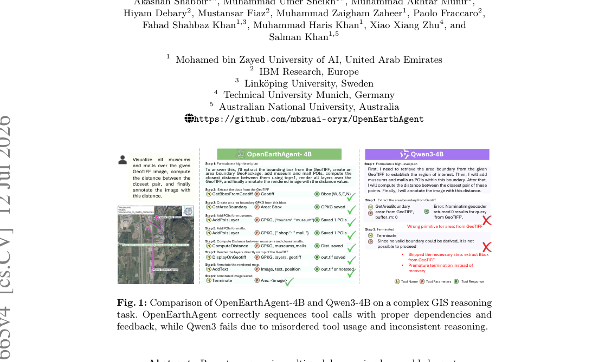

**Caption（原文）：** Fig. 1: Comparison of OpenEarthAgent-4B and Qwen3-4B on a complex GIS reasoning task. OpenEarthAgent correctly sequences tool calls with proper dependencies and feedback, while Qwen3 fails due to misordered tool usage and inconsistent reasoning.

[查看完整第 1 页](./source_pages/page-001.jpg)

## 表1 — 原文第 5 页

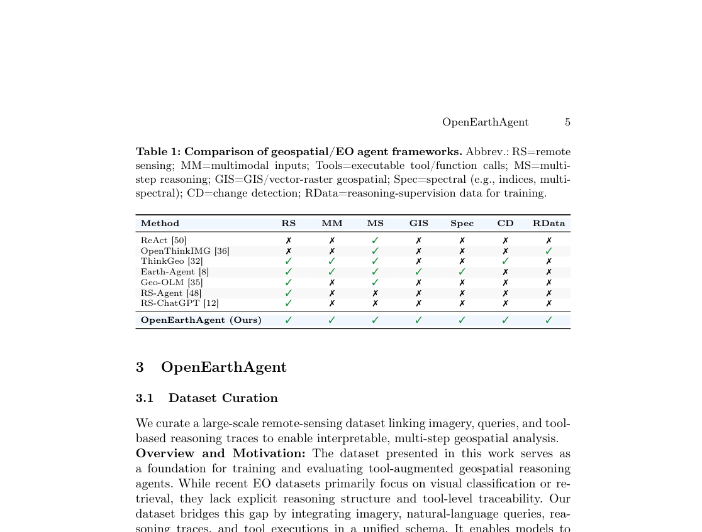

**Caption（原文）：** Table 1: Comparison of geospatial/EO agent frameworks. Abbrev.: RS=remote sensing; MM=multimodal inputs; Tools=executable tool/function calls; MS=multi- step reasoning; GIS=GIS/vector-raster geospatial; Spec=spectral (e.g., indices, multi- spectral); CD=change detection; RData=reasoning-supervision data for training.

[查看完整第 5 页](./source_pages/page-005.jpg)

## 表2 — 原文第 6 页

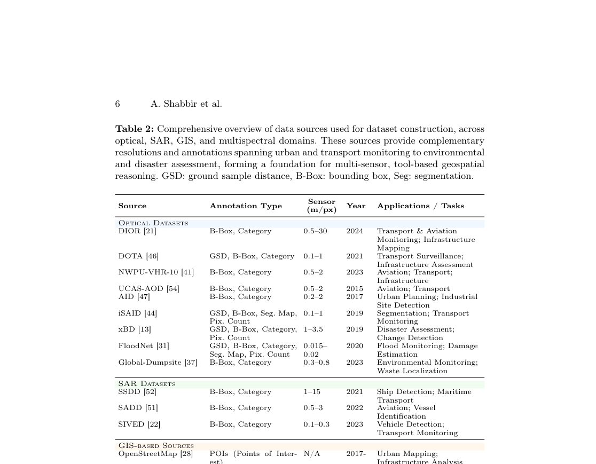

**Caption（原文）：** Table 2: Comprehensive overview of data sources used for dataset construction, across optical, SAR, GIS, and multispectral domains. These sources provide complementary resolutions and annotations spanning urban and transport monitoring to environmental and disaster assessment, forming a foundation for multi-sensor, tool-based geospatial reasoning. GSD: ground sample distance, B-Box: bounding box, Seg: segmentation.

[查看完整第 6 页](./source_pages/page-006.jpg)

## 图2 — 原文第 7 页

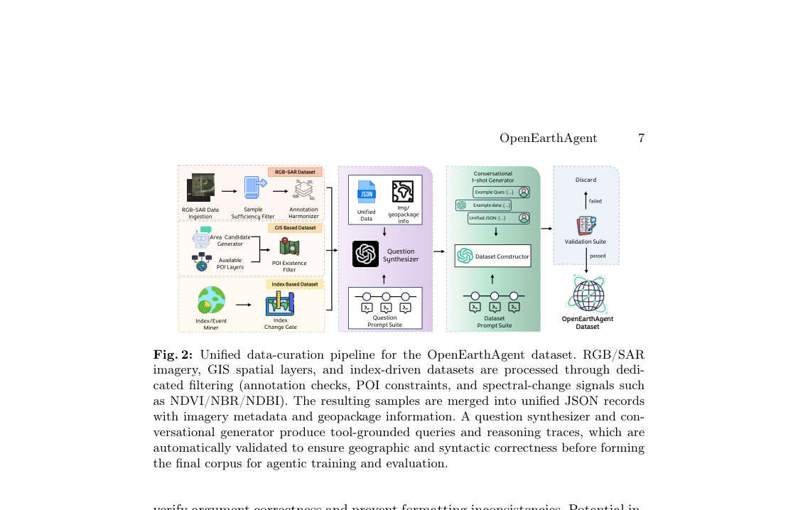

**Caption（原文）：** Fig. 2: Unified data-curation pipeline for the OpenEarthAgent dataset. RGB/SAR imagery, GIS spatial layers, and index-driven datasets are processed through dedi- cated filtering (annotation checks, POI constraints, and spectral-change signals such as NDVI/NBR/NDBI). The resulting samples are merged into unified JSON records with imagery metadata and geopackage information. A question synthesizer and con- versational generator produce tool-grounded queries and reasoning traces, which are

[查看完整第 7 页](./source_pages/page-007.jpg)

## 图3 — 原文第 8 页

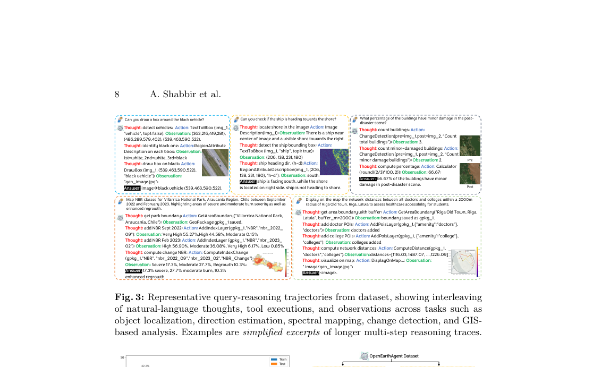

**Caption（原文）：** Fig. 3: Representative query-reasoning trajectories from dataset, showing interleaving of natural-language thoughts, tool executions, and observations across tasks such as object localization, direction estimation, spectral mapping, change detection, and GIS- based analysis. Examples are simplified excerpts of longer multi-step reasoning traces.

[查看完整第 8 页](./source_pages/page-008.jpg)

## 图4 — 原文第 8 页

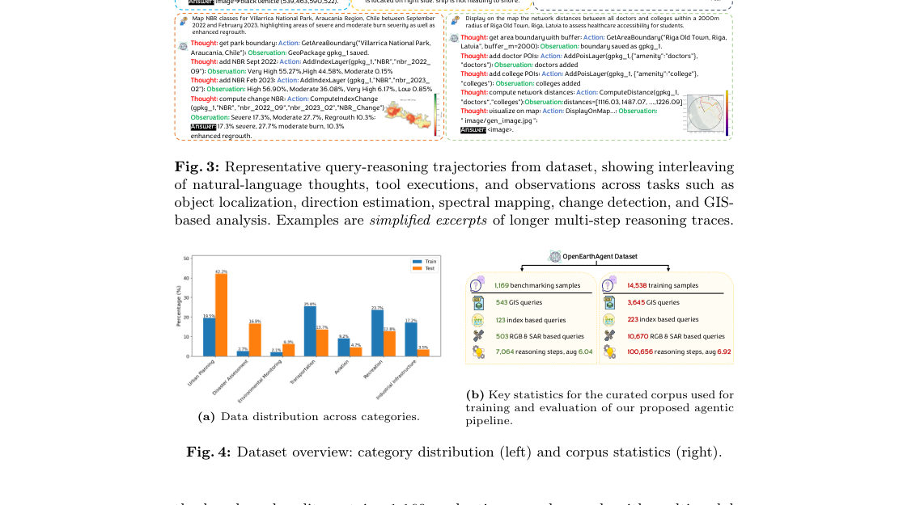

**Caption（原文）：** Fig. 4: Dataset overview: category distribution (left) and corpus statistics (right).

[查看完整第 8 页](./source_pages/page-008.jpg)

## 图5 — 原文第 9 页

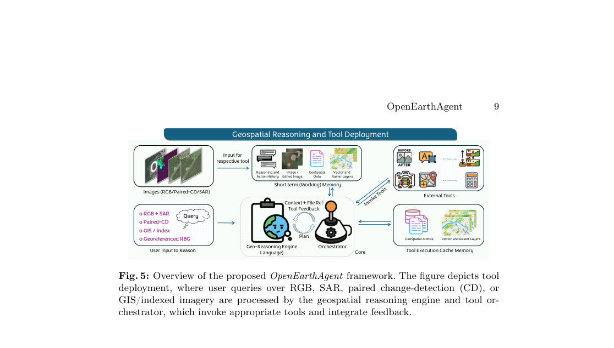

**Caption（原文）：** Fig. 5: Overview of the proposed OpenEarthAgent framework. The figure depicts tool deployment, where user queries over RGB, SAR, paired change-detection (CD), or GIS/indexed imagery are processed by the geospatial reasoning engine and tool or- chestrator, which invoke appropriate tools and integrate feedback.

[查看完整第 9 页](./source_pages/page-009.jpg)

## 表3 — 原文第 12 页

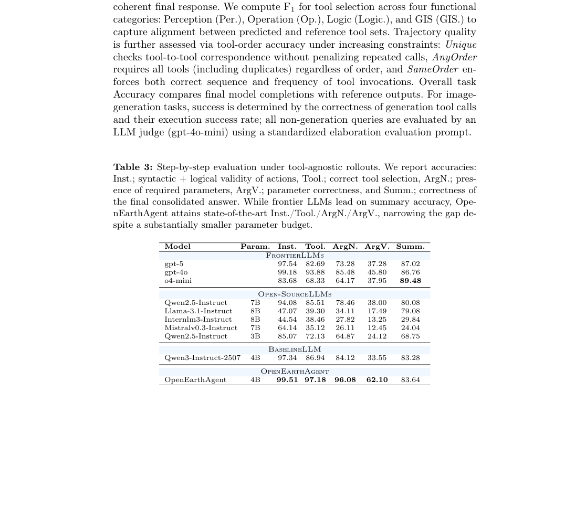

**Caption（原文）：** Table 3: Step-by-step evaluation under tool-agnostic rollouts. We report accuracies: Inst.; syntactic + logical validity of actions, Tool.; correct tool selection, ArgN.; pres- ence of required parameters, ArgV.; parameter correctness, and Summ.; correctness of the final consolidated answer. While frontier LLMs lead on summary accuracy, Ope- nEarthAgent attains state-of-the-art Inst./Tool./ArgN./ArgV., narrowing the gap de- spite a substantially smaller parameter budget.

[查看完整第 12 页](./source_pages/page-012.jpg)

## 表4 — 原文第 13 页

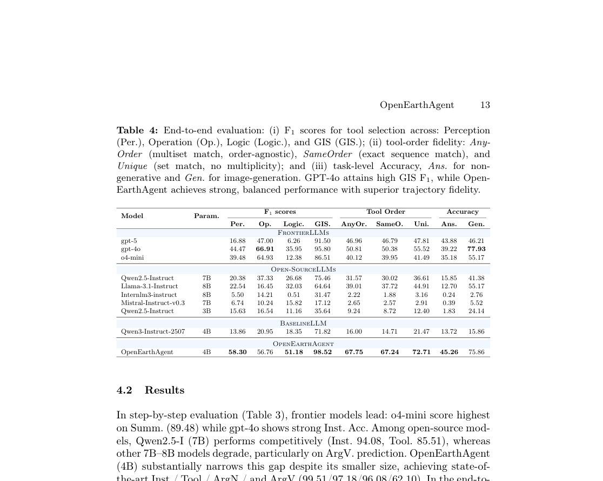

**Caption（原文）：** Table 4: End-to-end evaluation: (i) F1 scores for tool selection across: Perception (Per.), Operation (Op.), Logic (Logic.), and GIS (GIS.); (ii) tool-order fidelity: Any- Order (multiset match, order-agnostic), SameOrder (exact sequence match), and Unique (set match, no multiplicity); and (iii) task-level Accuracy, Ans. for non- generative and Gen. for image-generation. GPT-4o attains high GIS F1, while Open- EarthAgent achieves strong, balanced performance with superior trajectory fidelity.

[查看完整第 13 页](./source_pages/page-013.jpg)

## 表5 — 原文第 14 页

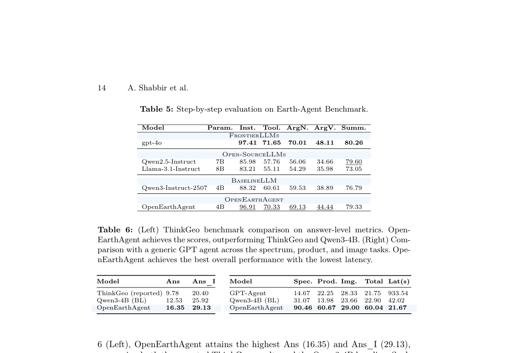

**Caption（原文）：** Table 5: Step-by-step evaluation on Earth-Agent Benchmark.

[查看完整第 14 页](./source_pages/page-014.jpg)

## 表6 — 原文第 14 页

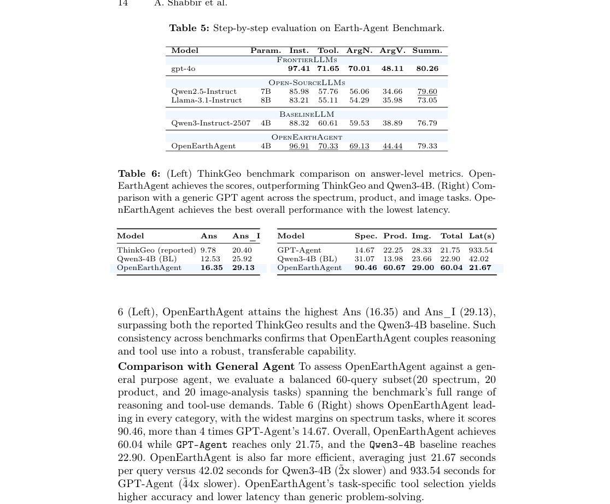

**Caption（原文）：** Table 6: (Left) ThinkGeo benchmark comparison on answer-level metrics. Open- EarthAgent achieves the scores, outperforming ThinkGeo and Qwen3-4B. (Right) Com- parison with a generic GPT agent across the spectrum, product, and image tasks. Ope- nEarthAgent achieves the best overall performance with the lowest latency.

[查看完整第 14 页](./source_pages/page-014.jpg)

## 图6 — 原文第 15 页

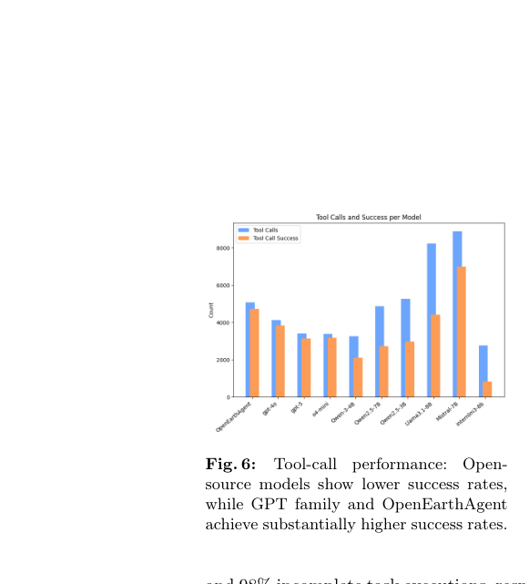

**Caption（原文）：** Fig. 6: Tool-call performance: Open- source models show lower success rates, while GPT family and OpenEarthAgent

[查看完整第 15 页](./source_pages/page-015.jpg)

## 图7 — 原文第 15 页

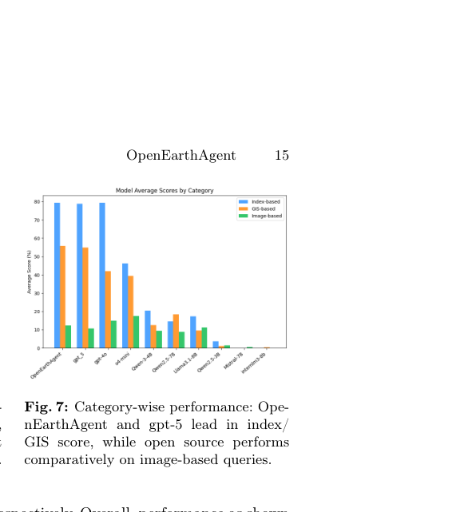

**Caption（原文）：** Fig. 7: Category-wise performance: Ope- nEarthAgent and gpt-5 lead in index/ GIS score, while open source performs comparatively on image-based queries.

[查看完整第 15 页](./source_pages/page-015.jpg)

## 表A1 — 原文第 20 页

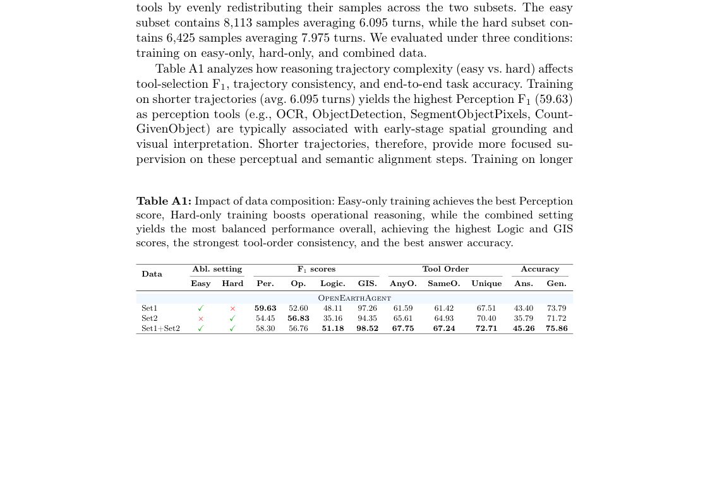

**Caption（原文）：** Table A1: Impact of data composition: Easy-only training achieves the best Perception score, Hard-only training boosts operational reasoning, while the combined setting yields the most balanced performance overall, achieving the highest Logic and GIS scores, the strongest tool-order consistency, and the best answer accuracy.

[查看完整第 20 页](./source_pages/page-020.jpg)

## 表A2 — 原文第 21 页

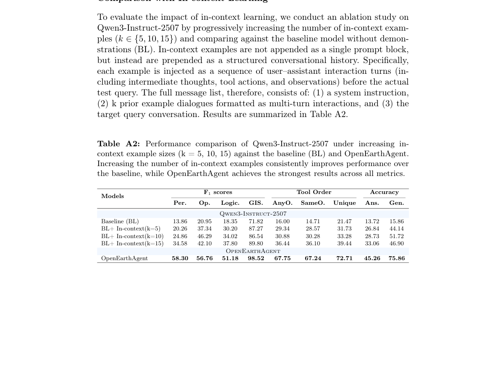

**Caption（原文）：** Table A2: Performance comparison of Qwen3-Instruct-2507 under increasing in- context example sizes (k = 5, 10, 15) against the baseline (BL) and OpenEarthAgent. Increasing the number of in-context examples consistently improves performance over the baseline, while OpenEarthAgent achieves the strongest results across all metrics.

[查看完整第 21 页](./source_pages/page-021.jpg)

## 表A3 — 原文第 22 页

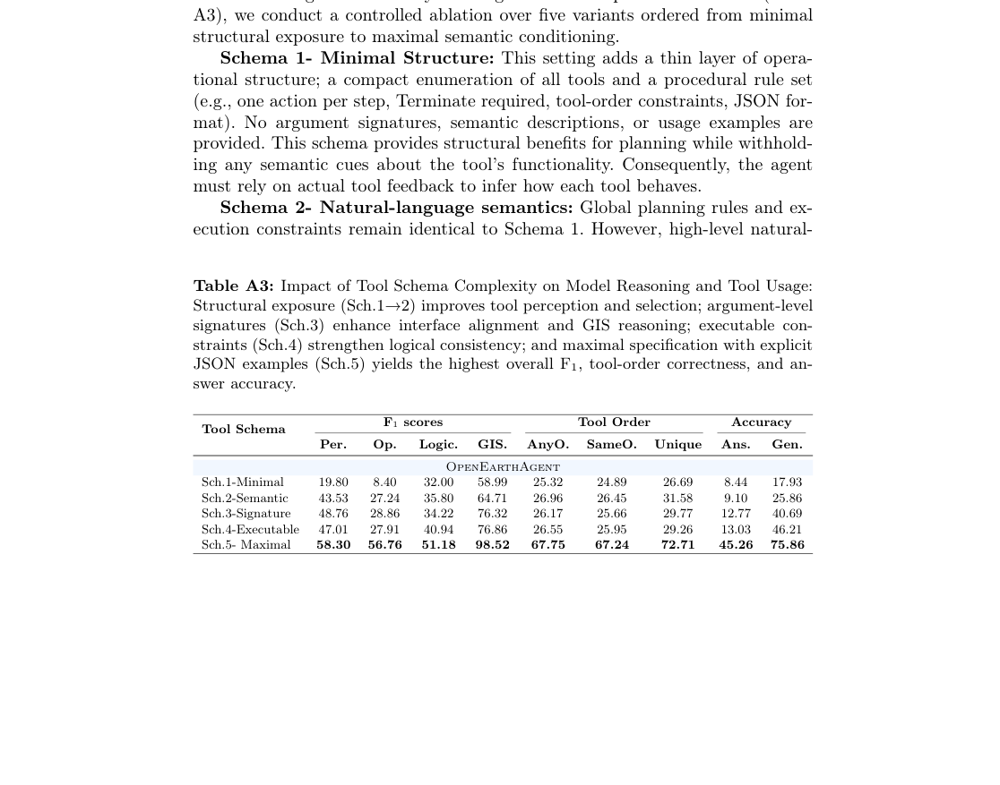

**Caption（原文）：** Table A3: Impact of Tool Schema Complexity on Model Reasoning and Tool Usage: Structural exposure (Sch.1→2) improves tool perception and selection; argument-level signatures (Sch.3) enhance interface alignment and GIS reasoning; executable con- straints (Sch.4) strengthen logical consistency; and maximal specification with explicit JSON examples (Sch.5) yields the highest overall F1, tool-order correctness, and an- swer accuracy.

[查看完整第 22 页](./source_pages/page-022.jpg)

## 表A4 — 原文第 25 页

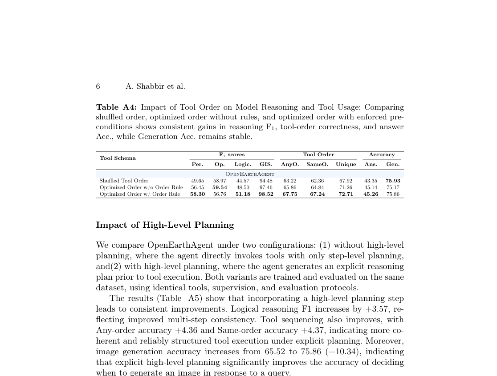

**Caption（原文）：** Table A4: Impact of Tool Order on Model Reasoning and Tool Usage: Comparing shuffled order, optimized order without rules, and optimized order with enforced pre- conditions shows consistent gains in reasoning F1, tool-order correctness, and answer Acc., while Generation Acc. remains stable.

[查看完整第 25 页](./source_pages/page-025.jpg)

## 表A5 — 原文第 25 页

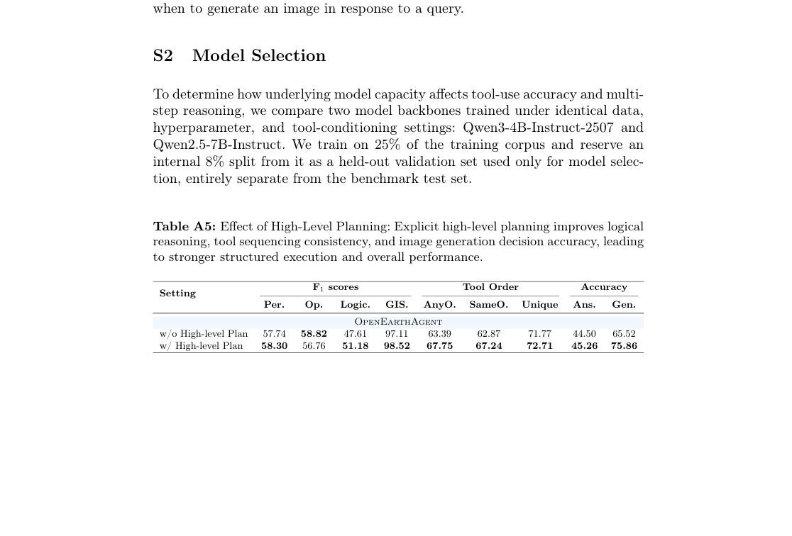

**Caption（原文）：** Table A5: Effect of High-Level Planning: Explicit high-level planning improves logical reasoning, tool sequencing consistency, and image generation decision accuracy, leading to stronger structured execution and overall performance.

[查看完整第 25 页](./source_pages/page-025.jpg)

## 表A6 — 原文第 26 页

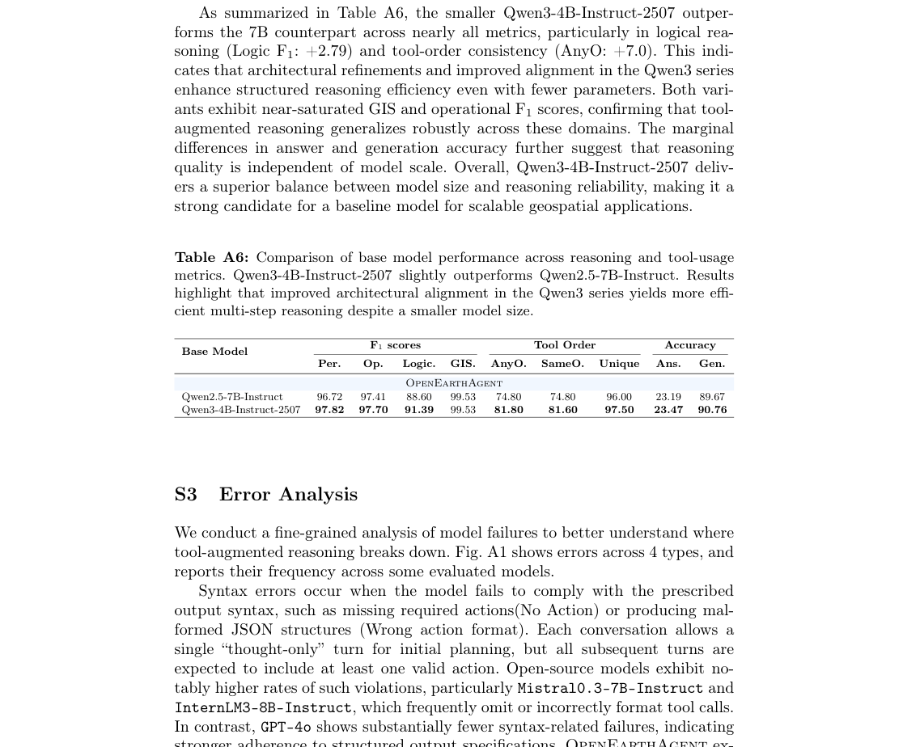

**Caption（原文）：** Table A6: Comparison of base model performance across reasoning and tool-usage metrics. Qwen3-4B-Instruct-2507 slightly outperforms Qwen2.5-7B-Instruct. Results highlight that improved architectural alignment in the Qwen3 series yields more effi- cient multi-step reasoning despite a smaller model size.

[查看完整第 26 页](./source_pages/page-026.jpg)

## 图A1 — 原文第 27 页

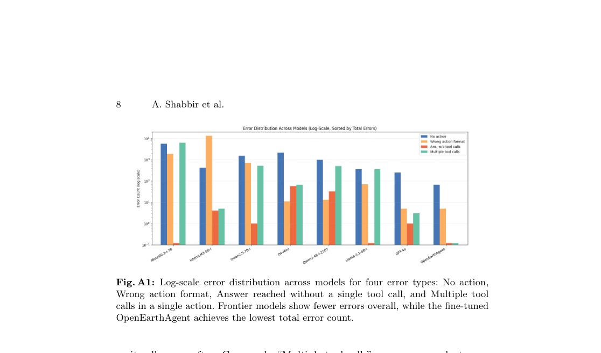

**Caption（原文）：** Fig. A1: Log-scale error distribution across models for four error types: No action, Wrong action format, Answer reached without a single tool call, and Multiple tool calls in a single action. Frontier models show fewer errors overall, while the fine-tuned OpenEarthAgent achieves the lowest total error count.

[查看完整第 27 页](./source_pages/page-027.jpg)

## 图A2 — 原文第 28 页

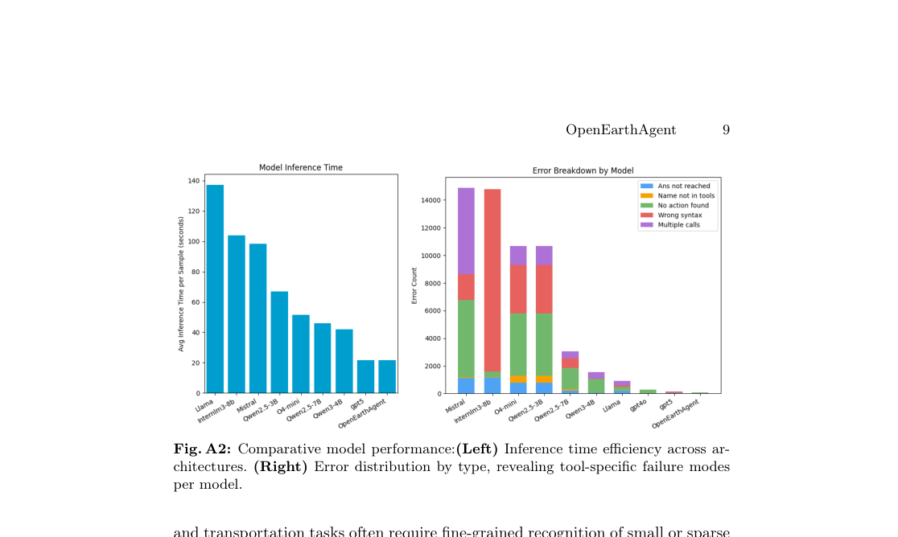

**Caption（原文）：** Fig. A2: Comparative model performance:(Left) Inference time efficiency across ar- chitectures. (Right) Error distribution by type, revealing tool-specific failure modes per model.

[查看完整第 28 页](./source_pages/page-028.jpg)

## 图A3 — 原文第 29 页

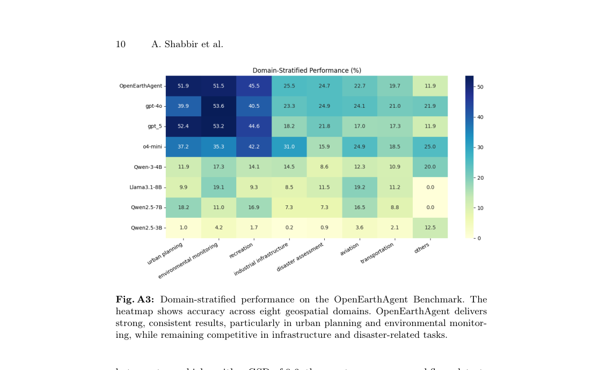

**Caption（原文）：** Fig. A3: Domain-stratified performance on the OpenEarthAgent Benchmark. The heatmap shows accuracy across eight geospatial domains. OpenEarthAgent delivers strong, consistent results, particularly in urban planning and environmental monitor- ing, while remaining competitive in infrastructure and disaster-related tasks.

[查看完整第 29 页](./source_pages/page-029.jpg)

## 图A4 — 原文第 29 页

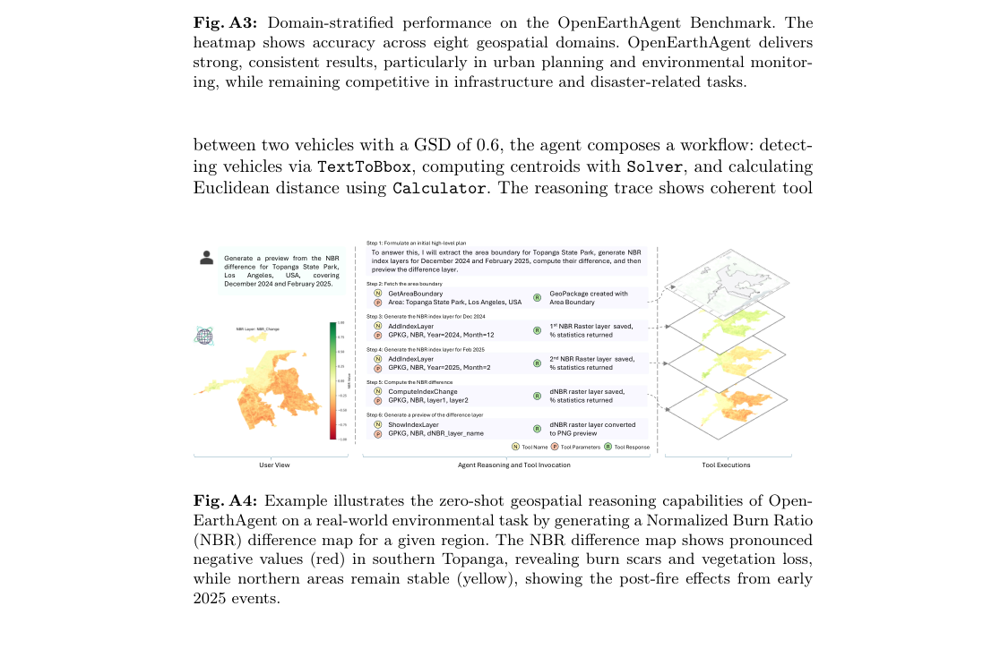

**Caption（原文）：** Fig. A4: Example illustrates the zero-shot geospatial reasoning capabilities of Open- EarthAgent on a real-world environmental task by generating a Normalized Burn Ratio (NBR) difference map for a given region. The NBR difference map shows pronounced negative values (red) in southern Topanga, revealing burn scars and vegetation loss, while northern areas remain stable (yellow), showing the post-fire effects from early 2025 events.

[查看完整第 29 页](./source_pages/page-029.jpg)

## 图A5 — 原文第 30 页

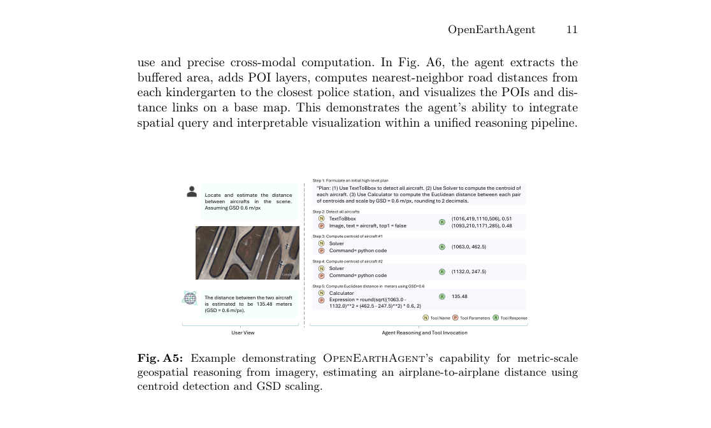

**Caption（原文）：** Fig. A5: Example demonstrating OpenEarthAgent’s capability for metric-scale geospatial reasoning from imagery, estimating an airplane-to-airplane distance using centroid detection and GSD scaling.

[查看完整第 30 页](./source_pages/page-030.jpg)

## 图A6 — 原文第 30 页

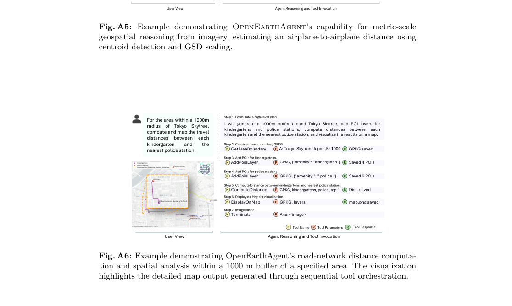

**Caption（原文）：** Fig. A6: Example demonstrating OpenEarthAgent’s road-network distance computa- tion and spatial analysis within a 1000 m buffer of a specified area. The visualization highlights the detailed map output generated through sequential tool orchestration.

[查看完整第 30 页](./source_pages/page-030.jpg)

## 图A7 — 原文第 33 页

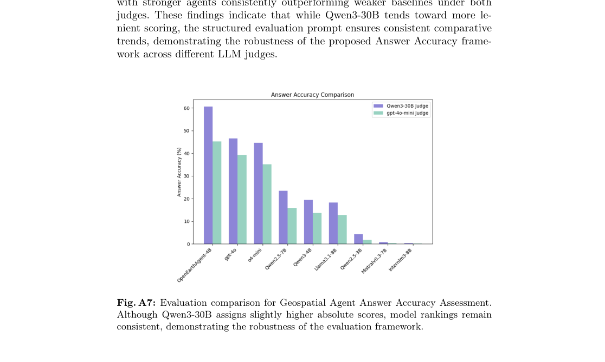

**Caption（原文）：** Fig. A7: Evaluation comparison for Geospatial Agent Answer Accuracy Assessment. Although Qwen3-30B assigns slightly higher absolute scores, model rankings remain consistent, demonstrating the robustness of the evaluation framework.

[查看完整第 33 页](./source_pages/page-033.jpg)

## 图A8 — 原文第 34 页

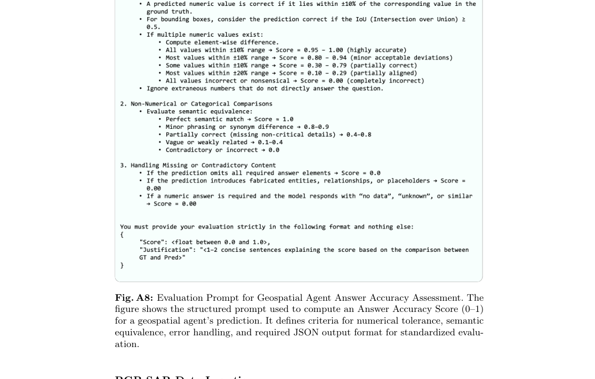

**Caption（原文）：** Fig. A8: Evaluation Prompt for Geospatial Agent Answer Accuracy Assessment. The figure shows the structured prompt used to compute an Answer Accuracy Score (0–1) for a geospatial agent’s prediction. It defines criteria for numerical tolerance, semantic equivalence, error handling, and required JSON output format for standardized evalu- ation.

[查看完整第 34 页](./source_pages/page-034.jpg)
