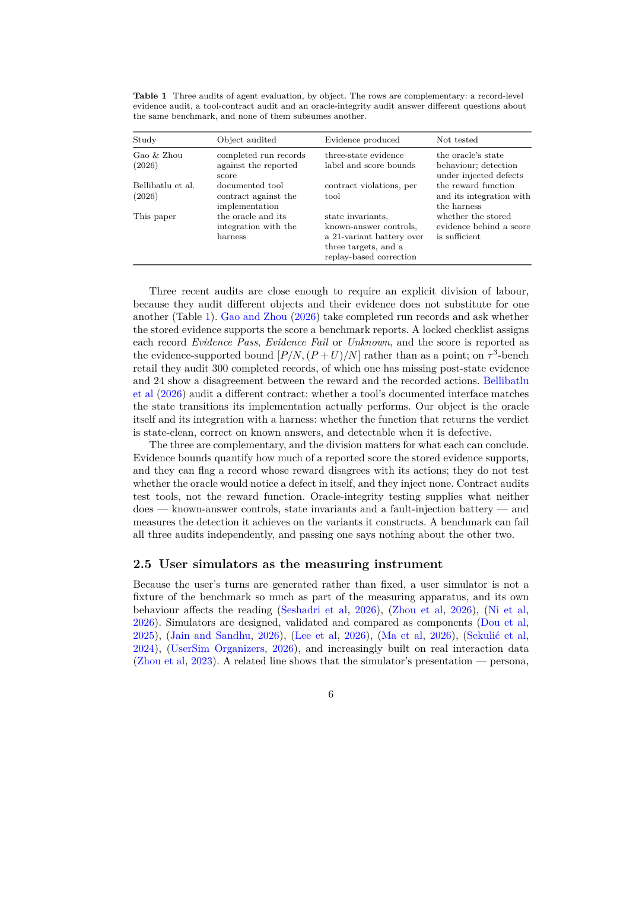
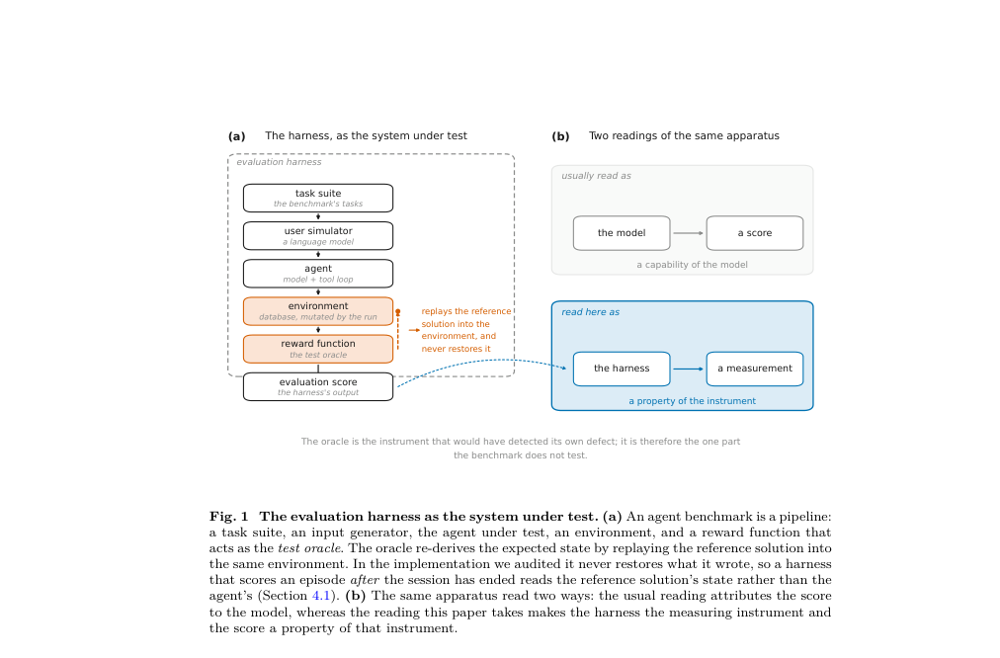
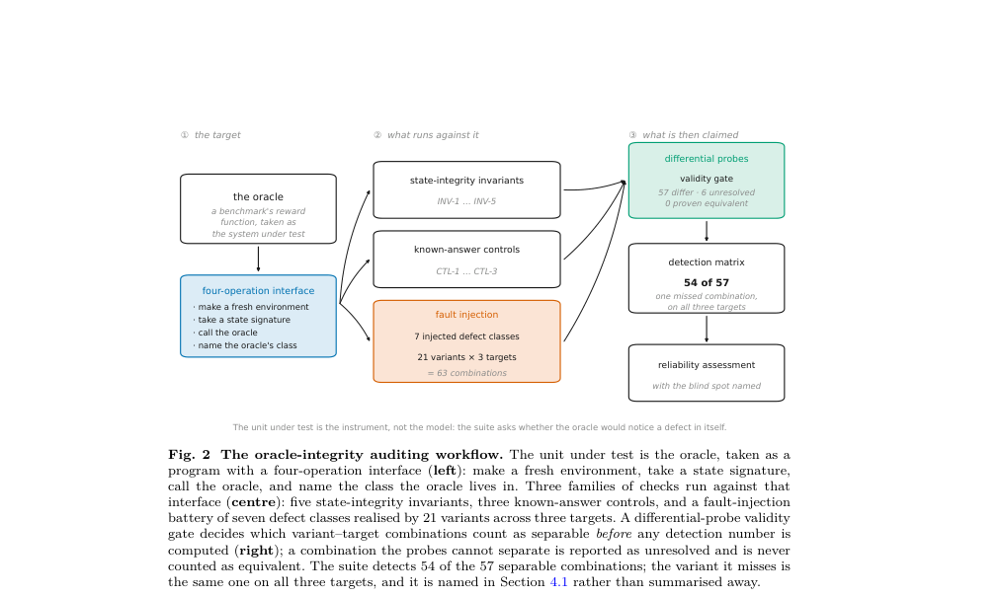
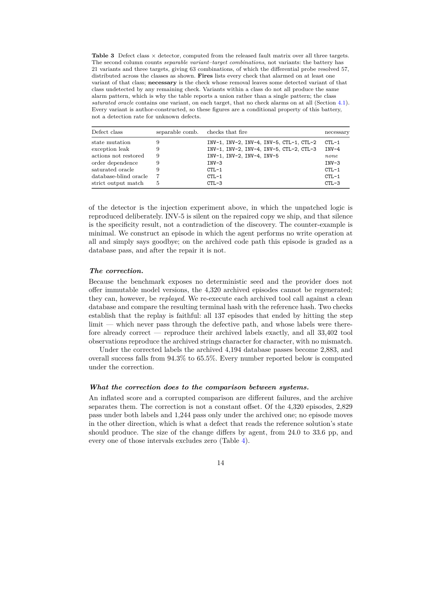
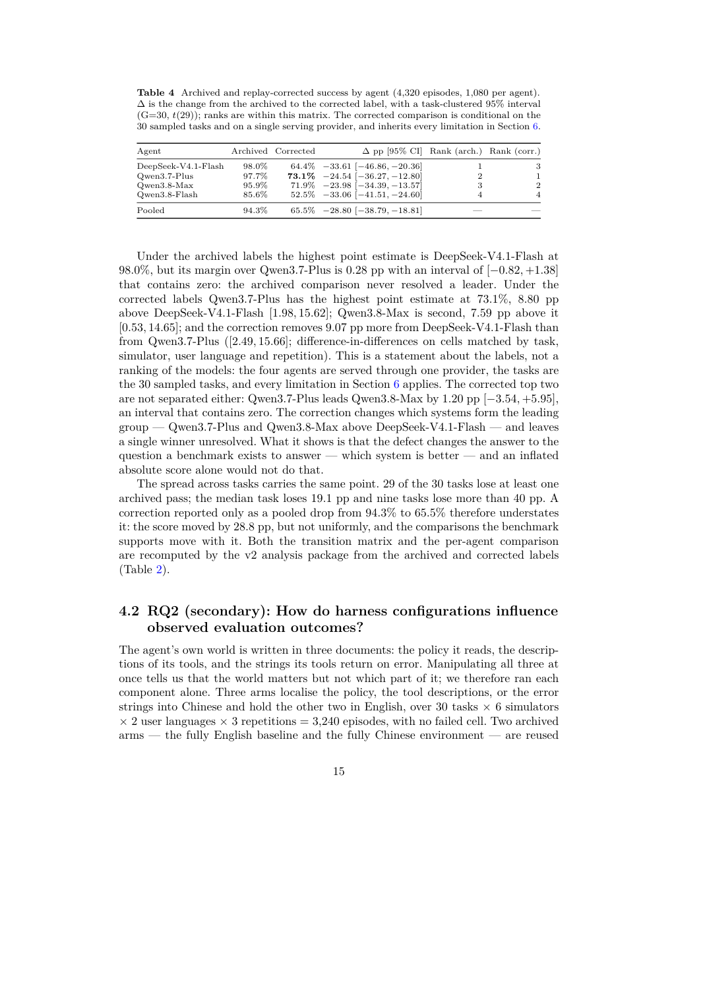
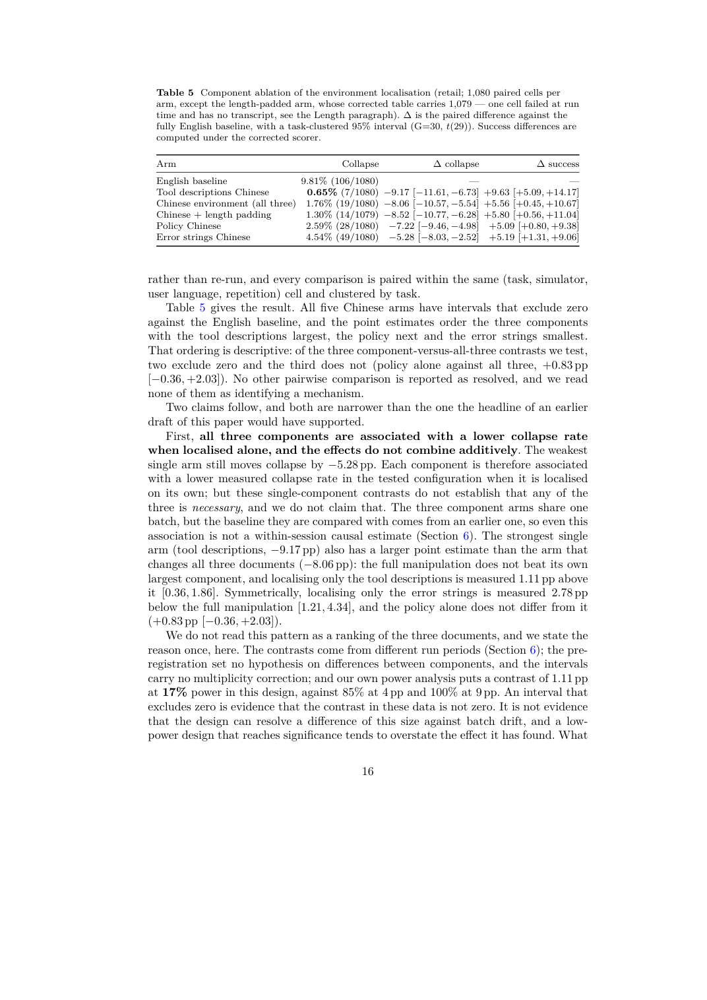
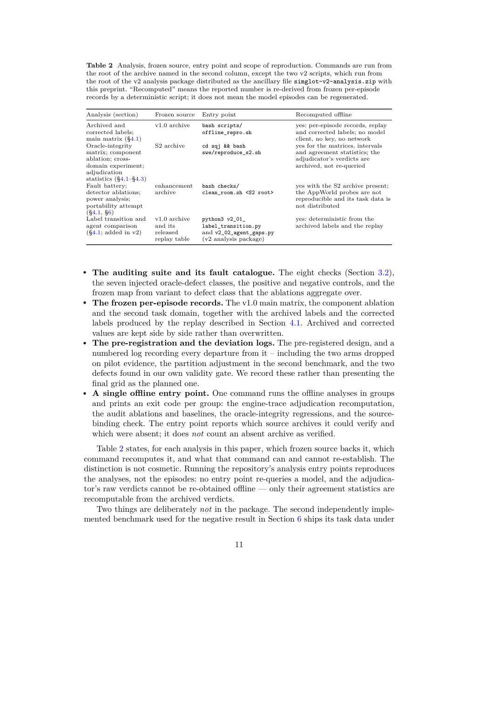

# 当智能体评价变得不可靠：评估预言机故障与配置依赖测量的实证研究

**原文题名**：*When Agent Evaluation Becomes Unreliable: An Empirical Study of Oracle Failures and Configuration-Dependent Measurement in an LLM Agent Benchmark*  
**作者**：Junjie Chen  
**机构**：南京理工大学计算机科学与工程学院  
**版本**：arXiv:2610.16067v2，2026 年 10 月 21 日；原始 PDF 共 29 页。

> **译文范围**：摘要、引言的研究问题与贡献、核心审计方法、主要结果、讨论及威胁已译成中文或作忠实分节译述。参考文献、部分表格的逐行细节和重复性材料未全部逐句翻译，仍在 `英文原文_逐页完整提取.md` 与原稿截图中保留。作者对哪些结果能够得到因果解释设置了很严格的界限，以下不扩大其结论。

## 摘要（中文翻译）

智能体评价框架（evaluation harness）本身是软件：它运行测试集、驱动测试输入生成器，并依靠测试预言机（test oracle）判定结果。本文审计这些软件中无法从分数表看出的缺陷。

首先，作者提出一种系统性的预言机完整性审计方法，包括 **五项状态完整性不变量**和**三项已知答案对照测试**，并通过在两个任务领域和一个合成领域注入七类预言机缺陷加以验证。所有缺陷类别均能够被发现，在 **57 个可区分的变体—测试目标组合中检出 54 个**；修复后的预言机没有出现误报。在一个常用智能体基准中，方法发现奖励函数在构造 Ground Truth 哈希时会重置数据库，却没有恢复原始状态，因此后续评分程序读取的可能是参考答案对应的状态，而不是智能体留下的状态。在 **4,320 次实验**中，归档标签记录了 **4,194 次**数据库部分判定通过，重新回放得到 **2,883 次**，总体成功率由 **94.3%** 降至 **65.5%**。这种修正并非简单的统一偏移：各智能体分数减少约 **24–34 个百分点**，被认为最强的智能体也发生变化。

其次，证据强度较弱的分析显示，评价装置的语言本地化是测量过程中的一个属性。涉及 **3,240 次实验**的消融研究发现，在所测试的配置下，分别本地化三种文档中的任何一种，都与智能体轨迹退化比例降低有关，但不能确定三者的因果排序；在第二个任务领域，语言效应的方向发生逆转。

最后，这套方法未能直接迁移到第二个独立实现的基准。作者明确指出方法迁移所要求的软件接口契约，并发布了可在离线环境中重新计算全部分析结果、无需模型调用的复现包。

**关键词**：测试预言机；不稳定测试；测量效度；基准质量；复现包；大模型智能体评价。

## 1 引言：应当审计的不只是模型，还有评分装置

评价一个 AI 智能体时，人们通常让它在基准任务上运行，然后报告一个成功率。这个数字用于论文结论、排行榜和日益增多的部署决策，但它并不是模型独自产生的：它是评价框架的输出。框架由测试任务、输入生成器（可能是模拟用户的语言模型）、工具与数据库环境以及判定通过／失败的奖励函数组成。

软件测试领域早已认识到：决定期望结果与实际结果是否相符的机制本身可能发生故障。这就是**测试预言机问题（Oracle Problem）**。当相同代码在不同运行中出现通过与失败时，称为 **Flaky Test（不稳定测试）**；当测量结果随着装置配置而改变，而非仅由被测性质决定时，涉及**测量效度问题**。另外，**故障注入（Fault Injection）**与**变异测试（Mutation Testing）**可以有目的地制造缺陷，检验测试系统能否发现它们。

作者的核心转变是：不再将奖励函数当作不可质疑的“正确性定义”，而是把评价框架本身视为**被测试系统（System Under Test）**。特别是，测试预言机既可能在计算出正确返回值的同时意外改变数据库，又可能因为与外部评分程序之间的隐含接口契约而产生错误标签。

### 三组研究问题与证据等级

**RQ1（主要）**：评价预言机是否可靠？它能否发现自身缺陷，事实上是否存在这样的缺陷？这是直接针对软件完整性和标签正确性的测试。

**RQ2、RQ3（次要）**：框架的配置会怎样影响观察到的评价结果？在执行期间会变化的因素会使结果敏感到何种程度？这些研究关注**测量过程和装置配置**，而不是宣称发现模型固有的语言能力机制。

### 作者明确限定的贡献

- 提出可系统检验预言机的八项检查及七类缺陷注入，并报告具体覆盖率和未检出的盲点。
- 发现并修复一个奖励函数引起的共享数据库状态污染，在固定归档记录上用**重新回放**而非重新调用模型纠正成功率。
- 检验模拟用户语言及智能体环境文本语言对轨迹退化的影响，严格限制解释范围。
- 发布离线复现材料，并报告对另一个评价框架迁移失败的负面结果。

## 2 相关背景

### 2.1 测试预言机与变异测试

预言机判定“预期是什么、实际是什么”，然而通常每次测试都调用它，却没有另一套测试去验证它是否正确。因此它的故障可能非常隐蔽。本文将故障注入直接施加于预言机，而不是仅检查被测智能体或应用代码。

### 2.2 不稳定测试、测量效度与配置敏感性

如果中文模拟用户与英文模拟用户使模型行为不同，这种差异不能自动证明预言机故障，因为模型所接收的输入确实不同。真正需要警惕的是：**研究者将装置配置造成的差异，误解释成模型内在能力的差异**。因此作者把语言实验称为“观察结果对配置的依赖”，而不是“模型在某种语言中必然更好”。

### 2.3 三种互补审计对象

作者在表 1 区分三类研究：**记录层证据审计**检查已完成轨迹能否支持所报告分数；**工具契约审计**检查 API 说明是否符合真正执行的状态变更；**预言机完整性审计**检查奖励函数自身的状态副作用、已知正确答案及缺陷可检测性。三者彼此不能替代。

**表 1 中文图注**：记录证据、工具契约和预言机完整性三种审计分别针对不同对象，也各自具有未覆盖的部分。

## 3 方法：把评价框架当作软件系统测试

### 3.1 评价框架的组成及故障根源

所审计的基准采用智能体—用户—数据库结构。智能体执行工具调用，数据库随之变化。测试预言机比较最终数据库状态与参考工具调用序列产生的预期状态，并对最终文字回复执行特定字符串检查。前者与语言相对独立，后者则对语言和格式敏感。

**图 1 中文说明**：左半部分描绘任务集、用户模拟器、智能体、环境、奖励函数和评分构成的测量流水线；右半部分强调对同一系统的两种解读——传统评价把分数看成“模型能力”，本文进一步把它看成“评价装置的一次读数”。

### 3.2 八项预言机审计检查

作者先定义一个包含四种基本操作的软件接口：创建全新环境、获取环境状态签名、调用预言机、获取预言机类以注入故障。随后构建两组共八项检查。

**五项状态完整性不变量（State-integrity Invariants）**：

| 编号 | 检查内容（中文对照） |
|---|---|
| INV-1 | 直接调用预言机不得修改被评分的环境状态。 |
| INV-2 | 对同一环境连续调用两次应得到一致判决，并保持相同状态。 |
| INV-3 | 判决不应依赖不同实验 episode 的评分先后顺序。 |
| INV-4 | 预言机在执行过程中抛出异常时，应恢复状态并继续传播异常。 |
| INV-5 | 会话结束后，环境必须仍然保存智能体留下的状态，不能额外附加终止步骤之后的动作。 |

**三项已知答案控制（Known-answer Controls）**：

| 编号 | 检查内容（中文对照） |
|---|---|
| CTL-1 | 完全没有完成任务、仅在文本中声称完成但没有进行必要写入的 episode，不得被判为成功。 |
| CTL-2 | 参考解决方案应被正确判为成功。 |
| CTL-3 | 允许的必需输出拼写变体应被接受。 |

### 3.3 故障注入与检测范围

作者设计七类故障：写入后不恢复环境；只在成功路径恢复；恢复时忘记已记录动作；利用模块级缓存导致结果依赖评分顺序；预言机始终返回通过；忽略某项状态组件；不做输出规范化而直接匹配。各类故障通过多个变体实现，跨三个测试目标形成 **21 个变体 × 3 个目标 = 63 个组合**。

作者特别区分“未能通过差分探针证明可区分的组合”与“真实等价的组合”。63 个组合中，**57 个可分辨、6 个未解决**；在 57 个可分辨组合里成功检出 **54 个**。未检出的情况来自同一个故障变体，在三个目标上重复出现，不应以总体检出率掩盖。

**图 2 中文说明**：从四操作接口、状态不变量和控制测试，到七类故障注入、差分探针验证和检测矩阵的预言机完整性审计流程。

### 3.4 任务领域、配置与实验设计

文章主要基于一个含 Retail（零售）与 Airline（航空）领域的智能体基准实施分析。预注册主矩阵使用 **30 个零售任务 × 2 种用户语言 × 6 种模拟器 × 4 种智能体 × 3 次重复，共 4,320 个 episode**。其他实验包括用户语言与环境语言的交叉、通过冗余附录控制提示长度、分别本地化三类环境文档的消融、第二任务领域的重复和对“轨迹退化”标签的独立复核。

环境语言的三个可操作组成部分为：**策略文档（Policy Wiki）**、**工具描述（Tool Descriptions）**和**工具错误字符串（Error Strings）**。作者明确不翻译数据库中的姓名、地址、订单编号等实体数据，也保留工具契约要求的字面常量，避免语言干预变成不相关的参数验证干预。

### 3.5 统计检验及复现包

文章将任务而非 episode 作为重要的抽样单位。主要分析采用任务聚类区间，首先在同一任务内计算配对差值，再对任务求均值并使用与任务数量相应的 t 分布参考。置换检验、精确检验与聚类 Bootstrap 等作为敏感性核对，而不是自动构成多条相互独立的因果证据。

复现包保存冻结的逐 episode 记录、原始与修正标签、哈希、分析脚本和偏离预注册的记录。**离线重新计算**意味着可以从现有归档重新得出论文中的数字，不等于能够原样重新生成当时的模型轨迹。

## 4 研究结果

### 4.1 RQ1：预言机故障及其对排行榜的影响

论文发现，奖励函数 `Env.calculate_reward()` 为生成参考状态哈希，把参考解法应用到同一个数据库，随后没有恢复环境。**函数返回给基准自身运行器的奖励值可以是正确的**：它在重置之前读取了智能体状态，且该运行器不会在奖励函数之后重新读取环境。所以作者没有声称原基准自身的官方运行器夸大了分数。

故障发生于作者的独立评价集成程序：它在会话结束之后再次读取数据库，于是读取到的已是参考答案状态。这是**上游奖励函数具有危险副作用与下游第二次读取相结合**所造成的集成故障。

主实验共有 4,320 次 episode；归档标签显示数据库状态部分通过 4,194 次，而根据已记录工具动作在干净数据库上重新回放仅有 2,883 次通过。结合文本部分后，整体成功率由 **94.3%** 修正为 **65.5%**。不同模型下降约 24–34 个百分点，并非统一偏移，足以改变这组实验里模型的相对排序。

**表 3 中文说明**：七类故障与检测器的对应关系及检测结果，具体单元格数据应以原表为准。

**表 4 中文说明**：按受测智能体比较归档标签与回放修正标签下的成功率，用以说明故障会影响相对排名。

### 4.2 RQ2：语言配置与轨迹退化

在正确评分条件下，仅改变模拟用户语言，没有观察到已经确认的总体成功率差异；然而，对于其中一个智能体，发生轨迹退化（Collapse）的比例可随语言配置变化约 **2–10 倍**。更重要的影响来自智能体本身所读环境文档的本地化。对三种文档分别本地化进行 **3,240 次实验**后，作者发现各单独本地化配置均与轨迹退化率降低有关，但三个文档的效果不能简单相加。

单独本地化工具描述的表现，与同时本地化三种文档之间存在 **1.11 个百分点**的观测差距。不过两者来自不同运行批次、服务商未公开可锁定的模型版本，作者自己的功效分析认为该大小差异仅有约 **17% 统计功效**。因此论文没有把组件排序当成既定机制。

**表 5 中文说明**：环境语言本地化消融实验及其相应的不确定性区间。若区间包括零，作者将其描述为“未检出差异”，而不是“证明不存在差异”。

### 4.3 RQ3：跨领域检验限制了语言效应的外推

把实验迁移到第二个任务领域后，语言效应的方向发生反转，说明该影响依赖具体的环境、任务和智能体配置，不能简单声称“中文优于英文”或反过来。某个跨服务商智能体在初步实验中完全没有发生轨迹退化，因满足预注册停止规则而退出后续矩阵，因此独立模型验证仍未完成。

## 5 讨论：从分数变动走向测量装置的可信度

论文的最主要贡献是将评价预言机作为可以独立测试的软件组件。由此可区分几类容易混淆的问题：评分数据存储不完整、工具接口说明不符合实现、奖励函数破坏环境状态、运行配置使得行为模式变化。这些问题可能分别改变实验分数，即使被测智能体完全未变。

更一般地，评价方法若只发布排行榜，而不说明评分器本身的故障风险、环境是否可复现、用户模拟器怎样生成输入、模型和工具版本如何冻结，就难以准确表达所报告分数能够支持何种结论。

## 6 效度威胁与方法适用范围

**构念效度**：轨迹退化以特定方式定义，仍会受模型输出单位和判断标准影响；模拟用户语言变化也可能合法改变受测输入。因此不能将所有结果变化都归咎于评价器错误。

**内部效度**：模型服务商并未提供可靠的确定性随机种子，同一请求在温度零下也可能产生不同轨迹；部分消融配置来自不同实验时段，无法完全排除服务端模型漂移。配对分析减小了任务差异，但不能替代同一时段的完全随机化实验。

**外部效度与可移植性**：第二个独立实现的基准未向外部测试者提供可重建的“参考终止状态”，因此作者无法为正控制测试建立独立可验证的参考答案，**未得到跨框架检测率，不能声称方法已经泛化**。其余实证发现来自一个基准、两个任务领域、四个智能体和六个模拟器；不同语言对、其他服务商和真人用户均尚需进一步检验。

**结论效度**：置信区间以任务聚类方式计算，不能将其解释为适用于任意新任务总体的保证。区间包含零表示“没有检出差异”，并非“证明没有差异”。

## 7 结论

智能体评价框架是一种测量仪器，其成功率只是仪器读数。本文发现一个会污染数据库状态的预言机缺陷，使作者的集成评价程序中记录的成功率从真实的 **65.5%** 夸大为 **94.3%**，同时扰乱受测系统的比较顺序。作者还证明，测量装置的语言与文档配置会影响某些轨迹的稳定性，但相关效应具有情境依赖性，不宜外推为普遍模型能力规律。

这篇论文强调：**应当测试评价系统是否可信，不能仅测试智能体是否得到高分。**

## 专业术语对照

| English | 中文 |
|---|---|
| Evaluation Harness | 评价框架／评估运行框架 |
| Test Oracle / Reward Function | 测试预言机／奖励函数 |
| Oracle Integrity | 预言机完整性 |
| Mutation Testing / Fault Injection | 变异测试／故障注入 |
| State-integrity Invariant | 状态完整性不变量 |
| Known-answer Control | 已知答案控制测试 |
| False Positive / False Negative | 假阳性／假阴性 |
| Variant–Target Combination | 缺陷变体—目标组合 |
| Differential Probe | 差分探针 |
| Episode / Trajectory | 单次测试回合／执行轨迹 |
| Replay-based Correction | 基于回放的纠正 |
| Task-clustered Interval | 任务聚类置信区间 |
| Configuration Dependence | 配置依赖性 |
| Collapse | 轨迹退化／崩塌 |
| Policy Wiki | 策略文档 |
| Tool Description | 工具描述 |
| Oracle Solver / Reference Solution | 参考求解器／参考解法 |
| Validity Gate | 有效性筛选门槛 |
| Portability Boundary | 可移植性边界 |

## 原文与复现材料

参考文献、数据声明、所引用的 Zenodo 存档地址以及未译技术细节均保留在英文逐页提取稿中。配图和原稿页图见文末自动附加索引；不应将截图的存在与翻译的完成等同。

---

## 原论文图表逐项索引（原始截图）

> 本节按照原稿页码与图表编号排列，供逐图检查与复现。表格截图使用完整原稿页，以避免跨栏或表格较长时遗漏关键列；原稿全部页面还保存于 `source_pages/`。

### 表1（PDF 第 6 页）

**原文标题摘录**：Table 1 Three audits of agent evaluation, by object. The rows are complementary: a record-level

[查看该页的完整原稿](./source_pages/page-006.jpg)

### 图1（PDF 第 8 页）

**原文标题摘录**：Fig. 1 The evaluation harness as the system under test. (a) An agent benchmark is a pipeline:

[查看该页的完整原稿](./source_pages/page-008.jpg)

### 图2（PDF 第 9 页）

**原文标题摘录**：Fig. 2 The oracle-integrity auditing workflow. The unit under test is the oracle, taken as a

[查看该页的完整原稿](./source_pages/page-009.jpg)

### 表2（PDF 第 11 页）

**原文标题摘录**：Table 2 Analysis, frozen source, entry point and scope of reproduction. Commands are run from

[查看该页的完整原稿](./source_pages/page-011.jpg)

### 表2（PDF 第 11 页）

**原文标题摘录**：Table 2 states, for each analysis in this paper, which frozen source backs it, which

[查看该页的完整原稿](./source_pages/page-011.jpg)

### 表3（PDF 第 14 页）

**原文标题摘录**：Table 3 Defect class × detector, computed from the released fault matrix over all three targets.

[查看该页的完整原稿](./source_pages/page-014.jpg)

### 表4（PDF 第 15 页）

**原文标题摘录**：Table 4 Archived and replay-corrected success by agent (4,320 episodes, 1,080 per agent).

[查看该页的完整原稿](./source_pages/page-015.jpg)

### 表5（PDF 第 16 页）

**原文标题摘录**：Table 5 Component ablation of the environment localisation (retail; 1,080 paired cells per

[查看该页的完整原稿](./source_pages/page-016.jpg)

## 原论文逐页视觉核查入口

下面提供全部 PDF 页面的图像链接。部分公式、代码、图内字体或双栏段落可能不适宜由纯文本抽取核对，以这些原稿页图为最终依据。

第 001 页：[查看原始页图](./source_pages/page-001.jpg)  
第 002 页：[查看原始页图](./source_pages/page-002.jpg)  
第 003 页：[查看原始页图](./source_pages/page-003.jpg)  
第 004 页：[查看原始页图](./source_pages/page-004.jpg)  
第 005 页：[查看原始页图](./source_pages/page-005.jpg)  
第 006 页：[查看原始页图](./source_pages/page-006.jpg)  
第 007 页：[查看原始页图](./source_pages/page-007.jpg)  
第 008 页：[查看原始页图](./source_pages/page-008.jpg)  
第 009 页：[查看原始页图](./source_pages/page-009.jpg)  
第 010 页：[查看原始页图](./source_pages/page-010.jpg)  
第 011 页：[查看原始页图](./source_pages/page-011.jpg)  
第 012 页：[查看原始页图](./source_pages/page-012.jpg)  
第 013 页：[查看原始页图](./source_pages/page-013.jpg)  
第 014 页：[查看原始页图](./source_pages/page-014.jpg)  
第 015 页：[查看原始页图](./source_pages/page-015.jpg)  
第 016 页：[查看原始页图](./source_pages/page-016.jpg)  
第 017 页：[查看原始页图](./source_pages/page-017.jpg)  
第 018 页：[查看原始页图](./source_pages/page-018.jpg)  
第 019 页：[查看原始页图](./source_pages/page-019.jpg)  
第 020 页：[查看原始页图](./source_pages/page-020.jpg)  
第 021 页：[查看原始页图](./source_pages/page-021.jpg)  
第 022 页：[查看原始页图](./source_pages/page-022.jpg)  
第 023 页：[查看原始页图](./source_pages/page-023.jpg)  
第 024 页：[查看原始页图](./source_pages/page-024.jpg)  
第 025 页：[查看原始页图](./source_pages/page-025.jpg)  
第 026 页：[查看原始页图](./source_pages/page-026.jpg)  
第 027 页：[查看原始页图](./source_pages/page-027.jpg)  
第 028 页：[查看原始页图](./source_pages/page-028.jpg)  
第 029 页：[查看原始页图](./source_pages/page-029.jpg)  
