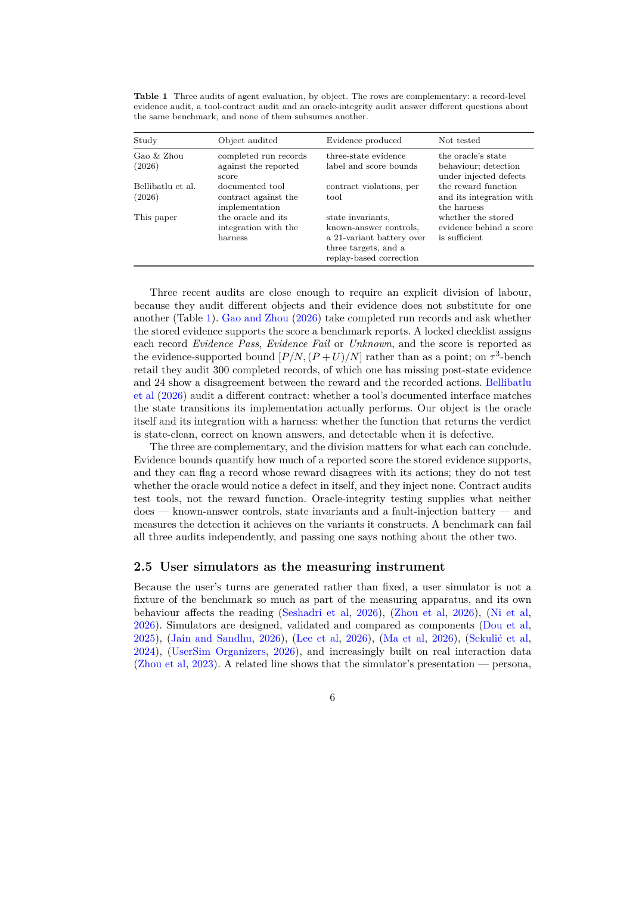
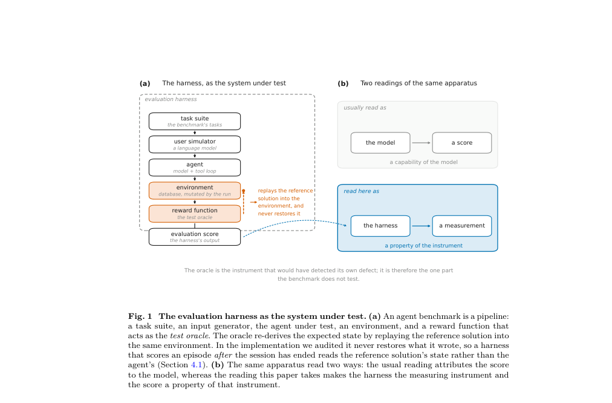
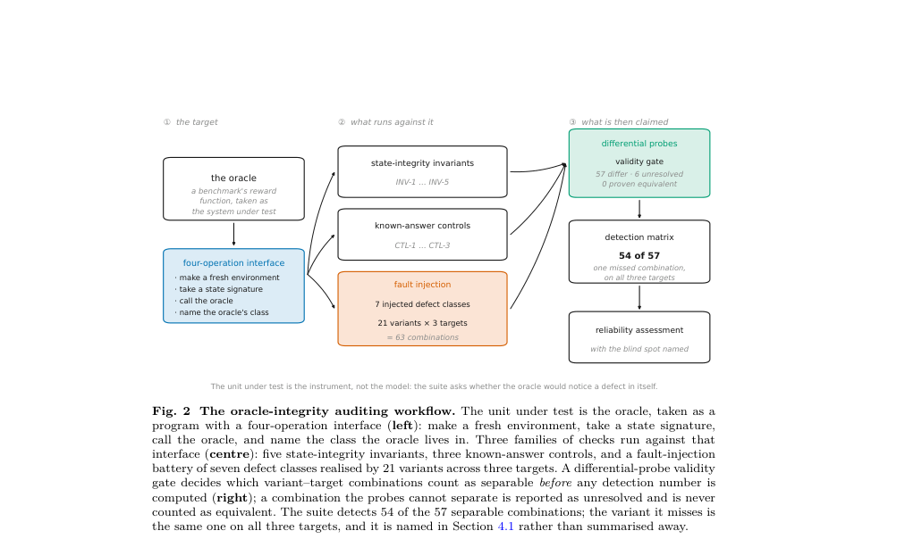
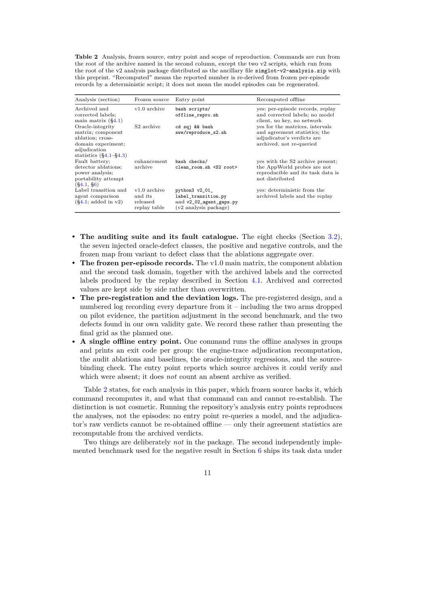
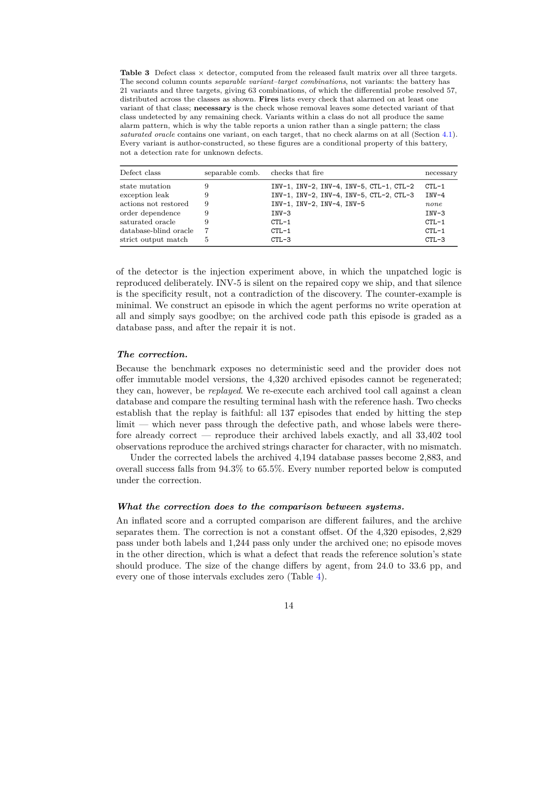
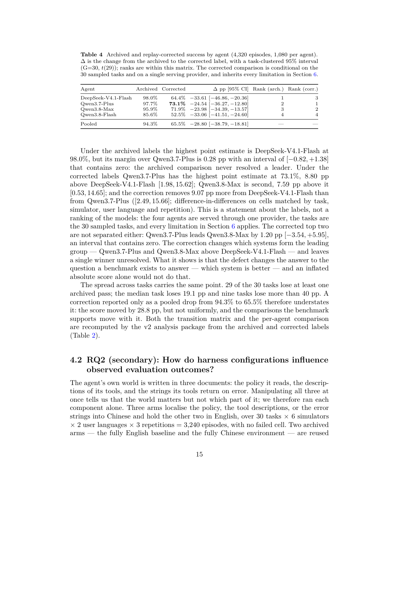
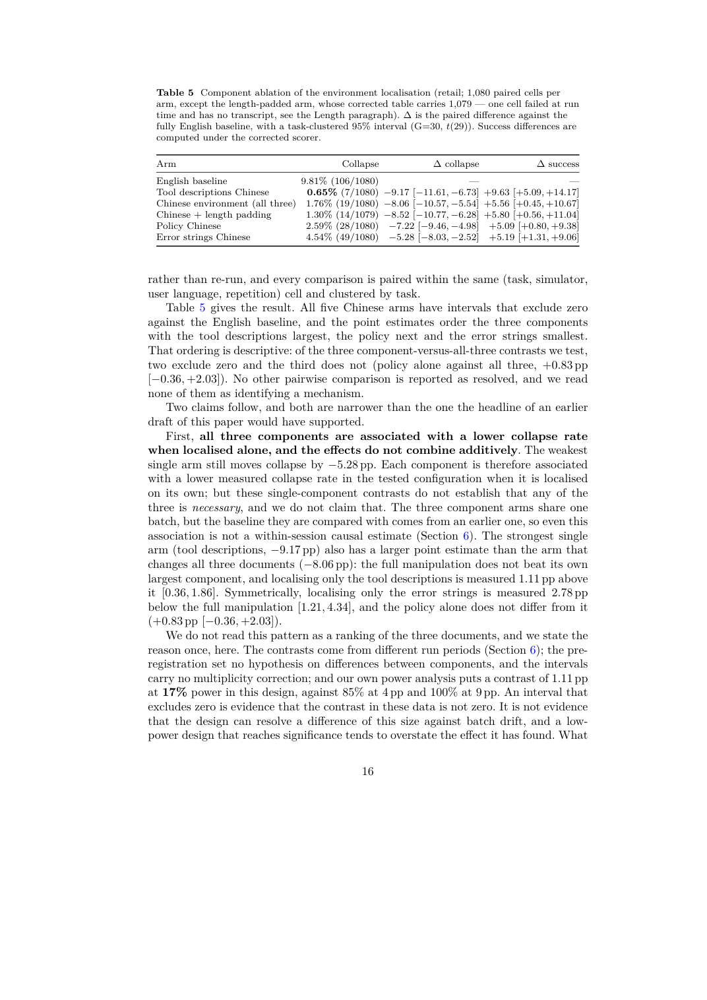

# 论文全部图表题名：中英对照

> 以原论文图号、表号和所在页作为唯一定位。部分英文原题较长，保留原文标题首行；中文为其意义概括，非图内全部文字翻译。

### 表1｜原稿第 6 页

**中文题名：** 三类智能体评价审计方法及其审计对象

**英文题名首行：** Table 1 Three audits of agent evaluation, by object. The rows are complementary: a record-level

### 图1｜原稿第 8 页

**中文题名：** 将评价框架本身视为被测系统：构件与两种读数解释

**英文题名首行：** Fig. 1 The evaluation harness as the system under test. (a) An agent benchmark is a pipeline:

### 图2｜原稿第 9 页

**中文题名：** 预言机完整性审计流程：不变量、控制测试、故障注入与有效性筛查

**英文题名首行：** Fig. 2 The oracle-integrity auditing workflow. The unit under test is the oracle, taken as a

### 表2｜原稿第 11 页

**中文题名：** 分析结果、冻结数据来源、执行入口与离线复现范围

**英文题名首行：** Table 2 Analysis, frozen source, entry point and scope of reproduction. Commands are run from

### 表3｜原稿第 14 页

**中文题名：** 故障类别与检测器矩阵

**英文题名首行：** Table 3 Defect class × detector, computed from the released fault matrix over all three targets.

### 表4｜原稿第 15 页

**中文题名：** 各智能体归档分数与重放修正分数对照

**英文题名首行：** Table 4 Archived and replay-corrected success by agent (4,320 episodes, 1,080 per agent).

### 表5｜原稿第 16 页

**中文题名：** 环境文本本地化的组件消融实验

**英文题名首行：** Table 5 Component ablation of the environment localisation (retail; 1,080 paired cells per

