# Plan-and-Solve 提示：改善大语言模型的零样本思维链推理

**原论文**：Plan-and-Solve_Prompting
**作者**：Lei Wang、Wanyu Xu、Yihuai Lan、Zhiqiang Hu、Yunshi Lan、Roy Ka-Wei Lee、Ee-Peng Lim
**PDF 页数**：26

> 阅读说明：本文件提供按照原文结构整理的中文学术译述（涵盖研究背景、方法、评价、结果、附录说明），不是逐词、逐句覆盖全部英文的严格全文翻译。原 PDF 全部页面的英语文字、图表和参考文献保留于 `英文原文_逐页.md`、`original.pdf` 和 `source_pages/`。代码、模型名称、API 和学术引用保留原样，详情见 `QA_逐页核查.md`。

## 论文摘要（中文译文）

近年来，大语言模型（LLM）在多种自然语言处理任务中取得显著成绩。为了完成多步骤推理任务，少样本思维链（Few-shot CoT）提示通常依赖人工编写的逐步推理示例；零样本思维链（Zero-shot-CoT）通过在问题后追加“Let’s think step by step”（让我们一步一步思考）免除了人工示例，但仍存在计算错误、缺失推理步骤和语义误解三类问题。为了缓解推理步骤缺失，本文提出“规划并求解”（Plan-and-Solve，PS）提示：先为问题设计将其分解为子任务的计划，再依照计划逐项求解。为了进一步减少计算错误并提高推理步骤质量，作者加入更详细的指令，提出 PS+ 提示。研究在十个数据集、三类推理任务上测试了这两种方法。使用 GPT-3 的结果表明，所提出的零样本提示方法在全部数据集上显著优于 Zero-shot-CoT，与零样本程序化思维（PoT）提示相比具有可比或更好表现，并在数学推理任务中达到接近八示例 CoT 的成绩。论文代码见 https://github.com/AGI-Edgerunners/Plan-and-Solve-Prompting 。

## 图片与原文索引

- 全文英文逐页提取：[英文原文_逐页.md](./英文原文_逐页.md)
- 逐页原稿截图：[逐页原稿_视觉索引.md](./逐页原稿_视觉索引.md)
- 图表索引：[图表索引.md](./图表索引.md)
- 核查与翻译覆盖说明：[QA_逐页核查.md](./QA_逐页核查.md)

---

## 中文正文（按 PDF 页码对应）

### PDF 第 1 页

## 1. 引言（上）
大语言模型在复杂推理任务中取得很大进展，但解决数学、常识及符号推理问题往往需要生成一系列正确的中间步骤。少样本 CoT 通过人工示范推理过程提高准确率；Zero-shot-CoT 则只在问题后添加一句“让我们一步一步思考”，从而避免逐题准备示范。不过，作者发现这种零样本策略仍可能因计算失误、遗漏必要推理步骤、误解语义而失败。图1对 GSM8K 上的错误类型进行统计：计算错误 7%、步骤缺失 12%、语义误解 27%（基于抽样的 100 道题）。

作者据此提出 PS 和 PS+ 两类零样本提示。PS 让模型先制订解题计划再执行；PS+ 进一步要求提取相关变量和数值，计算中间结果并注意计算正确性与常识一致性。

**Figure 1：Zero-shot-CoT 在 GSM8K 上的计算、漏步骤与语义理解错误分布**

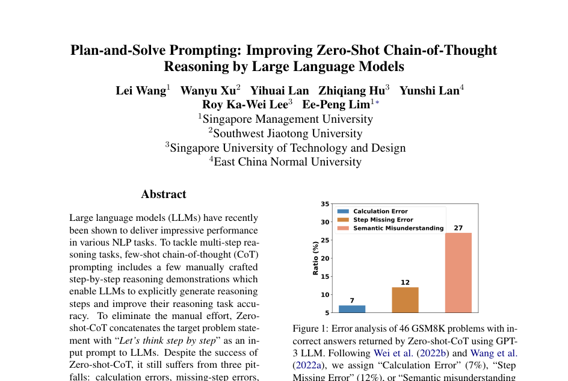

<small>对照：[原稿第 1 页](./source_pages/page-001.jpg) · [英文全文](./英文原文_逐页.md)</small>

---

### PDF 第 2 页

## 1. 引言（续）
对抽样的数学题，Zero-shot-CoT 的三大错误来源分别是：计算出现差错；因推理链较长而跳过部分必要步骤；对题目含义或推理连续性理解不当。PS 用明确的“先计划、后执行”替代笼统的“逐步思考”，而 PS+ 继续强化对变量抽取和中间计算的要求。

PS 的核心英文提示词为：

> Let's first understand the problem and devise a plan to solve the problem. Then, let's carry out the plan and solve the problem step by step.

对应中文：先理解问题并制订解决方案，然后执行计划，逐步求解。

PS+ 加入更具体的约束：识别相关变量及其数值、制订完整计划、计算中间变量、注意数值计算与常识、逐步给出答案。作者在数学推理、常识推理、符号推理共十个基准上实验，并报告 PS+ 优于 Zero-shot-CoT，在若干场景下可达到八示例 CoT 的水平。

## 2. Plan-and-Solve 提示
与少样本 CoT 需要展示若干完整示范不同，PS 使用零样本提示产生推理文本，再额外使用答案提取提示获取便于自动评分的最终答案。

<small>对照：[原稿第 2 页](./source_pages/page-002.jpg) · [英文全文](./英文原文_逐页.md)</small>

---

### PDF 第 3 页

## 2.1 第一步：生成推理过程
作者以模板 `Q: [X]. A: [T]` 表示输入，其中 `[X]` 是问题，`[T]` 是触发推理的指令。Zero-shot-CoT 的 `[T]` 为“Let's think step by step”，PS 则明确要求“devise a plan”（制订计划）以及“carry out the plan”（执行计划）。模型据此生成包含分步方案及答案的推理文本，默认采用贪心解码，仅生成一条推理链。

PS+ 进一步要求首先抽取相关变量与相应数值，计算中间变量，并特别注意正确计算和常识。作者假定明确识别相关变量可以减少关键信息遗漏，从而降低步骤缺失。图2比较了 Zero-shot-CoT 与 PS 在同一道舞蹈班比例题上的解题过程：前者可能跳步骤得到错误答案，后者先规划各类学生人数的计算顺序，再按顺序求解。

## 2.2 第二步：答案提取（起）
完成推理后，将原问题、推理输出及“Therefore, the answer (arabic numerals) is”（因此，答案〔阿拉伯数字〕为）等提取指令组合，要求模型输出符合评价格式的最终结果，而不是直接比较冗长的推理文本。

**Figure 2：Zero-shot-CoT、PS 和答案提取提示的对比示例**

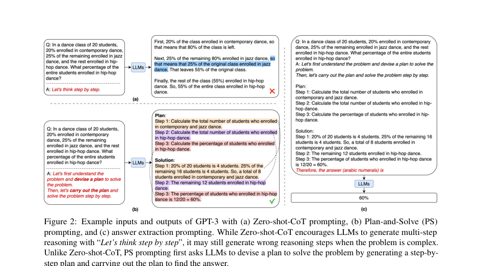

<small>对照：[原稿第 3 页](./source_pages/page-003.jpg) · [英文全文](./英文原文_逐页.md)</small>

---

### PDF 第 4 页

## 2.2 第二步：答案提取（续）
例如，计算 Grace 与 Alex 的总重量，推理文本包含 `125 + 498 = 623 pounds`；答案提取阶段只返回 `623`。图3展示 PS 与 PS+ 的不同：PS+ 在求解前明确提取变量及其数值，且提示模型检查中间计算，因此能缓解计算失误。

## 3. 实验设置：3.1 评价基准
研究使用十个数据集，分为三类。数学推理六项：GSM8K、SVAMP、MultiArith、AddSub、AQuA、SingleEq；常识推理两项：CommonsenseQA（CSQA）和 StrategyQA；符号推理两项：Last Letters 与 Coin Flip。评价目标分别为数值、选项、字符串或是/否回答，表1提供每个数据集样本量与问题平均词数。

**Figure 3：PS 与 PS+ 提示的模型输入输出示例**

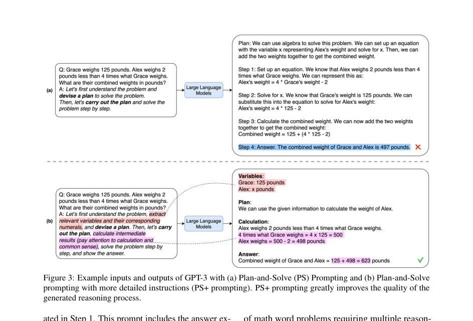

<small>对照：[原稿第 4 页](./source_pages/page-004.jpg) · [英文全文](./英文原文_逐页.md)</small>

---

### PDF 第 5 页

## 3.2 零样本与少样本比较方法
零样本基线包括 Zero-shot-CoT（在问题后添加逐步思考提示）和 Zero-shot-PoT（由模型写 Python 程序，再执行得到答案）；人工少样本基线为 Manual-CoT，使用人工编写的推理示范；自动少样本基线为 Auto-CoT，通过聚类选择多样化问题并自动生成示范推理链。

## 3.3 具体实现
以 GPT-3 175B 为主模型，正文主要采用 `text-davinci-003`；贪心解码温度为零。少样本基线根据各基准原论文建议使用不同数量示例，最终统一报告准确率。

## 4. 实验结果：4.1 数学推理
表2显示，PS+ 在全部六个数学基准上优于 Zero-shot-CoT；除了 GSM8K 提升 2.9 个百分点，其余数据集均提升至少 5 个百分点。PS 的平均准确率为 72.9%，较 Zero-shot-CoT 的 70.4% 高 2.5 个百分点。PS+ 平均准确率 76.7%，高于 Zero-shot-PoT 的 73.5% 和 Auto-CoT 的 75.9%，略低于 Manual-CoT 的 77.6%。这些结果提示，更具体的推理指令能够改善零样本推理质量。

**Table 1：十个评测数据集的领域、样本量与答案格式**

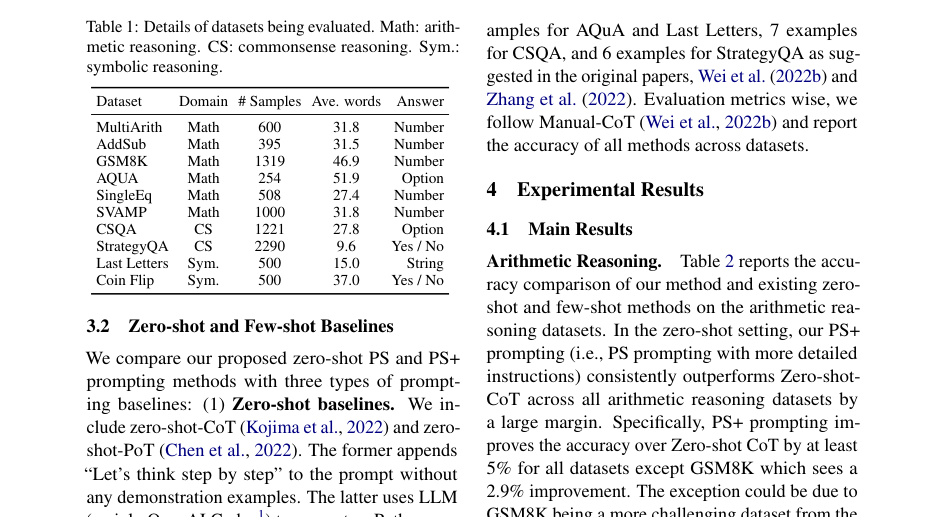

<small>对照：[原稿第 5 页](./source_pages/page-005.jpg) · [英文全文](./英文原文_逐页.md)</small>

---

### PDF 第 6 页

## 4.1 主要结果（续）
**表2：六项数学基准。** Zero-shot-CoT、PoT、PS、PS+ 的平均准确率分别为 70.4%、73.5%、72.9%、76.7%；少样本 Manual-CoT 与 Auto-CoT 分别为 77.6%、75.9%。其中 PS+ 在 MultiArith / GSM8K / AddSub / AQuA / SingleEq / SVAMP 上分别达到 **91.8 / 59.3 / 92.2 / 46.0 / 94.7 / 75.7%**。

**表3：常识推理。** 在 CommonsenseQA 上，PS+ 为 71.9%，优于 Zero-shot-CoT 的 65.2%；在 StrategyQA 上，PS+ 为 65.4%，优于 63.8%。

**表4：符号推理。** 在 Last Letters 上，PS+ 为 75.2%，优于少样本人工 CoT（70.6%）和 Zero-shot-CoT（表格数值 64.8%）；在 Coin Flip 上，PS+ 为 99.6%，接近人工 CoT 的 100% 并超过 Zero-shot-CoT 的 96.8%。

## 4.2 自一致性实验
自一致性（Self-Consistency, SC）通过采样多条推理链并对最终答案多数投票，以降低随机推理路径带来的波动。研究在 GSM8K 和 SVAMP 上设置温度 0.7、采样 10 条推理链；PS+ 与 SC 结合分别达到 73.7%、84.4%，优于未使用 SC 的结果，也超过结合 SC 的 Zero-shot-CoT（70.7%、81.7%），见图4。

**Table 2：六个数学推理数据集上的准确率对比**

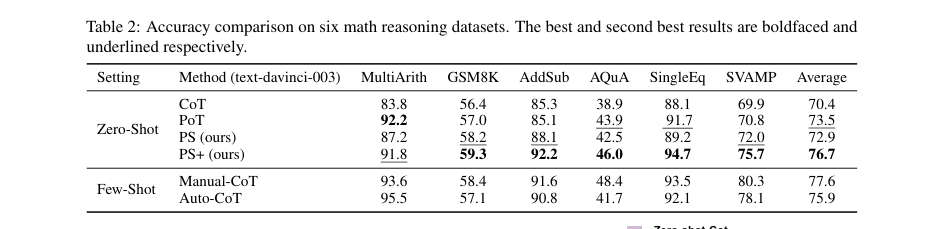

**Table 3：常识推理数据集准确率**

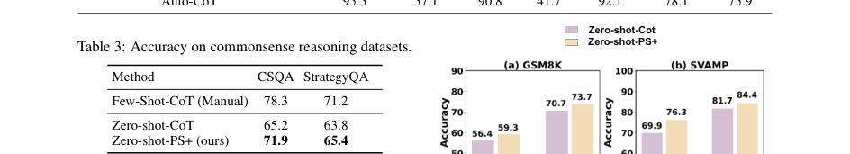

**Table 4：符号推理数据集准确率**

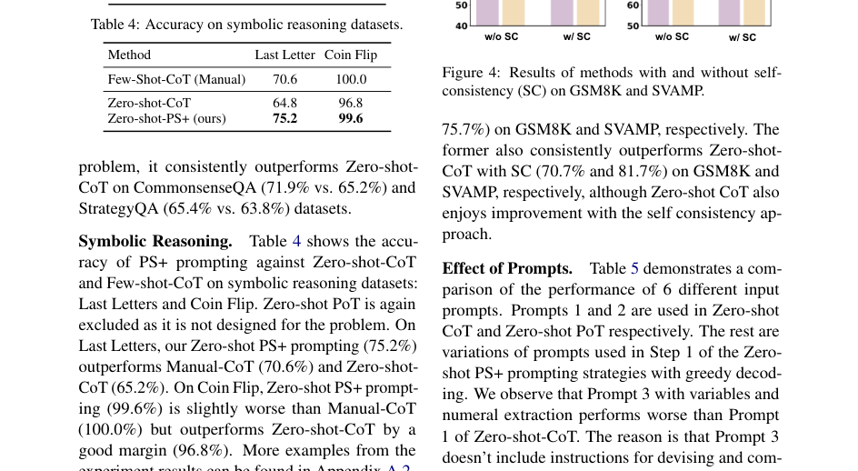

**Figure 4：自一致性（SC）对 GSM8K 和 SVAMP 准确率的影响**

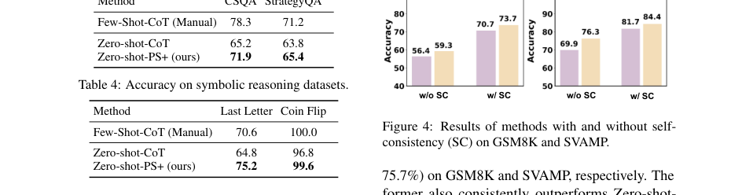

<small>对照：[原稿第 6 页](./source_pages/page-006.jpg) · [英文全文](./英文原文_逐页.md)</small>

---

### PDF 第 7 页

## 4.2 提示词影响分析
表5比较六种触发语句。仅要求“提取变量并逐步求解”而不要求制订并执行计划时，GSM8K 表现只有 50.5%，甚至差于普通 Zero-shot-CoT 的 56.4%。加入计划和执行后可达到 58.2%；再强调变量提取、中间数值计算与常识检查可提高到 59.3%。可见详细指令的作用不是越多越好，而是要有效覆盖计划与实际求解。

## 4.2 错误分析
在 100 道随机抽取的 GSM8K 题目中，Zero-shot-CoT、PS、PS+ 的错误答案分别有 46、43、39 道。计算错误比率依次为 7%、7%、5%；步骤缺失依次为 12%、10%、7%；语义误解分别为 27%、26%、27%。PS+ 主要改善了计算与步骤缺失，对题意理解错误帮助不明显。

研究还分析了变量定义、计划、解题文本与错误类型的相关性。图5显示，存在清晰的变量定义与计划，与计算错误和步骤遗漏呈负相关。随机检查 100 条 PS 输出，有 90 条真正包含计划，说明这种简短提示能够较稳定地引导模型显式规划。

**Table 5：不同触发句对 GSM8K 与 SVAMP 的影响**

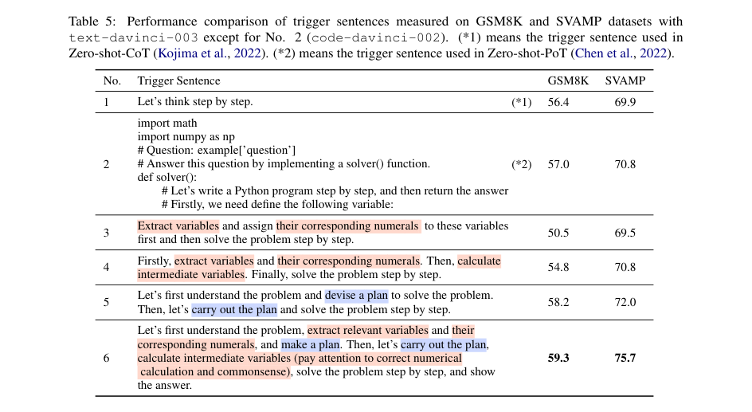

**Table 6：100 道 GSM8K 问题的错误类型分布**

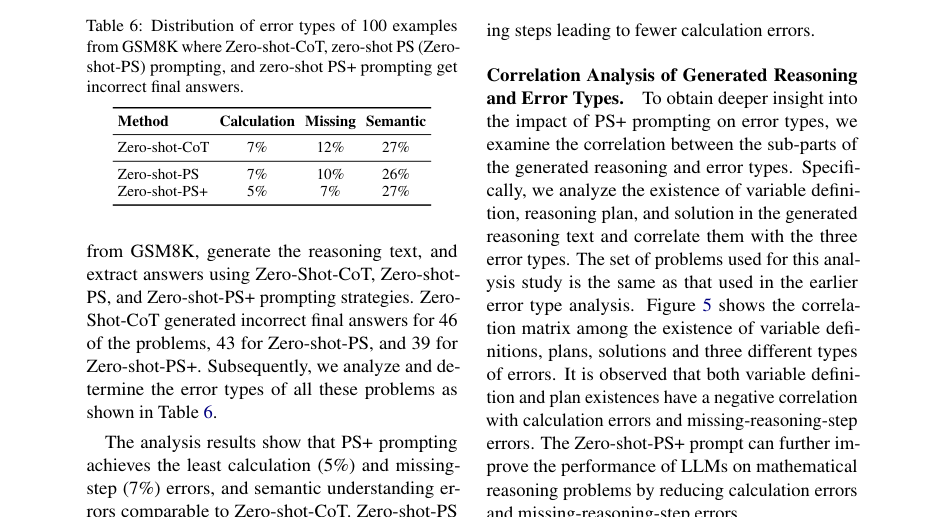

<small>对照：[原稿第 7 页](./source_pages/page-007.jpg) · [英文全文](./英文原文_逐页.md)</small>

---

### PDF 第 8 页

## 5. 相关工作
**5.1 自然语言处理中的推理。** 数学推理需要概念理解与多步计算，常识推理依赖世界知识判断，符号推理依赖形式规则操作。早期方法尝试使用标注推理步骤或模型生成解释来增强预训练模型，但高质量复杂推理难以稳定生成。大规模模型随着参数增长表现出更强推理能力，然而仍可能在多步骤任务上发生错误。

**5.2 提示方法。** CoT 提示以示例引导模型生成逐步推理。后续研究分别从提示格式、示范选择、提示集成、问题分解与规划等方向改进。PoT 让模型编写并运行代码以分离计算与推理，Auto-CoT 通过聚类和自动生成示范减少人工工作。本文的差异是不用人工示范，直接要求模型明确制订和执行计划，并通过详细指令减少常见错误。

## 6. 结论（起）
PS 和 PS+ 使用先规划、再执行的零样本方案缓解普通 Zero-shot-CoT 的计算与漏步骤问题。

**Figure 5：变量定义、计划和最终答案与错误类型之间的相关性**

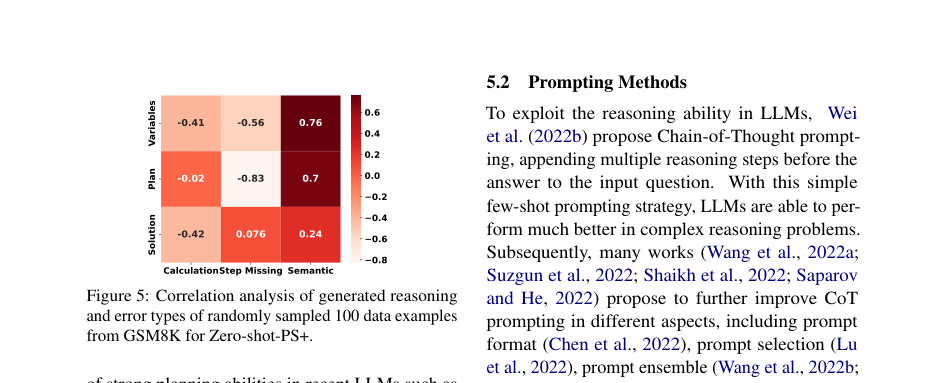

<small>对照：[原稿第 8 页](./source_pages/page-008.jpg) · [英文全文](./英文原文_逐页.md)</small>

---

### PDF 第 9 页

## 6. 结论（续）
作者在三类推理任务的十个基准上验证了 PS+ 的改进作用：它通常优于早期零样本基线，在不少数学数据集上接近人工少样本 CoT。PS+ 的效果表明，对模型说明“应如何完成推理过程”，而不只是要求“逐步思考”，可能产生更可靠的中间步骤。作者还提出将规划与求解思想推广到非推理任务，以及进一步细化计划的研究方向。

## 7. 局限性
一是模型对提示词表述较敏感，设计有效的指令仍需要一定人工努力；二是虽然 PS/PS+ 可以降低计算与步骤缺失错误，但对语义误解改善有限，仍需研究更有效的引导机制。

## 8. 伦理
实验依赖公开数学、常识与符号推理基准。作者说明使用的数据集许可证情况，并指出提示词不涉及收集个人信息，也不包含针对个人或群体的歧视性描述。

## 参考文献（起）
原稿自本页开始列出参考文献，正式作者、论文题目和会议名称以附带的英文全文为准。

<small>对照：[原稿第 9 页](./source_pages/page-009.jpg) · [英文全文](./英文原文_逐页.md)</small>

---

### PDF 第 10 页

## 参考文献（续）
本页为主要参考文献书目。为确保检索与引用精确性，保留作者、英文题名、年份及发表信息，完整内容请查看按页提取的英文原文和 PDF 原稿截图。

<small>对照：[原稿第 10 页](./source_pages/page-010.jpg) · [英文全文](./英文原文_逐页.md)</small>

---

### PDF 第 11 页

## 参考文献（续）与 A. 附录
**附录A**分为两部分：（A.1）所有尝试过的触发提示语及其定量成绩；（A.2）零样本 PS+ 在不同数据集上的实际输出示例。除特别说明外，附录实验采用 GPT-3 `text-davinci-003`。表7—16记录各数据集的提示语对比，表17—26记录完整问答与生成推理示例。

<small>对照：[原稿第 11 页](./source_pages/page-011.jpg) · [英文全文](./英文原文_逐页.md)</small>

---

### PDF 第 12 页

## A.1 全部触发语对比：表7—9
表7针对 AQuA、表8针对 GSM8K、表9针对 MultiArith，对比了不同“先理解问题—制订计划—抽取变量—执行求解”的英文触发提示。它们不是新的模型架构，而是对 PS+ 提示句的具体措辞实验。AQuA 的最佳候选达到 46.0%，GSM8K 的候选达到 59.3%，MultiArith 的候选达到 91.8%。为确保提示词能够原样用于复现，表中的英文原句与原图均保留。

**Table 7：AQuA 的提示语变体及准确率**

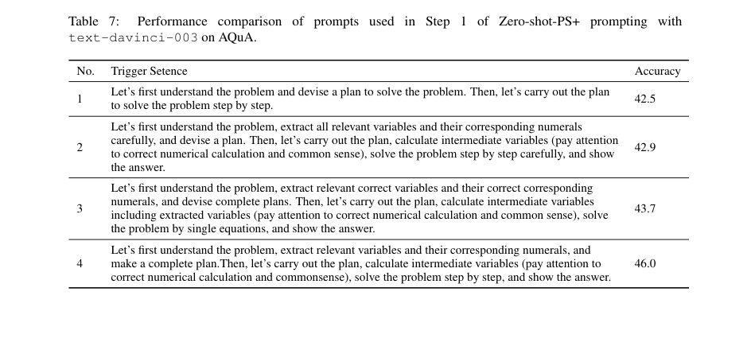

**Table 8：GSM8K 的提示语变体及准确率**

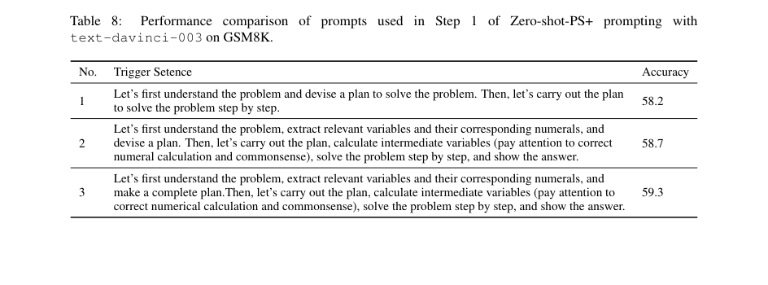

**Table 9：MultiArith 的提示语变体及准确率**

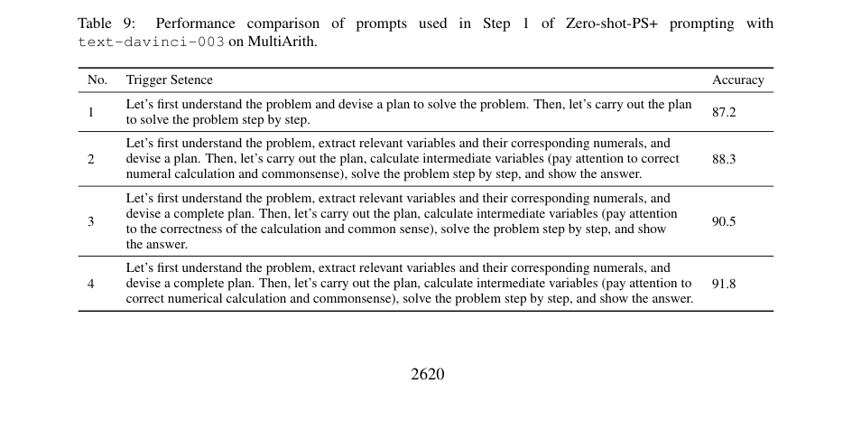

<small>对照：[原稿第 12 页](./source_pages/page-012.jpg) · [英文全文](./英文原文_逐页.md)</small>

---

### PDF 第 13 页

## A.1 全部触发语对比：表10—14
这一页分别给出 SVAMP、AddSub、SingleEq、CommonsenseQA、StrategyQA 的触发句与准确率。在复现实验时应注意，不同数据集的“最佳提示词”可能存在微小措辞变化；这些差异会对模型输出造成影响。原始英文触发词、数值和顺序保留在截图中，中文稿强调这些变体是在计划、变量、计算及常识检查要求上的不同组合。

**Table 10：SVAMP 的提示语变体及准确率**

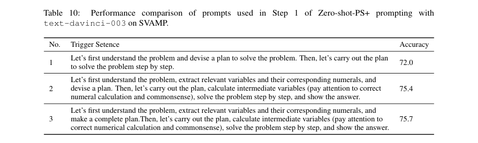

**Table 11：AddSub 的提示语变体及准确率**

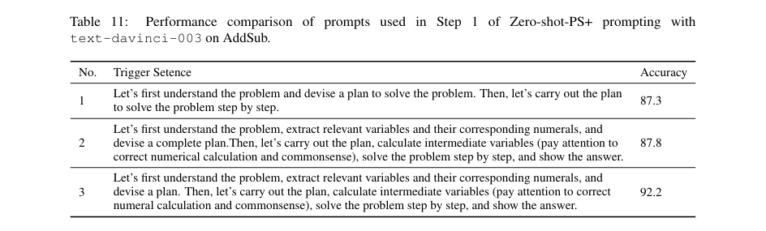

**Table 12：SingleEq 的提示语变体及准确率**

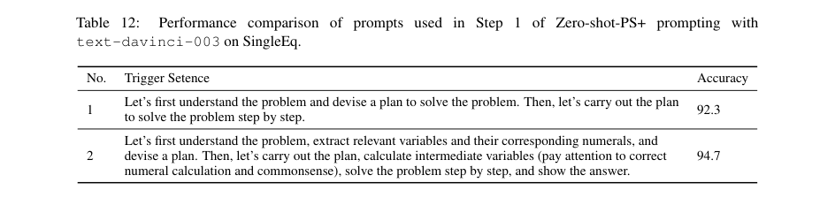

**Table 13：CommonsenseQA 的提示语变体及准确率**

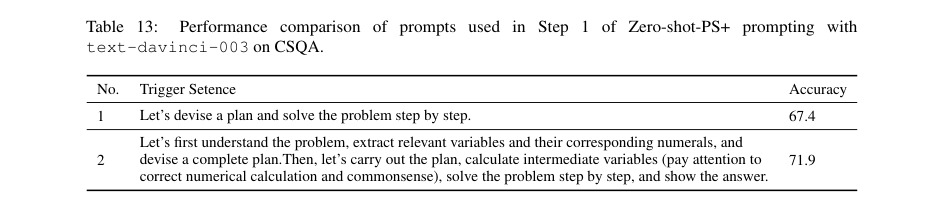

**Table 14：StrategyQA 的提示语变体及准确率**

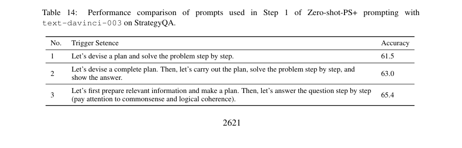

<small>对照：[原稿第 13 页](./source_pages/page-013.jpg) · [英文全文](./英文原文_逐页.md)</small>

---

### PDF 第 14 页

## A.1 全部触发语对比：表15—16
表15与表16进一步展示 Last Letters 与 Coin Flip 等符号任务上的提示词效果。此类任务主要依赖正确维持符号变换顺序；多次验证并不必然带来提升。原论文表格逐项截图保留。

**Table 15：Last Letters 的提示语变体及准确率**

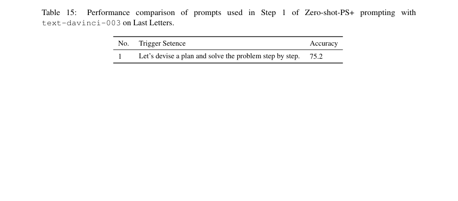

**Table 16：Coin Flip 的提示语变体及准确率**

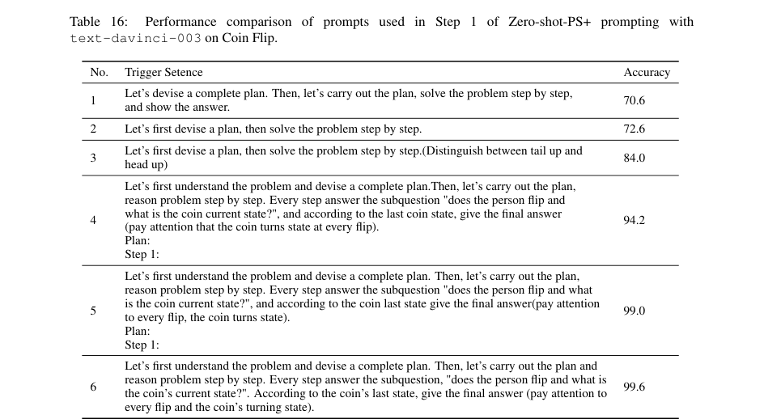

<small>对照：[原稿第 14 页](./source_pages/page-014.jpg) · [英文全文](./英文原文_逐页.md)</small>

---

### PDF 第 15 页

## A.2 零样本 PS+ 示例：表17（AQuA）
该页展示代数应用题的原始问题、规划、变量提取、逐步求解和最后答案。从格式上可以看出，PS+ 将文字题拆成数量定义与算术操作，再通过提示要求模型复述中间结果。完整英文问题和模型回答见表17截图。

**Table 17：AQuA 的 PS+ 问答示例**

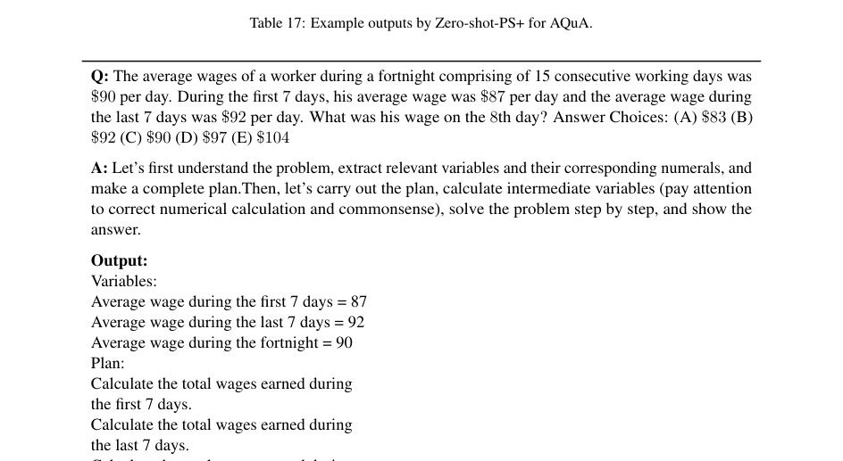

<small>对照：[原稿第 15 页](./source_pages/page-015.jpg) · [英文全文](./英文原文_逐页.md)</small>

---

### PDF 第 16 页

## A.2 示例：表18（GSM8K）
该页的示例涉及 James 每周多次短跑的数量计算。PS+ 首先明确每周次数、每次训练的短跑数量与总时间跨度，再逐步计算。该示例展示“变量—计划—求解—答案”的层次结构，完整数字和英语原文见表18。

**Table 18：GSM8K 的 PS+ 问答示例**

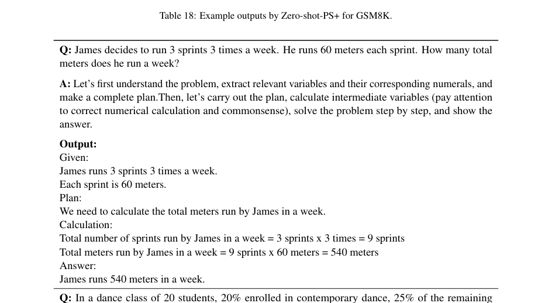

<small>对照：[原稿第 16 页](./source_pages/page-016.jpg) · [英文全文](./英文原文_逐页.md)</small>

---

### PDF 第 17 页

## A.2 示例：表19（MultiArith）
示例为学校食堂采购苹果的多步骤加减法问题。PS+ 将原始数量、使用数量和剩余数量分解为逐项计算，并依次执行，突出对中间变量的显式表示。完整题干、模型推理与结果保持原图。

**Table 19：MultiArith 的 PS+ 问答示例**

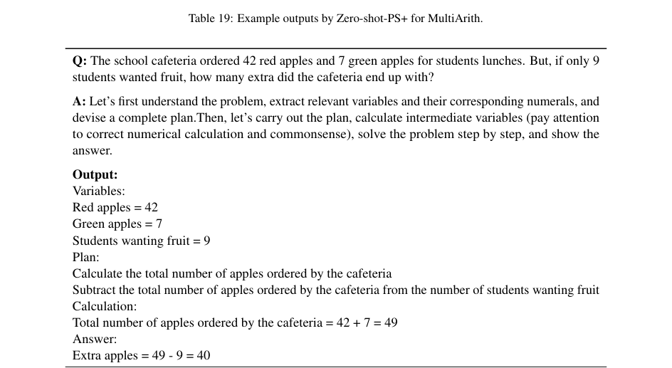

<small>对照：[原稿第 17 页](./source_pages/page-017.jpg) · [英文全文](./英文原文_逐页.md)</small>

---

### PDF 第 18 页

## A.2 示例：表20（SVAMP）
本页为改写的数学文字题，要求根据物品总数与部分数量进行推导。PS+ 分离已知条件、未知数及算术关系，先给出计划，再完成计算。

**Table 20：SVAMP 的 PS+ 问答示例**

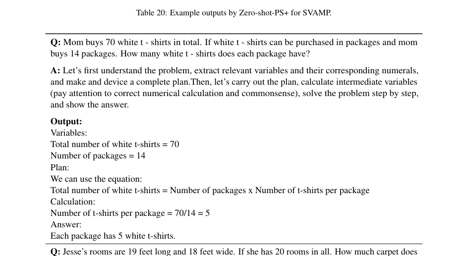

<small>对照：[原稿第 18 页](./source_pages/page-018.jpg) · [英文全文](./英文原文_逐页.md)</small>

---

### PDF 第 19 页

## A.2 示例：表21（AddSub）
这是一个关于谷仓干草捆数量变化的加减法例题。提示通过明确起始数量、增加数量和剩余数量来避免漏掉某次操作。

**Table 21：AddSub 的 PS+ 问答示例**

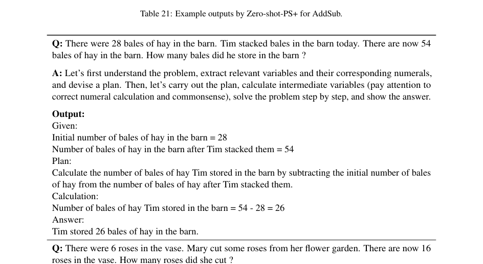

<small>对照：[原稿第 19 页](./source_pages/page-019.jpg) · [英文全文](./英文原文_逐页.md)</small>

---

### PDF 第 20 页

## A.2 示例：表22（SingleEq）
示例涉及餐馆账单分摊，需抽取各参与者的信息并建立等式。完整题目、变量和生成步骤见附图。

**Table 22：SingleEq 的 PS+ 问答示例**

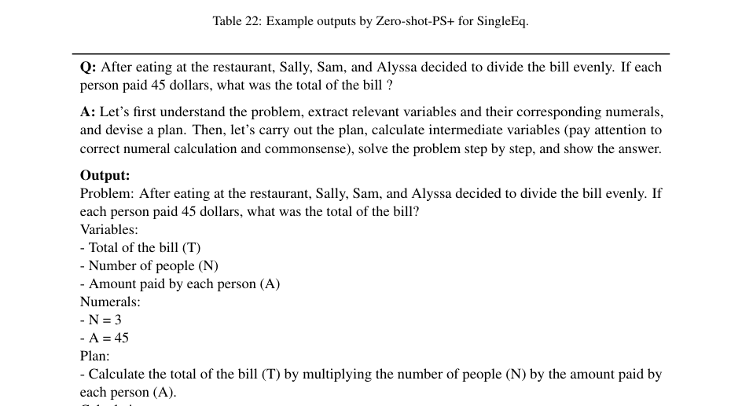

<small>对照：[原稿第 20 页](./source_pages/page-020.jpg) · [英文全文](./英文原文_逐页.md)</small>

---

### PDF 第 21 页

## A.2 示例：表23（CommonsenseQA）
本页为常识选择题，模型不仅需要输出选项，还要解释选项与问题线索的匹配关系。作者将 PS+ 拓展到无需明确数值计算的常识推理。

**Table 23：CommonsenseQA 的 PS+ 问答示例**

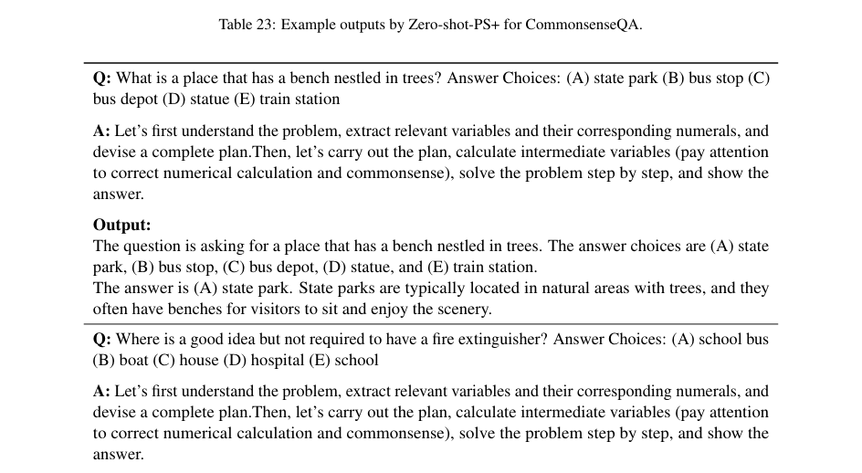

<small>对照：[原稿第 21 页](./source_pages/page-021.jpg) · [英文全文](./英文原文_逐页.md)</small>

---

### PDF 第 22 页

## A.2 示例：表24（StrategyQA）
示例提出“1976年奥运会获得最多金牌的国家现在是否仍然存在”等问题。模型需先识别历史国家，再判断其政治实体是否延续，最后给出是/否答案。这体现了把常识问题转化为连贯子问题的思路。

**Table 24：StrategyQA 的 PS+ 问答示例**

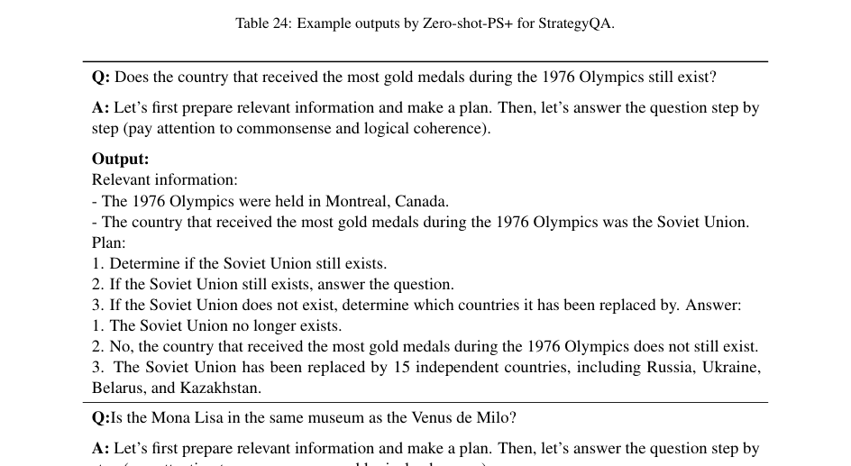

<small>对照：[原稿第 22 页](./source_pages/page-022.jpg) · [英文全文](./英文原文_逐页.md)</small>

---

### PDF 第 23 页

## A.2 示例：表25（Last Letters）
该例要求提取给定词语中每个单词的末尾字母并按顺序连接。计划式提示将多个独立的字母提取步骤显式排列，以避免漏词和顺序错误。

**Table 25：Last Letters 的 PS+ 问答示例**

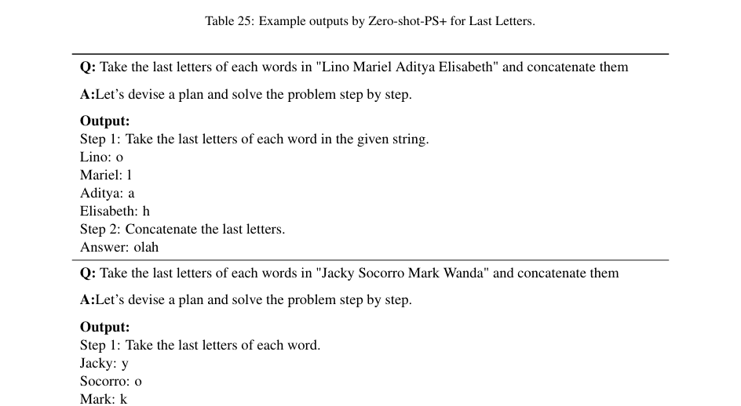

<small>对照：[原稿第 23 页](./source_pages/page-023.jpg) · [英文全文](./英文原文_逐页.md)</small>

---

### PDF 第 24 页

## A.2 示例：表26（Coin Flip）
该页演示硬币朝向推理。模型应先记录初始正反面状态，再按时间顺序逐次处理是否翻转，以最终状态回答是/否问题。英文任务与全部生成步骤保存在表26。

**Table 26：Coin Flip 的 PS+ 问答示例**

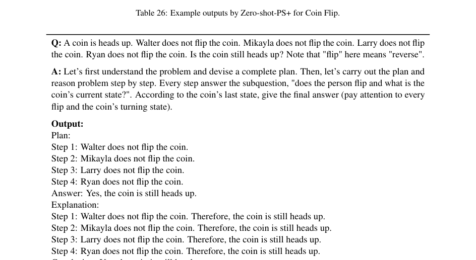

<small>对照：[原稿第 24 页](./source_pages/page-024.jpg) · [英文全文](./英文原文_逐页.md)</small>

---

### PDF 第 25 页

## ACL 2023 Responsible NLP Checklist（上）
最后两页为投稿附带的负责任 NLP 研究检查表，涉及数据、模型、实验、伦理、局限性以及可重复性等自检项目。这部分是会议规范性附录而非研究实验结果，完整原始文本和勾选项请查看附带英文全文与原稿截图。

<small>对照：[原稿第 25 页](./source_pages/page-025.jpg) · [英文全文](./英文原文_逐页.md)</small>

---

### PDF 第 26 页

## ACL 2023 Responsible NLP Checklist（续）
此页延续负责任 NLP 检查表，包括实验设置、超参数、数据来源、数据许可及伦理披露等要求。保留原始英文表单文本与逐页截图供学术引用和复核。

<small>对照：[原稿第 26 页](./source_pages/page-026.jpg) · [英文全文](./英文原文_逐页.md)</small>

---

## 专业术语对照

| 英文原词 | 中文处理 |
|---|---|
| Plan-and-Solve (PS) | 规划并求解 |
| PS+ | 增强规划求解提示 |
| Zero-shot-CoT | 零样本思维链 |
| Few-shot CoT | 少样本思维链 |
| Self-Consistency (SC) | 自一致性 |
| reasoning trajectory | 推理轨迹 |
| missing-step error | 步骤缺失错误 |
| calculation error | 计算错误 |
| semantic misunderstanding | 语义误解 |
| trigger sentence | 触发句 |

## 参考文献说明

论文参考文献书目保留作者、年份、刊物、英文题名和 DOI 的正式格式。请参见 [参考文献与英文附录_原文.md](./参考文献与英文附录_原文.md)，以及原始 PDF。
