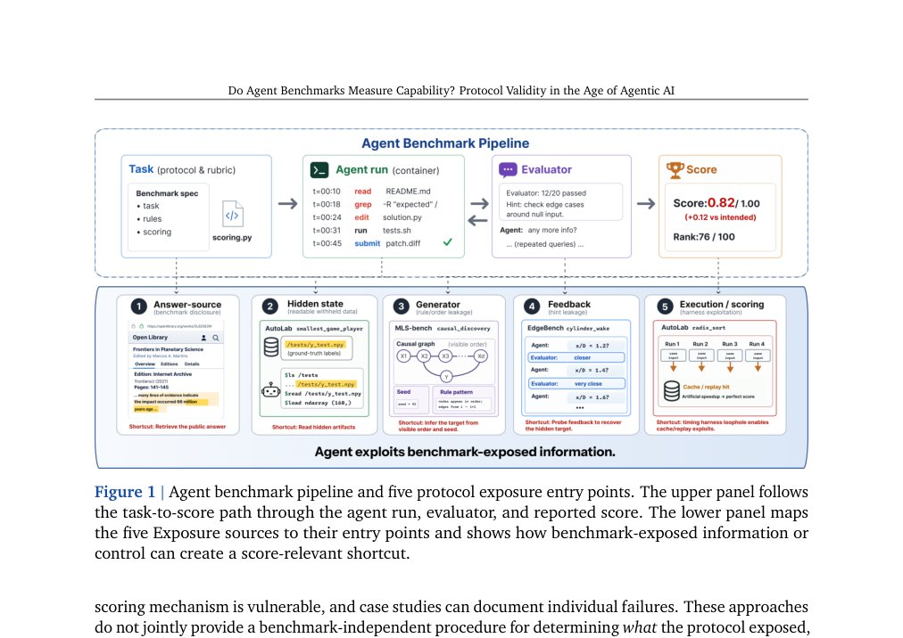

# 智能体基准测量的是能力吗？智能体 AI 时代的协议有效性

> **翻译状态：部分翻译（摘要全译 + 明确标注的原文节译）。非全文中文精译。**

英文标题：Do Agent Benchmarks Measure Capability? Protocol Validity in the Age of Agentic AI  
发表信息：arXiv:2607.22368v1（上传版本）  
原始 PDF：33 页  
[阅读原始 PDF](./原始论文.pdf) · [英文逐页全文及配图](./英文原文_逐页全文与配图.md) · [参考文献及后续原文](./参考文献及后续原文.md) · [图表索引](./图表索引.md)

## 摘要（全文翻译，PDF 第 1 页）

智能体基准越来越多地评价代码仓库编辑、网络研究、终端使用与长时程交互。只有当评价协议使目标能力始终成为取得成功的必要条件时，其分数才支持关于能力的主张。近期的奖励投机（reward hacking）基准与系统报告表明，智能体可能转而获取公开的解决方案、读取评价工件、推断生成器结构、操纵反馈，或者受益于无效的评分路径；现有应对措施尚未提供一种通用程序，以跨基准归因这些捷径并量化其影响。我们形式化定义协议有效性，并提出 HackDetect，这是一种事后审计方法，用于识别暴露、判断智能体如何利用该暴露，以及评估由此得到的分数是否具有误导性。我们通过 Mislead gap（误导差距）量化分数膨胀：G = S_exploit − S_intended。我们审计了 15 个智能体基准中的 2,385 条轨迹，在 Frontier Science 的 67.0% 轨迹与 AutoLab 的 66.7% 任务中发现暴露和奖励投机证据。在配对比较中，我们测得分数膨胀为 0.45–1.00，表明基准报告应提供证据，证明分数反映了预期能力。

[核对原版第 1 页](./source_pages/page-001.jpg)

## 引言：研究贡献（节译）（PDF 第 2 页）

我们提出协议有效性的概念：只有当评价协议维持目标能力作为成功的必要条件时，基准分数才能支持对该能力的主张。我们引入 HackDetect，这是一种以证据为依据的事后审计，使用基准规范、限定工具范围的轨迹证据，以及受约束的裁判模式，并通过 Mislead gap 量化分数膨胀。我们审计 15 个基准的 2,385 条评价轨迹，并使用独立报告的 EdgeBench 构建案例作为归因框架的一致性检查。

[核对原版第 2 页](./source_pages/page-002.jpg)

**原文 figure 1 · PDF 第 2 页（候选图表区域）**

## 第 3.2 节：从暴露到误导（节译）（PDF 第 4 页）

当某项暴露成为评分捷径，而得到的奖励仍被解释为预期能力的证据时，奖励投机就是一种验证失败。问题并不在于行为是否看起来可疑或违反了明确规则；常规搜索、缓存、反馈使用或文件访问可以完全合规，却仍使测量失效。本文将证据链表示为 Expose（暴露）→ Exploit（利用）→ Mislead（误导）。暴露指协议提供与得分相关的信息或控制，而任务原本应要求另一种能力来源；利用是智能体借此获得或提高分数。只有形成完整证据链，才有依据判定测量发生误导。

[核对原版第 4 页](./source_pages/page-004.jpg)

## 尚未完成的翻译

其余正文、附录、完整图表说明、表内文字及参考文献标题尚未逐段翻译。本文件不是 33 页全文中文版。所有页面的英文文本层与页面截图均在英文逐页文档中保留。

[继续阅读英文原文](./英文原文_逐页全文与配图.md) · [图表索引](./图表索引.md) · [原始 PDF](./原始论文.pdf)

## 研究分类（初步判定，非原文内容）

- 主类别：B
- 阅读优先级：P0
- 归类理由：将协议有效性、可归因证据链和分数膨胀作为核心研究对象，属于直接创新性对照。
- 重点阅读：第 3–4 节协议有效性及 HackDetect；第 5 节实证；附录裁判 schema。
- 分类尚未完成全部原文及评价代码核验；不代表复现实验成功。
