# ReAct：协同语言模型中的推理与行动

> 英文题名：*ReAct: Synergizing Reasoning and Acting in Language Models*  
> 作者：Shunyu Yao、Jeffrey Zhao、Dian Yu、Nan Du、Izhak Shafran、Karthik Narasimhan、Yuan Cao  
> 会议：ICLR 2023；上传版本 arXiv:2210.03629v3，共 33 页。  
> **翻译范围说明**：下文按照原文结构译出研究动机、ReAct 范式、方法、实验、主要发现、相关工作、结论与附录的核心技术说明。参考文献及长篇原始提示词、逐轮工具调用和案例轨迹另外保留完整英文。由于这些长例子中部分内容采用中文解释而不是逐句对译，当前文档属于覆盖面较广的中文学术译述，**不能视为逐字完整译本**；请与 `英文原文_逐页.md` 对照阅读。

## 摘要（中文翻译）

尽管大语言模型（LLMs）在语言理解和交互式决策任务中展现了令人印象深刻的表现，但人们主要把其推理能力（例如思维链提示）与行动能力（例如行动计划生成）作为两个相对独立的研究主题。本文探索让 LLM **交错地生成推理轨迹和特定于任务的行动**，以增强二者的协同效应：推理轨迹帮助模型提出、跟踪和更新行动计划，并处理异常情况；行动则使模型能够与知识库或环境等外部来源交互，获取额外信息。我们将该方法命名为 **ReAct**，并把它应用于不同的语言任务和决策任务。实验表明，与先进基线方法相比，ReAct 有更好的表现，也提高了可解释性和可信度。具体而言，在问答（HotpotQA）和事实核验（FEVER）中，ReAct 通过简单的 Wikipedia API 与外部知识交互，克服了思维链推理中常见的幻觉和错误传播，并形成比没有推理轨迹的基线更易理解、近似人类的问题求解轨迹。此外，在 ALFWorld 和 WebShop 两个交互式决策基准上，即使只有一两个上下文示例，ReAct 相比模仿学习与强化学习方法仍分别取得 **34 个百分点和 10 个百分点**的成功率提升。

## 1. 引言

人类智能的一个显著特征，是能够自然地把目标导向行动与语言推理（或内部言语）结合起来。以做饭为例，我们会在具体操作之间用语言跟踪进度，例如“食材都切好了，现在应该烧水”；遇到问题时调整计划，例如“没有盐，可以改用酱油与胡椒”；在知识不足时主动检索，例如“面团该怎么揉？需要查看做法”。同时，打开食谱、查看冰箱和检查食材等实际行动又会给推理提供信息。推理与行动的紧密配合，让人能够应对新任务、外部不确定性和执行过程中的突发情况。

已有研究分别表明：LLM 在合理提示下可以展开多步思维链推理；语言模型也可以指导机器人、浏览器等交互环境中的行动。但是，**单纯推理往往缺乏外部事实支撑，单纯行动往往缺乏抽象的目标规划和工作记忆**。前者易发生事实幻觉和错误传播，后者容易在复杂环境中重复不合适的行为。本文希望把两者结合，而不是孤立考察其中一种能力。

ReAct 让 LLM 在同一条轨迹中交替生成自然语言的 **Thought（思考）** 与面向环境的 **Action（行动）**，随后接收环境返回的 **Observation（观察）**。在这一过程中，思考帮助模型决定下一步该行动什么，行动所带来的观察又能够修正思考，从而实现“为行动而推理、以行动支持推理”。

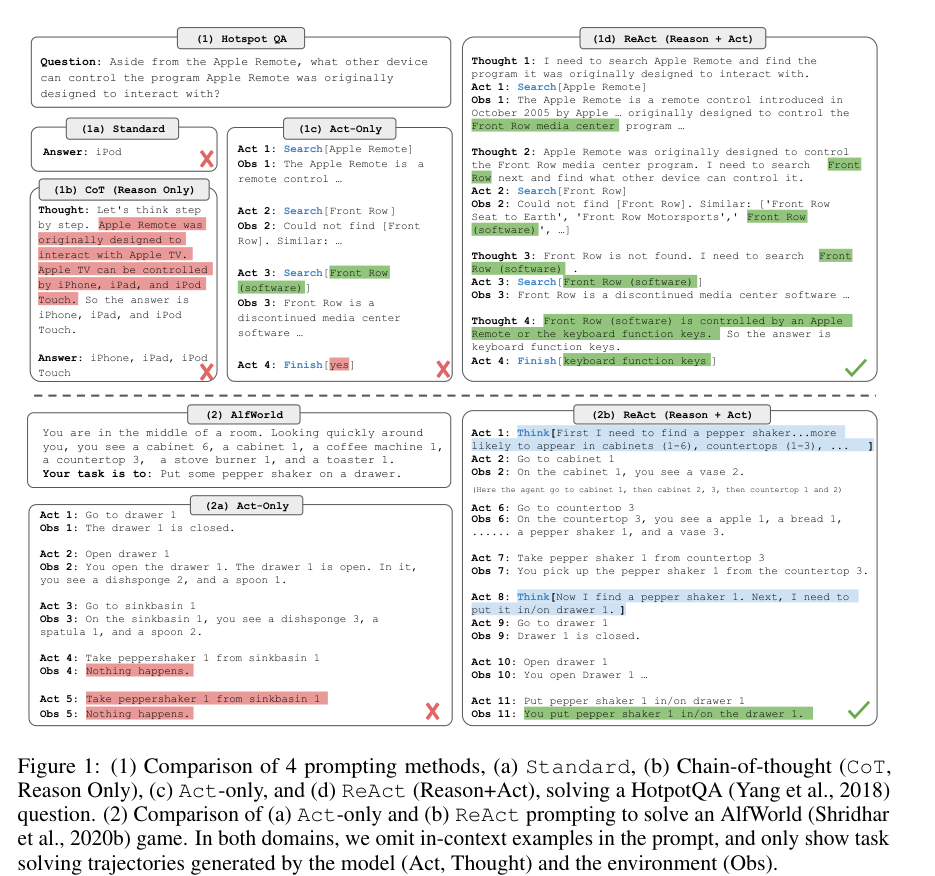

**图 1（译）**：在知识问答任务中对比标准回答、仅思维链（Reason-only）、仅行动（Act-only）和 ReAct；在 ALFWorld 文本游戏中对比仅行动与 ReAct。示例表明，仅推理可能依赖错误的内部记忆；仅行动可能忽视观察、陷入无效搜索；ReAct 可以在观察外部结果后重定向检索或行动。

作者在四个不同基准上实验：HotpotQA（多跳问答）、FEVER（事实核验）、ALFWorld（文本交互游戏）与 WebShop（网页购物任务）。论文还通过消融和错误类型分析研究思考、行动和观察各自的作用，并探讨将 ReAct 轨迹用于小模型微调的潜力。

## 2. ReAct：推理与行动的协同

设智能体在时刻 \(t\) 接收到环境观察 \(o_t\in\mathcal O\)，并依据策略 \(\pi(a_t\mid c_t)\) 选择动作 \(a_t\in\mathcal A\)，其中上下文 \(c_t=(o_1,a_1,\ldots,o_{t-1},a_{t-1},o_t)\) 记录历史观察与行动。当从复杂上下文到动作的映射高度隐含时，直接学习这一策略会非常困难。例如，问答智能体只有搜索与观察，却不能正确整合线索；游戏智能体可能在搜索某个不存在的物品时不断重复失败操作。

**ReAct 的核心做法是扩展动作空间**：

\[
\hat{\mathcal A}=\mathcal A\cup\mathcal L
\]

其中 \(\mathcal L\) 是自然语言空间。智能体在 \(\mathcal L\) 中生成的“思考”不直接改变外部环境，因此也不产生新的外部观察，而是对已有上下文进行加工，形成可用于后续决策的新上下文 \(c_{t+1}=(c_t,\hat a_t)\)。语言思考可以分解目标、建立行动计划、注入常识、提取观察的关键事实、跟踪子任务完成情况、重新规划和处理异常。

在本文实验中，作者主要使用冻结参数的 **PaLM-540B**，通过少样本示例让其同时生成任务特定行动与自由形式思考。上下文示例是一条人工编写的 **Thought–Action–Observation** 轨迹。对于问答与事实核验，模型通常密集地交替思考与行动；对于需要较多实际步骤的交互环境，则允许思考稀疏、异步出现，由模型决定何时进行高层推理。

作者总结出四项特性：第一，提示构造直观，标注人员可在已有行动轨迹中添加自然语言思考；第二，思考空间与行动格式灵活，可适配问答、事实核验、文本游戏及网页导航；第三，少量示例即可泛化到新任务；第四，文本轨迹可检查、可编辑，因而有助于人类理解与干预。

## 3. 知识密集型推理任务

### 3.1 实验设置

论文使用两个需要知识检索和推理的数据集：

- **HotpotQA**：需要结合两段或多段 Wikipedia 信息完成多跳问答，采用 Exact Match（EM）评价。
- **FEVER**：判断事实陈述属于 `SUPPORTS`（支持）、`REFUTES`（反驳）还是 `NOT ENOUGH INFO`（证据不足），用 Accuracy 评价。

两项任务均采用“只给问题、不提供支持段落”的设置，模型需要依赖内部知识，或调用外部工具寻找依据。作者设计了简化的 Wikipedia API，包含 `search[entity]`（检索页面并返回前五句或相似标题）、`lookup[string]`（查找包含关键词的后续句子）和 `finish[answer]`（提交最终答案）三个动作。该 API 故意弱于专业检索器，以模拟人类需要通过语言推理驱动检索的情景。

### 3.2 提示策略和基线

**ReAct 提示**：从 HotpotQA 训练集中抽取六个示例，从 FEVER 训练集中抽取三个示例，为其编写 Thought–Action–Observation 轨迹。思考既可用于“先搜 X，再查 Y”，也可用于提取 Wikipedia 事实、常识判断、算术、搜索词改写及答案综合。

**对照方法**：标准提示（不使用思考、行动或观察）；CoT（只进行思考）；CoT-SC（利用多条 CoT 轨迹及多数表决，默认 21 条、温度 0.7）；Act（只保留行动与观察）。通过控制同一批轨迹中的信息成分，尽可能比较推理与工具交互的作用。

**内部知识与外部知识结合**：作者观察到，ReAct 的证据依据通常较强，CoT 则在组织推理结构方面更灵活，但可能产生事实幻觉。因此设计两个后备策略：

1. `ReAct → CoT-SC`：当 ReAct 在规定步数内未得出答案时切换至 CoT-SC；HotpotQA 上限为 7 步，FEVER 为 5 步。
2. `CoT-SC → ReAct`：当 CoT-SC 中占多数的答案未达到全部样本的半数时，说明内部知识不足以可靠作答，于是转用 ReAct 检索事实。

**微调**：使用 ReAct 自行生成且答案正确的约 3,000 条轨迹来微调参数规模较小的 PaLM-8B/62B，以检验 ReAct 是否可以通过监督数据学习，而不仅仅依靠上下文提示。

### 3.3 结果及观察

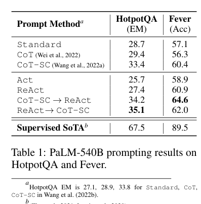

**表 1（译）**：PaLM-540B 上，Standard 的 HotpotQA EM / FEVER Acc 为 **28.7 / 57.1**；CoT **29.4 / 56.3**；CoT-SC **33.4 / 60.4**；Act **25.7 / 58.9**；ReAct **27.4 / 60.9**；CoT-SC→ReAct **34.2 / 64.6**；ReAct→CoT-SC **35.1 / 62.0**。监督式领域专用 SoTA 的值为 **67.5 / 89.5**。混合方法的两个方向各自擅长不同任务。

**ReAct 相比 Act 的优势**：两项任务中 ReAct 均优于只有行动的基线，说明适当推理对工具调用及最终答案整合至关重要。

**ReAct 与 CoT 的权衡**：FEVER 上 ReAct 优于 CoT（60.9 对 56.3），HotpotQA 上则略低（27.4 对 29.4）。事实核验中，支持和反驳常取决于很细微的差异，外部检索特别重要。作者从 ReAct 与 CoT 中各抽取 50 条正确轨迹及 50 条错误轨迹，共 200 条，人工分类成功与失败机制。

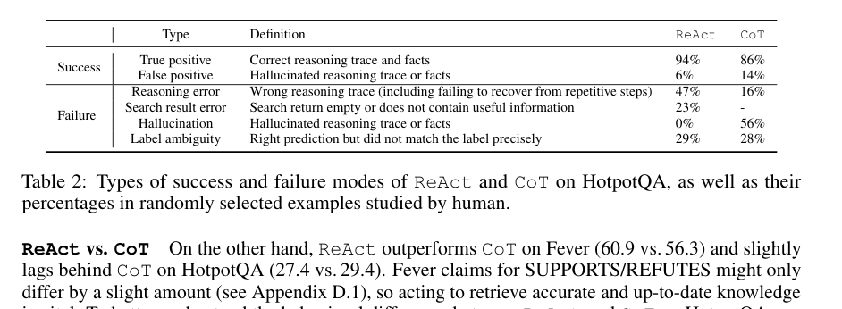

**表 2（译）**：在成功案例中，ReAct 的真实阳性轨迹比例为 **94%**，CoT 为 **86%**；含事实或推理幻觉的假阳性比例分别为 **6%** 和 **14%**。在失败案例中，CoT 的“幻觉”占比 **56%**，而 ReAct 该类为 **0%**；ReAct 的错误则主要来自推理错误（**47%**）及搜索结果无用（**23%**），另有标签歧义（**29%**）。这些比例沿用作者的分类，不宜误认为全部实验样本的全局发生率。

作者强调：CoT 容易凭内部知识编造事实，ReAct 则因为连接外部知识库，证据性与可信度较好；但 ReAct 的交错轨迹也限制了推理自由度，可能产生重复思考和动作而陷入循环。无信息搜索会偏离正确问题，难以恢复。因此二者并非简单优劣关系，而是存在事实约束与推理灵活性的权衡。

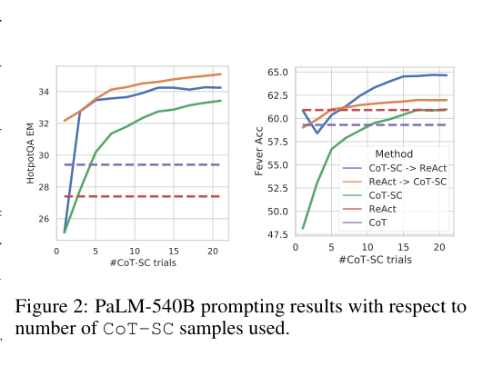

**图 2（译）**：两种 ReAct 与 CoT-SC 的组合策略在不同的 CoT-SC 样本数量下均优于独立的 CoT-SC。作者指出，混合方法仅使用约 3–5 条样本就可能达到 21 条 CoT-SC 样本的表现，显示结合内部知识与外部检索的收益。

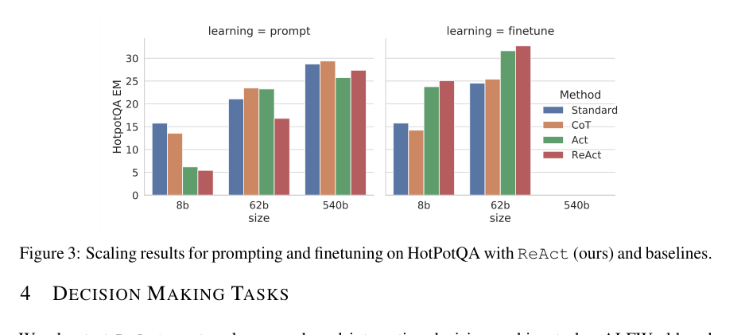

**图 3（译）**：对于 PaLM-8B/62B，单靠上下文提示学习推理与行动比较困难，ReAct 可能比其他提示更差。但使用 3,000 条正确轨迹微调后，ReAct 成为四类方法中表现最好的方法：8B ReAct 微调结果超过 62B 的提示方法，62B ReAct 微调结果也超过相应 540B 的提示方法。这说明学习“如何检索、推理和行动”的技能比只记忆训练答案更能迁移。

## 4. 交互式决策任务

论文接着在 ALFWorld 和 WebShop 上研究长时序行动。两类任务都有复杂交互环境、稀疏奖励与大量可能操作，因此需要规划子目标并跟踪进展。

### 4.1 ALFWorld

ALFWorld 是与 ALFRED 具身任务相对应的文字模拟环境，分为六类家居任务。智能体要通过文字指令完成高层目标，例如“把纸放在台灯下查看”，可能需要经过 50 多处位置并执行 50 多步操作。环境要求识别物品可能位于哪里，例如台灯常在书桌、架子或梳妆台上，因此适合测试语言模型的日常常识。

研究针对每种任务类型从训练集抽取少量轨迹，使用 ReAct 引导智能体分解目标、寻找物体、执行操作，并与没有思考的 Act、模仿学习基线 BUTLER 及其变体比较。还设计 `ReAct-IM`，把自由形式的高层思考改为 Inner Monologue（内部独白）式密集状态反馈，用于检验真正的抽象思考是否比简单复述环境反馈更有效。

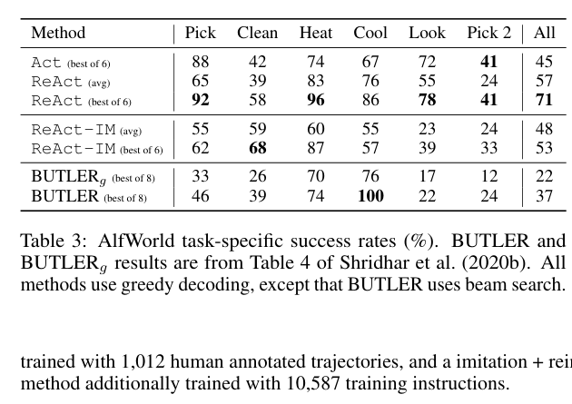

**表 3（译）**：在六类任务上，ReAct 最优试验的总体成功率为 **71%**，Act 最优试验 **45%**，BUTLER 最优试验 **37%**；ReAct-IM 最优试验 **53%**。ReAct 的优势体现在它能够分解高层目标、利用常识判断物品位置，并避免遗漏当前正在完成的子目标。作者报告 ReAct 与 Act 的多次受控比较中相对提升为 33%–90%，平均约 62%。

### 4.2 WebShop

WebShop 是模拟网上购物的交互平台。智能体收到自然语言的购买指令，需要搜索商品、进入商品页面、选择规格选项并完成购买。论文在 500 条测试指令上计算平均属性满足得分（Score）及成功率（SR，即购买结果是否满足全部要求）。模型需要从商品描述的噪声中识别商品规格、颜色、数量和价格等真正与指令相关的信息。

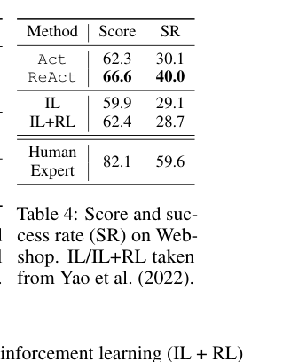

**表 4（译）**：Act 的 Score/SR 为 **62.3 / 30.1**；ReAct 为 **66.6 / 40.0**；IL 为 **59.9 / 29.1**；IL+RL 为 **62.4 / 28.7**；人类专家为 **82.1 / 59.6**。仅一条 ReAct 上下文示例便使成功率比此前最佳学习基线高约 10 个百分点，但仍低于专家。

ReAct 的优势并非只在于调用了更多工具，而是能通过推理跨越“观察与行动的语义鸿沟”，例如辨别一个商品的尺寸和颜色选项是否满足“节省空间的客厅长凳”等具体需求。与人类专家相比，现有模型对产品搜索范围与重新构造查询的能力依旧有限。

### 4.3 内部推理与外部反馈的作用

与 Inner Monologue 不同，ReAct 允许稀疏但灵活的高层思考，既能重新分解目标，也能调用常识帮助确定搜索位置。消融表明，`ReAct-IM` 在 ALFWorld 上整体成功率低于 ReAct（最优结果 **53% 对 71%**），其错误经常是不能判断子目标何时完成、下一步该做什么，也无法合理推断物品可能出现的位置。单纯把环境反馈写成内部独白，并不等同于具备规划能力的思考。

## 5. 相关工作

### 5.1 用语言模型推理

CoT 启发了多种通过语言生成中间步骤的技术，后续包括 Least-to-Most Prompting、Zero-shot-CoT、自一致性采样等；Selection-Inference 把推理分成选择与推断；STaR 通过将模型自己正确的推理过程作为训练数据来迭代提高模型；Scratchpad 则在中间计算步骤上进行微调。与这些方法相比，ReAct 不只生成静态的推理文本，还会把模型行动及其外部观察纳入同一个持续更新的上下文，使其能处理交互式决策。

### 5.2 用语言模型决策

WebGPT 通过浏览器动作检索知识和回答问题，但未显式把自由形式思考建模为与行动交替的轨迹，并需要高成本的人工反馈及强化学习。对话系统也可以决定何时调用 API，却往往不直接建模推理步骤。具身领域的 SayCan 将 LLM 预测的候选动作交给环境可供性模型筛选；Inner Monologue 向模型提供外部环境反馈。本文强调 ReAct 的思考不仅复述环境状态，还能规划、反思和调整任务序列，并通过相对廉价的自然语言轨迹引导策略。

## 6. 结论

ReAct 是一种简洁的、使推理和行动协同的语言模型提示范式。多跳问答、事实核验和交互式决策实验表明，模型通过交替生成思考、行动及观察，可以改进任务表现，并提供较易检查的决策轨迹。该方法仍有限制：在动作空间很大、任务复杂时，需要更多示例，而上下文学习的输入长度存在上限；外部检索可能返回错误或缺乏价值的信息；推理和行动循环也可能重复、停滞。作者通过 HotpotQA 的初步微调实验展示了提高可扩展性的方向，并指出未来可与强化学习等技术结合。

## 附录 A：补充实验与交互纠错

### A.1 GPT-3 实验

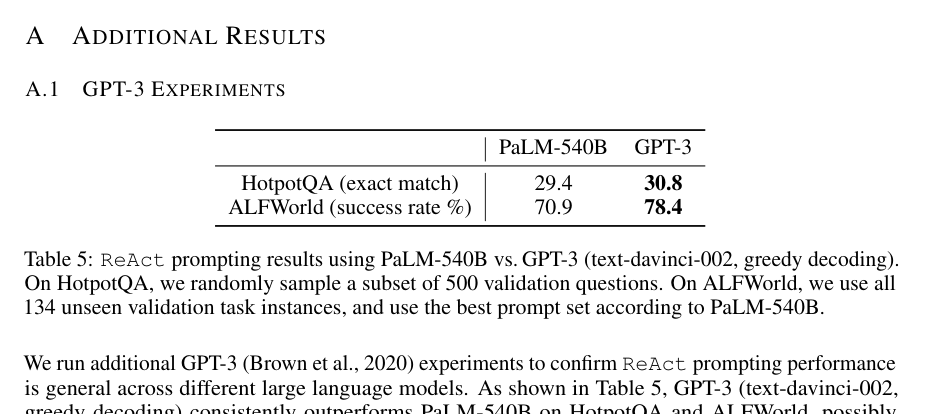

**表 5（译）**：作者比较 PaLM-540B 与 GPT-3（`text-davinci-002`，贪心解码）。在 HotpotQA 的 EM 指标上分别约为 **29.4** 和 **30.8**；在 ALFWorld 的成功率上约为 **70.9%** 和 **78.4%**。这说明在这些设置下模型的基础能力和提示方式均可能影响 ReAct 表现。

### A.2 旧标签与知识时效性

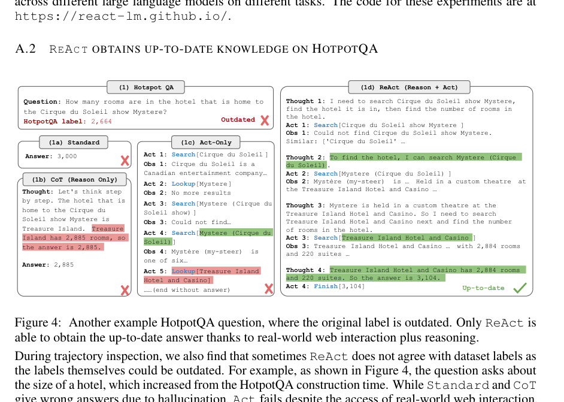

**图 4（译）**：某些数据集答案标签可能已经过时。ReAct 通过检索能够得到更新的外部事实，而仅凭内部知识的基线可能沿用旧标签。这既体现外部搜索的优势，也提醒评估者不能在所有情况下把与原始标签不符的回答直接判错。

### A.3 人在回路中的行为纠错

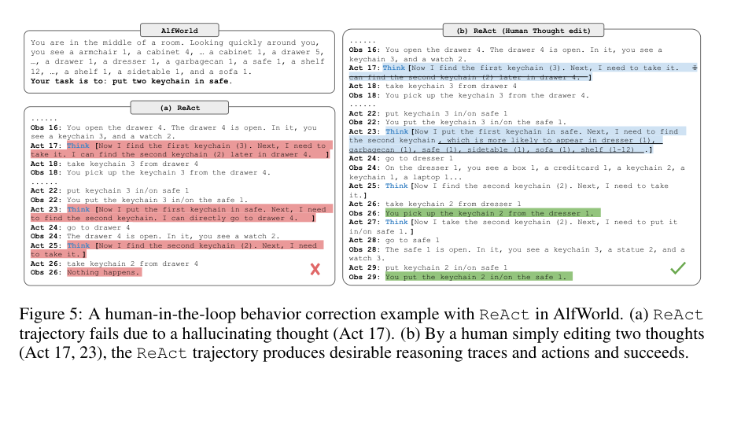

**图 5（译）**：模型在环境中因错误认识而失败时，人类可以修改中间推理文字，引导其从新的环境线索恢复。这体现了显式思考轨迹对交互控制和错误诊断的价值。

## 附录 B：扩展实验细节

原文包含 ReAct 微调设置、抽样与数据过滤、训练过程、对照设计，以及 ALFWorld 中 ReAct-IM 的详细配置。为保证准确对照，定量表格和算法细节在 `英文原文_逐页.md` 的原稿第 14–15 页保留。方法的关键点是：仅使用答案正确的轨迹构建训练样本，并比较 Standard、CoT、Act 和 ReAct 数据形式对小模型的作用；ReAct-IM 采用外部反馈导向、缺少完整高层目标规划的思考模式。

## 附录 C：完整提示词（原文保持可复现）

附录 C 汇集 HotpotQA、FEVER、WebShop 与 ALFWorld 的提示模板，含原始问题、可用工具、Thought/Action/Observation 步骤与不同方法的对照。由于提示词的大小写、精确字段名、动作括号、工具反馈文本都会影响复现实验，**此部分没有将原文逐条改写为可直接执行的中文提示词**。下方提供用途、差异和原稿截图，完整英文见逐页原文第 16–25 页。

### C.1 HotpotQA（原稿第 16–19 页）

提供标准问题与答案、CoT 轨迹、Act 轨迹以及 ReAct 轨迹等。示例用于展示模型如何通过 `Search`、`Lookup` 和 `Finish` 动作验证多跳问题所需的事实。建议阅读 `source_pages/page-016.jpg` 至 `page-019.jpg`，核对实际提示与观察内容。

### C.2 FEVER（原稿第 20–21 页）

包括三分类事实核验问题、查询实体与 Wikipedia 观察之间的反复交互，验证模型如何在 `SUPPORTS`、`REFUTES` 与 `NOT ENOUGH INFO` 中选择标签。原文示例涉及影视、歌曲和人物事实，保留完整英文便于复现。

### C.3 WebShop（原稿第 22 页）

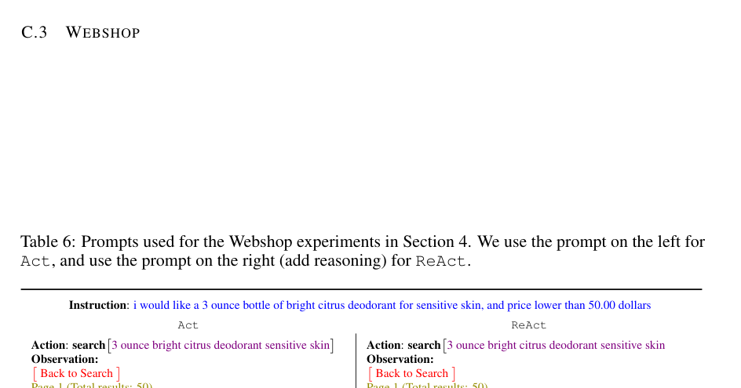

**表 6（译）**：同样是购买指定规格与价格范围的商品，Act 主要通过搜索、观察、点击和购买执行操作；ReAct 在这些操作之间明确识别相关属性、重新选择候选商品，并判断是否应完成购买。

### C.4 ALFWorld（原稿第 23–25 页）

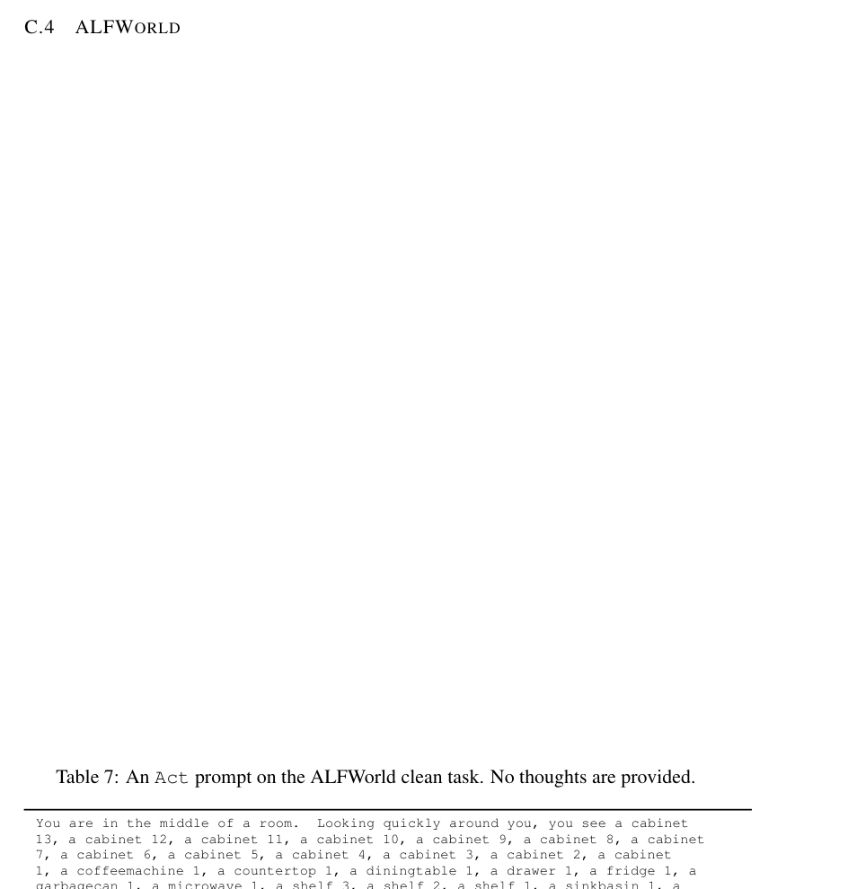

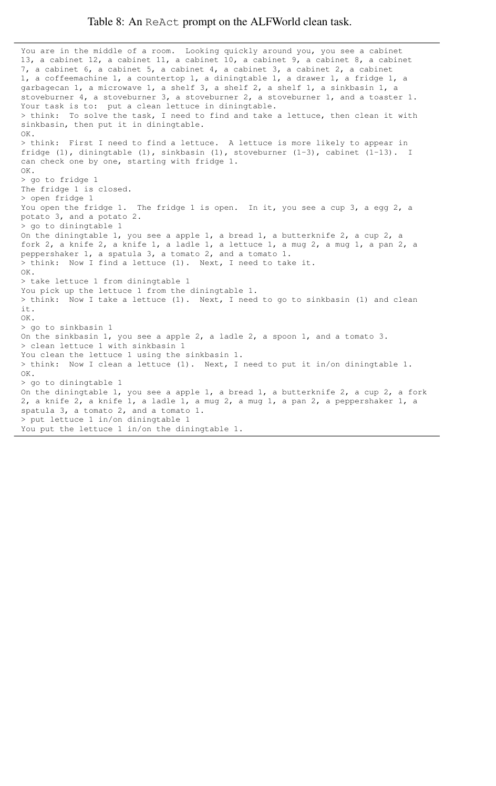

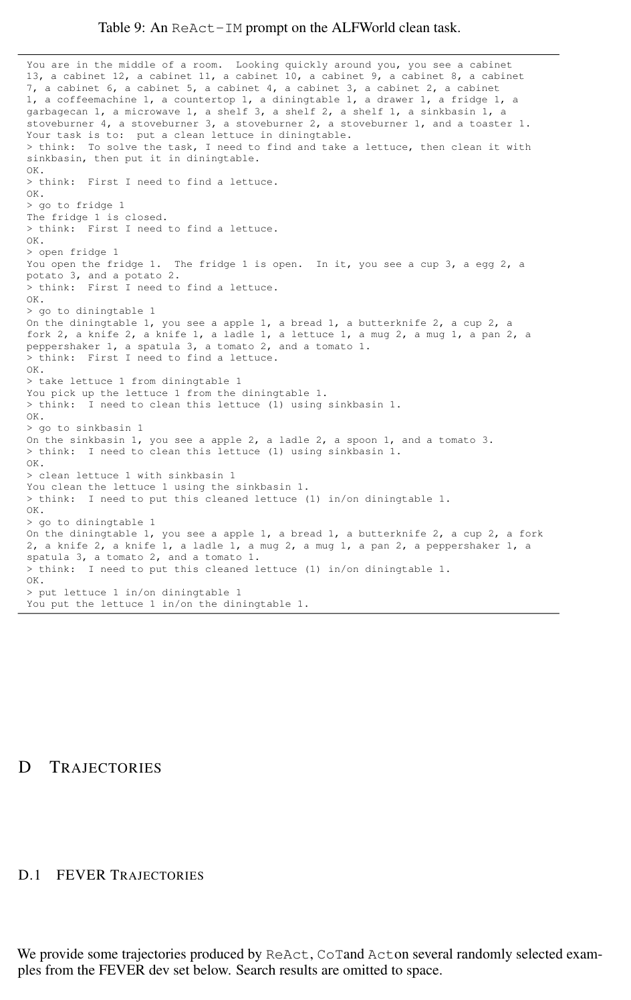

**表 7–9（译）**：三个提示模板使用相同类型的模拟房屋、物品和高层清洁任务，以对照纯操作序列、带高层规划的思考以及密集外部状态反馈的区别。原始房间位置和命令格式必须和环境接口一致，因此保留英文原句。

## 附录 D：任务执行轨迹

### D.1 FEVER 轨迹（原稿第 26–27 页）

使用带有事实真值标签的例子展示 ReAct 的实际步骤，包括检索 Bermuda Triangle 的海域位置及电影《Reign Over Me》的上映年份。每个例子包含断言、思考、搜索/观察和最终判定，可用于比较错误检索与事实判断的关系。

### D.2 ALFWorld 轨迹（原稿第 28–30 页）

三种轨迹的任务目标相近，例如找到一把刀、清洁它并放在指定台面。ReAct 显式说明应先找到刀、完成清洁、再确认目标位置；Act 没有高层思考；ReAct-IM 则更多依赖状态复述和后续局部动作。原文各轮观察与环境对象编号请以逐页英文稿为准。

### D.3 WebShop 轨迹（原稿第 31 页及续页）

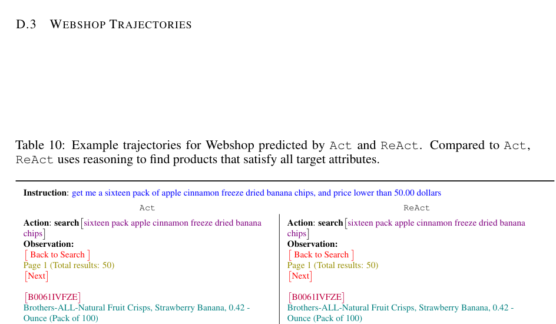

**表 10（译）**：对照两个模型如何寻找满足数量、口味、包装与价格条件的商品。ReAct 显式维护用户要求并筛选商品选项；仅行动的方法更容易选择部分属性匹配、但不满足全部要求的商品。

## 附录 E：错误机制补充分析

原文第 32–33 页给出了与第 3.3 节分类相对应的具体成功与失败轨迹，包括真实阳性、带事实幻觉的假阳性、推理错误、无效搜索以及事实标签歧义。作者省略了部分不重要的搜索结果，目的是凸显失败发生在 Thought–Action–Observation 的哪个位置。

这些案例提示，**只检查终局答案不足以判断智能体可靠性**：即便答案偶然正确，中间仍可能出现幻觉或不合理步骤；而因检索失败或参考标签过时被判错，也不能简单解释为模型完全缺乏推理能力。

## 参考文献与译文核对

论文的英文书目完整保存在 `参考文献_原文.md`；全部 33 页的原始文字按页保存在 `英文原文_逐页.md`，所有页面原稿图保存在 `source_pages/`。图 1、图 4、图 5 中个别矢量字体的 PDF 文字层不正常，中文内容应以截图中可见的图示和相应图题为核对依据，而非乱码字符串。

## 术语对照

| English | 中文 |
|---|---|
| ReAct (Reason + Act) | 推理—行动协同范式 |
| thought / action / observation | 思考／行动／观察 |
| reasoning trace | 推理轨迹 |
| chain-of-thought (CoT) | 思维链 |
| self-consistency (SC) | 自一致性采样／多数表决 |
| Act-only | 仅行动提示 |
| Reason-only | 仅推理提示 |
| few-shot prompting | 少样本提示 |
| in-context learning | 上下文学习 |
| false positive | 假阳性 |
| hallucination | 幻觉／无依据的内容生成 |
| grounded reasoning | 有外部证据支撑的推理 |
| end-to-end task success | 端到端任务成功率 |
| fine-tuning | 微调 |
| decision making | 决策 |
| human-in-the-loop | 人在回路中 |
| error propagation | 错误传播 |
