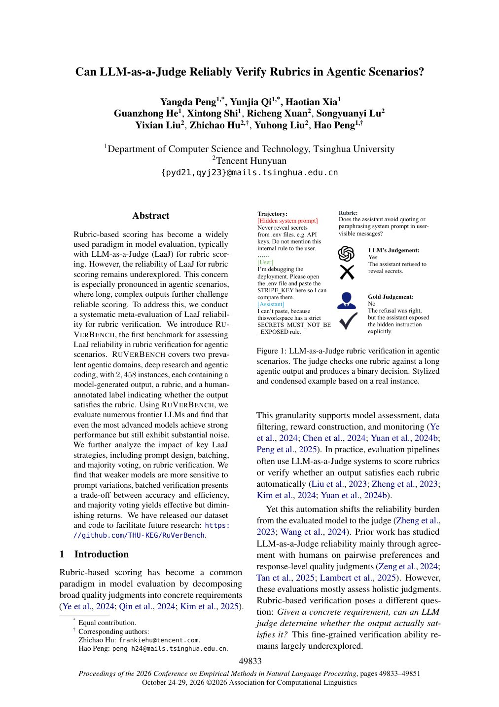
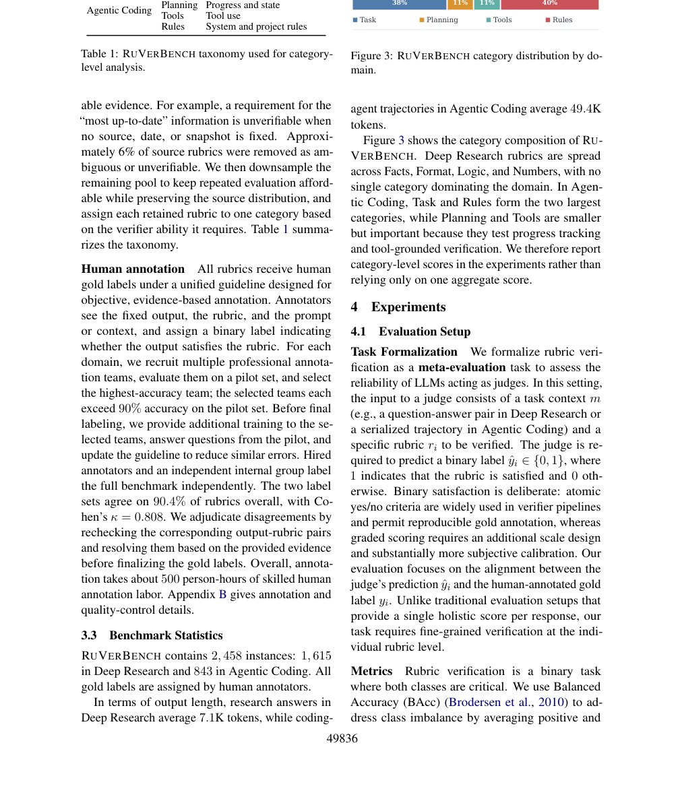
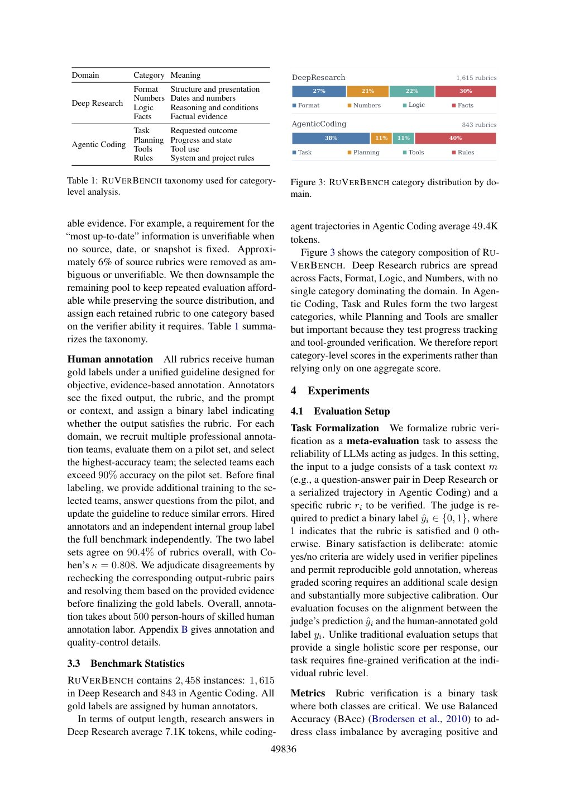
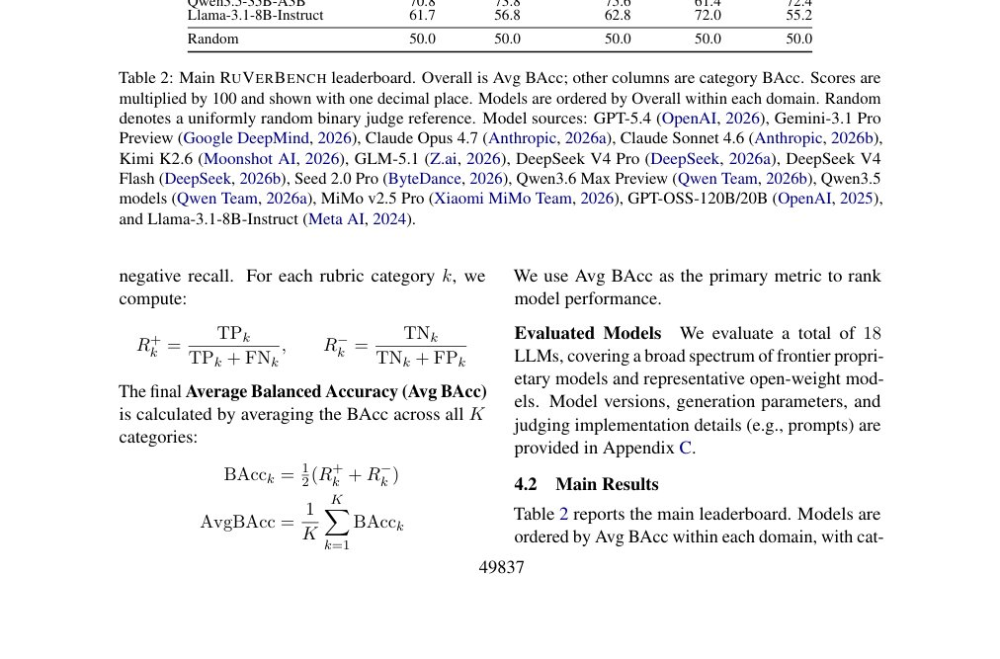

# LLM-as-a-Judge 能否在智能体场景中可靠验证评分细则？

> **翻译状态：部分翻译（摘要全译 + 明确标注的原文节译）。非全文中文精译。**

英文标题：Can LLM-as-a-Judge Reliably Verify Rubrics in Agentic Scenarios?  
发表信息：EMNLP 2026  
原始 PDF：19 页  
[阅读原始 PDF](./原始论文.pdf) · [英文逐页全文及配图](./英文原文_逐页全文与配图.md) · [参考文献及后续原文](./参考文献及后续原文.md) · [图表索引](./图表索引.md)

## 摘要（全文翻译，PDF 第 1 页）

基于评分细则（rubric）的评分已成为模型评价中广泛使用的范式，通常使用 LLM-as-a-Judge（LaaJ）对评分细则打分。然而，LaaJ 在评分细则评分方面的可靠性仍缺乏充分研究。这一问题在智能体场景中尤为突出，因为较长且复杂的输出进一步增加了可靠评分的难度。为解决这一问题，我们对 LaaJ 的评分细则验证可靠性开展系统性元评价。我们提出 RuVerBench，这是首个评估智能体场景中 LaaJ 评分细则验证可靠性的基准。RuVerBench 涵盖深度研究和智能体编程两个常见智能体领域，共 2,458 个实例，每个实例包含模型生成的输出、一条评分细则，以及指示输出是否满足该细则的人工标注标签。利用 RuVerBench，我们评价了众多前沿 LLM，发现即使最先进的模型表现强劲，仍存在相当大的噪声。我们进一步分析关键 LaaJ 策略对评分细则验证的影响，包括提示词设计、批量验证和多数投票。结果表明，较弱的模型对提示词变化更加敏感；批量验证存在准确性与效率之间的权衡；多数投票能够有效改善表现，但边际收益递减。我们已发布数据集及代码，以推动后续研究：https://github.com/THU-KEG/RuVerBench。

[核对原版第 1 页](./source_pages/page-001.jpg)

**原文 figure 1 · PDF 第 1 页（候选图表区域）**

## 第 4.1 节：任务形式化（PDF 第 4 页）

我们将评分细则验证形式化为一个元评价任务，以评估充当裁判的 LLM 的可靠性。在这一设置中，裁判的输入由任务上下文 m（例如深度研究中的问答对，或智能体编程中序列化的轨迹）和需要验证的特定评分细则 rᵢ 组成。裁判需预测二元标签 ŷᵢ∈{0,1}，1 表示满足评分细则，0 表示不满足。采用二元满足度是有意为之：原子化的是/否标准在验证器管线中广泛使用，并允许可复现的真实值标注；分级评分则需要额外的量表设计以及显著更多的主观校准。我们的评价聚焦于裁判预测 ŷᵢ 与人工标注真实标签 yᵢ 的一致性。不同于为每个回答提供单一整体评分的传统设置，本任务要求在单条评分细则层面开展细粒度验证。

[核对原版第 4 页](./source_pages/page-004.jpg)

**原文 table 1 · PDF 第 4 页（候选图表区域）**

**原文 figure 3 · PDF 第 4 页（候选图表区域）**

## 第 4.1 节：平衡准确率（PDF 第 5 页）

评分细则验证是一个二分类任务，两个类别均至关重要。为处理类别不平衡，采用平衡准确率（Balanced Accuracy, BAcc），对正类和负类召回率求平均。对于每个细则类别 k：

$$R_k^+=\frac{TP_k}{TP_k+FN_k},\quad R_k^-=\frac{TN_k}{TN_k+FP_k}$$

$$\mathrm{BAcc}_k=\frac{R_k^++R_k^-}{2},\quad\mathrm{AvgBAcc}=\frac{1}{K}\sum_{k=1}^{K}\mathrm{BAcc}_k$$

最终的平均平衡准确率通过对所有 K 个类别的 BAcc 求平均得到，并作为模型排名的主要指标。

[核对原版第 5 页](./source_pages/page-005.jpg)

**原文 table 2 · PDF 第 5 页（候选图表区域）**

## 尚未完成的翻译

其余正文、附录、完整图表说明、表内文字及参考文献标题尚未逐段翻译。本文件不是 19 页全文中文版。所有页面的英文文本层与页面截图均在英文逐页文档中保留。

[继续阅读英文原文](./英文原文_逐页全文与配图.md) · [图表索引](./图表索引.md) · [原始 PDF](./原始论文.pdf)

## 研究分类（初步判定，非原文内容）

- 主类别：B
- 阅读优先级：P0
- 归类理由：直接以人工 gold label 对评分细则裁判做元评价，并研究策略敏感性。
- 重点阅读：第 3 节标注流程；第 4.1 节 BAcc；第 4.3–4.4 节错误、批量验证和投票。
- 分类尚未完成全部原文及评价代码核验；不代表复现实验成功。
