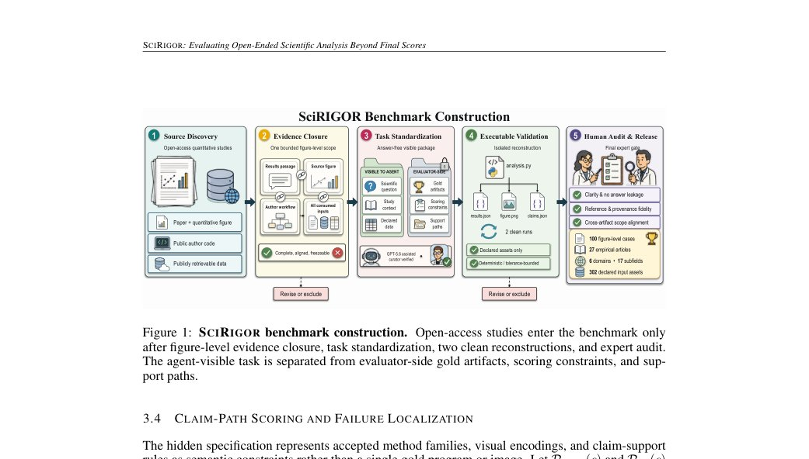

# SCIRIGOR：超越最终分数的开放式科学分析评价

> **翻译状态：部分翻译（摘要全译 + 明确标注的原文节译）。非全文中文精译。**

英文标题：SCIRIGOR: Evaluating Open-Ended Scientific Analysis Beyond Final Scores  
发表信息：arXiv:2609.06192v1（上传版本）  
原始 PDF：21 页  
[阅读原始 PDF](./原始论文.pdf) · [英文逐页全文及配图](./英文原文_逐页全文与配图.md) · [参考文献及后续原文](./参考文献及后续原文.md) · [图表索引](./图表索引.md)

## 摘要（全文翻译，PDF 第 1 页）

科学编程智能体越来越多地执行长时程、开放式工作流，产生相互依赖的代码、数值结果、图像及科学主张。现有评价通常孤立地对工作流完成情况或最终工件进行评分。这些分数无法证明所报告的主张是否获得同一次运行所产生的数据、计算和可视化的支持。我们将具有多模态工件、基于证据的科学分析形式化为一项评价任务。给定科学问题、可直接用于分析的数据和研究上下文，智能体必须产出可执行分析、结构化结果、可视化和原子化科学主张。成功要求报告所有必需的发现，并使每项主要主张保有经过验证的同次运行支持路径。SCIRIGOR 将细粒度评价框架与面向该任务的证据完备基准相结合。该框架将生成工件重构为具有类型的证据图，分别评价工件保真度和边的有效性，通过完整的计算与可视化路径对主张评分，并定位最早缺乏支持的关系。源证据约束下的替代路径允许科学上等价的方法和可视化编码，而最弱环节评分揭示貌似可信的下游输出背后的上游错误。基准包含来自 Nature 等期刊科学论文的 100 个案例，覆盖六个领域与 17 个子领域。每个案例对齐问题、完整输入、可执行的源分析、数值结果、源图像、原子化发现与来源追溯信息。我们在 SCIRIGOR 上评价了 11 种智能体/模型配置。在全基准运行中，无论结果是否忠实于科学目标，智能体主张与其自身结果的一致率都几乎相同（91.8% 与 91.0%）。然而，没有系统的软证据链评分超过 62.6%，严格全链成功率也没有超过 18.0%。因此，内部一致性不足以成为科学正确性的证据：必须沿完整的数据到主张路径验证其支持关系。

[核对原版第 1 页](./source_pages/page-001.jpg)

## 引言：错误链示例（节译）（PDF 第 1 页）

考虑一个询问极端高温下外卖配送工作量如何变化的案例（附录 F.2）。源回归将估计值与置信区间限值存储在对数尺度上，因此正确分析必须对三个数值均进行 100[exp(x)−1] 转换。若智能体只转换估计值，它仍可能给出看似正确的发现：增加 18.0%（95% CI 12.6–23.6%），尽管结构化区间和绘制的不确定性带仍在错误尺度上。文字表述与科学目标匹配，但所提交的计算和图像无法支持该表述。因此，评价这样的工作流不能仅依赖最终输出评分。

[核对原版第 1 页](./source_pages/page-001.jpg)

## 第 3.4 节：主张路径评分与失败定位（节译）（PDF 第 5 页）

对于主张 c，分别考虑计算路径和可视化路径 k∈{comp,vis}。

$$S_k(c)=\max_{p\in P_k(c)}\min_{z\in p}s(z)$$

$$S(c)=\min\{S_{comp}(c),S_{vis}(c),F_C(c)\}$$

其中 F_C(c) 为局部主张保真度。内部最小值在单条路径上执行最弱环节规则，外部最大值允许任何完整且获认可的替代路径。生成主张与必需主张槽位进行一对一匹配，以经验证的支持量得到证据链精确率、召回率及 F1。严格证据链成功要求完成执行、每项必需主张均获得完整支持、不包含无支持的主要主张，并满足全部硬性可视化约束。工件保真度、边通过率及执行门控的软链聚合提供互补的诊断视角。若证据链不完整，SCIRIGOR 报告任何已认可的部分路径均无法到达主张的最早拓扑层：契约/执行、数据→转换、转换→结果、转换/结果→可视化或结果/可视化→主张。只要另一条独立验证的路径仍完整，不完整路径就不决定分数；下游展示质量无法修复上游科学错误。

[核对原版第 5 页](./source_pages/page-005.jpg)

**原文 figure 1 · PDF 第 5 页（候选图表区域）**

## 尚未完成的翻译

其余正文、附录、完整图表说明、表内文字及参考文献标题尚未逐段翻译。本文件不是 21 页全文中文版。所有页面的英文文本层与页面截图均在英文逐页文档中保留。

[继续阅读英文原文](./英文原文_逐页全文与配图.md) · [图表索引](./图表索引.md) · [原始 PDF](./原始论文.pdf)

## 研究分类（初步判定，非原文内容）

- 主类别：B
- 阅读优先级：P0
- 归类理由：核心贡献为可审计的跨工件证据图、替代有效路径与最弱环节评分；与地学结果—过程一致性高度相关。次要角色 E。
- 重点阅读：第 3.2–3.4 节证据图、边验证与路径评分；第 5.2 节失败定位。
- 分类尚未完成全部原文及评价代码核验；不代表复现实验成功。
