# 图表及栅格对象索引
> 自动候选，并非人工确认的完整图表清单；裁图可能含邻近正文、重复或漏检无题图，原版页始终保留。

## Table 1 · PDF 第 3 页

Table 1: Support coverage of scientific-agent benchmarks.

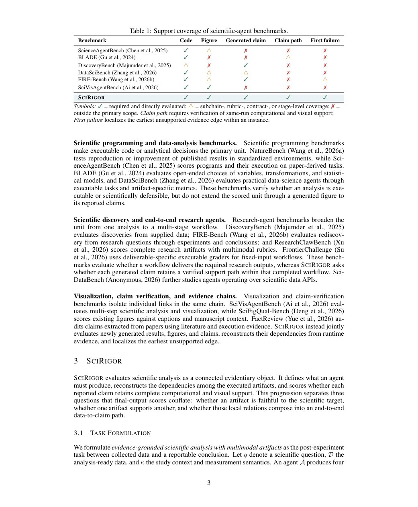

[整页核查](./source_pages/page-003.jpg)

## Figure 1 · PDF 第 5 页

Figure 1: SCIRIGOR benchmark construction. Open-access studies enter the benchmark only after figure-level evidence closure, task standardization, two clean reconstructions, and expert audit. The agent-visible task is separated from evaluator-side gold artifacts, scoring constraints, and sup- port paths.

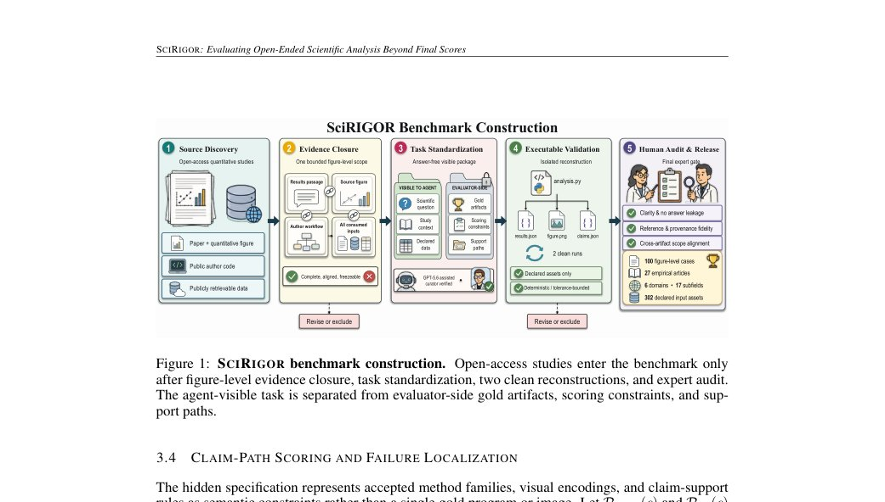

[整页核查](./source_pages/page-005.jpg)

## Figure 2 · PDF 第 7 页

Figure 2: SCIRIGOR spans diverse scientific domains, analysis methods, and multi-artifact task complexities. (a) The 100 cases span six reporting domains and 17 disciplinary subfields. The taxonomy ring assigns equal angular width to every subfield, while each inner domain spans the subfields it contains. (b) Cases require multiple input assets, result slots, visual requirements, and atomic claims, creating long evidence chains. (c) Method families are multi-label across domains; cells report case counts, and darker color denotes greater within-domain prevalence.

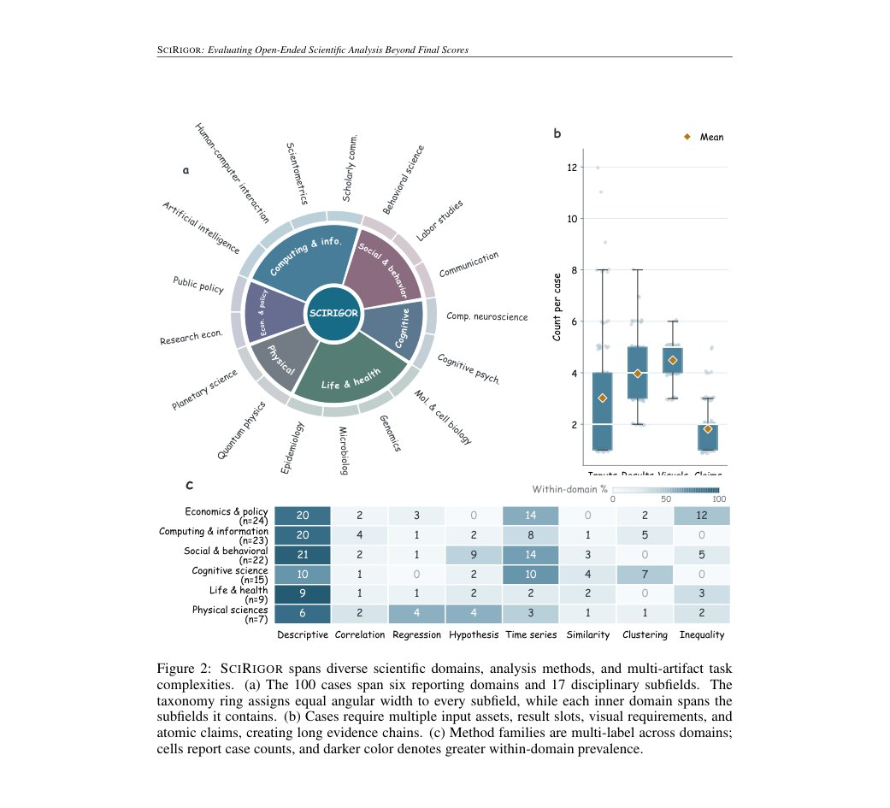

[整页核查](./source_pages/page-007.jpg)

## Table 2 · PDF 第 8 页

Table 2: Main results on SCIRIGOR (%; higher is better). Blue shading is normalized within each model row.

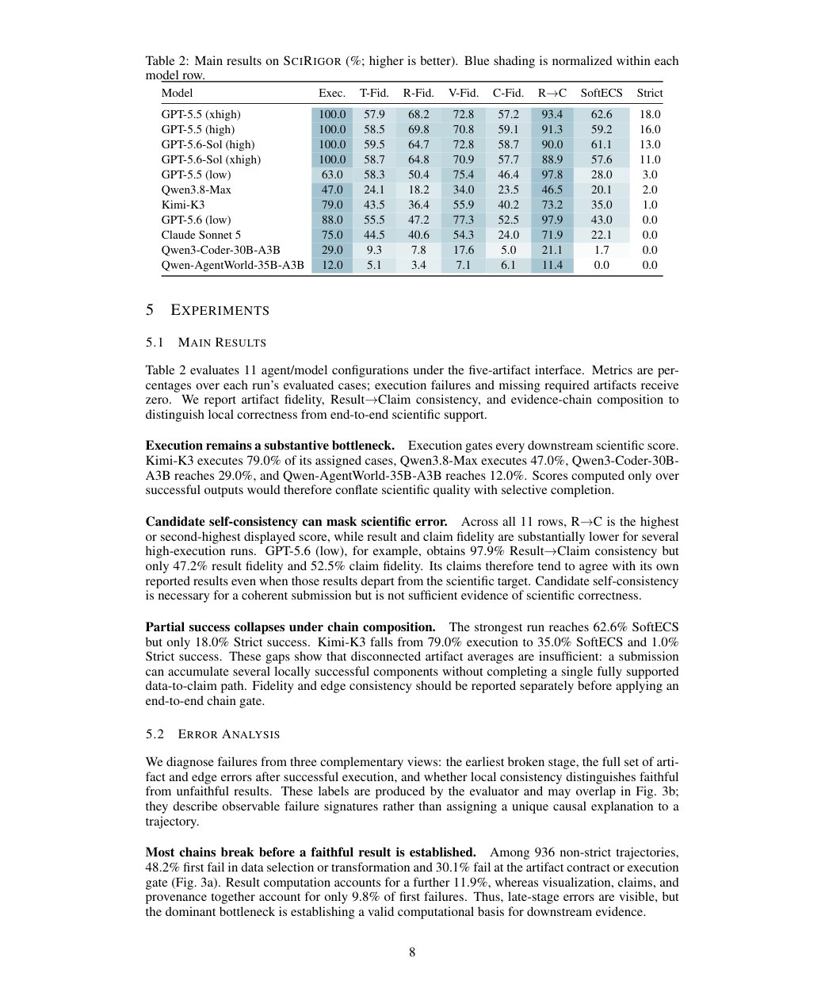

[整页核查](./source_pages/page-008.jpg)

## Figure 3 · PDF 第 9 页

Figure 3: Case-level error analysis across ten complete 100-case runs. (a) Earliest failure stage among the 936 trajectories that do not complete a strict chain. Each trajectory contributes to exactly one stage. (b) Overlapping artifact- and edge-level errors among the 718 successfully executed trajectories; values are percentages within each model’s executed cases. (c) Local Result→Visual and Result→Claim consistency conditioned on independent result fidelity.

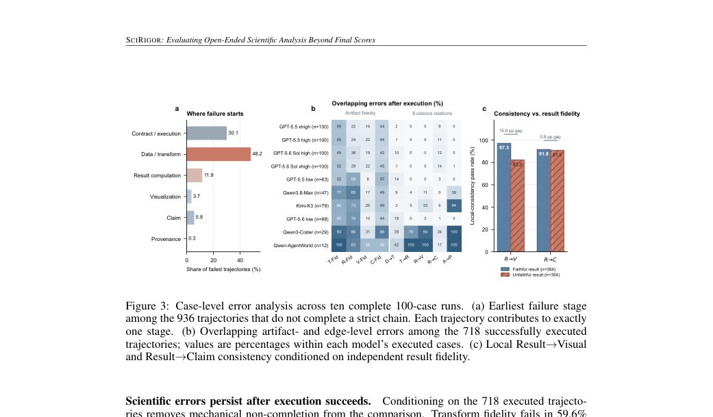

[整页核查](./source_pages/page-009.jpg)

## Figure 4 · PDF 第 10 页

Figure 4: Performance by task complexity for GPT-5.6 Sol xhigh on 100 cases. Points show bin means; error bars denote ±1 SEM across cases. Strict RG-EC decreases with more input assets, required result slots, and visual requirements; RG-EC F1 also declines with assets and result slots, while the gated-claim composite is flatter. RG-EC F1 gates claim coverage by verified numerical support, whereas Strict RG-EC requires complete support for every required and generated claim.

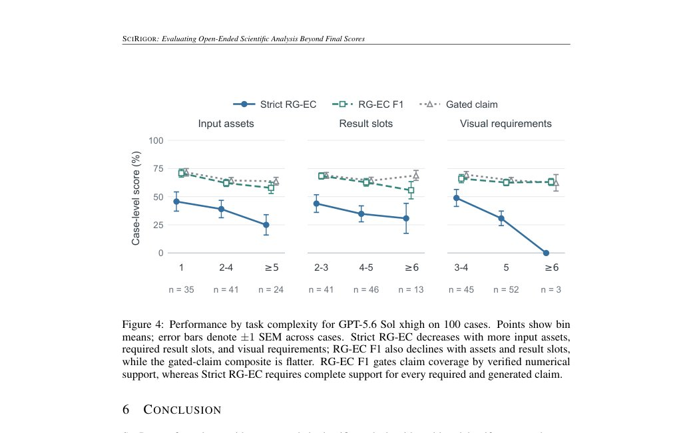

[整页核查](./source_pages/page-010.jpg)

## Table 3 · PDF 第 13 页

Table 3: Five-file SCIRIGOR contract for reference and candidate bundles. Serialized artifact Frozen reference role Candidate execution role

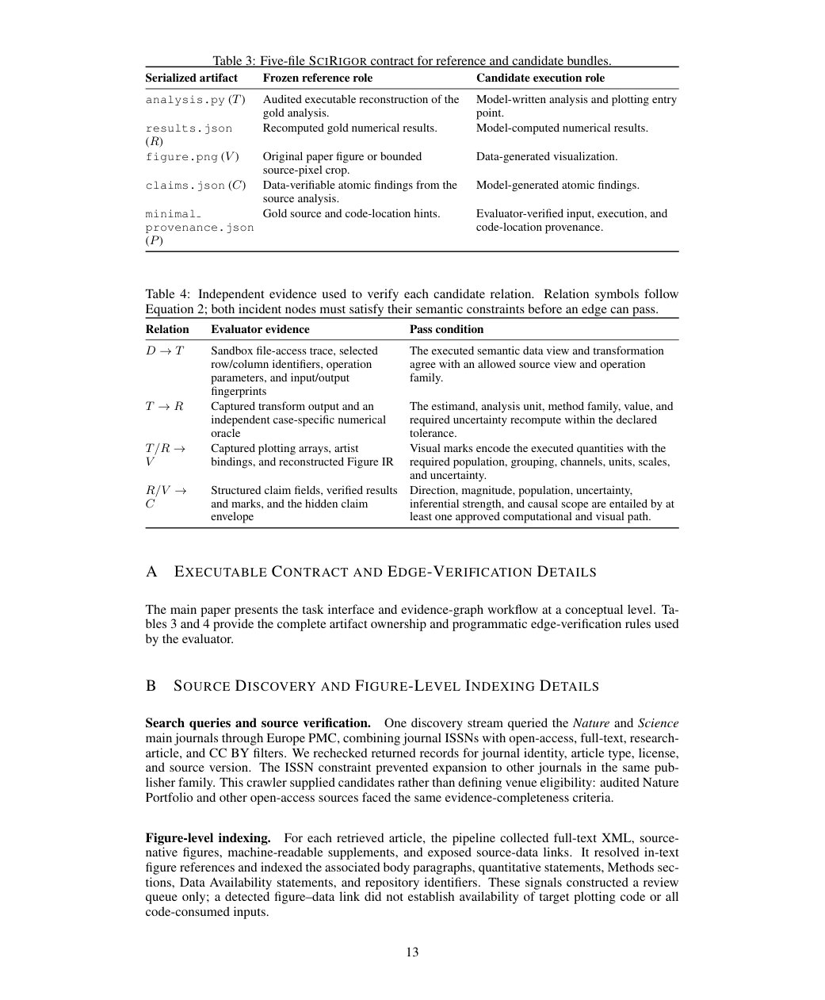

[整页核查](./source_pages/page-013.jpg)

## Table 4 · PDF 第 13 页

Table 4: Independent evidence used to verify each candidate relation. Relation symbols follow Equation 2; both incident nodes must satisfy their semantic constraints before an edge can pass.

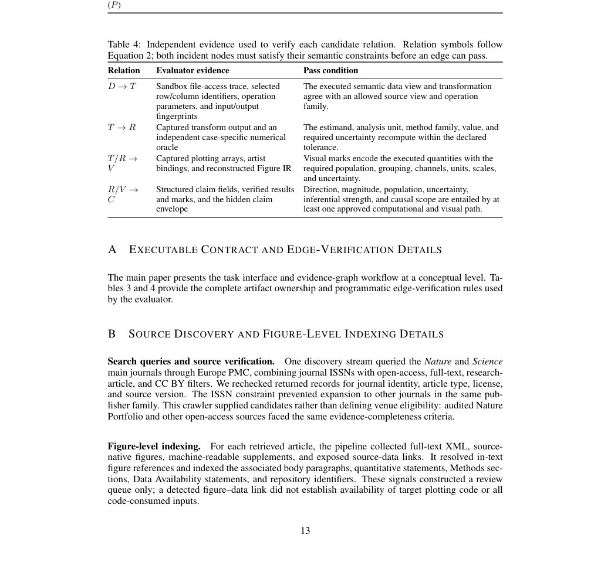

[整页核查](./source_pages/page-013.jpg)

## Table 5 · PDF 第 15 页

Table 5: Disciplinary composition of the 100 SCIRIGOR cases. Domains are used for descriptive reporting and do not imply a probability-balanced sample of the scientific literature.

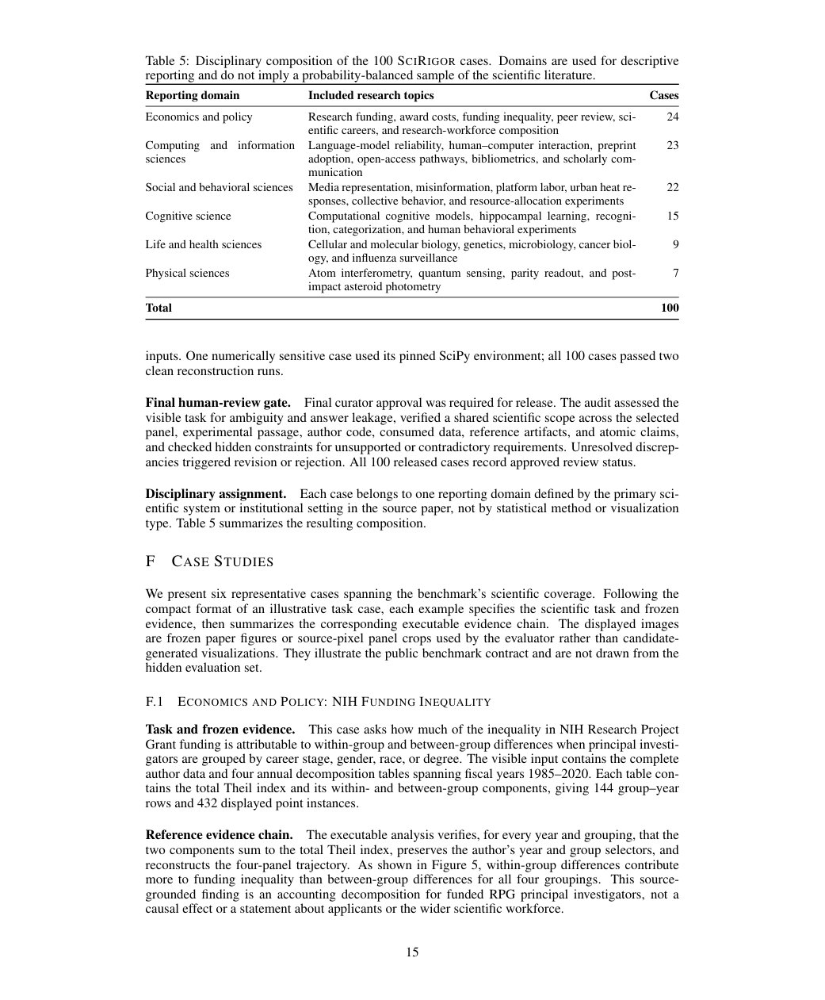

[整页核查](./source_pages/page-015.jpg)

## Figure 5 · PDF 第 16 页

Figure 5: NIH funding-inequality case. The frozen Figure 4 reference decomposes total Theil inequality into between- and within-group components by career stage, gender, race, and degree from FY1985 to FY2020. The within-group component exceeds the between-group component throughout all four panels.

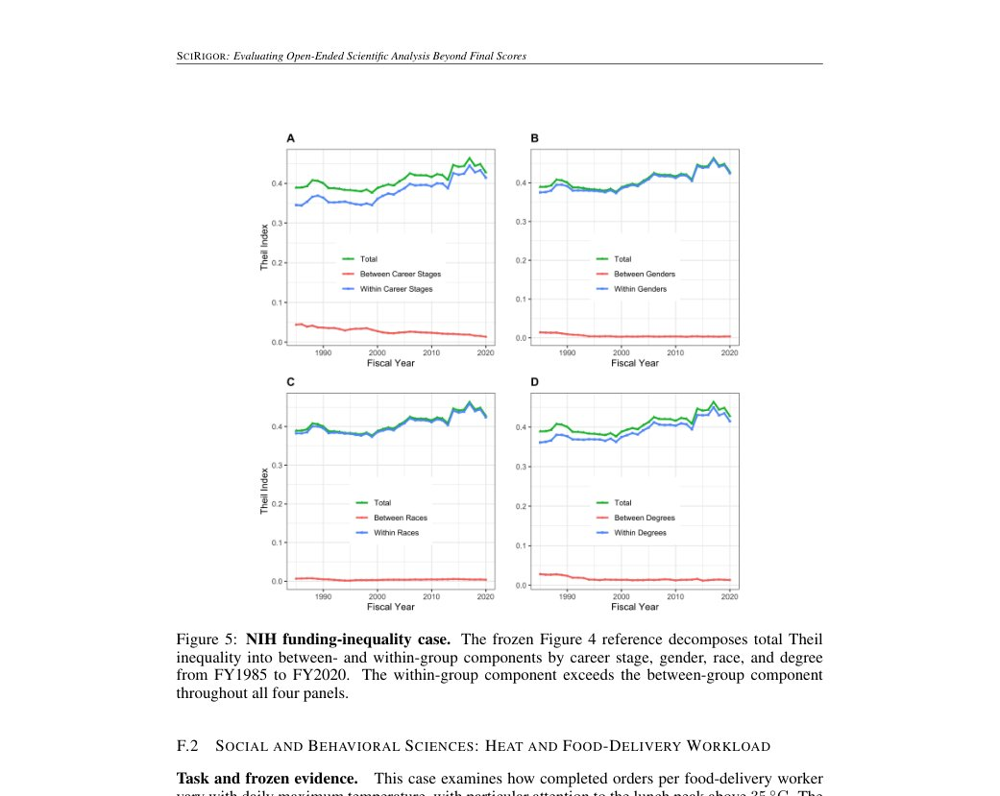

[整页核查](./source_pages/page-016.jpg)

## Figure 6 · PDF 第 17 页

Figure 6: Food-delivery workload case. The frozen Figure 4a panel shows percentage changes in completed orders per worker relative to the 20 ◦C baseline for all-day, lunch-peak, and dinner-peak periods. Curves and bands encode transformed estimates and 95% confidence intervals; shading marks the extreme-heat range.

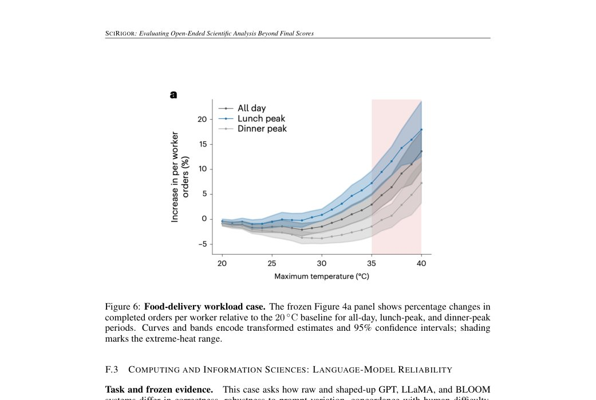

[整页核查](./source_pages/page-017.jpg)

## Figure 7 · PDF 第 18 页

Figure 7: Language-model reliability case. The frozen Figure 1 reference presents six-indicator profiles for GPT, LLaMA, and BLOOM systems on a common radial scale. Warm profiles denote raw systems and blue profiles shaped systems, exposing the joint correctness, robustness, difficulty- concordance, and error-free trade-offs evaluated by the case.

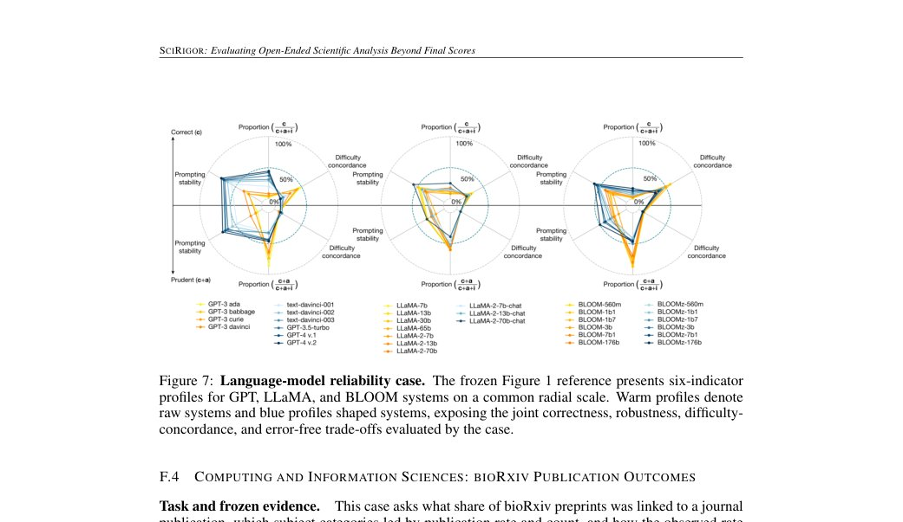

[整页核查](./source_pages/page-018.jpg)

## Figure 8 · PDF 第 19 页

Figure 8: bioRxiv publication-outcomes case. The frozen Figure 3 reference combines monthly linked-publication proportions with category- level proportions and counts. Evolutionary biology has the highest linked proportion, whereas neuroscience has the largest linked count; the monthly view must be interpreted under unequal follow-up across posting cohorts.

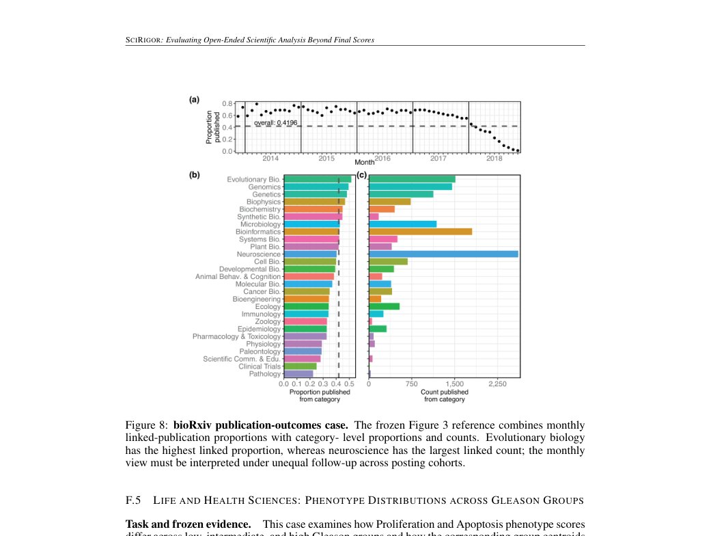

[整页核查](./source_pages/page-019.jpg)

## Figure 9 · PDF 第 20 页

Figure 9: Gleason phenotype case. The frozen Figure 4 reference combines PCA phenotype di- rections and group centroids with complete Proliferation and Apoptosis distributions for the low, intermediate, and high Gleason groups. The two displayed dimensions explain 38.3% and 27.8% of the model variance.

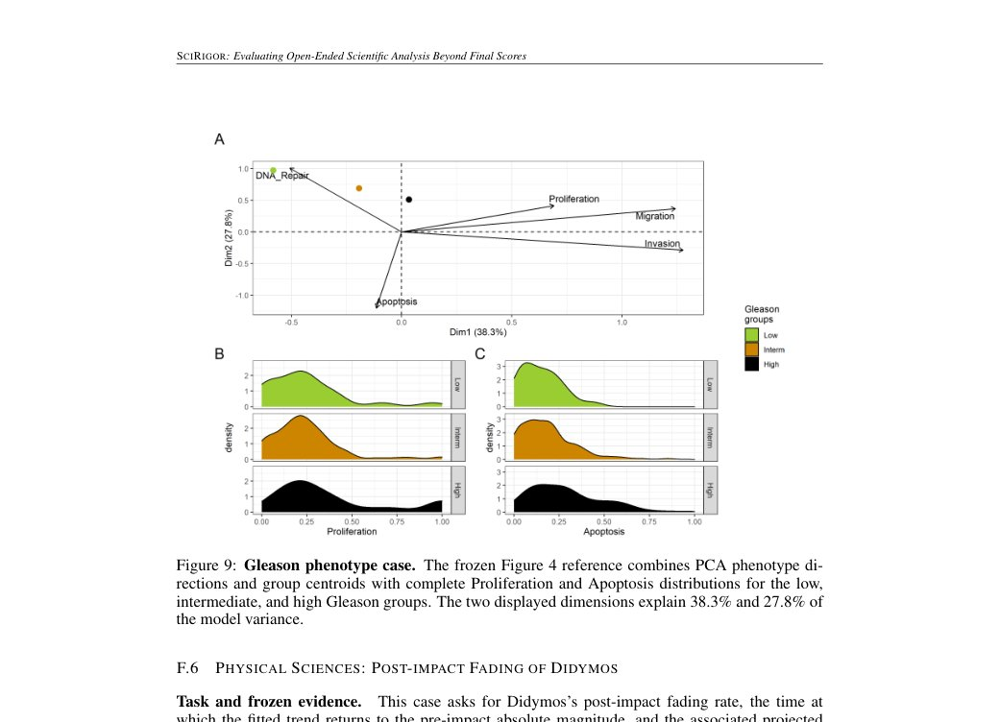

[整页核查](./source_pages/page-020.jpg)

## Figure 10 · PDF 第 21 页

Figure 10: Didymos post-impact fading case. The frozen Figure 3 reference shows all 27 absolute- magnitude observations and error bars, the author-selected weighted fit, the impact-time marker, and the pre-impact magnitude with its uncertainty band. The astronomical magnitude axis is reversed, so upward movement denotes greater brightness.

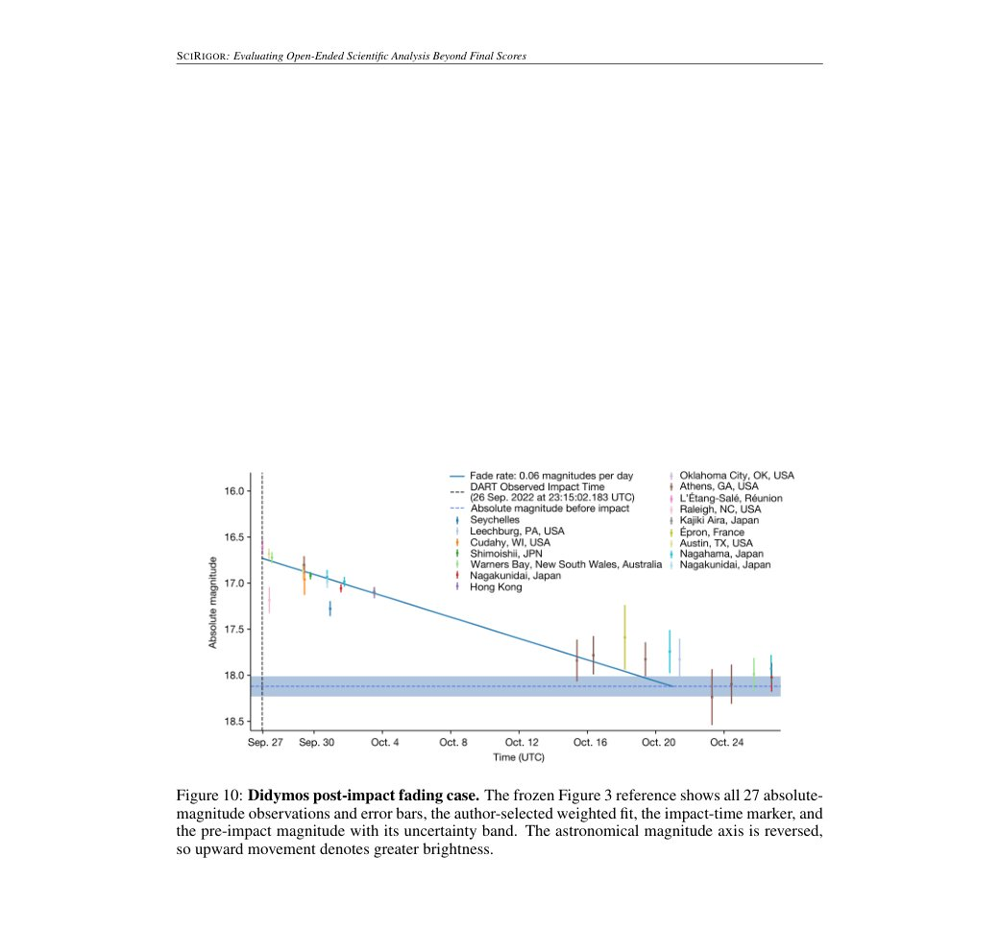

[整页核查](./source_pages/page-021.jpg)

### 栅格对象 · PDF 第 5 页

### 栅格对象 · PDF 第 5 页

### 栅格对象 · PDF 第 5 页

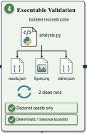

### 栅格对象 · PDF 第 5 页

### 栅格对象 · PDF 第 9 页

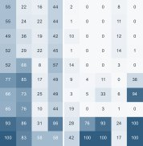

### 栅格对象 · PDF 第 16 页

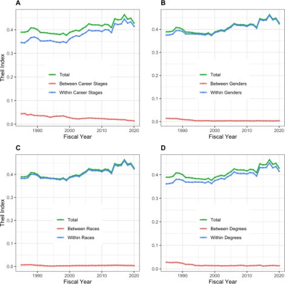

### 栅格对象 · PDF 第 17 页

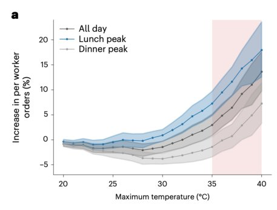

### 栅格对象 · PDF 第 18 页

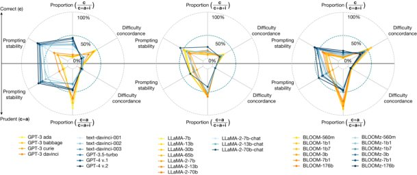

### 栅格对象 · PDF 第 19 页

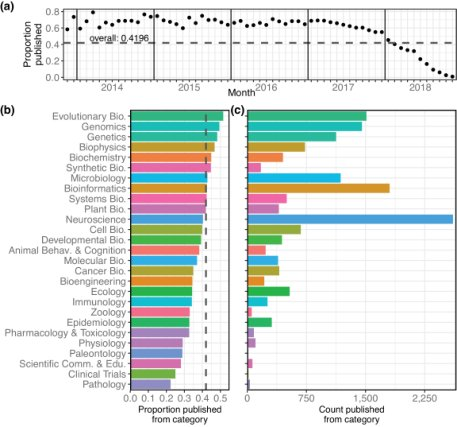

### 栅格对象 · PDF 第 20 页

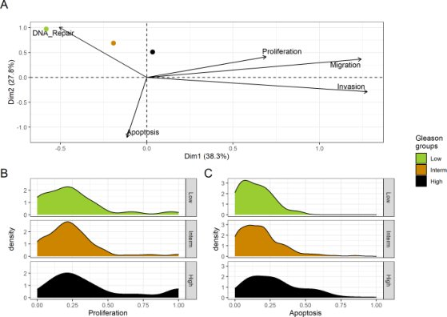

### 栅格对象 · PDF 第 21 页

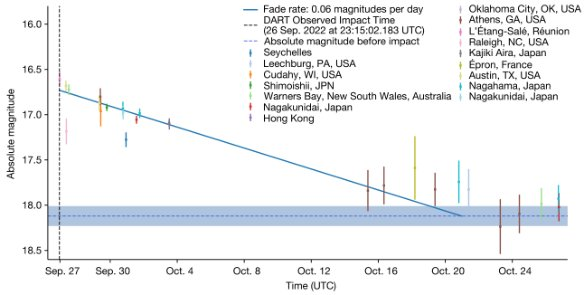