# SWE-bench：语言模型能解决真实世界的 GitHub 问题吗？

> **原题**：SWE-bench: Can Language Models Resolve Real-World GitHub Issues?  
> **作者**：Carlos E. Jimenez、John Yang、Alexander Wettig、Shunyu Yao、Kexin Pei、Ofir Press、Karthik Narasimhan  
> **机构**：普林斯顿大学、Princeton Language and Intelligence、芝加哥大学  
> **发表**：ICLR 2024。原文注明 Carlos E. Jimenez 与 John Yang 同等贡献。  
> **说明**：原论文共 51 页。为科研可复现性，测试命令、补丁、仓库路径、模型名称和英文原始 issue 文本均保留原样；中文翻译采用章节组织，所有原文页面、图表和示例代码另行完整收录。原文发表时的模型分数反映当时实验，不代表当下成绩。

## 摘要（原稿第 1 页）

语言模型的发展已经超越了我们有效评估其能力的水平，但为了推动未来研究，我们必须探索它们的能力边界。我们发现，真实世界的软件工程是评价下一代语言模型的一种丰富、可持续且具有挑战性的试验场。为此，我们提出 **SWE-bench**：一个评估框架，包含来自 **12 个**常用 Python 代码仓库的真实 GitHub issue 及对应 Pull Request（PR）构建的 **2,294 个**软件工程问题。给定代码仓库及待解决问题的描述，语言模型需要修改代码库来解决相应问题。SWE-bench 中的问题常常要求同时理解和协调多个函数、类，甚至多个文件之间的变化，因此模型需要与执行环境交互、处理极长上下文，并进行远超传统代码生成任务的复杂推理。实验表明，无论当时最先进的闭源模型还是我们微调的 SWE-Llama，都只能解决其中最简单的问题。表现最佳的 Claude 2 也仅解决 **1.96%** 的任务。SWE-bench 的进展将推动语言模型变得更加实用、智能和自主。

## 1 引言（原稿第 1–2 页）

语言模型正快速部署到聊天机器人、代码助手等商业产品中。与此同时，许多已有基准已经趋于饱和（Kiela et al., 2021；Ott et al., 2022），难以衡量最先进模型究竟能做什么、不能做什么。我们需要更有挑战性、能更真实反映语言模型实际应用的评测基准，从而引导未来模型的发展与使用（Srivastava et al., 2023）。

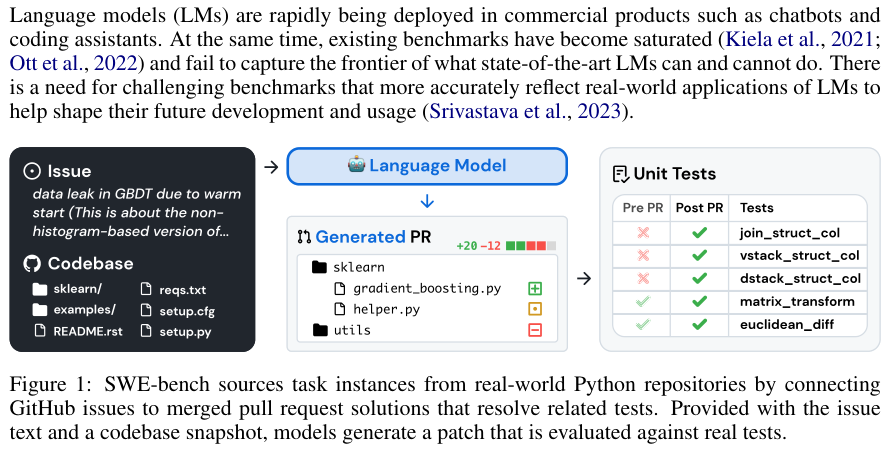

*图 1：SWE-bench 通过把真实 Python 代码仓库中的 GitHub issue 与解决对应测试的已合并 PR 关联起来，构造测试任务。给定 issue 文本和代码库快照，模型生成补丁并接受真实测试的验证。（原稿第 1 页）*

构建优秀基准并不容易：任务必须足够困难，以便区分已有模型的能力，同时模型生成结果还应当容易验证（Martínez-Plumed et al., 2021）。编程任务很有吸引力，因为它们可为模型带来困难问题，又可以通过运行单元测试较容易地验证生成的解决方案。然而，HumanEval（Chen et al., 2021）等传统编程基准主要包含相对独立的问题，往往只需几行代码即可解决。

真实世界的软件工程远没有这么简单。修复一个 bug 可能要求浏览大型代码仓库、理解不同文件中函数之间的相互作用，或者在复杂代码中找出一个细微错误。受此启发，我们提出 SWE-bench，在真实的软件工程情境中评价语言模型。如图 1 所示，模型需要解决用户提交到流行 GitHub 仓库的 issue（通常是错误报告或功能请求）。每项任务要求生成一个**补丁（patch）**，描述对现有代码库进行的修改，随后使用该仓库自身的测试框架评估修改后的代码。

相比过去的模型编程基准，SWE-bench 具有多项优势：任务来自真实用户提交的问题及解决方案；12 个仓库提供了多样且独特的代码问题；它使用基于执行的稳健评价框架；还可以在几乎不依赖人工的情况下，持续更新新任务。

我们评价了多种当时先进的语言模型，发现除最简单的问题外，它们几乎都不能解决。使用 BM25 检索器时，Claude 2 只解决 **1.96%** 的任务。

除 SWE-bench 以外，我们还发布用于推动开放模型研究的 **SWE-bench-train** 训练集：它包含来自另 **37 个仓库**、不用于正式测试的 **19,000 个** issue–PR 样本。利用它，我们在 CodeLlama（Rozière et al., 2023）基础上微调并发布 SWE-Llama 7B 与 13B。某些实验配置下，SWE-Llama 13B 的性能可与 Claude 2 相竞争，并能够处理超过 **100,000 tokens** 的上下文。

## 2 SWE-bench（原稿第 2–3 页）

SWE-bench 包含来自热门仓库的 GitHub issue（涉及 bug 报告或功能请求）以及为解决这些问题而修改仓库的 PR。每项任务需要生成一个解决 issue、并通过相关测试的 PR。

### 2.1 基准构建

GitHub 提供了丰富的软件开发数据，但是代码仓库、issue 和 PR 的内容可能有噪声、缺乏规范，或者文档与维护质量较差。为了大规模筛选高质量任务，我们采用三阶段流水线。

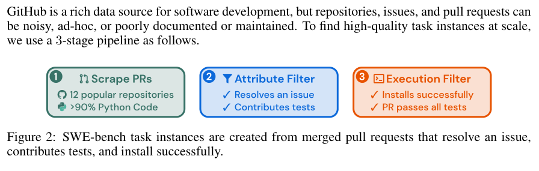

*图 2：通过筛选已合并 PR，要求其解决某个 issue、贡献相关测试，而且修改后的项目能够正确安装并通过测试，构造 SWE-bench 样本。（原稿第 2 页）*

**阶段 I：选择仓库并抓取数据。** 从 GitHub 中 **12 个**流行的开源 Python 仓库收集 PR，总计约 **90,000 个**。我们关注热门仓库，因为它们通常维护更好、贡献指南明确、测试覆盖也更充分。每个 PR 都对应一个由其 base commit 指定的代码库状态。

**阶段 II：基于属性筛选。** 从已合并 PR 中选出同时满足两个条件的候选任务：（1）解决某个 GitHub issue；（2）修改了仓库中的测试文件。这通常表明贡献者还编写了测试来验证问题是否解决。

**阶段 III：基于执行筛选。** 对每个候选任务，先把 PR 中的测试内容应用到相应代码库，并分别记录应用 PR 其他代码修改前后的测试结果。我们只保留至少存在一个测试从失败变为通过的任务——称为 **fail-to-pass test（失败转通过测试）**。因安装错误或运行时错误无法测试的候选任务也被剔除。

通过上述三步，最初约 90,000 个 PR 被筛至 **2,294 个**任务，组成最终 SWE-bench。图 3 展示它们在不同代码仓库的分布，表 1 汇总任务属性。值得注意的是，这些项目的代码规模通常非常庞大，包含数千个文件，而参考 PR 往往同时修改多个文件。更多构造技术细节见附录 A，数据集统计见附录 A.5。

### 2.2 任务形式化

**模型输入。** 模型获得 issue 的文本描述以及完整代码库，并须编辑代码库解决该问题。实践中，修改以补丁文件表示，明确指出应修改代码库中的哪些行。

**评价指标。** 评价候选解决方案时，先使用 Unix 的 `patch` 工具将模型生成的补丁应用到代码库，再执行与该任务相关的单元测试和系统测试。若补丁成功应用且所有相关测试通过，则认为问题已经解决。SWE-bench 的主要指标是**成功解决的任务占比（% Resolved）**。更多技术细节见附录 A.4。

### 2.3 SWE-bench 的特点

传统 NLP 基准通常只有较短的输入和输出序列，问题是专门为评测而人工设计的。相较之下，SWE-bench 真实世界的数据构建方式带来以下特点。

**真实的软件工程任务。** 每个实例都有庞大复杂的代码库和相应 issue 描述，因此要解决问题，就需要经验丰富的软件工程师所具备的知识与技能，而传统代码生成基准往往无法衡量这些能力。

**能够持续更新。** 数据收集流程可以在 GitHub 的任何 Python 仓库上较少人工干预地执行，使 SWE-bench 能持续增加新实例；模型还能在训练截止时间之后创建的 issue 上接受评测，以降低训练数据中已包含解决方案的风险。

**多样化的长输入。** issue 描述通常较长，平均约 **195 个词**；代码库则经常有数千个文件。解决任务需要从海量上下文中定位极少数真正需要修改的代码行。

**稳健评价。** 每个实例至少包含一个用于验证参考方案的 fail-to-pass test，**40%** 的实例有两个及以上这样的测试；此外，每项任务还有中位数 **51 个**测试，以检查现有功能是否维持正常。

**跨上下文代码编辑。** 不同于仅修改单个函数或类、或以填空形式补全代码的设置，SWE-bench 不会明确指出需要修改的位置。模型必须在大型代码库的多个位置生成修改。参考方案平均修改 **1.7 个文件、3.0 个函数及 32.8 行代码**（新增或删除）。

**解决方案具有多样性。** 仓库级代码编辑为检索方法、长上下文模型以及能够基于代码进行推理和行动的智能体提供了公平比较的平台。由于不强制与参考 PR 相同，模型可以提出不同于人工参考补丁的创新解决方案。

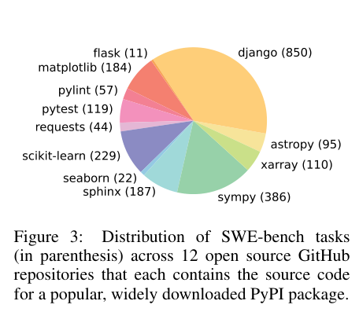

*图 3：SWE-bench 的 2,294 个任务分布于 12 个开源 GitHub 仓库；括号中为各仓库任务数量。（原稿第 4 页）*

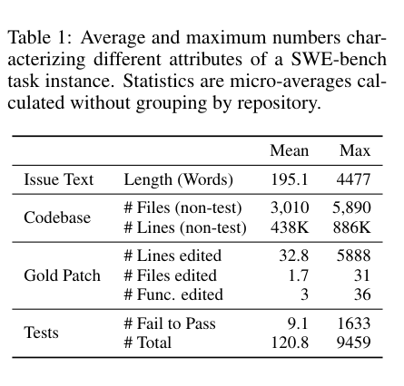

*表 1：SWE-bench 单个任务实例特征的平均与最大值（微平均、不按仓库分组），包括 issue 文本长度、代码行数、修改文件数和相关测试数。（原稿第 4 页）*

## 3 SWE-Llama：针对 SWE-bench 微调 CodeLlama（原稿第 3–4 页）

除了闭源模型，在 SWE-bench 上评估开放模型的性能同样重要。在本文写作时，只有 CodeLlama（Rozière et al., 2023）等少数模型能够处理任务所需的超长上下文。不过，我们观察到，直接使用未经进一步调整的 CodeLlama 变体无法很好地遵循仓库级编辑指令，输出通常只是占位回复或不相关代码。

为更有效地研究这些模型的能力，我们对 **70 亿**和 **130 亿**参数的 CodeLlama-Python 模型进行监督微调，所得模型成为专门的仓库编辑器，可以在消费级硬件上运行并修复 GitHub issue。

**训练数据。** 按照数据收集流程，我们从额外 37 个热门 Python 软件包仓库中构造 19,000 组 issue–PR 配对。与第 2.1 节不同，这里不要求 PR 必须修改测试文件，从而得到规模更大的监督训练集。为避免数据污染，训练数据集中的仓库与正式评测仓库完全不重叠。

**训练细节。** 以任务指令、GitHub issue 文本和相关代码文件作为提示，微调 SWE-Llama，使其生成解决该问题的补丁，即 **gold patch（参考补丁）**。为节省内存，仅通过 LoRA（Hu et al., 2022）微调注意力子层的权重；同时排除长度超过 30,000 token 的训练序列，实际训练集因此缩减至 10,000 个实例。详见附录 B。

## 4 实验设置（原稿第 4–5 页）

本节描述 SWE-bench 评价时的输入构建方式以及待评测模型。

### 4.1 基于检索的方法

SWE-bench 为模型提供 issue 描述和代码库。issue 平均只有约 195 个词，但代码库平均约 **43.8 万行**，远远超出当时大多数模型的上下文窗口。因此，问题在于：如何选择要放入提示中的相关内容？

在基线中，我们简单地使用通用检索系统筛选需要加入上下文的文件，比较两种设置：**稀疏检索**和**预言机（oracle）检索**。

**稀疏检索。** 当前场景的键和查询可能都很长，而且要求用自然语言检索代码文件，稠密检索方法并不理想。因此我们使用 **BM25**（Robertson et al., 2009）检索相关文件，直到达到给定上下文 token 上限。我们实验了三种不同的上下文长度限制，每个模型均在可容纳的限制下接受测试，报告其最佳表现。观察表明，模型往往在最短的上下文窗口上取得最好成绩，见表 2。

**Oracle 检索。** 为分析检索影响，我们还使用参考 PR 实际修改的文件作为“预言机”检索结果。由于真实工程师通常并不能预先知道应修改哪些文件，这一设置不够现实；并且只包含被修改的文件也未必提供全部必要上下文，因为软件行为可能受到其他未修改文件影响。

表 3 比较 BM25 与 oracle 的检索结果。在 27,000 token 上下文限制下，BM25 在约 **40%** 的实例中检索到了 oracle 文件的超集；但几乎一半实例中，它**没有检索到任何一个** oracle 文件。

### 4.2 输入格式

选择检索文件后，模型输入由以下内容构成：任务指令、issue 文本、检索到的代码文件及文档、示例补丁文件，以及要求生成补丁的提示。任务实例示例与更详细的输入组织方式见附录 D。

### 4.3 模型

由于需要处理极长序列，只有少数当时的模型适合 SWE-bench。本文评价 ChatGPT-3.5（`gpt-3.5-turbo-16k-0613`）、GPT-4（`gpt-4-32k-0613`）、Claude 2 和 SWE-Llama，各模型的上下文限制见表 4。

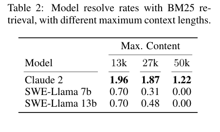

*表 2：不同上下文最大长度下的 BM25 检索基线问题解决率。（原稿第 5 页）*

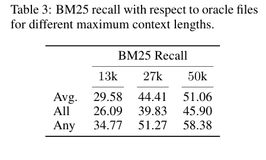

*表 3：不同上下文长度下，BM25 对 oracle 文件的平均、完全覆盖和任意覆盖召回率。（原稿第 5 页）*

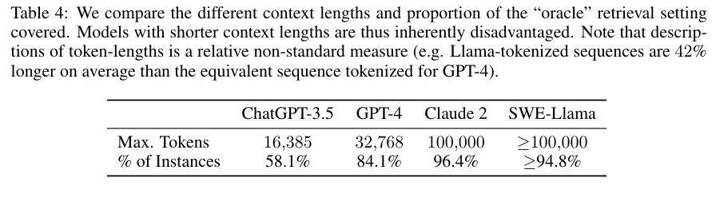

*表 4：不同模型的上下文长度及可覆盖 oracle 检索内容的实例比例。原文特别指出 token 长度是相对且非标准化的度量，例如 Llama 分词后的序列平均比同等 GPT-4 分词结果长约 42%。（原稿第 5 页）*

## 5 结果（原稿第 5–8 页）

本节给出采用不同检索机制、提示风格的模型评估结果，并分析模型性能和任务难度。表 5 汇总了 BM25 检索下的模型性能。各模型在解决真实 issue 时都面临巨大困难，其中最佳的 Claude 2 只解决 **1.96%** 的问题。

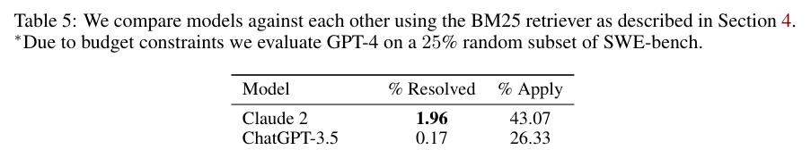

*表 5：BM25 检索下各模型的 % Resolved（成功解决率）和 % Apply（补丁成功应用率）。因预算限制，GPT-4 只在 SWE-bench 的 25% 随机子集上评估。（原稿第 6 页）*

为了分析检索器对整体结果的重要性，附录表 18 还展示 oracle 检索设置。在这一较有利条件下，Claude 2 能解决 **4.8%** 的问题；下文进一步分析上下文的作用。

**不同仓库的难度不同。** 从仓库角度分解时，不同模型在不同仓库中的表现趋势基本一致（图 4）。但模型解决的具体实例未必有很大重叠。例如，在 oracle 检索条件下，Claude 2 和 SWE-Llama 13B 分别解决 **110** 个与 **91** 个实例，表现相近，但 Claude 2 只解决了 SWE-Llama 已解决实例中的 **42%**。

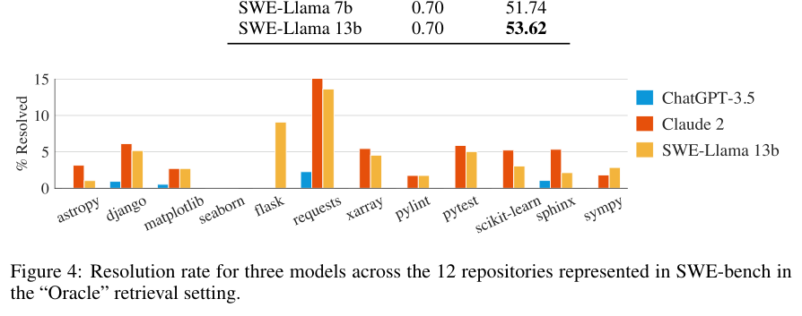

*图 4：Oracle 检索设置下，三个模型在 SWE-bench 12 个仓库中的问题解决率。（原稿第 6 页）*

这种差异也可能与 issue 中包含图像有关：图像会通过 Markdown 图片链接（例如 ``）嵌入 issue 文本。某些仓库的 issue 更常含图像，例如 matplotlib 中约 **32%**、seaborn 中约 **10%** 的实例包含嵌入图像，而总体比例只有约 **2%**。这些实例可能要求多模态模型或额外工具来处理图像信息。

**难度与上下文长度相关。** 聊天模型虽可能在预训练时见过长代码，但实际代码生成通常只要求在有限上下文中生成短片段。图 5 显示，随着总上下文长度增加，Claude 2 的表现明显下降，其他模型也存在类似趋势。我们的评测输入包含大量与 issue 不一定直接相关的代码，模型似乎经常难以准确定位需要修改的问题代码。这与既有研究相符：额外上下文会分散模型注意力，而目标序列在上下文中的相对位置也会影响结果（Liu et al., 2023b）。因此，即便扩大 BM25 的上下文窗口能够提升 oracle 文件召回率，最终性能却可能下降（表 2），因为模型无法有效定位真正有问题的代码。

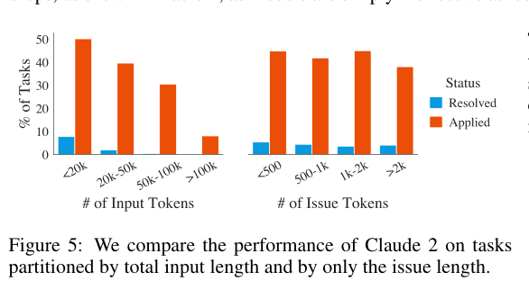

*图 5：按总输入长度及 issue 文本自身长度分组，比较 Claude 2 的表现。（原稿第 6 页）*

我们还对 oracle 检索进行一次输入消融，称为 **oracle-collapsed**：将检索文件中与参考 PR 修改行不直接相关的代码折叠，只保留实际修改位置及前后各 15 行，见表 6。这样处理后，GPT-4 的成功率从 **1.3%** 提高到 **3.4%**，Claude 2 则从 **4.8%** 提高到 **5.9%**。

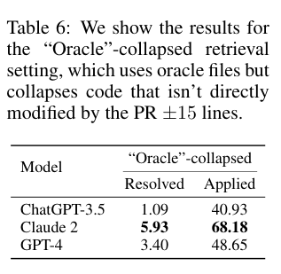

*表 6：oracle-collapsed 检索利用参考补丁实际修改的行及前后 15 行上下文，其余代码折叠后的性能。（原稿第 6 页）*

**难度与 issue 解决日期没有明显相关性。** 表 7 将 oracle 检索任务按 PR 创建于 2023 年之前或之后分组。除 GPT-4 外，多数模型在两个时间段的表现差异不大。作者认为这是一个积极信号：即便模型曾在训练时接触某个仓库的旧版本代码，它们也不太可能仅靠生成仓库的较新版本来“作弊”完成 issue。

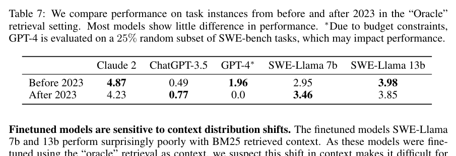

*表 7：Oracle 检索下，2023 年之前与之后创建的 PR 对应任务的解决率。大多数模型变化不大。GPT-4 只评估了随机 25% 子集，可能影响比较。（原稿第 7 页）*

**微调模型对上下文分布变化敏感。** SWE-Llama 7B 和 13B 在 BM25 检索上下文下的表现出乎意料地差。由于它们是在 oracle 检索上下文中微调的，我们怀疑上下文分布的偏移降低了模型可靠性。例如，SWE-Llama 训练时被要求编辑输入上下文中的每个文件，而在 BM25 设置中，许多检索出来的文件实际上不需要修改。

**生成补丁比重写整个文件更容易。** 模型通常使用完整代码文件训练，可能很少见到补丁格式。我们主要要求模型生成补丁而非重写整个文件，因为补丁通常是表达文件更改的一种更高效方式。表 5 表明，模型仍然难以生成格式正确的补丁。我们因此尝试让模型重新输出包含修改后的完整文件。结果总体比生成补丁更差；例如在 oracle 检索下，Claude 2 的整文件生成成功率为 **2.2%**，而生成补丁为 **4.8%**。即便控制任务输入长度，仅在较短的半数任务上测试，整文件生成也只有 **3.9%**，相比之下补丁生成可达到 **7.8%**。

**语言模型倾向于产生更短、更简单的编辑。** 模型生成的补丁通常比参考补丁新增或删除更少代码。表 8 显示，在成功应用的补丁中，模型生成补丁总长度往往不足参考补丁的一半（整体参考补丁平均 **74.5 行**，模型生成补丁在各设置中显著更短），也很少修改超过一个文件。

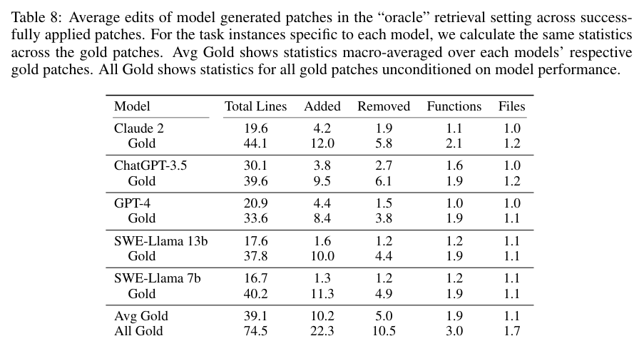

*表 8：Oracle 检索下成功应用的模型补丁，其总行数、新增行、删除行、修改函数数和修改文件数，与相应 gold patch 的对比。“Avg Gold”对模型对应参考补丁统计作宏平均，“All Gold”为不条件化的全部参考补丁。（原稿第 7 页）*

### 5.1 SWE-Llama 生成结果的定性分析

我们从 SWE-Llama 与 Claude 2 的生成结果中选取 **11 个**案例，进一步理解 oracle 检索下任务和补丁生成的质量。正文讨论一个 SWE-Llama 示例并给出总体观察，其他实例的深入分析见附录 F。

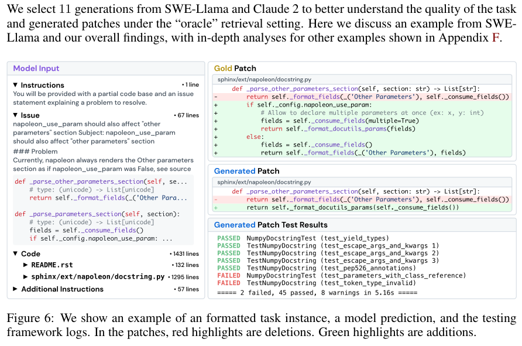

*图 6：一个格式化 SWE-bench 任务实例、模型预测补丁和参考补丁的对照。（原稿第 8 页）*

图 6 所示任务要求修复 Sphinx 的 Napoleon 文档字符串解析行为，模型给出了看似直接的修改，但它没有充分遵循配置变量 `napoleon_use_param` 对输出行为的约束。参考补丁引入了对应条件分支，而自动生成的补丁在配置设为 `False` 时会出现错误。相关测试很快捕捉到了模型的问题。

综合这些案例，我们观察到若干显著趋势：模型倾向于编写原始、直接的 Python 代码，没有充分利用现有第三方库及代码库中已经存在的功能；其生成体现一种“贪心式”的解题风格，只针对当前问题编写最直接的修改，较少考虑已有项目的代码风格和逻辑约束（例如相对导入与绝对导入的规范）。相反，许多 gold patch 会对更广范围的代码结构作出改进，不仅修复当前 issue，也提前处理潜在的后续问题。

## 6 相关工作（原稿第 8–9 页）

**语言模型评估。** 近期许多语言模型评价工作采用跨领域的任务集合（Hendrycks et al., 2021；Liang et al., 2022；Srivastava et al., 2023），也有研究将网络作为交互式环境，设置需要多步完成的任务（Yao et al., 2022；Zhou et al., 2023；Deng et al., 2023；Liu et al., 2023d）。但是这种“任务大杂烩”也存在缺点：每项任务通常聚焦一两种能力，使问题过于简单、模型角色受限，而且无法充分展现模型的通用性或潜在新能力（Srivastava et al., 2023）。因此，仅看这类任务集合的分数，未必能够深入指导模型能力的提升（Schlangen, 2019；Martínez-Plumed et al., 2021；Bowman & Dahl, 2021）。SWE-bench 旨在弥补这些不足：任务难度显著更高，为改进模型提供了丰富的研究空间，又能持续增加包含独特细节、真实实用挑战的新实例。

**代码生成基准。** HumanEval（Chen et al., 2021）代表了长期以来从自然语言描述合成代码的一条主流研究路线（Yu et al., 2018；Austin et al., 2021；Hendrycks et al., 2021；Li et al., 2022a；Zan et al., 2023）。后续基准扩展了编程语言、修改范围、新型代码补全形式与测试覆盖度（Cassano et al., 2022；Athiwaratkun et al., 2023；Orlanski et al., 2023；Yu et al., 2023；Du et al., 2023；Muennighoff et al., 2023；Liu et al., 2023a）。其他工作则尝试提出新编程范式或特定库的问题（Yin et al., 2022；Yang et al., 2023；Lai et al., 2022；Zan et al., 2022）。与将问题分割为彼此孤立的、为简单起见而裁剪过的基准不同，SWE-bench 仅对源代码进行少量后处理，保留了真实软件工程中比封闭式代码补全更广泛的挑战：补丁生成、长上下文推理、代码目录导航及跨模块依赖关系的理解。

**软件工程中的机器学习。** 传统程序分析技术可能无法充分扩展，也难以利用自然语言，因而软件工程研究的一个方向是使用包括语言模型在内的神经网络来自动化真实开发流程（Maniatis et al., 2023；Zheng et al., 2023；Hou et al., 2023）。具体应用包括自动生成 commit、PR 审查、bug 定位、测试和程序修复。与 SWE-bench 最相关的是使用语言模型自动程序修复，并利用 commit 信息指导代码编辑的研究。然而，已有数据集没有在 SWE-bench 这样的代码上下文规模上构建任务。此外，SWE-bench 很容易扩展到新语言与仓库，为语言模型与软件工程工具、实践的结合提供更真实、更困难的试验平台。

## 7 讨论（原稿第 9 页）

**局限性与未来方向。** SWE-bench 的任务全部来自 Python 仓库，我们希望把任务收集流程扩展到更多编程语言与领域。其次，本文实验仅建立最简单、最直接方法的基线，无意将未来研究限制在同类方法之内；我们鼓励研究其他方案，例如基于智能体的方法或工具增强语言模型。最后，尽管本文通过实际执行代码测试评价模型，但仅依赖这种方式仍不足以保证生成程序的可靠性：我们发现自动生成的代码往往不如人工修复全面、高效或易读。

**结论。** 真实软件开发过程的复杂性远远超越代码补全。通过利用开源协作流程，SWE-bench 构造了真实编码环境的忠实镜像。这一更贴近实际的环境能够鼓励创造性的解决方案，并可直接应用于开源软件开发。我们希望基准与其他贡献成为推动语言模型更实用、更智能、更自主的重要资产。

## 8 伦理声明（原稿第 10 页）

SWE-bench 完全收集自公开仓库，所涉及软件许可证允许本文贡献对应的使用方式，许可证详见表 12。收集与评估过程不额外收集 GitHub 用户的个人信息，所使用的数据不超出 GitHub 公共 API 和网站提供的内容。本文没有人类受试者参与，也不通过众包或雇佣任务工作者来完成数据收集、评价和实验。按热度筛选 GitHub 仓库的标准，没有显式或隐式采用带歧视性偏见的启发式规则。我们计划开源 SWE-bench 任务实例、收集和评价基础设施、实验结果、微调 SWE-Llama 的训练数据及模型权重；并遵循良好实践提供详细文档，以及便于反馈的沟通渠道来持续改进 SWE-bench。作者认为这项工作不会立即引起明确的有害后果，并在 E 节简要讨论潜在影响。

## 9 可复现性声明（原稿第 10 页）

投稿时已提交完整且经过匿名化处理的源代码 ZIP 包。代码按照论文不同贡献内容分别组织目录，如数据集收集、评价、开放模型推断和 SWE-Llama 训练等。代码中包含目的和使用说明。作者还提供了全部 **2294 个**包含正文所述组成部分的 SWE-bench 任务。除代码内文档之外，附录 A.2 和 A.4 对数据收集和评价流程给出了详细技术说明，与正文第 2 节互为补充，覆盖代码中实现的主要逻辑。作者计划将 SWE-bench 作为开源仓库正式发布，并详细说明基准内容、代码结构和用法。由于收集框架具有易维护的设计，作者希望其具备较高的可复现性。

## 10 致谢（原稿第 10 页）

感谢 Danqi Chen、Tri Dao、Zexuan Zhong、Tianyu Gao、Will Merrill、Mengzhou Xia、Dan Friedman、Adithya Bhaskar、Austin Watkins、Aatmik Gupta 和 Richard Zhu 提供宝贵的反馈与建议。本研究获得美国国家科学基金会（NSF）项目 **2239363** 与 Oracle Collaborative Research 奖项支持。文中的观点、发现与结论仅代表作者，不一定反映 NSF 的立场。

## 附录 A 基准细节（原稿第 15–23 页）

附录提供关于数据构建流程、评价流水线及 SWE-bench 数据属性的更完整技术说明。本节以更精细的技术细节补充正文第 2 节，涉及数据采集、基于执行的验证、评价步骤及任务实例特征。

### A.1 高层概览（第 15 页）

**抓取 Pull Request。** 以 2023 年 8 月下载量最大的 5,000 个 PyPI 软件包名单为基础，选取其中排名前 100 的软件包，识别对应的开源 GitHub 仓库，核验许可证是否允许自由使用软件，然后使用 GitHub 开发者 API 抓取这些仓库的全部 PR。选择高流量仓库，是因为其广泛使用通常意味着有较完善的文档、结构化开源贡献指南以及能够工作的规范代码。原论文在脚注给出了 PyPI 下载排名来源：https://hugovk.github.io/top-pypi-packages/ 。

**构建任务实例。** 候选 PR 必须满足三个条件。其一，状态必须为 `Merged`，意味着相关代码修改已被接受并合并到主仓库。其二，必须解决至少一个对应仓库的 issue；这里的 issue 是 GitHub 上用于跟踪 bug、功能增强或一般开发目标的工单。我们扫描 PR 标题、正文和 commit 信息，寻找 `fixes #24` 等关联 issue 的表述。其三，PR 必须增加一个或多个新测试；实际判定时，若 PR 修改的路径包含 `test`、`testing` 等关键词，则认为包含测试相关变更。

合格 PR 被转化为候选任务实例，如图 7。代码库 $C$ 通过仓库的 `owner/name` 和 PR 的 `base commit` 标识。获取代码库时，首先克隆仓库镜像，再检出该 base commit，得到 PR 修改之前的状态。问题描述 $P$ 聚合关联 issue 的标题、正文与 PR 初次 commit 之前发布的评论，以避免泄漏解决方案细节。PR 代码变更拆为**测试补丁 $T$** 和**参考解决方案补丁 $\delta$**，其中 $T$ 包含测试补丁所编辑的文件内的全部测试；二者均存储为 `.patch` 文件。有关语义解析的细节见 A.2。

**基于执行的验证。** 为验证任务实例可用性，先建立一个虚拟环境作为执行上下文，在应用任何补丁前安装代码库 $C$，然后分别在应用解决方案补丁 $\delta$ 前后运行测试 $T$。任何步骤失败的候选任务都会被排除。为确保解决方案不是平凡改动，还要比较应用解决方案前后的日志，至少存在一个测试从 `fail` 变为 `pass`。此外，若测试调用的是由 $\delta$ 首次引入的新函数或新类，则排除该任务，因为给新对象起名字通常具有任意性，而 issue 描述一般不会明确规定名称，即便人类开发者也可能无法推断。执行上下文、项目安装以及如何从日志判断测试状态等细节见 A.3。

**持续更新。** SWE-bench 的数据构建流程能够方便地扩展到任意开源代码库，以及新的语言或代码领域。它还具备时间维度上的鲁棒性：随着基于更新代码训练的语言模型陆续发布，SWE-bench 可以继续纳入模型训练截止时间之后创建的 PR，构建新测试任务。

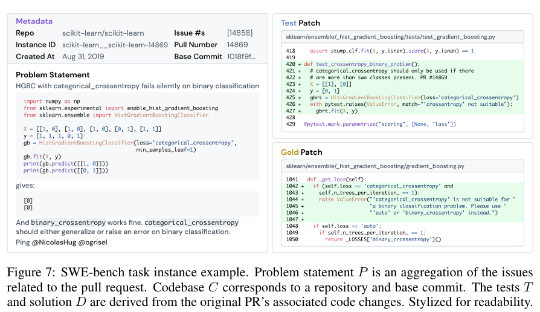

*图 7：一个实例示例。问题描述 $P$ 汇总关联 issue；代码库 $C$ 对应仓库及 base commit；测试 $T$ 和参考补丁 $\delta$ 来自原始 PR 代码变更。图形为提高可读性而作视觉整理。（原稿第 16 页）*

### A.2 实例构建过程（第 16–18 页）

将 PR 对象转化为候选任务时，核心目标是收集代码库 $C$、问题描述 $P$、单元测试 $T$ 和解决方案 $\delta$ 的全部必要信息。SWE-bench 的任务数据结构包含表 9 的字段，它们共同对应上述四种模块。

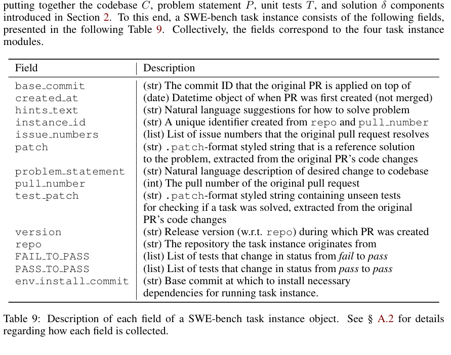

*表 9：SWE-bench 任务实例字段及类型。包括 `base_commit`、`created_at`、`hints_text`、`instance_id`、`issue_numbers`、`patch`、`problem_statement`、`pull_number`、`test_patch`、`repo` 与 `version` 等。原文截图保留全部字段定义。（原稿第 16 页）*

**问题描述与提示。** 把 PR 标题、正文和 commit 信息合并后，先移除 Markdown 样式的注释，再寻找 `#` 后跟数字的 issue 编号，并检查前面的词是否表明 PR 已解决该问题（如 `closes`、`fixes`、`resolves`）。把找到的编号记录到 `issue_numbers`，随后分别通过网络请求获取对应 issue 数据。将 issue 标题与正文合并；如果关联多个 issue，就依次拼接。`hints_text` 从 PR 评论区提取，仅采用 PR 首次 commit 之前的评论，因为这些评论可能包含给原始开发者的自然语言建议或伪代码。本文实验不使用 `hints_text`，但作者认为该信息值得未来研究。

**代码库。** 每个任务实例并不保存完整代码库明文，而是使用 `repo` 与 `base_commit` 两个字段引用相关状态。这些字段来自 PR 自身。为确保能稳定重现相应代码版本，作者创建原始 GitHub 仓库的镜像，并在 SWE-bench GitHub 组织下开源。这样可防止原仓库历史发生变更、对应 commit 消失而导致任务不可用。镜像不仅包含最新代码，还保留原 commit 哈希、历史、分支和标签，因而能完整保存技术历史；但镜像不保留 stars、watchers、issues 或 PR 等平台元数据。镜像在收集任务当天或之后创建，仓库名称延续原 `owner/name` 标识并将斜杠转换为 GitHub 合法命名方式。要还原任务代码，只需克隆对应镜像并检出 `base_commit`；同一仓库不同任务间通过 Git 版本控制清除上一次实例的本地变更并检出下一个 commit。

**参考补丁和测试补丁。** $\delta$ 与 $T$ 都由 PR 的代码差异（diff）生成，并保存为 `.patch` 格式。补丁由多个针对文件的块组成，每个块包括标识文件和行号的头部以及若干代码变更片段；修改行以 `+` 和 `-` 表示新增与删除。生成 $T$ 时，提取所有路径包含测试相关关键词的块并合并；其余块合并为 $\delta$。为检查解析脚本的正确性，作者将 $T$ 和 $\delta$ 应用于对应的 $C$，运行测试，并验证其行为与原 PR diff 相符。$\delta$ 存放在 `patch` 字段中，$T$ 存放在 `test_patch` 字段中。

**其他字段。** `created_at` 记录原 PR 创建日期，供模型表现的时间分析使用。`version` 则表示 PR 所属仓库的软件发布版本。作者依可得性与工作量，直接从源代码中读取版本、在本地构建并执行版本显示命令，或者根据创建日期与项目发布版本时间线进行对应。每个软件版本都会构建可执行环境，详见 A.3。

### A.3 基于执行的任务验证（第 18–19 页）

筛选 PR、构建候选任务后，还需通过实际执行确认任务的可用性，分为三步：为仓库不同发布版本建立执行上下文；检验 $\delta$ 和 $T$ 能否在 $C$ 上成功应用、安装和运行；检查日志以确认任务适合用于公平评测。

**执行上下文。** 作者比较过按任务实例、按仓库以及按发布版本建立虚拟环境的不同粒度。逐任务建立环境最有利于安装成功，但人工工作量大；只为仓库的最新版建立一个环境，则通常无法满足历史版本的依赖要求。按**发布版本**定义执行上下文在安装成功率与人工投入之间取得平衡。作者检查各版本最新任务的代码库和 README、CONTRIBUTING 文档，手工确定 Python 版本、必需依赖和安装命令。

**验证引擎。** 目标是检验补丁 $T$、$\delta$ 能否应用于 $C$，并确认项目能在对应虚拟环境中安装运行。以仓库为单位，按如下步骤执行：

1. 为不同版本基于 conda 创建环境，将任务按版本分组。
2. 逐任务清除本地文件修改并检出其 `base_commit`，重置为代码库 $C$。
3. 运行项目安装命令，建立可执行的 $C$。
4. 将测试补丁 $T$ 应用到 $C$。
5. 运行由 $T$ 决定的测试脚本，得到解决方案应用前日志 `log_pre`。
6. 将参考解决方案补丁 $\delta$ 应用到包含测试 $T$ 的代码库。
7. 再次执行同一测试脚本，得到解决方案应用后日志 `log_post`。

测试命令一般由仓库使用的框架（例如 `pytest`、`tox`）和测试补丁指定的文件路径构成，会执行这些文件路径中的所有相关测试。上述任一步失败，候选任务即被剔除；不同仓库略有差异，但这一环节通常会进一步排除约一半候选实例。

**验证日志检查。** 对引擎产生的 `log_pre` 和 `log_post`，首先检查 `log_pre` 是否含 `ImportError` 和 `AttributeError`，它们可能说明测试依赖某些任意命名的程序实体，导致正确修复难以推断，因此含此类错误的任务被排除。其次，使用仓库专用解析器把日志转换为“测试标识→测试状态”的映射，确保至少存在一个测试在应用 $\delta$ 前失败、应用后成功。只有符合要求的任务才能进入最终数据集。

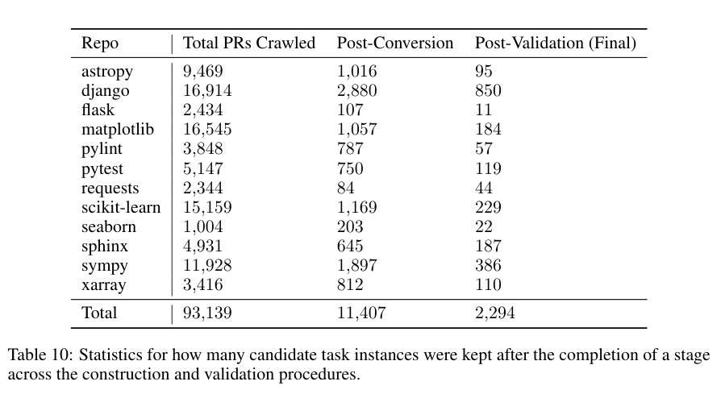

*表 10：不同仓库在 PR 抓取、构建候选任务及执行验证之后保留的任务数量。合计 **93,139 → 11,407 → 2,294**。（原稿第 19 页）*

最终任务保存为可下载的单个 `.json` 文件。作者还根据每个任务的 `log_pre` 和 `log_post` 缓存真值测试分类：`FAIL_TO_FAIL`、`FAIL_TO_PASS`、`PASS_TO_FAIL` 与 `PASS_TO_PASS`。每个键的值都是对应的测试列表。预先缓存这些结果，可避免评测阶段重复运行参考补丁 $\delta$（尽管仍可选择重跑）；该数据结构在 A.4 中用于判定任务完成。

### A.4 评价流程（第 19–20 页）

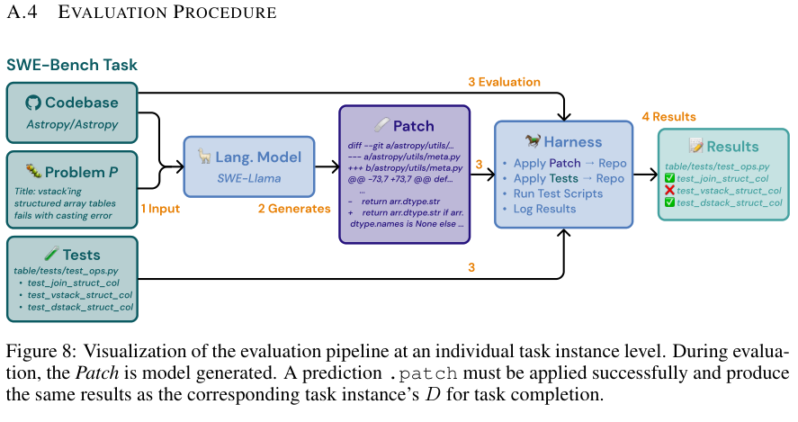

*图 8：单个任务实例的评价过程。模型生成预测补丁 $\hat\delta$，成功应用后运行真实测试，所得结果必须满足对应参考解决方案的测试状态要求。（原稿第 19 页）*

评价流程比较模型生成的 `.patch` 补丁 $\hat\delta$ 与参考补丁 $\delta$ 的**行为结果**，而不是逐行检查代码是否相同。具体步骤为：

1. 清除工作目录中的修改并检出任务的 `base_commit`，还原 $C$。
2. 激活任务对应版本的可执行环境。
3. 运行安装命令构建 $C$。
4. 将测试补丁 $T$ 应用到 $C$。
5. 在已经包含测试 $T$ 的代码库中应用模型预测补丁 $\hat\delta$。
6. 若应用失败，自动修复 $\hat\delta$ 并再次尝试。
7. 运行由 $T$ 指定的测试脚本，产生预测补丁的测试日志 $log_{\hat\delta}$。

前四步已在构建任务时验证，一般不会失败。若第五步应用补丁失败，尝试通过删除不必要上下文行、重新计算补丁头部行号等办法修复；若再次应用仍失败，或第七步测试命令失败，则预测结果得 **0 分**。否则，通过对应仓库的测试日志解析器把 $log_{\hat\delta}$ 转为测试状态映射。

**指标计算。** 判定任务是否完成时，将模型补丁对应的测试状态与参考结果中的 `FAIL_TO_PASS` 和 `PASS_TO_PASS` 两组测试比较。如果所有这些测试都存在，且状态为 `pass`，则认为任务被解决。任何缺失或状态不是 `pass` 的测试都会视为失败。也就是说，**必须同时通过全部 F2P 与 P2P 测试**，才能计算为 solved。

### A.5 正式评价集的特征（第 20–23 页）

表 11 将正文表 1 扩展为按仓库分组的统计。表 12 汇总仓库功能及开源许可证。各许可证都允许在遵守并保留其原有条款的条件下进行非商业使用。

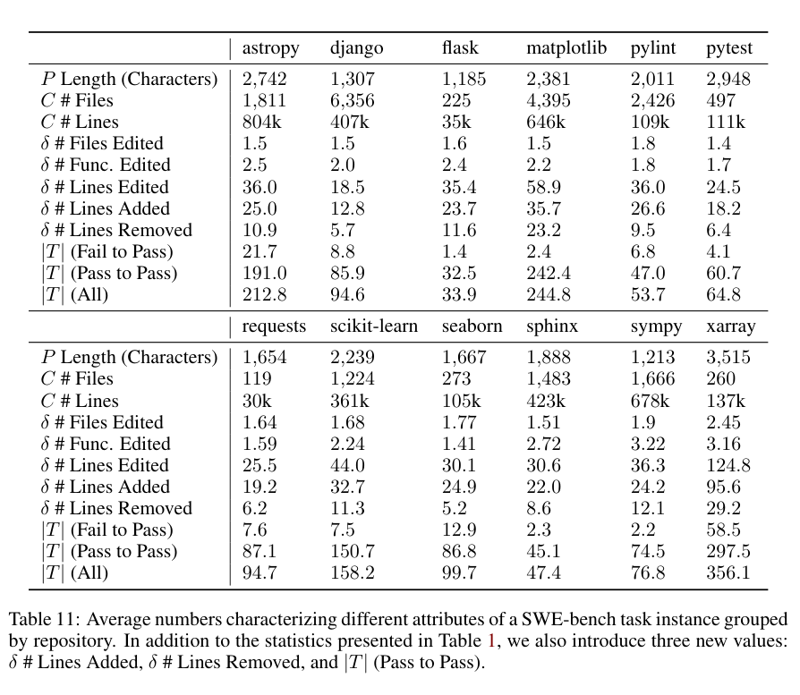

*表 11：按仓库分组的任务特征平均值。新增了 $\delta$ 的新增行数、删除行数，以及 P2P（Pass to Pass）测试数。（原稿第 22 页）*

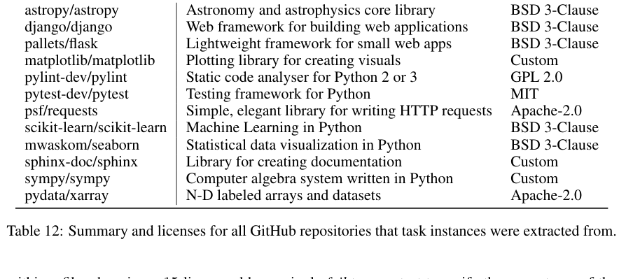

*表 12：12 个 GitHub 仓库的用途及许可证。（原稿第 22 页）*

相比正文表 1，新增的 `δ # Lines Added` 与 `δ # Lines Removed` 相加构成 `δ # Lines Edited`：前者表示解决方案新插入的行，后者表示删除的旧代码行。`|T| (Pass to Pass)` 则是应用解决方案前就已通过、应用后仍应通过的测试数量。与用于表示 issue 要求并检验修复行为的 F2P 测试不同，P2P 测试用于保证修复不会破坏已有功能。F2F 和 P2F 测试并不参与任务是否解决的判定，因此不计入该表的评价统计。

**Issue 类别。** 为理解 SWE-bench 涉及的问题类型，作者根据 `issue_numbers` 对应的 issue 元数据（尤其是 tags）进行简单分析。表 13 归类了总计 **2,289 个**标签的典型示例。尽管绝大部分问题与修复 bug 有关，数据集还覆盖错误修正之外的其他代码修改类型。

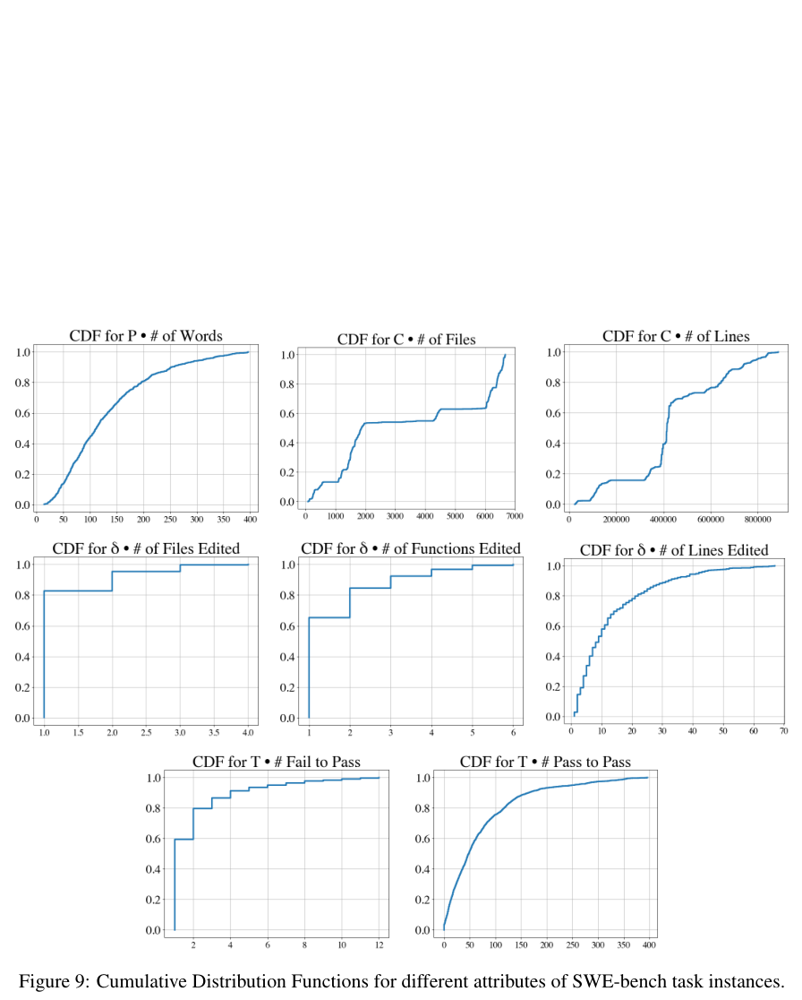

*图 9：SWE-bench 不同属性的累积分布函数（CDF）。（原稿第 21 页）*

从图 9 可知，任务实例的中位数特征是：问题描述约 **140 个词**，代码库略少于 **1,900 个文件和 40 万行代码**，参考补丁通常修改一个函数、约 15 行代码。用于验证修复正确性的 F2P 测试通常只有一个，而约 **51 个** P2P 测试用于保证已有行为得到维持。

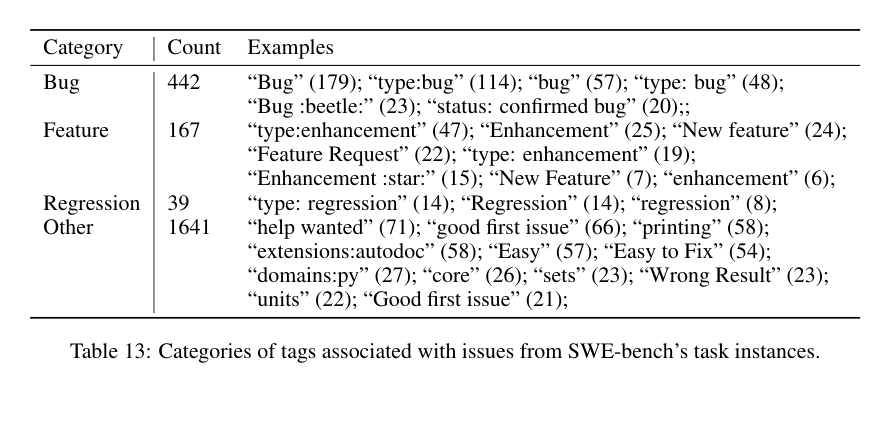

*表 13：SWE-bench issue 标签类别及示例，包括 Bug、Feature、Regression、Other。（原稿第 23 页）*

**补丁修复比例。** 表 14 统计各模型和检索配置下生成、成功应用及需要通过后处理修复才能成功应用的补丁数量。作者发现，在成功应用的补丁中，SWE-Llama 的补丁需要后处理修复的比例较低，说明微调有助于生成格式正确的补丁。相较而言，闭源模型成功应用补丁的比例更低，而成功应用的补丁中更多需要修复，表明模型整体上仍不擅长严格格式的补丁生成。

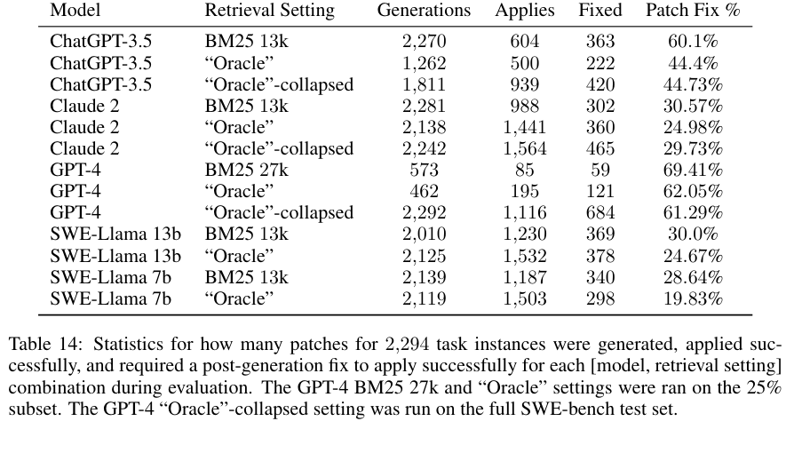

*表 14：不同模型和检索设置下补丁生成数、成功应用数、修复后应用数及修复比例。GPT-4 的 BM25 和 Oracle 结果多基于 25% 子集，Oracle-collapsed 配置使用完整测试集。（原稿第 23 页）*

### A.6 开发集的特征（第 23–25 页）

除正式评价集外，作者还提供一个用于正式测试前选择模型、调参的开发集。它包含来自 **6 个**开源仓库的 **225 个**任务，约为主评价集的十分之一，收集时使用与正式集相同的方法与筛选条件，并额外要求任务在 **2019 年 1 月 1 日之后**创建。表 15 汇总 6 个仓库用途和许可证，表 16 按类型给出 issue 标签，反映除 bug 修复以外的任务多样性，如 `Crash`、`io` 等与特定仓库相关的问题。表 17 给出按仓库统计的平均特征。开发集中每个任务平均有 **19.9 个 F2P 测试**（中位数 2）、**171.3 个 P2P 测试**（中位数 79.0），合计平均 **191.2 个测试**（中位数 101.0）。

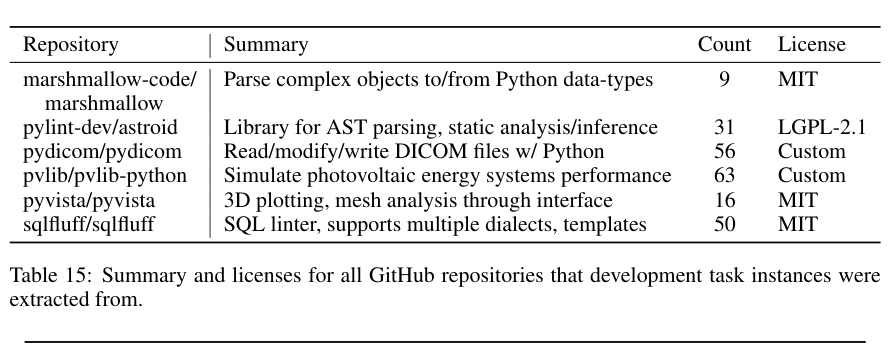

*表 15：开发集 6 个 GitHub 仓库的作用、任务数与许可证。（原稿第 24 页）*

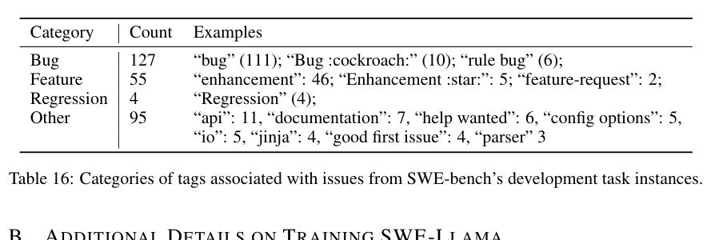

*表 16：开发集的 Bug、Feature、Regression 和其他 issue 标签类别。（原稿第 24 页）*

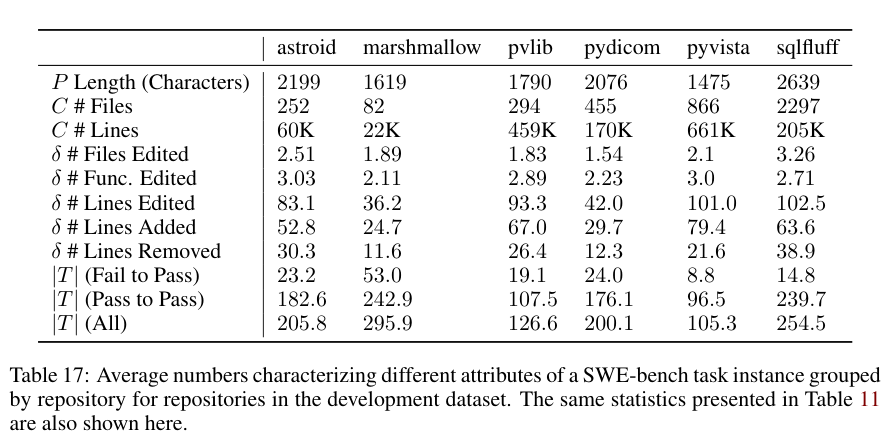

*表 17：开发集按仓库分组的任务特征，与正式集表 11 所用统计项一致。（原稿第 25 页）*

## 附录 B SWE-Llama 训练细节（原稿第 24 页）

### B.1 训练参数

**优化。** 通过 LoRA（Hu et al., 2022）微调每个注意力子层的查询、键、值及输出投影矩阵，设置 $r=16$、$\alpha=16$、`dropout=0.05`。使用学习率 $6\times10^{-4}$，每个梯度步骤的批量大小为 32 个序列，最多训练 **4 个 epoch**。训练时每隔 50 步保存 checkpoint，之后在留出的 100 个验证实例上按验证损失选择最佳 checkpoint。SWE-Llama 7B 在 CodeLlama-Python 7B 上初始化，使用 **4 块 NVIDIA A100** 训练 **20 小时**；SWE-Llama 13B 基于 CodeLlama-Python 13B 初始化，使用 **8 块 A100** 训练 **47 小时**。为支持长上下文训练，使用 DeepSpeed Ulysses（Jacobs et al., 2023）及 Flash Attention（Dao et al., 2022）。

## 附录 C 更多实验结果（原稿第 24–29 页）

### C.1 Oracle 检索结果

在第 4.1 节描述的 Oracle 设置下，作者仅提供参考解决方案实际修改的文件，因此模型相对于噪声更大的 BM25 检索总体表现有所改善，见表 18。

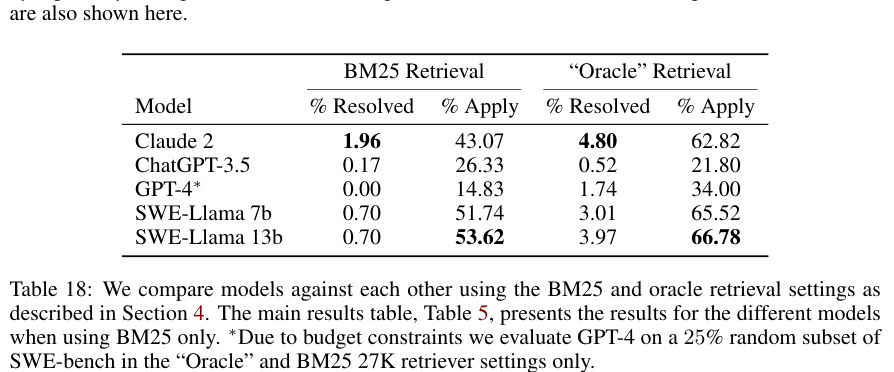

*表 18：各模型在 BM25 与 Oracle 检索下的成功解决率和补丁应用率；GPT-4 仅在 25% 随机子集上评测。（原稿第 25 页）*

### C.2 评价测试集

表 19 按仓库列出模型成功解决率，对应正文图 4；不同仓库之间的难度差异很大。

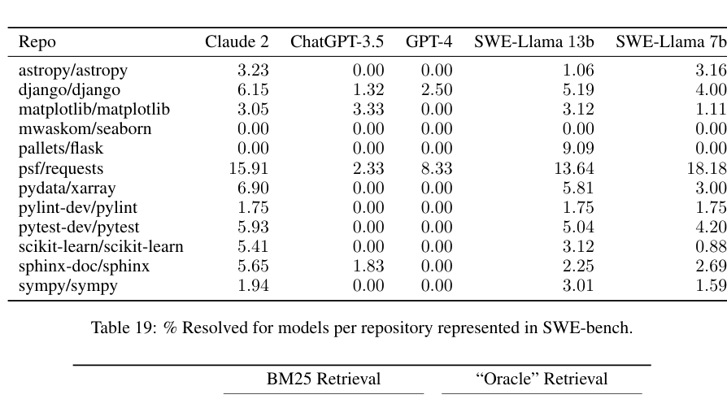

*表 19：Oracle 检索下各模型在 SWE-bench 12 个仓库中的 % Resolved。（原稿第 26 页）*

### C.3 GPT-4 子集分析

为保证与 GPT-4 所用随机 **25% 子集（574 个任务）**公平比较，表 20 在同一子集上重新统计了表 5 和表 18 的指标。作者发现，该子集的成功解决率与补丁应用率和完整测试集的总体结果大体一致，并未明显偏向更简单或更困难的问题。

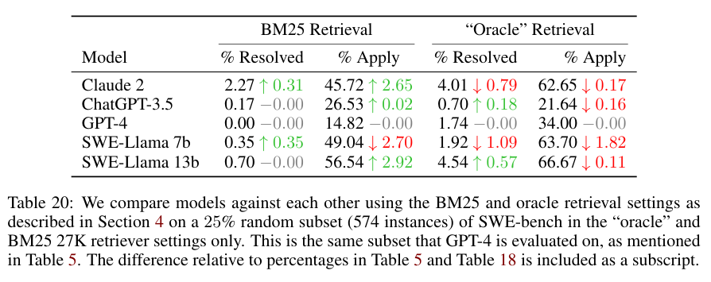

*表 20：相同随机 25% 子集上的 BM25 与 Oracle 结果，并给出与完整测试集分数的差异。（原稿第 26 页）*

### C.4 扩展时间分析

正文表 7 已比较 2023 年前后的任务；表 21 进一步将 issue 按创建年份划分成 **6 组**，在 Oracle 检索下比较各模型 % Resolved。结果看不出性能与年份之间存在稳定相关性，支持作者结论：即便模型预训练时可能见过旧版本代码，SWE-bench 的修复任务依然需要实际理解与实现，而不能通过简单记忆训练语料中的代码稳定完成。

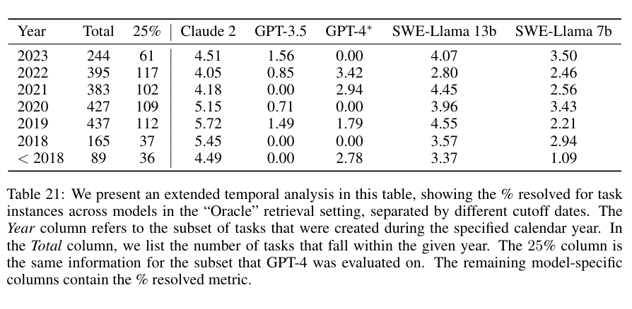

*表 21：Oracle 检索下，按任务创建年份划分的成功解决率。`Total` 列为各年份任务数，`25%` 为 GPT-4 子集对应任务数。（原稿第 27 页）*

### C.5 F2P 与 P2P 测试结果分析

正文主指标 `% Resolved` 只告诉我们有多少任务被**完全解决**。本节更精细地研究两类任务：模型补丁已经成功应用，但任务仍未解决。假设补丁能成功应用，则根据 F2P（原来失败、预期修复后通过）和 P2P（原来通过、预期修复后仍通过）的测试结果，可以划分六种状态，见表 22：

- **Resolved（完全解决）**：全部 F2P 与 P2P 测试通过。
- **Breaking Resolved（解决问题但破坏旧功能）**：全部 F2P 通过，但并非全部 P2P 通过。
- **Partially Resolved（部分解决）**：全部 P2P 通过，但仅有部分 F2P 通过。
- **Work in Progress（进行中）**：部分 F2P 和 P2P 未通过，即新问题尚未完全解决，而且部分原有行为也未保留。
- **No-Op（无有效修改）**：全部 P2P 通过，但 **0 个** F2P 通过，说明代码修改没有使原问题获得解决。
- **Regression（回归）**：0 个 F2P 通过，同时已有功能也未完全维持（P2P 未全部通过）。

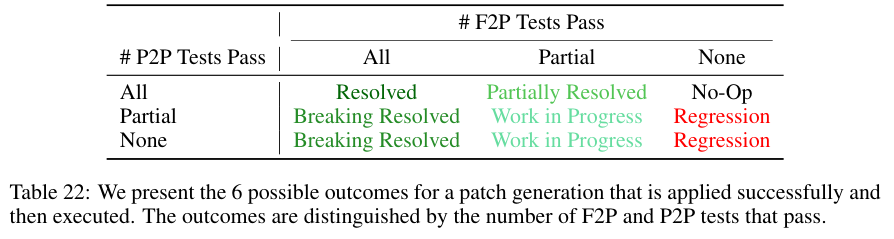

*表 22：按全部、部分或零个 F2P/P2P 测试通过的组合，区分补丁成功应用后的六种结果。（原稿第 27 页）*

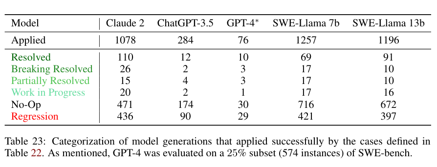

*表 23：按表 22 的六种状态，对各模型成功应用的补丁进行归类。GPT-4 仅在 25% 子集上评估。（原稿第 28 页）*

### C.6 模型补丁的编辑范围

表 24 统计 Oracle 检索下的所有生成补丁（包括未成功应用的补丁），并与对应参考补丁的修改行数、函数数和文件数比较。整体上，模型生成补丁的规模更接近参考修改。某些模型依然产生更少的修改行（如 Claude 2、ChatGPT-3.5、GPT-4），而 SWE-Llama 的编辑在多个指标上平均更长。结合仅统计成功应用补丁的表 8，可以推断：**模型在生成较长、且格式严格正确的补丁时明显更困难**。结合附录 F 的案例分析，长生成更容易暴露幻觉、不遵循已有代码风格或结构、错误引用远程依赖关系等问题。

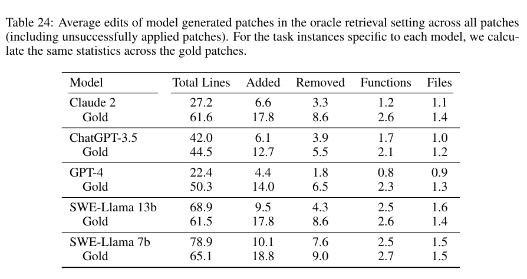

*表 24：Oracle 检索下的模型补丁与参考补丁在编辑总行数、增删行数、函数数和文件数上的比较。（原稿第 28 页）*

### C.7 软件工程指标

作者初步研究了如何用软件工程指标评价与复杂代码库集成的大代码块的效率和复杂度。传统 NLP 评估常用语义相似度或表层文本相似度；相较之下，**圈复杂度（Cyclomatic Complexity）**（McCabe, 1976）和 **Halstead 复杂度**（Halstead, 1977）建立在控制流、抽象语法树与软件工程原则之上，用标量描述程序复杂程度、效率和可读性。

SWE-bench 的补丁和评价日志包含丰富的材料，可以直接运用软件工程指标与静态分析器。由于任务跨越较大代码库，这些指标能为补丁引入的复杂性及其对项目其余部分的影响提供严谨、有结构的反馈信号。作者使用 **Radon** 工具包直接从源代码计算指标。

作为示例，作者分析在 Oracle 检索下成功应用的、面向 `psf/requests` 仓库的 Claude 2 补丁。对每个预测补丁先应用到代码库，再计算被修改函数的圈复杂度与 Halstead 复杂度，并对其参考补丁做同样的操作。圈复杂度衡量函数控制流中的独立执行路径数量，数值越高一般意味着函数更复杂、出现缺陷的风险和维护难度更高；Halstead 复杂度则统计程序中的操作符与操作数。

案例见图 10：模型补丁虽然比参考方案更短（**6 行对 11 行**）、修改文件更少（**1 个对 2 个**），并且正确修复了问题，却在较复杂且使用频繁的 `HTTPAdapter` 类中增加了条件分支，使其圈复杂度由 **3 增至 5**。参考方案虽然更长，却将模块内依赖适当导入，在结构上较简单的 `get_connection` 函数中作出修改，并定义新的 `InvalidProxyURL` 异常类型来表达新出现的问题。

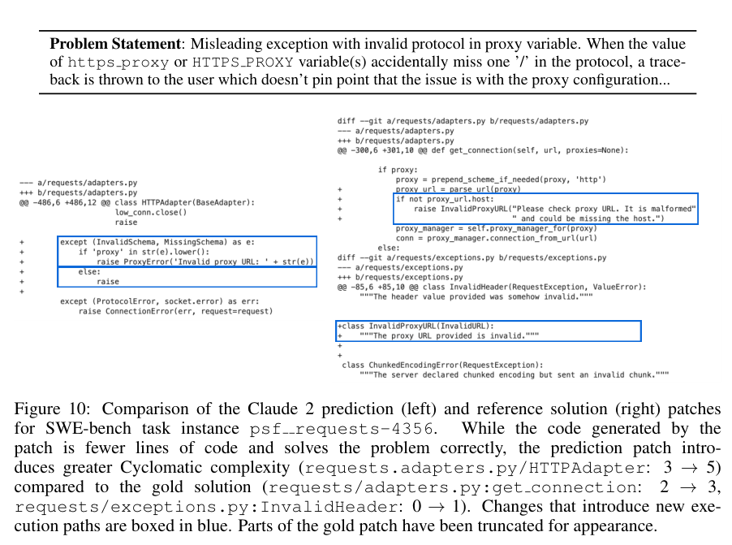

*图 10：`psf/requests-4356` 任务中 Claude 2 预测补丁（左）与参考解决方案（右）。模型虽以更少代码正确修复问题，但带来了更大的圈复杂度增量；蓝色框标记新增执行路径的更改。图中部分参考补丁为了展示而被截断。（原稿第 29 页）*

## 附录 D 补充实验细节与输入模板（原稿第 28–31 页）

### D.1 检索细节

**稀疏检索。** 作者略微调整检索文档，在文件内容前附加其路径，以便 issue 直接提及文件名时，检索系统可以利用路径匹配。**Oracle 检索。** 直接从参考补丁中提取被编辑文件路径，排除测试文件。

### D.2 推断设置

由于生成成本较高，对每个任务只生成**一个补丁文件**。按照代码生成领域 `pass@1` 的既有评价方式（Chen et al., 2021；Rozière et al., 2023），所有模型均采用**贪心解码（greedy decoding）**。

### D.3 提示模板

模型接受内容相近的统一提示模板，仅根据具体模型略作调整。模板的中文说明是：“你会获得部分代码库和描述待解决问题的 issue；在 `<issue>` 标签中给出问题文本，在 `<code>` 标签中给出 README 和相关代码文件的具体内容，之后提供一个补丁文件示例，说明如何用文件名、行号及以 `+`、`-` 表示的修改行来描述代码变更。请生成解决问题的补丁。”

以下是原文示例的结构；花括号代表实际任务替换字段，标记符保持英文不变，以便复现：

```text
You will be provided with a partial code base and an issue statement
explaining a problem to resolve.
<issue>
{ISSUE TEXT}
</issue>

<code>
[start of README.md]
{README.md text}
[end of README.md]
[start of file_1.py]
{file_1.py text}
[end of file_1.py]
...
</code>
```

完整补丁格式示例及模型具体提示参见 `英文原文_逐页提取.md` 的 PDF 第 29–31 页。此处的原始程序上下文以英文保存，不改变可执行字符。

## 附录 E 社会影响（原稿第 31 页）

随着代码推理逐渐成为语言模型能力的重要基础，未来由机器自动完成软件工程工作，会引出许多问题，并可能对 AI 安全产生重要影响（Gros et al., 2023）。一个重要课题是如何确保 AI 生成代码忠实于人类意图，以及当代码智能体误解人类目标并继续执行任务时，需要设置哪些防护机制。作者希望 SWE-bench 能在可控条件下暴露这些问题、探索解决方案，成为设计安全、鲁棒、目标一致且可验证的 AI 驱动软件工程方法的试验场。

## 附录 F SWE-Llama 生成结果的深入案例分析（原稿第 31–51 页）

本节沿用正文第 5.1 节的形式，进一步对 Claude 2 与 SWE-Llama 在 Oracle 检索环境下的生成结果作定性分析。表 25、26 是 Claude 2 正确解决任务的例子；表 27、28、29 是 Claude 2 未能正确解决的例子。表 30–34 研究 SWE-Llama 13B，其中 30–32 成功解决任务，33、34 失败。这些例子支持正文的观察：模型难以稳定处理多行、多文件修改，要求的修复较短时表现较好，需要更有效的代码库理解能力。

**阅读规则：** 以下逐例将 issue 目标与作者讨论译为中文。原始 GitHub issue、函数签名、完整补丁 diff、路径和测试清单在原文中属于可执行、可检索的技术证据，原样收录在 `英文原文_逐页提取.md` 与 `source_pages/page-032.jpg` 至 `page-051.jpg` 中，避免翻译代码导致行为改变。每例配图来自对应原论文的表格截图，若表格跨页，紧随其后的整页截图补充后续代码。

### F.1 Claude 2 的正确修复：HuberRegressor 布尔输入（表 25，第 32–33 页）

**任务**：`scikit-learn/scikit-learn-13328`。issue 标题：“向 HuberRegressor 的 fit 提供布尔类型 X 时发生 TypeError”。

该问题涉及数组的类型转换。使用 `X_bool` 等布尔特征调用 `HuberRegressor.fit` 时，会出现 `TypeError`，因为 HuberRegressor 不像 `LinearRegression` 等其他模型那样自动把布尔数组转换成浮点数，从而发生类型不匹配。

模型的补丁定义了自己的 `_validate_data` 函数，封装类型转换逻辑并应用于 `X`。这个方案虽然通过了相关测试，但效率不高，可能引入代码风格和组织结构上的不一致。人工参考解决方案表明，更简洁的修复是给已有的 `check_X_y` 调用传入合适的 `dtype` 参数，利用现有接口标志完成转换。由于上下文窗口限制，Oracle 检索未包含其他相关文件内容。

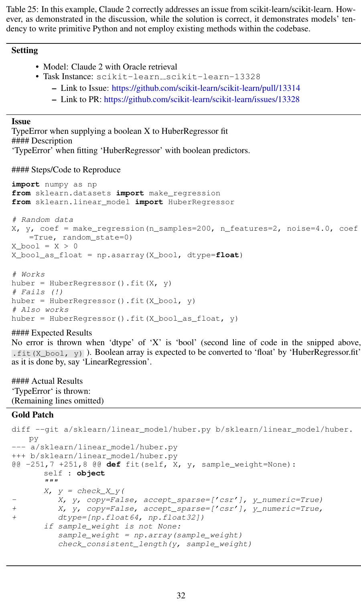

*表 25：Claude 2 正确解决 scikit-learn 问题，但倾向于编写基本 Python，而不是复用代码库已有方法。下页继续展示模型补丁和测试。（原稿第 32–33 页）*

[查看原论文第 33 页的完整补丁与测试](./source_pages/page-033.jpg)

### F.2 Claude 2 的正确修复：subplots 的 sharex/sharey（表 26，第 34–35 页）

**任务**：`matplotlib/matplotlib-24362`。issue 标题：“`sharex` 和 `sharey` 不接受 0 和 1 作为布尔值”。

该任务要求 `pyplot.subplots` 在参数 `sharex`、`sharey` 中将 0 和 1 也视为布尔值；现有代码会报错。模型补丁直接让 0、1 成为可接受的值，而参考补丁将合法输入纳入包含 `all`、`row`、`col`、`none`、`False`、`True` 的合理处理逻辑，并移除了与该问题相关的 `Integral` 类型警告。这些清理使 `check_in_list` 的参数使用更明确，代码也更简洁、可读。

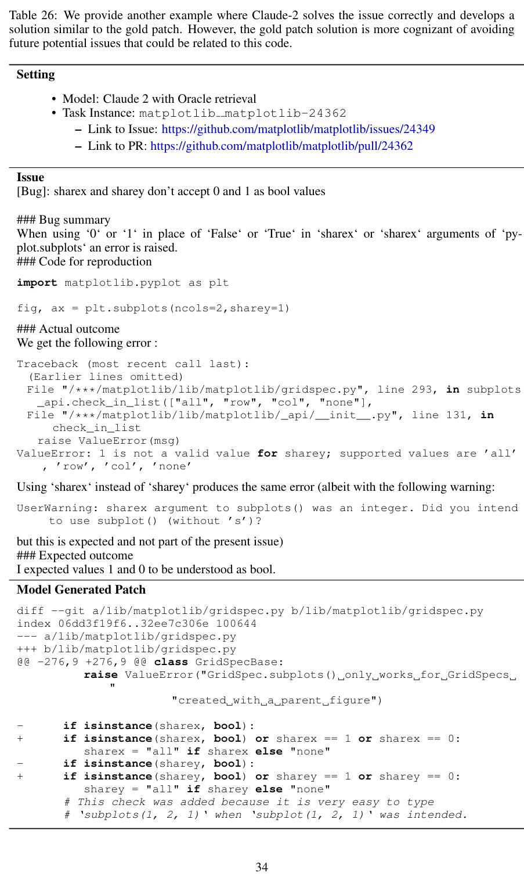

*表 26：Claude 2 正确解决问题，改动与人工 gold patch 相似，但 gold patch 考虑了未来潜在问题。（原稿第 34–35 页）*

[查看原论文第 35 页的完整补丁与讨论](./source_pages/page-035.jpg)

### F.3 Claude 2 的失败修复：QDP 命令大小写（表 27，第 36–37 页）

**任务**：`astropy/astropy-14365`。issue 标题：“`ascii.qdp` 表格格式假定 QDP 命令必须大写”。

QDP 文件的命令实际上不区分大小写，例如 `READ SERR 1 2` 与 `read serr 1 2` 均应有效，而当前 `ascii.qdp` 会要求大写。模型直接定位 issue 中提及的 `READ` 和 `ERR`，修改其正则表达式。但同一文件中这些正则模式还由 `_type_re` 等其他模式使用，直接更改“根”正则并不一定恰当。在多个正则变量中识别正确修改位置需要更深入的推理，也可能借助实际执行反馈。这项错误不仅导致问题所需的新测试失败，还使既有测试失败，破坏了旧行为。

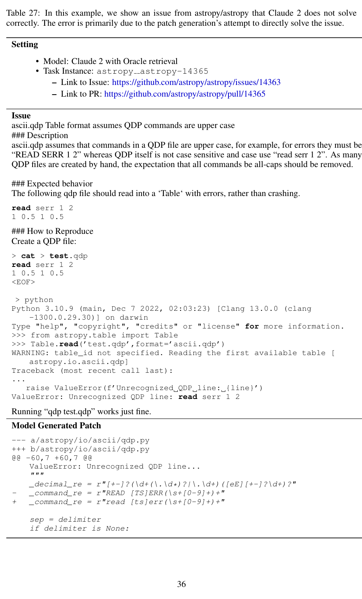

*表 27：Claude 2 未正确修复 astropy 的 QDP 解析问题，生成补丁过于直接。（原稿第 36–37 页）*

[查看原论文第 37 页的补丁和错误分析](./source_pages/page-037.jpg)

### F.4 Claude 2 的失败修复：包含图像的 issue（表 28，第 38–39 页）

**任务**：`mwaskom/seaborn-3217`。原始问题描述带有指向图像的超链接。

模型无法解决这个问题，直接原因是基线没有获取图像输入。这个案例说明真实软件问题的调试可能需要理解图片，从而引入一整类独立的视觉理解与推理挑战。不仅是 SWE-bench 内包含图像的 issue，软件工程中的系统设计图、用户界面规范和用户反馈也都可能构成值得研究的视觉语言任务。

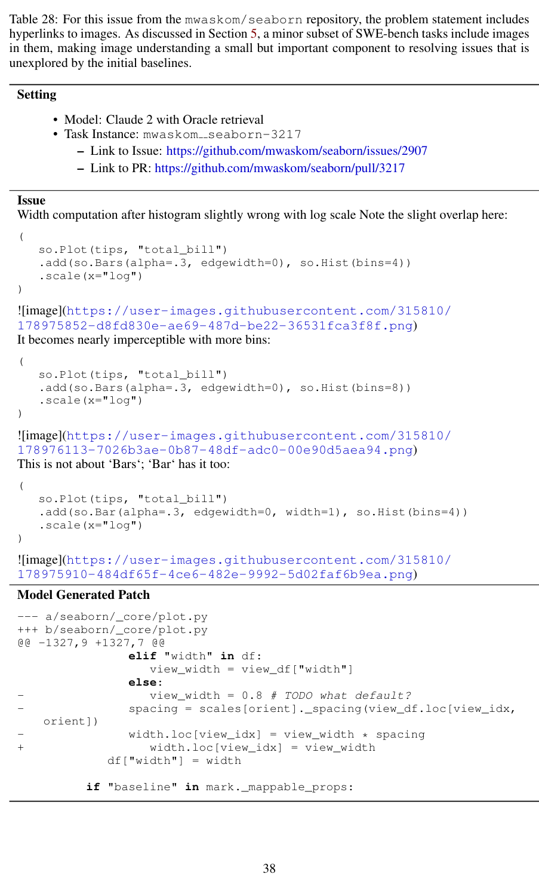

*表 28：真实问题可能依赖截图，缺乏图像理解能力会阻碍代码修复。（原稿第 38–39 页）*

[查看原论文第 39 页的补丁和讨论](./source_pages/page-039.jpg)

### F.5 Claude 2 的失败修复：Pylint 循环导入（表 29，第 40–41 页）

**任务**：涉及 `pylint` 对 `TYPE_CHECKING` 条件下循环导入的处理。

用户要求通过基于 `TYPE_CHECKING` 的方式修复 Pylint 报告的循环导入错误。参考补丁提供了更细致的解决方案，包括在 `TYPE_CHECKING` 块内进行条件化处理、排除循环导入提示，并更有针对性地处理具体问题。模型给出了一种类似 Stack Overflow 常见回答的通用方案：增加 `TYPE_CHECKING` 块。尽管这种做法在一般 Python 项目中很常用，但这里需要结合当前代码库提供比一般网上答案更加细致的修复。

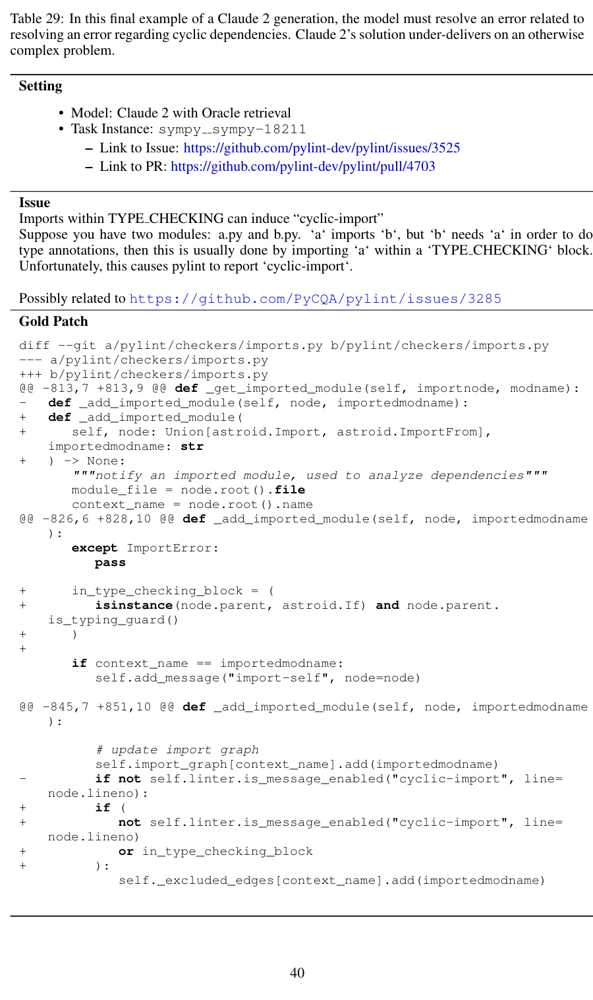

*表 29：Claude 2 在需深入理解特定代码库的循环导入问题上失败。（原稿第 40–41 页）*

[查看原论文第 41 页的完整补丁与讨论](./source_pages/page-041.jpg)

### F.6 SWE-Llama 13B 的正确修复：xarray 表示中的尾随空格（表 30，第 42–43 页）

**任务**：来自 `xarray` 的 `groupby` 表示问题，需要删除输出中的多余尾随空格。

issue 通过运行示例展示错误，但并没有明确指出该修改哪个函数。在 Oracle 检索下，模型获得 `xarray/core/groupby.py`，仍需要进一步定位代码行。模型成功推断：交互式 Python 环境中调用的底层函数实际是 `repr`，并找到返回语句中显式包含的空格将其删除。生成补丁通过 **10 个 F2P 测试**，同时通过 **16 个 P2P 测试**，既修复新问题，也保留了原有行为。

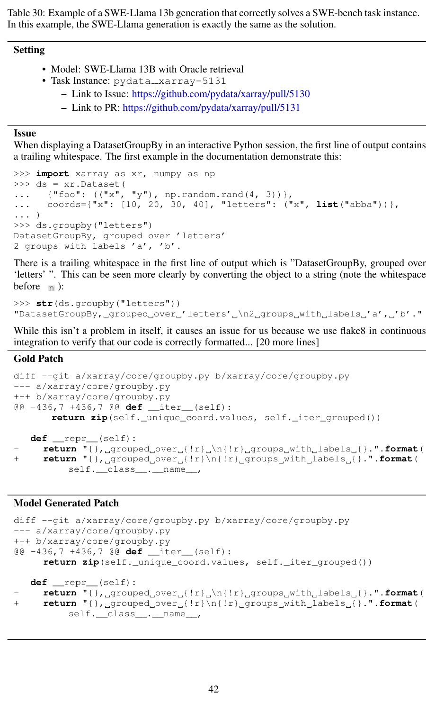

*表 30：SWE-Llama 13B 成功解决 xarray 中的尾随空格问题。（原稿第 42–43 页）*

[查看原论文第 43 页的补丁与测试](./source_pages/page-043.jpg)

### F.7 SWE-Llama 13B 的正确修复：Python 2 的 Unicode 方法名（表 31，第 44–45 页）

**任务**：`psf/requests-1724`。issue 标题：“某些请求在 Python 2.7.2 中使用 Unicode 方法名会导致 `UnicodeDecodeError`”。

与表 30 的问题不同，这里的 issue 提供了函数调用的完整错误堆栈以及用户重现步骤，最后还提出了可能的修复建议。Oracle 设置下，模型利用这一自然语言建议，把更改定位在含义相近的代码行，将 `request.method.upper()` 改为 `str(request.method).upper()`。修复通过全部相关测试，但成功也具有偶然性。参考补丁调用代码库已有的统一字符串格式处理函数；模型却使用更原始的 Python 转换方法，与项目其他代码不一致，可能不被人工审查者接受。进一步检查参考实现使用的 `builtin_str` 可发现，它还能处理 issue 中没有展示的其他字符串格式情况。因此，模型虽成功解决当前任务，未来鲁棒性仍值得怀疑。

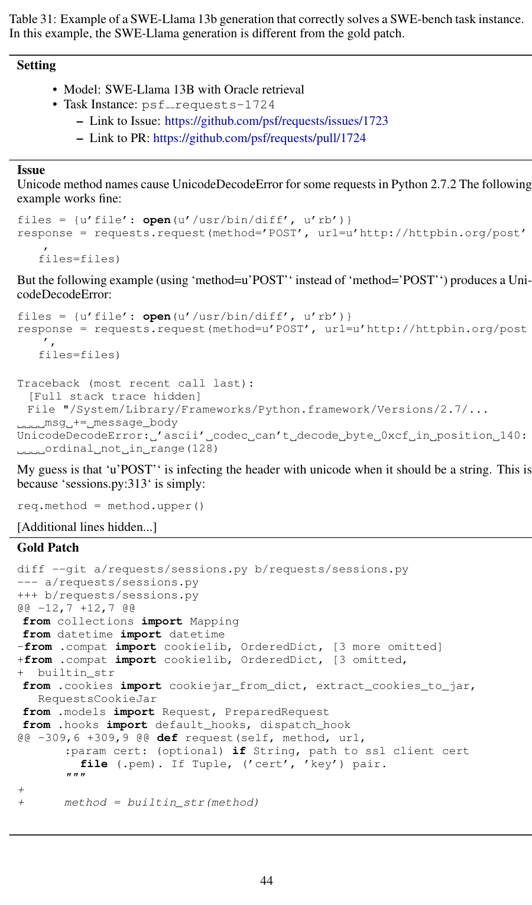

*表 31：SWE-Llama 13B 正确解决问题，但方案不同于参考补丁，并可能缺少长期鲁棒性。（原稿第 44–45 页）*

[查看原论文第 45 页的补丁和分析](./source_pages/page-045.jpg)

### F.8 SWE-Llama 13B 的正确修复：Django 管理界面按钮（表 32，第 46–47 页）

**任务**：`django/django-11727`。issue 标题：“允许使用上下文变量 `show_save_and_add_another` 隐藏‘保存并新增一条’按钮”。

这个任务希望像其他“保存”和“保存并继续编辑”按钮一样，通过上下文变量控制“保存并新增一条”按钮是否显示。与前两例相比，问题更困难，因为 issue 没有提供显式堆栈或程序化复现步骤。在定位函数信息不足的情况下，模型仍正确判断要修改已有的 `show_save_and_add_another` 键值对。模型补丁可被认为在修改行数上比参考方案更高效：只进行最小必要修改，把 `context` 接入为按钮显示状态的控制开关。然而，人工参考补丁在风格上更符合项目既有结构，还进行了 issue 没明确提出、但遵循代码库习惯的其他变更（例如添加 `can_save_and_add_another` 字段）。该案例提示了一个有潜力的研究方向：通过人类指导或更好地理解整个代码库，使模型生成既功能正确、又符合风格的修改。

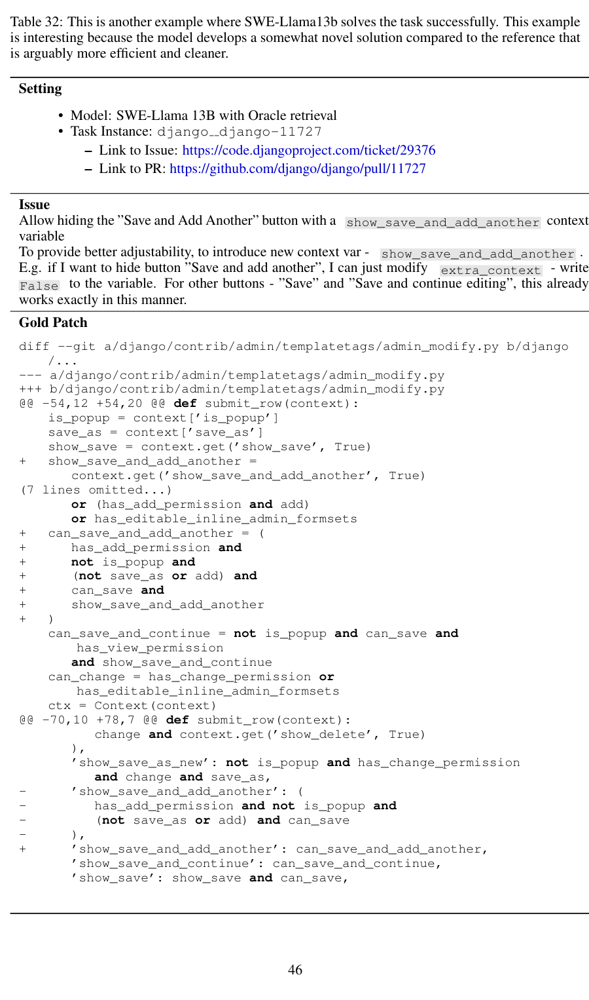

*表 32：SWE-Llama 13B 在较少提示下生成新的、相对简洁的正确修复方案。（原稿第 46–47 页）*

[查看原论文第 47 页的补丁与分析](./source_pages/page-047.jpg)

### F.9 SWE-Llama 13B 的失败修复：Sphinx 标题渲染（表 33，第 48–49 页）

**任务**：`sphinx-doc/sphinx-11445`。issue 标题：“使用 `rst_prolog` 会移除包含 domain directive 的顶级标题”。

问题要求修复文档标题渲染错误。对于模型而言，仅理解 issue 中使用的术语，并把术语映射到代码库的具体逻辑，就已很有挑战。issue 给出一条可辅助调试的命令，但仍需在代码库中定位相应机制。比较模型与参考补丁可以看出，模型未接近正确解决方案。它大体识别出了需要修改正则表达式这一方向，参考补丁也确实修改了正则；但失败主要来自当前方案依赖代码库的其他模块及第三方库，模型与 Oracle 检索的有限上下文都没有充分覆盖这些联系。这表明，自动发现相关依赖信息，以及使模型利用这些信息，是值得继续研究的问题。

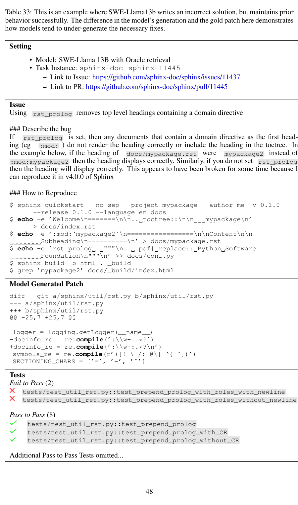

*表 33：SWE-Llama 13B 未能正确修复 Sphinx 标题问题，但仍保留了旧行为；模型生成的修复范围不足。（原稿第 48–49 页）*

[查看原论文第 49 页的补丁与分析](./source_pages/page-049.jpg)

### F.10 SWE-Llama 13B 的失败修复：KernelPCA 输出符号不一致（表 34，第 50–51 页）

**任务**：`scikit-learn/scikit-learn-13241`。issue 标题：“采用 RBF 核的 KernelPCA 在相同数据上的结果存在符号差异”。

issue 提供了重现过程：对相同数据使用 `KernelPCA(n_components=7, kernel='rbf', copy_X=False, n_jobs=-1)`，得到的结果数值相近但符号可能相反。参考补丁导入并使用 `svd_flip` 函数，在 `_fit_transform` 的其他位置修复符号不确定性；模型却在该函数中错误地修改返回值逻辑。

与表 33 的问题相比，这一失败额外强调：模型不仅需要理解其修改所依赖的第三方模块，还需要知道代码库的其他部分又是如何依赖正在修改的函数。跨越局部编辑范围处理长上下文，是一种困难但非常值得解决的挑战。该补丁既没解决问题，又破坏了既有行为。

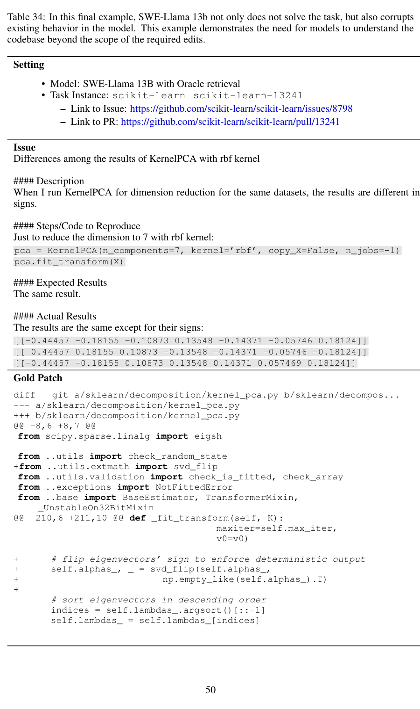

*表 34：SWE-Llama 13B 不仅未解决任务，还破坏现有行为，说明修复需要理解局部代码修改对整个代码库的影响。（原稿第 50–51 页）*

[查看原论文第 51 页的补丁及分析](./source_pages/page-051.jpg)

## 参考文献（原稿第 11–14 页）

参考文献依照学术规范保留英文原文的作者名、正式题名、期刊会议与年份，以便直接检索和核对。全部参考文献条目位于随包附送的 `英文原文_逐页提取.md` 第 11–14 页，不采用人工补写的缩略引用列表。

### 参考文献英文完整原文（按原稿页码）

以下参考文献完整保留作者、论文题名、发表信息与编号的原文形式，便于准确检索。参考文献文字来源于原始 PDF 文本层；遇到双栏布局时，按左栏后右栏的顺序提取。原始排版可对照 `source_pages/`。

#### 原稿第 11 页

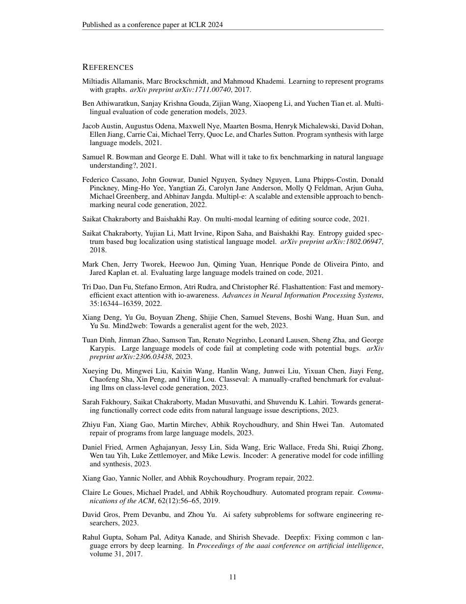

```text
Published as a conference paper at ICLR 2024


REFERENCES

Miltiadis Allamanis, Marc Brockschmidt, and Mahmoud Khademi. Learning to represent programs
  with graphs. arXiv preprint arXiv:1711.00740, 2017.

Ben Athiwaratkun, Sanjay Krishna Gouda, Zijian Wang, Xiaopeng Li, and Yuchen Tian et. al. Multi-
   lingual evaluation of code generation models, 2023.

Jacob Austin, Augustus Odena, Maxwell Nye, Maarten Bosma, Henryk Michalewski, David Dohan,
  Ellen Jiang, Carrie Cai, Michael Terry, Quoc Le, and Charles Sutton. Program synthesis with large
  language models, 2021.

Samuel R. Bowman and George E. Dahl. What will it take to fix benchmarking in natural language
  understanding?, 2021.

Federico Cassano, John Gouwar, Daniel Nguyen, Sydney Nguyen, Luna Phipps-Costin, Donald
  Pinckney, Ming-Ho Yee, Yangtian Zi, Carolyn Jane Anderson, Molly Q Feldman, Arjun Guha,
  Michael Greenberg, and Abhinav Jangda. Multipl-e: A scalable and extensible approach to bench-
  marking neural code generation, 2022.

Saikat Chakraborty and Baishakhi Ray. On multi-modal learning of editing source code, 2021.

Saikat Chakraborty, Yujian Li, Matt Irvine, Ripon Saha, and Baishakhi Ray. Entropy guided spec-
  trum based bug localization using statistical language model. arXiv preprint arXiv:1802.06947,
  2018.

Mark Chen, Jerry Tworek, Heewoo Jun, Qiming Yuan, Henrique Ponde de Oliveira Pinto, and
  Jared Kaplan et. al. Evaluating large language models trained on code, 2021.

Tri Dao, Dan Fu, Stefano Ermon, Atri Rudra, and Christopher R´e. Flashattention: Fast and memory-
   efficient exact attention with io-awareness. Advances in Neural Information Processing Systems,
  35:16344–16359, 2022.

Xiang Deng, Yu Gu, Boyuan Zheng, Shijie Chen, Samuel Stevens, Boshi Wang, Huan Sun, and
  Yu Su. Mind2web: Towards a generalist agent for the web, 2023.

Tuan Dinh, Jinman Zhao, Samson Tan, Renato Negrinho, Leonard Lausen, Sheng Zha, and George
  Karypis.  Large language models of code fail at completing code with potential bugs.  arXiv
  preprint arXiv:2306.03438, 2023.

Xueying Du, Mingwei Liu, Kaixin Wang, Hanlin Wang, Junwei Liu, Yixuan Chen, Jiayi Feng,
  Chaofeng Sha, Xin Peng, and Yiling Lou. Classeval: A manually-crafted benchmark for evaluat-
  ing llms on class-level code generation, 2023.

Sarah Fakhoury, Saikat Chakraborty, Madan Musuvathi, and Shuvendu K. Lahiri. Towards generat-
  ing functionally correct code edits from natural language issue descriptions, 2023.

Zhiyu Fan, Xiang Gao, Martin Mirchev, Abhik Roychoudhury, and Shin Hwei Tan. Automated
   repair of programs from large language models, 2023.

Daniel Fried, Armen Aghajanyan, Jessy Lin, Sida Wang, Eric Wallace, Freda Shi, Ruiqi Zhong,
  Wen tau Yih, Luke Zettlemoyer, and Mike Lewis. Incoder: A generative model for code infilling
  and synthesis, 2023.

Xiang Gao, Yannic Noller, and Abhik Roychoudhury. Program repair, 2022.

Claire Le Goues, Michael Pradel, and Abhik Roychoudhury. Automated program repair. Commu-
  nications of the ACM, 62(12):56–65, 2019.

David Gros, Prem Devanbu, and Zhou Yu.  Ai safety subproblems for software engineering re-
   searchers, 2023.

Rahul Gupta, Soham Pal, Aditya Kanade, and Shirish Shevade. Deepfix: Fixing common c lan-
  guage errors by deep learning. In Proceedings of the aaai conference on artificial intelligence,
  volume 31, 2017.


                                       11
```

#### 原稿第 12 页

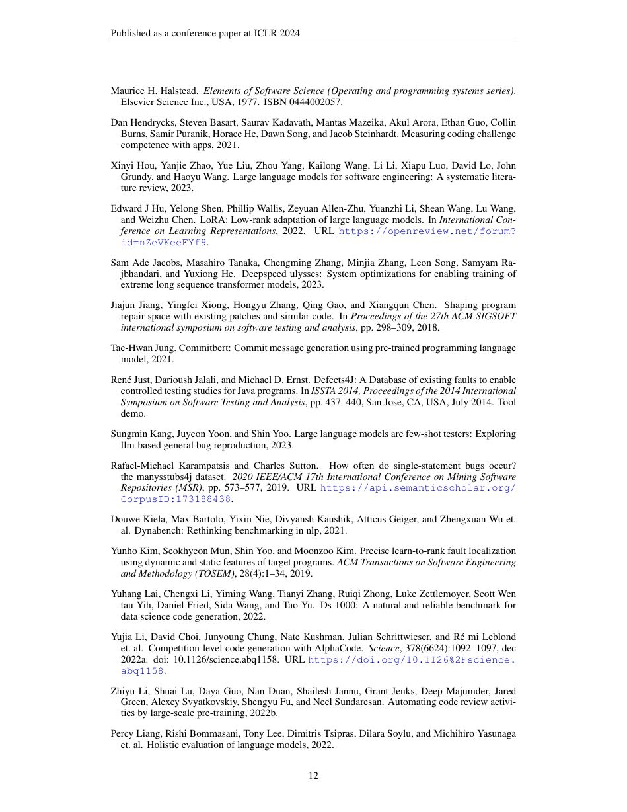

```text
Published as a conference paper at ICLR 2024


Maurice H. Halstead. Elements of Software Science (Operating and programming systems series).
  Elsevier Science Inc., USA, 1977. ISBN 0444002057.

Dan Hendrycks, Steven Basart, Saurav Kadavath, Mantas Mazeika, Akul Arora, Ethan Guo, Collin
  Burns, Samir Puranik, Horace He, Dawn Song, and Jacob Steinhardt. Measuring coding challenge
  competence with apps, 2021.

Xinyi Hou, Yanjie Zhao, Yue Liu, Zhou Yang, Kailong Wang, Li Li, Xiapu Luo, David Lo, John
  Grundy, and Haoyu Wang. Large language models for software engineering: A systematic litera-
   ture review, 2023.

Edward J Hu, Yelong Shen, Phillip Wallis, Zeyuan Allen-Zhu, Yuanzhi Li, Shean Wang, Lu Wang,
  and Weizhu Chen. LoRA: Low-rank adaptation of large language models. In International Con-
  ference on Learning Representations, 2022. URL https://openreview.net/forum?
  id=nZeVKeeFYf9.

Sam Ade Jacobs, Masahiro Tanaka, Chengming Zhang, Minjia Zhang, Leon Song, Samyam Ra-
  jbhandari, and Yuxiong He. Deepspeed ulysses: System optimizations for enabling training of
  extreme long sequence transformer models, 2023.

Jiajun Jiang, Yingfei Xiong, Hongyu Zhang, Qing Gao, and Xiangqun Chen.  Shaping program
   repair space with existing patches and similar code. In Proceedings of the 27th ACM SIGSOFT
  international symposium on software testing and analysis, pp. 298–309, 2018.

Tae-Hwan Jung. Commitbert: Commit message generation using pre-trained programming language
  model, 2021.

Ren´e Just, Darioush Jalali, and Michael D. Ernst. Defects4J: A Database of existing faults to enable
  controlled testing studies for Java programs. In ISSTA 2014, Proceedings of the 2014 International
  Symposium on Software Testing and Analysis, pp. 437–440, San Jose, CA, USA, July 2014. Tool
  demo.

Sungmin Kang, Juyeon Yoon, and Shin Yoo. Large language models are few-shot testers: Exploring
  llm-based general bug reproduction, 2023.

Rafael-Michael Karampatsis and Charles Sutton.  How often do single-statement bugs occur?
  the manysstubs4j dataset. 2020 IEEE/ACM 17th International Conference on Mining Software
  Repositories (MSR), pp. 573–577, 2019. URL https://api.semanticscholar.org/
  CorpusID:173188438.

Douwe Kiela, Max Bartolo, Yixin Nie, Divyansh Kaushik, Atticus Geiger, and Zhengxuan Wu et.
   al. Dynabench: Rethinking benchmarking in nlp, 2021.

Yunho Kim, Seokhyeon Mun, Shin Yoo, and Moonzoo Kim. Precise learn-to-rank fault localization
  using dynamic and static features of target programs. ACM Transactions on Software Engineering
  and Methodology (TOSEM), 28(4):1–34, 2019.

Yuhang Lai, Chengxi Li, Yiming Wang, Tianyi Zhang, Ruiqi Zhong, Luke Zettlemoyer, Scott Wen
  tau Yih, Daniel Fried, Sida Wang, and Tao Yu. Ds-1000: A natural and reliable benchmark for
  data science code generation, 2022.

Yujia Li, David Choi, Junyoung Chung, Nate Kushman, Julian Schrittwieser, and R´e mi Leblond
   et. al. Competition-level code generation with AlphaCode. Science, 378(6624):1092–1097, dec
  2022a. doi: 10.1126/science.abq1158. URL https://doi.org/10.1126%2Fscience.
  abq1158.

Zhiyu Li, Shuai Lu, Daya Guo, Nan Duan, Shailesh Jannu, Grant Jenks, Deep Majumder, Jared
  Green, Alexey Svyatkovskiy, Shengyu Fu, and Neel Sundaresan. Automating code review activi-
   ties by large-scale pre-training, 2022b.

Percy Liang, Rishi Bommasani, Tony Lee, Dimitris Tsipras, Dilara Soylu, and Michihiro Yasunaga
   et. al. Holistic evaluation of language models, 2022.


                                       12
```

#### 原稿第 13 页

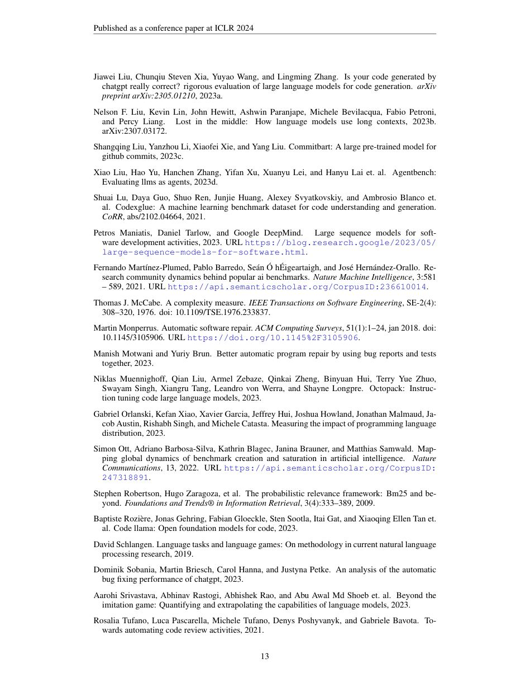

```text
Published as a conference paper at ICLR 2024


Jiawei Liu, Chunqiu Steven Xia, Yuyao Wang, and Lingming Zhang.  Is your code generated by
  chatgpt really correct? rigorous evaluation of large language models for code generation. arXiv
  preprint arXiv:2305.01210, 2023a.

Nelson F. Liu, Kevin Lin, John Hewitt, Ashwin Paranjape, Michele Bevilacqua, Fabio Petroni,
  and Percy Liang.   Lost in the middle: How language models use long contexts, 2023b.
  arXiv:2307.03172.

Shangqing Liu, Yanzhou Li, Xiaofei Xie, and Yang Liu. Commitbart: A large pre-trained model for
  github commits, 2023c.

Xiao Liu, Hao Yu, Hanchen Zhang, Yifan Xu, Xuanyu Lei, and Hanyu Lai et. al.  Agentbench:
  Evaluating llms as agents, 2023d.

Shuai Lu, Daya Guo, Shuo Ren, Junjie Huang, Alexey Svyatkovskiy, and Ambrosio Blanco et.
   al. Codexglue: A machine learning benchmark dataset for code understanding and generation.
  CoRR, abs/2102.04664, 2021.

Petros Maniatis, Daniel Tarlow, and Google DeepMind.   Large sequence models for  soft-
  ware development activities, 2023. URL https://blog.research.google/2023/05/
  large-sequence-models-for-software.html.
Fernando Mart´ınez-Plumed, Pablo Barredo, Se´an ´O h´Eigeartaigh, and Jos´e Hern´andez-Orallo. Re-
  search community dynamics behind popular ai benchmarks. Nature Machine Intelligence, 3:581
  – 589, 2021. URL https://api.semanticscholar.org/CorpusID:236610014.

Thomas J. McCabe. A complexity measure. IEEE Transactions on Software Engineering, SE-2(4):
  308–320, 1976. doi: 10.1109/TSE.1976.233837.

Martin Monperrus. Automatic software repair. ACM Computing Surveys, 51(1):1–24, jan 2018. doi:
  10.1145/3105906. URL https://doi.org/10.1145%2F3105906.

Manish Motwani and Yuriy Brun. Better automatic program repair by using bug reports and tests
   together, 2023.

Niklas Muennighoff, Qian Liu, Armel Zebaze, Qinkai Zheng, Binyuan Hui, Terry Yue Zhuo,
  Swayam Singh, Xiangru Tang, Leandro von Werra, and Shayne Longpre.  Octopack: Instruc-
   tion tuning code large language models, 2023.

Gabriel Orlanski, Kefan Xiao, Xavier Garcia, Jeffrey Hui, Joshua Howland, Jonathan Malmaud, Ja-
  cob Austin, Rishabh Singh, and Michele Catasta. Measuring the impact of programming language
   distribution, 2023.

Simon Ott, Adriano Barbosa-Silva, Kathrin Blagec, Janina Brauner, and Matthias Samwald. Map-
  ping global dynamics of benchmark creation and saturation in artificial intelligence.  Nature
  Communications, 13, 2022. URL https://api.semanticscholar.org/CorpusID:
  247318891.

Stephen Robertson, Hugo Zaragoza, et al. The probabilistic relevance framework: Bm25 and be-
  yond. Foundations and Trends® in Information Retrieval, 3(4):333–389, 2009.

Baptiste Rozi`ere, Jonas Gehring, Fabian Gloeckle, Sten Sootla, Itai Gat, and Xiaoqing Ellen Tan et.
   al. Code llama: Open foundation models for code, 2023.

David Schlangen. Language tasks and language games: On methodology in current natural language
  processing research, 2019.

Dominik Sobania, Martin Briesch, Carol Hanna, and Justyna Petke. An analysis of the automatic
  bug fixing performance of chatgpt, 2023.

Aarohi Srivastava, Abhinav Rastogi, Abhishek Rao, and Abu Awal Md Shoeb et. al. Beyond the
  imitation game: Quantifying and extrapolating the capabilities of language models, 2023.

Rosalia Tufano, Luca Pascarella, Michele Tufano, Denys Poshyvanyk, and Gabriele Bavota. To-
  wards automating code review activities, 2021.


                                       13
```

#### 原稿第 14 页

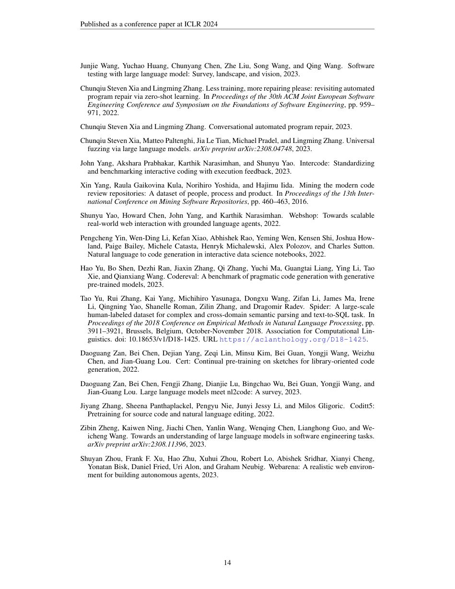

```text
Published as a conference paper at ICLR 2024


Junjie Wang, Yuchao Huang, Chunyang Chen, Zhe Liu, Song Wang, and Qing Wang.  Software
   testing with large language model: Survey, landscape, and vision, 2023.

Chunqiu Steven Xia and Lingming Zhang. Less training, more repairing please: revisiting automated
  program repair via zero-shot learning. In Proceedings of the 30th ACM Joint European Software
  Engineering Conference and Symposium on the Foundations of Software Engineering, pp. 959–
  971, 2022.

Chunqiu Steven Xia and Lingming Zhang. Conversational automated program repair, 2023.

Chunqiu Steven Xia, Matteo Paltenghi, Jia Le Tian, Michael Pradel, and Lingming Zhang. Universal
  fuzzing via large language models. arXiv preprint arXiv:2308.04748, 2023.

John Yang, Akshara Prabhakar, Karthik Narasimhan, and Shunyu Yao.  Intercode: Standardizing
  and benchmarking interactive coding with execution feedback, 2023.

Xin Yang, Raula Gaikovina Kula, Norihiro Yoshida, and Hajimu Iida. Mining the modern code
  review repositories: A dataset of people, process and product. In Proceedings of the 13th Inter-
  national Conference on Mining Software Repositories, pp. 460–463, 2016.

Shunyu Yao, Howard Chen, John Yang, and Karthik Narasimhan.  Webshop: Towards scalable
  real-world web interaction with grounded language agents, 2022.

Pengcheng Yin, Wen-Ding Li, Kefan Xiao, Abhishek Rao, Yeming Wen, Kensen Shi, Joshua How-
   land, Paige Bailey, Michele Catasta, Henryk Michalewski, Alex Polozov, and Charles Sutton.
  Natural language to code generation in interactive data science notebooks, 2022.

Hao Yu, Bo Shen, Dezhi Ran, Jiaxin Zhang, Qi Zhang, Yuchi Ma, Guangtai Liang, Ying Li, Tao
  Xie, and Qianxiang Wang. Codereval: A benchmark of pragmatic code generation with generative
   pre-trained models, 2023.

Tao Yu, Rui Zhang, Kai Yang, Michihiro Yasunaga, Dongxu Wang, Zifan Li, James Ma, Irene
   Li, Qingning Yao, Shanelle Roman, Zilin Zhang, and Dragomir Radev.  Spider: A large-scale
  human-labeled dataset for complex and cross-domain semantic parsing and text-to-SQL task. In
  Proceedings of the 2018 Conference on Empirical Methods in Natural Language Processing, pp.
  3911–3921, Brussels, Belgium, October-November 2018. Association for Computational Lin-
   guistics. doi: 10.18653/v1/D18-1425. URL https://aclanthology.org/D18-1425.

Daoguang Zan, Bei Chen, Dejian Yang, Zeqi Lin, Minsu Kim, Bei Guan, Yongji Wang, Weizhu
  Chen, and Jian-Guang Lou.  Cert: Continual pre-training on sketches for library-oriented code
  generation, 2022.

Daoguang Zan, Bei Chen, Fengji Zhang, Dianjie Lu, Bingchao Wu, Bei Guan, Yongji Wang, and
  Jian-Guang Lou. Large language models meet nl2code: A survey, 2023.

Jiyang Zhang, Sheena Panthaplackel, Pengyu Nie, Junyi Jessy Li, and Milos Gligoric.  Coditt5:
  Pretraining for source code and natural language editing, 2022.

Zibin Zheng, Kaiwen Ning, Jiachi Chen, Yanlin Wang, Wenqing Chen, Lianghong Guo, and We-
  icheng Wang. Towards an understanding of large language models in software engineering tasks.
  arXiv preprint arXiv:2308.11396, 2023.

Shuyan Zhou, Frank F. Xu, Hao Zhu, Xuhui Zhou, Robert Lo, Abishek Sridhar, Xianyi Cheng,
  Yonatan Bisk, Daniel Fried, Uri Alon, and Graham Neubig. Webarena: A realistic web environ-
  ment for building autonomous agents, 2023.


                                       14
```

