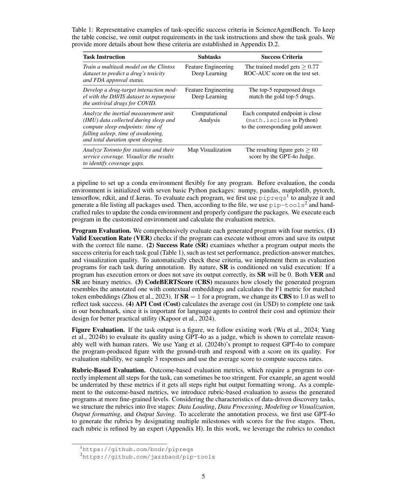

# ScienceAgentBench：迈向数据驱动科学发现语言智能体的严谨评价

> **翻译状态：部分翻译（摘要全译 + 明确标注的原文节译）。非全文中文精译。**

英文标题：ScienceAgentBench: Toward Rigorous Assessment of Language Agents for Data-Driven Scientific Discovery  
发表信息：ICLR 2025  
原始 PDF：57 页  
[阅读原始 PDF](./原始论文.pdf) · [英文逐页全文及配图](./英文原文_逐页全文与配图.md) · [参考文献及后续原文](./参考文献及后续原文.md) · [图表索引](./图表索引.md)

## 摘要（全文翻译，PDF 第 1 页）

大语言模型（LLM）的进展引发了人们对开发基于 LLM 的语言智能体、端到端自动化科学发现的日益浓厚的兴趣，同时也激发了对这类智能体真实能力的期待与质疑。在本研究中，我们认为，要实现科学发现的完全自动化，智能体必须能够完成工作流中的所有必要任务。因此，在对端到端自动化作出大胆主张之前，我们呼吁严格评价智能体在科学工作流各项独立任务上的能力。为此，我们提出 ScienceAgentBench，一个面向数据驱动科学发现的语言智能体评价新基准。为确保基准的科学真实性与现实相关性，我们从四个学科的 44 篇同行评议出版物中提取了 102 项任务，并邀请九位领域专家进行验证。我们将每项任务的目标输出统一为一个自包含 Python 程序文件，并采用一系列评价指标考察生成程序、执行结果及成本。每项任务均经过标注者和领域专家的多轮人工验证，以确保标注质量和科学合理性。我们还提出两种有效策略来缓解数据污染方面的担忧。利用这一基准，我们评价了五个开放权重和专有 LLM，每个模型使用三种框架：直接提示、OpenHands CodeAct 和自调试。每项任务允许三次尝试，表现最好的智能体只能独立解决 32.4% 的任务，在专家提供知识时也仅解决 34.3%。这些结果凸显了当前语言智能体在为数据驱动发现生成代码方面的能力局限，更不用说实现科学研究的端到端自动化。

[核对原版第 1 页](./source_pages/page-001.jpg)

## 第 2.3 节：程序评价（PDF 第 5 页）

我们使用四项指标全面评价每个生成程序。

1. **有效执行率（Valid Execution Rate, VER）**：检查程序是否能无错误地执行，并以正确文件名保存输出。
2. **成功率（Success Rate, SR）**：检查程序输出是否满足各任务目标的成功标准，例如测试集表现、预测与答案匹配程度、可视化质量。为自动检查标准，在标注期间为每项任务实现评价程序。SR 以有效执行为条件：若程序执行出错或未正确保存输出，其 SR 为 0。VER 与 SR 均为二元指标。
3. **CodeBERTScore（CBS）**：利用上下文嵌入衡量生成程序与标注程序的相似程度，并计算匹配 token 嵌入的 F1 指标。如果某程序 SR=1，将其 CBS 同样设为 1.0，以反映任务成功。
4. **API 成本（Cost）**：计算完成基准中一项任务的平均美元成本，因为控制成本及优化设计对智能体的实际效用很重要。

[核对原版第 5 页](./source_pages/page-005.jpg)

**原文 table 1 · PDF 第 5 页（候选图表区域）**

## 第 2.3 节：图像评价与评分细则评价（节译）（PDF 第 5 页）

若任务输出为图像，本文采用 GPT-4o 作为裁判，比较程序生成的图像与真实值，并返回质量评分。为提高评价稳定性，采样三次回答并使用平均分计算成功率。基于结果的指标要求程序正确实现任务的所有步骤，有时可能过于严格。例如，智能体若各步骤均正确但输出格式错误，可能被低估。作为结果指标的补充，本文引入基于评分细则的评价，以更细粒度的层次评估生成程序。

[核对原版第 5 页](./source_pages/page-005.jpg)

## 尚未完成的翻译

其余正文、附录、完整图表说明、表内文字及参考文献标题尚未逐段翻译。本文件不是 57 页全文中文版。所有页面的英文文本层与页面截图均在英文逐页文档中保留。

[继续阅读英文原文](./英文原文_逐页全文与配图.md) · [图表索引](./图表索引.md) · [原始 PDF](./原始论文.pdf)

## 研究分类（初步判定，非原文内容）

- 主类别：E
- 阅读优先级：P1
- 归类理由：多学科科学 Agent 基准包含 GIS 子集；可执行代码、结果、成本和逐步 rubric 的组合评价可借鉴。
- 重点阅读：第 2.1–2.3 节；图 1 GIS 子任务；附录 GIS 任务与专家 rubric。
- 分类尚未完成全部原文及评价代码核验；不代表复现实验成功。
