# 分割一切（Segment Anything）

> **作者**：Alexander Kirillov、Eric Mintun、Nikhila Ravi、Hanzi Mao、Chloe Rolland、Laura Gustafson、Tete Xiao、Spencer Whitehead、Alexander C. Berg、Wan-Yen Lo、Piotr Dollár、Ross Girshick  
> **机构**：Meta AI Research，FAIR  
> **论文**：ICCV 2023 开放获取版本。原稿脚注：作者中设有项目负责人、共同第一作者、同等贡献作者及方向负责人。  
> **说明**：正文按原论文翻译，模型、数据集及评估指标采用约定的英文术语。参考文献保留原始英文书目，详见文末及英文逐页提取稿。

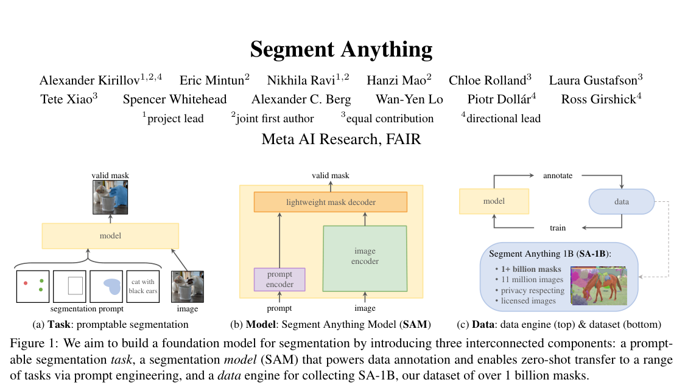

*图 1：构建图像分割基础模型的三个相互关联部分：（a）可提示分割任务；（b）支持数据标注与零样本迁移的 SAM 模型；（c）用于收集超过十亿个掩码的 SA-1B 数据集的数据引擎。（原稿第 1 页）*

## 摘要（第 1 页）

我们提出 **Segment Anything（SA，分割一切）**项目，其中包含一项新的图像分割任务、一个模型以及一个数据集。通过将高效模型引入数据收集循环，我们建立了迄今规模最大的分割数据集，其中包含约 **1100 万张**经授权、尊重隐私的图像，以及超过 **10 亿个分割掩码**。该模型被设计、训练为可通过提示控制，使其能够以零样本方式迁移至新的图像分布和任务。我们针对多种任务评估了该模型的能力，发现其零样本性能令人印象深刻，经常能够与已有完全监督方法竞争，甚至超越它们。我们发布 **Segment Anything Model（SAM）** 及相应的 **SA-1B** 数据集（约 10 亿个掩码、1100 万张图像），以推动计算机视觉基础模型的研究。项目网址为 https://segment-anything.com ，建议阅读论文完整版本 https://arxiv.org/abs/2304.02643 。

## 1 引言（第 1–2 页）

在网络规模语料上预训练的大语言模型，凭借强大的零样本和少样本泛化能力，正在深刻改变自然语言处理（NLP）[10]。这类**基础模型（foundation models）**[8]能够泛化到训练期间未见过的任务和数据分布。通常通过**提示工程（prompt engineering）**实现这种能力：设计人工编写的文本提示，促使语言模型针对给定任务产生有效的文本回答。在海量网络文本上扩展模型规模并训练之后，其零样本和少样本表现可以出人意料地接近、某些情形下甚至相当于针对特定任务微调的模型[10,20]。已有经验趋势表明，随着模型规模、数据量和训练计算量增加，这种能力还在提高[54,10,20,49]。

计算机视觉领域也开始探索基础模型，但程度相对较低。最有代表性的路线之一，是对齐来自网络的成对文本与图像。例如 CLIP[80] 和 ALIGN[53]采用对比学习训练文本编码器与图像编码器，使两种模态对齐。模型训练完成后，可以借助设计好的文本提示，对新的视觉概念和数据分布进行零样本泛化。这些编码器还可以和其他模块有效组合，支持图像生成等下游任务，如 DALL·E[81]。尽管视觉和语言编码器取得了不少进展，计算机视觉的问题范围远大于此，其中很多任务并不存在丰富的训练数据。

本文旨在建立一个**用于图像分割的基础模型**：设计一个可提示的模型，并通过有利于强泛化能力的任务，在广泛数据集上进行预训练。借助这一模型，我们希望利用提示工程，在新的数据分布上解决各种下游分割问题。

这一目标的实现依赖三个组成部分：**任务、模型与数据**。围绕图像分割，我们需要回答三个问题：什么任务能够促进零样本泛化？对应的模型架构应当是什么？什么样的数据能够支撑这样的任务和模型？

这些问题彼此关联，因此需要综合解决。首先，我们定义足够通用的**可提示分割任务**，既可以作为有效的预训练目标，又可以用于多种下游应用。这要求模型能够接受灵活的提示，并在给出提示时实时输出分割掩码，支持交互式使用。训练模型还需要规模大且多样化的数据来源。由于分割掩码不像文本那样具有网络规模的天然数据来源，我们构建了一个**数据引擎（data engine）**：利用高效模型辅助收集数据，再用新收集的数据改进模型，不断迭代。下文将先介绍三个相互联系的组成部分，再介绍创建的数据集与验证方法有效性的实验。

**任务（第 2 节）**：NLP 以及近期的计算机视觉研究表明，基础模型往往能借助提示技术在新数据集和新任务上实现零样本或少样本学习。受此启发，我们提出**可提示分割（promptable segmentation）**任务：给定任意分割提示，模型必须返回一个有效的分割掩码（见图 1a）。提示只是指出图像中应该分割什么内容，例如可以包含标识对象的空间信息或文本信息。“有效掩码”意味着即使提示存在歧义、可能指向多个对象（例如，落在衬衫上的点既可能表示衬衫，也可能表示穿衬衫的人），模型也应至少对其中某个对象给出合理的掩码。我们既将该任务作为预训练目标，也通过提示工程将其用于通用下游分割任务。

**模型（第 3 节）**：可提示分割任务和实际应用目标对模型架构提出了约束：模型必须支持灵活提示，能够以摊销意义上的实时速度计算掩码，以便交互使用，而且需要具备歧义感知能力。令人意外的是，一个简洁设计即可满足这三个要求：强大的图像编码器计算图像嵌入，提示编码器对提示进行编码，随后使用轻量级掩码解码器融合两种信息并预测掩码。我们称之为 **Segment Anything Model（SAM）**（图 1b）。将 SAM 划分为图像编码器和快速提示编码器／掩码解码器后，同一个图像嵌入可以被不同提示重复利用，摊销图像编码的计算成本。在给定图像嵌入之后，提示编码器与掩码解码器可以在网页浏览器中用约 **50 毫秒**从提示生成掩码。本文重点研究点、边界框和掩码提示，也给出自由文本提示的初步结果。为应对歧义，我们设计模型对同一提示预测多个掩码，从而自然处理前述“衬衫与人”的歧义。

**数据引擎（第 4 节）**：要使 SAM 对新的数据分布具有强泛化能力，需要用比任何现有分割数据集都更加庞大、多样的掩码集合来训练。虽然基础模型的常见做法是从网络收集数据[80]，但是掩码并不天然大量存在，所以必须采用另一条路径。我们的方案是构建数据引擎，即让模型参与标注循环，并与数据收集过程共同演化（图 1c）。数据引擎有三个阶段：辅助人工标注、半自动标注和全自动标注。第一阶段由 SAM 辅助标注员绘制掩码，类似传统交互式分割；第二阶段为部分对象自动生成掩码，让标注员专注于剩余对象，以提高掩码多样性；第三阶段使用规则网格上的前景点提示 SAM，平均每张图像产生约 **100 个**高质量掩码。

**数据集（第 5 节）**：最终的 SA-1B 数据集包含从约 1100 万张授权且保护隐私的图像中获得的超过 10 亿个掩码（图 2）。它完全使用数据引擎第三阶段的全自动流程收集，掩码数量达到此前任何分割数据集的 **400 多倍**[64,43,115,58]。我们通过大量验证表明，这些掩码具有较高质量和多样性。除了训练鲁棒且通用的 SAM，我们也希望 SA-1B 成为研究新型基础模型的重要资源。

**实验（第 6 节）**：我们广泛评估了 SAM 的性能。首先，在由 23 个分割数据集构成的多样化测试集合中，我们发现只给定一个前景点，SAM 就能够生成高质量掩码，质量往往仅稍逊于人工标注的真值。其次，在使用提示工程的零样本迁移协议下，SAM 在多种下游任务上呈现稳定且强劲的定量、定性性能，包括边缘检测、对象候选区域生成、实例分割和文本到掩码预测的初步研究。这些结果表明，SAM 不经额外训练，仅借助提示工程就可以解决训练数据之外的对象或图像分布所涉及的多种任务。但仍有改进空间，第 7 节会进一步讨论。

**负责任的 AI**：补充材料中提供了模型卡和数据集卡，并报告使用 SA-1B 与 SAM 可能涉及的公平性问题和偏见。SA-1B 的图像来自地理和经济背景多样的地区，我们发现 SAM 在不同人群上的表现相近。我们希望这能推动更公平的现实应用。

**开放发布**：我们发布 SA-1B 供研究使用，并以宽松的 Apache 2.0 开源许可证开放 SAM，网址为 https://segment-anything.com ，同时通过在线演示展示其能力。

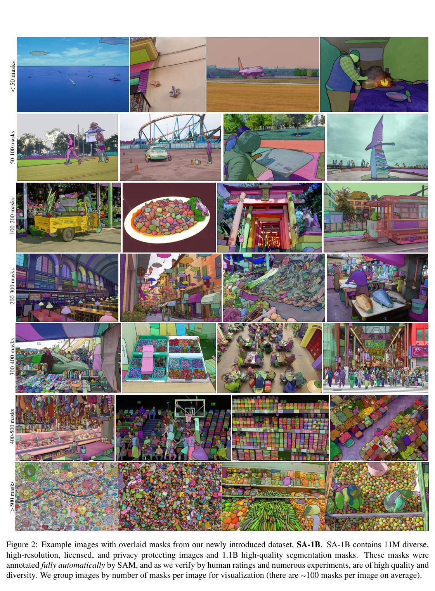

*图 2：SA-1B 数据集样本图像及其叠加的分割掩码。数据集含约 1100 万张多样、高分辨率、授权且保护隐私的图像，以及约 **11 亿个**高质量掩码。掩码由 SAM 自动生成，经人工评分与大量实验验证其质量和多样性。图中按每张图像的掩码数量分组，平均约 100 个／图。（原稿第 3 页）*

## 2 Segment Anything 任务（原稿第 4 页）

我们受到 NLP 的启发：在 NLP 中，“预测下一个 token”任务既用于基础模型的预训练，也能通过提示工程解决多种下游任务[10]。要为分割构建基础模型，我们希望定义一个具有类似能力的任务。

**任务定义。** 首先，我们把 NLP 中的提示概念迁移到分割领域。提示可以是一组前景／背景点、粗略的边界框或掩码、自由文本，或任何指出图像中应当分割什么的信息。因此，“可提示分割”任务，就是对任意提示返回有效的分割掩码。“有效”仅意味着当提示存在歧义、可能表示多个对象时（例如前述“衬衫”与“人”的例子，以及图 3），输出至少应当是其中某个对象的合理掩码。这类似于要求语言模型面对含糊提示时，仍能生成连贯的回答。我们选择此任务，是因为它自然导出预训练算法，并提供一种通过提示零样本迁移到下游任务的通用方式。

**预训练。** 可提示分割带来一种自然的预训练方法：对每个训练样本模拟一系列提示（例如点、框、掩码），并把模型预测的掩码与真值进行比较。我们将这一方法由交互式分割[107,68]改造而来。但传统交互式分割的目标是在用户提供足够输入后最终得到有效掩码，而我们的目标是：对**任何提示**都能给出有效掩码，即使提示本身有歧义。这样预训练后的模型才能有效支持涉及歧义的应用，包括第 4 节数据引擎所需要的自动标注。我们指出，要在这一任务中取得良好表现并不简单，需要特殊的模型设计与训练损失，详见第 3 节。

**零样本迁移。** 直观地说，预训练任务赋予模型在推断阶段适当响应任意提示的能力；因此，只需设计合适提示即可解决下游任务。例如，若已有检测猫的边界框检测器，可直接把检测器输出的框作为 SAM 提示，实现猫的实例分割。一般来说，很多实用分割任务都能够转化为提示任务。除自动数据标注之外，第 6 节还探索了五项不同的下游任务。

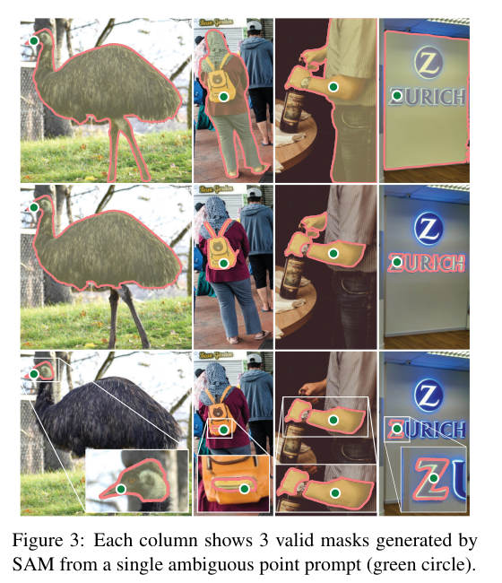

*图 3：每一列展示了 SAM 对单个有歧义的点提示（绿色圆圈）生成的 3 种有效掩码。（原稿第 4 页）*

**相关任务。** 分割领域覆盖广泛，包括交互式分割[55,107]、边缘检测[3]、超像素生成[83]、对象候选区域生成[2]、前景分割[92]、语义分割[88]、实例分割[64]、全景分割[57]等。可提示分割任务旨在得到一个能力广泛的模型，通过提示工程适应许多（但不是全部）已有和新出现的分割任务。这是**任务泛化（task generalization）**的一种形式[25]。

它不同于过去的多任务分割系统：多任务系统让一个模型执行一组固定任务，例如同时执行语义、实例和全景分割[112,18,52]，但其训练任务与测试任务相同。本文的重要区别是：可提示分割模型在测试时可以通过成为更大系统中的一个组件来执行不同的新任务。例如，把可提示分割模型与现有目标检测器相结合，即可完成实例分割。

**讨论。** 提示与组件组合具有很强的扩展性，可以使一个模型完成设计之初尚未设想的任务。这与其他基础模型的使用方式相似，例如 CLIP[80] 作为 DALL·E[81] 图像生成系统中的图文对齐组件。我们预期，由提示工程支持的可组合式系统设计，会比仅针对固定任务训练的系统支持更广泛的应用。从组合角度看，可提示分割与交互式分割也值得比较：交互式分割模型面向人类用户设计，而可提示分割模型还可以组成更大的算法系统，后文将给出实例。

## 3 Segment Anything 模型（原稿第 5 页）

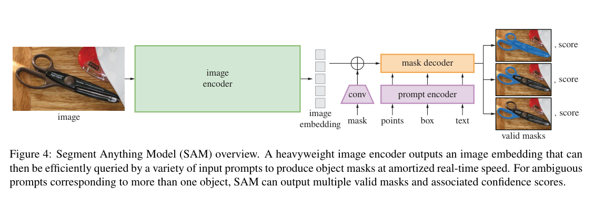

*图 4：SAM 架构。计算量较大的图像编码器先输出图像嵌入，之后不同输入提示可快速查询该嵌入，以摊销意义上的实时速度产生对象掩码。对于可能指代多个对象的含糊提示，SAM 能返回多个有效掩码及相应置信度。（原稿第 5 页）*

下面介绍用于可提示分割的 **SAM**。如图 4 所示，SAM 由三个部分组成：**图像编码器、灵活的提示编码器和快速掩码解码器**。我们在 Transformer 视觉模型[13,32,19,60]的基础上设计，并针对（摊销）实时性能作出具体权衡。本节概述主要结构，细节见原文补充材料第 B 节。

**图像编码器。** 出于可扩展性和强大预训练方法的考虑，我们使用经过 MAE[46] 预训练的视觉 Transformer（ViT）[32]，并针对高分辨率输入[60]作少量调整。每张图像只需要运行图像编码器一次，而且可以在输入提示之前预先完成编码。

**提示编码器。** 考虑两类提示：稀疏提示（点、边界框和文本）与密集提示（掩码）。对点和框，我们把位置编码[93]与各提示类型的可学习嵌入相加；自由文本则用现成的 CLIP 文本编码器[80]表示。密集提示（掩码）通过卷积编码，并与图像嵌入按元素相加。

**掩码解码器。** 解码器将图像嵌入、提示嵌入及一个输出 token 高效映射为掩码。该结构受[13,19]启发，使用改造后的 Transformer 解码器块[101]，再接动态掩码预测头。改造后的解码器通过提示自身的自注意力，以及两个方向的交叉注意力（提示→图像嵌入、图像嵌入→提示），更新全部嵌入。在执行两个解码器块后，对图像嵌入进行上采样，用一个多层感知机（MLP）将输出 token 映射成动态线性分类器，计算图像各位置属于掩码前景的概率。

**消解歧义。** 面对含糊提示，如果模型只能输出一个掩码，就可能把多个有效掩码平均在一起。为此，我们修改模型，使其对每条提示预测多个输出掩码（图 3）。实验发现，预测 **3 个**掩码足以应对多数常见情况，因为对象嵌套通常最多具有三个层级：整体、部分和子部分。训练时仅对掩码中损失最小者反向传播[14,44,62]。为给掩码排序，模型还会预测每个掩码的置信度分数，即估计的 IoU。

**效率。** 整体设计主要受到效率要求的驱动。有了预计算的图像嵌入，提示编码器和掩码解码器可以在浏览器中、仅用 CPU 以约 **50 毫秒**运行，从而实现平滑的实时交互提示。

**损失与训练。** 掩码预测的监督使用 focal loss[63] 和 dice loss[71] 的线性组合，沿用[13]的设置。训练可提示分割任务时，我们混合使用几何提示（文本提示见第 6.2 节）。按照[90,36]，我们为每个掩码随机采样 **11 轮**提示来模拟交互过程，使 SAM 能够顺利集成到数据引擎中。

## 4 Segment Anything 数据引擎（原稿第 5–6 页）

由于网络中不存在天然丰富的分割掩码，我们建立数据引擎以收集 SA-1B 数据集的 11 亿个掩码。整个过程分三阶段：（1）模型辅助人工标注；（2）自动预测掩码与模型辅助标注混合的半自动阶段；（3）完全不需要标注员输入、由模型自动生成掩码的全自动阶段。

**辅助人工阶段。** 第一阶段类似传统交互式分割：一组专业标注员通过浏览器中的 SAM 交互式分割工具，点击对象的前景或背景点标注掩码。标注员也能使用像素级精确的“画笔”“橡皮擦”工具细化掩码。由于图像嵌入可预先计算，模型辅助标注能够直接在浏览器中实时运行，实现真正交互式体验。我们没有对可标注对象设置语义类别限制，标注员既可以自由标注不可数的背景区域（stuff），也可以标注可数对象（things）[1]。我们建议标注员选择自己能命名或描述的对象，但并不收集这些名称或描述。要求按照显著性由高到低标注，并建议当标注一个掩码超过 30 秒时转至下一张图像。

第一阶段开始时，SAM 用常见公开分割数据集训练。在收集足够的标注后，仅用新标注掩码重新训练 SAM。随着数据积累，图像编码器从 ViT-B 扩大到 ViT-H，其他架构细节也随之调整；模型总共重新训练了 **6 次**。随着模型改进，单个掩码的平均标注时间从 **34 秒降至 14 秒**；14 秒比 COCO[64] 掩码标注快约 **6.5 倍**，只比用极值点标注边界框[74,69]慢约 2 倍。每张图像平均掩码数量从 **20 个增加到 44 个**。本阶段共从 **12 万张图像**采集到 **430 万个掩码**。

**半自动阶段。** 这一阶段旨在提高掩码多样性，从而增强模型“分割一切”的能力。为使标注员关注不太显著的对象，我们先自动检测高置信度掩码，然后给标注员显示预填充这些掩码的图像，让其补充标注其他未被覆盖的对象。高置信度掩码由一个边界框检测器[82]产生，该检测器使用第一阶段的所有掩码训练，仅设置通用的“对象”类别。本阶段从 **18 万张图像**中额外获得 **590 万个掩码**（累计 **1020 万**）。与第一阶段相同，我们定期使用新收集数据重训模型，共 **5 次**。由于剩余对象更难标注，不计自动掩码的人工标注时间又升至平均 34 秒。包括自动掩码在内，每张图像的平均掩码数量从 **44 个增至 72 个**。

**全自动阶段。** 最后阶段的标注完全自动化。其可行性主要来自两项改进：一是前两个阶段已收集了足够多样的掩码，使模型显著提升；二是我们开发了具备歧义感知能力的模型，能够在含糊提示下仍给出有效掩码。具体而言，我们用 **32×32** 的规则点网格提示模型，对每个点预测一组可能对应有效对象的掩码。当点落在某个部分或子部分上时，具备歧义感知能力的 SAM 能同时返回子部分、部分及整体对象。模型利用 IoU 预测模块筛选高置信度掩码，并进一步只保留稳定掩码（若将概率图分别按 $0.5-\delta$ 和 $0.5+\delta$ 二值化后产生相似掩码，则认为其稳定）。然后执行非极大值抑制（NMS）删除重复掩码。为进一步提高小掩码质量，还会处理多个相互重叠的放大图像裁剪。此阶段的更多细节见补充材料第 C 节。我们将全自动掩码生成应用于全部 **1100 万张图像**，最终产生约 **11 亿个**高质量掩码。下面分析所得的 SA-1B 数据集。

## 5 Segment Anything 数据集（原稿第 6–7 页）

SA-1B 数据集包含约 1100 万张多样、高分辨率、经授权且注重隐私的图像，以及由数据引擎收集的约 11 亿个高质量分割掩码。我们将 SA-1B 与已有数据集比较，分析掩码质量与性质，并发布 SA-1B 支持未来计算机视觉基础模型的开发。数据集面向某些研究用途按照有利的授权协议提供，同时设置研究者保护机制。

**图像。** 我们从一家直接与摄影师合作的供应商获得 **1100 万张**图像的授权。原始图像分辨率很高（平均 **3300×4950 像素**），数据规模会带来访问和存储挑战。因此，发布时将图像的短边下采样至 1500 像素。即便如此，分辨率依旧明显高于许多现有视觉数据集，例如 COCO[64] 的图像大约只有 480×640 像素。需要指出，当前多数模型实际运行在低得多的输入分辨率上。所发布图像中的人脸和车牌已进行模糊处理。

**掩码。** 数据引擎共生成约 11 亿个掩码，其中 **99.1%** 为完全自动生成。因此，自动掩码的质量极其重要。我们直接将自动掩码与专业人工标注对照，并比较其几何性质与重要分割数据集的差异。结合下面的分析和第 6 节实验，我们的主要结论是：自动掩码质量高，能有效用于模型训练。基于此，最终发布的 SA-1B **只包含自动生成的掩码**。

**掩码质量。** 为估计掩码质量，我们随机抽取 **500 张图像**（约 **5 万个掩码**），邀请专业标注员改善其中全部掩码质量。标注员使用 SAM 以及像素级“画笔”“橡皮擦”工具完成修正，形成一组自动预测掩码与专业人工修正掩码的配对。我们计算每对掩码的交并比（IoU），发现 **94%** 的配对 IoU 超过 **90%**，**97%** 超过 **75%**。作为对比，已有研究估计不同标注员之间的一致性约为 **85%–91% IoU**[43,58]。第 6 节的人工评分进一步验证了掩码质量相对于多种数据集较高，并发现仅用自动掩码训练与使用数据引擎产生的全部掩码训练，效果几乎相当。

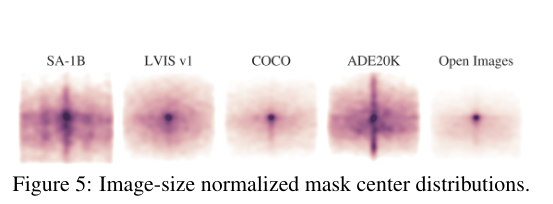

*图 5：经图像尺寸归一化的掩码中心位置分布。（原稿第 6 页）*

**掩码性质。** 图 5 比较了 SA-1B 与现有大型分割数据集中对象中心点的空间分布。所有数据集均存在摄影者常见的构图偏差。与分布最相似的 LVIS v1[43] 和 ADE20K[115] 相比，SA-1B 在图像角落的覆盖更广，而 COCO[64] 和 Open Images V5[58] 的中心偏置更明显。

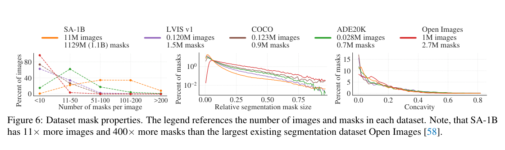

*图 6：数据集掩码属性。图例标明各数据集图像与掩码的数量。SA-1B 的图像数是此前最大分割数据集 Open Images[58] 的 11 倍，掩码数约为其 400 倍。（原稿第 7 页）*

图 6 的图例比较了各数据集规模：SA-1B 比此前第二大的 Open Images 多 **11 倍图像、400 倍掩码**；平均每张图像的掩码数量是 Open Images 的 **36 倍**。在这一指标上最接近的 ADE20K，平均每张图像的掩码数量仍少 **3.5 倍**。图 6 左图给出“每图掩码数量”的分布；中图比较相对于图像大小的掩码尺寸，其定义为掩码面积与图像面积之比的平方根。由于 SA-1B 的每图掩码数量更多，可以预期其中小型和中型相对尺寸掩码的比例也更高。最后，我们使用掩码的**凹度（concavity）**表示形状复杂性：$1-\text{掩码面积}/\text{掩码凸包面积}$，见图 6 右图。由于形状复杂性与掩码尺寸相关，我们先按掩码尺寸分箱并进行分层采样，控制各数据集的尺寸分布差异。分析显示，SA-1B 掩码的凹度分布与其他数据集总体相近。

## 6 零样本迁移实验（原稿第 7–9 页）

本节介绍 SAM 的零样本迁移实验。我们研究五种任务，其中四种与训练 SAM 使用的可提示分割任务显著不同。实验使用模型训练中未见过的数据集和任务（本文“零样本迁移”的用法与 CLIP[80] 一致）。测试图像可能具有全新的分布，例如据我们所知未出现在 SA-1B 中的水下图像或第一人称视角图像。

我们首先检验可提示分割最核心的目标：能否根据任意提示产生有效掩码。尤其关注只有一个前景点的困难情形，因为相比更加具体的提示，这种输入更可能产生歧义。随后以大致对应计算机视觉历史发展的顺序，测试从低层、中层到高层的图像理解能力。具体而言，我们通过提示工程使 SAM：（1）执行边缘检测；（2）“分割全部对象”，即产生对象候选区域；（3）分割已检测对象，即实例分割；（4）作为概念验证，从自由文本分割对象。这四种任务均与 SAM 的训练目标明显不同。正文报告单点提示的零样本有效掩码评估以及文本到掩码的概念验证。零样本边缘检测、对象候选区域生成和实例分割实验以及消融实验见原论文补充材料。此外，补充材料还讨论模型对训练数据规模、组成和图像编码器架构的敏感性。

**实现约定。** 除非另有说明，（1）SAM 使用经过 MAE[46] 预训练的 ViT-H[32] 图像编码器；（2）SAM 用 SA-1B 训练，该数据集仅包含数据引擎最后阶段自动生成的掩码。其他模型超参数和训练细节参见补充材料第 B 节。

### 6.1 单点提示的零样本有效掩码评估

**任务。** 我们评估仅根据一个前景点分割对象。因为一个点可能指向多个对象，所以这在数学上是欠定的。多数数据集的真值掩码并未枚举全部可能有效的掩码，导致自动指标有时并不可靠。因此，除了标准的 **mIoU** 指标（预测掩码与真值掩码之间的 IoU 均值），我们还开展人工研究，让标注员以 1 分（完全不合理）到 10 分（像素级完美）的尺度评价掩码质量，详见补充材料 E.1、F 和 H 节。默认按交互式分割的标准协议[90]，从真值掩码的“中心”采样提示点，也就是其内部距离变换达到最大值的位置。尽管 SAM 可以预测多个掩码，我们默认只评估模型置信度最高的一个掩码。比较方法均只生成一个掩码，主要对比对象是强大的交互式分割器 **RITM**[90]，其表现优于我们测试的其他强基线[65,17]。

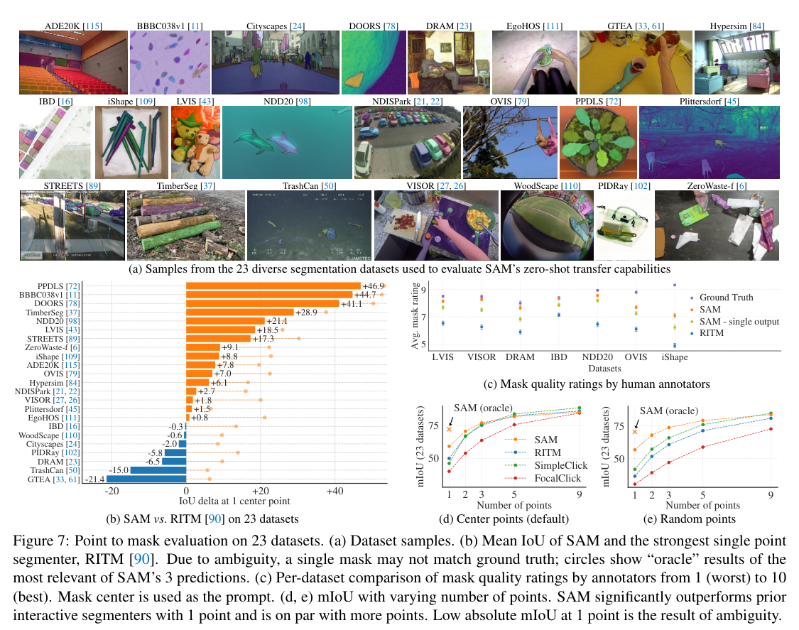

*图 7：23 个数据集的点提示到掩码评估。（a）数据集样例；（b）SAM 与最强单点分割器 RITM[90] 的平均 IoU，圆点表示从 SAM 的 3 个预测中按真值选择最相关掩码的 oracle 结果；（c）人工对各数据集掩码质量进行 1–10 分评分；（d）（e）不同提示点数量下的 mIoU。SAM 在单点输入时显著优于此前交互式分割器，点数增加后表现相当。单点绝对 mIoU 较低与提示歧义有关。（原稿第 8 页）*

**数据集。** 我们新汇编了 **23 个**图像分布多样的数据集，更多细节见附录表 4。mIoU 评估使用全部 23 个数据集；由于人工研究成本较高，人类评分只采用图 7c 所列子集。该子集既包含 SAM 在自动指标上优于 RITM 的数据集，也包含表现较差的数据集。

**结果。** 首先，比较 23 个数据集的 mIoU，见图 7b。SAM 在其中 **16 个**数据集上优于 RITM，最大提升约 **47 IoU 点**。我们还给出 oracle 结果：不选择置信度最高的掩码，而是按真值从 SAM 的 3 个掩码中选择最相关的一个。这表明歧义对自动评估影响很大：通过 oracle 消除歧义后，SAM 在全部数据集上均优于 RITM。

人工研究结果见图 7c；误差条表示 **95% 置信区间**，所有差异均有统计显著性，详见补充材料 F 节。标注员持续将 SAM 掩码的质量评为显著高于最强基线 RITM。仅输出一个掩码的“不具备歧义感知能力”SAM 消融版本，评分始终更低。SAM 平均评分落在 **7–9 分**之间，按质量指南表示“对象可识别，错误细小且罕见，例如只遗漏一个较小且严重遮挡的不连通部分”。这些结果说明，SAM 已经学会仅凭单点生成合理的有效掩码。尤其值得注意的是，在 DRAM 与 IBD 等数据集上，虽然 SAM 的自动指标较低，但人工评分仍持续更高。

图 7d 加入 SimpleClick[65]、FocalClick[17] 等基线。当提示点数从 1 增至 9 时，各方法差距缩小，这是因为任务变得更简单，而且 SAM 并未专门针对极高 IoU 的交互式分割优化。最后，图 7e 将默认的中心点采样换为随机点采样。此时 SAM 与基线的差距扩大，而且 SAM 在两种采样方式下都能获得相近的结果。

### 6.2 零样本文本到掩码（Zero-Shot Text-to-Mask）

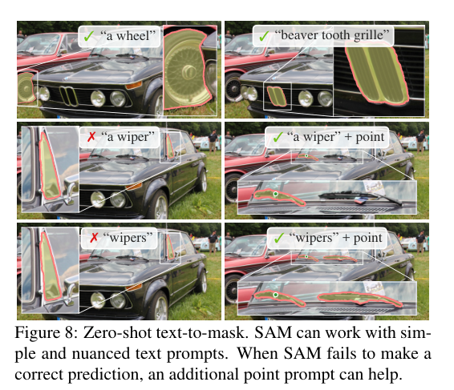

*图 8：零样本文本到掩码。SAM 可以响应简单或细致的文本提示；当文本提示不能正确定位对象时，额外加入一个点提示通常能够修正结果。（原稿第 9 页）*

**方法。** 这一实验是 SAM 能否从自由文本提示分割对象的概念验证。此前所有实验均使用完全相同的 SAM，而此处适当修改训练流程，使 SAM 具备文本感知能力，但不需要增加新的文本标注。具体而言，对每个面积大于 $100^2$ 的人工收集掩码，我们提取其 **CLIP 图像嵌入**。训练时，我们将该嵌入作为 SAM 第一轮交互的提示。这里的关键是：CLIP 图像嵌入在训练时已与其文本嵌入对齐，因此可以使用图像嵌入训练，推断时却改用文本嵌入。换言之，推断时先让文本通过 CLIP 文本编码器，然后把所得文本嵌入作为 SAM 的提示（详见补充材料 E.5 节）。

**结果。** 图 8 给出了定性结果。SAM 不仅能够依据 “a wheel”（一个车轮）等简单文本提示分割对象，也能理解 “beaver tooth grille”（海狸牙式格栅）等更加细致的短语。当 SAM 无法仅根据文本提示选中正确对象时，增加一个点提示往往能够纠正预测，这与[30]相似。

## 7 讨论（原稿第 9 页）

**基础模型。** 从机器学习早期起，预训练模型就被迁移到下游任务[97]。近年来，随着研究者越来越重视模型规模，这一范式变得更加重要，这类模型最近被（重新）命名为“基础模型”，即“在广泛数据上进行大规模训练，并能适应多种下游任务的模型”[8]。本文工作与这一界定相符。不过我们也指出，图像分割基础模型的范围本来就有限，因为分割虽然重要，但也只是计算机视觉的一个子集。另外，我们的方法与[8]强调基础模型应使用自监督学习的某个侧重点存在差异。虽然我们使用自监督技术 MAE[46] 初始化模型，但其绝大多数能力来自大规模**监督训练**。当数据引擎可以将标注规模扩大到本文这样的程度时，监督训练是一条有效路径。

**可组合性。** 预训练模型可以支持训练时尚未设想到的能力。CLIP[80] 作为 DALL·E[81] 等更大系统的组件，就是一个代表性例子。我们的目标是让 SAM 也能便捷地参与这种组合。通过要求 SAM 对广泛的分割提示返回有效掩码，我们在 SAM 与其他组件之间建立了可靠接口。例如 MCC[104] 可以利用 SAM 分割感兴趣的对象，从单幅 RGB-D 图像重建三维结构，并很好地泛化到未知对象。另一个例子是用可穿戴设备检测的视线注视点作为 SAM 提示，进而支持新应用。由于 SAM 能够泛化到第一人称视角等新领域，这些系统无需额外训练即可工作。

**局限性。** 尽管总体表现良好，SAM 并不完美：它可能遗漏细小结构，有时会“幻觉式”地产生孤立的小部分，而且边界不如那些使用高成本“局部放大”技术的方法精细，例如[17]。当给定大量交互点时，我们预计专用交互式分割方法[65]会优于 SAM，因为 SAM 旨在追求通用性和广泛适用性，而非专门优化极高 IoU 的交互式分割。SAM 对提示的响应可达到实时，但使用较重的图像编码器时，系统整体运行未必实时。本文文本到掩码实验仍处于探索阶段，鲁棒性有限，不过我们认为通过进一步努力可以改善。虽然 SAM 能够完成许多任务，但如何用简单提示实现语义分割和全景分割仍不清楚。最后，某些专门的领域工具，例如[7]，预计仍会在自己的领域优于 SAM。

**结论。** Segment Anything 项目尝试使图像分割进入基础模型时代。主要贡献是一项新的任务（可提示分割）、一个模型（SAM）和一个数据集（SA-1B），三者共同使这一步成为可能。SAM 是否真正达到基础模型的地位，仍取决于社区如何使用它；无论如何，我们相信本文提出的视角、超过十亿个掩码的发布，以及可提示分割模型，将为后续研究铺平道路。

## 参考文献（原稿第 10–12 页）

论文第 10–12 页为完整参考文献。为保留作者、原始英文书目题名、期刊会议缩写及检索准确性，以下直接收录原文条目；页眉页脚及分栏阅读顺序请同时核对 `source_pages/` 里的整页截图。

### 参考文献英文完整原文（按原稿页码）

以下参考文献完整保留作者、论文题名、发表信息与编号的原文形式，便于准确检索。参考文献文字来源于原始 PDF 文本层；遇到双栏布局时，按左栏后右栏的顺序提取。原始排版可对照 `source_pages/`。

#### 原稿第 10 页

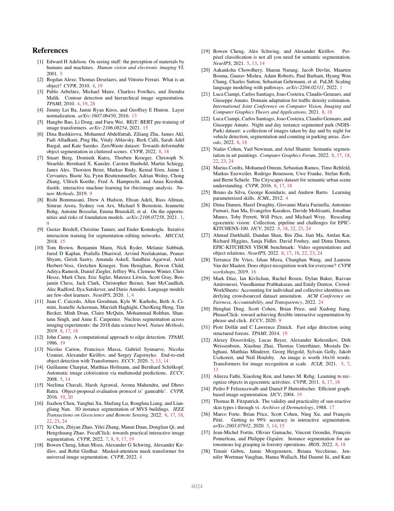

```text
References
   [1] Edward H Adelson. On seeing stuff: the perception of materials by
     humans and machines. Human vision and electronic imaging VI,
      2001. 5
   [2] Bogdan Alexe, Thomas Deselaers, and Vittorio Ferrari. What is an
       object? CVPR, 2010. 4, 19
   [3] Pablo Arbel´aez, Michael Maire, Charless Fowlkes, and Jitendra
      Malik.  Contour detection and hierarchical image segmentation.
     TPAMI, 2010. 4, 19, 28
   [4] Jimmy Lei Ba, Jamie Ryan Kiros, and Geoffrey E Hinton. Layer
       normalization. arXiv:1607.06450, 2016. 13
   [5] Hangbo Bao, Li Dong, and Furu Wei. BEiT: BERT pre-training of
      image transformers. arXiv:2106.08254, 2021. 15
   [6] Dina Bashkirova, Mohamed Abdelfattah, Ziliang Zhu, James Akl,
      Fadi Alladkani, Ping Hu, Vitaly Ablavsky, Berk Calli, Sarah Adel
       Bargal, and Kate Saenko. ZeroWaste dataset: Towards deformable
       object segmentation in cluttered scenes. CVPR, 2022. 8, 18
   [7]  Stuart Berg, Dominik Kutra, Thorben Kroeger,  Christoph N.
       Straehle, Bernhard X. Kausler, Carsten Haubold, Martin Schiegg,
      Janez Ales, Thorsten Beier, Markus Rudy, Kemal Eren, Jaime I.
       Cervantes, Buote Xu, Fynn Beuttenmueller, Adrian Wolny, Chong
      Zhang, Ullrich Koethe, Fred A. Hamprecht, and Anna Kreshuk.
        ilastik: interactive machine learning for (bio)image analysis. Na-
       ture Methods, 2019. 9
   [8] Rishi Bommasani, Drew A Hudson, Ehsan Adeli, Russ Altman,
      Simran Arora, Sydney von Arx, Michael S Bernstein, Jeannette
      Bohg, Antoine Bosselut, Emma Brunskill, et al. On the opportu-
        nities and risks of foundation models. arXiv:2108.07258, 2021. 1,
      9
   [9] Gustav Bredell, Christine Tanner, and Ender Konukoglu. Iterative
       interaction training for segmentation editing networks. MICCAI,
      2018. 15
 [10] Tom Brown, Benjamin Mann, Nick Ryder, Melanie Subbiah,
       Jared D Kaplan, Prafulla Dhariwal, Arvind Neelakantan, Pranav
      Shyam, Girish Sastry, Amanda Askell, Sandhini Agarwal, Ariel
       Herbert-Voss, Gretchen Krueger, Tom Henighan, Rewon Child,
      Aditya Ramesh, Daniel Ziegler, Jeffrey Wu, Clemens Winter, Chris
      Hesse, Mark Chen, Eric Sigler, Mateusz Litwin, Scott Gray, Ben-
      jamin Chess, Jack Clark, Christopher Berner, Sam McCandlish,
      Alec Radford, Ilya Sutskever, and Dario Amodei. Language models
       are few-shot learners. NeurIPS, 2020. 1, 4
 [11] Juan C. Caicedo, Allen Goodman, Kyle W. Karhohs, Beth A. Ci-
       mini, Jeanelle Ackerman, Marzieh Haghighi, CherKeng Heng, Tim
      Becker, Minh Doan, Claire McQuin, Mohammad Rohban, Shan-
      tanu Singh, and Anne E. Carpenter. Nucleus segmentation across
      imaging experiments: the 2018 data science bowl. Nature Methods,
      2019. 8, 17, 18
 [12] John Canny. A computational approach to edge detection. TPAMI,
      1986. 19
 [13] Nicolas Carion,  Francisco Massa,  Gabriel Synnaeve,  Nicolas
       Usunier, Alexander Kirillov, and Sergey Zagoruyko.  End-to-end
       object detection with Transformers. ECCV, 2020. 5, 13, 14
 [14] Guillaume Charpiat, Matthias Hofmann, and Bernhard Sch¨olkopf.
      Automatic image colorization via multimodal predictions. ECCV,
      2008. 5, 14
 [15] Neelima Chavali, Harsh Agrawal, Aroma Mahendru, and Dhruv
       Batra. Object-proposal evaluation protocol is’ gameable’. CVPR,
      2016. 19, 20
 [16] Jiazhou Chen, Yanghui Xu, Shufang Lu, Ronghua Liang, and Lian-
       gliang Nan. 3D instance segmentation of MVS buildings. IEEE
      Transactions on Geoscience and Remote Sensing, 2022. 8, 17, 18,
       22, 23, 24
 [17] Xi Chen, Zhiyan Zhao, Yilei Zhang, Manni Duan, Donglian Qi, and
      Hengshuang Zhao. FocalClick: towards practical interactive image
       segmentation. CVPR, 2022. 7, 8, 9, 17, 19
 [18] Bowen Cheng, Ishan Misra, Alexander G Schwing, Alexander Kir-
        illov, and Rohit Girdhar.  Masked-attention mask transformer for
       universal image segmentation. CVPR, 2022. 4


                                                       402

[19] Bowen Cheng, Alex Schwing, and Alexander  Kirillov.   Per-
         pixel classification is not all you need for semantic segmentation.
        NeurIPS, 2021. 5, 13, 14
   [20] Aakanksha Chowdhery, Sharan Narang, Jacob Devlin, Maarten
       Bosma, Gaurav Mishra, Adam Roberts, Paul Barham, Hyung Won
        Chung, Charles Sutton, Sebastian Gehrmann, et al. PaLM: Scaling
        language modeling with pathways. arXiv:2204.02311, 2022. 1
   [21] Luca Ciampi, Carlos Santiago, Joao Costeira, Claudio Gennaro, and
        Giuseppe Amato. Domain adaptation for traffic density estimation.
         International Joint Conference on Computer Vision, Imaging and
       Computer Graphics Theory and Applications, 2021. 8, 18
   [22] Luca Ciampi, Carlos Santiago, Joao Costeira, Claudio Gennaro, and
        Giuseppe Amato. Night and day instance segmented park (NDIS-
         Park) dataset: a collection of images taken by day and by night for
         vehicle detection, segmentation and counting in parking areas. Zen-
        odo, 2022. 8, 18
   [23] Nadav Cohen, Yael Newman, and Ariel Shamir. Semantic segmen-
          tation in art paintings. Computer Graphics Forum, 2022. 8, 17, 18,
         22, 23, 24
   [24] Marius Cordts, Mohamed Omran, Sebastian Ramos, Timo Rehfeld,
       Markus Enzweiler, Rodrigo Benenson, Uwe Franke, Stefan Roth,
        and Bernt Schiele. The Cityscapes dataset for semantic urban scene
         understanding. CVPR, 2016. 8, 17, 18
   [25] Bruno da Silva, George Konidaris, and Andrew Barto.  Learning
         parameterized skills. ICML, 2012. 4
   [26] Dima Damen, Hazel Doughty, Giovanni Maria Farinella, Antonino
         Furnari, Jian Ma, Evangelos Kazakos, Davide Moltisanti, Jonathan
       Munro, Toby Perrett, Will Price, and Michael Wray.  Rescaling
         egocentric vision: Collection, pipeline and challenges for EPIC-
       KITCHENS-100. IJCV, 2022. 8, 18, 22, 23, 24
   [27] Ahmad Darkhalil, Dandan Shan, Bin Zhu, Jian Ma, Amlan Kar,
        Richard Higgins, Sanja Fidler, David Fouhey, and Dima Damen.
      EPIC-KITCHENS VISOR benchmark: Video segmentations and
         object relations. NeurIPS, 2022. 8, 17, 18, 22, 23, 24
   [28] Terrance De Vries, Ishan Misra, Changhan Wang, and Laurens
       Van der Maaten. Does object recognition work for everyone? CVPR
        workshops, 2019. 16
   [29] Mark D´ıaz, Ian Kivlichan, Rachel Rosen, Dylan Baker, Razvan
        Amironesei, Vinodkumar Prabhakaran, and Emily Denton. Crowd-
        WorkSheets: Accounting for individual and collective identities un-
         derlying crowdsourced dataset annotation. ACM Conference on
         Fairness, Accountability, and Transparency, 2022. 24
   [30] Henghui Ding,  Scott Cohen, Brian Price, and Xudong Jiang.
         PhraseClick: toward achieving flexible interactive segmentation by
         phrase and click. ECCV, 2020. 9
   [31]  Piotr Doll´ar and C Lawrence Zitnick.  Fast edge detection using
         structured forests. TPAMI, 2014. 19
   [32] Alexey Dosovitskiy, Lucas Beyer, Alexander Kolesnikov, Dirk
        Weissenborn, Xiaohua Zhai, Thomas Unterthiner, Mostafa De-
         hghani, Matthias Minderer, Georg Heigold, Sylvain Gelly, Jakob
         Uszkoreit, and Neil Houlsby. An image is worth 16x16 words:
        Transformers for image recognition at scale.  ICLR, 2021.  5, 7,
       13
   [33] Alireza Fathi, Xiaofeng Ren, and James M. Rehg. Learning to rec-
        ognize objects in egocentric activities. CVPR, 2011. 8, 17, 18
   [34] Pedro F Felzenszwalb and Daniel P Huttenlocher. Efficient graph-
        based image segmentation. IJCV, 2004. 19
   [35] Thomas B. Fitzpatrick. The validity and practicality of sun-reactive
         skin types i through vi. Archives of Dermatology, 1988. 17
   [36] Marco Forte, Brian Price, Scott Cohen, Ning Xu, and Franc¸ois
            Piti´e.   Getting  to 99% accuracy  in  interactive segmentation.
        arXiv:2003.07932, 2020. 5, 14, 15
   [37] Jean-Michel Fortin, Olivier Gamache, Vincent Grondin, Franc¸ois
        Pomerleau, and Philippe Gigu`ere.  Instance segmentation for au-
        tonomous log grasping in forestry operations. IROS, 2022. 8, 18
   [38] Timnit  Gebru,  Jamie  Morgenstern,  Briana  Vecchione,  Jen-
          nifer Wortman Vaughan, Hanna Wallach, Hal Daum´e Iii, and Kate


024
```

#### 原稿第 11 页

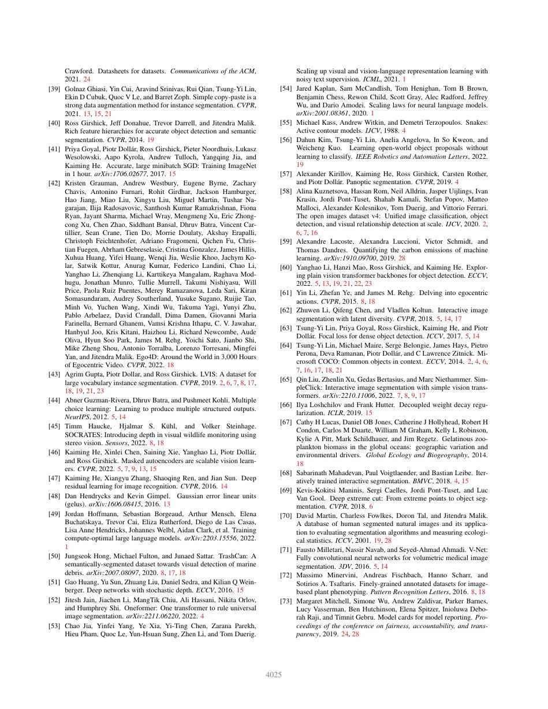

```text
Crawford. Datasheets for datasets. Communications of the ACM,
     2021. 24
[39] Golnaz Ghiasi, Yin Cui, Aravind Srinivas, Rui Qian, Tsung-Yi Lin,
     Ekin D Cubuk, Quoc V Le, and Barret Zoph. Simple copy-paste is a
     strong data augmentation method for instance segmentation. CVPR,
     2021. 13, 15, 21
[40] Ross Girshick, Jeff Donahue, Trevor Darrell, and Jitendra Malik.
     Rich feature hierarchies for accurate object detection and semantic
     segmentation. CVPR, 2014. 19
[41] Priya Goyal, Piotr Doll´ar, Ross Girshick, Pieter Noordhuis, Lukasz
     Wesolowski, Aapo Kyrola, Andrew Tulloch, Yangqing Jia, and
     Kaiming He. Accurate, large minibatch SGD: Training ImageNet
      in 1 hour. arXiv:1706.02677, 2017. 15
[42] Kristen Grauman, Andrew Westbury, Eugene Byrne, Zachary
     Chavis, Antonino Furnari, Rohit Girdhar, Jackson Hamburger,
    Hao Jiang, Miao Liu, Xingyu Liu, Miguel Martin, Tushar Na-
      garajan, Ilija Radosavovic, Santhosh Kumar Ramakrishnan, Fiona
     Ryan, Jayant Sharma, Michael Wray, Mengmeng Xu, Eric Zhong-
     cong Xu, Chen Zhao, Siddhant Bansal, Dhruv Batra, Vincent Car-
        tillier, Sean Crane, Tien Do, Morrie Doulaty, Akshay Erapalli,
     Christoph Feichtenhofer, Adriano Fragomeni, Qichen Fu, Chris-
      tian Fuegen, Abrham Gebreselasie, Cristina Gonzalez, James Hillis,
    Xuhua Huang, Yifei Huang, Wenqi Jia, Weslie Khoo, Jachym Ko-
       lar, Satwik Kottur, Anurag Kumar, Federico Landini, Chao Li,
     Yanghao Li, Zhenqiang Li, Karttikeya Mangalam, Raghava Mod-
     hugu, Jonathan Munro, Tullie Murrell, Takumi Nishiyasu, Will
      Price, Paola Ruiz Puentes, Merey Ramazanova, Leda Sari, Kiran
     Somasundaram, Audrey Southerland, Yusuke Sugano, Ruijie Tao,
    Minh Vo, Yuchen Wang, Xindi Wu, Takuma Yagi, Yunyi Zhu,
     Pablo Arbelaez, David Crandall, Dima Damen, Giovanni Maria
      Farinella, Bernard Ghanem, Vamsi Krishna Ithapu, C. V. Jawahar,
     Hanbyul Joo, Kris Kitani, Haizhou Li, Richard Newcombe, Aude
      Oliva, Hyun Soo Park, James M. Rehg, Yoichi Sato, Jianbo Shi,
    Mike Zheng Shou, Antonio Torralba, Lorenzo Torresani, Mingfei
     Yan, and Jitendra Malik. Ego4D: Around the World in 3,000 Hours
      of Egocentric Video. CVPR, 2022. 18
[43] Agrim Gupta, Piotr Dollar, and Ross Girshick. LVIS: A dataset for
      large vocabulary instance segmentation. CVPR, 2019. 2, 6, 7, 8, 17,
     18, 19, 21, 23
[44] Abner Guzman-Rivera, Dhruv Batra, and Pushmeet Kohli. Multiple
     choice learning: Learning to produce multiple structured outputs.
     NeurIPS, 2012. 5, 14
[45] Timm  Haucke,  Hjalmar  S.  K¨uhl,  and  Volker  Steinhage.
    SOCRATES: Introducing depth in visual wildlife monitoring using
      stereo vision. Sensors, 2022. 8, 18
[46] Kaiming He, Xinlei Chen, Saining Xie, Yanghao Li, Piotr Doll´ar,
     and Ross Girshick. Masked autoencoders are scalable vision learn-
      ers. CVPR, 2022. 5, 7, 9, 13, 15
[47] Kaiming He, Xiangyu Zhang, Shaoqing Ren, and Jian Sun. Deep
      residual learning for image recognition. CVPR, 2016. 14
[48] Dan Hendrycks and Kevin Gimpel.  Gaussian error linear units
      (gelus). arXiv:1606.08415, 2016. 13
[49] Jordan Hoffmann, Sebastian Borgeaud, Arthur Mensch, Elena
     Buchatskaya, Trevor Cai, Eliza Rutherford, Diego de Las Casas,
     Lisa Anne Hendricks, Johannes Welbl, Aidan Clark, et al. Training
     compute-optimal large language models. arXiv:2203.15556, 2022.
     1
[50] Jungseok Hong, Michael Fulton, and Junaed Sattar. TrashCan: A
     semantically-segmented dataset towards visual detection of marine
      debris. arXiv:2007.08097, 2020. 8, 17, 18
[51] Gao Huang, Yu Sun, Zhuang Liu, Daniel Sedra, and Kilian Q Wein-
      berger. Deep networks with stochastic depth. ECCV, 2016. 15
[52]  Jitesh Jain, Jiachen Li, MangTik Chiu, Ali Hassani, Nikita Orlov,
     and Humphrey Shi. Oneformer: One transformer to rule universal
     image segmentation. arXiv:2211.06220, 2022. 4
[53] Chao Jia, Yinfei Yang, Ye Xia, Yi-Ting Chen, Zarana Parekh,
     Hieu Pham, Quoc Le, Yun-Hsuan Sung, Zhen Li, and Tom Duerig.


                                                      402

Scaling up visual and vision-language representation learning with
         noisy text supervision. ICML, 2021. 1
   [54] Jared Kaplan, Sam McCandlish, Tom Henighan, Tom B Brown,
        Benjamin Chess, Rewon Child, Scott Gray, Alec Radford, Jeffrey
       Wu, and Dario Amodei. Scaling laws for neural language models.
        arXiv:2001.08361, 2020. 1
   [55] Michael Kass, Andrew Witkin, and Demetri Terzopoulos. Snakes:
        Active contour models. IJCV, 1988. 4
   [56] Dahun Kim, Tsung-Yi Lin, Anelia Angelova, In So Kweon, and
       Weicheng Kuo.  Learning open-world object proposals without
         learning to classify. IEEE Robotics and Automation Letters, 2022.
       19
   [57] Alexander Kirillov, Kaiming He, Ross Girshick, Carsten Rother,
        and Piotr Doll´ar. Panoptic segmentation. CVPR, 2019. 4
   [58] Alina Kuznetsova, Hassan Rom, Neil Alldrin, Jasper Uijlings, Ivan
         Krasin, Jordi Pont-Tuset, Shahab Kamali, Stefan Popov, Matteo
         Malloci, Alexander Kolesnikov, Tom Duerig, and Vittorio Ferrari.
       The open images dataset v4: Unified image classification, object
         detection, and visual relationship detection at scale. IJCV, 2020. 2,
          6, 7, 16
   [59] Alexandre Lacoste, Alexandra Luccioni,  Victor Schmidt, and
       Thomas Dandres.  Quantifying the carbon emissions of machine
         learning. arXiv:1910.09700, 2019. 28
   [60] Yanghao Li, Hanzi Mao, Ross Girshick, and Kaiming He. Explor-
         ing plain vision transformer backbones for object detection. ECCV,
        2022. 5, 13, 19, 21, 22, 23
   [61] Yin Li, Zhefan Ye, and James M. Rehg. Delving into egocentric
          actions. CVPR, 2015. 8, 18
   [62] Zhuwen Li, Qifeng Chen, and Vladlen Koltun.  Interactive image
        segmentation with latent diversity. CVPR, 2018. 5, 14, 17
   [63] Tsung-Yi Lin, Priya Goyal, Ross Girshick, Kaiming He, and Piotr
           Doll´ar. Focal loss for dense object detection. ICCV, 2017. 5, 14
   [64] Tsung-Yi Lin, Michael Maire, Serge Belongie, James Hays, Pietro
         Perona, Deva Ramanan, Piotr Doll´ar, and C Lawrence Zitnick. Mi-
         crosoft COCO: Common objects in context. ECCV, 2014. 2, 4, 6,
          7, 16, 17, 18, 21
   [65] Qin Liu, Zhenlin Xu, Gedas Bertasius, and Marc Niethammer. Sim-
         pleClick: Interactive image segmentation with simple vision trans-
         formers. arXiv:2210.11006, 2022. 7, 8, 9, 17
   [66]  Ilya Loshchilov and Frank Hutter. Decoupled weight decay regu-
          larization. ICLR, 2019. 15
   [67] Cathy H Lucas, Daniel OB Jones, Catherine J Hollyhead, Robert H
        Condon, Carlos M Duarte, William M Graham, Kelly L Robinson,
        Kylie A Pitt, Mark Schildhauer, and Jim Regetz. Gelatinous zoo-
        plankton biomass in the global oceans: geographic variation and
        environmental drivers. Global Ecology and Biogeography, 2014.
       18
   [68] Sabarinath Mahadevan, Paul Voigtlaender, and Bastian Leibe. Iter-
          atively trained interactive segmentation. BMVC, 2018. 4, 15
   [69] Kevis-Kokitsi Maninis, Sergi Caelles, Jordi Pont-Tuset, and Luc
       Van Gool. Deep extreme cut: From extreme points to object seg-
         mentation. CVPR, 2018. 6
   [70] David Martin, Charless Fowlkes, Doron Tal, and Jitendra Malik.
     A database of human segmented natural images and its applica-
          tion to evaluating segmentation algorithms and measuring ecologi-
          cal statistics. ICCV, 2001. 19, 28
   [71] Fausto Milletari, Nassir Navab, and Seyed-Ahmad Ahmadi. V-Net:
         Fully convolutional neural networks for volumetric medical image
         segmentation. 3DV, 2016. 5, 14
   [72] Massimo  Minervini,  Andreas  Fischbach, Hanno  Scharr,  and
          Sotirios A. Tsaftaris. Finely-grained annotated datasets for image-
        based plant phenotyping. Pattern Recognition Letters, 2016. 8, 18
   [73] Margaret Mitchell, Simone Wu, Andrew Zaldivar, Parker Barnes,
       Lucy Vasserman, Ben Hutchinson, Elena Spitzer, Inioluwa Debo-
         rah Raji, and Timnit Gebru. Model cards for model reporting. Pro-
        ceedings of the conference on fairness, accountability, and trans-
         parency, 2019. 24, 28


025
```

#### 原稿第 12 页

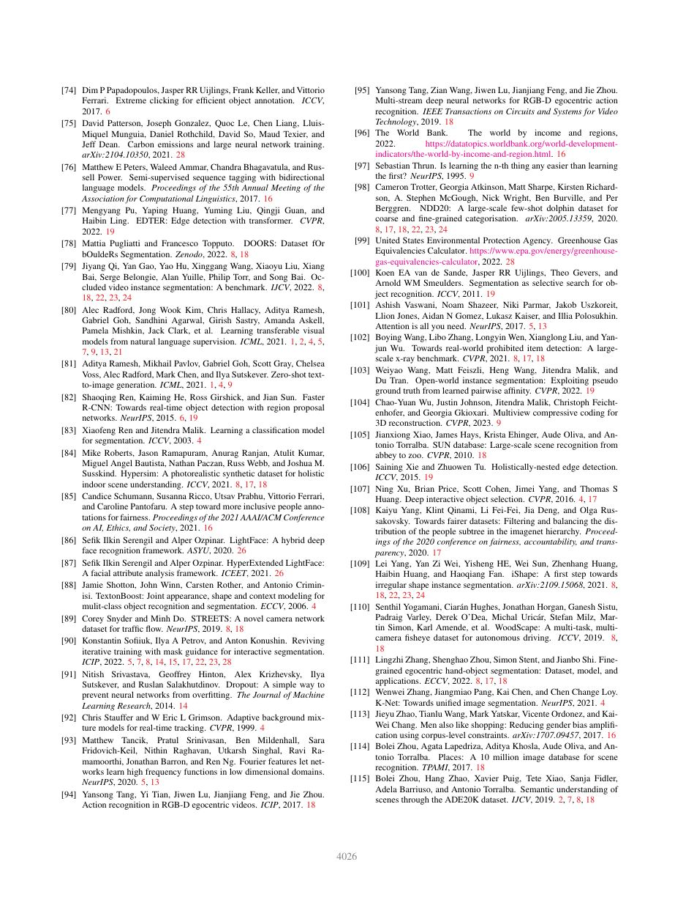

```text
[74] Dim P Papadopoulos, Jasper RR Uijlings, Frank Keller, and Vittorio
      Ferrari.  Extreme clicking for efficient object annotation.  ICCV,
     2017. 6
[75] David Patterson, Joseph Gonzalez, Quoc Le, Chen Liang, Lluis-
     Miquel Munguia, Daniel Rothchild, David So, Maud Texier, and
      Jeff Dean.  Carbon emissions and large neural network training.
     arXiv:2104.10350, 2021. 28
[76] Matthew E Peters, Waleed Ammar, Chandra Bhagavatula, and Rus-
       sell Power.  Semi-supervised sequence tagging with bidirectional
     language models. Proceedings of the 55th Annual Meeting of the
     Association for Computational Linguistics, 2017. 16
[77] Mengyang Pu, Yaping Huang, Yuming Liu, Qingji Guan, and
     Haibin Ling. EDTER: Edge detection with transformer. CVPR,
     2022. 19
[78] Mattia Pugliatti and Francesco Topputo.  DOORS: Dataset fOr
     bOuldeRs Segmentation. Zenodo, 2022. 8, 18
[79] Jiyang Qi, Yan Gao, Yao Hu, Xinggang Wang, Xiaoyu Liu, Xiang
      Bai, Serge Belongie, Alan Yuille, Philip Torr, and Song Bai. Oc-
     cluded video instance segmentation: A benchmark. IJCV, 2022. 8,
     18, 22, 23, 24
[80] Alec Radford, Jong Wook Kim, Chris Hallacy, Aditya Ramesh,
     Gabriel Goh, Sandhini Agarwal, Girish Sastry, Amanda Askell,
     Pamela Mishkin, Jack Clark, et al.  Learning transferable visual
     models from natural language supervision. ICML, 2021. 1, 2, 4, 5,
      7, 9, 13, 21
[81] Aditya Ramesh, Mikhail Pavlov, Gabriel Goh, Scott Gray, Chelsea
     Voss, Alec Radford, Mark Chen, and Ilya Sutskever. Zero-shot text-
     to-image generation. ICML, 2021. 1, 4, 9
[82] Shaoqing Ren, Kaiming He, Ross Girshick, and Jian Sun.  Faster
    R-CNN: Towards real-time object detection with region proposal
     networks. NeurIPS, 2015. 6, 19
[83] Xiaofeng Ren and Jitendra Malik. Learning a classification model
      for segmentation. ICCV, 2003. 4
[84] Mike Roberts, Jason Ramapuram, Anurag Ranjan, Atulit Kumar,
     Miguel Angel Bautista, Nathan Paczan, Russ Webb, and Joshua M.
     Susskind. Hypersim: A photorealistic synthetic dataset for holistic
     indoor scene understanding. ICCV, 2021. 8, 17, 18
[85] Candice Schumann, Susanna Ricco, Utsav Prabhu, Vittorio Ferrari,
     and Caroline Pantofaru. A step toward more inclusive people anno-
      tations for fairness. Proceedings of the 2021 AAAI/ACM Conference
     on AI, Ethics, and Society, 2021. 16
[86] Sefik Ilkin Serengil and Alper Ozpinar. LightFace: A hybrid deep
      face recognition framework. ASYU, 2020. 26
[87] Sefik Ilkin Serengil and Alper Ozpinar. HyperExtended LightFace:
   A facial attribute analysis framework. ICEET, 2021. 26
[88] Jamie Shotton, John Winn, Carsten Rother, and Antonio Crimin-
        isi. TextonBoost: Joint appearance, shape and context modeling for
      mulit-class object recognition and segmentation. ECCV, 2006. 4
[89] Corey Snyder and Minh Do. STREETS: A novel camera network
      dataset for traffic flow. NeurIPS, 2019. 8, 18
[90] Konstantin Sofiiuk, Ilya A Petrov, and Anton Konushin. Reviving
      iterative training with mask guidance for interactive segmentation.
     ICIP, 2022. 5, 7, 8, 14, 15, 17, 22, 23, 28
[91]  Nitish  Srivastava,  Geoffrey  Hinton,  Alex  Krizhevsky,  Ilya
      Sutskever, and Ruslan Salakhutdinov. Dropout: A simple way to
     prevent neural networks from overfitting. The Journal of Machine
     Learning Research, 2014. 14
[92] Chris Stauffer and W Eric L Grimson. Adaptive background mix-
      ture models for real-time tracking. CVPR, 1999. 4
[93] Matthew  Tancik,   Pratul  Srinivasan,  Ben  Mildenhall,  Sara
      Fridovich-Keil,  Nithin Raghavan,  Utkarsh  Singhal,  Ravi Ra-
     mamoorthi, Jonathan Barron, and Ren Ng. Fourier features let net-
     works learn high frequency functions in low dimensional domains.
     NeurIPS, 2020. 5, 13
[94] Yansong Tang, Yi Tian, Jiwen Lu, Jianjiang Feng, and Jie Zhou.
     Action recognition in RGB-D egocentric videos. ICIP, 2017. 18


                                                      402

[95] Yansong Tang, Zian Wang, Jiwen Lu, Jianjiang Feng, and Jie Zhou.
         Multi-stream deep neural networks for RGB-D egocentric action
         recognition. IEEE Transactions on Circuits and Systems for Video
         Technology, 2019. 18
   [96] The  World  Bank.    The  world  by  income  and  regions,
        2022.        https://datatopics.worldbank.org/world-development-
         indicators/the-world-by-income-and-region.html. 16
   [97] Sebastian Thrun. Is learning the n-th thing any easier than learning
         the first? NeurIPS, 1995. 9
   [98] Cameron Trotter, Georgia Atkinson, Matt Sharpe, Kirsten Richard-
         son, A. Stephen McGough, Nick Wright, Ben Burville, and Per
        Berggren.  NDD20: A large-scale few-shot dolphin dataset for
         coarse and fine-grained categorisation.  arXiv:2005.13359, 2020.
          8, 17, 18, 22, 23, 24
   [99] United States Environmental Protection Agency. Greenhouse Gas
         Equivalencies Calculator. https://www.epa.gov/energy/greenhouse-
         gas-equivalencies-calculator, 2022. 28
  [100] Koen EA van de Sande, Jasper RR Uijlings, Theo Gevers, and
        Arnold WM Smeulders. Segmentation as selective search for ob-
          ject recognition. ICCV, 2011. 19
  [101] Ashish Vaswani, Noam Shazeer, Niki Parmar, Jakob Uszkoreit,
         Llion Jones, Aidan N Gomez, Lukasz Kaiser, and Illia Polosukhin.
         Attention is all you need. NeurIPS, 2017. 5, 13
  [102] Boying Wang, Libo Zhang, Longyin Wen, Xianglong Liu, and Yan-
         jun Wu.  Towards real-world prohibited item detection: A large-
         scale x-ray benchmark. CVPR, 2021. 8, 17, 18
  [103] Weiyao Wang, Matt Feiszli, Heng Wang,  Jitendra Malik, and
      Du Tran.  Open-world instance segmentation: Exploiting pseudo
        ground truth from learned pairwise affinity. CVPR, 2022. 19
  [104] Chao-Yuan Wu, Justin Johnson, Jitendra Malik, Christoph Feicht-
         enhofer, and Georgia Gkioxari. Multiview compressive coding for
      3D reconstruction. CVPR, 2023. 9
  [105] Jianxiong Xiao, James Hays, Krista Ehinger, Aude Oliva, and An-
         tonio Torralba. SUN database: Large-scale scene recognition from
        abbey to zoo. CVPR, 2010. 18
  [106] Saining Xie and Zhuowen Tu. Holistically-nested edge detection.
       ICCV, 2015. 19
  [107] Ning Xu, Brian Price, Scott Cohen, Jimei Yang, and Thomas S
        Huang. Deep interactive object selection. CVPR, 2016. 4, 17
  [108] Kaiyu Yang, Klint Qinami, Li Fei-Fei, Jia Deng, and Olga Rus-
         sakovsky. Towards fairer datasets: Filtering and balancing the dis-
          tribution of the people subtree in the imagenet hierarchy. Proceed-
         ings of the 2020 conference on fairness, accountability, and trans-
         parency, 2020. 17
  [109] Lei Yang, Yan Zi Wei, Yisheng HE, Wei Sun, Zhenhang Huang,
        Haibin Huang, and Haoqiang Fan.  iShape: A first step towards
          irregular shape instance segmentation. arXiv:2109.15068, 2021. 8,
         18, 22, 23, 24
  [110]  Senthil Yogamani, Ciar´an Hughes, Jonathan Horgan, Ganesh Sistu,
         Padraig Varley, Derek O’Dea, Michal Uric´ar, Stefan Milz, Mar-
           tin Simon, Karl Amende, et al. WoodScape: A multi-task, multi-
        camera fisheye dataset for autonomous driving. ICCV, 2019.  8,
       18
  [111] Lingzhi Zhang, Shenghao Zhou, Simon Stent, and Jianbo Shi. Fine-
         grained egocentric hand-object segmentation: Dataset, model, and
          applications. ECCV, 2022. 8, 17, 18
  [112] Wenwei Zhang, Jiangmiao Pang, Kai Chen, and Chen Change Loy.
        K-Net: Towards unified image segmentation. NeurIPS, 2021. 4
  [113] Jieyu Zhao, Tianlu Wang, Mark Yatskar, Vicente Ordonez, and Kai-
       Wei Chang. Men also like shopping: Reducing gender bias amplifi-
         cation using corpus-level constraints. arXiv:1707.09457, 2017. 16
  [114] Bolei Zhou, Agata Lapedriza, Aditya Khosla, Aude Oliva, and An-
         tonio Torralba.  Places: A 10 million image database for scene
         recognition. TPAMI, 2017. 18
  [115] Bolei Zhou, Hang Zhao, Xavier Puig, Tete Xiao, Sanja Fidler,
        Adela Barriuso, and Antonio Torralba. Semantic understanding of
         scenes through the ADE20K dataset. IJCV, 2019. 2, 7, 8, 18


026
```

