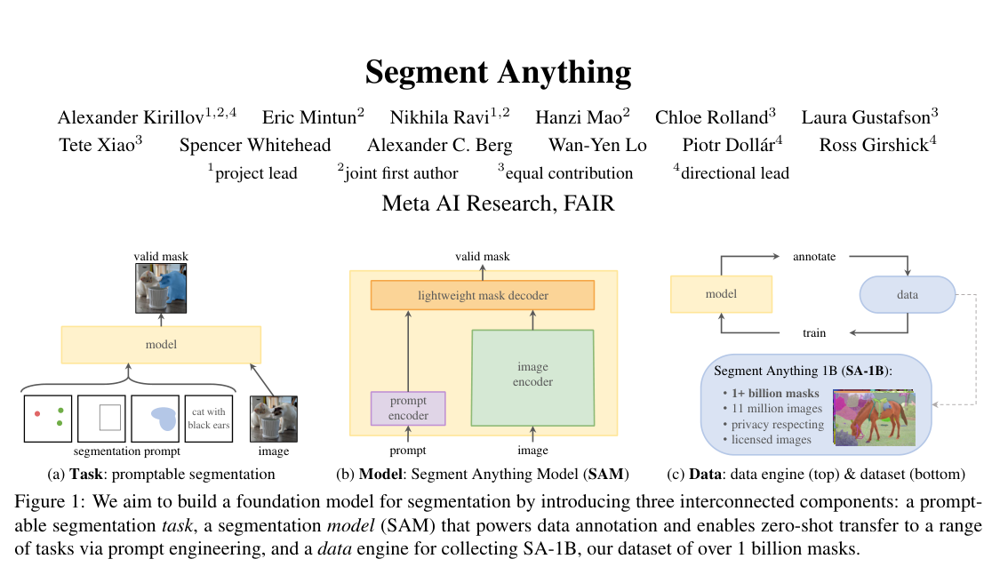
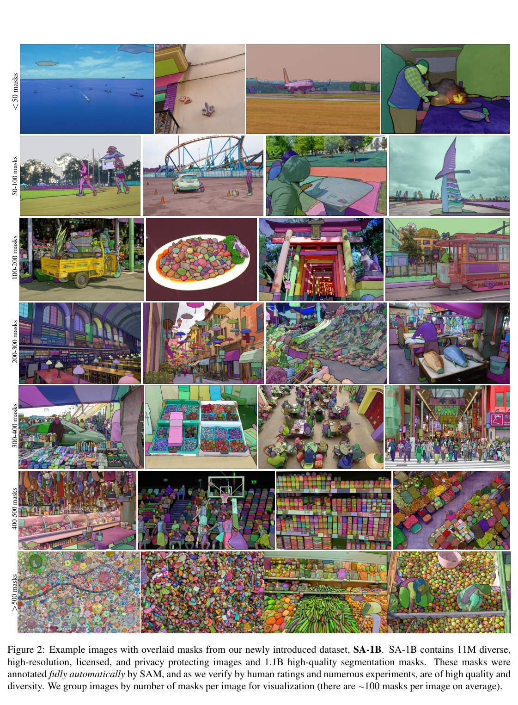
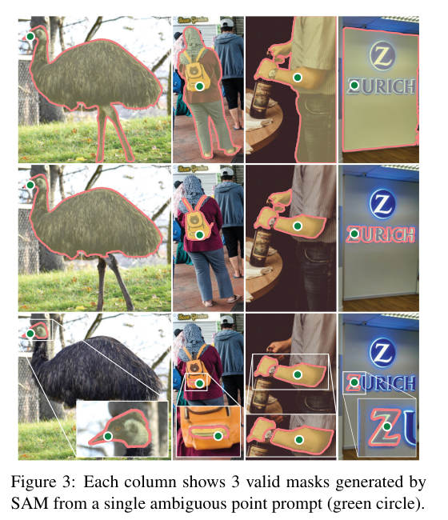
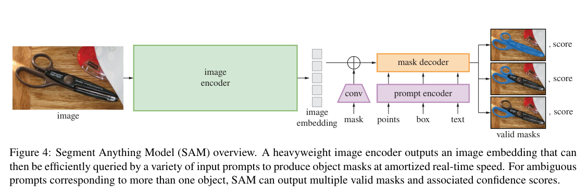
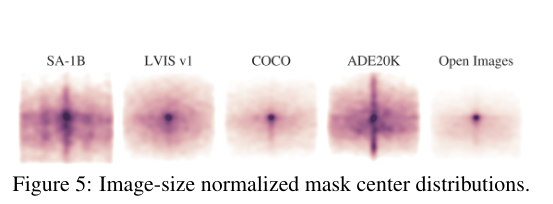
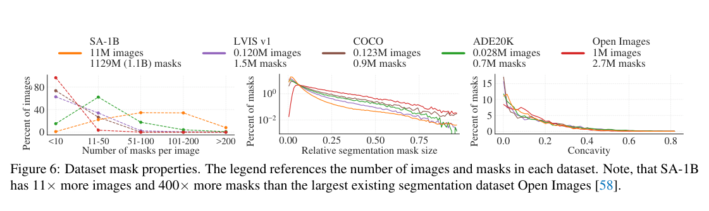
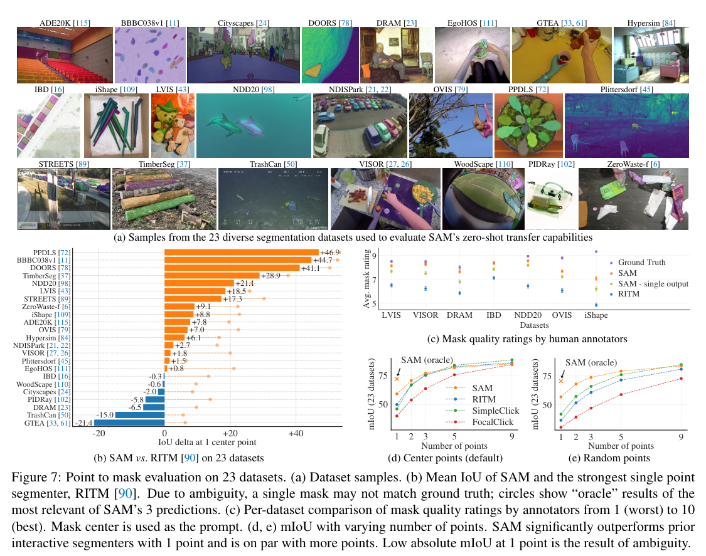
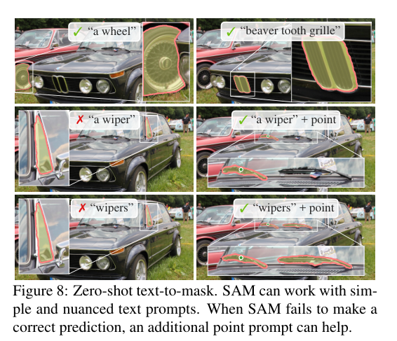

# Segment Anything

> 原文逐页提取，保留原有语言。跨栏图示、复杂表格和公式请结合图片核对。

## 原文图表索引

- 图 1（PDF 第 1 页）：[Figure 1: We aim to build a foundation model for segmentation by introducing three interconnected components: a prompt- able segmentation task, a segm](./images/figure-01-p01.png)
- 图 2（PDF 第 3 页）：[Figure 2: Example images with overlaid masks from our newly introduced dataset, SA-1B. SA-1B contains 11M diverse, high-resolution, licensed, and priv](./images/figure-02-p03.png)
- 图 3（PDF 第 4 页）：[Figure 3: Each column shows 3 valid masks generated by SAM from a single ambiguous point prompt (green circle).](./images/figure-03-p04.png)
- 图 4（PDF 第 5 页）：[Figure 4: Segment Anything Model (SAM) overview. A heavyweight image encoder outputs an image embedding that can then be efficiently queried by a varie](./images/figure-04-p05.png)
- 图 5（PDF 第 6 页）：[Figure 5: Image-size normalized mask center distributions.](./images/figure-05-p06.png)
- 图 6（PDF 第 7 页）：[Figure 6: Dataset mask properties. The legend references the number of images and masks in each dataset. Note, that SA-1B has 11⇥more images and 400⇥m](./images/figure-06-p07.png)
- 图 7（PDF 第 8 页）：[(d) Center points (default) (e) Random points Figure 7: Point to mask evaluation on 23 datasets. (a) Dataset samples. (b) Mean IoU of SAM and the stro](./images/figure-07-p08.png)
- 图 8（PDF 第 9 页）：[Figure 8: Zero-shot text-to-mask. SAM can work with sim- ple and nuanced text prompts. When SAM fails to make a correct prediction, an additional poin](./images/figure-08-p09.png)

## 全文逐页原文

### PDF 第 1 页

                        This ICCV paper is the Open Access versi
                                   Except for this watermark, it
                                  the final published version of the

                    Segment A
     Alexander Kirillov1,2,4   Eric Mintun2   Nikhila Ravi1,2
     Tete Xiao3    Spencer Whitehead    Alexander C. Berg
                           1project lead      2joint first author     3eq
                               Meta AI Resea

                        valid mask                                                     valid mask

                                                                             lightweight mask d

                     model

                                                                                         e
                                                              prompt
                                            cat with                            encoder
                                       black ears
           segmentation prompt             image                 prompt
     (a) Task: promptable segmentation          (b) Model: Segment Anythi
Figure 1: We aim to build a foundation model for segmentation
able segmentation task, a segmentation model (SAM) that powe
of tasks via prompt engineering, and a data engine for collecting

                 Abstract
  We introduce the Segment Anything (SA) project: a new
task, model, and dataset for image segmentation. Using our
efficient model in a data collection loop, we built the largest
segmentation dataset to date (by far), with over 1 billion
masks on 11M licensed and privacy respecting images. The
model is designed and trained to be promptable, so it can
transfer zero-shot to new image distributions and tasks. We
evaluate its capabilities on numerous tasks and find that
its zero-shot performance is impressive – often competitive
with or even superior to prior fully supervised results. We
are releasing the Segment Anything Model (SAM) and cor-
responding dataset (SA-1B) of 1B masks and 11M images
at segment-anything.com to foster research into foundation
models for computer vision. We recommend reading the
full paper at: arxiv.org/abs/2304.02643.

1. Introduction
   Large language models pre-trained on web-scale datasets
are revolutionizing NLP with strong zero-shot and few-shot
generalization [10].  These “foundation models” [8] can
generalize to tasks and data distributions beyond those seen
during training. This capability is often implemented with
prompt engineering in which hand-crafted text is used to
prompt the language model to generate a valid textual re-
sponse for the task at hand. When scaled and trained with
abundant text corpora from the web, these models’ zero and
few-shot performance compares surprisingly well to (even

                                                       40

  ion, provided by the Computer Vision Foundation.
   t is identical to the accepted version;
  proceedings is available on IEEE Xplore.

Anything
    Hanzi Mao2   Chloe Rolland3   Laura Gustafson3
     Wan-Yen Lo     Piotr Doll´ar4    Ross Girshick4
  qual contribution      4directional lead
  arch, FAIR

                                                       annotate

   ecoder                         model                              data

                                                                  train

   image                        Segment Anything 1B (SA-1B):
   encoder
                                                   • 1+ billion masks
                                                   • 11 million images
                                                   • privacy respecting
                                                   • licensed images
   image
  ing Model (SAM)      (c) Data: data engine (top) & dataset (bottom)
  by introducing three interconnected components: a prompt-
  ers data annotation and enables zero-shot transfer to a range
 g SA-1B, our dataset of over 1 billion masks.

   matching in some cases) fine-tuned models [10, 20]. Empir-
   ical trends show this behavior improving with model scale,
   dataset size, and total training compute [54, 10, 20, 49].
     Foundation models have also been explored in computer
   vision, albeit to a lesser extent. Perhaps the most promi-
   nent illustration aligns paired text and images from the web.
   For example, CLIP [80] and ALIGN [53] use contrastive
   learning to train text and image encoders that align the two
   modalities. Once trained, engineered text prompts enable
   zero-shot generalization to novel visual concepts and data
   distributions. Such encoders also compose effectively with
   other modules to enable downstream tasks, such as image
   generation (e.g., DALL·E [81]). While much progress has
   been made on vision and language encoders, computer vi-
   sion includes a wide range of problems beyond this scope,
  and for many of these, abundant training data does not exist.
      In this work, our goal is to build a foundation model for
  image segmentation. That is, we seek to develop a prompt-
   able model and pre-train it on a broad dataset using a task
   that enables powerful generalization. With this model, we
  aim to solve a range of downstream segmentation problems
  on new data distributions using prompt engineering.
     The success of this plan hinges on three components:
   task, model, and data. To develop them, we address the
   following questions about image segmentation:
     1. What task will enable zero-shot generalization?
     2. What is the corresponding model architecture?
     3. What data can power this task and model?

  15

**原文图 1**：Figure 1: We aim to build a foundation model for segmentation by introducing three interconnected components: a prompt- able segmentation task, a segmentation model (SAM) that powers data annotation and enables zero-shot transfer to a range of tasks via prompt engineering, and a data engine for collecting SA-1B, our dataset of over 1 billion masks.

### PDF 第 2 页

These questions are entangled and require a comprehen-
sive solution. We start by defining a promptable segmenta-
tion task that is general enough to provide a powerful pre-
training objective and to enable a wide range of downstream
applications. This task requires a model that supports flex-
ible prompting and can output segmentation masks in real-
time when prompted to allow for interactive use. To train
our model, we need a diverse, large-scale source of data.
Unfortunately, there is no web-scale data source for seg-
mentation; to address this, we build a “data engine”, i.e.,
we iterate between using our efficient model to assist in data
collection and using the newly collected data to improve the
model. We introduce each interconnected component next,
followed by the dataset we created and the experiments that
demonstrate the effectiveness of our approach.
Task (§2).  In NLP and more recently computer vision,
foundation models are a promising development that can
perform zero-shot and few-shot learning for new datasets
and tasks often by using “prompting” techniques. Inspired
by this line of work, we propose the promptable segmen-
tation task, where the goal is to return a valid segmenta-
tion mask given any segmentation prompt (see Fig. 1a). A
prompt simply specifies what to segment in an image, e.g.,
a prompt can include spatial or text information identifying
an object. The requirement of a valid output mask means
that even when a prompt is ambiguous and could refer to
multiple objects (for example, a point on a shirt may in-
dicate either the shirt or the person wearing it), the output
should be a reasonable mask for at least one of those ob-
jects. We use the promptable segmentation task as both a
pre-training objective and to solve general downstream seg-
mentation tasks via prompt engineering.
Model (§3). The promptable segmentation task and the goal
of real-world use impose constraints on the model architec-
ture. In particular, the model must support flexible prompts,
needs to compute masks in amortized real-time to allow in-
teractive use, and must be ambiguity-aware. Surprisingly,
we find that a simple design satisfies all three constraints:
a powerful image encoder computes an image embedding,
a prompt encoder embeds prompts, and then the two infor-
mation sources are combined in a lightweight mask decoder
that predicts segmentation masks. We refer to this model as
the Segment Anything Model, or SAM (see Fig. 1b). By
separating SAM into an image encoder and a fast prompt
encoder / mask decoder, the same image embedding can
be reused (and its cost amortized) with different prompts.
Given an image embedding, the prompt encoder and mask
decoder predict a mask from a prompt in ⇠50ms in a web
browser. We focus on point, box, and mask prompts, and
also present initial results with free-form text prompts. To
make SAM ambiguity-aware, we design it to predict mul-
tiple masks for a single prompt allowing SAM to naturally
handle ambiguity, such as the shirt vs. person example.

                                                       40

 Data engine (§4). To achieve strong generalization to new
 data distributions, we found it necessary to train SAM on
 a large and diverse set of masks, beyond any segmenta-
 tion dataset that already exists. While a typical approach
 for foundation models is to obtain data online [80], masks
 are not naturally abundant and thus we need an alternative
 strategy. Our solution is to build a “data engine”, i.e., we
 co-develop our model with model-in-the-loop dataset an-
 notation (see Fig. 1c). Our data engine has three stages:
 assisted-manual, semi-automatic, and fully automatic.  In
 the first stage, SAM assists annotators in annotating masks,
 similar to a classic interactive segmentation setup.  In the
 second stage, SAM can automatically generate masks for
 a subset of objects by prompting it with likely object lo-
 cations and annotators focus on annotating the remaining
 objects, helping increase mask diversity. In the final stage,
we prompt SAM with a regular grid of foreground points,
 yielding on average ⇠100 high-quality masks per image.
 Dataset (§5). Our final dataset, SA-1B, includes more than
 1B masks from 11M licensed and privacy-preserving im-
 ages (see Fig. 2). SA-1B, collected fully automatically us-
 ing the final stage of our data engine, has 400⇥more masks than any existing segmentation dataset [64, 43, 115, 58],
 and as we verify extensively, the masks are of high quality
 and diversity. Beyond its use in training SAM to be robust
 and general, we hope SA-1B becomes a valuable resource
 for research aiming to build new foundation models.
 Experiments (§6). We extensively evaluate SAM. First, us-
 ing a diverse new suite of 23 segmentation datasets, we find
 that SAM produces high-quality masks from a single fore-
 ground point, often only slightly below that of the manu-
 ally annotated ground truth. Second, we find consistently
 strong quantitative and qualitative results on a variety of
 downstream tasks under a zero-shot transfer protocol using
 prompt engineering, including edge detection, object pro-
 posal generation, instance segmentation, and a preliminary
 exploration of text-to-mask prediction. These results sug-
 gest that SAM can be used out-of-the-box with prompt en-
 gineering to solve a variety of tasks involving object and
 image distributions beyond SAM’s training data. Neverthe-
 less, room for improvement remains, as we discuss in §7.
 Responsible AI. We provide model/dataset cards and report
 on potential fairness concerns and biases when using SA-1B
 and SAM in the supplement. Images in SA-1B span a geo-
 graphically and economically diverse set of regions and we
 found that SAM performs similarly across different groups
 of people. Together, we hope this will make our work more
 equitable for real-world use cases.
 Release. We are releasing the SA-1B dataset for research
 purposes and making SAM available under a permissive
 open license (Apache 2.0) at https://segment-anything.com.
We also showcase SAM’s capabilities with an online demo.

16

### PDF 第 3 页

 masks
 <50

  masks
  50-100

  masks
  100-200

  masks
  200-300

  masks
  300-400

  masks
  400-500

 masks
 >500

Figure 2: Example images with overlaid masks from our newly
high-resolution, licensed, and privacy protecting images and 1
annotated fully automatically by SAM, and as we verify by huma
diversity. We group images by number of masks per image for v

                                                       40

y introduced dataset, SA-1B. SA-1B contains 11M diverse,
1.1B high-quality segmentation masks. These masks were
an ratings and numerous experiments, are of high quality and
 isualization (there are ⇠100 masks per image on average).

 17

**原文图 2**：Figure 2: Example images with overlaid masks from our newly introduced dataset, SA-1B. SA-1B contains 11M diverse, high-resolution, licensed, and privacy protecting images and 1.1B high-quality segmentation masks. These masks were annotated fully automatically by SAM, and as we verify by human ratings and numerous experiments, are of high quality and diversity. We group images by number of masks per image for visualization (there are ⇠100 masks per image on average).

### PDF 第 4 页

2. Segment Anything Task

  We take inspiration from NLP, where the next token pre-
diction task is used for foundation model pre-training and
to solve diverse downstream tasks via prompt engineer-
ing [10]. To build a foundation model for segmentation,
we aim to define a task with analogous capabilities.
Task. We start by translating the idea of a prompt from NLP
to segmentation, where a prompt can be a set of foreground
/ background points, a rough box or mask, free-form text,
or, in general, any information indicating what to segment
in an image. The promptable segmentation task, then, is to
return a valid segmentation mask given any prompt. The re-
quirement of a “valid” mask simply means that even when
a prompt is ambiguous and could refer to multiple objects
(e.g., recall the shirt vs. person example, and see Fig. 3),
the output should be a reasonable mask for at least one of
those objects. This requirement is similar to expecting a lan-
guage model to output a coherent response to an ambiguous
prompt. We choose this task because it leads to a natural
pre-training algorithm and a general method for zero-shot
transfer to downstream segmentation tasks via prompting.
Pre-training. The promptable segmentation task suggests a
natural pre-training algorithm that simulates a sequence of
prompts (e.g., points, boxes, masks) for each training sam-
ple and compares the model’s mask predictions against the
ground truth. We adapt this method from interactive seg-
mentation [107, 68], although unlike interactive segmenta-
tion whose aim is to eventually predict a valid mask after
enough user input, our aim is to always predict a valid mask
for any prompt even when the prompt is ambiguous. This
ensures that a pre-trained model is effective in use cases that
involve ambiguity, including automatic annotation as re-
quired by our data engine §4. We note that performing well
at this task is challenging and requires specialized modeling
and training loss choices, which we discuss in §3.
Zero-shot transfer.  Intuitively, our pre-training task en-
dows the model with the ability to respond appropriately to
any prompt at inference time, and thus downstream tasks
can be solved by engineering appropriate prompts. For ex-
ample, if one has a bounding box detector for cats, cat in-
stance segmentation can be solved by providing the detec-
tor’s box output as a prompt to our model. In general, a wide
array of practical segmentation tasks can be cast as prompt-
ing. In addition to automatic dataset labeling, we explore
five diverse example tasks in our experiments in §6.
Related tasks. Segmentation is a broad field: there’s in-
teractive segmentation [55, 107], edge detection [3], su-
per pixelization [83], object proposal generation [2], fore-
ground segmentation [92], semantic segmentation [88], in-
stance segmentation [64], panoptic segmentation [57], etc.
The goal of our promptable segmentation task is to produce

                                                       40

 Figure 3: Each column shows 3 valid masks generated by
SAM from a single ambiguous point prompt (green circle).

 a broadly capable model that can adapt to many (though
 not all) existing and new segmentation tasks via prompt
 engineering. This capability is a form of task generaliza-
 tion [25]. Note that this is different than previous work on
 multi-task segmentation systems. In a multi-task system, a
 single model performs a fixed set of tasks, e.g., joint seman-
 tic, instance, and panoptic segmentation [112, 18, 52], but
 the training and test tasks are the same. An important dis-
 tinction in our work is that a model trained for promptable
 segmentation can perform a new, different task at inference
 time by acting as a component in a larger system, e.g., to
 perform instance segmentation, a promptable segmentation
 model is combined with an existing object detector.
 Discussion. Prompting and composition are powerful tools
 that enable a single model to be used in extensible ways, po-
 tentially to accomplish tasks unknown at the time of model
 design. This approach is analogous to how other founda-
 tion models are used, e.g., how CLIP [80] is the text-image
 alignment component of the DALL·E [81] image generation system. We anticipate that composable system design, pow-
 ered by techniques such as prompt engineering, will enable
 a wider variety of applications than systems trained specif-
 ically for a fixed set of tasks.  It’s also interesting to com-
 pare promptable and interactive segmentation through the
 lens of composition: while interactive segmentation mod-
 els are designed with human users in mind, a model trained
 for promptable segmentation can also be composed into a
 larger algorithmic system as we will demonstrate.

18

**原文图 3**：Figure 3: Each column shows 3 valid masks generated by SAM from a single ambiguous point prompt (green circle).

### PDF 第 5 页

                                            image
                                              encoder

           image
                                                   em

Figure 4: Segment Anything Model (SAM) overview. A heavyw
then be efficiently queried by a variety of input prompts to produc
prompts corresponding to more than one object, SAM can outpu

3. Segment Anything Model

  We next describe the Segment Anything Model (SAM)
for promptable segmentation. SAM has three components,
illustrated in Fig. 4: an image encoder, a flexible prompt
encoder, and a fast mask decoder. We build on Transformer
vision models [13, 32, 19, 60] with specific tradeoffs for
(amortized) real-time performance. We describe these com-
ponents at a high-level here, with details in §B.
Image encoder. Motivated by scalability and powerful pre-
training methods, we use an MAE [46] pre-trained Vision
Transformer (ViT) [32] minimally adapted to process high
resolution inputs [60]. The image encoder runs once per
image and can be applied prior to prompting the model.
Prompt encoder. We consider two sets of prompts: sparse
(points, boxes,  text) and dense (masks).  We represent
points and boxes by positional encodings [93] summed with
learned embeddings for each prompt type and free-form text
with an off-the-shelf text encoder from CLIP [80]. Dense
prompts (i.e., masks) are embedded using convolutions and
summed element-wise with the image embedding.
Mask decoder. The mask decoder efficiently maps the im-
age embedding, prompt embeddings, and an output token
to a mask.  This design, inspired by [13, 19], employs a
modification of a Transformer decoder block [101] followed
by a dynamic mask prediction head. Our modified decoder
block uses prompt self-attention and cross-attention in two
directions (prompt-to-image embedding and vice-versa) to
update all embeddings. After running two blocks, we up-
sample the image embedding and an MLP maps the output
token to a dynamic linear classifier, which then computes
the mask foreground probability at each image location.
Resolving ambiguity. With one output, the model will av-
erage multiple valid masks if given an ambiguous prompt.
To address this, we modify the model to predict multiple
output masks for a single prompt (see Fig. 3). We found
3 mask outputs is sufficient to address most common cases
(nested masks are often at most three deep: whole, part, and
subpart). During training, we backprop only the minimum

                                                       40

                                                                                                                            , score

                     mask decoder

                                                                                                                           , score

           conv       prompt encoder

  image                                                                                                             , score
          mask    points    box      text mbedding
                                                       valid masks
weight image encoder outputs an image embedding that can
ce object masks at amortized real-time speed. For ambiguous
ut multiple valid masks and associated confidence scores.

  loss [14, 44, 62] over masks. To rank masks, the model pre-
  dicts a confidence score (i.e., estimated IoU) for each mask.
  Efficiency. The overall model design is largely motivated
 by efficiency. Given a precomputed image embedding, the
 prompt encoder and mask decoder run in a web browser, on
 CPU, in ⇠50ms. This runtime performance enables seam-
  less, real-time interactive prompting of our model.
  Losses and training. We supervise mask prediction with
  the linear combination of focal loss [63] and dice loss [71]
  used in [13]. We train for the promptable segmentation task
  using a mixture of geometric prompts (for text prompts see
  §6.2). Following [90, 36], we simulate an interactive setup
 by randomly sampling prompts in 11 rounds per mask, al-
  lowing SAM to integrate seamlessly into our data engine.

  4. Segment Anything Data Engine
   As segmentation masks are not abundant on the inter-
  net, we built a data engine to enable the collection of our
 1.1B mask dataset, SA-1B.  The data engine has three
  stages: (1) a model-assisted manual annotation stage, (2) a
  semi-automatic stage with a mix of automatically predicted
 masks and model-assisted annotation, and (3) a fully auto-
  matic stage in which our model generates masks without
  annotator input. We go into details of each next.
 Assisted-manual stage. In the first stage, resembling clas-
  sic interactive segmentation, a team of professional annota-
  tors labeled masks by clicking foreground / background ob-
  ject points using a browser-based interactive segmentation
  tool powered by SAM. Masks could be refined using pixel-
  precise “brush” and “eraser” tools. Our model-assisted an-
  notation runs in real-time directly inside a browser (using
 precomputed image embeddings) enabling a truly interac-
  tive experience. We did not impose semantic constraints for
  labeling objects, and annotators freely labeled both “stuff”
 and “things” [1]. We suggested annotators label objects
  they could name or describe, but did not collect these names
  or descriptions. Annotators were asked to label objects in
  order of prominence and were encouraged to proceed to the
  next image once a mask took over 30 seconds to annotate.

 19

**原文图 4**：Figure 4: Segment Anything Model (SAM) overview. A heavyweight image encoder outputs an image embedding that can then be efficiently queried by a variety of input prompts to produce object masks at amortized real-time speed. For ambiguous prompts corresponding to more than one object, SAM can output multiple valid masks and associated confidence scores.

### PDF 第 6 页

  At the start of this stage, SAM was trained using com-
mon public segmentation datasets. After sufficient data an-
notation, SAM was retrained using only newly annotated
masks. As more masks were collected, the image encoder
was scaled from ViT-B to ViT-H and other architectural de-
tails evolved; in total we retrained our model 6 times. Av-
erage annotation time per mask decreased from 34 to 14
seconds as the model improved. We note that 14 seconds
is 6.5⇥faster than mask annotation for COCO [64] and
only 2⇥slower than bounding-box labeling with extremepoints [74, 69]. As SAM improved, the average number of
masks per image increased from 20 to 44 masks. Overall,
we collected 4.3M masks from 120k images in this stage.
Semi-automatic stage. In this stage, we aimed to increase
the diversity of masks in order to improve our model’s
ability to segment anything. To focus annotators on less
prominent objects, we first automatically detected confident
masks. Then we presented annotators with images prefilled
with these masks and asked them to annotate any additional
unannotated objects. To detect confident masks, we trained
a bounding box detector [82] on all first stage masks using a
generic “object” category. During this stage we collected an
additional 5.9M masks in 180k images (for a total of 10.2M
masks). As in the first stage, we periodically retrained our
model on newly collected data (5 times). Average annota-
tion time per mask went back up to 34 seconds (excluding
the automatic masks) as these objects were more challeng-
ing to label. The average number of masks per image went
from 44 to 72 masks (including the automatic masks).
Fully automatic stage. In the final stage, annotation was
fully automatic.  This was feasible due to two major en-
hancements to our model. First, at the start of this stage, we
had collected enough masks to greatly improve the model,
including the diverse masks from the previous stage. Sec-
ond, by this stage we had developed the ambiguity-aware
model, which allowed us to predict valid masks even in am-
biguous cases. Specifically, we prompted the model with a
32⇥32 regular grid of points and for each point predicteda set of masks that may correspond to valid objects. With
the ambiguity-aware model, if a point lies on a part or sub-
part, our model will return the subpart, part, and whole ob-
ject. The IoU prediction module of our model is used to se-
lect confident masks; moreover, we identified and selected
only stable masks (we consider a mask stable if threshold-
ing the probability map at 0.5 −δ and 0.5 + δ results insimilar masks).  Finally, after selecting the confident and
stable masks, we applied non-maximal suppression (NMS)
to filter duplicates. To further improve the quality of smaller
masks, we also processed multiple overlapping zoomed-in
image crops. For further details of this stage, see §C. We
applied fully automatic mask generation to all 11M images
in our dataset, producing a total of 1.1B high-quality masks.
We describe and analyze the resulting dataset, SA-1B, next.

                                                       40

 Figure 5: Image-size normalized mask center distributions.

 5. Segment Anything Dataset

   Our dataset, SA-1B, consists of 11M diverse, high-
 resolution, licensed, and privacy protecting images and
 1.1B high-quality segmentation masks collected with our
 data engine. We compare SA-1B with existing datasets
 and analyze mask quality and properties. We are releasing
 SA-1B to aid future development of foundation models for
 computer vision. We note that SA-1B will be released un-
 der a favorable license agreement for certain research uses
 and with protections for researchers.
 Images. We licensed a new set of 11M images from a
 provider that works directly with photographers. These im-
 ages are high resolution (3300⇥4950 pixels on average), and the resulting data size can present accessibility and stor-
 age challenges. Therefore, we are releasing downsampled
 images with their shortest side set to 1500 pixels. Even af-
 ter downsampling, our images are significantly higher reso-
 lution than many existing vision datasets (e.g., COCO [64]
 images are ⇠480⇥640 pixels). Note that most models today operate on much lower resolution inputs. Faces and vehicle
 license plates have been blurred in the released images.
 Masks. Our data engine produced 1.1B masks, 99.1% of
 which were generated fully automatically.  Therefore, the
 quality of the automatic masks is centrally important. We
 compare them directly to professional annotations and look
 at how various mask properties compare to prominent seg-
 mentation datasets. Our main conclusion, as borne out in
 the analysis below and the experiments in §6, is that our
 automatic masks are high quality and effective for training
 models. Motivated by these findings, SA-1B only includes
 automatically generated masks.
Mask quality. To estimate mask quality, we randomly sam-
 pled 500 images (⇠50k masks) and asked our professional
 annotators to improve the quality of all masks in these im-
 ages. Annotators did so using our model and pixel-precise
 “brush” and “eraser” editing tools. This procedure resulted
 in pairs of automatically predicted and professionally cor-
 rected masks. We computed IoU between each pair and
 found that 94% of pairs have greater than 90% IoU (and
97% of pairs have greater than 75% IoU). For comparison,
 prior work estimates inter-annotator consistency at 85-91%
 IoU [43, 58]. Our experiments in §6 confirm by human rat-
 ings that mask quality is high relative to a variety of datasets
 and that training our model on automatic masks is nearly as
 good as using all masks produced by the data engine.

20

**原文图 5**：Figure 5: Image-size normalized mask center distributions.

### PDF 第 7 页

                                              #
                               "                                    "
                                     " "                      " "

Figure 6: Dataset mask properties. The legend references the num
has 11⇥more images and 400⇥more masks than the largest exi
Mask properties. In Fig. 5 we plot the spatial distribution
of object centers in SA-1B compared to the largest existing
segmentation datasets. Common photographer biases are
present in all datasets. We observe that SA-1B has greater
coverage of image corners compared to LVIS v1 [43] and
ADE20K [115], the two most similarly distributed datasets,
while COCO [64] and Open Images V5 [58] have a more
prominent center bias. In Fig. 6 (legend) we compare these
datasets by size. SA-1B has 11⇥more images and 400⇥more masks than the second largest, Open Images. On av-
erage, it has 36⇥more masks per image than Open Images.
The closest dataset in this respect, ADE20K, still has 3.5⇥fewer masks per image. Fig. 6 (left) plots the masks-per-
image distribution. Next, we look at image-relative mask
size (square root of the mask area divided by image area)
in Fig. 6 (middle). As expected, since our dataset has more
masks per image, it also tends to include a greater percent-
age of small and medium relative-size masks.  Finally, to
analyze shape complexity, we look at mask concavity (1
minus mask area divided by area of mask’s convex hull) in
Fig. 6 (right).  Since shape complexity is correlated with
mask size, we control for the datasets’ mask size distribu-
tions by first performing stratified sampling from binned
mask sizes. We observe that the concavity distribution of
our masks is broadly similar to that of other datasets.

6. Zero-Shot Transfer Experiments

   In this section, we present zero-shot transfer experiments
with SAM, the Segment Anything Model. We consider five
tasks, four of which differ significantly from the promptable
segmentation task used to train SAM. These experiments
evaluate SAM on datasets and tasks that were not seen dur-
ing training (our usage of “zero-shot transfer” follows its
usage in CLIP [80]). The datasets may include novel image
distributions, such as underwater or ego-centric images that,
to our knowledge, do not appear in SA-1B.
  Our experiments begin by  testing the core goal of
promptable segmentation: producing a valid mask from any
prompt. We emphasize the challenging scenario of a single
foreground point prompt, since it is more likely to be am-
biguous than other more specific prompts. Next, we present
a sequence of experiments that traverse low, mid, and high-

                                                       40

                                            !         "
            "                           "                       "
       " "                         " "                         " "

mber of images and masks in each dataset. Note, that SA-1B
isting segmentation dataset Open Images [58].

 level image understanding and roughly parallel the histori-
 cal development of the field. Specifically, we prompt SAM
 to (1) perform edge detection, (2) segment everything, i.e.
 object proposal generation, (3) segment detected objects,
 i.e. instance segmentation, and (4), as a proof-of-concept,
 to segment objects from free-form text. These four tasks
 differ significantly from the promptable segmentation task
 that SAM was trained on and are implemented via prompt
 engineering. We report zero-shot single point valid mask
 evaluation and zero-shot text to mask proof-of-concept in
 the main text. We refer readers to the supplement for our
 experiments with zero-shot edge detection, object proposal,
 and instance segmentation. In addition, we report a set of
 ablations in the supplement. We analyze SAM performance
 with respect to the size and composition of its training data
 as well as the image encoder architecture.
 Implementation.  Unless otherwise specified:  (1) SAM
 uses an MAE [46] pre-trained ViT-H [32] image encoder
 and (2) SAM was trained on SA-1B, noting that this dataset
 includes only automatically generated masks from the final
 stage of our data engine. For all other model and training
 details, such as hyperparameters, refer to §B.

 6.1. Zero-Shot Single Point Valid Mask Evaluation
 Task. We evaluate segmenting an object from a single fore-
 ground point. This task is ill-posed as one point can refer
 to multiple objects. Ground truth masks in most datasets
 do not enumerate all possible masks, which can make au-
 tomatic metrics unreliable. Therefore, we supplement the
 standard mIoU metric (i.e., the mean of all IoUs between
 predicted and ground truth masks) with a human study in
 which annotators rate mask quality from 1 (nonsense) to 10
 (pixel-perfect). See §E.1, §F, and §H for additional details.
   By default, we sample points from the “center” of ground
 truth masks (at a maximal value of the mask’s interior dis-
 tance transform), following the standard evaluation proto-
 col in interactive segmentation [90]. Since SAM is capable
 of predicting multiple masks, we evaluate only the model’s
 most confident mask by default.  The baselines are all
 single-mask methods. We compare mainly to RITM [90],
 a strong interactive segmenter that performs best on our
 benchmark compared to other strong baselines [65, 17].

21

**原文图 6**：Figure 6: Dataset mask properties. The legend references the number of images and masks in each dataset. Note, that SA-1B has 11⇥more images and 400⇥more masks than the largest existing segmentation dataset Open Images [58].

### PDF 第 8 页

     ADE20K [115]      BBBC038v1 [11]           Cityscapes [24]       DOORS [78]

     IBD [16]        iShape [109]    LVIS [43]        NDD20 [98]             NDISPark

     STREETS [89]            TimberSeg [37]               TrashCan [50]          V

                         (a) Samples from the 23 diverse segmentation datasets us
     PPDLS [72]                                                                  +46.9
 BBBC038v1 [11]                                                                +44.7    $
    DOORS [78]                                                             +41.1
   TimberSeg [37]                                                  +28.9
    NDD20 [98]                                           +21.1
       LVIS [43]                                         +18.5
   STREETS [89]                                        +17.3
   ZeroWaste-f [6]                                  +9.1
      iShape [109]                                 +8.8
   ADE20K [115]                                 +7.8
      OVIS [79]                                +7.0
    Hypersim [84]                               +6.1
NDISPark [21, 22]                            +2.7
  VISOR [27, 26]                           +1.8
    Plittersdorf [45]                           +1.5
   EgoHOS [111]                          +0.8
       IBD [16]                        -0.3
 WoodScape [110]                        -0.6
    Cityscapes [24]                      -2.0
    PIDRay [102]                  -5.8
    DRAM [23]                  -6.5
    TrashCan [50]       -15.0
   GTEA [33, 61] -21.4
                   -20            0           +20          +40
                              IoU delta at 1 center point
                   (b) SAM vs. RITM [90] on 23 datasets
Figure 7: Point to mask evaluation on 23 datasets. (a) Dataset sa
segmenter, RITM [90]. Due to ambiguity, a single mask may n
most relevant of SAM’s 3 predictions. (c) Per-dataset compariso
(best). Mask center is used as the prompt. (d, e) mIoU with vary
interactive segmenters with 1 point and is on par with more poin

Datasets. We use a newly compiled suite of 23 datasets
with diverse image distributions, see appendix Table 4 for
more details. We use all 23 datasets for mIoU evaluation.
For the human study, we use the subset listed in Fig. 7c
(due to the resource requirements of such studies).  This
subset includes both datasets for which SAM outperforms
and underperforms RITM according to automatic metrics.

Results. First, we look at automatic evaluation on the full
suite of 23 datasets using mIoU. We compare per-dataset
results in Fig. 7b against RITM. SAM yields higher re-
sults on 16 of the 23 datasets, by as much as ⇠47 IoU. We
also present an “oracle” result, in which the most relevant
of SAM’s 3 masks is selected by comparing them to the
ground truth, rather than selecting the most confident mask.
This reveals the impact of ambiguity on automatic evalu-
ation. In particular, with the oracle to perform ambiguity
resolution, SAM outperforms RITM on all datasets.
   Results of the human study are presented in Fig. 7c. Er-
ror bars are 95% confidence intervals (all differences are
significant; see §F for details). We observe that the annota-

                                                       40

   DRAM [23]      EgoHOS [111]       GTEA [33, 61]          Hypersim [84]

  [21, 22]         OVIS [79]        PPDLS [72]                 Plittersdorf [45]

VISOR [27, 26]          WoodScape [110]   PIDRay [102]         ZeroWaste-f [6]

 sed to evaluate SAM’s zero-shot transfer capabilities

 $
 "                                                                                        " %     "%$

 #
                                                                                     #       %$!%$

 &

                                                        !
                                                                        $ # $#
                 (c) Mask quality ratings by human annotators

  $#                 "

 #

 $

                           !

               %     "   !    $#
       (d) Center points (default)                (e) Random points
amples. (b) Mean IoU of SAM and the strongest single point
not match ground truth; circles show “oracle” results of the
on of mask quality ratings by annotators from 1 (worst) to 10
ying number of points. SAM significantly outperforms prior
nts. Low absolute mIoU at 1 point is the result of ambiguity.

  tors consistently rate the quality of SAM’s masks substan-
  tially higher than the strongest baseline, RITM. An ablated,
  “ambiguity-unaware” version of SAM with a single output
 mask has consistently lower ratings. SAM’s mean ratings
  fall between 7 and 9, which corresponds to the qualitative
  rating guideline: “A high score (7-9): The object is identi-
  fiable and errors are small and rare (e.g., missing a small,
  heavily obscured disconnected component, ...).” These re-
  sults indicate that SAM has learned to segment valid masks
  from a single point. Note that for datasets like DRAM and
  IBD, where SAM is worse on automatic metrics, it receives
  consistently higher ratings in the human study.
     Fig. 7d shows additional baselines, SimpleClick [65] and
  FocalClick [17]. As the number of points increases from 1
  to 9, we observe that the gap between methods decreases.
  This is expected as the task becomes easier; also, SAM is
  not optimized for the very high IoU regime.  Finally, in
  Fig. 7e we replace the default center point sampling with
 random point sampling. We observe that the gap between
 SAM and the baselines grows and SAM is able to achieve
  comparable results under either sampling method.

 22

**原文图 7**：(d) Center points (default) (e) Random points Figure 7: Point to mask evaluation on 23 datasets. (a) Dataset samples. (b) Mean IoU of SAM and the strongest single point segmenter, RITM [90]. Due to ambiguity, a single mask may not match ground truth; circles show “oracle” results of the most relevant of SAM’s 3 predictions. (c) Per-dataset comparison of mask quality ratings by annotators from 1 (worst) to 10 (best). Mask center is used as the prompt. (d, e) mIoU with varying number of points. SAM significantly outperforms prior interactive segmenters with 1 point and is on par with more points. Low absolute mIoU at 1 point is the result of ambiguity.

### PDF 第 9 页

       3                3

         7                 3

         7                 3

Figure 8: Zero-shot text-to-mask. SAM can work with sim-
ple and nuanced text prompts. When SAM fails to make a
correct prediction, an additional point prompt can help.
6.2. Zero-Shot Text-to-Mask

Approach.   This experiment  is a proof-of-concept of
SAM’s  ability  to segment objects from free-form  text
prompts. While we used the exact same SAM in all prior
experiments, for this one SAM’s training procedure is mod-
ified to make it text-aware, but in a way that does not require
new text annotations. Specifically, for each manually col-
lected mask with area larger than 1002 we extract the CLIP
image embedding. Then, during training, we prompt SAM
with the extracted CLIP image embeddings as its first in-
teraction. The key observation here is that because CLIP’s
image embeddings are trained to align with its text embed-
dings, we can train with image embeddings, but use text
embeddings for inference. That is, at inference time we run
text through CLIP’s text encoder and then give the resulting
text embedding as a prompt to SAM (see §E.5 for details).
Results.  We show qualitative results in Fig. 8. SAM
can segment objects based on simple text prompts like “a
wheel” as well as phrases like “beaver tooth grille”. When
SAM fails to pick the right object from a text prompt only,
an additional point often fixes the prediction, similar to [30].

7. Discussion
Foundation models. Pre-trained models have been adapted
to downstream tasks since the early days of machine learn-
ing [97].  This paradigm has become increasingly impor-
tant in recent years with a growing emphasis on scale, and
such models have recently been (re-)branded as “founda-
tion models”:  i.e. models that are “trained on broad data
at scale and are adaptable to a wide range of downstream
tasks” [8]. Our work correlates well with this definition,
though we note that a foundation model for image segmen-
tation is an inherently limited scope, since it represents an
important, yet fractional, subset of computer vision. We

                                                       40

 also contrast one aspect of our approach with [8], which
 emphasizes the role of self-supervised learning in founda-
 tion models.  While our model is initialized with a self-
 supervised technique (MAE [46]), the vast majority of its
 capabilities come from large-scale supervised training. In
 cases where data engines can scale available annotations,
 like ours, supervised training provides an effective solution.

 Compositionality. Pre-trained models can power new ca-
 pabilities even beyond ones imagined at the moment of
 training. One prominent example is how CLIP [80] is used
 as a component in larger systems, such as DALL·E [81]. Our goal is to make this kind of composition straightfor-
 ward with SAM. We aim to achieve this by requiring SAM
 to predict a valid mask for a wide range of segmentation
 prompts. The effect is to create a reliable interface between
SAM and other components. For example, MCC [104] can
 easily use SAM to segment an object of interest and achieve
 strong generalization to unseen objects for 3D reconstruc-
 tion from a single RGB-D image. In another example, SAM
 can be prompted with gaze points detected by a wearable
 device, enabling new applications. Thanks to SAM’s abil-
 ity to generalize to new domains like ego-centric images,
 such systems work without need for additional training.

 Limitations. While SAM performs well in general, it is
 not perfect.  It can miss fine structures, hallucinates small
 disconnected components at times, and does not produce
 boundaries as crisply as more computationally intensive
 methods that “zoom-in”, e.g. [17].  In general, we expect
 dedicated interactive segmentation methods to outperform
SAM when many points are provided, e.g. [65].  Unlike
 these methods, SAM is designed for generality and breadth
 of use rather than high IoU interactive segmentation. More-
 over, SAM can process prompts in real-time, but neverthe-
 less SAM’s overall performance is not real-time when using
 a heavy image encoder. Our foray into the text-to-mask task
 is exploratory and not entirely robust, although we believe
 it can be improved with more effort. While SAM can per-
 form many tasks, it is unclear how to design simple prompts
 that implement semantic and panoptic segmentation.  Fi-
 nally, there are domain-specific tools, such as [7], that we
 expect to outperform SAM in their respective domains.

 Conclusion. The Segment Anything project is an attempt to
 lift image segmentation into the era of foundation models.
 Our principal contributions are a new task (promptable seg-
 mentation), model (SAM), and dataset (SA-1B) that make
 this leap possible. Whether SAM achieves the status of a
 foundation model remains to be seen by how it is used in
 the community, but regardless we expect the perspective of
 this work, the release of over 1B masks, and our promptable
 segmentation model will help pave the path ahead.

23

**原文图 8**：Figure 8: Zero-shot text-to-mask. SAM can work with sim- ple and nuanced text prompts. When SAM fails to make a correct prediction, an additional point prompt can help.

### PDF 第 10 页

References
   [1] Edward H Adelson. On seeing stuff: the perceptio
     humans and machines. Human vision and electr
      2001. 5
   [2] Bogdan Alexe, Thomas Deselaers, and Vittorio Fe
       object? CVPR, 2010. 4, 19
   [3] Pablo Arbel´aez, Michael Maire, Charless Fowlk
      Malik.  Contour detection and hierarchical ima
     TPAMI, 2010. 4, 19, 28
   [4] Jimmy Lei Ba, Jamie Ryan Kiros, and Geoffrey
       normalization. arXiv:1607.06450, 2016. 13
   [5] Hangbo Bao, Li Dong, and Furu Wei. BEiT: BER
      image transformers. arXiv:2106.08254, 2021. 15
   [6] Dina Bashkirova, Mohamed Abdelfattah, Ziliang
      Fadi Alladkani, Ping Hu, Vitaly Ablavsky, Berk
       Bargal, and Kate Saenko. ZeroWaste dataset: Tow
       object segmentation in cluttered scenes. CVPR, 2
   [7]  Stuart Berg, Dominik Kutra, Thorben Kroege
       Straehle, Bernhard X. Kausler, Carsten Haubold
      Janez Ales, Thorsten Beier, Markus Rudy, Kem
       Cervantes, Buote Xu, Fynn Beuttenmueller, Adri
      Zhang, Ullrich Koethe, Fred A. Hamprecht, and
        ilastik: interactive machine learning for (bio)ima
       ture Methods, 2019. 9
   [8] Rishi Bommasani, Drew A Hudson, Ehsan Ade
      Simran Arora, Sydney von Arx, Michael S Ber
      Bohg, Antoine Bosselut, Emma Brunskill, et al.
        nities and risks of foundation models. arXiv:2108
      9
   [9] Gustav Bredell, Christine Tanner, and Ender Kon
       interaction training for segmentation editing netw
      2018. 15
 [10] Tom Brown, Benjamin Mann, Nick Ryder, M
       Jared D Kaplan, Prafulla Dhariwal, Arvind Nee
      Shyam, Girish Sastry, Amanda Askell, Sandhin
       Herbert-Voss, Gretchen Krueger, Tom Henigha
      Aditya Ramesh, Daniel Ziegler, Jeffrey Wu, Clem
      Hesse, Mark Chen, Eric Sigler, Mateusz Litwin,
      jamin Chess, Jack Clark, Christopher Berner, S
      Alec Radford, Ilya Sutskever, and Dario Amodei.
       are few-shot learners. NeurIPS, 2020. 1, 4
 [11] Juan C. Caicedo, Allen Goodman, Kyle W. Karh
       mini, Jeanelle Ackerman, Marzieh Haghighi, Che
      Becker, Minh Doan, Claire McQuin, Mohamma
      tanu Singh, and Anne E. Carpenter. Nucleus seg
      imaging experiments: the 2018 data science bowl.
      2019. 8, 17, 18
 [12] John Canny. A computational approach to edge d
      1986. 19
 [13] Nicolas Carion,  Francisco Massa,  Gabriel Sy
       Usunier, Alexander Kirillov, and Sergey Zagoru
       object detection with Transformers. ECCV, 2020.
 [14] Guillaume Charpiat, Matthias Hofmann, and Ber
      Automatic image colorization via multimodal pre
      2008. 5, 14
 [15] Neelima Chavali, Harsh Agrawal, Aroma Mahe
       Batra. Object-proposal evaluation protocol is’ ga
      2016. 19, 20
 [16] Jiazhou Chen, Yanghui Xu, Shufang Lu, Ronghua
       gliang Nan. 3D instance segmentation of MVS
      Transactions on Geoscience and Remote Sensing
       22, 23, 24
 [17] Xi Chen, Zhiyan Zhao, Yilei Zhang, Manni Duan,
      Hengshuang Zhao. FocalClick: towards practical
       segmentation. CVPR, 2022. 7, 8, 9, 17, 19
 [18] Bowen Cheng, Ishan Misra, Alexander G Schwin
        illov, and Rohit Girdhar.  Masked-attention mas
       universal image segmentation. CVPR, 2022. 4

                           [19] Bowen Cheng, Alex Schw
                                  pixel classification is not al
 on of materials by            NeurIPS, 2021. 5, 13, 14
 ronic imaging VI,                           [20] Aakanksha Chowdhery, Sh
                          Bosma, Gaurav Mishra, Ad
  errari. What is an                           Chung, Charles Sutton, Seb
                              language modeling with pat
  kes, and Jitendra                           [21] Luca Ciampi, Carlos Santiag
 age segmentation.                            Giuseppe Amato. Domain a
                                 International Joint Confere
 E Hinton. Layer                           Computer Graphics Theory
                           [22] Luca Ciampi, Carlos Santiag RT pre-training of                            Giuseppe Amato. Night an
                               Park) dataset: a collection o
g Zhu, James Akl,                                vehicle detection, segmentat
  Calli, Sarah Adel                              odo, 2022. 8, 18
 wards deformable
                           [23] Nadav Cohen, Yael Newma 022. 8, 18
                                   tation in art paintings. Com  er,  Christoph N.
                                22, 23, 24  , Martin Schiegg,
                           [24] Marius Cordts, Mohamed Omal Eren, Jaime I.
                          Markus Enzweiler, Rodrigo ian Wolny, Chong
                            and Bernt Schiele. The City d Anna Kreshuk.
                                understanding. CVPR, 2016 age analysis. Na-
                           [25] Bruno da Silva, George Ko
 eli, Russ Altman,             parameterized skills. ICML
  rnstein, Jeannette        [26] Dima Damen, Hazel Dough
  On the opportu-              Furnari, Jian Ma, Evangelos
 8.07258, 2021. 1,           Munro, Toby Perrett, Will
                                egocentric vision:  Collecti
 nukoglu. Iterative          KITCHENS-100. IJCV, 202
 works. MICCAI,        [27] Ahmad Darkhalil, Dandan
                             Richard Higgins, Sanja Fid
 Melanie Subbiah,          EPIC-KITCHENS VISOR
 elakantan, Pranav              object relations. NeurIPS, 2
 ni Agarwal, Ariel        [28] Terrance De Vries, Ishan
 an, Rewon Child,           Van der Maaten. Does objec
mens Winter, Chris            workshops, 2019. 16
  Scott Gray, Ben-        [29] Mark D´ıaz, Ian Kivlichan,
 Sam McCandlish,             Amironesei, Vinodkumar Pr
 Language models            WorkSheets: Accounting fo
                                derlying crowdsourced data
 hohs, Beth A. Ci-              Fairness, Accountability, an
 erKeng Heng, Tim        [30] Henghui Ding,  Scott Coh
 ad Rohban, Shan-             PhraseClick: toward achiev
 gmentation across             phrase and click. ECCV, 20
  . Nature Methods,                           [31]  Piotr Doll´ar and C Lawren
                                 structured forests. TPAMI, 2
 detection. TPAMI,                           [32] Alexey Dosovitskiy, Lucas
                              Weissenborn, Xiaohua Zha
 ynnaeve,  Nicolas                               hghani, Matthias Minderer,
 uyko.  End-to-end                                Uszkoreit, and Neil Houlsb
  . 5, 13, 14                              Transformers for image rec
 rnhard Sch¨olkopf.                           13
 edictions. ECCV,
                           [33] Alireza Fathi, Xiaofeng Ren
                              ognize objects in egocentric endru, and Dhruv
                           [34] Pedro F Felzenszwalb and D ameable’. CVPR,
                             based image segmentation.
 a Liang, and Lian-        [35] Thomas B. Fitzpatrick. The
  buildings. IEEE             skin types i through vi. Arch
   , 2022. 8, 17, 18,        [36] Marco Forte, Brian Price,
                                             Piti´e.   Getting  to 99% a
  Donglian Qi, and             arXiv:2003.07932, 2020. 5,
  interactive image        [37] Jean-Michel Fortin, Olivier
                             Pomerleau, and Philippe G
ng, Alexander Kir-           tonomous log grasping in fo
 k transformer for        [38] Timnit  Gebru,  Jamie M
                                   nifer Wortman Vaughan, Ha

                4024

 wing, and Alexander  Kirillov.   Per-
   ll you need for semantic segmentation.

 haran Narang, Jacob Devlin, Maarten
 dam Roberts, Paul Barham, Hyung Won
 bastian Gehrmann, et al. PaLM: Scaling
  thways. arXiv:2204.02311, 2022. 1
  go, Joao Costeira, Claudio Gennaro, and
  adaptation for traffic density estimation.
 ence on Computer Vision, Imaging and
  and Applications, 2021. 8, 18
  go, Joao Costeira, Claudio Gennaro, and
 nd day instance segmented park (NDIS-
 of images taken by day and by night for
  tion and counting in parking areas. Zen-

 an, and Ariel Shamir. Semantic segmen-
  puter Graphics Forum, 2022. 8, 17, 18,

 Omran, Sebastian Ramos, Timo Rehfeld,
 o Benenson, Uwe Franke, Stefan Roth,
 yscapes dataset for semantic urban scene
  6. 8, 17, 18
  onidaris, and Andrew Barto.  Learning
   , 2012. 4
 hty, Giovanni Maria Farinella, Antonino
  s Kazakos, Davide Moltisanti, Jonathan
   Price, and Michael Wray.  Rescaling
  on, pipeline and challenges for EPIC-
  22. 8, 18, 22, 23, 24
  Shan, Bin Zhu, Jian Ma, Amlan Kar,
  dler, David Fouhey, and Dima Damen.
  benchmark: Video segmentations and
 2022. 8, 17, 18, 22, 23, 24
  Misra, Changhan Wang, and Laurens
 ct recognition work for everyone? CVPR

   Rachel Rosen, Dylan Baker, Razvan
  rabhakaran, and Emily Denton. Crowd-
 or individual and collective identities un-
  aset annotation. ACM Conference on
 nd Transparency, 2022. 24
 hen, Brian Price, and Xudong Jiang.
  ing flexible interactive segmentation by
 020. 9
 nce Zitnick.  Fast edge detection using
  2014. 19
  s Beyer, Alexander Kolesnikov, Dirk
  ai, Thomas Unterthiner, Mostafa De-
   , Georg Heigold, Sylvain Gelly, Jakob
  by. An image is worth 16x16 words:
  cognition at scale.  ICLR, 2021.  5, 7,

  n, and James M. Rehg. Learning to rec-
 c activities. CVPR, 2011. 8, 17, 18
  Daniel P Huttenlocher. Efficient graph-
  IJCV, 2004. 19
 e validity and practicality of sun-reactive
  hives of Dermatology, 1988. 17
   Scott Cohen, Ning Xu, and Franc¸ois
  accuracy  in  interactive segmentation.
   , 14, 15
  r Gamache, Vincent Grondin, Franc¸ois
 Gigu`ere.  Instance segmentation for au-
 orestry operations. IROS, 2022. 8, 18
Morgenstern,  Briana  Vecchione,  Jen-
  anna Wallach, Hal Daum´e Iii, and Kate

### PDF 第 11 页

     Crawford. Datasheets for datasets. Communicat
     2021. 24
[39] Golnaz Ghiasi, Yin Cui, Aravind Srinivas, Rui Qi
     Ekin D Cubuk, Quoc V Le, and Barret Zoph. Simp
     strong data augmentation method for instance segm
     2021. 13, 15, 21
[40] Ross Girshick, Jeff Donahue, Trevor Darrell, an
     Rich feature hierarchies for accurate object detect
     segmentation. CVPR, 2014. 19
[41] Priya Goyal, Piotr Doll´ar, Ross Girshick, Pieter N
     Wesolowski, Aapo Kyrola, Andrew Tulloch, Y
     Kaiming He. Accurate, large minibatch SGD: Tr
      in 1 hour. arXiv:1706.02677, 2017. 15
[42] Kristen Grauman, Andrew Westbury, Eugene
     Chavis, Antonino Furnari, Rohit Girdhar, Jack
    Hao Jiang, Miao Liu, Xingyu Liu, Miguel Ma
      garajan, Ilija Radosavovic, Santhosh Kumar Ram
     Ryan, Jayant Sharma, Michael Wray, Mengmeng
     cong Xu, Chen Zhao, Siddhant Bansal, Dhruv Ba
        tillier, Sean Crane, Tien Do, Morrie Doulaty,
     Christoph Feichtenhofer, Adriano Fragomeni, Q
      tian Fuegen, Abrham Gebreselasie, Cristina Gonza
    Xuhua Huang, Yifei Huang, Wenqi Jia, Weslie K
       lar, Satwik Kottur, Anurag Kumar, Federico L
     Yanghao Li, Zhenqiang Li, Karttikeya Mangalam
     hugu, Jonathan Munro, Tullie Murrell, Takumi
      Price, Paola Ruiz Puentes, Merey Ramazanova,
     Somasundaram, Audrey Southerland, Yusuke Su
    Minh Vo, Yuchen Wang, Xindi Wu, Takuma Y
     Pablo Arbelaez, David Crandall, Dima Damen,
      Farinella, Bernard Ghanem, Vamsi Krishna Ithap
     Hanbyul Joo, Kris Kitani, Haizhou Li, Richard N
      Oliva, Hyun Soo Park, James M. Rehg, Yoichi
    Mike Zheng Shou, Antonio Torralba, Lorenzo T
     Yan, and Jitendra Malik. Ego4D: Around the Wor
      of Egocentric Video. CVPR, 2022. 18
[43] Agrim Gupta, Piotr Dollar, and Ross Girshick. LV
      large vocabulary instance segmentation. CVPR, 20
     18, 19, 21, 23
[44] Abner Guzman-Rivera, Dhruv Batra, and Pushmee
     choice learning: Learning to produce multiple st
     NeurIPS, 2012. 5, 14
[45] Timm  Haucke,  Hjalmar  S.  K¨uhl,  and  Vo
    SOCRATES: Introducing depth in visual wildlife
      stereo vision. Sensors, 2022. 8, 18
[46] Kaiming He, Xinlei Chen, Saining Xie, Yanghao
     and Ross Girshick. Masked autoencoders are scal
      ers. CVPR, 2022. 5, 7, 9, 13, 15
[47] Kaiming He, Xiangyu Zhang, Shaoqing Ren, and
      residual learning for image recognition. CVPR, 20
[48] Dan Hendrycks and Kevin Gimpel.  Gaussian
      (gelus). arXiv:1606.08415, 2016. 13
[49] Jordan Hoffmann, Sebastian Borgeaud, Arthur
     Buchatskaya, Trevor Cai, Eliza Rutherford, Dieg
     Lisa Anne Hendricks, Johannes Welbl, Aidan Cla
     compute-optimal large language models. arXiv:2
     1
[50] Jungseok Hong, Michael Fulton, and Junaed Satt
     semantically-segmented dataset towards visual de
      debris. arXiv:2007.08097, 2020. 8, 17, 18
[51] Gao Huang, Yu Sun, Zhuang Liu, Daniel Sedra, an
      berger. Deep networks with stochastic depth. ECC
[52]  Jitesh Jain, Jiachen Li, MangTik Chiu, Ali Hassa
     and Humphrey Shi. Oneformer: One transformer
     image segmentation. arXiv:2211.06220, 2022. 4
[53] Chao Jia, Yinfei Yang, Ye Xia, Yi-Ting Chen
     Hieu Pham, Quoc Le, Yun-Hsuan Sung, Zhen Li,

 tions of the ACM,             Scaling up visual and vision
                               noisy text supervision. ICM
  an, Tsung-Yi Lin,        [54] Jared Kaplan, Sam McCan
 ple copy-paste is a            Benjamin Chess, Rewon Ch
 mentation. CVPR,          Wu, and Dario Amodei. Sc
                              arXiv:2001.08361, 2020. 1
nd Jitendra Malik.        [55] Michael Kass, Andrew Witk
  tion and semantic             Active contour models. IJC
                           [56] Dahun Kim, Tsung-Yi Lin
Noordhuis, Lukasz           Weicheng Kuo.  Learning
Yangqing Jia, and              learning to classify. IEEE R
  raining ImageNet           19
                           [57] Alexander Kirillov, Kaimin
  Byrne, Zachary            and Piotr Doll´ar. Panoptic s
 kson Hamburger,        [58] Alina Kuznetsova, Hassan R
 artin, Tushar Na-             Krasin, Jordi Pont-Tuset, S
makrishnan, Fiona             Malloci, Alexander Kolesni
 g Xu, Eric Zhong-           The open images dataset v
 atra, Vincent Car-              detection, and visual relatio
  Akshay Erapalli,               6, 7, 16
Qichen Fu, Chris-        [59] Alexandre Lacoste, Alexa
 alez, James Hillis,          Thomas Dandres.  Quantif
Khoo, Jachym Ko-              learning. arXiv:1910.09700
Landini, Chao Li,        [60] Yanghao Li, Hanzi Mao, Ro
 m, Raghava Mod-             ing plain vision transformer
  i Nishiyasu, Will            2022. 5, 13, 19, 21, 22, 23
  Leda Sari, Kiran        [61] Yin Li, Zhefan Ye, and Jam
ugano, Ruijie Tao,               actions. CVPR, 2015. 8, 18
 Yagi, Yunyi Zhu,                           [62] Zhuwen Li, Qifeng Chen, a
  , Giovanni Maria                              segmentation with latent div
 pu, C. V. Jawahar,                           [63] Tsung-Yi Lin, Priya Goyal, Newcombe, Aude                                       Doll´ar. Focal loss for dense  Sato, Jianbo Shi,
                           [64] Tsung-Yi Lin, Michael MaiTorresani, Mingfei
                               Perona, Deva Ramanan, Pio rld in 3,000 Hours
                                  crosoft COCO: Common ob
                                    7, 16, 17, 18, 21
 VIS: A dataset for
                           [65] Qin Liu, Zhenlin Xu, Gedas 019. 2, 6, 7, 8, 17,
                                 pleClick: Interactive image
                                formers. arXiv:2210.11006
  et Kohli. Multiple
                           [66]  Ilya Loshchilov and Frank tructured outputs.
                                    larization. ICLR, 2019. 15
                           [67] Cathy H Lucas, Daniel OBVolker  Steinhage.                           Condon, Carlos M Duarte, W  monitoring using                              Kylie A Pitt, Mark Schildh
                              plankton biomass in the gl
 o Li, Piotr Doll´ar,                              environmental drivers. Glo
 lable vision learn-                           18
                           [68] Sabarinath Mahadevan, Pau
 d Jian Sun. Deep               atively trained interactive se
 016. 14                           [69] Kevis-Kokitsi Maninis, Ser
  error linear units           Van Gool. Deep extreme c
                               mentation. CVPR, 2018. 6
  r Mensch, Elena        [70] David Martin, Charless Fo
 go de Las Casas,        A database of human segm
 ark, et al. Training              tion to evaluating segmenta
2203.15556, 2022.              cal statistics. ICCV, 2001. 1
                           [71] Fausto Milletari, Nassir Nav
  tar. TrashCan: A             Fully convolutional neural n
 etection of marine             segmentation. 3DV, 2016. 5
                           [72] Massimo  Minervini, And
 nd Kilian Q Wein-              Sotirios A. Tsaftaris. Finely
 CV, 2016. 15                based plant phenotyping. Pa
  ani, Nikita Orlov,        [73] Margaret Mitchell, Simone
  r to rule universal           Lucy Vasserman, Ben Hutc
                               rah Raji, and Timnit Gebru.
n, Zarana Parekh,             ceedings of the conference
  and Tom Duerig.             parency, 2019. 24, 28

                4025

 n-language representation learning with
ML, 2021. 1
 ndlish, Tom Henighan, Tom B Brown,
  hild, Scott Gray, Alec Radford, Jeffrey
 caling laws for neural language models.

  kin, and Demetri Terzopoulos. Snakes:
CV, 1988. 4
   , Anelia Angelova, In So Kweon, and
  open-world object proposals without
 Robotics and Automation Letters, 2022.

 ng He, Ross Girshick, Carsten Rother,
 segmentation. CVPR, 2019. 4
 Rom, Neil Alldrin, Jasper Uijlings, Ivan
 Shahab Kamali, Stefan Popov, Matteo
 ikov, Tom Duerig, and Vittorio Ferrari.
v4: Unified image classification, object
  nship detection at scale. IJCV, 2020. 2,

 andra Luccioni,  Victor Schmidt, and
 fying the carbon emissions of machine
 0, 2019. 28
 oss Girshick, and Kaiming He. Explor-
 r backbones for object detection. ECCV,

 mes M. Rehg. Delving into egocentric

 and Vladlen Koltun.  Interactive image
 versity. CVPR, 2018. 5, 14, 17
  , Ross Girshick, Kaiming He, and Piotr
 e object detection. ICCV, 2017. 5, 14
  ire, Serge Belongie, James Hays, Pietro
 otr Doll´ar, and C Lawrence Zitnick. Mi-
 bjects in context. ECCV, 2014. 2, 4, 6,

 s Bertasius, and Marc Niethammer. Sim-
  segmentation with simple vision trans-
   , 2022. 7, 8, 9, 17
  Hutter. Decoupled weight decay regu-

  Jones, Catherine J Hollyhead, Robert H
 William M Graham, Kelly L Robinson,
hauer, and Jim Regetz. Gelatinous zoo-
  obal oceans: geographic variation and
 obal Ecology and Biogeography, 2014.

 ul Voigtlaender, and Bastian Leibe. Iter-
 egmentation. BMVC, 2018. 4, 15
 rgi Caelles, Jordi Pont-Tuset, and Luc
 cut: From extreme points to object seg-

  wlkes, Doron Tal, and Jitendra Malik.
 mented natural images and its applica-
 ation algorithms and measuring ecologi-
 19, 28
 vab, and Seyed-Ahmad Ahmadi. V-Net:
 networks for volumetric medical image
 5, 14
 dreas  Fischbach, Hanno  Scharr,  and
 y-grained annotated datasets for image-
 attern Recognition Letters, 2016. 8, 18
 e Wu, Andrew Zaldivar, Parker Barnes,
 chinson, Elena Spitzer, Inioluwa Debo-
  Model cards for model reporting. Pro-
  on fairness, accountability, and trans-

### PDF 第 12 页

[74] Dim P Papadopoulos, Jasper RR Uijlings, Frank K
      Ferrari.  Extreme clicking for efficient object an
     2017. 6
[75] David Patterson, Joseph Gonzalez, Quoc Le, Ch
     Miquel Munguia, Daniel Rothchild, David So, M
      Jeff Dean.  Carbon emissions and large neural
     arXiv:2104.10350, 2021. 28
[76] Matthew E Peters, Waleed Ammar, Chandra Bhag
       sell Power.  Semi-supervised sequence tagging w
     language models. Proceedings of the 55th Annu
     Association for Computational Linguistics, 2017.
[77] Mengyang Pu, Yaping Huang, Yuming Liu, Q
     Haibin Ling. EDTER: Edge detection with tran
     2022. 19
[78] Mattia Pugliatti and Francesco Topputo. DOO
     bOuldeRs Segmentation. Zenodo, 2022. 8, 18
[79] Jiyang Qi, Yan Gao, Yao Hu, Xinggang Wang, X
      Bai, Serge Belongie, Alan Yuille, Philip Torr, an
     cluded video instance segmentation: A benchmar
     18, 22, 23, 24
[80] Alec Radford, Jong Wook Kim, Chris Hallacy,
     Gabriel Goh, Sandhini Agarwal, Girish Sastry,
     Pamela Mishkin, Jack Clark, et al.  Learning tr
     models from natural language supervision. ICML
      7, 9, 13, 21
[81] Aditya Ramesh, Mikhail Pavlov, Gabriel Goh, Sc
     Voss, Alec Radford, Mark Chen, and Ilya Sutskeve
     to-image generation. ICML, 2021. 1, 4, 9
[82] Shaoqing Ren, Kaiming He, Ross Girshick, and
    R-CNN: Towards real-time object detection with
     networks. NeurIPS, 2015. 6, 19
[83] Xiaofeng Ren and Jitendra Malik. Learning a cla
      for segmentation. ICCV, 2003. 4
[84] Mike Roberts, Jason Ramapuram, Anurag Ranja
     Miguel Angel Bautista, Nathan Paczan, Russ Web
     Susskind. Hypersim: A photorealistic synthetic d
     indoor scene understanding. ICCV, 2021. 8, 17, 1
[85] Candice Schumann, Susanna Ricco, Utsav Prabhu
     and Caroline Pantofaru. A step toward more inclu
      tations for fairness. Proceedings of the 2021 AAAI/
     on AI, Ethics, and Society, 2021. 16
[86] Sefik Ilkin Serengil and Alper Ozpinar. LightFac
      face recognition framework. ASYU, 2020. 26
[87] Sefik Ilkin Serengil and Alper Ozpinar. HyperExt
   A facial attribute analysis framework. ICEET, 202
[88] Jamie Shotton, John Winn, Carsten Rother, and
        isi. TextonBoost: Joint appearance, shape and con
      mulit-class object recognition and segmentation. E
[89] Corey Snyder and Minh Do. STREETS: A nove
      dataset for traffic flow. NeurIPS, 2019. 8, 18
[90] Konstantin Sofiiuk, Ilya A Petrov, and Anton Ko
      iterative training with mask guidance for interact
     ICIP, 2022. 5, 7, 8, 14, 15, 17, 22, 23, 28
[91]  Nitish  Srivastava,  Geoffrey  Hinton,  Alex K
      Sutskever, and Ruslan Salakhutdinov. Dropout:
     prevent neural networks from overfitting. The Jo
     Learning Research, 2014. 14
[92] Chris Stauffer and W Eric L Grimson. Adaptive
      ture models for real-time tracking. CVPR, 1999. 4
[93] Matthew  Tancik,   Pratul  Srinivasan,  Ben M
      Fridovich-Keil,  Nithin Raghavan,  Utkarsh Sin
     mamoorthi, Jonathan Barron, and Ren Ng. Fourie
     works learn high frequency functions in low dime
     NeurIPS, 2020. 5, 13
[94] Yansong Tang, Yi Tian, Jiwen Lu, Jianjiang Fen
     Action recognition in RGB-D egocentric videos.

Keller, and Vittorio        [95] Yansong Tang, Zian Wang, J
 nnotation.  ICCV,             Multi-stream deep neural n
                                 recognition. IEEE Transact
 hen Liang, Lluis-             Technology, 2019. 18
 Maud Texier, and        [96] The  World  Bank.    Th
 network training.            2022.         https://datatop
                                indicators/the-world-by-inco
 gavatula, and Rus-        [97] Sebastian Thrun. Is learning
 with bidirectional              the first? NeurIPS, 1995. 9
ual Meeting of the        [98] Cameron Trotter, Georgia A
  16                            son, A. Stephen McGough
Qingji Guan, and             Berggren.  NDD20: A lar
 nsformer. CVPR,             coarse and fine-grained cat
                                   8, 17, 18, 22, 23, 24
ORS: Dataset fOr        [99] United States Environmenta
                               Equivalencies Calculator. ht
                                 gas-equivalencies-calculatorXiaoyu Liu, Xiang
                        [100] Koen EA van de Sande, Jnd Song Bai. Oc-
                            Arnold WM Smeulders. Se  k. IJCV, 2022. 8,
                                     ject recognition. ICCV, 201
                        [101] Ashish Vaswani, Noam Sh  Aditya Ramesh,
                               Llion Jones, Aidan N Gome  Amanda Askell,
                                Attention is all you need. N ransferable visual
                        [102] Boying Wang, Libo Zhang,L, 2021. 1, 2, 4, 5,
                               jun Wu.  Towards real-wor
                                 scale x-ray benchmark. CVP
 cott Gray, Chelsea
                        [103] Weiyao Wang, Matt Feisz er. Zero-shot text-
                      Du Tran.  Open-world inst
                            ground truth from learned p
  Jian Sun.  Faster                        [104] Chao-Yuan Wu, Justin John h region proposal                                enhofer, and Georgia Gkiox
                      3D reconstruction. CVPR, 2
 assification model                        [105] Jianxiong Xiao, James Hay
                                tonio Torralba. SUN databa
 an, Atulit Kumar,            abbey to zoo. CVPR, 2010.
 bb, and Joshua M.                        [106] Saining Xie and Zhuowen T
 dataset for holistic                          ICCV, 2015. 19
 18                        [107] Ning Xu, Brian Price, Sco
 u, Vittorio Ferrari,            Huang. Deep interactive ob
usive people anno-                        [108] Kaiyu Yang, Klint Qinami
 /ACM Conference                               sakovsky. Towards fairer da
                                   tribution of the people subtr
 ce: A hybrid deep             ings of the 2020 conference
                               parency, 2020. 17
 tended LightFace:       [109] Lei Yang, Yan Zi Wei, Yis
 21. 26                      Haibin Huang, and Haoqia
  Antonio Crimin-               irregular shape instance seg
 ntext modeling for             18, 22, 23, 24
 ECCV, 2006. 4         [110]  Senthil Yogamani, Ciar´an H
el camera network             Padraig Varley, Derek O’D
                                      tin Simon, Karl Amende, e
 nushin. Reviving            camera fisheye dataset for
 tive segmentation.           18
                        [111] Lingzhi Zhang, Shenghao Z
                               grained egocentric hand-ob Krizhevsky,  Ilya
                                  applications. ECCV, 2022. A simple way to
ournal of Machine       [112] Wenwei Zhang, Jiangmiao P
                             K-Net: Towards unified ima
                        [113] Jieyu Zhao, Tianlu Wang, M  background mix-
                         Wei Chang. Men also like sh 4
                                 cation using corpus-level co Mildenhall,  Sara
                        [114] Bolei Zhou, Agata Lapedriz nghal,  Ravi Ra-
                                tonio Torralba.  Places: A er features let net-
                                 recognition. TPAMI, 2017. ensional domains.
                        [115] Bolei Zhou, Hang Zhao, X
                            Adela Barriuso, and Antoni ng, and Jie Zhou.                              scenes through the ADE20K ICIP, 2017. 18

                4026

 Jiwen Lu, Jianjiang Feng, and Jie Zhou.
 networks for RGB-D egocentric action
 tions on Circuits and Systems for Video

 he  world  by  income  and  regions,
 pics.worldbank.org/world-development-
 ome-and-region.html. 16
 g the n-th thing any easier than learning

Atkinson, Matt Sharpe, Kirsten Richard-
 h, Nick Wright, Ben Burville, and Per
 rge-scale few-shot dolphin dataset for
 tegorisation.  arXiv:2005.13359, 2020.

 al Protection Agency. Greenhouse Gas
 ttps://www.epa.gov/energy/greenhouse-
  r, 2022. 28
 Jasper RR Uijlings, Theo Gevers, and
 egmentation as selective search for ob-
 11. 19
 hazeer, Niki Parmar, Jakob Uszkoreit,
 ez, Lukasz Kaiser, and Illia Polosukhin.
NeurIPS, 2017. 5, 13
 Longyin Wen, Xianglong Liu, and Yan-
 rld prohibited item detection: A large-
 PR, 2021. 8, 17, 18
 zli, Heng Wang,  Jitendra Malik, and
 tance segmentation: Exploiting pseudo
pairwise affinity. CVPR, 2022. 19
 nson, Jitendra Malik, Christoph Feicht-
 xari. Multiview compressive coding for
 2023. 9
ys, Krista Ehinger, Aude Oliva, and An-
 ase: Large-scale scene recognition from
  18
 Tu. Holistically-nested edge detection.

 ott Cohen, Jimei Yang, and Thomas S
bject selection. CVPR, 2016. 4, 17
  , Li Fei-Fei, Jia Deng, and Olga Rus-
 atasets: Filtering and balancing the dis-
 ree in the imagenet hierarchy. Proceed-
 e on fairness, accountability, and trans-

 sheng HE, Wei Sun, Zhenhang Huang,
 ang Fan.  iShape: A first step towards
  mentation. arXiv:2109.15068, 2021. 8,

Hughes, Jonathan Horgan, Ganesh Sistu,
Dea, Michal Uric´ar, Stefan Milz, Mar-
 et al. WoodScape: A multi-task, multi-
 autonomous driving. ICCV, 2019.  8,

Zhou, Simon Stent, and Jianbo Shi. Fine-
  ject segmentation: Dataset, model, and
  8, 17, 18
 Pang, Kai Chen, and Chen Change Loy.
 age segmentation. NeurIPS, 2021. 4
Mark Yatskar, Vicente Ordonez, and Kai-
 hopping: Reducing gender bias amplifi-
 onstraints. arXiv:1707.09457, 2017. 16
 za, Aditya Khosla, Aude Oliva, and An-
A 10 million image database for scene
 18
 Xavier Puig, Tete Xiao, Sanja Fidler,
 io Torralba. Semantic understanding of
K dataset. IJCV, 2019. 2, 7, 8, 18
