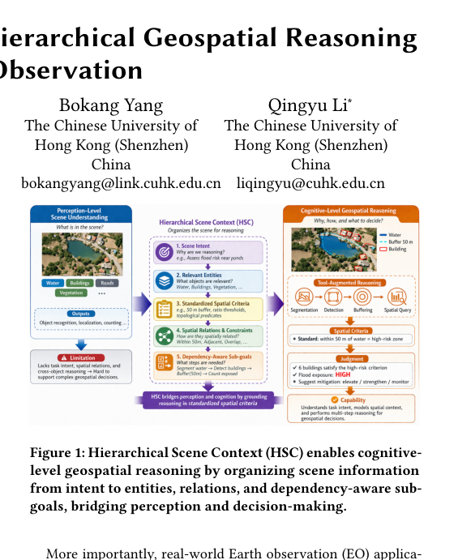
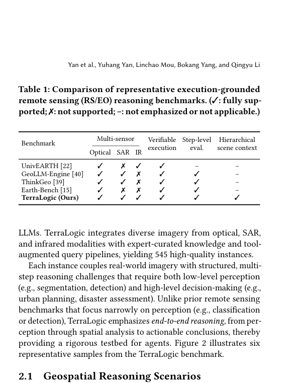
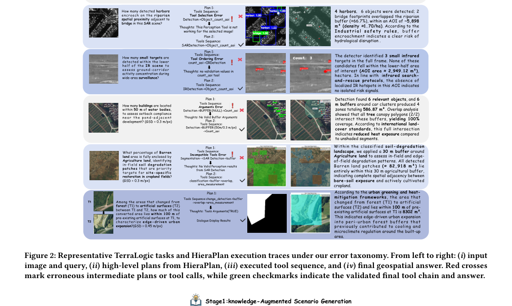
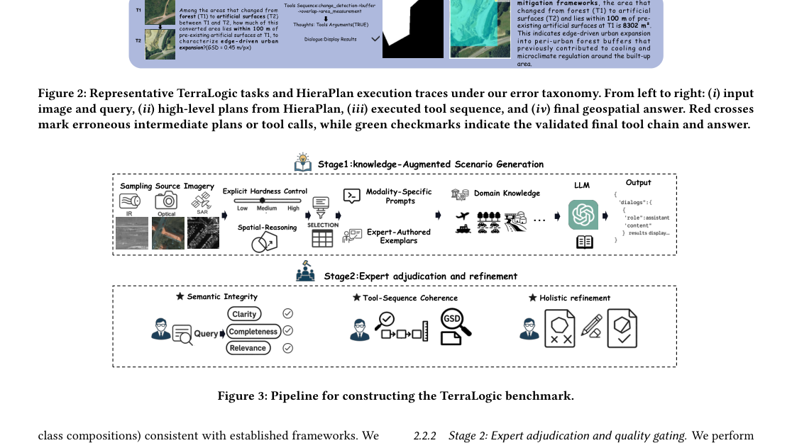
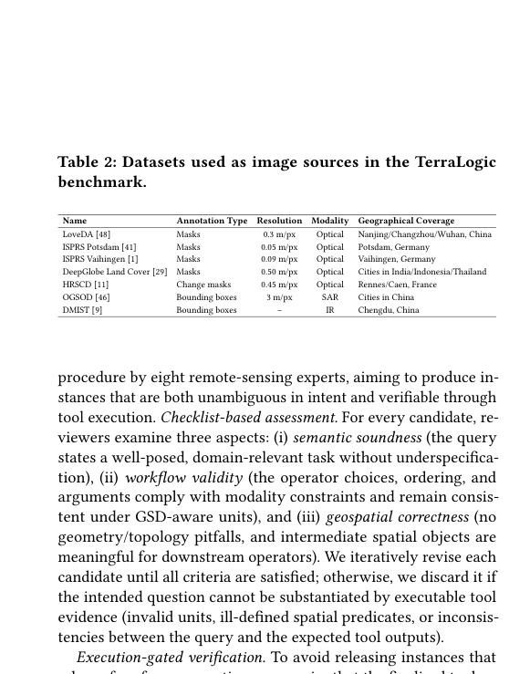
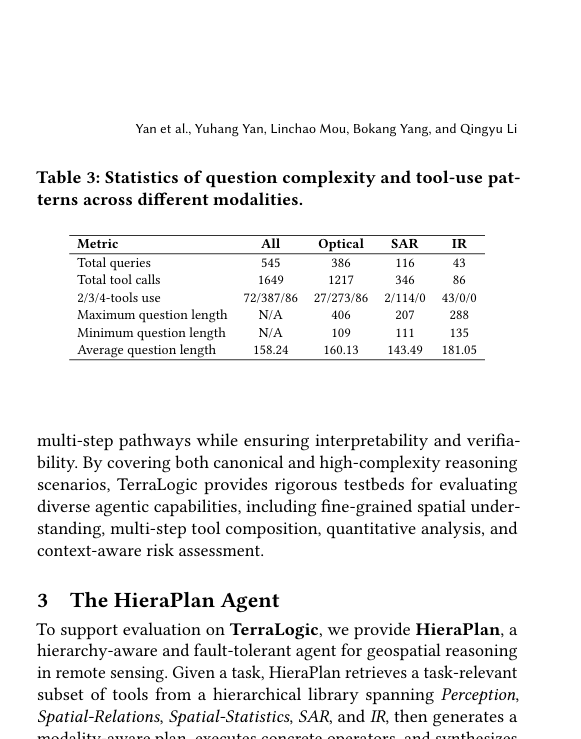
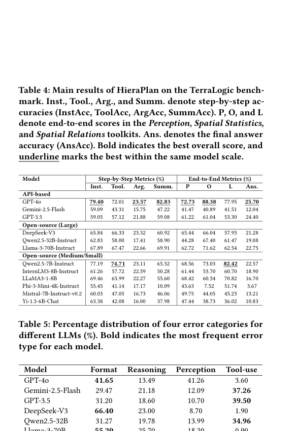
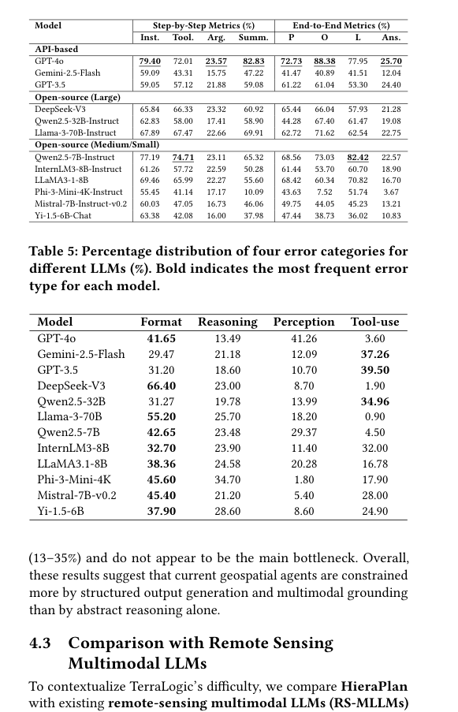

# TerraLogic：面向地球观测分层地理空间推理的评测基准

**原文题目：** TerraLogic: A Benchmark for Hierarchical Geospatial Reasoning in Earth Observation

**原始 PDF：** [原始论文](./原始论文.pdf)（共 8 页）

> **翻译覆盖声明（请先阅读）**：本文件提供**摘要完整中文翻译**及主要研究章节的**中文学术译述**，不等同于逐字逐句的全文译本。为避免遗漏资料，原 PDF 全部页面的英文文字与附录、参考文献均已收录在 `英文原文_逐页.md` 和 `英文全文_保留版面.txt`，图、表另见 `图表索引.md`。不可把本文档当作全部正文及附录均已翻译的材料。

---

## 摘要（完整中文翻译）

在遥感领域，除感知能力外，推理对于高级解译、推断和决策同样至关重要。大语言模型近期的发展使工具增强智能体能够利用外部工具执行复杂分析任务，但现有遥感研究主要关注感知型任务，针对认知层级地理空间推理的研究仍不充分。为填补这一空白，作者提出 TerraLogic 地理空间推理基准。TerraLogic 包含 545 个以真实情景驱动、具备层次结构的任务，例如灾害脆弱性评估、城市热岛分析以及森林破碎化动态分析；任务覆盖光学、合成孔径雷达（SAR）和红外（IR）影像。它将评价目标由识别和监测扩展至认知层面的地理空间分析。为开展该基准上的评测，作者进一步提出工具增强智能体 HieraPlan：将工具组合组织为功能层级，并执行具有故障容忍能力的推理。HieraPlan 支持结构化抽象、工具失败后的稳健恢复和长时程规划。大量实验表明，当前方法在分层地理空间推理上仍存在困难，而 HieraPlan 在推理、跨模态泛化及错误处理方面提供了更强的基线。数据集和智能体代码均已公开。

## 主要研究章节（中文学术译述）

### 从感知到认知推理

单纯回答图像中存在什么地物，通常不足以支撑真实的地理空间决策。例如，要评价建筑物是否满足水体退让距离要求，必须检测相关实体、建立缓冲区、判断拓扑关系并根据空间标准给出结论。任务需要将场景意图、依赖关系和空间约束贯穿整个工具工作流，而不能只累计单步检测结果。

### Benchmark 规模与任务

TerraLogic 共包含 545 个经过审定的任务，覆盖光学、SAR 和红外三种遥感模态。情景包括城市规划、灾害评估、环境监测、交通分析、活动监测、海事监测和工业设施等领域。每项任务将场景意图、可验证空间规则、所需工具过程与决策输出联系起来，以检验认知层面的地理空间推理能力。

### 层次场景语境（HSC）

层次场景语境（Hierarchical Scene Context，HSC）不是简单的线性思维链，而是将任务信息划分为意图、实体、关系及依赖感知子目标。这样的结构可将“为什么分析”“分析哪些空间对象”“实体之间有什么关系”“先后需要完成哪些计算”组织起来。图 1 给出了这一路径。

### 数据构建与专家复核

基准从多类遥感数据集选取图像，并引入领域知识、模态适配提示和显式难度控制形成候选任务。随后通过专家审定和可执行性门控检查进行多轮筛选，关注语义完整性、工具序列一致性以及空间操作合法性，例如地面采样距离（GSD）与缓冲距离单位之间的换算。

### HieraPlan 的作用

HieraPlan 将可用工具组织为功能层级，使智能体能够根据空间情景生成和修订高层计划，再将计划分解为具体工具执行过程。图 2 展示了多种中间错误与修正，包括工具选择错误、调用顺序错误、参数错误及工具不兼容。这些例子说明，正确的最终答复需要能够检测并恢复前序步骤的失败。

### 评测可靠性观察

本文适合用于地学 Benchmark 横向比较中的“空间关系、层次推理、工作流容错”类别。值得审查的评价设计问题包括：缓冲/叠置/拓扑结果是否作为 GT 直接校验；单位换算和 GSD 误差是否计入失败；等价工具路径能否获得相同分数；故障修复轨迹与一次成功轨迹怎样区分。

## 专业术语中英对照

| English | 中文术语 |
|---|---|
| hierarchical geospatial reasoning | 分层地理空间推理 |
| Hierarchical Scene Context | 层次场景语境 |
| dependency-aware sub-goals | 依赖感知子目标 |
| standards-grounded spatial constraints | 以空间标准为依据的约束 |
| topological predicates | 拓扑谓词 |
| fault-tolerant reasoning | 容错推理 |
| ground sampling distance | 地面采样距离 |

## 图表与逐页原文导航

独立裁图共 **10** 张；完整原版页面截图共 **8** 张。

- [全部图表索引](./图表索引.md)
- [逐页原文与对应图表](./逐页原文与配图.md)
- [英文原文逐页](./英文原文_逐页.md)
- [参考文献英文原文](./参考文献_英文原文.md)
- [QA 逐页核查报告](./QA_逐页核查报告.md)

### 代表性原始图表

**图1（第 1 页）**

> Figure 1: Hierarchical Scene Context (HSC) enables cognitive- level geospatial reasoning by organizing scene information from intent to entities, relations, and dependency-aware sub- goals, bridging perception and decision-making.

**表1（第 2 页）**

> Table 1: Comparison of representative execution-grounded remote sensing (RS/EO) reasoning benchmarks. (✓: fully sup- ported; ✗: not supported; –: not emphasized or not applicable.)

**图2（第 3 页）**

> Figure 2: Representative TerraLogic tasks and HieraPlan execution traces under our error taxonomy. From left to right: (i) input image and query, (ii) high-level plans from HieraPlan, (iii) executed tool sequence, and (iv) final geospatial answer. Red crosses mark erroneous intermediate plans or tool calls, while green checkmarks indicate the validated final tool chain and answer.

**图3（第 3 页）**

> Figure 3: Pipeline for constructing the TerraLogic benchmark.

**表2（第 4 页）**

> Table 2: Datasets used as image sources in the TerraLogic benchmark.

**表3（第 4 页）**

> Table 3: Statistics of question complexity and tool-use pat- terns across different modalities.

**表4（第 5 页）**

> Table 4: Main results of HieraPlan on the TerraLogic bench- mark. Inst., Tool., Arg., and Summ. denote step-by-step ac- curacies (InstAcc, ToolAcc, ArgAcc, SummAcc). P, O, and L denote end-to-end scores in the Perception, Spatial Statistics, and Spatial Relations toolkits. Ans. denotes the final answer accuracy (AnsAcc). Bold indicates the best overall score, and

**表5（第 5 页）**

> Table 5: Percentage distribution of four error categories for different LLMs (%). Bold indicates the most frequent error type for each model.
