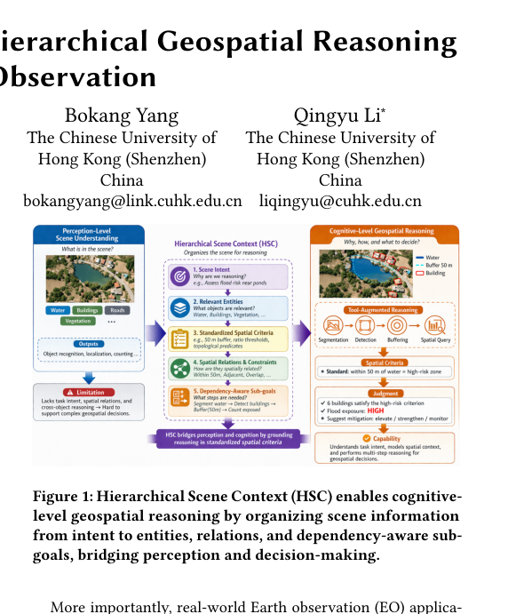
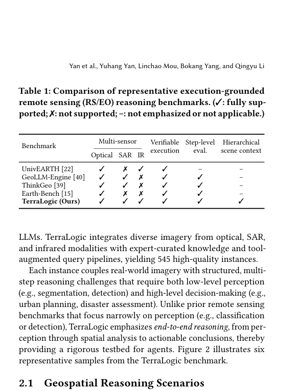
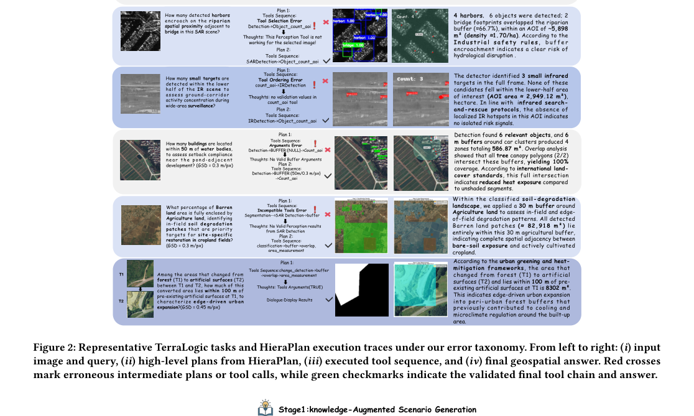
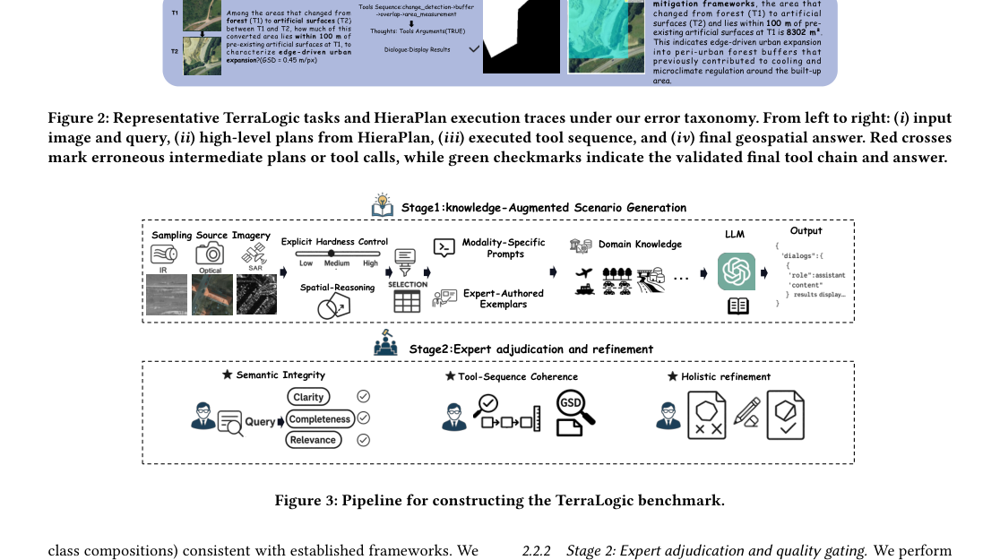
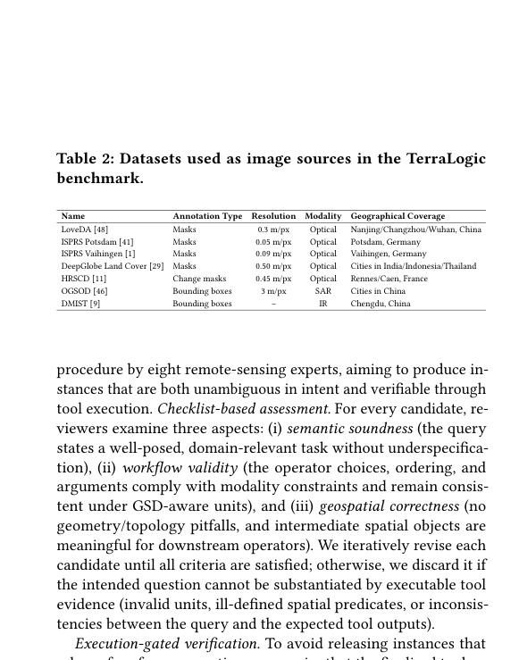
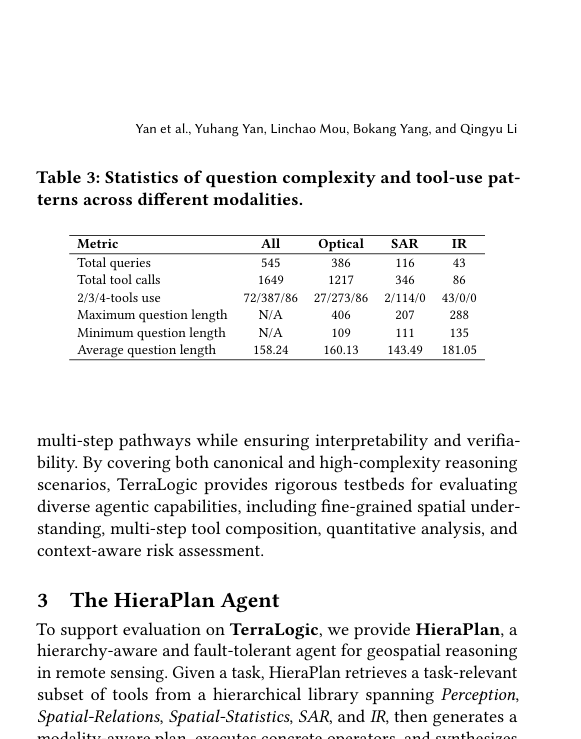
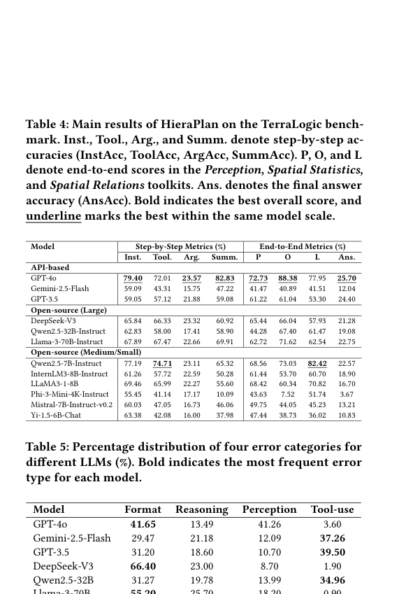
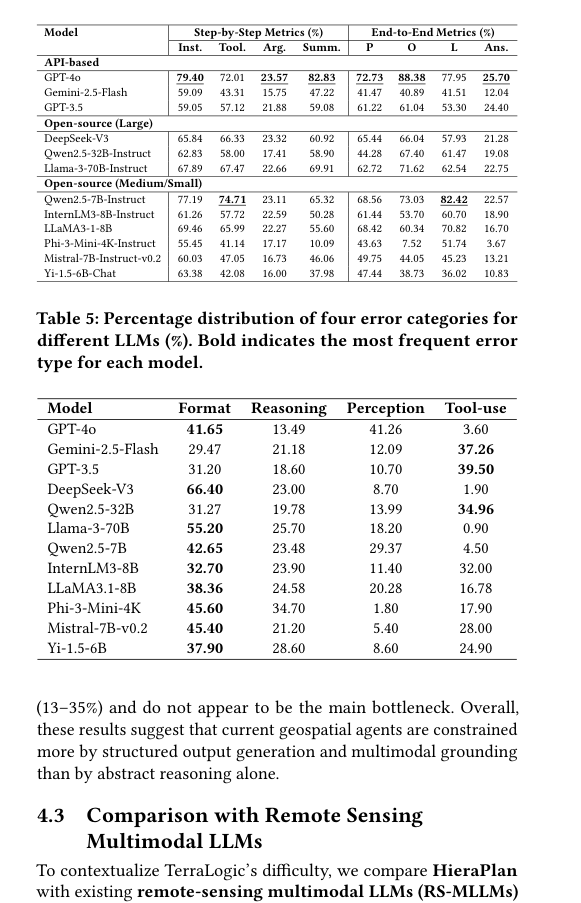
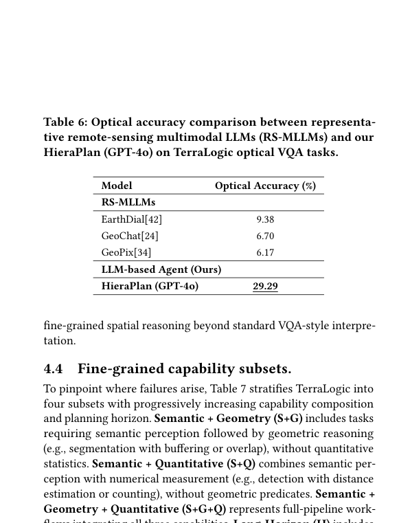
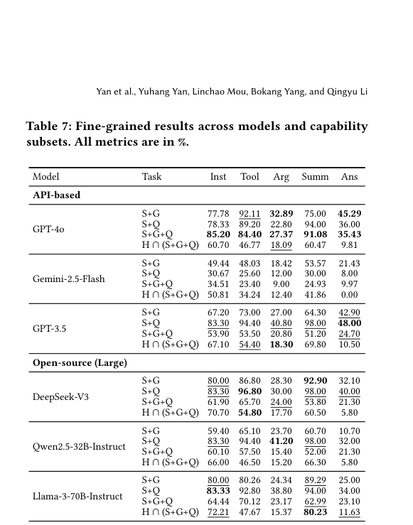

# 图表索引

来源：**TerraLogic: A Benchmark for Hierarchical Geospatial Reasoning in Earth Observation**，共 8 页。按原 PDF 页码列出图表；截图保留原版文字。

## 图1 — 原文第 1 页

**Caption（原文）：** Figure 1: Hierarchical Scene Context (HSC) enables cognitive- level geospatial reasoning by organizing scene information from intent to entities, relations, and dependency-aware sub- goals, bridging perception and decision-making.

[查看完整第 1 页](./source_pages/page-001.jpg)

## 表1 — 原文第 2 页

**Caption（原文）：** Table 1: Comparison of representative execution-grounded remote sensing (RS/EO) reasoning benchmarks. (✓: fully sup- ported; ✗: not supported; –: not emphasized or not applicable.)

[查看完整第 2 页](./source_pages/page-002.jpg)

## 图2 — 原文第 3 页

**Caption（原文）：** Figure 2: Representative TerraLogic tasks and HieraPlan execution traces under our error taxonomy. From left to right: (i) input image and query, (ii) high-level plans from HieraPlan, (iii) executed tool sequence, and (iv) final geospatial answer. Red crosses mark erroneous intermediate plans or tool calls, while green checkmarks indicate the validated final tool chain and answer.

[查看完整第 3 页](./source_pages/page-003.jpg)

## 图3 — 原文第 3 页

**Caption（原文）：** Figure 3: Pipeline for constructing the TerraLogic benchmark.

[查看完整第 3 页](./source_pages/page-003.jpg)

## 表2 — 原文第 4 页

**Caption（原文）：** Table 2: Datasets used as image sources in the TerraLogic benchmark.

[查看完整第 4 页](./source_pages/page-004.jpg)

## 表3 — 原文第 4 页

**Caption（原文）：** Table 3: Statistics of question complexity and tool-use pat- terns across different modalities.

[查看完整第 4 页](./source_pages/page-004.jpg)

## 表4 — 原文第 5 页

**Caption（原文）：** Table 4: Main results of HieraPlan on the TerraLogic bench- mark. Inst., Tool., Arg., and Summ. denote step-by-step ac- curacies (InstAcc, ToolAcc, ArgAcc, SummAcc). P, O, and L denote end-to-end scores in the Perception, Spatial Statistics, and Spatial Relations toolkits. Ans. denotes the final answer accuracy (AnsAcc). Bold indicates the best overall score, and

[查看完整第 5 页](./source_pages/page-005.jpg)

## 表5 — 原文第 5 页

**Caption（原文）：** Table 5: Percentage distribution of four error categories for different LLMs (%). Bold indicates the most frequent error type for each model.

[查看完整第 5 页](./source_pages/page-005.jpg)

## 表6 — 原文第 6 页

**Caption（原文）：** Table 6: Optical accuracy comparison between representa- tive remote-sensing multimodal LLMs (RS-MLLMs) and our HieraPlan (GPT-4o) on TerraLogic optical VQA tasks.

[查看完整第 6 页](./source_pages/page-006.jpg)

## 表7 — 原文第 6 页

**Caption（原文）：** Table 7: Fine-grained results across models and capability subsets. All metrics are in %.

[查看完整第 6 页](./source_pages/page-006.jpg)
