# ThinkGeo：面向遥感任务的工具增强智能体评估

> 原题：*ThinkGeo: Evaluating Tool-Augmented Agents for Remote Sensing Tasks*  
> 作者：Akashah Shabbir、Muhammad Akhtar Munir、Akshay Dudhane、Muhammad Umer Sheikh、Muhammad Haris Khan、Paolo Fraccaro、Juan Bernabe Moreno、Fahad Shahbaz Khan、Salman Khan。  
> 原稿：arXiv:2505.23752v3，标注日期 2026-04-02，共 14 页（其中补充材料 4 页）。  
> **翻译范围说明**：下文完整覆盖研究问题、方法、数据、指标、结果、结论和补充材料的关键说明；为保证工具调用示例可复现，原始 JSON、命令、参考文献条目及部分图内英文保留在原稿/英文提取文件中。个别段落为忠实合并译述，不能等同于全部英文逐句对译。

## 摘要（中文翻译）

近年来，大语言模型（Large Language Models，LLMs）的进步使工具增强智能体能够通过逐步推理解决复杂的现实任务。然而，现有评估主要围绕通用任务或多模态场景，缺少能够评测复杂遥感应用中工具使用能力的领域专用基准。本文提出 **ThinkGeo**，这是一个面向遥感任务、通过结构化工具使用和多步骤规划评估大语言模型驱动智能体的基准。该基准受到工具交互范式启发，收录了经人工整理的真实应用查询，覆盖城市规划、灾害评估与变化分析、环境监测、交通分析、航空监测、休闲基础设施和工业场地分析等场景。任务以卫星或航空影像为依据，既涉及光学 RGB 数据，也包含合成孔径雷达（SAR）影像，并要求智能体在多种工具之间进行推理与协调。研究实现了 ReAct 风格的交互循环，在 **486 项结构化智能体任务、1,778 个专家核验的推理步骤**上评估开源和闭源模型，包括 GPT-4o、Qwen2.5 等。该基准同时报告逐步执行指标与最终答案正确性。分析揭示了不同模型在工具准确性和规划一致性方面的显著差异。ThinkGeo 为研究具备工具使用能力的大语言模型智能体如何在遥感情境下完成空间推理，提供了一个系统性试验平台。

## 1. 引言

近期 LLM 的发展催生了工具增强智能体：它们可以把复杂任务分解为逐步执行的计划，调用视觉模型、计算器、代码解释器等外部工具，并根据中间状态继续推理。ReAct 式框架让模型在“思考—行动—观察”间交替，推动了这一范式的发展。ToolBench、GAIA、GTA 等基准已经能测量通用任务中的过程正确性、工具使用和最终结果，但它们大多基于合成、开放域或网络信息，无法充分覆盖对空间精度要求很高的遥感应用。

遥感广泛服务于环境监测、城市与交通基础设施分析、灾害响应和土地利用制图。尽管目标检测、图像分割和变化检测等视觉模型取得进展，实际处理流程依然高度依赖人工搭建，并涉及大地测量元数据、地面采样距离（GSD）、时间变化以及带单位的计算。这些特征要求 Agent 不能仅“看懂图像”，还要可靠地组合工具并进行定量空间推理。

ThinkGeo 因此以真实卫星和航空影像为基础，构建不预先告诉模型调用步骤与工具名称的任务。每个查询都连接着可执行工具环境与结构化评估信号，使研究者能够分别分析感知、规划、工具调用和空间推理中的错误。

本文贡献如下。

- **任务与数据集**：486 个任务、1,778 个经专家验证的推理步骤；光学 RGB 数据对应 **436 项任务**，SAR 数据对应 **50 项任务**，涵盖多种遥感应用。
- **可执行工具集**：提供 14 种工具，涵盖目标检测、像素分割、变化检测等感知模块，计算器、求解器等逻辑工具，以及绘制方框、添加文字等可视化操作。
- **评估协议**：设计逐步评估和端到端评估两种模式，衡量遵循指令、选择工具、参数格式、多步骤推理与最终答案正确性。
- **基准实验**：比较 GPT-4o、Claude、Qwen、LLaMA 等模型，揭示当前多模态工具推理和执行轨迹对齐仍存在明显局限。

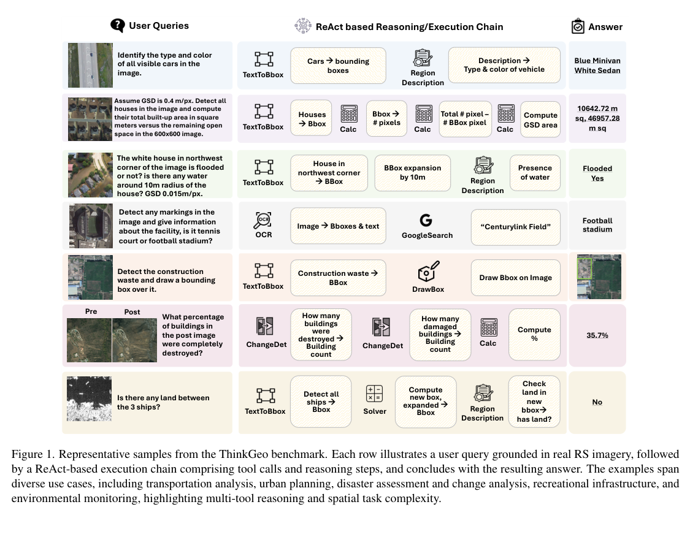

**图 1（译）**：每一行依次给出用户查询、基于真实遥感影像的多工具推理与执行链，以及最终答案。示例覆盖车辆类别与颜色识别、建筑面积计算、受灾房屋周边水体判断、球场识别、施工废弃物定位、灾害前后变化分析及船舶间地物判断等任务。

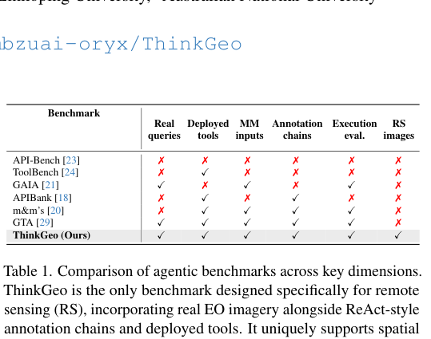

**表 1（译）**：将 ThinkGeo 与 API-Bench、ToolBench、GAIA、API-Bank、m&m’s 和 GTA 比较，维度包括真实查询、已部署工具、多模态输入、标注执行链、执行层评估以及遥感图像。作者认为 ThinkGeo 在所比较基准中同时覆盖全部维度。

## 2. 相关研究

### 2.1 工具增强 LLM 智能体及其基准

将 LLM 与可执行工具结合已经成为智能体研究的中心主题。早期方法以交替规划和执行的方式使用工具；ReAct 通过交错生成自然语言“思考”和结构化工具调用，让同一模型同时完成推理和行动。HuggingGPT 进一步以 GPT 控制器选用数百种视觉、语音及语言模型；Visual ChatGPT 与 MM-ReAct 将这一思想应用于多模态感知。

在评测方面，ToolBench、APIBench、API-Bank 主要从合成提示中的 API 调用入手；m&m’s 扩展到多步骤多模态任务；GAIA 与 GTA 使用人工编写、未明确提供工具步骤的任务和可执行工具链，揭示了智能体在真实执行检查下的能力差距。MLGym 则通过 Gym 风格环境将模型评估推广到长期 AI 研究工作流。这些基准仍未充分涵盖地理空间影像所要求的空间精度与单位计算。

### 2.2 遥感智能体

Remote Sensing ChatGPT 和 RS-Agent 利用 GPT 规划器连接预训练检测器、分割器及地理空间工具，但通常只报告最终答案正确性，缺少正式的 ReAct 轨迹评估及逐步错误归因。TreeGPT、GeoMap-Agent 分别探索林业与地质制图任务，但仍偏向模板或定性输出。UnivEARTH 要求 LLM 生成 Google Earth Engine 代码，作者引用的既有研究表明其可执行性和最终正确率仍面临挑战。

总体而言，现有遥感智能体不仅会在工具选择上失败，还会出现参数与地理对象不一致、空间单位推理错误等问题。因此，评测应同时观察工具层面的执行正确性和地理空间任务最终结果。

### 2.3 评价协议

传统工具基准主要评估孤立或单步骤 API 调用，不能有效覆盖多工具规划和中间状态。GTA 将感知、逻辑、操作、生成模块纳入连续执行流程，采用 ToolAcc、ArgAcc、StepAcc 等细粒度指标。MLGym 研究训练、评估和报告等长期工作流程中的记忆与适应。ThinkGeo 在此基础上加入真实遥感影像和空间计算要求。

## 3. ThinkGeo 基准

该基准面向光学遥感场景中需要空间定位、多步工具规划和地理一致输出的问题，并辅以 SAR 扩展实验。

### 3.1 设计目标

**地理空间推理**：任务参照环境监测和灾害响应等现实场景，涉及米级距离、指定缓冲区内的目标数量、受损建筑特征等。所需能力包括精细空间定位、带单位的数值推理与视觉属性对应。

**隐式步骤与隐式工具**：与提示中明示工具名称的基准不同，ThinkGeo 的自然语言查询不告诉智能体应调用哪种工具，也不列出执行步骤。模型必须自行判断需要感知、逻辑还是操作模块，以及各模块的调用顺序。

### 3.2 任务类别

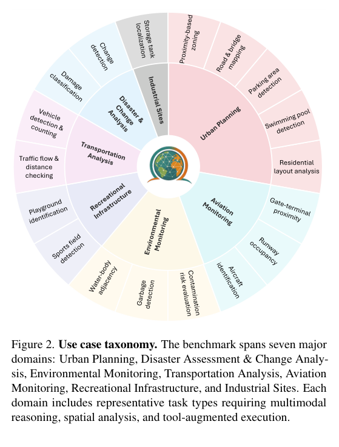

**图 2（译）**：任务涵盖七个领域。城市规划涉及住宅布局、泳池与停车场检测、道路桥梁制图、可达性和邻近关系；灾害评估与变化分析涉及洪水、飓风、野火与火山事件的多时相变化、损毁分级与面积统计；环境监测包括水体邻近分析、垃圾与建筑废弃物、污染风险、农业用地影响；交通分析包含车辆检测计数、方向识别、流量与距离安全检查；航空监测涉及飞机分类、跑道占用、登机口与航站楼邻近分析；休闲基础设施涉及球类场地检测、方向和覆盖范围；工业场地分析涉及储罐定位、直径与面积测量，以及周边作业区空间关系。

这些类别既包括典型遥感任务，也包括现有基准较少关注的综合空间分析，可评估多模态推理、精细空间理解、工具组合及时间变化检测。

### 3.3 查询构建流程

研究把“复杂查询”定义为对人类简短自然、但必须调用多个工具并经过多步推理才可解答的提示。构建流程采用半自动化方式：

1. **样本选择与指南制定**：从多种遥感数据集中筛选高质量图像，由领域专家编写情景专用指南和参考查询。
2. **编制 ReAct 轨迹**：人工检查图像、识别对象与空间关系，写出隐含多步骤规划的自然语言查询，补充缺失标注，并形成包含思考、工具调用、观察、答案的半结构化对话。OpenAI GPT API 脚本结合图像元数据（例如类别、GSD、边界框）和工具定义辅助生成。
3. **双重验证**：领域专家检查查询的语义正确性、关联性及与工具集的匹配程度；脚本检查工具参数一致性、对话结构完整性。发现错误后进行人工修订。

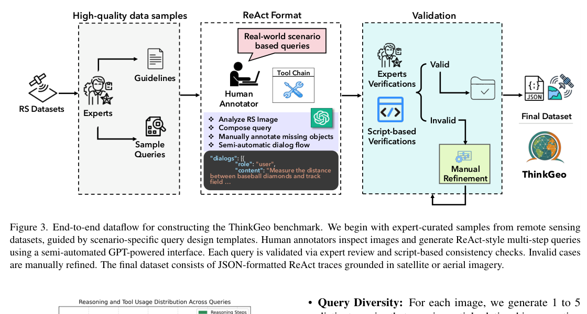

**图 3（译）**：从遥感样本与专家规范出发，经过人工分析、GPT 辅助构建 ReAct 执行链、专家验证和脚本验证，最终形成 JSON 格式数据。

作者还对每幅影像生成 1–5 个相互区别的问题，变化维度包括空间关系、计数逻辑或时间比较，以增加组合多样性。难度分为简单与困难两级，参考复杂关键词（如“估计”“比较”“面积”“方向”“邻近”等）数量与推理步数：词汇与推理步骤较少的任务被划入简单类，其他任务划入困难类。提示词避免泄露具体 API 字段名，以贴近真实用户输入。

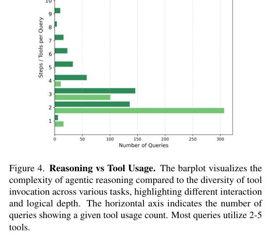

**图 4（译）**：横轴为某一工具数量下的问题数，纵轴表示工具调用/推理步骤数量。多数任务调用 2–5 个工具。

### 3.4 遥感影像数据来源

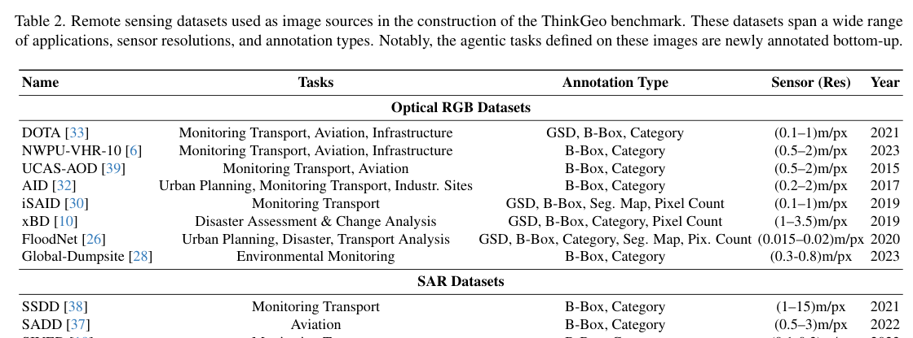

**表 2（译）**：光学数据来自 DOTA、NWPU-VHR-10、UCAS-AOD、AID、iSAID、xBD、FloodNet 和 Global-Dumpsite；SAR 数据来自 SSDD、SADD 和 SIVED。它们覆盖交通、航空、城市规划、工业、灾害和环境监测等领域，提供 GSD、边界框、类别、分割图及像素统计等不同标注信息。研究复用原始影像，并对缺少的任务级标签追加人工标注。

## 4. 工具集与评估

### 4.1 任务格式

每个样本是一个不显式给出步骤和工具的查询。智能体按 ReAct 格式生成思考步骤、选择预定义工具、格式化调用参数，并给出最终答案。因此，基准同时考察空间推理、规划以及以遥感影像为依据的多步骤执行能力。

### 4.2 工具类别

ThinkGeo 扩展 AgentLego 框架，新增用于多时相遥感分析的 `ChangeDetection` 和用于分割、像素计数的 `SegmentObjectPixels`。**14 个工具**按职责划分：

- **感知（Perception）**：例如 `TextToBbox`、`ChangeDetection`，负责目标定位及视觉信息提取。
- **逻辑（Logic）**：例如 `Calculator`、`Solver`，负责数值运算、距离计算与空间关系判断。
- **操作（Operation）**：例如 `DrawBox`、`GoogleSearch`，负责图像标注、信息查询与输出整理。

这种划分可用于区分模型在感知、逻辑和操作工具上的能力，同时分析不同类型的规划错误。

### 4.3 评价方法

研究借用 GTA 的逐步评估体系，包含 `InstAcc`（指令遵循正确率）、`ToolAcc`（工具选择正确率）、`ArgAcc`（工具参数正确率）和 `SummAcc`（总结生成正确率）。端到端评估另外区分感知、操作与逻辑工具表现，以及最终答案准确性、以图像为依据的答案准确性（`Ans_I`）。

GTA 原有的最终答案评价依靠确定性的字符串匹配，可能把表达方式不同但语义等价的回答误判为错误。本文为每个查询设计评价问题，并使用 `GPT-4o-mini` 作为 LLM-as-a-Judge 判断预测答案是否正确，尤其用于包含多项事实的答案。需要注意，这属于作者的评估方案，论文并未据此证明评价器绝对无误。

## 5. 实验与讨论

### 5.1 定量实验

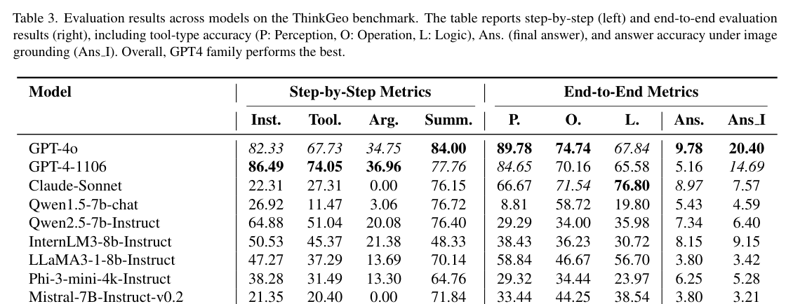

**表 3（译）**：左侧列为 Inst.、Tool.、Arg.、Summ.；右侧为感知（P）、操作（O）、逻辑（L）、最终答案（Ans.）和图像支撑的答案（Ans_I）。主论文所有比较使用光学 RGB 影像；SAR 结果置于附录。

实验评估 GPT-4o、GPT-4-1106、Claude-Sonnet，以及 Qwen、InternLM、LLaMA3、Phi、Mistral、Yi 等模型。在逐步指标中，GPT-4-1106 的指令遵循、工具选择和参数准确率分别为 **86.49、74.05、36.96**；GPT-4o 分别为 **82.33、67.73、34.75**。在端到端指标中，GPT-4o 的感知工具正确率为 **89.78**、操作工具 **74.74**、逻辑工具 **67.84**，最终答案值为 **9.78**，图像依据答案值为 **20.40**（按原表照录）。总体上，作者认为 GPT-4 系列在工具链规划与执行中表现更强，但最终答案质量仍有明显提升空间。

### 5.2 逐步指标与最终正确率的关系

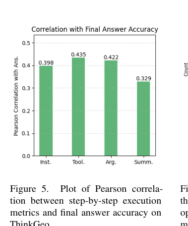

**图 5（译）**：指令遵循、工具选择、参数正确与总结生成指标同最终答案准确率的 Pearson 相关系数分别约为 **0.398、0.435、0.422、0.329**。其中工具选择与最终正确率的相关性最高，显示调用合适工具是影响任务成功的重要环节。

### 5.3 工具调用错误

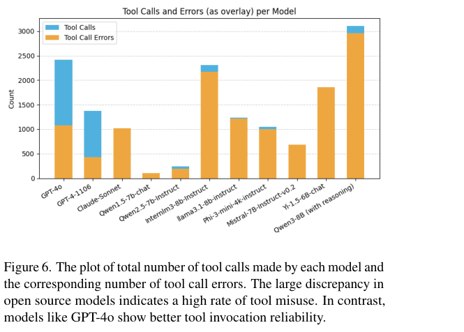

**图 6（译）**：GPT-4o 与 GPT-4-1106 较频繁地调用工具，但相对较低的错误率分别为 **44.46%** 和 **30.86%**。部分开源模型尽管调用次数很多，却出现了更多不合法或不恰当的工具调用；一些小模型的调用次数少，但仍可能由于参数格式、上下文对齐等问题失败。工具可访问性并不等于可靠工具使用能力。

### 5.4 典型失败模式

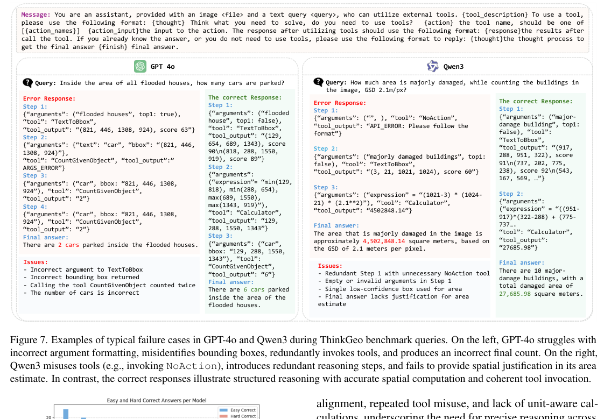

**图 7（译）**：一个问题要求计算所有被淹房屋区域内停车数量；GPT-4o 未正确设置 `TextToBbox` 参数、选取错误边界框，并重复调用计数工具，错误地答为 **2 辆**，参考流程给出 **6 辆**。另一个问题要求根据 **2.1 m/px** 的 GSD 计算严重损毁建筑面积；Qwen3 出现不必要的 `NoAction`、低质量边界框及缺乏空间解释等问题，报告约 **4,502,848.14 m²**，而论文示例参考答案为 **10 栋、27,685.98 m²**。这说明边界框对应错误和单位敏感计算失败会沿工具链传播。

### 5.5 简单任务与困难任务

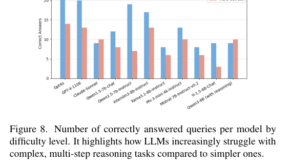

**图 8（译）**：按第 3.3 节的难度划分，模型在困难任务上的表现整体弱于简单任务，反映复杂、多步骤遥感推理仍是一大挑战。

## 6. 结论

ThinkGeo 以真实、高分辨率地球观测影像、结构化工具链和细粒度推理标注，评估工具增强 LLM 智能体处理遥感问题的能力。486 项任务的实验表明，即使拥有目标分割、变化检测等工具，智能体仍会因空间规划、时间一致性、参数格式、工具选择和领域知识不足而发生错误。该基准可帮助识别工具增强遥感智能体的具体瓶颈，并推动面向真实空间分析任务的可靠 Agent 研究。

## 补充材料（按原文 S1–S7 顺序整理）

### S1. SAR 数据评估

作者另外收集 **50 个基于 SAR 影像的查询、244 个工具推理步骤**，采用与 RGB 部分相同的生成和验证流程。GPT-4 系列在指令理解及工具使用方面仍保持优势，但所有模型最终答案正确率均较低（作者指出低于 6%）。这表明即便工具调用较熟练，仍不足以保证非光学影像的视觉依据与空间理解准确。

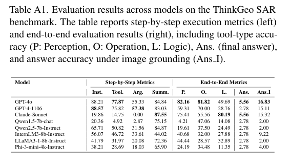

### S2. 错误分析

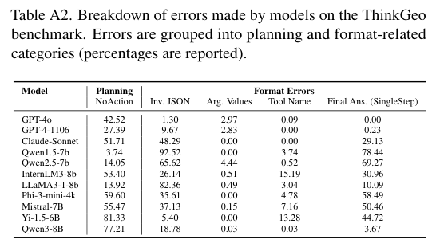

**表 A2（译）**：将错误划分为规划层面（如 `NoAction`）与格式层面（无效 JSON、参数取值、工具名称、单步提前给出最终答案）。例如，Phi-3-mini 与 Mistral 的 `NoAction` 相关错误比例达到 **59.60%** 和 **55.47%**；LLaMA3-1-8b 与 Qwen1.5-7b 在无效 JSON 类别分别达到 **82.36%**、**92.52%**。Qwen1.5-7b、Qwen2.5-7b、Phi-3-mini 还经常跳过中间步骤、直接给出最终答案。不同模型的主要失败机制并不一致：有些无法规划，有些会规划却不能正确格式化工具参数。

### S3. 更多案例

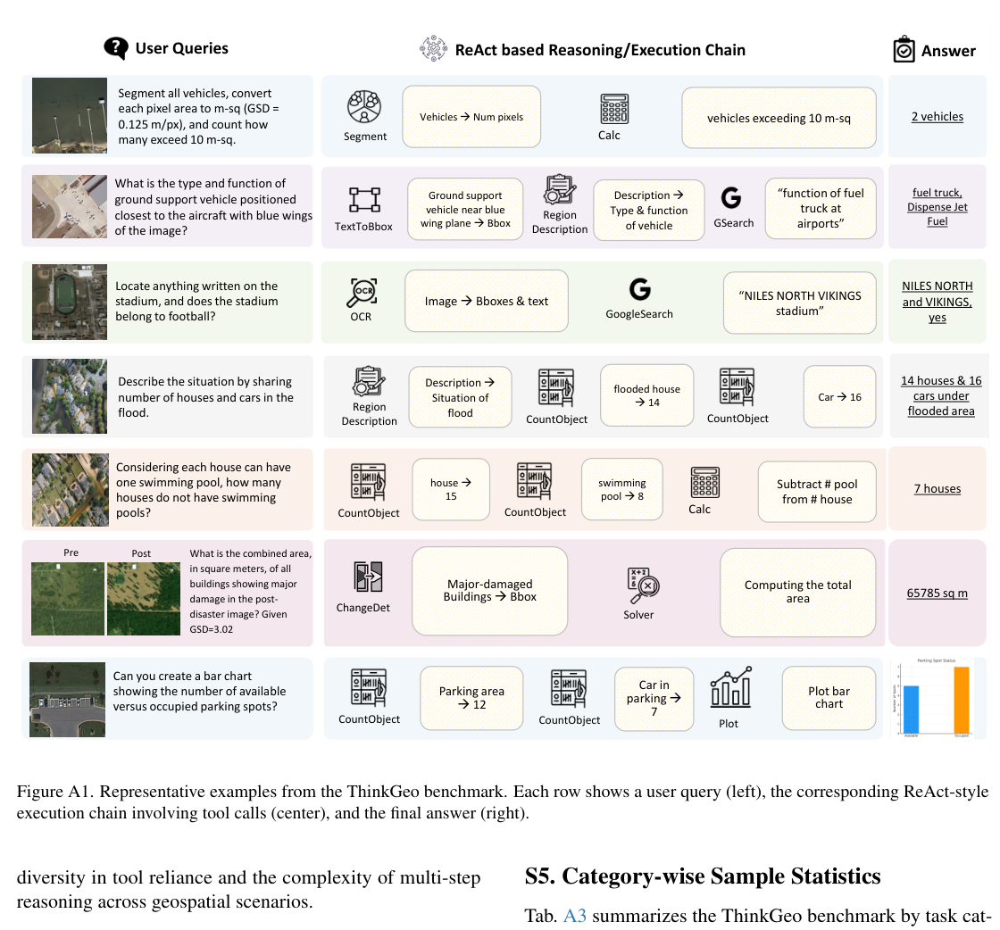

**图 A1（译）**：补充示例说明智能体如何组合分割、OCR、计数、搜索、绘图和面积计算工具，解决车辆面积、球场文字识别、洪水区建筑与汽车数量、泳池覆盖、重大损毁面积及机场地勤车辆判断等问题。

### S4. 工具调用频次

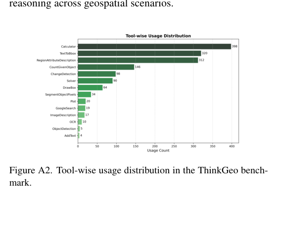

**图 A2（译）**：最常见的工具为 `Calculator`、`TextToBbox` 和 `RegionAttributeDescription`，符合基准强调空间计算、目标定位和属性推理的设计。`CountGivenObject` 和 `ChangeDetection` 调用频次居中，而 `AddText`、`ObjectDetection`、`OCR` 等相对较少。

### S5. 按任务类别与难度的样本统计

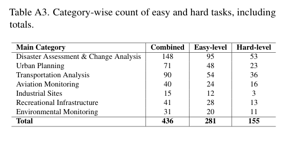

**表 A3（译）**：RGB 任务 **436** 个，其中简单 **281** 个、困难 **155** 个。分类统计为灾害评估与变化分析 148、城市规划 71、交通分析 90、航空监测 40、工业场地 15、休闲基础设施 41、环境监测 31。此处 436 仅统计 RGB，另有 SAR 50 项构成全部 486 项任务。

### S6. 人工标注工作量

标注总投入约 **500 人时**，由四人团队完成：样本筛选和查询草拟 **100 小时**；检查图像、编写查询、补充边界框与计数并利用 `o4-mini` 形成 ReAct 轨迹 **280 小时**；人工与脚本验证、修正、定稿 **120 小时**。这表明该基准虽使用半自动生成，仍投入相当规模的人工核查。

### S7. 运行时间分析

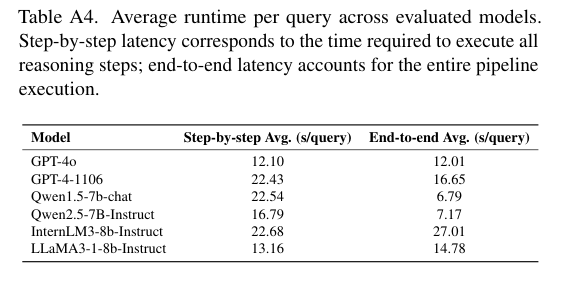

**表 A4（译）**：GPT-4o 平均为 12.10 秒/任务（逐步）和 12.01 秒/任务（端到端），GPT-4-1106 为 22.43 和 16.65 秒；InternLM3-8B 分别为 22.68 和 27.01 秒。部分模型在逐步模式中每执行一步就重新编码累计历史，随着上下文增长导致耗时上升；端到端生成较短轨迹时反而可能更快。减少延迟仍是遥感 Agent 实时部署的开放问题。

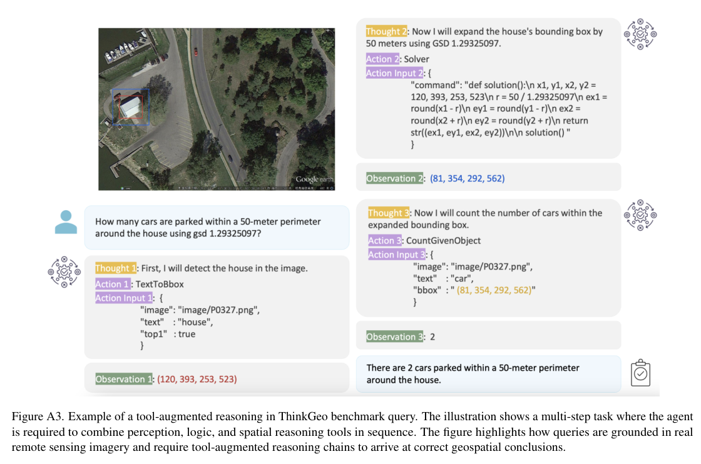

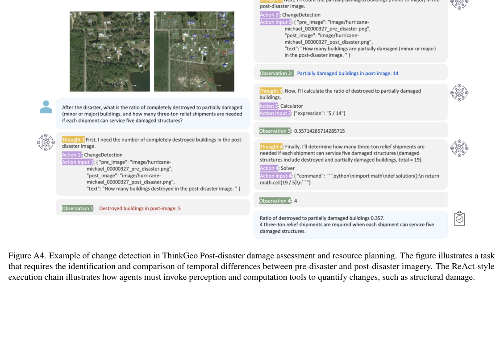

## 关于参考文献、完整原稿与代码实例

所有英文参考文献条目见同级 `参考文献_原文.md`，逐页完整文字见 `英文原文_逐页.md`，逐页原稿图见 `source_pages/`。原始调用示例中的 `role`、`thought`、`action`、`action_input`、`response`、JSON 参数和工具名称没有翻译替换；它们可在第 8 页原稿和补充材料的原始截图与逐页提取中核对。

## 术语对照

| English | 中文 |
|---|---|
| tool-augmented agent | 工具增强智能体 |
| remote sensing (RS) | 遥感 |
| earth observation (EO) | 地球观测 |
| ground sampling distance (GSD) | 地面采样距离 |
| visual grounding | 视觉依据定位／视觉锚定 |
| step-implicit / tool-implicit | 隐式步骤／隐式工具 |
| execution trace | 执行轨迹 |
| perception / operation / logic | 感知／操作／逻辑 |
| InstAcc / ToolAcc / ArgAcc / SummAcc | 指令遵循／工具选择／参数／总结正确率 |
| end-to-end evaluation | 端到端评估 |
| LLM-as-a-Judge | 以大语言模型充当评价器 |
| bounding box | 边界框／目标包围框 |
| synthetic aperture radar (SAR) | 合成孔径雷达 |
