# ThinkGeo｜英文完整原文（按 PDF 页码提取）

> 原文保持作者原有拼写、数字、引用和命令。依据 PDF 的文本层提取；图内嵌字和特殊字体编码可能无法通过文本层准确识别，请使用 `source_pages/` 中的原始页截图核对。

## 原稿第 1 / 14 页

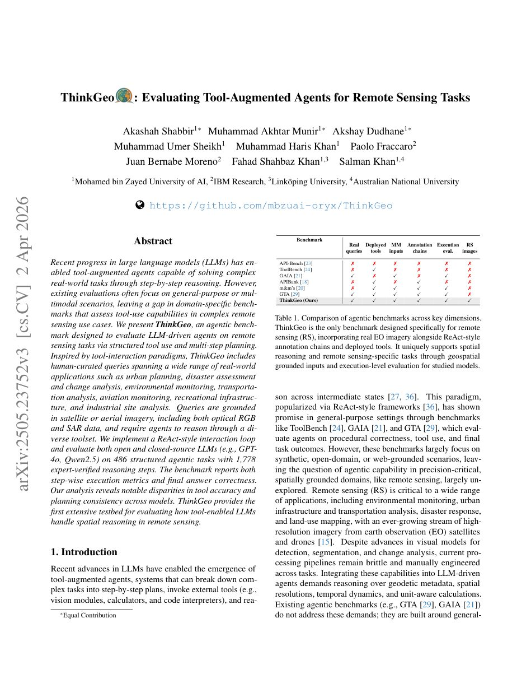

~~~~~text
ThinkGeo
: Evaluating Tool-Augmented Agents for Remote Sensing Tasks
Akashah Shabbir1* Muhammad Akhtar Munir1* Akshay Dudhane1*
Muhammad Umer Sheikh1
Muhammad Haris Khan1
Paolo Fraccaro2
Juan Bernabe Moreno2
Fahad Shahbaz Khan1,3
Salman Khan1,4
1Mohamed bin Zayed University of AI, 2IBM Research, 3Link¨oping University, 4Australian National University
Πhttps://github.com/mbzuai-oryx/ThinkGeo
Abstract
Recent progress in large language models (LLMs) has en-
abled tool-augmented agents capable of solving complex
real-world tasks through step-by-step reasoning. However,
existing evaluations often focus on general-purpose or mul-
timodal scenarios, leaving a gap in domain-specific bench-
marks that assess tool-use capabilities in complex remote
sensing use cases. We present ThinkGeo, an agentic bench-
mark designed to evaluate LLM-driven agents on remote
sensing tasks via structured tool use and multi-step planning.
Inspired by tool-interaction paradigms, ThinkGeo includes
human-curated queries spanning a wide range of real-world
applications such as urban planning, disaster assessment
and change analysis, environmental monitoring, transporta-
tion analysis, aviation monitoring, recreational infrastruc-
ture, and industrial site analysis. Queries are grounded
in satellite or aerial imagery, including both optical RGB
and SAR data, and require agents to reason through a di-
verse toolset. We implement a ReAct-style interaction loop
and evaluate both open and closed-source LLMs (e.g., GPT-
4o, Qwen2.5) on 486 structured agentic tasks with 1,778
expert-verified reasoning steps. The benchmark reports both
step-wise execution metrics and final answer correctness.
Our analysis reveals notable disparities in tool accuracy and
planning consistency across models. ThinkGeo provides the
first extensive testbed for evaluating how tool-enabled LLMs
handle spatial reasoning in remote sensing.
1. Introduction
Recent advances in LLMs have enabled the emergence of
tool-augmented agents, systems that can break down com-
plex tasks into step-by-step plans, invoke external tools (e.g.,
vision modules, calculators, and code interpreters), and rea-
*Equal Contribution
Benchmark
Real
queries
Deployed
tools
MM
inputs
Annotation
chains
Execution
eval.
RS
images
API-Bench [23]
✗
✗
✗
✗
✗
✗
ToolBench [24]
✗
✓
✗
✗
✗
✗
GAIA [21]
✓
✗
✓
✗
✓
✗
APIBank [18]
✗
✓
✗
✓
✗
✗
m&m’s [20]
✗
✓
✓
✓
✓
✗
GTA [29]
✓
✓
✓
✓
✓
✗
ThinkGeo (Ours)
✓
✓
✓
✓
✓
✓
Table 1. Comparison of agentic benchmarks across key dimensions.
ThinkGeo is the only benchmark designed specifically for remote
sensing (RS), incorporating real EO imagery alongside ReAct-style
annotation chains and deployed tools. It uniquely supports spatial
reasoning and remote sensing-specific tasks through geospatial
grounded inputs and execution-level evaluation for studied models.
son across intermediate states [27, 36].
This paradigm,
popularized via ReAct-style frameworks [36], has shown
promise in general-purpose settings through benchmarks
like ToolBench [24], GAIA [21], and GTA [29], which eval-
uate agents on procedural correctness, tool use, and final
task outcomes. However, these benchmarks largely focus on
synthetic, open-domain, or web-grounded scenarios, leav-
ing the question of agentic capability in precision-critical,
spatially grounded domains, like remote sensing, largely un-
explored. Remote sensing (RS) is critical to a wide range
of applications, including environmental monitoring, urban
infrastructure and transportation analysis, disaster response,
and land-use mapping, with an ever-growing stream of high-
resolution imagery from earth observation (EO) satellites
and drones [15]. Despite advances in visual models for
detection, segmentation, and change analysis, current pro-
cessing pipelines remain brittle and manually engineered
across tasks. Integrating these capabilities into LLM-driven
agents demands reasoning over geodetic metadata, spatial
resolutions, temporal dynamics, and unit-aware calculations.
Existing agentic benchmarks (e.g., GTA [29], GAIA [21])
do not address these demands; they are built around general-
arXiv:2505.23752v3  [cs.CV]  2 Apr 2026
~~~~~

## 原稿第 2 / 14 页

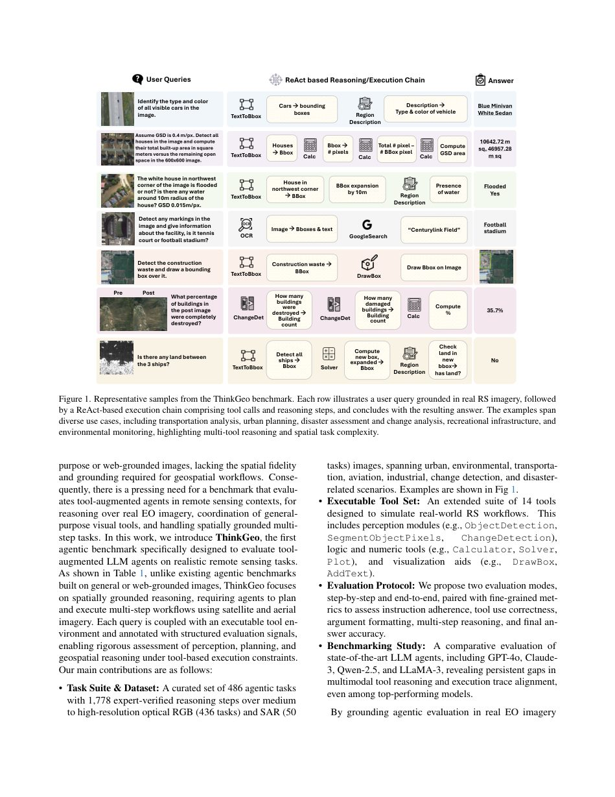

~~~~~text
35.7%
Football 
stadium
User Queries
TextToBbox
ReAct based Reasoning/Execution Chain
Answer
Identify the type and color 
of all visible cars in the 
image.
Cars à bounding 
boxes
Blue Minivan
White Sedan
Region
Description
Description à
Type & color of vehicle
The white house in northwest 
corner of the image is flooded 
or not? is there any water 
around 10m radius of the 
house? GSD 0.015m/px.
House in 
northwest corner 
à BBox
Flooded
Yes
BBox expansion 
by 10m
Presence 
of water
Detect any markings in the 
image and give information 
about the facility, is it tennis 
court or football stadium?
Image à Bboxes & text 
“Centurylink Field”
OCR
GoogleSearch
Detect the construction 
waste and draw a bounding 
box over it.
Draw Bbox on Image
Construction waste à
BBox
DrawBox
What percentage 
of buildings in 
the post image 
were completely 
destroyed?
ChangeDet
Pre
How many 
damaged 
buildings à
Building 
count
Compute 
%
10642.72 m 
sq, 46957.28 
m sq
Calc
Compute 
GSD area​
Assume GSD is 0.4 m/px. Detect all 
houses in the image and compute 
their total built-up area in square 
meters versus the remaining open 
space in the 600x600 image.
Post
ChangeDet
TextToBbox
TextToBbox
TextToBbox
Calc
Calc
Region
Description
Bbox à
# pixels
Houses 
à Bbox
Calc
Total # pixel –
# BBox pixel
How many 
buildings 
were 
destroyed à
Building 
count
No
Is there any land between 
the 3 ships?
Compute 
new box, 
expanded à
Bbox
Check 
land in 
new 
bboxà
has land?
Detect all 
ships à
Bbox
TextToBbox
Region
Description
Solver
Figure 1. Representative samples from the ThinkGeo benchmark. Each row illustrates a user query grounded in real RS imagery, followed
by a ReAct-based execution chain comprising tool calls and reasoning steps, and concludes with the resulting answer. The examples span
diverse use cases, including transportation analysis, urban planning, disaster assessment and change analysis, recreational infrastructure, and
environmental monitoring, highlighting multi-tool reasoning and spatial task complexity.
purpose or web-grounded images, lacking the spatial fidelity
and grounding required for geospatial workflows. Conse-
quently, there is a pressing need for a benchmark that evalu-
ates tool-augmented agents in remote sensing contexts, for
reasoning over real EO imagery, coordination of general-
purpose visual tools, and handling spatially grounded multi-
step tasks. In this work, we introduce ThinkGeo, the first
agentic benchmark specifically designed to evaluate tool-
augmented LLM agents on realistic remote sensing tasks.
As shown in Table 1, unlike existing agentic benchmarks
built on general or web-grounded images, ThinkGeo focuses
on spatially grounded reasoning, requiring agents to plan
and execute multi-step workflows using satellite and aerial
imagery. Each query is coupled with an executable tool en-
vironment and annotated with structured evaluation signals,
enabling rigorous assessment of perception, planning, and
geospatial reasoning under tool-based execution constraints.
Our main contributions are as follows:
• Task Suite & Dataset: A curated set of 486 agentic tasks
with 1,778 expert-verified reasoning steps over medium
to high-resolution optical RGB (436 tasks) and SAR (50
tasks) images, spanning urban, environmental, transporta-
tion, aviation, industrial, change detection, and disaster-
related scenarios. Examples are shown in Fig 1.
• Executable Tool Set: An extended suite of 14 tools
designed to simulate real-world RS workflows.
This
includes perception modules (e.g., ObjectDetection,
SegmentObjectPixels,
ChangeDetection),
logic and numeric tools (e.g., Calculator, Solver,
Plot),
and
visualization
aids
(e.g.,
DrawBox,
AddText).
• Evaluation Protocol: We propose two evaluation modes,
step-by-step and end-to-end, paired with fine-grained met-
rics to assess instruction adherence, tool use correctness,
argument formatting, multi-step reasoning, and final an-
swer accuracy.
• Benchmarking Study: A comparative evaluation of
state-of-the-art LLM agents, including GPT-4o, Claude-
3, Qwen-2.5, and LLaMA-3, revealing persistent gaps in
multimodal tool reasoning and execution trace alignment,
even among top-performing models.
By grounding agentic evaluation in real EO imagery
~~~~~

## 原稿第 3 / 14 页

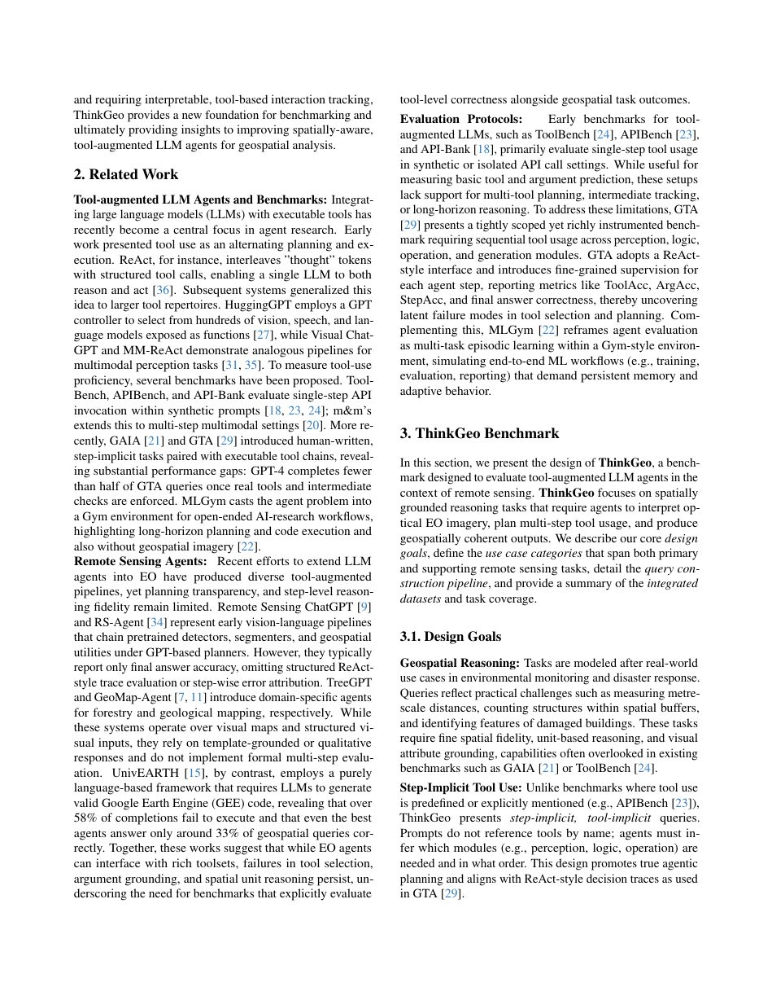

~~~~~text
and requiring interpretable, tool-based interaction tracking,
ThinkGeo provides a new foundation for benchmarking and
ultimately providing insights to improving spatially-aware,
tool-augmented LLM agents for geospatial analysis.
2. Related Work
Tool-augmented LLM Agents and Benchmarks: Integrat-
ing large language models (LLMs) with executable tools has
recently become a central focus in agent research. Early
work presented tool use as an alternating planning and ex-
ecution. ReAct, for instance, interleaves ”thought” tokens
with structured tool calls, enabling a single LLM to both
reason and act [36]. Subsequent systems generalized this
idea to larger tool repertoires. HuggingGPT employs a GPT
controller to select from hundreds of vision, speech, and lan-
guage models exposed as functions [27], while Visual Chat-
GPT and MM-ReAct demonstrate analogous pipelines for
multimodal perception tasks [31, 35]. To measure tool-use
proficiency, several benchmarks have been proposed. Tool-
Bench, APIBench, and API-Bank evaluate single-step API
invocation within synthetic prompts [18, 23, 24]; m&m’s
extends this to multi-step multimodal settings [20]. More re-
cently, GAIA [21] and GTA [29] introduced human-written,
step-implicit tasks paired with executable tool chains, reveal-
ing substantial performance gaps: GPT-4 completes fewer
than half of GTA queries once real tools and intermediate
checks are enforced. MLGym casts the agent problem into
a Gym environment for open-ended AI-research workflows,
highlighting long-horizon planning and code execution and
also without geospatial imagery [22].
Remote Sensing Agents: Recent efforts to extend LLM
agents into EO have produced diverse tool-augmented
pipelines, yet planning transparency, and step-level reason-
ing fidelity remain limited. Remote Sensing ChatGPT [9]
and RS-Agent [34] represent early vision-language pipelines
that chain pretrained detectors, segmenters, and geospatial
utilities under GPT-based planners. However, they typically
report only final answer accuracy, omitting structured ReAct-
style trace evaluation or step-wise error attribution. TreeGPT
and GeoMap-Agent [7, 11] introduce domain-specific agents
for forestry and geological mapping, respectively. While
these systems operate over visual maps and structured vi-
sual inputs, they rely on template-grounded or qualitative
responses and do not implement formal multi-step evalu-
ation. UnivEARTH [15], by contrast, employs a purely
language-based framework that requires LLMs to generate
valid Google Earth Engine (GEE) code, revealing that over
58% of completions fail to execute and that even the best
agents answer only around 33% of geospatial queries cor-
rectly. Together, these works suggest that while EO agents
can interface with rich toolsets, failures in tool selection,
argument grounding, and spatial unit reasoning persist, un-
derscoring the need for benchmarks that explicitly evaluate
tool-level correctness alongside geospatial task outcomes.
Evaluation Protocols:
Early benchmarks for tool-
augmented LLMs, such as ToolBench [24], APIBench [23],
and API-Bank [18], primarily evaluate single-step tool usage
in synthetic or isolated API call settings. While useful for
measuring basic tool and argument prediction, these setups
lack support for multi-tool planning, intermediate tracking,
or long-horizon reasoning. To address these limitations, GTA
[29] presents a tightly scoped yet richly instrumented bench-
mark requiring sequential tool usage across perception, logic,
operation, and generation modules. GTA adopts a ReAct-
style interface and introduces fine-grained supervision for
each agent step, reporting metrics like ToolAcc, ArgAcc,
StepAcc, and final answer correctness, thereby uncovering
latent failure modes in tool selection and planning. Com-
plementing this, MLGym [22] reframes agent evaluation
as multi-task episodic learning within a Gym-style environ-
ment, simulating end-to-end ML workflows (e.g., training,
evaluation, reporting) that demand persistent memory and
adaptive behavior.
3. ThinkGeo Benchmark
In this section, we present the design of ThinkGeo, a bench-
mark designed to evaluate tool-augmented LLM agents in the
context of remote sensing. ThinkGeo focuses on spatially
grounded reasoning tasks that require agents to interpret op-
tical EO imagery, plan multi-step tool usage, and produce
geospatially coherent outputs. We describe our core design
goals, define the use case categories that span both primary
and supporting remote sensing tasks, detail the query con-
struction pipeline, and provide a summary of the integrated
datasets and task coverage.
3.1. Design Goals
Geospatial Reasoning: Tasks are modeled after real-world
use cases in environmental monitoring and disaster response.
Queries reflect practical challenges such as measuring metre-
scale distances, counting structures within spatial buffers,
and identifying features of damaged buildings. These tasks
require fine spatial fidelity, unit-based reasoning, and visual
attribute grounding, capabilities often overlooked in existing
benchmarks such as GAIA [21] or ToolBench [24].
Step-Implicit Tool Use: Unlike benchmarks where tool use
is predefined or explicitly mentioned (e.g., APIBench [23]),
ThinkGeo presents step-implicit,
tool-implicit queries.
Prompts do not reference tools by name; agents must in-
fer which modules (e.g., perception, logic, operation) are
needed and in what order. This design promotes true agentic
planning and aligns with ReAct-style decision traces as used
in GTA [29].
~~~~~

## 原稿第 4 / 14 页

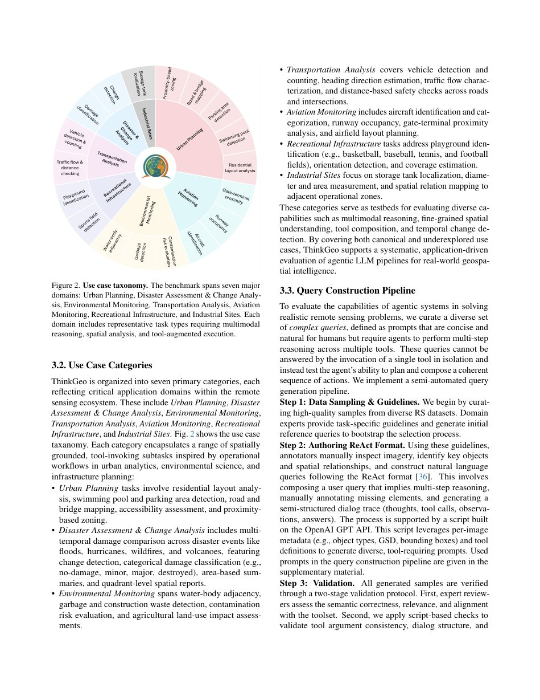

~~~~~text
Traffic flow & 
distance 
checking
Figure 2. Use case taxonomy. The benchmark spans seven major
domains: Urban Planning, Disaster Assessment & Change Analy-
sis, Environmental Monitoring, Transportation Analysis, Aviation
Monitoring, Recreational Infrastructure, and Industrial Sites. Each
domain includes representative task types requiring multimodal
reasoning, spatial analysis, and tool-augmented execution.
3.2. Use Case Categories
ThinkGeo is organized into seven primary categories, each
reflecting critical application domains within the remote
sensing ecosystem. These include Urban Planning, Disaster
Assessment & Change Analysis, Environmental Monitoring,
Transportation Analysis, Aviation Monitoring, Recreational
Infrastructure, and Industrial Sites. Fig. 2 shows the use case
taxanomy. Each category encapsulates a range of spatially
grounded, tool-invoking subtasks inspired by operational
workflows in urban analytics, environmental science, and
infrastructure planning:
• Urban Planning tasks involve residential layout analy-
sis, swimming pool and parking area detection, road and
bridge mapping, accessibility assessment, and proximity-
based zoning.
• Disaster Assessment & Change Analysis includes multi-
temporal damage comparison across disaster events like
floods, hurricanes, wildfires, and volcanoes, featuring
change detection, categorical damage classification (e.g.,
no-damage, minor, major, destroyed), area-based sum-
maries, and quadrant-level spatial reports.
• Environmental Monitoring spans water-body adjacency,
garbage and construction waste detection, contamination
risk evaluation, and agricultural land-use impact assess-
ments.
• Transportation Analysis covers vehicle detection and
counting, heading direction estimation, traffic flow charac-
terization, and distance-based safety checks across roads
and intersections.
• Aviation Monitoring includes aircraft identification and cat-
egorization, runway occupancy, gate-terminal proximity
analysis, and airfield layout planning.
• Recreational Infrastructure tasks address playground iden-
tification (e.g., basketball, baseball, tennis, and football
fields), orientation detection, and coverage estimation.
• Industrial Sites focus on storage tank localization, diame-
ter and area measurement, and spatial relation mapping to
adjacent operational zones.
These categories serve as testbeds for evaluating diverse ca-
pabilities such as multimodal reasoning, fine-grained spatial
understanding, tool composition, and temporal change de-
tection. By covering both canonical and underexplored use
cases, ThinkGeo supports a systematic, application-driven
evaluation of agentic LLM pipelines for real-world geospa-
tial intelligence.
3.3. Query Construction Pipeline
To evaluate the capabilities of agentic systems in solving
realistic remote sensing problems, we curate a diverse set
of complex queries, defined as prompts that are concise and
natural for humans but require agents to perform multi-step
reasoning across multiple tools. These queries cannot be
answered by the invocation of a single tool in isolation and
instead test the agent’s ability to plan and compose a coherent
sequence of actions. We implement a semi-automated query
generation pipeline.
Step 1: Data Sampling & Guidelines. We begin by curat-
ing high-quality samples from diverse RS datasets. Domain
experts provide task-specific guidelines and generate initial
reference queries to bootstrap the selection process.
Step 2: Authoring ReAct Format. Using these guidelines,
annotators manually inspect imagery, identify key objects
and spatial relationships, and construct natural language
queries following the ReAct format [36]. This involves
composing a user query that implies multi-step reasoning,
manually annotating missing elements, and generating a
semi-structured dialog trace (thoughts, tool calls, observa-
tions, answers). The process is supported by a script built
on the OpenAI GPT API. This script leverages per-image
metadata (e.g., object types, GSD, bounding boxes) and tool
definitions to generate diverse, tool-requiring prompts. Used
prompts in the query construction pipeline are given in the
supplementary material.
Step 3: Validation. All generated samples are verified
through a two-stage validation protocol. First, expert review-
ers assess the semantic correctness, relevance, and alignment
with the toolset. Second, we apply script-based checks to
validate tool argument consistency, dialog structure, and
~~~~~

## 原稿第 5 / 14 页

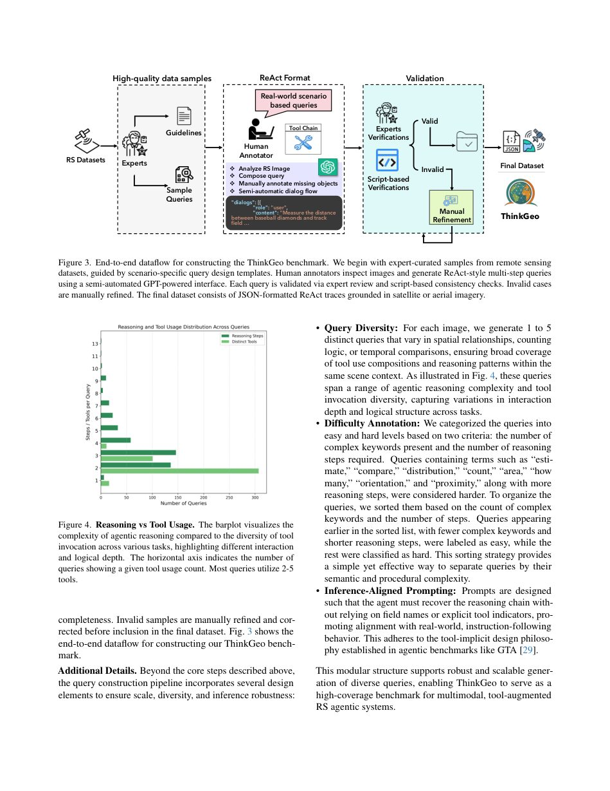

~~~~~text
High-quality data samples
ReAct Format
Validation
RS Datasets
Final Dataset
Experts
Guidelines
Sample
Queries
Human
Annotator
Tool Chain
Real-world scenario 
based queries
❖Analyze RS Image
❖Compose query
❖Manually annotate missing objects
❖Semi-automatic dialog flow
"dialogs": [{
        "role": "user",
        "content": "Measure the distance 
between baseball diamonds and track 
field …
Experts
Verifications
Script-based
Verifications
Valid
Invalid
Manual
Refinement
ThinkGeo
Figure 3. End-to-end dataflow for constructing the ThinkGeo benchmark. We begin with expert-curated samples from remote sensing
datasets, guided by scenario-specific query design templates. Human annotators inspect images and generate ReAct-style multi-step queries
using a semi-automated GPT-powered interface. Each query is validated via expert review and script-based consistency checks. Invalid cases
are manually refined. The final dataset consists of JSON-formatted ReAct traces grounded in satellite or aerial imagery.
Figure 4. Reasoning vs Tool Usage. The barplot visualizes the
complexity of agentic reasoning compared to the diversity of tool
invocation across various tasks, highlighting different interaction
and logical depth. The horizontal axis indicates the number of
queries showing a given tool usage count. Most queries utilize 2-5
tools.
completeness. Invalid samples are manually refined and cor-
rected before inclusion in the final dataset. Fig. 3 shows the
end-to-end dataflow for constructing our ThinkGeo bench-
mark.
Additional Details. Beyond the core steps described above,
the query construction pipeline incorporates several design
elements to ensure scale, diversity, and inference robustness:
• Query Diversity: For each image, we generate 1 to 5
distinct queries that vary in spatial relationships, counting
logic, or temporal comparisons, ensuring broad coverage
of tool use compositions and reasoning patterns within the
same scene context. As illustrated in Fig. 4, these queries
span a range of agentic reasoning complexity and tool
invocation diversity, capturing variations in interaction
depth and logical structure across tasks.
• Difficulty Annotation: We categorized the queries into
easy and hard levels based on two criteria: the number of
complex keywords present and the number of reasoning
steps required. Queries containing terms such as “esti-
mate,” “compare,” “distribution,” “count,” “area,” “how
many,” “orientation,” and “proximity,” along with more
reasoning steps, were considered harder. To organize the
queries, we sorted them based on the count of complex
keywords and the number of steps. Queries appearing
earlier in the sorted list, with fewer complex keywords and
shorter reasoning steps, were labeled as easy, while the
rest were classified as hard. This sorting strategy provides
a simple yet effective way to separate queries by their
semantic and procedural complexity.
• Inference-Aligned Prompting: Prompts are designed
such that the agent must recover the reasoning chain with-
out relying on field names or explicit tool indicators, pro-
moting alignment with real-world, instruction-following
behavior. This adheres to the tool-implicit design philoso-
phy established in agentic benchmarks like GTA [29].
This modular structure supports robust and scalable gener-
ation of diverse queries, enabling ThinkGeo to serve as a
high-coverage benchmark for multimodal, tool-augmented
RS agentic systems.
~~~~~

## 原稿第 6 / 14 页

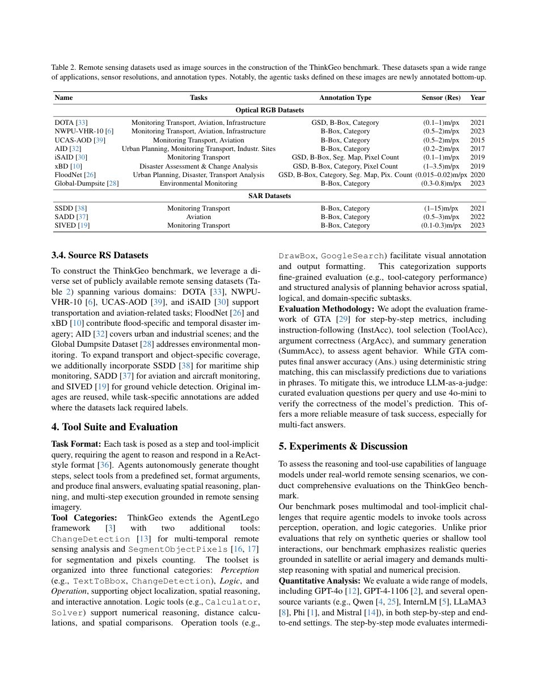

~~~~~text
Table 2. Remote sensing datasets used as image sources in the construction of the ThinkGeo benchmark. These datasets span a wide range
of applications, sensor resolutions, and annotation types. Notably, the agentic tasks defined on these images are newly annotated bottom-up.
Name
Tasks
Annotation Type
Sensor (Res)
Year
Optical RGB Datasets
DOTA [33]
Monitoring Transport, Aviation, Infrastructure
GSD, B-Box, Category
(0.1–1)m/px
2021
NWPU-VHR-10 [6]
Monitoring Transport, Aviation, Infrastructure
B-Box, Category
(0.5–2)m/px
2023
UCAS-AOD [39]
Monitoring Transport, Aviation
B-Box, Category
(0.5–2)m/px
2015
AID [32]
Urban Planning, Monitoring Transport, Industr. Sites
B-Box, Category
(0.2–2)m/px
2017
iSAID [30]
Monitoring Transport
GSD, B-Box, Seg. Map, Pixel Count
(0.1–1)m/px
2019
xBD [10]
Disaster Assessment & Change Analysis
GSD, B-Box, Category, Pixel Count
(1–3.5)m/px
2019
FloodNet [26]
Urban Planning, Disaster, Transport Analysis
GSD, B-Box, Category, Seg. Map, Pix. Count (0.015–0.02)m/px 2020
Global-Dumpsite [28]
Environmental Monitoring
B-Box, Category
(0.3-0.8)m/px
2023
SAR Datasets
SSDD [38]
Monitoring Transport
B-Box, Category
(1–15)m/px
2021
SADD [37]
Aviation
B-Box, Category
(0.5–3)m/px
2022
SIVED [19]
Monitoring Transport
B-Box, Category
(0.1-0.3)m/px
2023
3.4. Source RS Datasets
To construct the ThinkGeo benchmark, we leverage a di-
verse set of publicly available remote sensing datasets (Ta-
ble 2) spanning various domains: DOTA [33], NWPU-
VHR-10 [6], UCAS-AOD [39], and iSAID [30] support
transportation and aviation-related tasks; FloodNet [26] and
xBD [10] contribute flood-specific and temporal disaster im-
agery; AID [32] covers urban and industrial scenes; and the
Global Dumpsite Dataset [28] addresses environmental mon-
itoring. To expand transport and object-specific coverage,
we additionally incorporate SSDD [38] for maritime ship
monitoring, SADD [37] for aviation and aircraft monitoring,
and SIVED [19] for ground vehicle detection. Original im-
ages are reused, while task-specific annotations are added
where the datasets lack required labels.
4. Tool Suite and Evaluation
Task Format: Each task is posed as a step and tool-implicit
query, requiring the agent to reason and respond in a ReAct-
style format [36]. Agents autonomously generate thought
steps, select tools from a predefined set, format arguments,
and produce final answers, evaluating spatial reasoning, plan-
ning, and multi-step execution grounded in remote sensing
imagery.
Tool Categories:
ThinkGeo extends the AgentLego
framework
[3]
with
two
additional
tools:
ChangeDetection [13] for multi-temporal remote
sensing analysis and SegmentObjectPixels [16, 17]
for segmentation and pixels counting.
The toolset is
organized into three functional categories:
Perception
(e.g., TextToBbox, ChangeDetection), Logic, and
Operation, supporting object localization, spatial reasoning,
and interactive annotation. Logic tools (e.g., Calculator,
Solver) support numerical reasoning, distance calcu-
lations, and spatial comparisons.
Operation tools (e.g.,
DrawBox, GoogleSearch) facilitate visual annotation
and output formatting.
This categorization supports
fine-grained evaluation (e.g., tool-category performance)
and structured analysis of planning behavior across spatial,
logical, and domain-specific subtasks.
Evaluation Methodology: We adopt the evaluation frame-
work of GTA [29] for step-by-step metrics, including
instruction-following (InstAcc), tool selection (ToolAcc),
argument correctness (ArgAcc), and summary generation
(SummAcc), to assess agent behavior. While GTA com-
putes final answer accuracy (Ans.) using deterministic string
matching, this can misclassify predictions due to variations
in phrases. To mitigate this, we introduce LLM-as-a-judge:
curated evaluation questions per query and use 4o-mini to
verify the correctness of the model’s prediction. This of-
fers a more reliable measure of task success, especially for
multi-fact answers.
5. Experiments & Discussion
To assess the reasoning and tool-use capabilities of language
models under real-world remote sensing scenarios, we con-
duct comprehensive evaluations on the ThinkGeo bench-
mark.
Our benchmark poses multimodal and tool-implicit chal-
lenges that require agentic models to invoke tools across
perception, operation, and logic categories. Unlike prior
evaluations that rely on synthetic queries or shallow tool
interactions, our benchmark emphasizes realistic queries
grounded in satellite or aerial imagery and demands multi-
step reasoning with spatial and numerical precision.
Quantitative Analysis: We evaluate a wide range of models,
including GPT-4o [12], GPT-4-1106 [2], and several open-
source variants (e.g., Qwen [4, 25], InternLM [5], LLaMA3
[8], Phi [1], and Mistral [14]), in both step-by-step and end-
to-end settings. The step-by-step mode evaluates intermedi-
~~~~~

## 原稿第 7 / 14 页

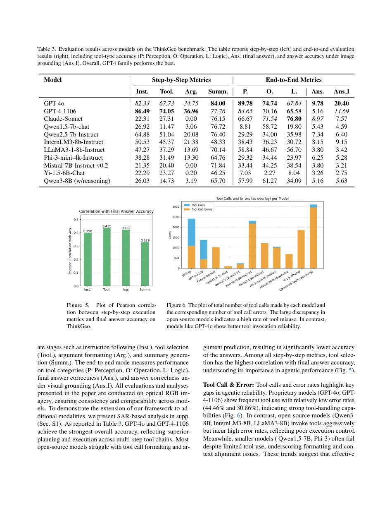

~~~~~text
Table 3. Evaluation results across models on the ThinkGeo benchmark. The table reports step-by-step (left) and end-to-end evaluation
results (right), including tool-type accuracy (P: Perception, O: Operation, L: Logic), Ans. (final answer), and answer accuracy under image
grounding (Ans I). Overall, GPT4 family performs the best.
Model
Step-by-Step Metrics
End-to-End Metrics
Inst.
Tool.
Arg.
Summ.
P.
O.
L.
Ans.
Ans I
GPT-4o
82.33
67.73
34.75
84.00
89.78
74.74
67.84
9.78
20.40
GPT-4-1106
86.49
74.05
36.96
77.76
84.65
70.16
65.58
5.16
14.69
Claude-Sonnet
22.31
27.31
0.00
76.15
66.67
71.54
76.80
8.97
7.57
Qwen1.5-7b-chat
26.92
11.47
3.06
76.72
8.81
58.72
19.80
5.43
4.59
Qwen2.5-7b-Instruct
64.88
51.04
20.08
76.40
29.29
34.00
35.98
7.34
6.40
InternLM3-8b-Instruct
50.53
45.37
21.38
48.33
38.43
36.23
30.72
8.15
9.15
LLaMA3-1-8b-Instruct
47.27
37.29
13.69
70.14
58.84
46.67
56.70
3.80
3.42
Phi-3-mini-4k-Instruct
38.28
31.49
13.30
64.76
29.32
34.44
23.97
6.25
5.28
Mistral-7B-Instruct-v0.2
21.35
20.40
0.00
71.84
33.44
44.25
38.54
3.80
3.21
Yi-1.5-6B-Chat
22.29
23.27
0.20
46.25
7.03
2.27
8.04
3.26
2.75
Qwen3-8B (w/reasoning)
26.03
14.73
3.19
65.70
57.99
61.27
34.09
5.16
5.63
Figure 5.
Plot of Pearson correla-
tion between step-by-step execution
metrics and final answer accuracy on
ThinkGeo.
Figure 6. The plot of total number of tool calls made by each model and
the corresponding number of tool call errors. The large discrepancy in
open source models indicates a high rate of tool misuse. In contrast,
models like GPT-4o show better tool invocation reliability.
ate stages such as instruction following (Inst.), tool selection
(Tool.), argument formatting (Arg.), and summary genera-
tion (Summ.). The end-to-end mode measures performance
on tool categories (P: Perception, O: Operation, L: Logic),
final answer correctness (Ans.), and answer correctness un-
der visual grounding (Ans I). All evaluations and analyses
presented in the paper are conducted on optical RGB im-
agery, ensuring consistency and comparability across mod-
els. To demonstrate the extension of our framework to ad-
ditional modalities, we present SAR-based analysis in supp.
(Sec. S1). As reported in Table 3, GPT-4o and GPT-4-1106
achieve the strongest overall accuracy, reflecting superior
planning and execution across multi-step tool chains. Most
open-source models struggle with tool call formatting and ar-
gument prediction, resulting in significantly lower accuracy
of the answers. Among all step-by-step metrics, tool selec-
tion has the highest correlation with final answer accuracy,
underscoring its importance in agentic performance (Fig. 5).
Tool Call & Error: Tool calls and error rates highlight key
gaps in agentic reliability. Proprietary models (GPT-4o, GPT-
4-1106) show frequent tool use with relatively low error rates
(44.46% and 30.86%), indicating strong tool-handling capa-
bilities (Fig. 6). In contrast, open-source models (Qwen3-
8B, InternLM3-8B, LLaMA3-8B) invoke tools aggressively
but incur high error rates, reflecting poor execution control.
Meanwhile, smaller models ( Qwen1.5-7B, Phi-3) often fail
despite limited tool use, underscoring formatting and con-
text alignment issues. These trends suggest that effective
~~~~~

## 原稿第 8 / 14 页

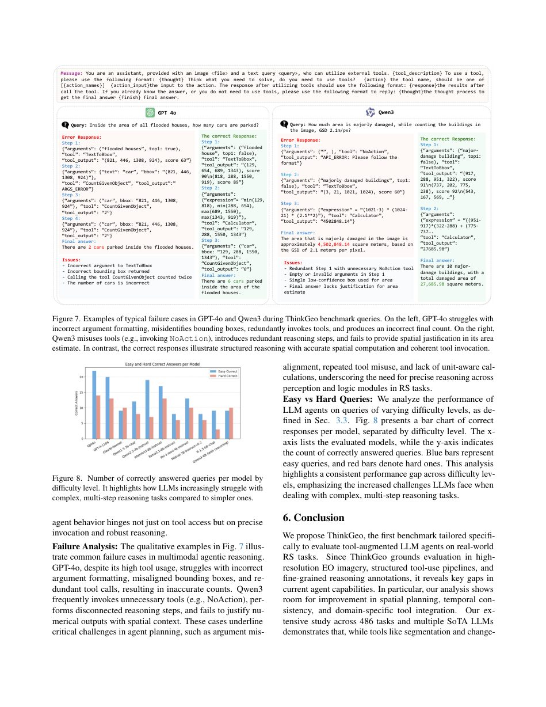

~~~~~text
Message: You are an assistant, provided with an image <file> and a text query <query>, who can utilize external tools. {tool_description} To use a tool, 
please use the following format: {thought} Think what you need to solve, do you need to use tools?  {action} the tool name, should be one of 
[{action_names}]  {action_input}the input to the action. The response after utilizing tools should use the following format: {response}the results after 
call the tool. If you already know the answer, or you do not need to use tools, please use the following format to reply: {thought}the thought process to 
get the final answer {finish} final answer.
GPT 4o
Qwen3
Query: Inside the area of all flooded houses, how many cars are parked?
Error Response:
Step 1:
{“arguments”: (“flooded houses”, top1: true), 
“tool”: “TextToBbox”, 
“tool_output”: “(821, 446, 1308, 924), score 63”}
Step 2:
{“arguments”: {“text”: “car”, “bbox”: “(821, 446, 
1308, 924)”},
“tool”: “CountGivenObject”, “tool_output”:” 
ARGS_ERROR”}
Step 3:
{“arguments”: (“car”, bbox: “821, 446, 1308, 
924”), “tool”: “CountGivenObject”, 
“tool_output”: “2”}
Step 4:
{“arguments”: (“car”, bbox: “821, 446, 1308, 
924”), “tool”: “CountGivenObject”, 
“tool_output”: “2”}
Final answer:
There are 2 cars parked inside the flooded houses.
The correct Response:
Step 1:
{“arguments”: (“flooded 
house”, top1: false), 
“tool”: “TextToBbox”, 
“tool_output”: “(129, 
654, 689, 1343), score 
90\n(818, 288, 1550, 
919), score 89”}
Step 2:
{“arguments”: 
(“expression”= “min(129, 
818), min(288, 654), 
max(689, 1550), 
max(1343, 919)”),
“tool”: “Calculator”, 
“tool_output”: “129, 
288, 1550, 1343”}
Step 3:
{“arguments”: (“car”, 
bbox: “129, 288, 1550, 
1343”), “tool”: 
“CountGivenObject”, 
“tool_output”: “6”} 
Final answer:
There are 6 cars parked 
inside the area of the 
flooded houses.
Issues:
- Incorrect argument to TextToBbox
- Incorrect bounding box returned
- Calling the tool CountGivenObject counted twice
- The number of cars is incorrect
Query: How much area is majorly damaged, while counting the buildings in 
the image, GSD 2.1m/px?
Error Response:
Step 1:
{“arguments”: (“”, ), “tool”: “NoAction”,
“tool_output”: “API_ERROR: Please follow the 
format”}
Step 2:
{“arguments”: (“majorly damaged buildings”, top1: 
false), “tool”: “TextToBbox”,
“tool_output”: “(3, 21, 1021, 1024), score 60”}
Step 3:
{“arguments”: (“expression” = “(1021-3) * (1024-
21) * (2.1**2)”), “tool”: “Calculator”,
“tool_output”: “4502848.14”}
Final answer:
The area that is majorly damaged in the image is 
approximately 4,502,848.14 square meters, based on 
the GSD of 2.1 meters per pixel.
The correct Response:
Step 1:
{“arguments”: (“major-
damage building”, top1: 
false), “tool”: 
“TextToBbox”,
“tool_output”: “(917, 
288, 951, 322), score 
91\n(737, 202, 775, 
238), score 92\n(543, 
167, 569, …”}
Step 2:
{“arguments”: 
(“expression” = “((951-
917)*(322-288) + (775-
737….
“tool”: “Calculator”, 
“tool_output”: 
“27685.98”}
Final answer:
There are 10 major-
damage buildings, with a 
total damaged area of 
27,685.98 square meters.
Issues:
- Redundant Step 1 with unnecessary NoAction tool
- Empty or invalid arguments in Step 1
- Single low-confidence box used for area
- Final answer lacks justification for area 
estimate
Figure 7. Examples of typical failure cases in GPT-4o and Qwen3 during ThinkGeo benchmark queries. On the left, GPT-4o struggles with
incorrect argument formatting, misidentifies bounding boxes, redundantly invokes tools, and produces an incorrect final count. On the right,
Qwen3 misuses tools (e.g., invoking NoAction), introduces redundant reasoning steps, and fails to provide spatial justification in its area
estimate. In contrast, the correct responses illustrate structured reasoning with accurate spatial computation and coherent tool invocation.
Figure 8. Number of correctly answered queries per model by
difficulty level. It highlights how LLMs increasingly struggle with
complex, multi-step reasoning tasks compared to simpler ones.
agent behavior hinges not just on tool access but on precise
invocation and robust reasoning.
Failure Analysis: The qualitative examples in Fig. 7 illus-
trate common failure cases in multimodal agentic reasoning.
GPT-4o, despite its high tool usage, struggles with incorrect
argument formatting, misaligned bounding boxes, and re-
dundant tool calls, resulting in inaccurate counts. Qwen3
frequently invokes unnecessary tools (e.g., NoAction), per-
forms disconnected reasoning steps, and fails to justify nu-
merical outputs with spatial context. These cases underline
critical challenges in agent planning, such as argument mis-
alignment, repeated tool misuse, and lack of unit-aware cal-
culations, underscoring the need for precise reasoning across
perception and logic modules in RS tasks.
Easy vs Hard Queries: We analyze the performance of
LLM agents on queries of varying difficulty levels, as de-
fined in Sec. 3.3. Fig. 8 presents a bar chart of correct
responses per model, separated by difficulty level. The x-
axis lists the evaluated models, while the y-axis indicates
the count of correctly answered queries. Blue bars represent
easy queries, and red bars denote hard ones. This analysis
highlights a consistent performance gap across difficulty lev-
els, emphasizing the increased challenges LLMs face when
dealing with complex, multi-step reasoning tasks.
6. Conclusion
We propose ThinkGeo, the first benchmark tailored specifi-
cally to evaluate tool-augmented LLM agents on real-world
RS tasks.
Since ThinkGeo grounds evaluation in high-
resolution EO imagery, structured tool-use pipelines, and
fine-grained reasoning annotations, it reveals key gaps in
current agent capabilities. In particular, our analysis shows
room for improvement in spatial planning, temporal con-
sistency, and domain-specific tool integration.
Our ex-
tensive study across 486 tasks and multiple SoTA LLMs
demonstrates that, while tools like segmentation and change-
~~~~~

## 原稿第 9 / 14 页

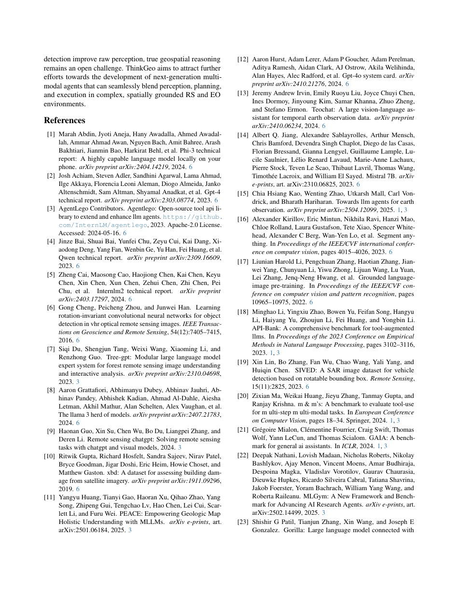

~~~~~text
detection improve raw perception, true geospatial reasoning
remains an open challenge. ThinkGeo aims to attract further
efforts towards the development of next-generation multi-
modal agents that can seamlessly blend perception, planning,
and execution in complex, spatially grounded RS and EO
environments.
References
[1] Marah Abdin, Jyoti Aneja, Hany Awadalla, Ahmed Awadal-
lah, Ammar Ahmad Awan, Nguyen Bach, Amit Bahree, Arash
Bakhtiari, Jianmin Bao, Harkirat Behl, et al. Phi-3 technical
report: A highly capable language model locally on your
phone. arXiv preprint arXiv:2404.14219, 2024. 6
[2] Josh Achiam, Steven Adler, Sandhini Agarwal, Lama Ahmad,
Ilge Akkaya, Florencia Leoni Aleman, Diogo Almeida, Janko
Altenschmidt, Sam Altman, Shyamal Anadkat, et al. Gpt-4
technical report. arXiv preprint arXiv:2303.08774, 2023. 6
[3] AgentLego Contributors. Agentlego: Open-source tool api li-
brary to extend and enhance llm agents. https://github.
com/InternLM/agentlego, 2023. Apache-2.0 License.
Accessed: 2024-05-16. 6
[4] Jinze Bai, Shuai Bai, Yunfei Chu, Zeyu Cui, Kai Dang, Xi-
aodong Deng, Yang Fan, Wenbin Ge, Yu Han, Fei Huang, et al.
Qwen technical report. arXiv preprint arXiv:2309.16609,
2023. 6
[5] Zheng Cai, Maosong Cao, Haojiong Chen, Kai Chen, Keyu
Chen, Xin Chen, Xun Chen, Zehui Chen, Zhi Chen, Pei
Chu, et al.
Internlm2 technical report.
arXiv preprint
arXiv:2403.17297, 2024. 6
[6] Gong Cheng, Peicheng Zhou, and Junwei Han. Learning
rotation-invariant convolutional neural networks for object
detection in vhr optical remote sensing images. IEEE Transac-
tions on Geoscience and Remote Sensing, 54(12):7405–7415,
2016. 6
[7] Siqi Du, Shengjun Tang, Weixi Wang, Xiaoming Li, and
Renzhong Guo. Tree-gpt: Modular large language model
expert system for forest remote sensing image understanding
and interactive analysis. arXiv preprint arXiv:2310.04698,
2023. 3
[8] Aaron Grattafiori, Abhimanyu Dubey, Abhinav Jauhri, Ab-
hinav Pandey, Abhishek Kadian, Ahmad Al-Dahle, Aiesha
Letman, Akhil Mathur, Alan Schelten, Alex Vaughan, et al.
The llama 3 herd of models. arXiv preprint arXiv:2407.21783,
2024. 6
[9] Haonan Guo, Xin Su, Chen Wu, Bo Du, Liangpei Zhang, and
Deren Li. Remote sensing chatgpt: Solving remote sensing
tasks with chatgpt and visual models, 2024. 3
[10] Ritwik Gupta, Richard Hosfelt, Sandra Sajeev, Nirav Patel,
Bryce Goodman, Jigar Doshi, Eric Heim, Howie Choset, and
Matthew Gaston. xbd: A dataset for assessing building dam-
age from satellite imagery. arXiv preprint arXiv:1911.09296,
2019. 6
[11] Yangyu Huang, Tianyi Gao, Haoran Xu, Qihao Zhao, Yang
Song, Zhipeng Gui, Tengchao Lv, Hao Chen, Lei Cui, Scar-
lett Li, and Furu Wei. PEACE: Empowering Geologic Map
Holistic Understanding with MLLMs. arXiv e-prints, art.
arXiv:2501.06184, 2025. 3
[12] Aaron Hurst, Adam Lerer, Adam P Goucher, Adam Perelman,
Aditya Ramesh, Aidan Clark, AJ Ostrow, Akila Welihinda,
Alan Hayes, Alec Radford, et al. Gpt-4o system card. arXiv
preprint arXiv:2410.21276, 2024. 6
[13] Jeremy Andrew Irvin, Emily Ruoyu Liu, Joyce Chuyi Chen,
Ines Dormoy, Jinyoung Kim, Samar Khanna, Zhuo Zheng,
and Stefano Ermon. Teochat: A large vision-language as-
sistant for temporal earth observation data. arXiv preprint
arXiv:2410.06234, 2024. 6
[14] Albert Q. Jiang, Alexandre Sablayrolles, Arthur Mensch,
Chris Bamford, Devendra Singh Chaplot, Diego de las Casas,
Florian Bressand, Gianna Lengyel, Guillaume Lample, Lu-
cile Saulnier, L´elio Renard Lavaud, Marie-Anne Lachaux,
Pierre Stock, Teven Le Scao, Thibaut Lavril, Thomas Wang,
Timoth´ee Lacroix, and William El Sayed. Mistral 7B. arXiv
e-prints, art. arXiv:2310.06825, 2023. 6
[15] Chia Hsiang Kao, Wenting Zhao, Utkarsh Mall, Carl Von-
drick, and Bharath Hariharan. Towards llm agents for earth
observation. arXiv preprint arXiv:2504.12099, 2025. 1, 3
[16] Alexander Kirillov, Eric Mintun, Nikhila Ravi, Hanzi Mao,
Chloe Rolland, Laura Gustafson, Tete Xiao, Spencer White-
head, Alexander C Berg, Wan-Yen Lo, et al. Segment any-
thing. In Proceedings of the IEEE/CVF international confer-
ence on computer vision, pages 4015–4026, 2023. 6
[17] Liunian Harold Li, Pengchuan Zhang, Haotian Zhang, Jian-
wei Yang, Chunyuan Li, Yiwu Zhong, Lijuan Wang, Lu Yuan,
Lei Zhang, Jenq-Neng Hwang, et al. Grounded language-
image pre-training. In Proceedings of the IEEE/CVF con-
ference on computer vision and pattern recognition, pages
10965–10975, 2022. 6
[18] Minghao Li, Yingxiu Zhao, Bowen Yu, Feifan Song, Hangyu
Li, Haiyang Yu, Zhoujun Li, Fei Huang, and Yongbin Li.
API-Bank: A comprehensive benchmark for tool-augmented
llms. In Proceedings of the 2023 Conference on Empirical
Methods in Natural Language Processing, pages 3102–3116,
2023. 1, 3
[19] Xin Lin, Bo Zhang, Fan Wu, Chao Wang, Yali Yang, and
Huiqin Chen. SIVED: A SAR image dataset for vehicle
detection based on rotatable bounding box. Remote Sensing,
15(11):2825, 2023. 6
[20] Zixian Ma, Weikai Huang, Jieyu Zhang, Tanmay Gupta, and
Ranjay Krishna. m & m’s: A benchmark to evaluate tool-use
for m ulti-step m ulti-modal tasks. In European Conference
on Computer Vision, pages 18–34. Springer, 2024. 1, 3
[21] Gr´egoire Mialon, Cl´ementine Fourrier, Craig Swift, Thomas
Wolf, Yann LeCun, and Thomas Scialom. GAIA: A bench-
mark for general ai assistants. In ICLR, 2024. 1, 3
[22] Deepak Nathani, Lovish Madaan, Nicholas Roberts, Nikolay
Bashlykov, Ajay Menon, Vincent Moens, Amar Budhiraja,
Despoina Magka, Vladislav Vorotilov, Gaurav Chaurasia,
Dieuwke Hupkes, Ricardo Silveira Cabral, Tatiana Shavrina,
Jakob Foerster, Yoram Bachrach, William Yang Wang, and
Roberta Raileanu. MLGym: A New Framework and Bench-
mark for Advancing AI Research Agents. arXiv e-prints, art.
arXiv:2502.14499, 2025. 3
[23] Shishir G Patil, Tianjun Zhang, Xin Wang, and Joseph E
Gonzalez. Gorilla: Large language model connected with
~~~~~

## 原稿第 10 / 14 页

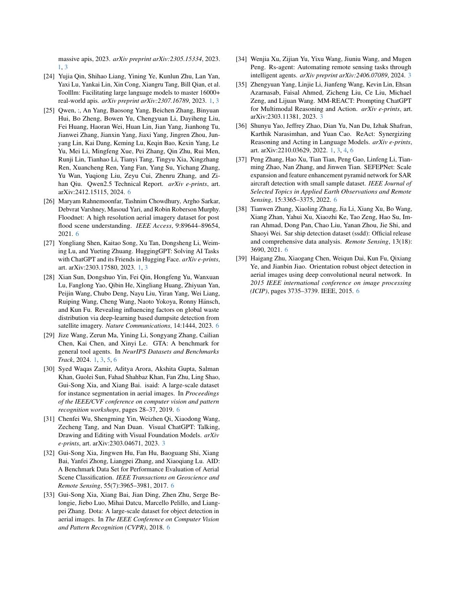

~~~~~text
massive apis, 2023. arXiv preprint arXiv:2305.15334, 2023.
1, 3
[24] Yujia Qin, Shihao Liang, Yining Ye, Kunlun Zhu, Lan Yan,
Yaxi Lu, Yankai Lin, Xin Cong, Xiangru Tang, Bill Qian, et al.
Toolllm: Facilitating large language models to master 16000+
real-world apis. arXiv preprint arXiv:2307.16789, 2023. 1, 3
[25] Qwen, :, An Yang, Baosong Yang, Beichen Zhang, Binyuan
Hui, Bo Zheng, Bowen Yu, Chengyuan Li, Dayiheng Liu,
Fei Huang, Haoran Wei, Huan Lin, Jian Yang, Jianhong Tu,
Jianwei Zhang, Jianxin Yang, Jiaxi Yang, Jingren Zhou, Jun-
yang Lin, Kai Dang, Keming Lu, Keqin Bao, Kexin Yang, Le
Yu, Mei Li, Mingfeng Xue, Pei Zhang, Qin Zhu, Rui Men,
Runji Lin, Tianhao Li, Tianyi Tang, Tingyu Xia, Xingzhang
Ren, Xuancheng Ren, Yang Fan, Yang Su, Yichang Zhang,
Yu Wan, Yuqiong Liu, Zeyu Cui, Zhenru Zhang, and Zi-
han Qiu. Qwen2.5 Technical Report. arXiv e-prints, art.
arXiv:2412.15115, 2024. 6
[26] Maryam Rahnemoonfar, Tashnim Chowdhury, Argho Sarkar,
Debvrat Varshney, Masoud Yari, and Robin Roberson Murphy.
Floodnet: A high resolution aerial imagery dataset for post
flood scene understanding. IEEE Access, 9:89644–89654,
2021. 6
[27] Yongliang Shen, Kaitao Song, Xu Tan, Dongsheng Li, Weim-
ing Lu, and Yueting Zhuang. HuggingGPT: Solving AI Tasks
with ChatGPT and its Friends in Hugging Face. arXiv e-prints,
art. arXiv:2303.17580, 2023. 1, 3
[28] Xian Sun, Dongshuo Yin, Fei Qin, Hongfeng Yu, Wanxuan
Lu, Fanglong Yao, Qibin He, Xingliang Huang, Zhiyuan Yan,
Peijin Wang, Chubo Deng, Nayu Liu, Yiran Yang, Wei Liang,
Ruiping Wang, Cheng Wang, Naoto Yokoya, Ronny H¨ansch,
and Kun Fu. Revealing influencing factors on global waste
distribution via deep-learning based dumpsite detection from
satellite imagery. Nature Communications, 14:1444, 2023. 6
[29] Jize Wang, Zerun Ma, Yining Li, Songyang Zhang, Cailian
Chen, Kai Chen, and Xinyi Le. GTA: A benchmark for
general tool agents. In NeurIPS Datasets and Benchmarks
Track, 2024. 1, 3, 5, 6
[30] Syed Waqas Zamir, Aditya Arora, Akshita Gupta, Salman
Khan, Guolei Sun, Fahad Shahbaz Khan, Fan Zhu, Ling Shao,
Gui-Song Xia, and Xiang Bai. isaid: A large-scale dataset
for instance segmentation in aerial images. In Proceedings
of the IEEE/CVF conference on computer vision and pattern
recognition workshops, pages 28–37, 2019. 6
[31] Chenfei Wu, Shengming Yin, Weizhen Qi, Xiaodong Wang,
Zecheng Tang, and Nan Duan. Visual ChatGPT: Talking,
Drawing and Editing with Visual Foundation Models. arXiv
e-prints, art. arXiv:2303.04671, 2023. 3
[32] Gui-Song Xia, Jingwen Hu, Fan Hu, Baoguang Shi, Xiang
Bai, Yanfei Zhong, Liangpei Zhang, and Xiaoqiang Lu. AID:
A Benchmark Data Set for Performance Evaluation of Aerial
Scene Classification. IEEE Transactions on Geoscience and
Remote Sensing, 55(7):3965–3981, 2017. 6
[33] Gui-Song Xia, Xiang Bai, Jian Ding, Zhen Zhu, Serge Be-
longie, Jiebo Luo, Mihai Datcu, Marcello Pelillo, and Liang-
pei Zhang. Dota: A large-scale dataset for object detection in
aerial images. In The IEEE Conference on Computer Vision
and Pattern Recognition (CVPR), 2018. 6
[34] Wenjia Xu, Zijian Yu, Yixu Wang, Jiuniu Wang, and Mugen
Peng. Rs-agent: Automating remote sensing tasks through
intelligent agents. arXiv preprint arXiv:2406.07089, 2024. 3
[35] Zhengyuan Yang, Linjie Li, Jianfeng Wang, Kevin Lin, Ehsan
Azarnasab, Faisal Ahmed, Zicheng Liu, Ce Liu, Michael
Zeng, and Lijuan Wang. MM-REACT: Prompting ChatGPT
for Multimodal Reasoning and Action. arXiv e-prints, art.
arXiv:2303.11381, 2023. 3
[36] Shunyu Yao, Jeffrey Zhao, Dian Yu, Nan Du, Izhak Shafran,
Karthik Narasimhan, and Yuan Cao. ReAct: Synergizing
Reasoning and Acting in Language Models. arXiv e-prints,
art. arXiv:2210.03629, 2022. 1, 3, 4, 6
[37] Peng Zhang, Hao Xu, Tian Tian, Peng Gao, Linfeng Li, Tian-
ming Zhao, Nan Zhang, and Jinwen Tian. SEFEPNet: Scale
expansion and feature enhancement pyramid network for SAR
aircraft detection with small sample dataset. IEEE Journal of
Selected Topics in Applied Earth Observations and Remote
Sensing, 15:3365–3375, 2022. 6
[38] Tianwen Zhang, Xiaoling Zhang, Jia Li, Xiang Xu, Bo Wang,
Xiang Zhan, Yahui Xu, Xiaozhi Ke, Tao Zeng, Hao Su, Im-
ran Ahmad, Dong Pan, Chao Liu, Yanan Zhou, Jie Shi, and
Shaoyi Wei. Sar ship detection dataset (ssdd): Official release
and comprehensive data analysis. Remote Sensing, 13(18):
3690, 2021. 6
[39] Haigang Zhu, Xiaogang Chen, Weiqun Dai, Kun Fu, Qixiang
Ye, and Jianbin Jiao. Orientation robust object detection in
aerial images using deep convolutional neural network. In
2015 IEEE international conference on image processing
(ICIP), pages 3735–3739. IEEE, 2015. 6
~~~~~

## 原稿第 11 / 14 页

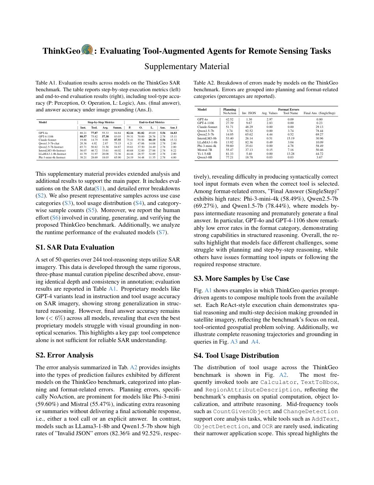

~~~~~text
ThinkGeo
: Evaluating Tool-Augmented Agents for Remote Sensing Tasks
Supplementary Material
Table A1. Evaluation results across models on the ThinkGeo SAR
benchmark. The table reports step-by-step execution metrics (left)
and end-to-end evaluation results (right), including tool-type accu-
racy (P: Perception, O: Operation, L: Logic), Ans. (final answer),
and answer accuracy under image grounding (Ans I).
Model
Step-by-Step Metrics
End-to-End Metrics
Inst.
Tool.
Arg.
Summ.
P.
O.
L.
Ans.
Ans I
GPT-4o
88.21
77.87
55.33
84.84
82.16
81.82
49.69
5.56
16.83
GPT-4-1106
88.57
75.82
57.38
83.03
59.31
70.00
28.76
2.78
15.11
Claude-Sonnet
19.86
14.75
0.00
87.55
75.41
55.56
80.19
5.56
15.32
Qwen1.5-7b-chat
20.36
4.92
2.87
75.15
4.21
47.06
14.08
2.78
2.00
Qwen2.5-7b-Instruct
65.71
50.82
31.56
84.87
19.61
37.50
24.49
2.78
2.00
InternLM3-8b-Instruct
56.07
46.72
33.61
44.02
40.68
32.00
27.88
2.78
9.22
LLaMA3-1-8b-Instruct
41.79
31.97
20.08
72.36
44.44
28.57
32.89
2.78
2.00
Phi-3-mini-4k-Instruct
38.21
28.69
18.03
65.90
24.19
34.48
11.35
2.78
4.00
This supplementary material provides extended analysis and
additional results to support the main paper. It includes eval-
uations on the SAR data(S1), and detailed error breakdowns
(S2). We also present representative samples across use case
categories (S3), tool usage distribution (S4), and category-
wise sample counts (S5). Moreover, we report the human
effort (S6) involved in curating, generating, and verifying the
proposed ThinkGeo benchmark. Additionally, we analyze
the runtime performance of the evaluated models (S7).
S1. SAR Data Evaluation
A set of 50 queries over 244 tool-reasoning steps utilize SAR
imagery. This data is developed through the same rigorous,
three-phase manual curation pipeline described above, ensur-
ing identical depth and consistency in annotation; evaluation
results are reported in Table A1. Proprietary models like
GPT-4 variants lead in instruction and tool usage accuracy
on SAR imagery, showing strong generalization in struc-
tured reasoning. However, final answer accuracy remains
low (< 6%) across all models, revealing that even the best
proprietary models struggle with visual grounding in non-
optical scenarios. This highlights a key gap: tool competence
alone is not sufficient for reliable SAR understanding.
S2. Error Analysis
The error analysis summarized in Tab. A2 provides insights
into the types of prediction failures exhibited by different
models on the ThinkGeo benchmark, categorized into plan-
ning and format-related errors. Planning errors, specifi-
cally NoAction, are prominent for models like Phi-3-mini
(59.60%) and Mistral (55.47%), indicating extra reasoning
or summaries without delivering a final actionable response,
i.e., either a tool call or an explicit answer. In contrast,
models such as LLama3-1-8b and Qwen1.5-7b show high
rates of ”Invalid JSON” errors (82.36% and 92.52%, respec-
Table A2. Breakdown of errors made by models on the ThinkGeo
benchmark. Errors are grouped into planning and format-related
categories (percentages are reported).
Model
Planning
Format Errors
NoAction
Inv. JSON
Arg. Values
Tool Name
Final Ans. (SingleStep)
GPT-4o
42.52
1.30
2.97
0.09
0.00
GPT-4-1106
27.39
9.67
2.83
0.00
0.23
Claude-Sonnet
51.71
48.29
0.00
0.00
29.13
Qwen1.5-7b
3.74
92.52
0.00
3.74
78.44
Qwen2.5-7b
14.05
65.62
4.44
0.52
69.27
InternLM3-8b
53.40
26.14
0.51
15.19
30.96
LLaMA3-1-8b
13.92
82.36
0.49
3.04
10.09
Phi-3-mini-4k
59.60
35.61
0.00
4.78
58.49
Mistral-7B
55.47
37.13
0.15
7.16
50.46
Yi-1.5-6B
81.33
5.40
0.00
13.28
44.72
Qwen3-8B
77.21
18.78
0.03
0.03
3.67
tively), revealing difficulty in producing syntactically correct
tool input formats even when the correct tool is selected.
Among format-related errors, ”Final Answer (SingleStep)”
exhibits high rates: Phi-3-mini-4k (58.49%), Qwen2.5-7b
(69.27%), and Qwen1.5-7b (78.44%), where models by-
pass intermediate reasoning and prematurely generate a final
answer. In particular, GPT-4o and GPT-4-1106 show remark-
ably low error rates in the format category, demonstrating
strong capabilities in structured reasoning. Overall, the re-
sults highlight that models face different challenges, some
struggle with planning and step-by-step reasoning, while
others have issues formatting tool inputs or following the
required response structure.
S3. More Samples by Use Case
Fig. A1 shows examples in which ThinkGeo queries prompt-
driven agents to compose multiple tools from the available
set. Each ReAct-style execution chain demonstrates spa-
tial reasoning and multi-step decision making grounded in
satellite imagery, reflecting the benchmark’s focus on real,
tool-oriented geospatial problem solving. Additionally, we
illustrate complete reasoning trajectories and grounding in
queries in Fig. A3 and A4.
S4. Tool Usage Distribution
The distribution of tool usage across the ThinkGeo
benchmark is shown in Fig. A2.
The most fre-
quently invoked tools are Calculator, TextToBbox,
and RegionAttributeDescription, reflecting the
benchmark’s emphasis on spatial computation, object lo-
calization, and attribute reasoning. Mid-frequency tools
such as CountGivenObject and ChangeDetection
support core analysis tasks, while tools such as AddText,
ObjectDetection, and OCR are rarely used, indicating
their narrower application scope. This spread highlights the
~~~~~

## 原稿第 12 / 14 页

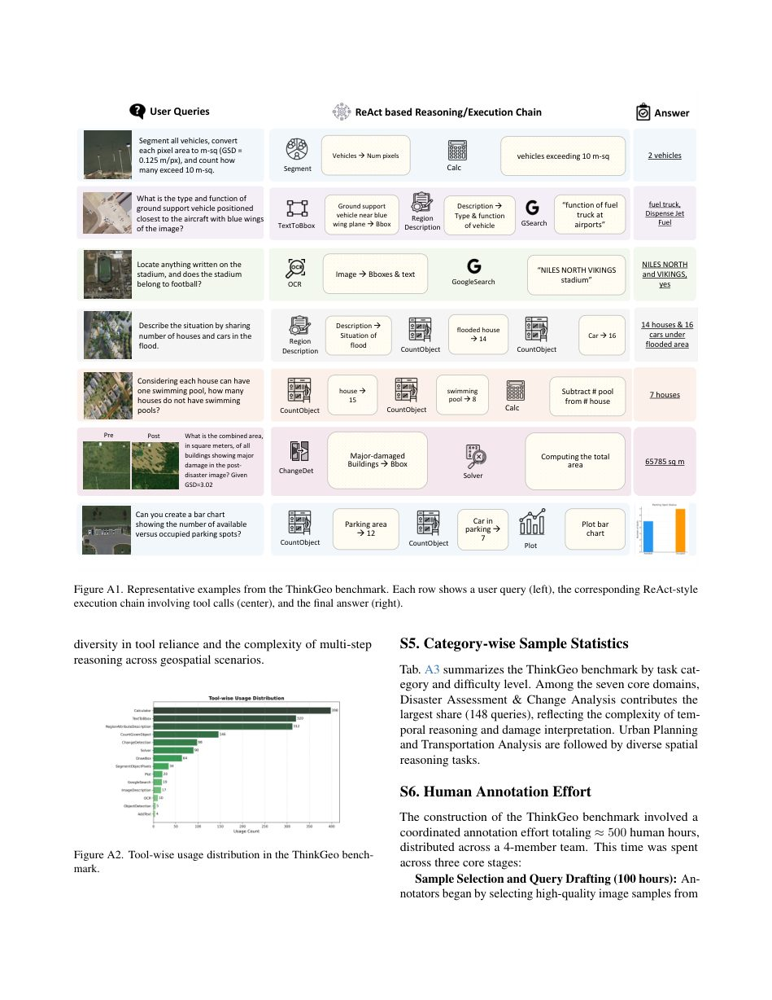

~~~~~text
65785 sq m
7 houses
14 houses & 16 
cars under 
flooded area
User Queries
TextToBbox
ReAct based Reasoning/Execution Chain
Answer
Segment all vehicles, convert 
each pixel area to m-sq (GSD = 
0.125 m/px), and count how 
many exceed 10 m-sq.
Vehicles → Num pixels
2 vehicles
vehicles exceeding 10 m-sq
Locate anything written on the 
stadium, and does the stadium 
belong to football?
NILES NORTH 
and VIKINGS,
yes
Describe the situation by sharing 
number of houses and cars in the 
flood.
Considering each house can have 
one swimming pool, how many 
houses do not have swimming 
pools?
What is the combined area, 
in square meters, of all 
buildings showing major 
damage in the post-
disaster image? Given 
GSD=3.02
Major-damaged 
Buildings → Bbox
ChangeDet
Pre
fuel truck,
Dispense Jet 
Fuel
What is the type and function of 
ground support vehicle positioned 
closest to the aircraft with blue wings 
of the image?
Post
Can you create a bar chart 
showing the number of available 
versus occupied parking spots?
Ground support 
vehicle near blue 
wing plane → Bbox
Region
Description
Description → 
Type & function 
of vehicle
GSearch
“function of fuel 
truck at 
airports”
Segment
Calc
OCR
Image → Bboxes & text 
“NILES NORTH VIKINGS 
stadium”
GoogleSearch
Region
Description
Description → 
Situation of 
flood
CountObject
flooded house 
→ 14
CountObject
Car → 16
CountObject
house → 
15
CountObject
swimming 
pool → 8
Subtract # pool 
from # house
Calc
Solver
Computing the total 
area
CountObject
Parking area 
→ 12 
CountObject
Car in 
parking → 
7 
Plot
Plot bar 
chart
Figure A1. Representative examples from the ThinkGeo benchmark. Each row shows a user query (left), the corresponding ReAct-style
execution chain involving tool calls (center), and the final answer (right).
diversity in tool reliance and the complexity of multi-step
reasoning across geospatial scenarios.
Figure A2. Tool-wise usage distribution in the ThinkGeo bench-
mark.
S5. Category-wise Sample Statistics
Tab. A3 summarizes the ThinkGeo benchmark by task cat-
egory and difficulty level. Among the seven core domains,
Disaster Assessment & Change Analysis contributes the
largest share (148 queries), reflecting the complexity of tem-
poral reasoning and damage interpretation. Urban Planning
and Transportation Analysis are followed by diverse spatial
reasoning tasks.
S6. Human Annotation Effort
The construction of the ThinkGeo benchmark involved a
coordinated annotation effort totaling ≈500 human hours,
distributed across a 4-member team. This time was spent
across three core stages:
Sample Selection and Query Drafting (100 hours): An-
notators began by selecting high-quality image samples from
~~~~~

## 原稿第 13 / 14 页

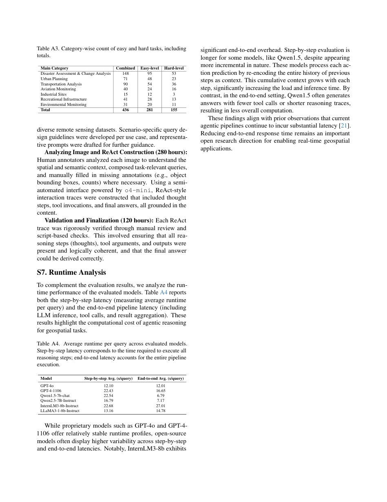

~~~~~text
Table A3. Category-wise count of easy and hard tasks, including
totals.
Main Category
Combined
Easy-level
Hard-level
Disaster Assessment & Change Analysis
148
95
53
Urban Planning
71
48
23
Transportation Analysis
90
54
36
Aviation Monitoring
40
24
16
Industrial Sites
15
12
3
Recreational Infrastructure
41
28
13
Environmental Monitoring
31
20
11
Total
436
281
155
diverse remote sensing datasets. Scenario-specific query de-
sign guidelines were developed per use case, and representa-
tive prompts were drafted for further guidance.
Analyzing Image and ReAct Construction (280 hours):
Human annotators analyzed each image to understand the
spatial and semantic context, composed task-relevant queries,
and manually filled in missing annotations (e.g., object
bounding boxes, counts) where necessary. Using a semi-
automated interface powered by o4-mini, ReAct-style
interaction traces were constructed that included thought
steps, tool invocations, and final answers, all grounded in the
content.
Validation and Finalization (120 hours): Each ReAct
trace was rigorously verified through manual review and
script-based checks. This involved ensuring that all rea-
soning steps (thoughts), tool arguments, and outputs were
present and logically coherent, and that the final answer
could be derived correctly.
S7. Runtime Analysis
To complement the evaluation results, we analyze the run-
time performance of the evaluated models. Table A4 reports
both the step-by-step latency (measuring average runtime
per query) and the end-to-end pipeline latency (including
LLM inference, tool calls, and result aggregation). These
results highlight the computational cost of agentic reasoning
for geospatial tasks.
Table A4. Average runtime per query across evaluated models.
Step-by-step latency corresponds to the time required to execute all
reasoning steps; end-to-end latency accounts for the entire pipeline
execution.
Model
Step-by-step Avg. (s/query)
End-to-end Avg. (s/query)
GPT-4o
12.10
12.01
GPT-4-1106
22.43
16.65
Qwen1.5-7b-chat
22.54
6.79
Qwen2.5-7B-Instruct
16.79
7.17
InternLM3-8b-Instruct
22.68
27.01
LLaMA3-1-8b-Instruct
13.16
14.78
While proprietary models such as GPT-4o and GPT-4-
1106 offer relatively stable runtime profiles, open-source
models often display higher variability across step-by-step
and end-to-end latencies. Notably, InternLM3-8b exhibits
significant end-to-end overhead. Step-by-step evaluation is
longer for some models, like Qwen1.5, despite appearing
more incremental in nature. These models process each ac-
tion prediction by re-encoding the entire history of previous
steps as context. This cumulative context grows with each
step, significantly increasing the load and inference time. By
contrast, in the end-to-end setting, Qwen1.5 often generates
answers with fewer tool calls or shorter reasoning traces,
resulting in less overall computation.
These findings align with prior observations that current
agentic pipelines continue to incur substantial latency [21].
Reducing end-to-end response time remains an important
open research direction for enabling real-time geospatial
applications.
~~~~~

## 原稿第 14 / 14 页

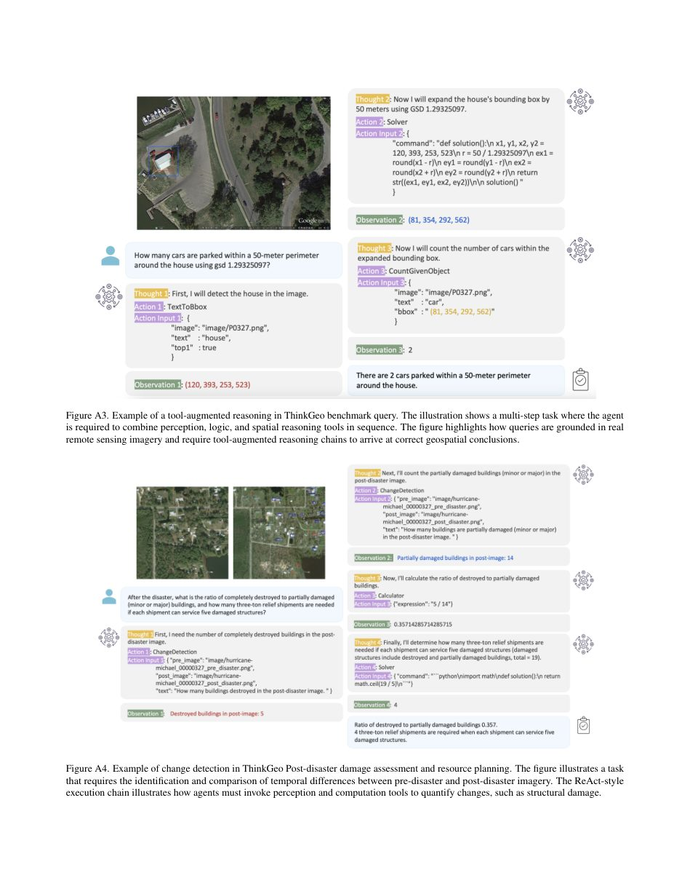

~~~~~text
Figure A3. Example of a tool-augmented reasoning in ThinkGeo benchmark query. The illustration shows a multi-step task where the agent
is required to combine perception, logic, and spatial reasoning tools in sequence. The figure highlights how queries are grounded in real
remote sensing imagery and require tool-augmented reasoning chains to arrive at correct geospatial conclusions.
Figure A4. Example of change detection in ThinkGeo Post-disaster damage assessment and resource planning. The figure illustrates a task
that requires the identification and comparison of temporal differences between pre-disaster and post-disaster imagery. The ReAct-style
execution chain illustrates how agents must invoke perception and computation tools to quantify changes, such as structural damage.
~~~~~
