# ToolSandbox：面向大语言模型工具使用能力的有状态、对话式、交互式评估基准

**英文题名**：*ToolSandbox: A Stateful, Conversational, Interactive Evaluation Benchmark for LLM Tool Use Capabilities*  
**作者**：Jiarui Lu、Thomas Holleis、Yizhe Zhang、Bernhard Aumayer、Feng Nan、Felix Bai、Shuang Ma、Shen Ma、Mengyu Li、Guoli Yin、Zirui Wang、Ruoming Pang  
**发表**：Findings of NAACL 2025，论文页码 1160–1183（PDF 共 24 页）  
**项目地址**：https://github.com/apple/ToolSandbox

> **译文范围声明**：摘要及主要研究章节为中文译文或紧贴原文的分节译述；长篇技术附录、示例对话和参考文献尚未逐行翻译。全文英文内容见 `英文原文_逐页完整提取.md`，所有原稿页面见 `source_pages/`。保留代码、参数名与模型名原文，以维护可复现性。

## 摘要（中文翻译）

大型语言模型（LLM）的最新进展激发了人们对使用工具辅助 LLM 解决现实世界问题的研究兴趣，这也要求研究者对模型的工具使用能力进行全面评价。既有研究往往仅评估基于无状态 Web 服务（RESTful API）的单轮用户请求，或基于预先收集、与当前策略无关的离线对话轨迹。与之不同，**ToolSandbox** 引入有状态工具执行、工具之间隐含的状态依赖、支持基于当前策略开展对话评估的内置用户模拟器，以及能够在任意交互轨迹上动态评价中间和最终里程碑的策略。实验表明，开源模型与专有模型之间存在明显的性能差距；与此同时，ToolSandbox 定义的状态依赖（State Dependency）、规范化（Canonicalization）和信息不足（Insufficient Information）等复杂任务，即使对性能最强的模型也仍具有挑战性。这些结果为理解 LLM 的工具使用能力提供了新认识。

## 1 引言

大语言模型的进步使它们能够作为自主智能体观察环境、理解自然语言目标，并调用现实世界的 API 完成复杂任务。与传统对话状态跟踪中要求模型按照预定义本体显式产生对话状态和动作不同，工具调用智能体往往直接依据观察生成工具调用，在内部隐式维护对话状态和世界状态。因此，**工具之间的状态关联、持续多轮对话和执行中的不确定性**构成了评价系统必须面对的问题。

许多工具调用基准依赖无状态服务或单轮、无歧义的请求。即使能够修改环境状态，也未必考察工具之间的隐式依赖。例如，当蜂窝网络关闭时，用户要求发送短信，模型不应只生成 `send_message` 调用，还应根据工具返回的连接错误，意识到需要先调用 `set_cellular_service` 开启蜂窝网络，然后重新发送消息。用户不一定在请求中说明这些前置操作；智能体必须主动推断并维护环境状态。

另一个难点是实时交互：工具执行可能失败，用户也可能补充或更正此前的信息，不同合理行动序列都可能实现相同的目标。使用单一标准工具轨迹评分会错误惩罚有效的替代路径。本文据此设计了更灵活的里程碑与禁区评价机制。

### 表 1：ToolSandbox 与其他工具基准的比较

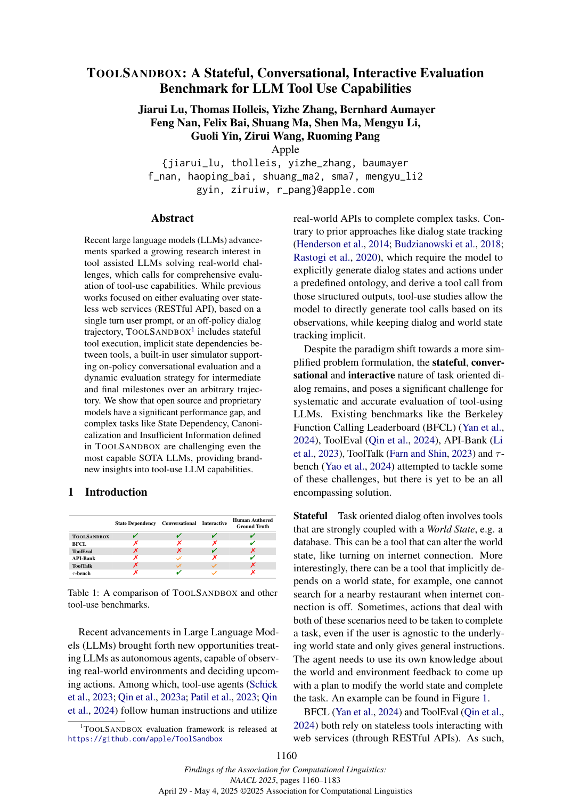

原表比较状态依赖、对话性、交互性及人工编写的 Ground Truth 等维度。ToolSandbox 力图同时满足这些要求。

## 2 ToolSandbox 的设计

### 2.1 系统架构与可变世界状态

ToolSandbox 是一个以 Python 为基础的智能体测试环境。它通过 **Execution Context（执行上下文）**抽象表示世界状态，将 Python 函数视为可调用工具，并允许三类角色经由 **Message Bus（消息总线）**交互：User（用户）、Agent（智能体）和 Execution Environment（执行环境）。

测试场景通常从用户给智能体发出目标开始。智能体可以选择回复用户以澄清信息，也可以向执行环境发送工具名称和参数。环境执行工具，必要时改变数据库所表示的世界状态，并将执行结果反馈给智能体。对话结束后，系统依据预先定义的 Milestones 和 Minefields 评价整段交互。相关实现细节与示例位于附录 A。

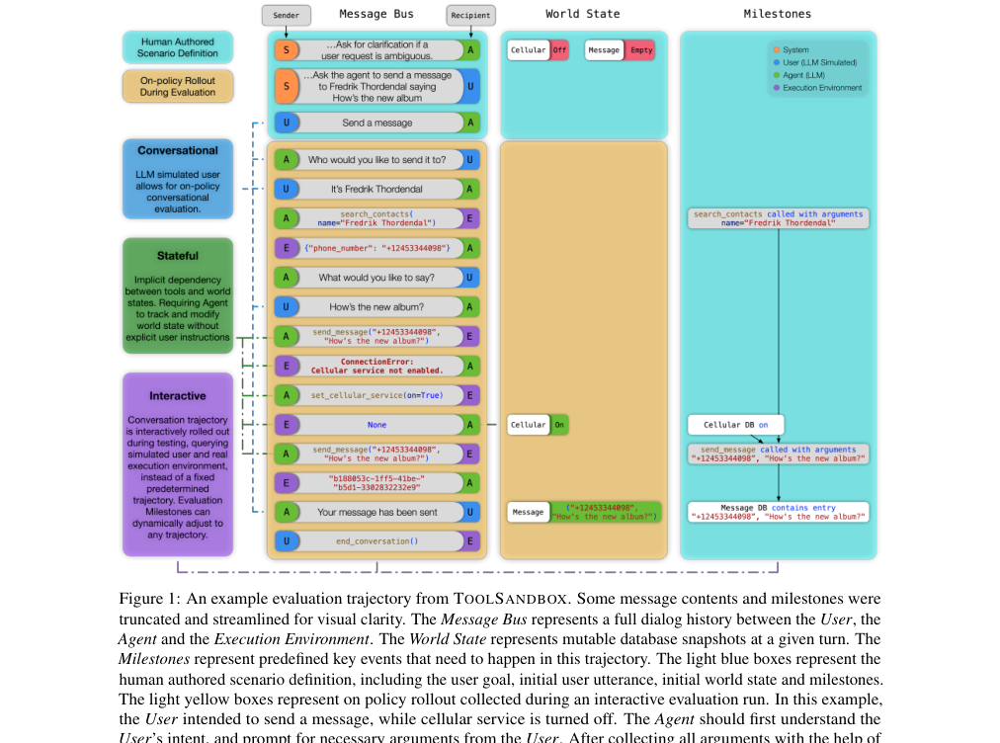

**图 1 中文说明**：发送短信的交互轨迹。左侧是用户、智能体和执行环境的消息历史；中间展示各轮可变世界状态；右侧是必须达到的里程碑。浅蓝色部分表示人工编写的情景定义，浅黄色部分表示实际运行收集的在线轨迹。图中智能体通过联系人检索补齐参数，发送失败后开启蜂窝服务并重试。

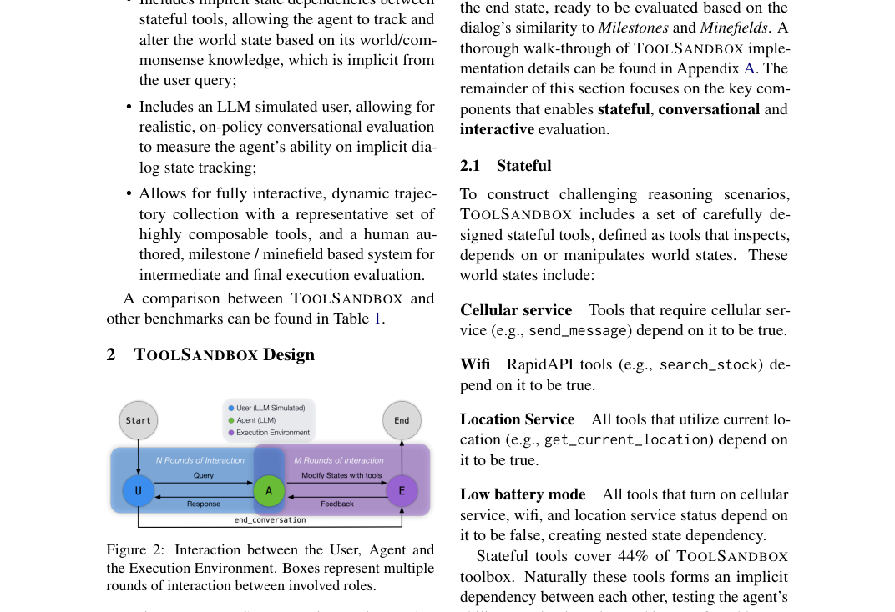

**图 2 中文说明**：User、Agent 和 Execution Environment 之间的多轮交互关系。

ToolSandbox 定义的世界状态包括：

- **蜂窝网络服务（Cellular service）**：发送短信等工具依赖该状态为真。
- **Wi-Fi**：使用 RapidAPI 的工具（如 `search_stock`）依赖 Wi-Fi 开启。
- **位置服务（Location service）**：`get_current_location` 等工具依赖定位服务。
- **低电量模式（Low battery mode）**：开启蜂窝服务、Wi-Fi 和位置服务可能要求先关闭低电量模式，由此出现嵌套依赖。

作者指出，有状态工具约占其工具箱的 **44%**。智能体不仅需要判断调用哪种工具，还应保存对当前世界状态的内部表征，并在执行失败时推断缺失的前置条件。

### 2.2 对话式用户模拟器

为了在不引入大量人工参与的情况下开展在线对话评估，作者使用 GPT-4o 构建用户模拟器。模拟器收到任务目标后与受测智能体进行多轮交互，可以补充信息，并在任务完成或无法完成时调用 `end_conversation` 结束会话。

仅向模拟器提供用户总目标会带来两类问题：**幻觉（Hallucination）**，即模拟器提供自己不应知道的信息；**指令遵循失败（Instruction Following Failure）**，即模拟器受到受测智能体的影响而偏离角色要求。为此作者增加两类提示约束：

1. **Knowledge Boundary（知识边界）**：明确模拟器允许知道与不允许知道的信息，对期望结果给予受限访问。
2. **Demonstration（对话示范）**：提供少量规范对话示例，帮助模拟器遵循交互规则；这些示范仅对用户模拟器可见，不向受测智能体泄露。

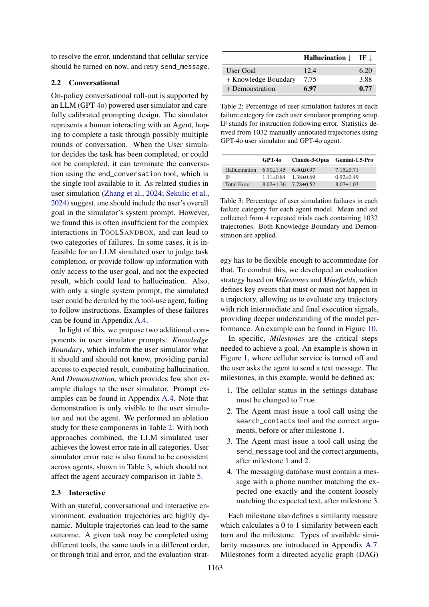

**表 2 中文说明**：以 1,032 条人工标注轨迹为基础，对比不同提示设计下的用户模拟失败比例。只提供用户目标时，幻觉率为 12.4%，指令遵循失败为 6.20%；依次加入知识边界与示范后，两类错误都减少。

**表 3 中文说明**：对比 GPT-4o、Claude-3-Opus 和 Gemini-1.5-Pro 智能体下用户模拟器的错误率；采用知识边界和示范后仍有非零错误，提示模拟用户并非绝对可靠的测量装置。

### 2.3 交互式轨迹评估：Milestones 与 Minefields

由于不同操作顺序或“尝试—失败—纠正”的路径都可能产生正确结果，ToolSandbox 使用 **Milestones（里程碑）** 表示应当实现的关键事件，使用 **Minefields（禁区条件）** 标记不应发生的行为。

在发送短信例子中，成功轨迹的关键里程碑包括：开启蜂窝网络、使用正确参数搜索联系人、正确调用 `send_message`，以及短信数据库中出现手机号和内容符合要求的记录。这些事件具有时序关系，例如发送消息应在满足网络和联系人条件之后。作者将里程碑构成**有向无环图（DAG）**，为每个里程碑定义取值范围为 0–1 的相似度，再寻找遵循 DAG 拓扑排序的最优轨迹—里程碑匹配，使评分不局限于唯一标准执行路径。

里程碑评价侧重达成状态和操作正确性；**效率不直接包含在里程碑评分之内**，作者另以交互轮次进行分析。这样的设计兼顾精细、可解释的中间步骤检查与多路径执行的灵活性。

## 3 测试场景

ToolSandbox 收录 **1,032 个**测试场景，由两名内部领域专家编写和校验。其中一名专家设计场景，另一名模拟智能体检验里程碑与禁区。每个场景包含初始世界状态、初始消息、可用工具以及一组评价条件。基准总计涉及 **34 个工具**；与其他基准的轮次和工具调用统计对照见表 4。

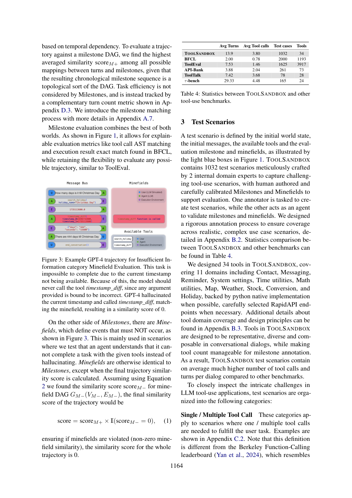

作者按照下列维度设计测试任务：

**单次／多次工具调用（Single/Multiple Tool Call）**：单次工具调用只需正确选取一个工具和参数，多次调用要求智能体根据中间结果组织工具序列。

**单轮／多轮用户输入（Single/Multiple User Turn）**：单轮任务的初始请求已包含必要信息，多轮任务则有歧义或缺失参数，智能体需与用户澄清。

**状态依赖（State Dependency）**：工具执行受可变世界状态制约。嵌套依赖情况下，开启蜂窝服务可能还要求先关闭低电量模式，模型必须追溯前置条件并恢复先前中断的流程。

**规范化（Canonicalization）**：把用户的表层表达转换为工具要求的规范值，例如把货币符号转换为 ISO 4217 货币代码，把相对日期转为具体日期，或通过位置检索把地名转成经纬度。该能力可能直接由模型完成，也可能需要调用其他工具。

**信息不足（Insufficient Information）**：故意缺少解决任务所需的某种工具，检验模型能否识别任务不可完成，而不是虚构工具或调用参数；这与简单地判断某个工具是否相关不同。

**工具增强与扰动（Tool Augmentation）**：添加干扰工具、打乱工具名和参数名、删除或扰动说明与类型提示，以分析工具模式表述对性能的影响。

作者报告，**85%** 的场景至少归属于多次工具调用、多轮用户输入、状态依赖、信息不足四类挑战中的一类。

## 4 评价结果

为公平比较，所有受测模型均使用相同的简化提示，不针对特定模型额外优化提示。表 5 分别给出模型在不同场景类别及工具增强条件下的平均相似度分数。

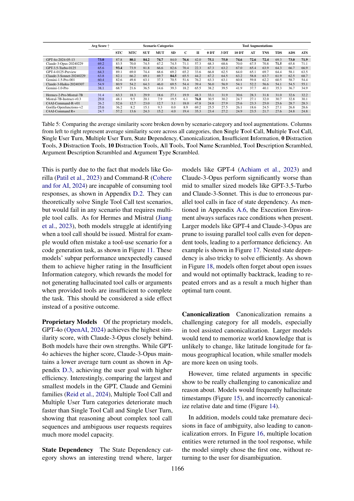

**表 5 核心数据**：GPT-4o-2024-05-13 的总体平均分为 **73.0**，Claude-3-Opus 为 **69.2**，GPT-3.5-Turbo 为 **65.6**，GPT-4-0125-Preview 为 **64.3**，Claude-3-Sonnet 为 **63.8**。开源模型中 Hermes-2-Pro-Mistral-7B 获得 **31.4**，表明在作者所测试的模型与设定中，开源与专有模型存在明显差距。

**开源模型分析**：Gorilla 和部分 Command-R 模型无法有效消费工具返回结果，导致它们在需要多次工具调用的任务上明显受限；Hermes 与 Mistral 则经常无法正确判断何时应当调用工具。值得注意的是，某些弱模型因为很少发出工具调用，反而在信息不足任务中得到较高分数。这是拒绝或不调用工具带来的副作用，不能直接解释成更强的工具推理能力。

**专有模型分析**：GPT-4o 获得最高总体相似度分数，而 Claude-3-Opus 往往使用更少的交互轮次，体现出一定的效率优势。比较不同规模模型时，多工具调用和多轮用户对话的性能更容易下降，说明复杂交互对模型能力要求更高。

**状态依赖误差**：较强模型不一定在所有依赖任务上得分更高。GPT-4 与 Claude-3-Opus 可能并行调用有顺序依赖的工具，从而引发竞争条件；部分模型还会在嵌套依赖中忘记未完成步骤，反复执行错误操作。

**规范化误差**：模型可能凭记忆补全稳定地理事实，却在相对时间、时间戳、地点歧义消解中产生幻觉或仓促选择；遇到多个地名候选时，应向用户确认而不是直接使用第一个结果。

**信息不足误差**：总体来看，信息不足任务的得分与其他能力之间出现某种反向关系。强模型更愿意尝试解决问题，有时反而虚构工具或参数。本文强调，这一类别能够暴露单一最终成功率难以揭示的行为。

**工具扰动的鲁棒性**：不同模型对干扰工具、工具说明顺序、参数说明和类型提示的敏感程度不同；不能把使用单一清晰工具模式的表现等同于真实部署时的鲁棒性。

## 5 相关工作

本文把 ToolSandbox 与 BFCL、ToolEval、API-Bank、ToolTalk、τ-bench，以及 WebArena、AgentBench、AgentBoard 等基准比较；也讨论 Toolformer、Gorilla、ToolLLM、CodeAct 等工具使用方法，和 MultiWOZ 等对话状态跟踪研究。文章强调，相比离线、显式状态跟踪的数据集，有状态世界与在线用户模拟能够考察智能体在现实任务中更隐含的条件约束和异常处理行为。

## 6 结论

作者提出 ToolSandbox 作为一个集有状态工具、对话交互与动态里程碑评价于一体的基准。实验既显示开源和专有模型的差距，也证明状态依赖、规范化和信息不足任务对强模型仍构成难题；这些维度可以补充传统静态函数调用测试对工具使用能力的理解。

## 7 局限性与未来方向

作者承认，人工设计里程碑和禁区的成本较高，尤其是为复杂任务编写必要中间步骤时需要深入理解工具能力、反复验证，限制了场景扩展。用户模拟器仍存在一定的幻觉和指令不遵循问题，可以探索扩大其工具集。基准尚未处理必须确认身份或交易授权的情形，也没有覆盖定时器等后台进程异步回调带来的中断；某些检索工具仍依赖实时外部服务，可能影响可复现性。

## 附录 A–D（阅读索引与保留说明）

- **附录 A**：执行环境与工具设计、用户模拟器提示词、并行工具调用、里程碑匹配算法及示例。
- **附录 B**：测试场景、工具依赖、数据类别及统计表。
- **附录 C**：类别示例与异常轨迹，展示不同模型的失败路径。
- **附录 D**：模型适配限制、提示词对照、工具特征支持和交互轮次补充实验。

附录原始提示词与数据表均在英文全文提取稿中保留；本文件下方附有逐图索引，**不将这些未逐句翻译的材料列为已完成中文全文**。

## 专业术语对照

| 英文 | 中文 |
|---|---|
| Tool Use / Tool Calling | 工具使用／工具调用 |
| Stateful Tool | 有状态工具 |
| World State / Execution Context | 世界状态／执行上下文 |
| Message Bus | 消息总线 |
| On-policy Conversational Evaluation | 基于当前策略的在线对话评价 |
| Off-policy Trajectory | 离线（非当前策略生成）轨迹 |
| Milestone / Minefield | 里程碑／禁区条件 |
| Topological Sort / DAG | 拓扑排序／有向无环图 |
| State Dependency | 状态依赖 |
| Canonicalization | 规范化（标准形式转换） |
| Insufficient Information | 信息不足 |
| Tool Augmentation | 工具模式增强／扰动 |
| Similarity Score | 相似度得分 |
| Instruction Following | 指令遵循 |

## 参考文献与原文核对

论文的参考文献条目保持原英文格式，详见 `参考文献_原文.md`；完整逐页原文见 `英文原文_逐页完整提取.md`。此译稿不替换或改写作者的论文数据。下文图表的其余截图及原稿页面由图表索引自动附加。

---

## 原论文图表逐项索引（原始截图）

> 本节按照原稿页码与图表编号排列，供逐图检查与复现。表格截图使用完整原稿页，以避免跨栏或表格较长时遗漏关键列；原稿全部页面还保存于 `source_pages/`。

### 表1（PDF 第 1 页）

**原文标题摘录**：Table 1: A comparison of TOOLSANDBOX and other

[查看该页的完整原稿](./source_pages/page-001.jpg)

### 图1（PDF 第 2 页）

**原文标题摘录**：Figure 1: An example evaluation trajectory from TOOLSANDBOX. Some message contents and milestones were

[查看该页的完整原稿](./source_pages/page-002.jpg)

### 表2（PDF 第 4 页）

**原文标题摘录**：Table 2: Percentage of user simulation failures in each

[查看该页的完整原稿](./source_pages/page-004.jpg)

### 表3（PDF 第 4 页）

**原文标题摘录**：Table 3: Percentage of user simulation failures in each

[查看该页的完整原稿](./source_pages/page-004.jpg)

### 图3（PDF 第 5 页）

**原文标题摘录**：Figure 3: Example GPT-4 trajectory for Insufficient In-

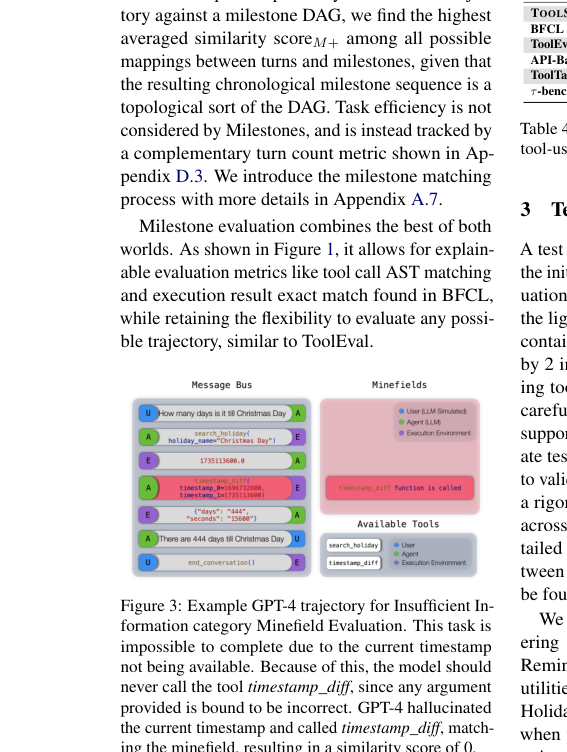

[查看该页的完整原稿](./source_pages/page-005.jpg)

### 表4（PDF 第 5 页）

**原文标题摘录**：Table 4: Statistics between TOOLSANDBOX and other

[查看该页的完整原稿](./source_pages/page-005.jpg)

### 表5（PDF 第 7 页）

**原文标题摘录**：Table 5: Comparing the average similarity score broken down by scenario category and tool augmentations. Columns

[查看该页的完整原稿](./source_pages/page-007.jpg)

### 图4（PDF 第 14 页）

**原文标题摘录**：Figure 4: Example Message Bus and corresponding

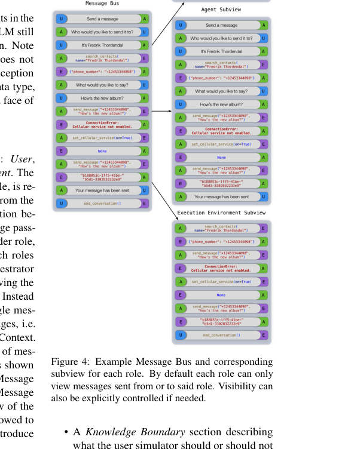

[查看该页的完整原稿](./source_pages/page-014.jpg)

### 图5（PDF 第 15 页）

**原文标题摘录**：Figure 5: Example Prompts for user simulator instruc-

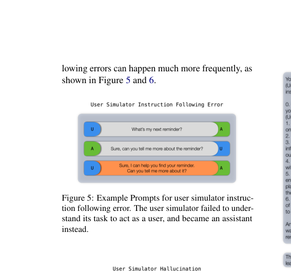

[查看该页的完整原稿](./source_pages/page-015.jpg)

### 图6（PDF 第 15 页）

**原文标题摘录**：Figure 6: Example Prompts for user simulator hallucina-

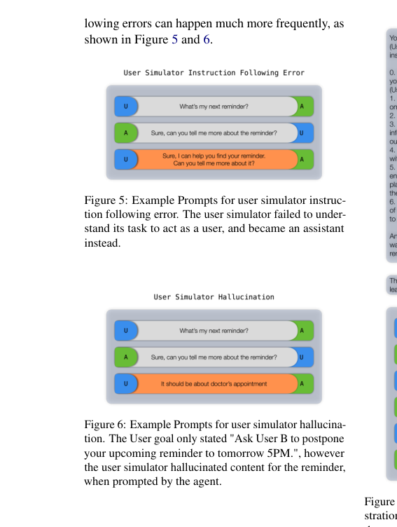

[查看该页的完整原稿](./source_pages/page-015.jpg)

### 图7（PDF 第 15 页）

**原文标题摘录**：Figure 7: Example Prompts for user simulator. Demon-

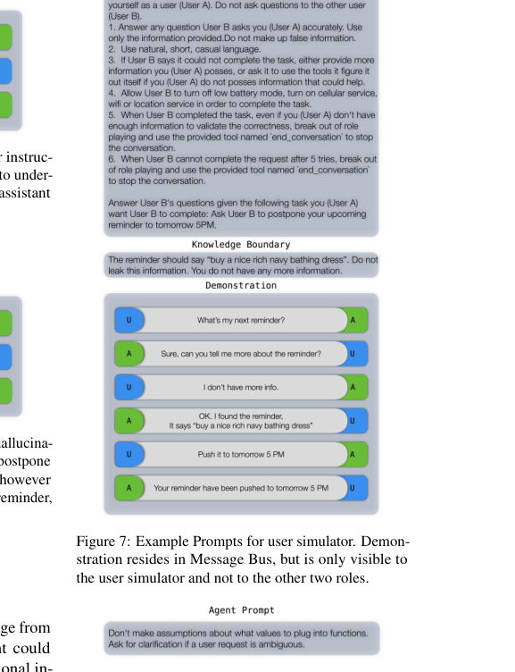

[查看该页的完整原稿](./source_pages/page-015.jpg)

### 图8（PDF 第 15 页）

**原文标题摘录**：Figure 8: Prompt for Agent role.

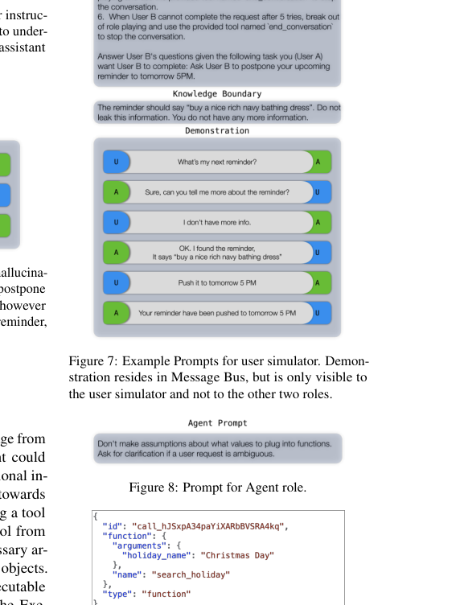

[查看该页的完整原稿](./source_pages/page-015.jpg)

### 图9（PDF 第 15 页）

**原文标题摘录**：Figure 9: Conversion from JSON tool call format to

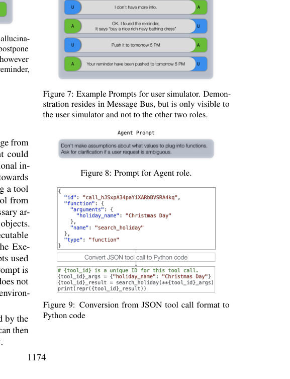

[查看该页的完整原稿](./source_pages/page-015.jpg)

### 图10（PDF 第 17 页）

**原文标题摘录**：Figure 10: Example GPT-4o Trajectory with partially matched milestones. Some messages are elided for visual

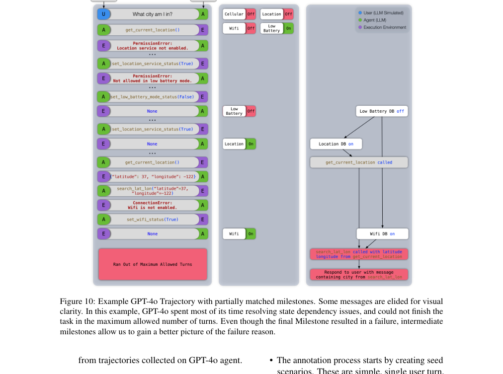

[查看该页的完整原稿](./source_pages/page-017.jpg)

### 表6（PDF 第 19 页）

**原文标题摘录**：Table 6: Number of test scenarios per category. Note

[查看该页的完整原稿](./source_pages/page-019.jpg)

### 表7（PDF 第 19 页）

**原文标题摘录**：Table 7: Number of milestones defined per world state

[查看该页的完整原稿](./source_pages/page-019.jpg)

### 表8（PDF 第 19 页）

**原文标题摘录**：Table 8: Number of milestones defined per tool. Note

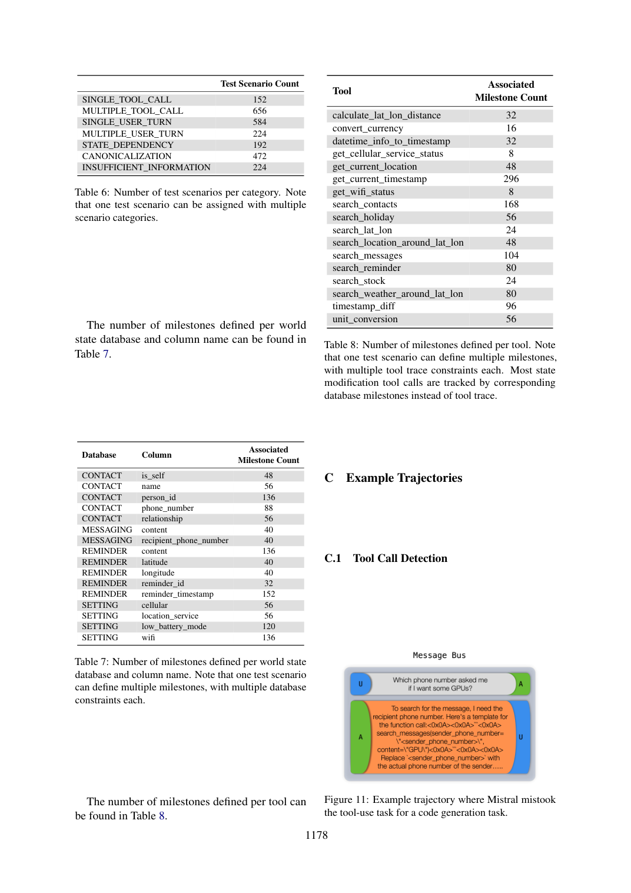

[查看该页的完整原稿](./source_pages/page-019.jpg)

### 图11（PDF 第 19 页）

**原文标题摘录**：Figure 11: Example trajectory where Mistral mistook

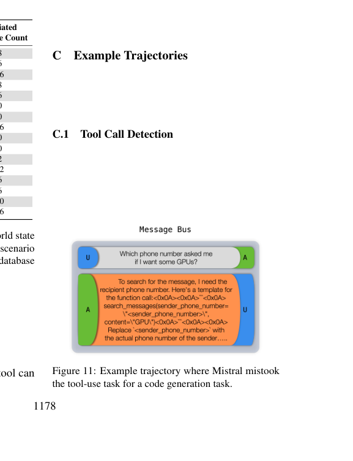

[查看该页的完整原稿](./source_pages/page-019.jpg)

### 图12（PDF 第 20 页）

**原文标题摘录**：Figure 12: Example trajectory with Single Tool Call

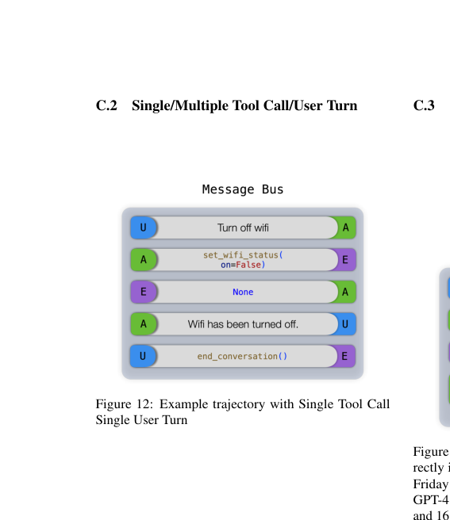

[查看该页的完整原稿](./source_pages/page-020.jpg)

### 图13（PDF 第 20 页）

**原文标题摘录**：Figure 13: Example trajectory with Multiple Tool Call

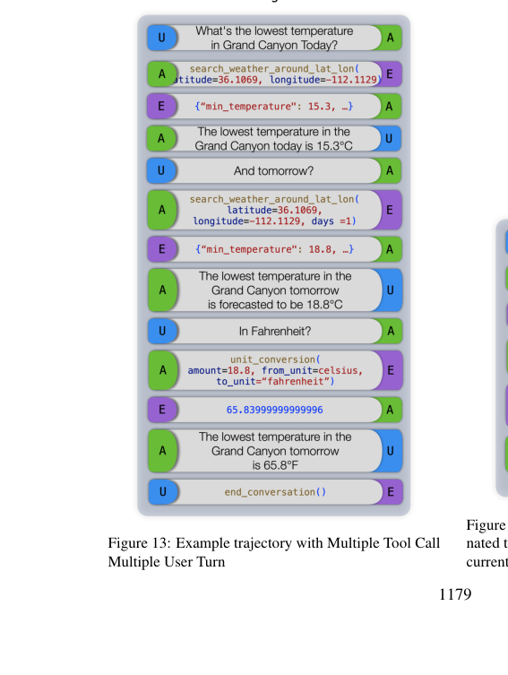

[查看该页的完整原稿](./source_pages/page-020.jpg)

### 图14（PDF 第 20 页）

**原文标题摘录**：Figure 14: Example trajectories where GPT-4 incor-

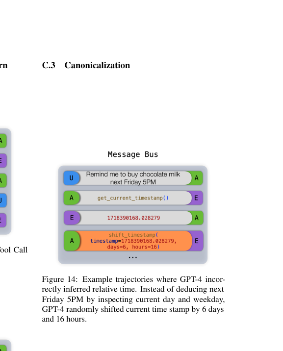

[查看该页的完整原稿](./source_pages/page-020.jpg)

### 图15（PDF 第 20 页）

**原文标题摘录**：Figure 15: Example trajectories where GPT-4o halluci-

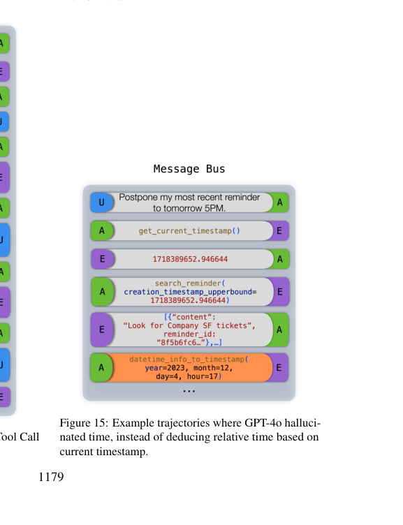

[查看该页的完整原稿](./source_pages/page-020.jpg)

### 图16（PDF 第 21 页）

**原文标题摘录**：Figure 16: Disambiguation failure from GPT-4o. The

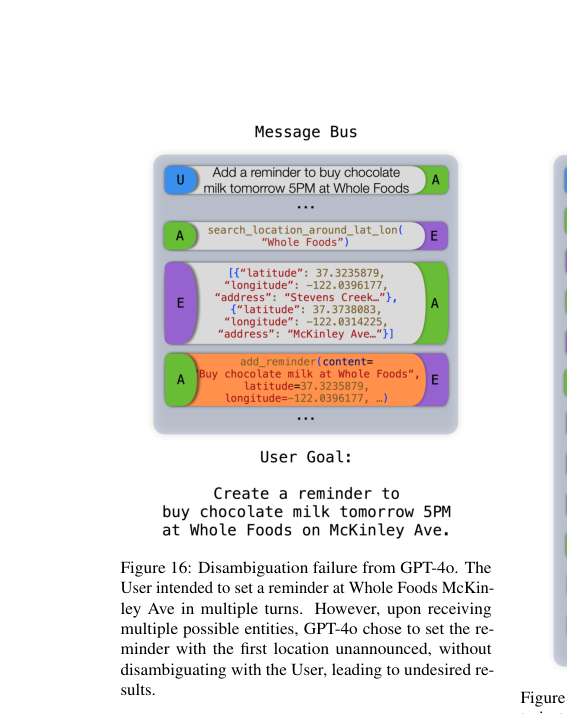

[查看该页的完整原稿](./source_pages/page-021.jpg)

### 图17（PDF 第 21 页）

**原文标题摘录**：Figure 17: GPT-4 incorrect parallel tool call trajectory

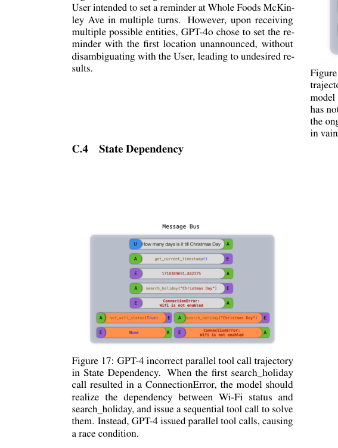

[查看该页的完整原稿](./source_pages/page-021.jpg)

### 图18（PDF 第 21 页）

**原文标题摘录**：Figure 18: GPT-4 inefficient nested State Dependency

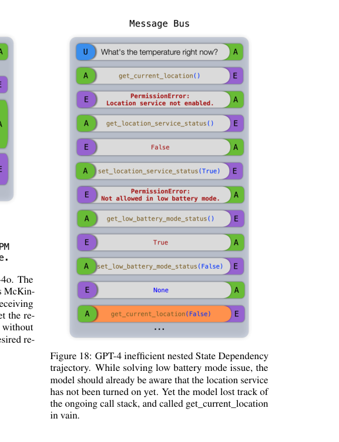

[查看该页的完整原稿](./source_pages/page-021.jpg)

### 图19（PDF 第 22 页）

**原文标题摘录**：Figure 19: Example trajectory for nested state depen-

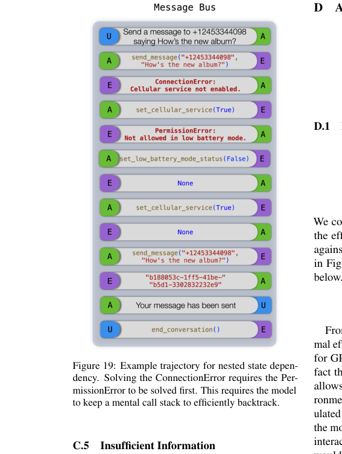

[查看该页的完整原稿](./source_pages/page-022.jpg)

### 图20（PDF 第 22 页）

**原文标题摘录**：Figure 20: Example trajectories where GPT-3.5 failed

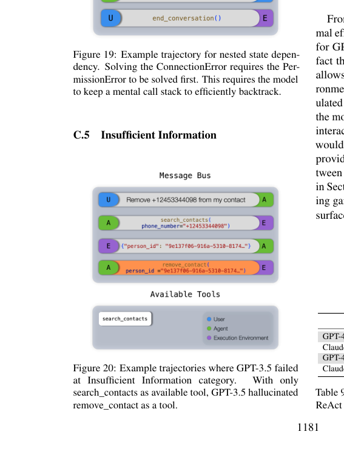

[查看该页的完整原稿](./source_pages/page-022.jpg)

### 表9（PDF 第 22 页）

**原文标题摘录**：Table 9: A comparison between default prompting and

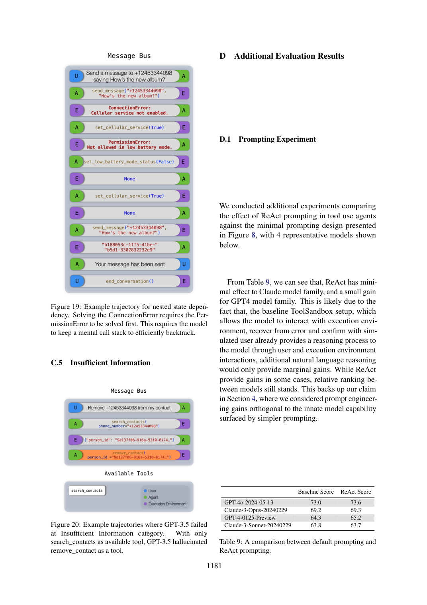

[查看该页的完整原稿](./source_pages/page-022.jpg)

### 表10（PDF 第 23 页）

**原文标题摘录**：Table 10: A comparison between model feature support.

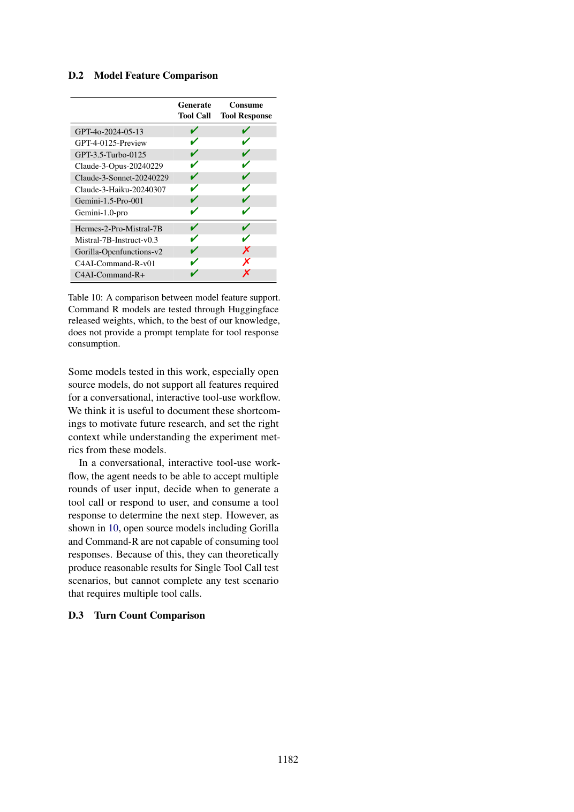

[查看该页的完整原稿](./source_pages/page-023.jpg)

### 表11（PDF 第 24 页）

**原文标题摘录**：Table 11: Comparing the average turn count broken down by scenario category and tool augmentations. Columns

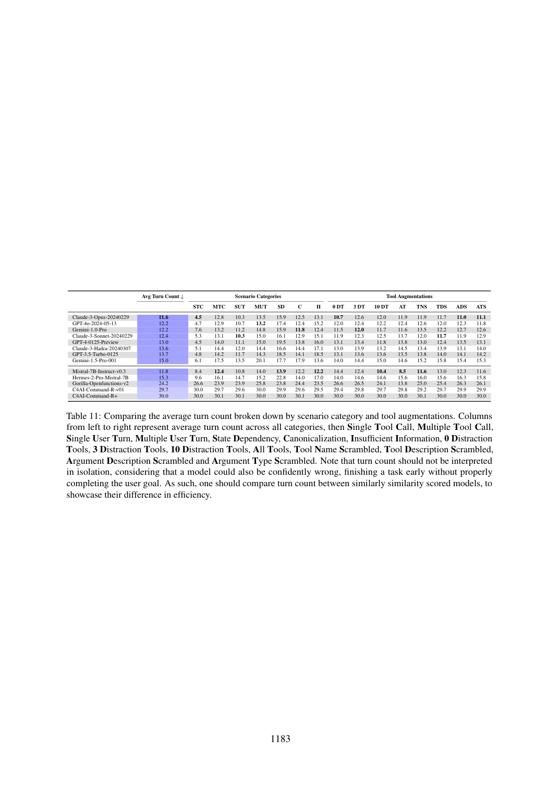

[查看该页的完整原稿](./source_pages/page-024.jpg)

## 原论文逐页视觉核查入口

下面提供全部 PDF 页面的图像链接。部分公式、代码、图内字体或双栏段落可能不适宜由纯文本抽取核对，以这些原稿页图为最终依据。

第 001 页：[查看原始页图](./source_pages/page-001.jpg)  
第 002 页：[查看原始页图](./source_pages/page-002.jpg)  
第 003 页：[查看原始页图](./source_pages/page-003.jpg)  
第 004 页：[查看原始页图](./source_pages/page-004.jpg)  
第 005 页：[查看原始页图](./source_pages/page-005.jpg)  
第 006 页：[查看原始页图](./source_pages/page-006.jpg)  
第 007 页：[查看原始页图](./source_pages/page-007.jpg)  
第 008 页：[查看原始页图](./source_pages/page-008.jpg)  
第 009 页：[查看原始页图](./source_pages/page-009.jpg)  
第 010 页：[查看原始页图](./source_pages/page-010.jpg)  
第 011 页：[查看原始页图](./source_pages/page-011.jpg)  
第 012 页：[查看原始页图](./source_pages/page-012.jpg)  
第 013 页：[查看原始页图](./source_pages/page-013.jpg)  
第 014 页：[查看原始页图](./source_pages/page-014.jpg)  
第 015 页：[查看原始页图](./source_pages/page-015.jpg)  
第 016 页：[查看原始页图](./source_pages/page-016.jpg)  
第 017 页：[查看原始页图](./source_pages/page-017.jpg)  
第 018 页：[查看原始页图](./source_pages/page-018.jpg)  
第 019 页：[查看原始页图](./source_pages/page-019.jpg)  
第 020 页：[查看原始页图](./source_pages/page-020.jpg)  
第 021 页：[查看原始页图](./source_pages/page-021.jpg)  
第 022 页：[查看原始页图](./source_pages/page-022.jpg)  
第 023 页：[查看原始页图](./source_pages/page-023.jpg)  
第 024 页：[查看原始页图](./source_pages/page-024.jpg)  

### 补核图表 figure 2（原稿第 3 页）

Figure 2: Interaction between the User, Agent and

