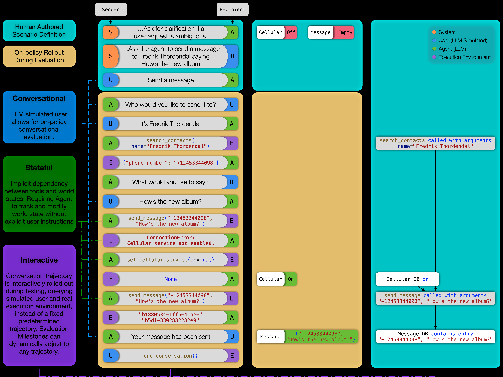
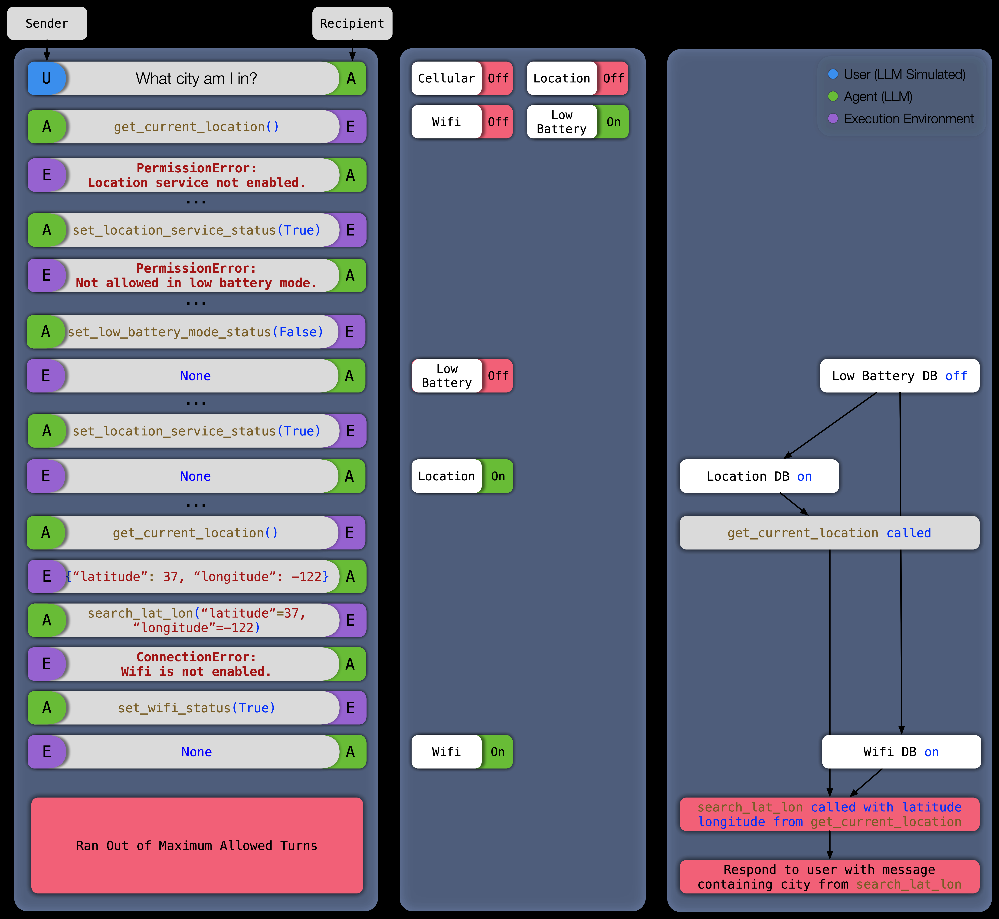
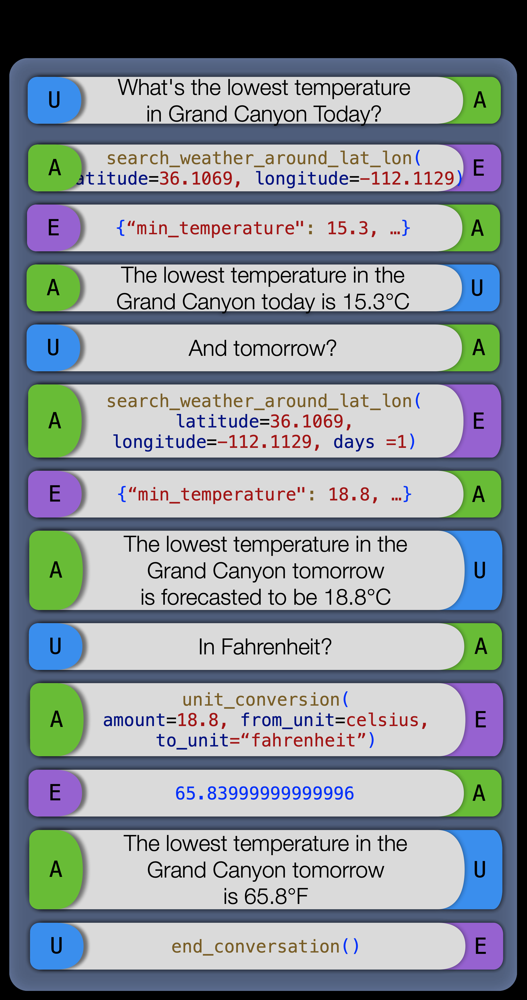

# PDF 原生嵌入图像提取索引

共获取 20 幅具备有效尺寸的原生栅格图片。注意：PDF 中大量图表使用矢量绘图，不存在可直接提取的原生 PNG/JPEG；这些图已通过渲染截图保存于 `images/`。

## XREF 374

## XREF 413

## XREF 540

## XREF 1196

## XREF 1227

## XREF 1228

## XREF 1229

## XREF 1230

## XREF 1231

## XREF 1287

## XREF 1313

## XREF 1321

## XREF 1322

## XREF 1323

## XREF 1324

## XREF 1335

## XREF 1336

## XREF 1337

## XREF 1357

## XREF 1358

