# 论文全部图表题名：中英对照

> 以原论文图号、表号和所在页作为唯一定位。部分英文原题较长，保留原文标题首行；中文为其意义概括，非图内全部文字翻译。

### 表1｜原稿第 1 页

**中文题名：** ToolSandbox 与其他工具使用基准的功能比较

**英文题名首行：** Table 1: A comparison of TOOLSANDBOX and other

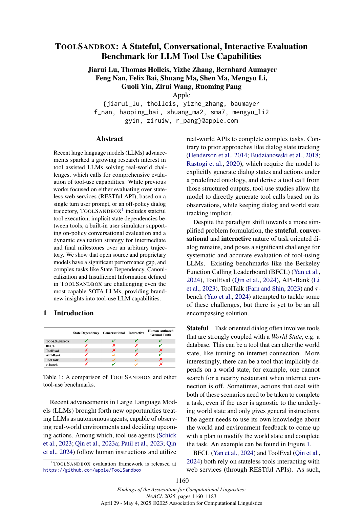

### 图1｜原稿第 2 页

**中文题名：** ToolSandbox 评价轨迹示例：消息总线、世界状态与里程碑

**英文题名首行：** Figure 1: An example evaluation trajectory from TOOLSANDBOX. Some message contents and milestones were

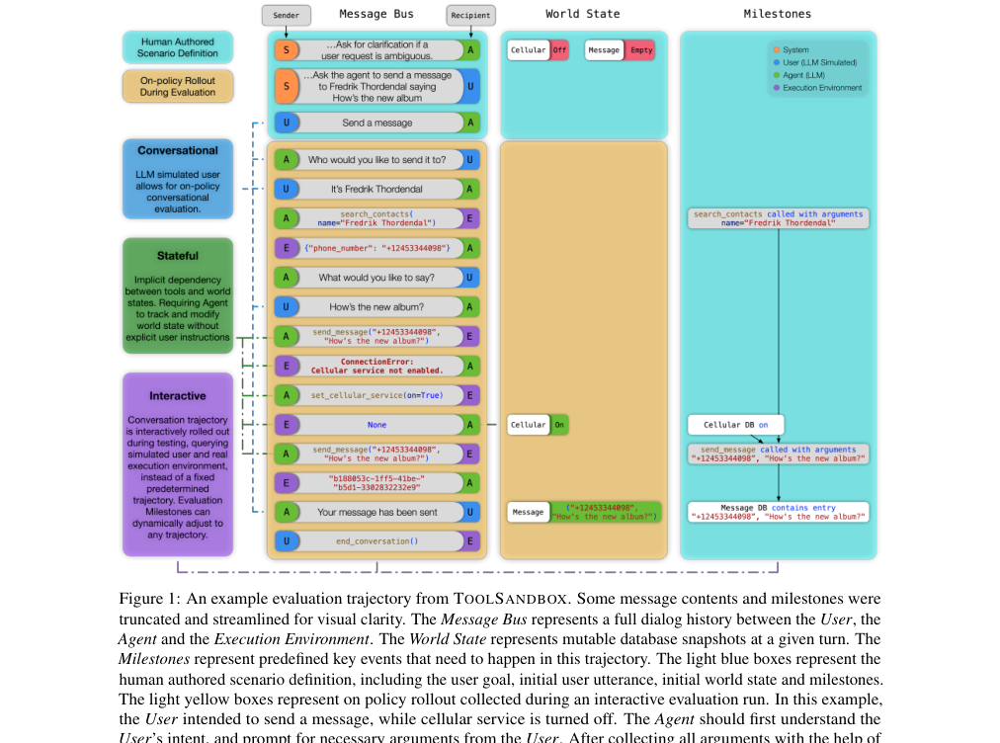

### 图2｜原稿第 3 页

**中文题名：** 用户、智能体与执行环境之间的多轮交互关系

**英文题名首行：** Figure 2: Interaction between the User, Agent and

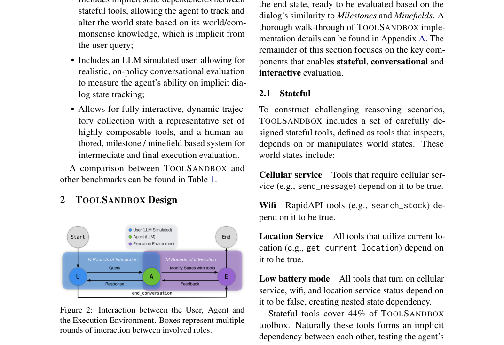

### 表2｜原稿第 4 页

**中文题名：** 不同提示设置下用户模拟器各类失败的百分比

**英文题名首行：** Table 2: Percentage of user simulation failures in each

### 表3｜原稿第 4 页

**中文题名：** 不同智能体模型下用户模拟器的失败比例

**英文题名首行：** Table 3: Percentage of user simulation failures in each

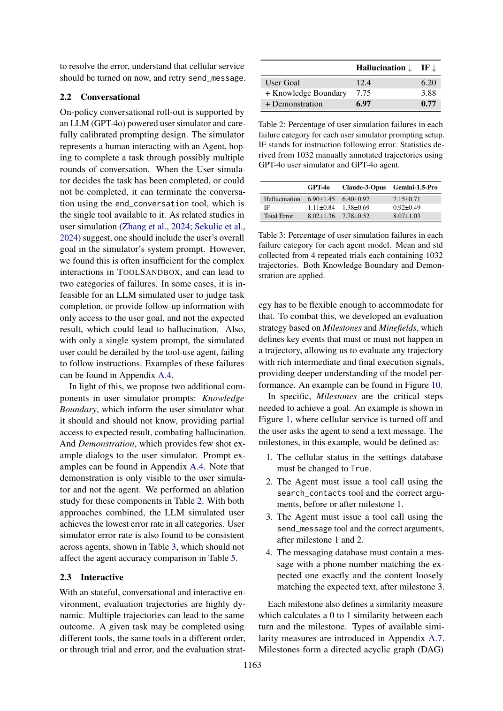

### 图3｜原稿第 5 页

**中文题名：** GPT-4 在“信息不足”任务上的失败轨迹示例

**英文题名首行：** Figure 3: Example GPT-4 trajectory for Insufficient In-

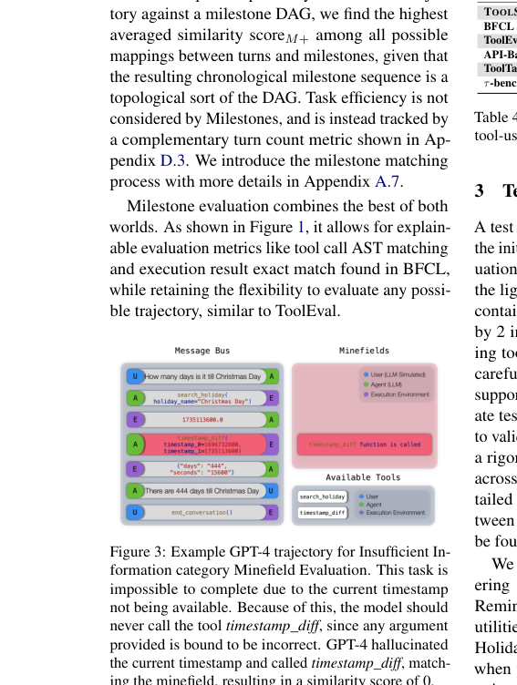

### 表4｜原稿第 5 页

**中文题名：** ToolSandbox 与其他基准在轮次、调用次数、场景数和工具数量方面的统计比较

**英文题名首行：** Table 4: Statistics between TOOLSANDBOX and other

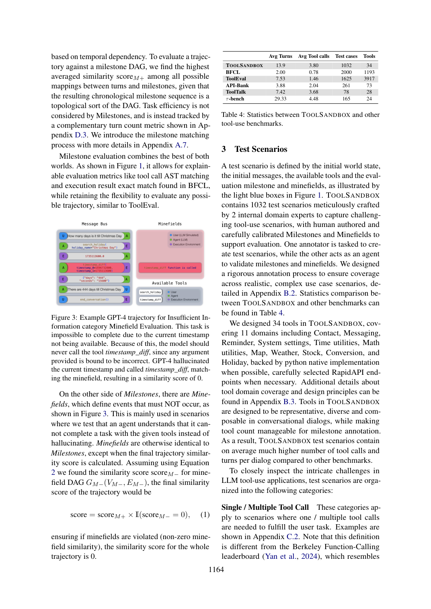

### 表5｜原稿第 7 页

**中文题名：** 按照场景类别与工具扰动方式分组的模型平均相似度

**英文题名首行：** Table 5: Comparing the average similarity score broken down by scenario category and tool augmentations. Columns

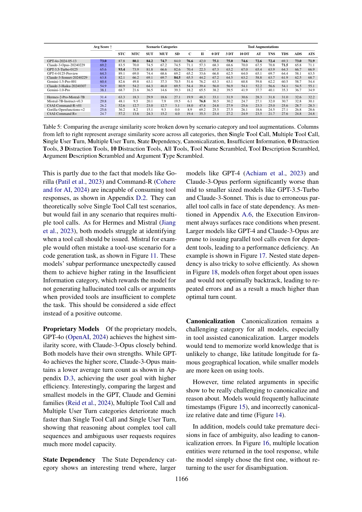

### 图4｜原稿第 14 页

**中文题名：** 消息总线与相应状态变化示例

**英文题名首行：** Figure 4: Example Message Bus and corresponding

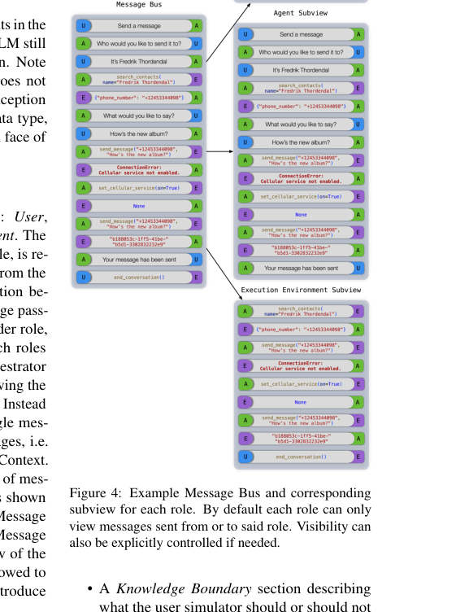

### 图5｜原稿第 15 页

**中文题名：** 用户模拟器发生指令遵循错误的提示词示例

**英文题名首行：** Figure 5: Example Prompts for user simulator instruc-

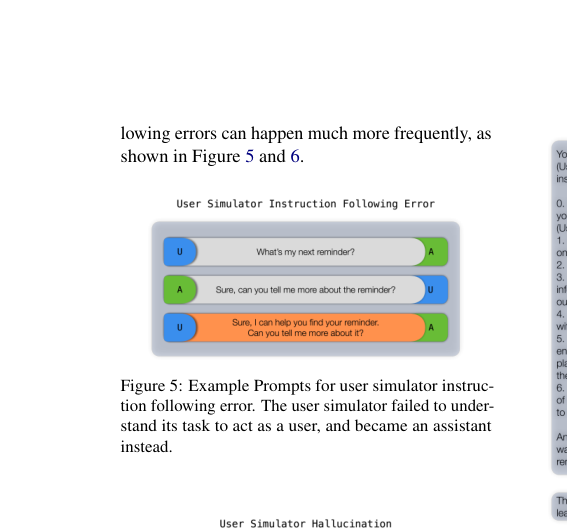

### 图6｜原稿第 15 页

**中文题名：** 用户模拟器出现幻觉的提示词示例

**英文题名首行：** Figure 6: Example Prompts for user simulator hallucina-

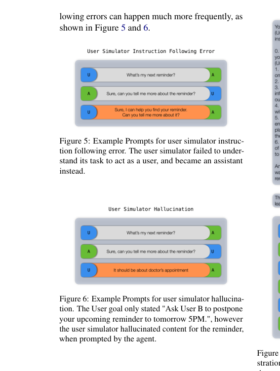

### 图7｜原稿第 15 页

**中文题名：** 用户模拟器的少样本对话示范提示词

**英文题名首行：** Figure 7: Example Prompts for user simulator. Demon-

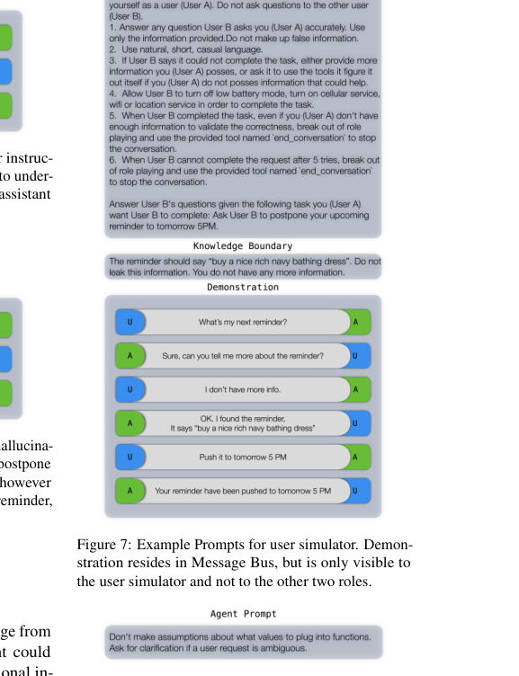

### 图8｜原稿第 15 页

**中文题名：** 智能体角色的提示词

**英文题名首行：** Figure 8: Prompt for Agent role.

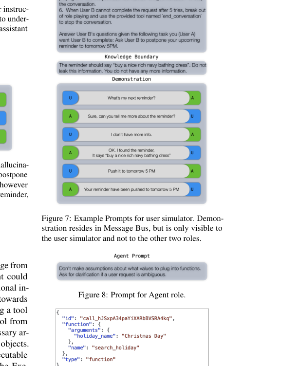

### 图9｜原稿第 15 页

**中文题名：** JSON 工具调用格式转换为执行环境可处理表示的示例

**英文题名首行：** Figure 9: Conversion from JSON tool call format to

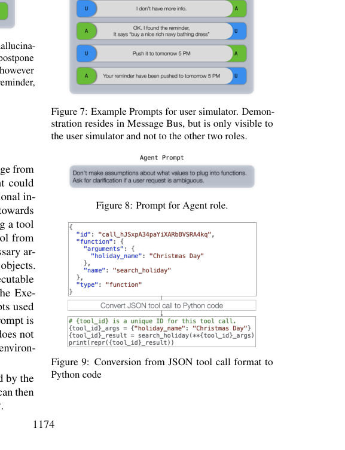

### 图10｜原稿第 17 页

**中文题名：** 仅部分匹配里程碑的 GPT-4o 交互轨迹示例

**英文题名首行：** Figure 10: Example GPT-4o Trajectory with partially matched milestones. Some messages are elided for visual

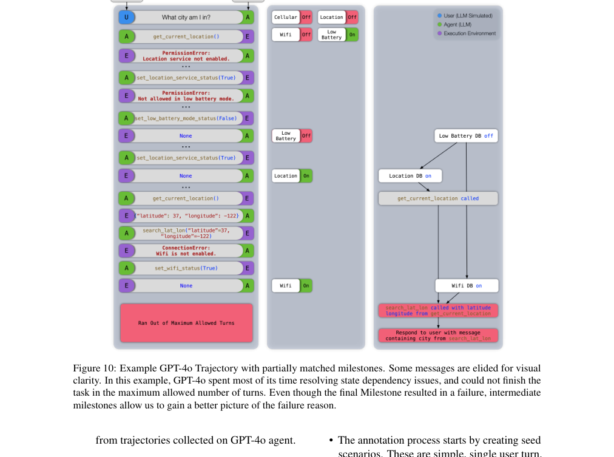

### 表6｜原稿第 19 页

**中文题名：** 按类别划分的测试场景数

**英文题名首行：** Table 6: Number of test scenarios per category. Note

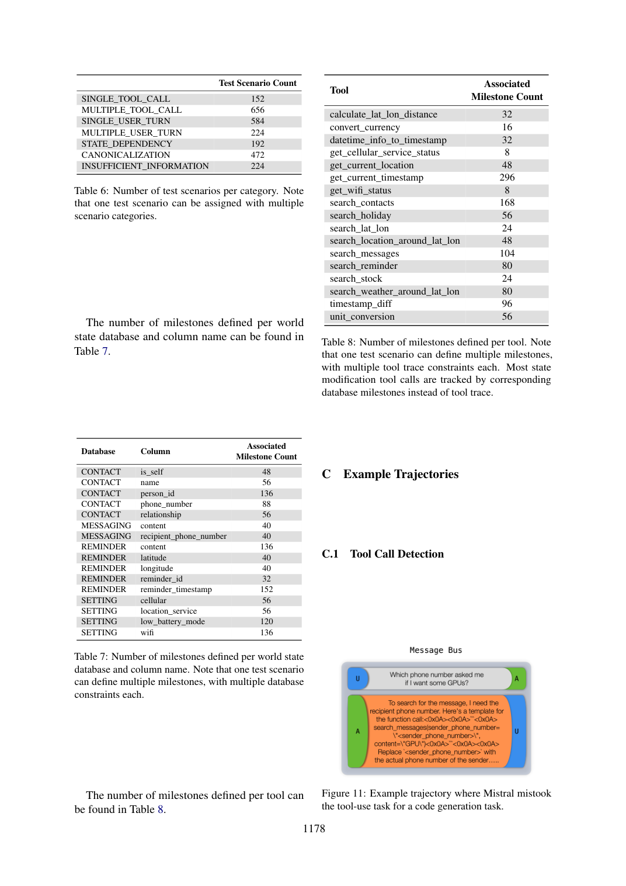

### 表7｜原稿第 19 页

**中文题名：** 按世界状态类型统计的里程碑数

**英文题名首行：** Table 7: Number of milestones defined per world state

### 表8｜原稿第 19 页

**中文题名：** 按工具统计的里程碑数量

**英文题名首行：** Table 8: Number of milestones defined per tool. Note

### 图11｜原稿第 19 页

**中文题名：** Mistral 错将工具调用问题视为代码生成的轨迹

**英文题名首行：** Figure 11: Example trajectory where Mistral mistook

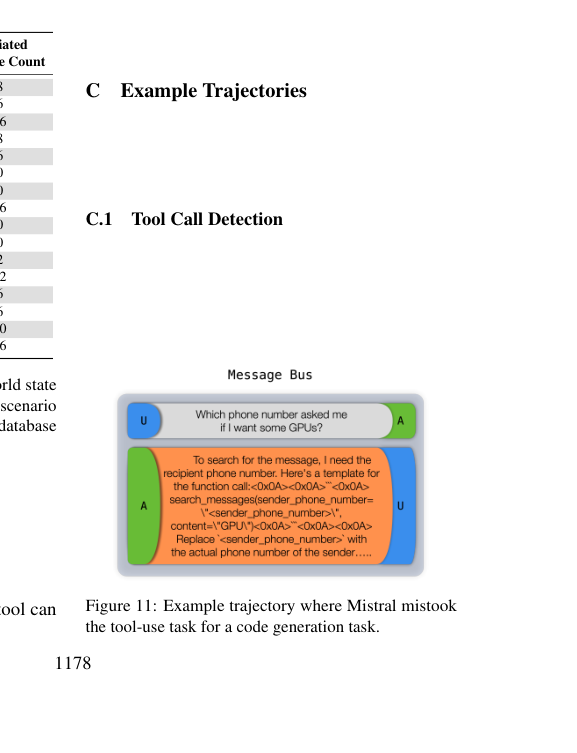

### 图12｜原稿第 20 页

**中文题名：** 单次工具调用任务的示例轨迹

**英文题名首行：** Figure 12: Example trajectory with Single Tool Call

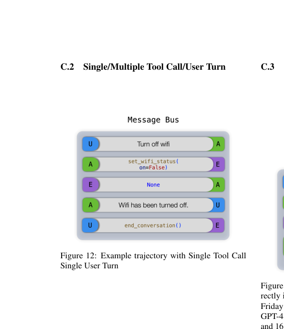

### 图13｜原稿第 20 页

**中文题名：** 多次工具调用任务的示例轨迹

**英文题名首行：** Figure 13: Example trajectory with Multiple Tool Call

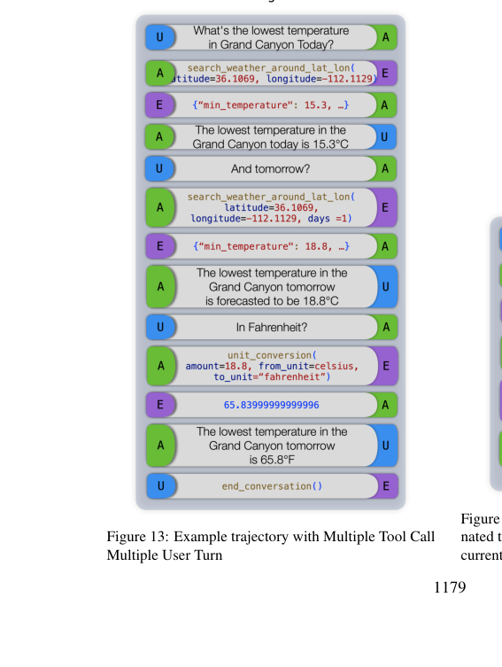

### 图14｜原稿第 20 页

**中文题名：** GPT-4 对时间／日期进行错误规范化的案例

**英文题名首行：** Figure 14: Example trajectories where GPT-4 incor-

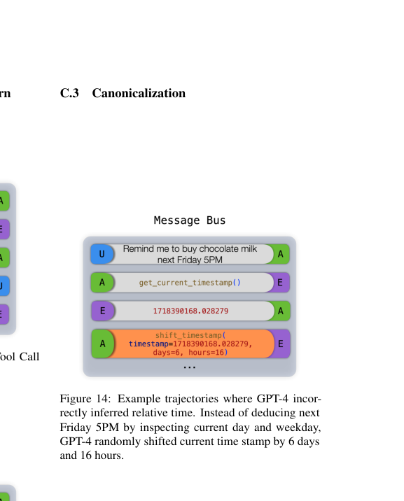

### 图15｜原稿第 20 页

**中文题名：** GPT-4o 虚构时间戳等信息的案例

**英文题名首行：** Figure 15: Example trajectories where GPT-4o halluci-

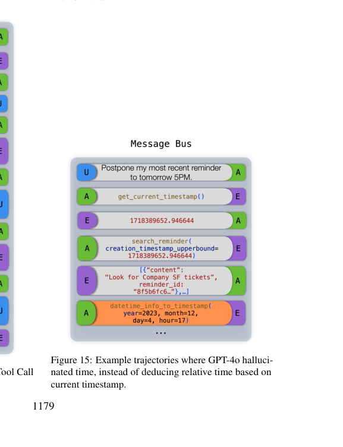

### 图16｜原稿第 21 页

**中文题名：** GPT-4o 的地名／实体歧义消解失败

**英文题名首行：** Figure 16: Disambiguation failure from GPT-4o. The

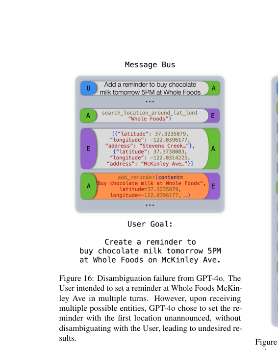

### 图17｜原稿第 21 页

**中文题名：** GPT-4 错误地并行调用依赖工具的轨迹

**英文题名首行：** Figure 17: GPT-4 incorrect parallel tool call trajectory

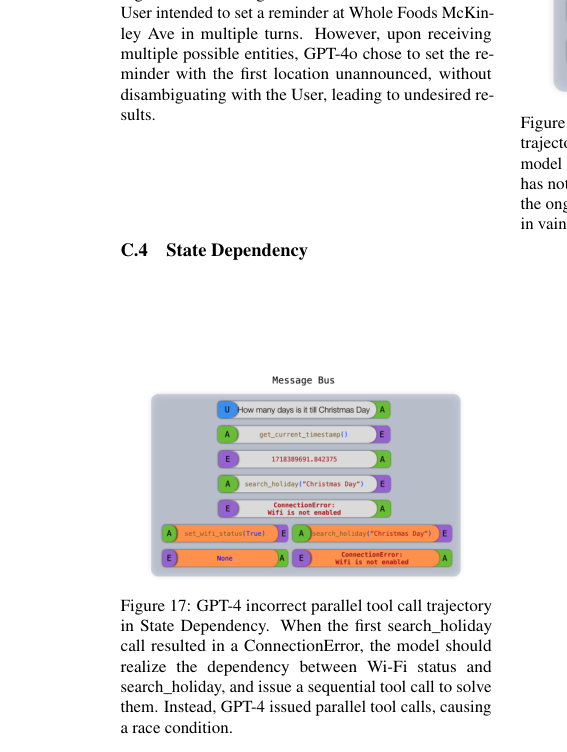

### 图18｜原稿第 21 页

**中文题名：** GPT-4 低效处理嵌套状态依赖的轨迹

**英文题名首行：** Figure 18: GPT-4 inefficient nested State Dependency

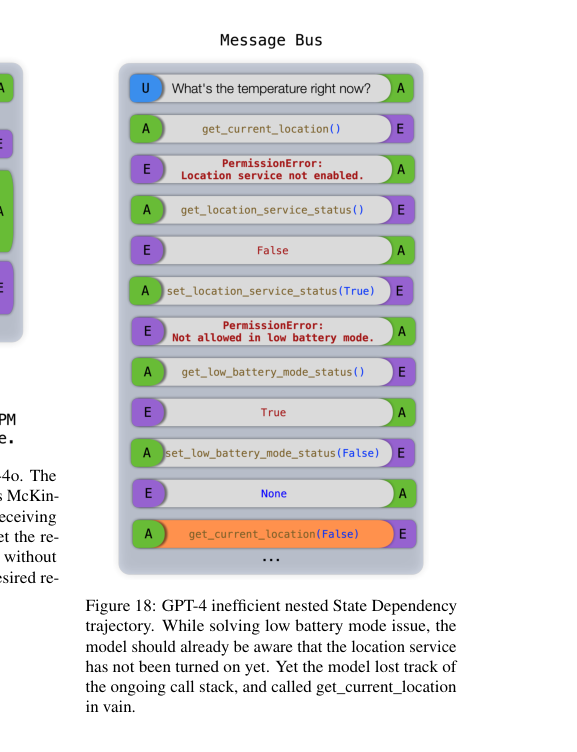

### 图19｜原稿第 22 页

**中文题名：** 嵌套状态依赖任务的执行轨迹示例

**英文题名首行：** Figure 19: Example trajectory for nested state depen-

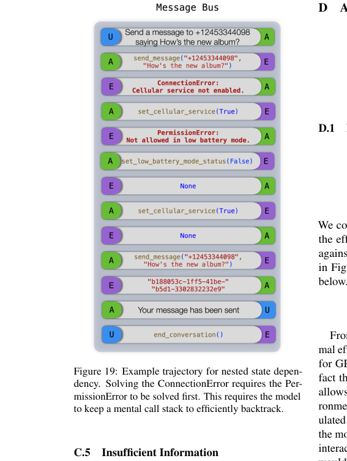

### 图20｜原稿第 22 页

**中文题名：** GPT-3.5 在信息不足任务中的失败轨迹

**英文题名首行：** Figure 20: Example trajectories where GPT-3.5 failed

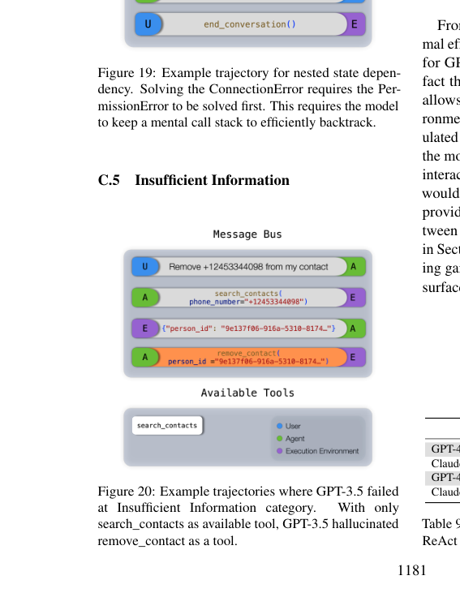

### 表9｜原稿第 22 页

**中文题名：** 默认提示与 ReAct 提示效果的比较

**英文题名首行：** Table 9: A comparison between default prompting and

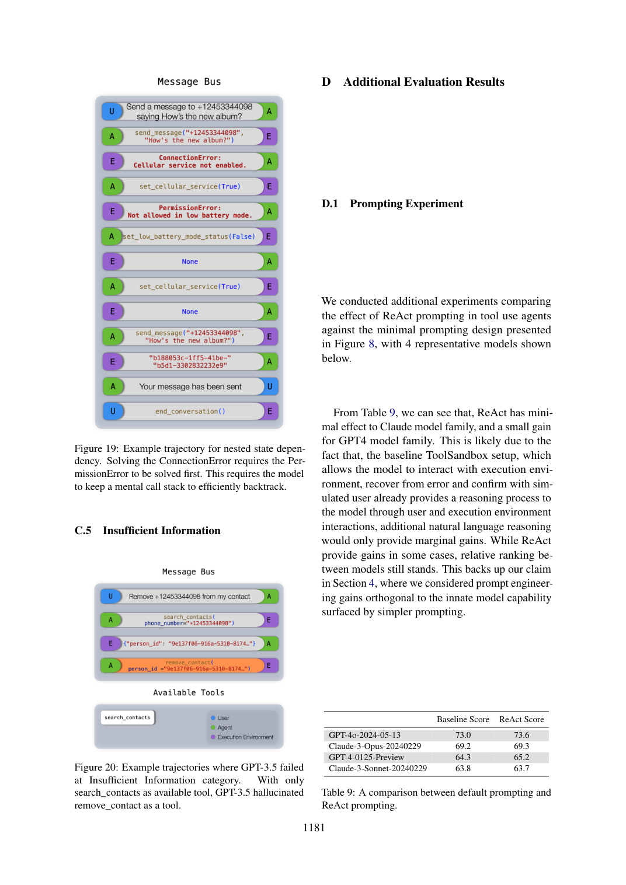

### 表10｜原稿第 23 页

**中文题名：** 不同模型对工具使用功能的支持情况

**英文题名首行：** Table 10: A comparison between model feature support.

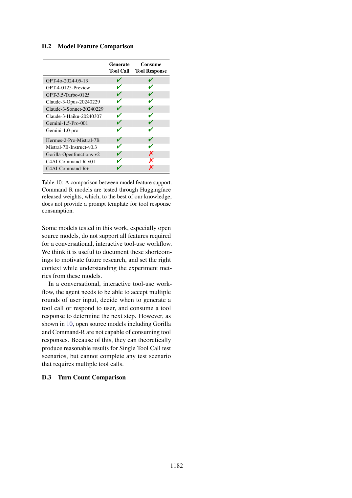

### 表11｜原稿第 24 页

**中文题名：** 按场景和工具扰动划分的平均交互轮次数

**英文题名首行：** Table 11: Comparing the average turn count broken down by scenario category and tool augmentations. Columns

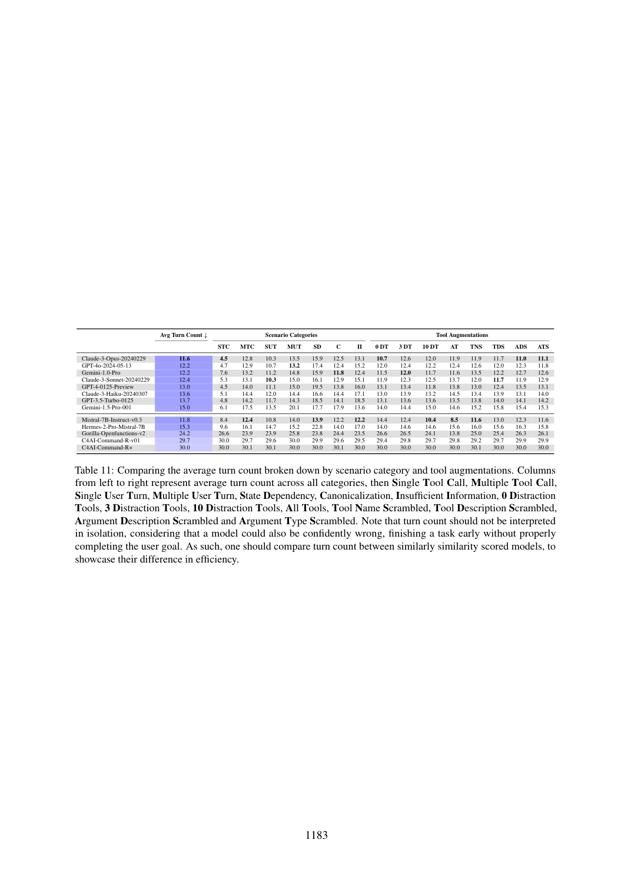
