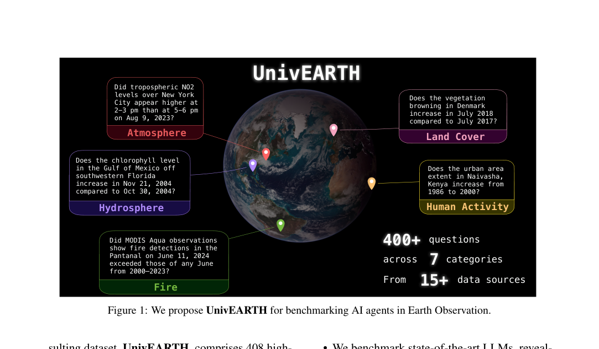
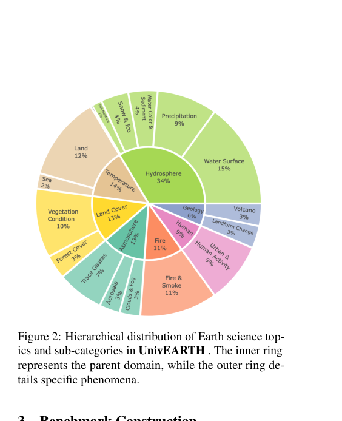
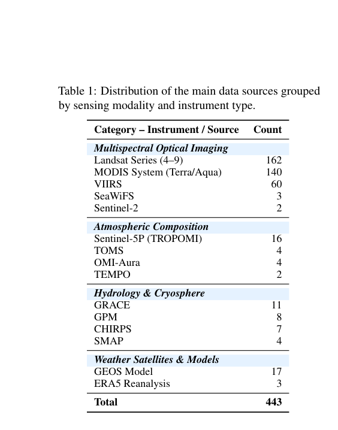
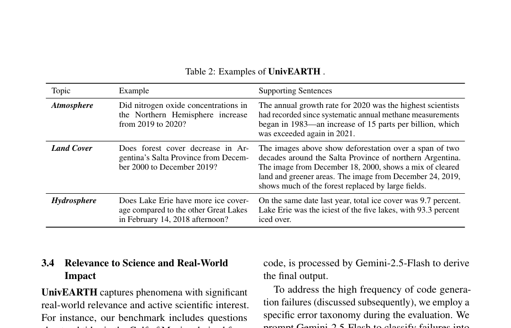
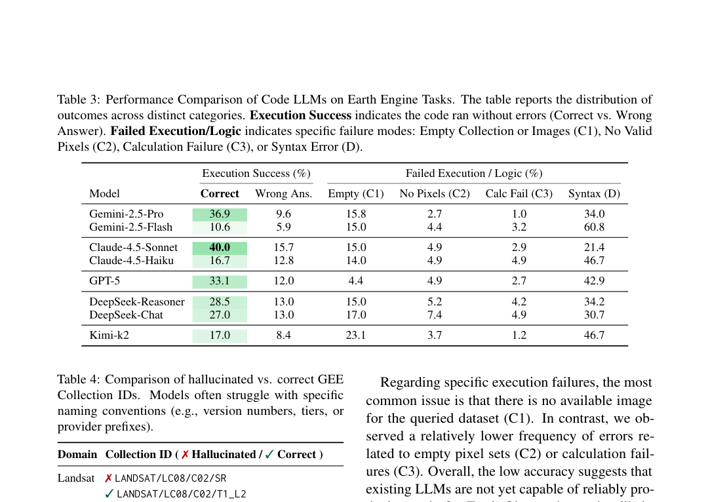
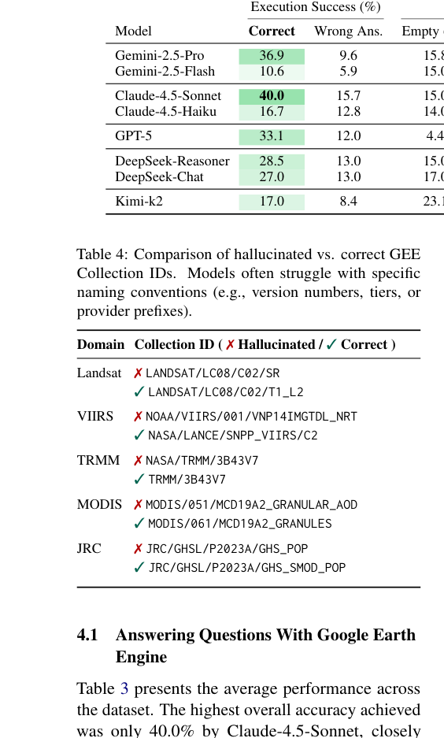
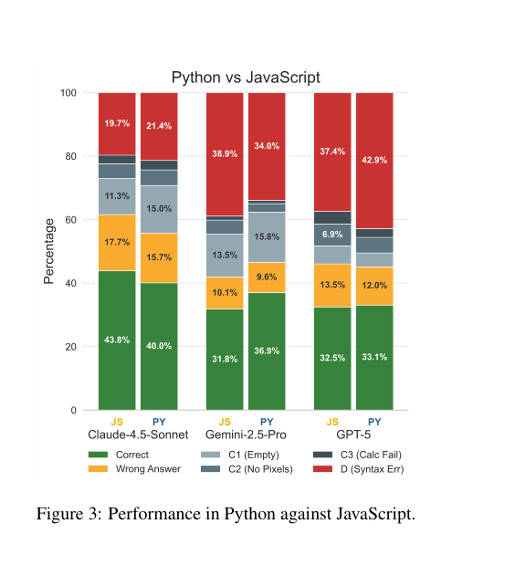
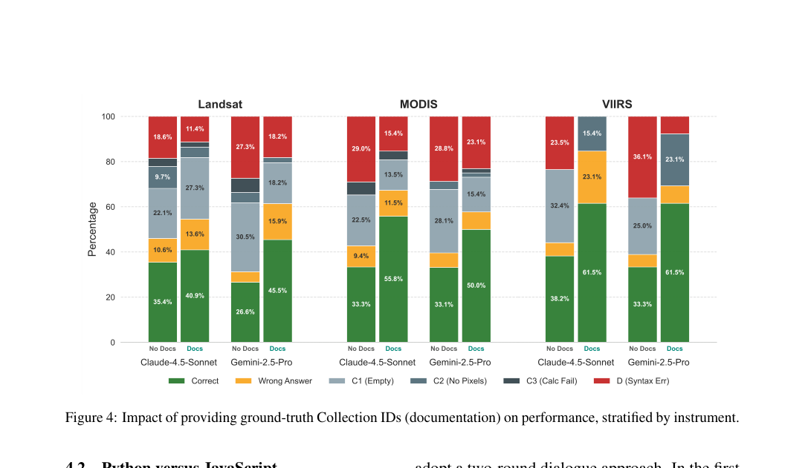

# 迈向面向地球观测的大语言模型智能体

**原文题目：** Towards LLM Agents for Earth Observation

**原始 PDF：** [原始论文](./原始论文.pdf)（共 15 页）

> **翻译覆盖声明（请先阅读）**：本文件提供**摘要完整中文翻译**及主要研究章节的**中文学术译述**，不等同于逐字逐句的全文译本。为避免遗漏资料，原 PDF 全部页面的英文文字与附录、参考文献均已收录在 `英文原文_逐页.md` 和 `英文全文_保留版面.txt`，图、表另见 `图表索引.md`。不可把本文档当作全部正文及附录均已翻译的材料。

---

## 摘要（完整中文翻译）

地球观测（Earth Observation，EO）为环境监测、灾害管理、气候科学及其他科学领域提供关键的全球数据。本文提出一个问题：现有人工智能系统是否已经能够可靠地进行地球观测分析？为回答这一问题，作者提出 UnivEARTH——一个基于 NASA Earth Observatory 文章构建的代码生成评测基准，包含 408 道“是/否”问题，涉及 7 类主题和 15 种以上卫星仪器及数据来源。在零样本设置下，将 Google Earth Engine（GEE）API 作为工具时，大语言模型智能体的正确率仅为 40.0%，且超过 44% 的情况下生成的代码无法运行。为进一步理解模型行为，作者比较了 JavaScript 与 Python 版本 API 的影响，并考察提供文档资料的作用。此外，实验发现引入 Reflexion 反思机制能够显著减少错误：Claude-4.5-Sonnet、Gemini-2.5-Pro 和 GPT-5 的正确率可提升到约 60%。不过，这一结果仍仅略高于随机猜测水平。总体而言，研究指出自动化地球观测之前仍需解决若干重要挑战，同时提出了可能的改进方向。数据集已经公开。

## 主要研究章节（中文学术译述）

### 研究目标与任务边界

UnivEARTH 评价的不仅是模型知道多少地球科学知识，更是模型能否根据自然语言问题选择正确的数据集、空间范围、时段和波段，编写能够在 Google Earth Engine 环境运行的代码，并由计算结果支撑判断。由于问题设计为“是/否”，其随机猜测基线约为 50%，因此对准确率的解释需结合生成代码能否执行和结果是否有证据支撑。

### Benchmark 数据来源

作者以 NASA Earth Observatory 科普与观测文章为问题来源，通过人工样例、辅助生成、GEE 可回答性检验和独立人工审核形成 408 个高质量二元问题，覆盖 7 个地球科学主题和 15 种以上数据来源。每一问题都要能够落地为真实的遥感数据查询与计算，而非只依赖语言模型记忆。

### 零样本评测结果

在主要零样本代码生成设置下，最佳基础正确率为 40.0%，超过 44% 的生成代码不能顺利运行。这个结果提示，模型即使理解了题目的自然语言含义，也经常在数据集 ID、波段名称、时间过滤、函数调用或者数据处理逻辑上失误，从而使研究结论没有可复现的计算证据。

### API 语言与文档影响

论文比较 GEE JavaScript API 和 Python API 的生成表现；两者可能在语法错误类型上有所不同，但都无法自动消除空间分析逻辑错误。向模型提供可靠的数据集标识等有针对性的文档，有助于减少虚构的 Collection ID 和 API 使用错误。

### 反思与错误恢复

Reflexion 流程允许模型检查运行错误日志、重新规划并修改脚本。使用此类反思机制，部分先进模型的正确率提高至约 60%。作者指出，虽然编程可执行性有所提高，但在需要真实物理过程理解与数据分析的地球观测场景中，整体可靠性距离高要求科研自动化仍有明显差距。

### 对评测有效性的价值

UnivEARTH 为“可执行性与科学正确性必须分开评估”提供了直观案例。仅有代码能运行不足以证明分析逻辑正确；仅有最终二元答案正确也不足以证明数据来源、时空筛选和物理含义正确。研究可围绕代码执行率、数据选择合法性、最终正确率及错误恢复后的成功率，建立分层评价协议。

## 专业术语中英对照

| English | 中文术语 |
|---|---|
| Earth Observation | 地球观测 |
| UnivEARTH | UnivEARTH 基准 |
| answerability | 可回答性 |
| zero-shot | 零样本 |
| Collection ID | 数据集标识符 |
| reflexion | 反思与自我纠错 |
| executable ground truth | 可执行真实值 |

## 图表与逐页原文导航

独立裁图共 **11** 张；完整原版页面截图共 **15** 张。

- [全部图表索引](./图表索引.md)
- [逐页原文与对应图表](./逐页原文与配图.md)
- [英文原文逐页](./英文原文_逐页.md)
- [参考文献英文原文](./参考文献_英文原文.md)
- [QA 逐页核查报告](./QA_逐页核查报告.md)

### 代表性原始图表

**图1（第 2 页）**

> Figure 1: We propose UnivEARTH for benchmarking AI agents in Earth Observation.

**图2（第 3 页）**

> Figure 2: Hierarchical distribution of Earth science top- ics and sub-categories in UnivEARTH . The inner ring represents the parent domain, while the outer ring de- tails specific phenomena.

**表1（第 4 页）**

> Table 1: Distribution of the main data sources grouped by sensing modality and instrument type.

**表2（第 5 页）**

> Table 2: Examples of UnivEARTH .

**表3（第 6 页）**

> Table 3: Performance Comparison of Code LLMs on Earth Engine Tasks. The table reports the distribution of outcomes across distinct categories. Execution Success indicates the code ran without errors (Correct vs. Wrong Answer). Failed Execution/Logic indicates specific failure modes: Empty Collection or Images (C1), No Valid Pixels (C2), Calculation Failure (C3), or Syntax Error (D).

**表4（第 6 页）**

> Table 4: Comparison of hallucinated vs. correct GEE Collection IDs. Models often struggle with specific naming conventions (e.g., version numbers, tiers, or provider prefixes).

**图3（第 6 页）**

> Figure 3: Performance in Python against JavaScript.

**图4（第 7 页）**

> Figure 4: Impact of providing ground-truth Collection IDs (documentation) on performance, stratified by instrument.
