# 图表索引

来源：**Towards LLM Agents for Earth Observation**，共 15 页。按原 PDF 页码列出图表；截图保留原版文字。

## 图1 — 原文第 2 页

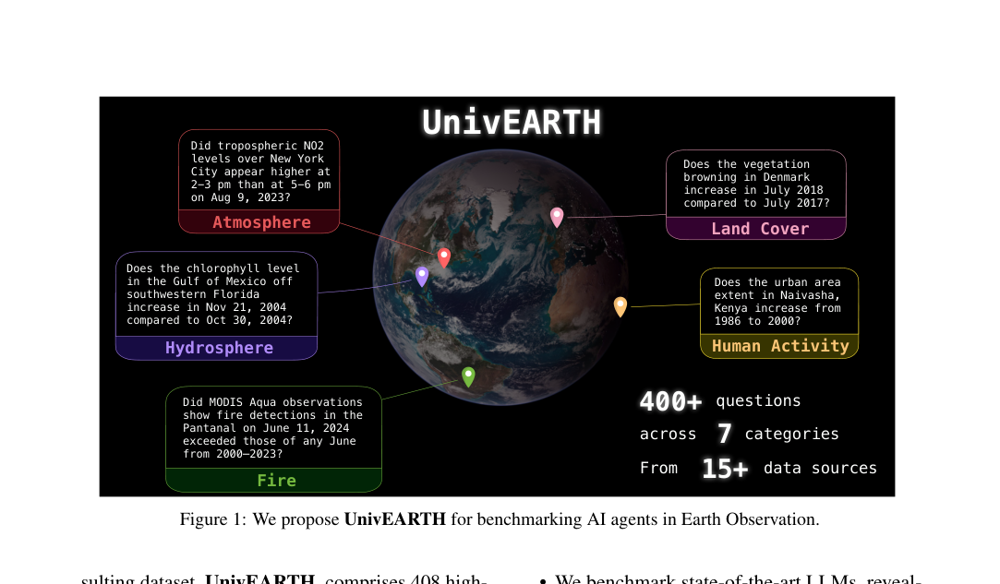

**Caption（原文）：** Figure 1: We propose UnivEARTH for benchmarking AI agents in Earth Observation.

[查看完整第 2 页](./source_pages/page-002.jpg)

## 图2 — 原文第 3 页

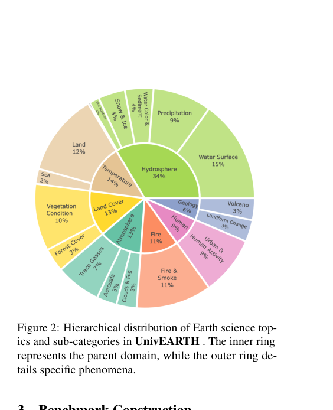

**Caption（原文）：** Figure 2: Hierarchical distribution of Earth science top- ics and sub-categories in UnivEARTH . The inner ring represents the parent domain, while the outer ring de- tails specific phenomena.

[查看完整第 3 页](./source_pages/page-003.jpg)

## 表1 — 原文第 4 页

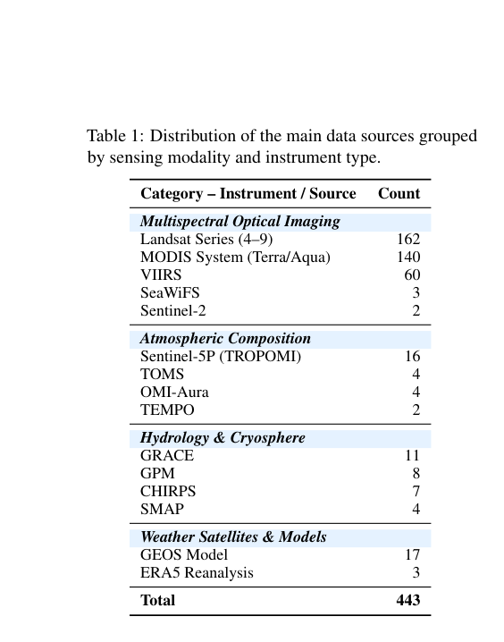

**Caption（原文）：** Table 1: Distribution of the main data sources grouped by sensing modality and instrument type.

[查看完整第 4 页](./source_pages/page-004.jpg)

## 表2 — 原文第 5 页

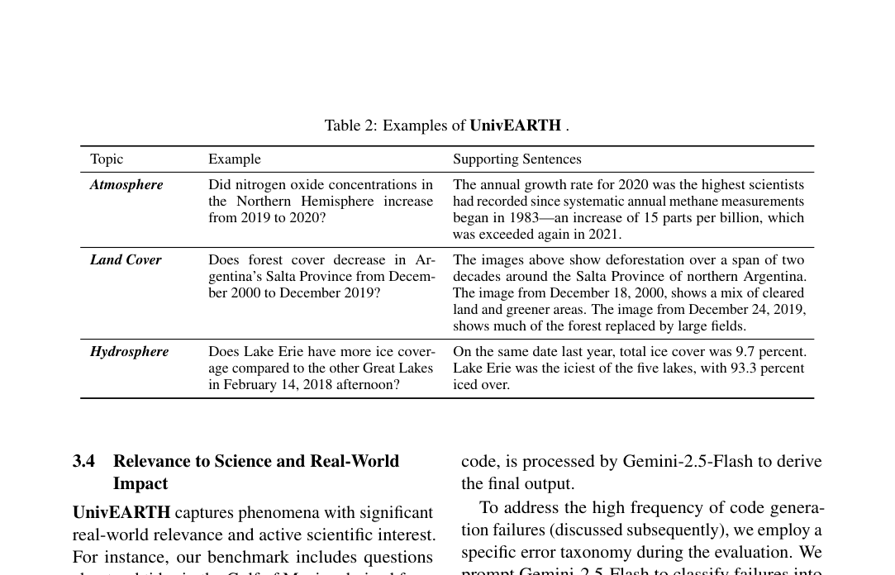

**Caption（原文）：** Table 2: Examples of UnivEARTH .

[查看完整第 5 页](./source_pages/page-005.jpg)

## 表3 — 原文第 6 页

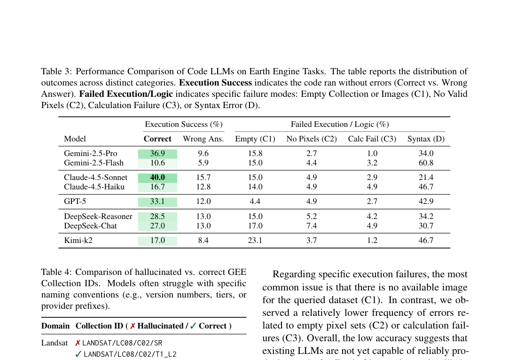

**Caption（原文）：** Table 3: Performance Comparison of Code LLMs on Earth Engine Tasks. The table reports the distribution of outcomes across distinct categories. Execution Success indicates the code ran without errors (Correct vs. Wrong Answer). Failed Execution/Logic indicates specific failure modes: Empty Collection or Images (C1), No Valid Pixels (C2), Calculation Failure (C3), or Syntax Error (D).

[查看完整第 6 页](./source_pages/page-006.jpg)

## 表4 — 原文第 6 页

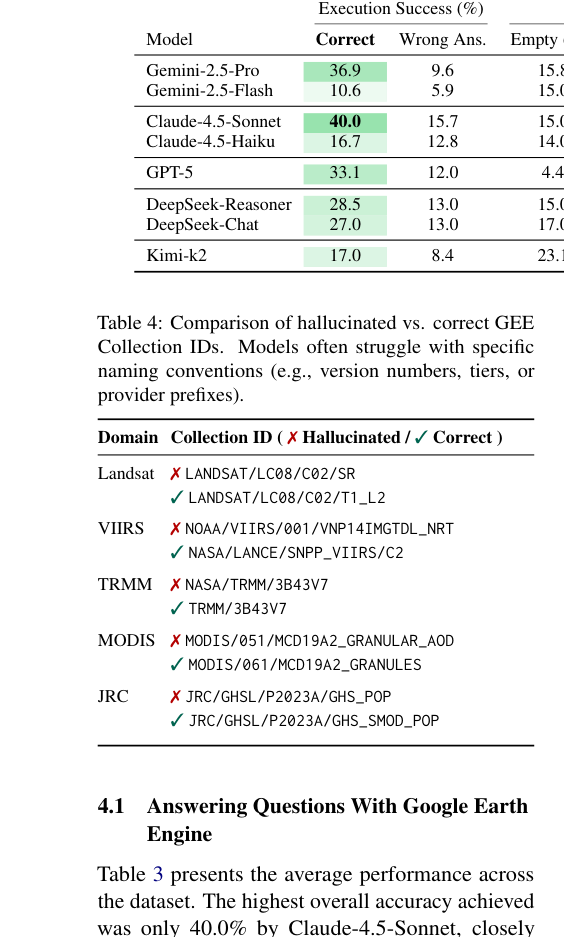

**Caption（原文）：** Table 4: Comparison of hallucinated vs. correct GEE Collection IDs. Models often struggle with specific naming conventions (e.g., version numbers, tiers, or provider prefixes).

[查看完整第 6 页](./source_pages/page-006.jpg)

## 图3 — 原文第 6 页

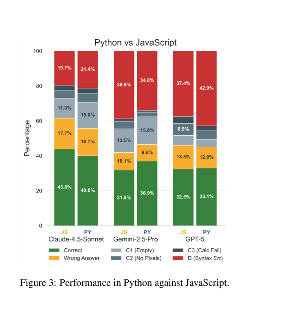

**Caption（原文）：** Figure 3: Performance in Python against JavaScript.

[查看完整第 6 页](./source_pages/page-006.jpg)

## 图4 — 原文第 7 页

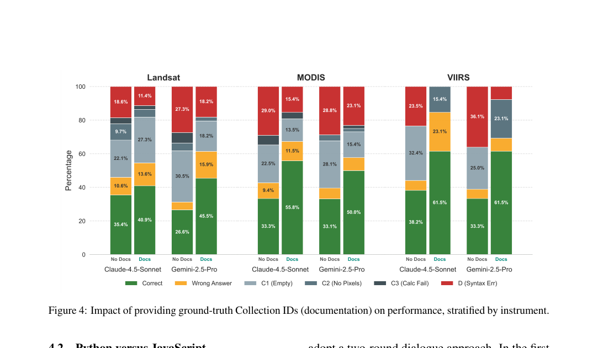

**Caption（原文）：** Figure 4: Impact of providing ground-truth Collection IDs (documentation) on performance, stratified by instrument.

[查看完整第 7 页](./source_pages/page-007.jpg)

## 图5 — 原文第 8 页

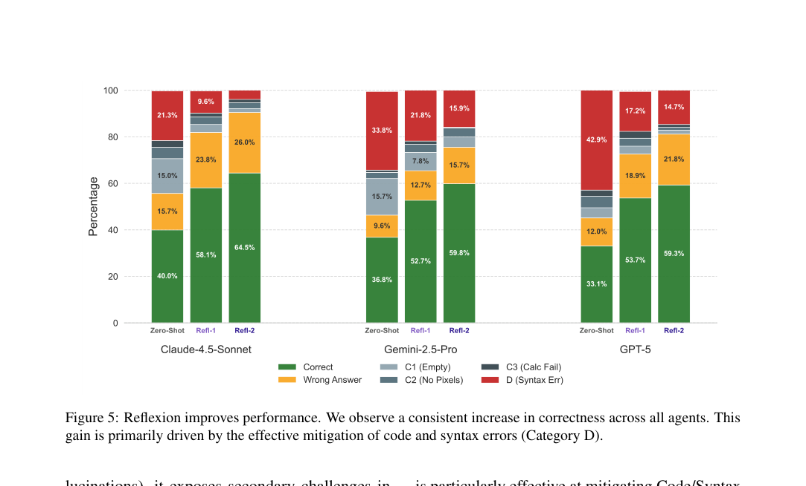

**Caption（原文）：** Figure 5: Reflexion improves performance. We observe a consistent increase in correctness across all agents. This gain is primarily driven by the effective mitigation of code and syntax errors (Category D).

[查看完整第 8 页](./source_pages/page-008.jpg)

## 表5 — 原文第 14 页

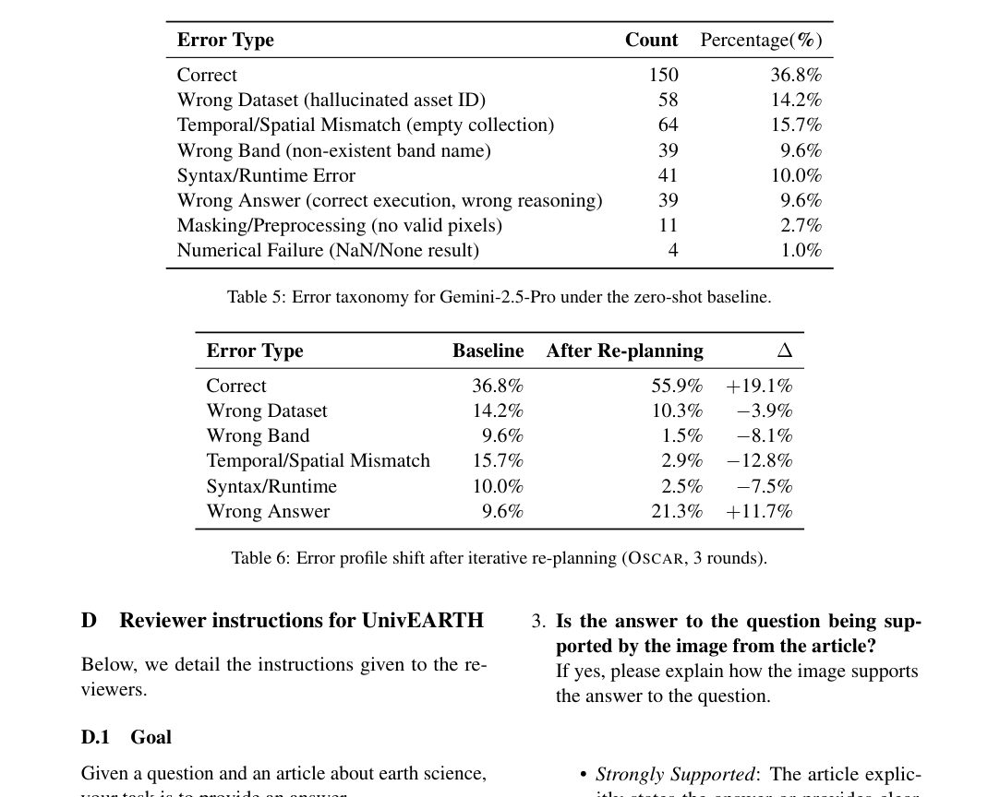

**Caption（原文）：** Table 5: Error taxonomy for Gemini-2.5-Pro under the zero-shot baseline.

[查看完整第 14 页](./source_pages/page-014.jpg)

## 表6 — 原文第 14 页

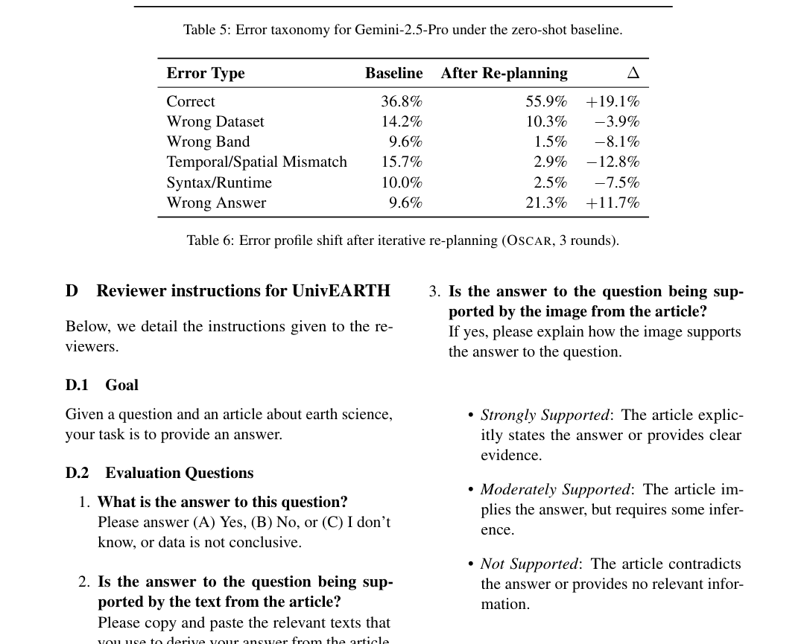

**Caption（原文）：** Table 6: Error profile shift after iterative re-planning (OSCAR, 3 rounds).

[查看完整第 14 页](./source_pages/page-014.jpg)
