# VOYAGER：基于大语言模型的开放式具身智能体

> **原题**：VOYAGER: An Open-Ended Embodied Agent with Large Language Models  
> **作者**：Guanzhi Wang、Yuqi Xie、Yunfan Jiang、Ajay Mandlekar、Chaowei Xiao、Yuke Zhu、Linxi “Jim” Fan、Anima Anandkumar  
> **机构**：NVIDIA、Caltech、UT Austin、Stanford、UW Madison  
> **论文版本**：arXiv:2305.16291v2（2023年10月19日）；PDF 42页  
> **项目**：https://voyager.minedojo.org  
> **译文说明**：依原稿顺序翻译正文、表格标题、图注、实验结果和技术说明。保留 API、JavaScript 函数名、JSON 字段及程序代码原样，完整英文逐页提取见 `英文原文_逐页提取.md`。

## 摘要（Abstract）

本文介绍 **VOYAGER**，作者称其为第一个由大语言模型（LLM）驱动、在《我的世界》（Minecraft）中开展**具身终身学习（embodied lifelong learning）**的智能体。它可以在没有人类干预的情况下持续探索世界、获得各种技能，并不断发现新事物。

VOYAGER 由三个关键部分组成：（1）最大化探索的**自动课程（automatic curriculum）**；（2）不断增长的**技能库（skill library）**，以可执行代码形式存储和检索复杂行为；（3）新型**迭代提示机制（iterative prompting mechanism）**，结合环境反馈、执行错误和自我验证，改进生成程序。

VOYAGER 以黑箱查询方式与 GPT-4 交互，不需要对模型参数进行微调。其学习的技能具有跨越多个时间步、可解释、可组合等特征，因而能够快速累积能力并缓解传统持续学习方法中的**灾难性遗忘（catastrophic forgetting）**。实验表明，VOYAGER 在 Minecraft 中展现了强大的**上下文内终身学习（in-context lifelong learning）**能力：比以往先进方法获得 **3.3倍**的不同物品、探索距离延长 **2.3倍**，解锁技术树关键里程碑的速度最快达到 **15.3倍**。此外，它还能把旧世界获得的技能库迁移至新的 Minecraft 世界，从零完成新任务，而对照方法难以实现有效泛化。

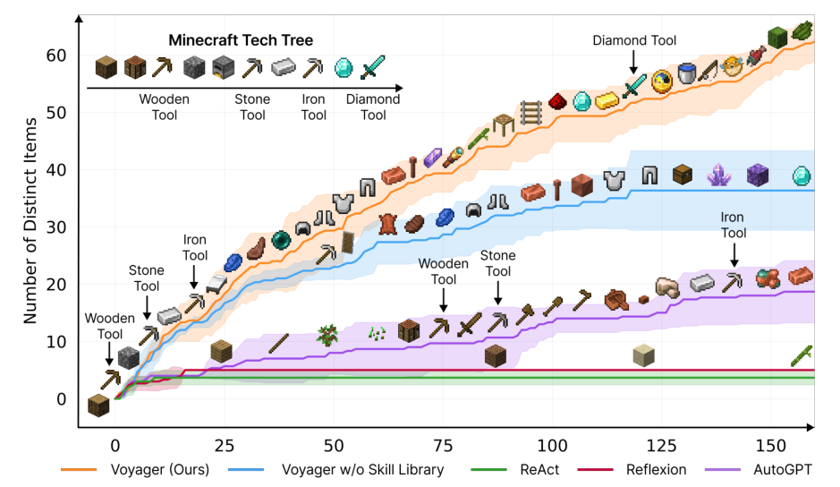

**图1　VOYAGER 通过自主探索持续发现 Minecraft 物品与技能，表现显著优于对照算法。** 横轴为提示迭代次数。

## 1 引言（Introduction）

开发能够在开放世界中持续探索、规划并培养新技能的通用具身智能体，是人工智能领域的重要挑战。传统方法使用在原始动作空间中工作的**强化学习（RL）**和**模仿学习（imitation learning）**，但在系统性探索、可解释性和泛化性方面可能存在困难。近年来，基于大语言模型的智能体能够利用预训练模型所蕴含的世界知识，生成连贯的行动计划或可执行策略，并被用于游戏、机器人以及非具身 NLP 任务。然而，这些系统往往不具备持续获取、更新、积累和跨长时间尺度迁移知识的终身学习能力。

Minecraft 是一个适合研究此问题的环境：与具有固定终点和剧情的普通游戏不同，它没有预先定义的最终目标，程序生成的广阔三维地形提供了近乎无限的活动可能。玩家需要在探索地图时收集资源、逐步解锁技术树。人类玩家通常先学习砍树、烹饪等基础能力，再逐渐掌握打怪、制作钻石工具等复杂技能。

作者认为，理想的终身学习智能体应具备类似能力：（1）根据当前技能水平和世界状态提出恰当任务，如在沙漠中先学会收集沙子与仙人掌，而不是执着于寻找铁矿；（2）根据环境反馈完善技能，并把已掌握技能存入记忆，使其在类似情境下重用，例如击败僵尸的经验可用于对付蜘蛛；（3）持续、自主地探索世界并发现新目标。

为此，作者提出 VOYAGER，通过自动课程、技能库、迭代提示三个模块，在不需要人类介入的情况下推动探索与技能习得。它采用**代码作为动作空间（code as action space）**，而不是直接生成低层运动指令。程序可以自然表达跨越多个时间步、由简单动作组合而成的行为，特别适合 Minecraft 中长期、多步骤任务。系统依赖 GPT-4 的提示与**上下文学习（in-context learning）**，无需访问或更新模型参数，也无需梯度训练。

自动课程根据探索进展和智能体当前状态，逐步提出更困难的任务。GPT-4 接收“尽可能发现多种多样的东西”这一总体目标，生成连续的新挑战，这类似于在上下文内开展的**新颖性搜索（novelty search）**。完成任务后，VOYAGER 把有效的行动程序存入技能库，并以程序描述的向量嵌入作为索引；未来遇到相似情境时检索这些程序。多个基础技能能够组合成更复杂技能，从而迅速提升系统能力并减少遗忘。

由于语言模型往往无法一次生成完全正确的动作代码，VOYAGER 引入迭代改进：（1）执行程序并收集 Minecraft 的库存、附近生物等环境观测，以及解释器的错误轨迹；（2）把这些反馈加入下一轮 GPT-4 提示，以修订程序；（3）重复直到**自我验证模块**确认任务成功，随后将程序（例如 `craftStoneShovel()` 或 `combatZombieWithSword()`）加入技能库，并请求自动课程安排下一目标。

作者在开源 Minecraft AI 环境 **MineDojo** 中将 VOYAGER 与 ReAct、Reflexion、AutoGPT 等系统比较，结果显示它在发现新物品、解锁技术树、地图探索和新世界技能迁移方面均具有优势。

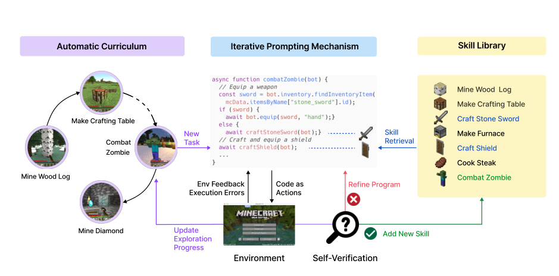

**图2　VOYAGER 的整体架构。** 左侧为开放式探索的自动课程，中间为以程序代码作为动作的迭代提示机制，右侧为不断增长的技能库；环境反馈、程序执行错误与自我验证共同驱动探索和修复的闭环。

## 2 方法（Method）

VOYAGER 的方法由三部分组成：自动课程为开放式探索提出任务，技能库存储与复用可执行的复杂行为，迭代提示负责把大语言模型输出转换成可执行控制程序。完整提示词结构位于原文附录 A。

### 2.1 自动课程（Automatic Curriculum）

开放式环境中的目标具有不同难度。自动课程让学习过程既具有挑战性又可管理，鼓励好奇心驱动的内在探索动机，支持建立通用、灵活的问题解决策略。作者利用 GPT-4 在互联网规模语料中学到的知识，连续提出新的任务与挑战。课程按**自底向上（bottom-up）**的方式推进，对当前探索进度及智能体状态保持较高适应性。随着目标难度增加，VOYAGER 会自然地掌握越来越多技能，例如最终尝试“开采钻石”。

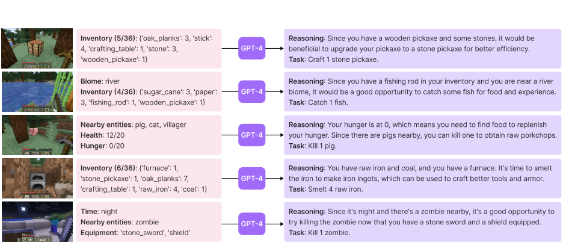

**图3　自动课程根据游戏状态生成任务示例。** 拥有木镐和石块时，建议制作石镐；在河边且携带钓竿时，建议钓鱼；饥饿值为零且附近有猪时，建议捕猎获取食物；拥有熔炉、原铁和煤炭时，建议冶炼4块原铁；夜晚身边有僵尸且装备石剑与盾牌时，建议击败1只僵尸。图中仅展示部分提示，完整内容见原文附录 A.3。

发送给 GPT-4 的自动课程提示包含四类信息：

1. **目标指令及约束**：鼓励探索多样性，并限制难度，例如“我的最终目标是尽可能发现更多不同的事物……下一任务不应太难，因为我可能尚未拥有必需的资源或足够技能”。
2. **当前环境状态**：背包（inventory）、装备、附近方块与实体、生物群系（biome）、时间、生命值、饥饿度和坐标位置。
3. **已完成与失败的任务**：反映进度及智能体当前能力边界。
4. **额外上下文**：使用 GPT-3.5 根据现有状态与探索进展自问自答，补充世界知识。一般语言处理任务选择 GPT-3.5 而非 GPT-4，主要出于预算考虑。

### 2.2 技能库（Skill Library）

自动课程会提出持续升级的任务，因此需要一个能够支持学习和进化的技能库。作者借鉴程序的通用性、可解释性与可组合性，将每个技能表示为一段**可执行代码**，该代码封装完成特定任务的、跨越多个时间步的动作序列。

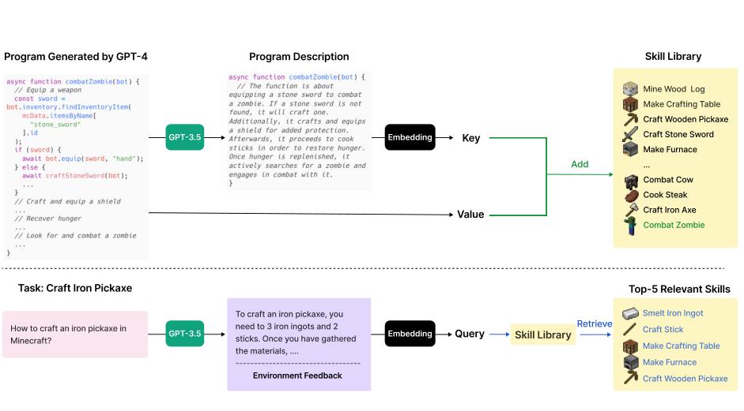

**图4　技能的存储与检索。** 上半部分：GPT-4 成功生成并验证新程序后，把程序存入向量数据库，**键（key）**是 GPT-3.5 对程序描述的文本嵌入，**值（value）**是程序本体。下半部分：遇到新任务时，先用 GPT-3.5 生成总体解题建议，结合环境反馈形成查询上下文，再检索最相关的**前5个技能（top-5 relevant skills）**。

技能代码生成提示包括：（1）强调函数的通用性与可复用性，例如“这个函数将作为更复杂函数的组成部分，请让它尽可能通用且可复用”；（2）提供底层控制 API 以及技能库检索所得的相关技能，以实现上下文学习；（3）提供上一轮生成程序、环境反馈、执行错误与批评意见，用于持续改进；（4）提供背包、装备、附近实体、生物群系、时间、生命和饥饿状态、位置等当前信息；（5）借助思维链提示，在编程前先进行推理。

系统通过下一节的迭代提示不断改进代码，验证完成后将其加入技能库，并用程序描述的嵌入向量建立索引。之后又能根据自动课程产生的任务计划和环境反馈检索相关技能，令技能库持续扩张、复合与泛化。

### 2.3 迭代提示机制（Iterative Prompting Mechanism）

作者使用三种反馈来驱动智能体自我改进：

1. **环境反馈（environment feedback）**：展示程序执行的中间进度和资源不足等具体原因。例如“无法制作铁质胸甲，还差7块铁锭”。系统在底层控制 API 中利用 `bot.chat()` 产生环境反馈，同时鼓励 GPT-4 在所生成的代码中使用这个函数。
2. **执行错误（execution errors）**：来自代码解释器的运行错误或语法错误，可直接用于程序调试。例如调用不存在的物品名引发异常，可以提示修改参数和函数使用方式。
3. **自我验证（self-verification）**：负责检查任务是否完成。由于任务由自动课程不断动态生成，不可能为每项新任务都手工编写检查器，因此作者让另一个 GPT-4 智能体充当**批评器（critic）**，读取任务目标和当前环境状态后，判断成功与否；如果失败，则输出改进建议。这比仅反思错误的方案进一步增加了对任务完成结果的显式检验。

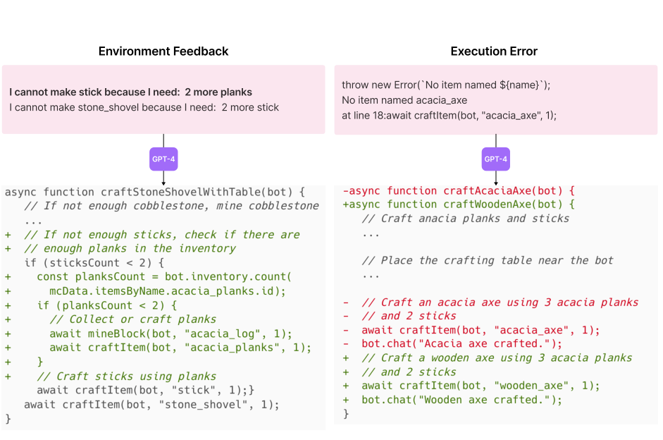

**图5　两种失败反馈。** 左图提示“制作木棍还缺少2块木板”，说明资源不足；右图中调用 `craftItem(bot,"acacia_axe",1)` 报错，因为游戏中不存在相应的“金合欢木斧”物品，模型应当改为可制作的木斧。图中程序代码与错误字符串保持原文。

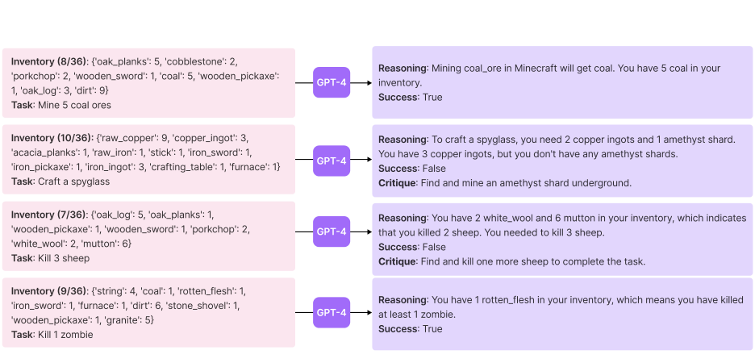

**图6　自我验证示例。** 挖掘5块煤矿石后背包出现煤炭，判定成功；制作望远镜时缺少紫水晶碎片，判定失败并建议寻找紫水晶；目标击败3只羊但只有2块羊毛对应的证据时，建议再击败一只；拥有腐肉则可作为曾击败僵尸的证据之一。模型给出理由、布尔型成功标记，以及必要时的批评性建议。

每轮生成代码后，VOYAGER 都执行程序、收集环境反馈与异常，再把这些信息带入下一轮 GPT-4 提示。循环持续到自我验证确认任务完成，随后新技能被加入技能库，并由自动课程提出下一任务。**如果连续4轮代码生成仍陷入困境，系统将改为请求课程生成其他任务**，不无限重试。此机制帮助 VOYAGER 在无人类干预时持续获得新技能。

## 3 实验（Experiments）

### 3.1 实验设置

论文使用 `gpt-4-0314` 与 `gpt-3.5-turbo-0301` API 生成文本，使用 `text-embedding-ada-002` 生成向量嵌入。除自动课程为增加任务多样性而把**温度设为0.1**外，其他模块温度均设为 **0**。Minecraft 模拟环境建立在 **MineDojo** 之上，运动控制借助 **Mineflayer JavaScript API** 实现。更多细节见原论文附录 B.1。

### 3.2 基线方法

由于当时没有可直接在 Minecraft 中部署的通用大语言模型智能体，作者把几个原本面向 NLP 的代表性算法改造为可在 MineDojo 执行的系统。

**ReAct** 交替生成推理轨迹和行动计划，接收环境反馈与智能体状态作为观察；**Reflexion** 在 ReAct 基础上增加自我反思机制，实验中为其提供执行错误与本文的自我验证模块；**AutoGPT** 将大目标分解为多个子目标，再在 ReAct 风格的循环中执行，作者用 GPT-4 对其进行重新实现，提供智能体状态、环境反馈和执行错误。与 VOYAGER 相比，改造后的 AutoGPT 缺少用于积累知识的技能库、用于判断成功的自我验证，以及用于开放探索的自动课程。

作者没有直接与输入 Minecraft 屏幕像素、输出低层键鼠动作的系统比较，因为 VOYAGER 使用高层 Mineflayer API，二者的感知和动作条件并不一致。本文的重点是提升 GPT-4 在具身终身学习方面的能力，而不是解决三维视觉感知和感觉运动控制问题。只要底层控制器暴露代码 API，VOYAGER 原则上能够与 VPT 等基于梯度的控制方法组合使用。附录表 A.2 给出更全面的系统层面比较。

### 3.3 评估结果

作者从**探索表现、技术树掌握、地图覆盖、在新世界中对未知任务的零样本泛化**四个方面进行系统比较。

**探索：** 如图1所示，VOYAGER 在160轮提示迭代中获得 **63种不同物品**，是对照方法的 **3.3倍**；AutoGPT 获取新物品的速度明显更慢，而 ReAct 和 Reflexion 在开放目标过于抽象、缺少合适课程的情况下很难进展。

**技术树：** Minecraft 从木制工具、石制工具、铁制工具到钻石工具的升级，需要多个技能有序组合。VOYAGER 解锁木制工具阶段的速度比对照快 **15.3倍**，石制阶段快 **8.5倍**，铁制阶段快 **6.4倍**；在主实验中，它还是唯一成功解锁钻石工具阶段的系统。这支持了自动课程能够以适当难度不断推动能力发展的判断。

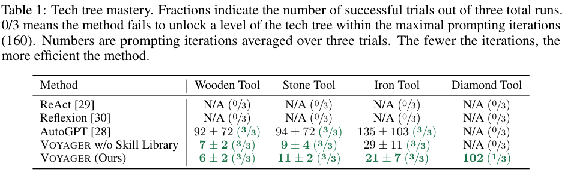

**表1　技术树掌握表现（提示轮次，越少越好）。** 分数括号代表三次实验中的成功次数；`N/A (0/3)` 表示最多160轮也未成功。

| 方法 | 木制工具 | 石制工具 | 铁制工具 | 钻石工具 |
|---|---:|---:|---:|---:|
| ReAct | N/A (0/3) | N/A (0/3) | N/A (0/3) | N/A (0/3) |
| Reflexion | N/A (0/3) | N/A (0/3) | N/A (0/3) | N/A (0/3) |
| AutoGPT | 92 ± 72 (3/3) | 94 ± 72 (3/3) | 135 ± 103 (3/3) | N/A (0/3) |
| VOYAGER（无技能库） | 7 ± 2 (3/3) | 9 ± 4 (3/3) | 29 ± 11 (3/3) | N/A (0/3) |
| **VOYAGER** | **6 ± 2 (3/3)** | **11 ± 2 (3/3)** | **21 ± 7 (3/3)** | **102 (1/3)** |

**地图覆盖：** VOYAGER 能够跨越多种地形，移动的距离比基线长 **2.3倍**。相较之下，其他智能体更容易困在局部区域，难以发现新资源与知识。

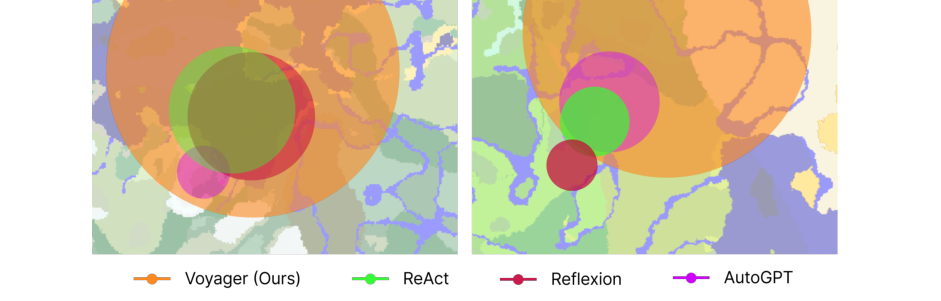

**图7　各方法 Minecraft 地图覆盖范围的俯视比较。** VOYAGER 在多样地形中进行更大范围的探索。

**零样本泛化：** 研究将智能体背包清空，并置入新生成的 Minecraft 世界，测试训练探索期间没有直接执行过的新任务。VOYAGER 与 AutoGPT 都使用 GPT-4 将新任务拆分为子目标。VOYAGER 在**制作钻石镐、金剑、熔岩桶和指南针**四项任务上三次均成功，其他原始基线在最多50轮内无法完成。将 VOYAGER 的技能库提供给 AutoGPT 后，后者表现得到改善，证明技能库可作为跨算法使用的即插即用知识资源。

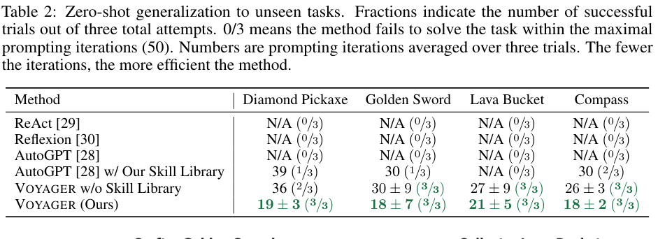

**表2　对未见任务的零样本泛化表现。** 数字为成功时使用的平均提示轮数，括号为三次尝试的成功次数，最多50轮。

| 方法 | 钻石镐 | 金剑 | 熔岩桶 | 指南针 |
|---|---:|---:|---:|---:|
| ReAct | N/A (0/3) | N/A (0/3) | N/A (0/3) | N/A (0/3) |
| Reflexion | N/A (0/3) | N/A (0/3) | N/A (0/3) | N/A (0/3) |
| AutoGPT | N/A (0/3) | N/A (0/3) | N/A (0/3) | N/A (0/3) |
| AutoGPT + 本文技能库 | 39 (1/3) | 30 (1/3) | N/A (0/3) | 30 (2/3) |
| VOYAGER（无技能库） | 36 (2/3) | 30 ± 9 (3/3) | 27 ± 9 (3/3) | 26 ± 3 (3/3) |
| **VOYAGER** | **19 ± 3 (3/3)** | **18 ± 7 (3/3)** | **21 ± 5 (3/3)** | **18 ± 2 (3/3)** |

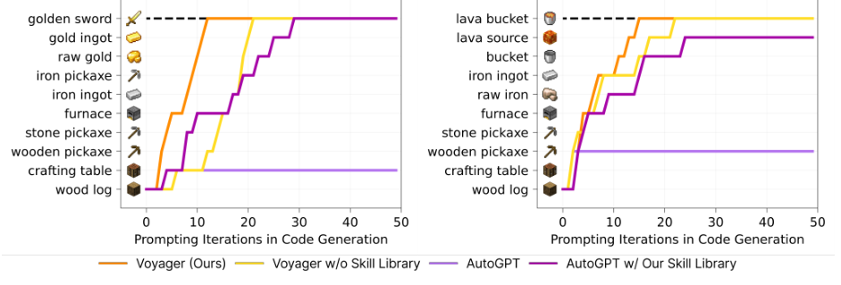

**图8　新任务零样本泛化的中间过程。** 展示了四个任务中的两个，另两个见原文附录 B.4.3；ReAct 和 Reflexion 因没有实质性进展而未绘制。

### 3.4 消融实验（Ablation Studies）

作者分别移除或改变六项设计：**自动课程、技能库、环境反馈、执行错误、自我验证、使用 GPT-4 生成代码**，并观察探索表现的变化。主要发现如下：

- **自动课程至关重要。** 换成随机课程后，获得的物品数量下降 **93%**，原因是智能体可能过早尝试超出能力的任务。手工课程则需要 Minecraft 专家经验，且无法灵活适应实时状态，在实验中仍不如自动课程。
- **技能库支撑长期增长。** 移除技能库后，探索能力往往在后期停滞。保留旧技能、以旧技能组成新技能，是持续拓展能力边界的关键。
- **自我验证是反馈机制中最重要的一环。** 移除后发现的新物品数下降 **73%**。它决定是否应该转向新任务，还是继续重试此前失败的目标。
- **GPT-4 的代码生成能力明显优于 GPT-3.5。** 将代码生成模型换成 GPT-3.5 后结果明显下降，GPT-4 获得的新物品数量高出 **5.7倍**，表明高质量程序合成对于系统至关重要。

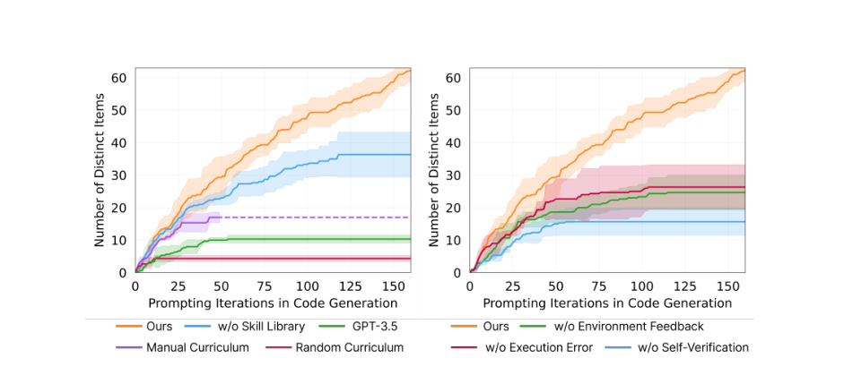

**图9　模块消融结果。** 左侧比较自动课程、技能库和 GPT-4；右侧比较迭代提示中的三种反馈。完整 VOYAGER 在两个图中均表现更好。

### 3.5 来自人类的多模态反馈

论文撰写时可用的 GPT-4 API 只支持文本，因此 VOYAGER 本身没有视觉感知能力。不过它可以进一步结合多模态感知模型。作者展示：在人类提供反馈后，VOYAGER 可以建造**下界传送门（Nether Portal）**、房屋等三维结构。

第一种方式是**人类充当批评器**，对应自我验证：人类观察生成的三维建筑，指出位置、方向和结构细节方面的错误，VOYAGER 再修改代码。这可弥补纯文本智能体无法直接感知某些空间细节的缺陷。第二种方式是**人类充当课程设计者**，将复杂建筑任务拆解为小步骤，引导智能体逐步完成。这能帮助 VOYAGER 处理更复杂的建造目标。

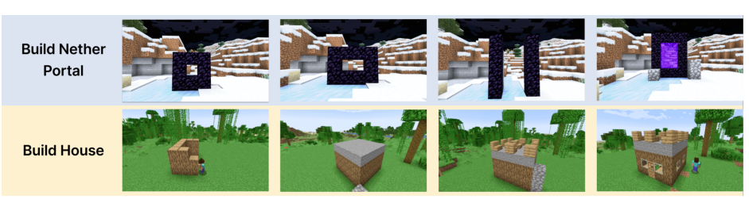

**图10　借助人类反馈建造三维建筑的过程。** 从左到右展示人类输入如何参与建造设计与迭代改善。

## 4 局限性与未来工作（Limitations and Future Work）

**成本。** GPT-4 API 的成本较高，约为 GPT-3.5 的 **15倍**。然而，VOYAGER 需要 GPT-4 相对 GPT-3.5 和当时开源模型的代码生成优势，因此成本成为制约规模化使用的重要因素。

**不准确性。** 尽管有迭代提示，智能体仍可能卡住，无法生成正确技能；自动课程允许其之后再回到任务，但自我验证偶尔也会失败。例如击败蜘蛛后得到蛛丝，验证器却未将其识别为成功信号。

**幻觉。** 自动课程有时会提出游戏中根本不存在的任务，如制作“铜剑”或“铜质胸甲”；代码生成也会产生幻觉，例如错误地将圆石（cobblestone）作为燃料，或者调用控制 API 中没有提供的函数，导致执行错误。作者认为改进的基础模型和针对开源模型的新型微调方法有望缓解这些问题。

## 5 相关工作（Related Work）

### 5.1 Minecraft 中的决策智能体

Minecraft 的开放三维世界支持极多活动。既有学习算法大致可分为两类：一类是**低层控制器**，例如通过分层强化学习、人类演示、视频预训练或世界模型学习控制键鼠动作。VPT 和 MineDojo 使用 YouTube 视频预训练，DreamerV3 通过学习世界模型探索并寻找钻石。另一类是**高层规划器**，使用 LLM 或代码模型把复杂任务拆分为小目标，再调用底层控制器执行。例如部分工作基于物品合成配方分解任务，因而缺少对开放目标的充分探索。

VOYAGER 同样利用 GPT-4 进行高层规划，使用 Mineflayer API 执行运动，但不同之处在于它的自动课程由**好奇心和探索进展**驱动，从简单任务逐渐发展到复杂目标，并非完全依赖预设目标或固定配方序列。

### 5.2 大语言模型用于智能体规划

LLM 的零样本推理和复杂规划能力推动了具身智能体研究。机器人方向的工作使用 LLM 制定子目标，Inner Monologue 增加环境反馈，Code as Policies 和 ProgPrompt 直接生成可执行机器人程序，VIMA、PaLM-E 则探索多模态模型。文本智能体方面，ReAct 交替执行推理与行动，Reflexion 在此基础上增加自我反思，AutoGPT 将大目标拆成多个子目标，DERA 采用多个 GPT-4 智能体对话。

作者也提到 Generative Agents：该系统利用 ChatGPT 将虚拟角色经历存成记忆，再检索以规划行为，但其行动未形成可执行代码。同期 SPRING 通过 GPT-4 从游戏说明书提取游戏规则，并据此构建问题图和预测动作。作者强调，这些已有工作普遍缺少能持续组合生成复杂行为的**技能库**，而这正是 VOYAGER 终身学习成功的关键之一。

### 5.3 利用执行反馈生成代码

传统程序生成研究已探索用中间执行结果指导程序搜索、用多数投票选择候选程序，或训练验证器识别错误程序。LEVER 学习基于执行结果筛除错误程序，CLAIRIFY 在化学实验规划代码中使用规则验证器生成修复反馈。VOYAGER 的区别在于将**环境反馈、执行错误和任务级自我验证**三者统一到具身行动程序的迭代提示中。

## 6 结论（Conclusion）

VOYAGER 将 GPT-4、自动课程、技能库和迭代反馈结合，构成无需人工干预即可探索、学习、修复与迁移的具身终身学习智能体。它在 Minecraft 中持续发现物品、解锁技术树、跨多样地形导航，并将旧环境中的可执行技能迁移到新环境。论文说明，通过将自然语言模型与可执行程序、外部记忆和环境验证闭环相结合，可以在无需修改基础模型参数的条件下积累具有组合性的行动能力。

## 附录 A 方法细节（Method）

### A.1 VOYAGER 算法

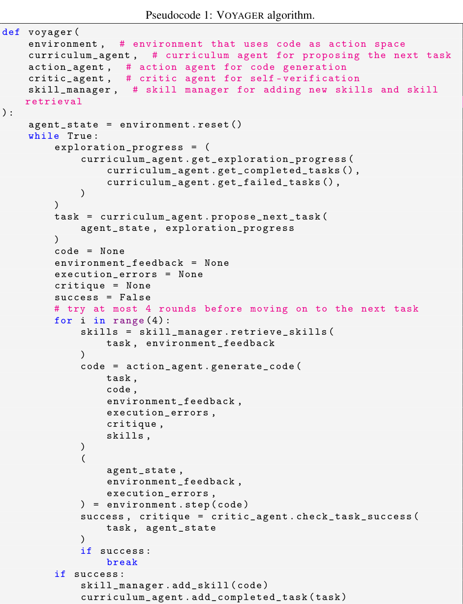

**伪代码1　VOYAGER 主循环。** `environment` 代表以代码作为动作空间的环境，`curriculum_agent` 负责提出新任务，`action_agent` 生成可执行代码，`critic_agent` 负责自我验证，`skill_manager` 用于存储和检索技能。原始伪代码中的函数名与参数名保持原文。

算法首先重置环境得到初始智能体状态，随后进入持续循环：读取已完成及失败任务以估计探索进展，再由课程智能体提出当前目标。每个任务初始时将代码、环境反馈、执行错误和批评意见清空，并设定成功标记为假。随后最多执行**4轮**：检索相关技能；调用行动智能体生成或修改代码；执行 `environment.step(code)`，获得新状态、环境反馈和执行错误；让批评器调用 `check_task_success` 判断任务是否完成并给出建议。若验证成功，程序写入技能库并标记为已完成任务；否则记为失败任务，进入下一次课程规划。

### A.2 提示消息结构（Prompting）

GPT-4 与 GPT-3.5 的对话消息采用三类角色：**System（系统）**指定全局任务、目标与行为边界，**User（用户）**指定当前这轮需要执行的具体任务，**Assistant（助手）**是模型输出。为节省 token，作者在实际实现中把系统提示与用户提示合并，而不是进行多轮冗长对话。

### A.3 自动课程（Automatic Curriculum）

#### A.3.1 提示组成

自动课程的输入包括：任务可实现性和可验证性约束；智能体状态；已完成及失败任务；补充上下文；以及要求模型**先推理、后给出下一任务**的思维链输出要求。

智能体状态中各字段的含义如下：`Inventory` 是物品与数量构成的字典；`Equipment` 是已装备护甲和武器；`Nearby blocks` 是距离32格之内的方块；`Other blocks that are recently seen` 为近期见过但不在附近或库存中的方块；`Nearby entities` 是32格内的生物或其他实体；`Chests` 是已发现的箱子，其内容在首次打开前标为 `Unknown`；`Biome` 为草原、河流、海滩、森林、雪山、海洋等生物群系；`Time` 为日出、白天、中午、日落、夜间、午夜之一；生命值与饥饿值最大均为20；`Position` 是世界中的三维坐标 `(x,y,z)`。

#### A.3.2 补充上下文

作者让 GPT-3.5 根据当前状态**自问自答（self-ask / self-answer）**。每个问题搭配一个**概念（concept）**，用于从 Minecraft Wiki 知识库检索相关文档，再用该文档帮助回答。由于 GPT-3.5 已掌握较多 Minecraft 知识，外部 Wiki 在本实验中是可选组件；但若模型对特定领域缺乏预训练知识，外部资料会更有价值。

#### A.3.3 热身日程（Warm-up Schedule）

作者采用分阶段开放信息的**热身机制（warm-up）**：随着完成任务数量增加，提示中逐步加入更多状态字段和额外上下文，让智能体先掌握基础知识再承担更复杂的探索挑战。

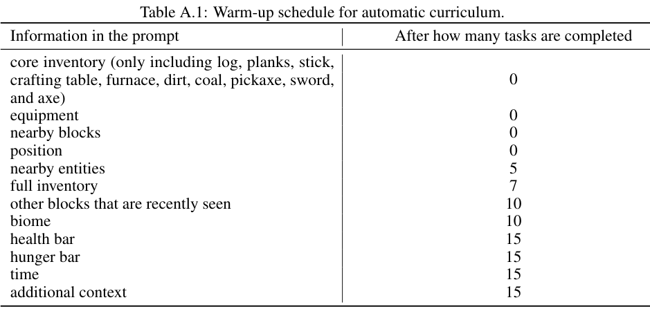

**附录表 A.1　自动课程的热身信息开放顺序。**

| 可用信息 | 完成任务数达到 |
|---|---:|
| 核心库存（原木、木板、木棍、工作台、熔炉、泥土、煤炭、镐、剑、斧） | 0 |
| 装备 | 0 |
| 附近方块 | 0 |
| 三维坐标位置 | 0 |
| 附近实体 | 5 |
| 完整库存 | 7 |
| 最近见过的其他方块 | 10 |
| 生物群系 | 10 |
| 生命值 | 15 |
| 饥饿度 | 15 |
| 时间 | 15 |
| 额外问答上下文 | 15 |

#### A.3.4 完整提示词（Prompt 1–3）

原论文给出三段完整系统提示。为保证可复现性，**原始英语命令、输出标记 `Reasoning:` / `Task:` / `Question:` / `Concept:` / `Answer:` 以及字段名在逐页英文提取稿的第21—24页原样保留**；下面翻译其全部关键行为约束和输出语义。

**Prompt 1：自动课程。** 模型角色是一名 Minecraft 导师，应根据智能体现有学习进度推荐**下一项立即执行的任务**。总体目标是尽可能发现多样事物、完成不同任务、提升游戏水平。输入包括额外问答、环境信息、库存、已完成任务与难度过高的失败任务。输出须遵守八项原则：（1）结合当前水平提出目标；（2）明确需采集的资源、要制作的物品或要击败的生物；（3）只输出一条简洁的任务短语，如 `Mine [quantity] [block]`、`Craft [quantity] [item]`、`Smelt [quantity] [item]`、`Kill [quantity] [mob]`、`Cook [quantity] [food]` 或 `Equip [item]`，不得一次提出多个任务；（4）避免超出资源与技能的难度；（5）任务应新颖、有趣，鼓励稀有资源、装备升级和发现新事物；（6）仅在需要材料时重复旧任务；（7）夜晚也不要让智能体固定在某处建造或挖掘庇护所，因为目标是探索；（8）避免需要额外屏幕视觉才能判断成功的放置、建造、种植和交易任务。回复必须先说明选择依据，再提供单一目标。原文示例为“背包空了，应先砍树取木材；下一任务：获取一块原木”。

**Prompt 2：自动课程的自提问。** 模型根据环境状态提出**5至10个**帮助选择下一任务的 Minecraft 知识问题；每个问题必须配套一个用于知识检索的明确概念。问题要足够具体，例如“怎样制作木镐？”应对应 `wooden pickaxe`，不能含糊写成“怎样玩好 Minecraft”；问题必须**无需知道当前情境也能独立回答**，因此“我目前所在群系有什么方块？”不合适，而“稀疏丛林（sparse jungle）里有什么方块？”合适。概念应当匹配检索页面，如查询稀疏丛林能获得哪些矿石时，概念应该是 `sparse jungle` 而不是泛泛的 `ore`。禁止围绕过于困难的建造任务提问。输出中先给推理，再用 `Question 1` / `Concept 1` 等成对字段列出问题与检索概念。

**Prompt 3：知识问题回答。** 模型回答 Minecraft 专业问题，可在有用时参考检索到的 Wiki 上下文，并结合自身的游戏知识作答。必须以 `Answer:` 开头；若不知道答案，明确返回 `Answer: Unknown`，而不是编造内容。

### A.4 技能库（Skill Library）

#### A.4.1 生成代码的提示组成

代码生成提示不仅提供编程规则，还提供作者实现的底层辅助 API 及 Mineflayer 原生 API、技能库检索的程序、上一轮代码与错误、聊天日志、批评意见、环境状态、当前任务以及一般性任务建议。要求模型先解释上轮为什么失败、列出完成目标的步骤计划，最后生成**可复用的 JavaScript 异步函数**。

**作者封装的底层控制 API：**

| API | 中文功能 |
|---|---|
| `exploreUntil(bot, direction, maxTime=60, callback)` | 朝指定方向探索，回调函数判断何时提前停止 |
| `mineBlock(bot, name, count=1)` | 在32格内挖掘并采集指定数量的方块 |
| `craftItem(bot, name, count=1)` | 使用附近的工作台合成指定物品 |
| `placeItem(bot, name, position)` | 在目标坐标放置物品或方块 |
| `smeltItem(bot, itemName, fuelName, count=1)` | 使用附近的熔炉和指定燃料冶炼物品 |
| `killMob(bot, mobName, timeout=300)` | 攻击指定生物并获取掉落物 |
| `getItemFromChest(bot, chestPosition, itemsToGet)` | 移至指定箱子并取出相应物品 |
| `depositItemIntoChest(bot, chestPosition, itemsToDeposit)` | 移至指定箱子并存入相应物品 |

**Mineflayer 的典型操作：** `bot.pathfinder.goto` 负责导航；`GoalNear` 前往某坐标范围，`GoalXZ` 支持无特定高度的远距离目标，`GoalGetToBlock` 到达紧邻方块的位置，`GoalFollow` 跟随实体，`GoalPlaceBlock` 寻找合适的方块放置位置，`GoalLookAtBlock` 导航到能看见目标方块表面的位置；`bot.isABed` 判断方块是否为床，`bot.blockAt` 获取指定位置的方块；`bot.equip` 装备物品，`bot.consume` 食用或饮用手持物品，`bot.fish` 钓鱼，`bot.sleep` 睡到天亮，`bot.activateBlock` 右键交互方块，`bot.lookAt` 注视某位置，`bot.activateItem` 使用手持物品，`bot.useOn` 对指定生物进行交互（如剪羊毛）。这些操作有前置条件，例如装备钓竿后才可钓鱼、靠近床后才能睡觉；完整参数和前置要求保留于英文原文第24—30页。

#### A.4.2 完整代码生成提示（Prompt 4）

原提示要求模型将输入任务转换成 Mineflayer JavaScript 代码，并提供大量可执行示例。关键规则为：（1）输出以 `bot` 为唯一参数的 `async` 函数；（2）尽量复用作者提供的辅助函数，而不是直接调用 `bot.dig`、`bot.craft`、`bot.openFurnace`、`bot.placeBlock` 或 `bot.attack`；（3）程序未来会被复用，不能假设背包中一定有某些物品，使用前须检查，缺少则先收集或制作；（4）不能依赖上一轮代码中定义但不会被保存和执行的函数；（5）所有变量必须定义在函数内部；（6）使用 `bot.chat` 输出中间执行进度；（7）找不到目标时可以使用 `exploreUntil` 探索，并应变化方向，而非始终朝同一方向搜索；（8）方块检索距离不得超过32，以避免作弊；（9）禁止无限循环和递归函数；（10）不应使用 `bot.on` 或 `bot.once` 注册事件监听；（11）函数名称应当清晰、能够反映任务语义。

回复格式必须包含 `Explain`（失败分析）、`Plan`（逐步方案）和 `Code`（代码块）三个部分。原稿第26—31页包含矿石搜索、合成、方块放置、冶炼、战斗、箱子物品存取等完整代码，**代码本体保持原文，不进行可能改变功能的汉化**。

#### A.4.3 技能代码示例

原文附录展示了包括 `craftWoodenPlanks` 等可复用的 Mineflayer JavaScript 函数。典型程序先检查库存资源；若没有原木就调用 `mineWoodLog` 获取；再判断具体木材类型，合成相应种类的木板；对外通过 `bot.chat` 提供进度反馈。另一个示例展示制作并装备木镐、向地下探索石块、采集八块圆石的复合技能。所有示例代码见逐页原文第32—34页及相应原稿页图。

### A.5 自我验证（Self-Verification）

自我验证提示由以下部分组成：当前状态（通常排除近期见过但与完成检查不直接相关的方块和附近生物）、自动课程提出的任务、GPT-3.5 生成的一般性任务建议、先推理再输出的思维链要求，以及少样本示例。模型必须先依据资源或任务状态判断是否成功，再输出布尔变量，并在失败时指出改进办法。其关键输出字段为 `reasoning`、`success` 和 `critique`。

原文 **Prompt 6** 特别强调：应判断任务要求是否确已满足；完成超过目标数量通常也应算成功，但不能因看到不充分证据就推断完成。示例包括拥有腐肉可能证明击败僵尸、饥饿度变化可能证明已进食、指定箱子里的物品清单应和物品存放任务要求对应等。完整提示与 JSON 示例见原稿第35—37页。

### A.6 其他实现细节

原论文后续说明了技能和课程所用的文本嵌入、代码记录格式等实现要点。需要复现时，请优先核对英文原稿中 **A.1–A.6** 的函数签名与提示变量；中文表述仅用于解释语义，不能替代原始可执行参数。

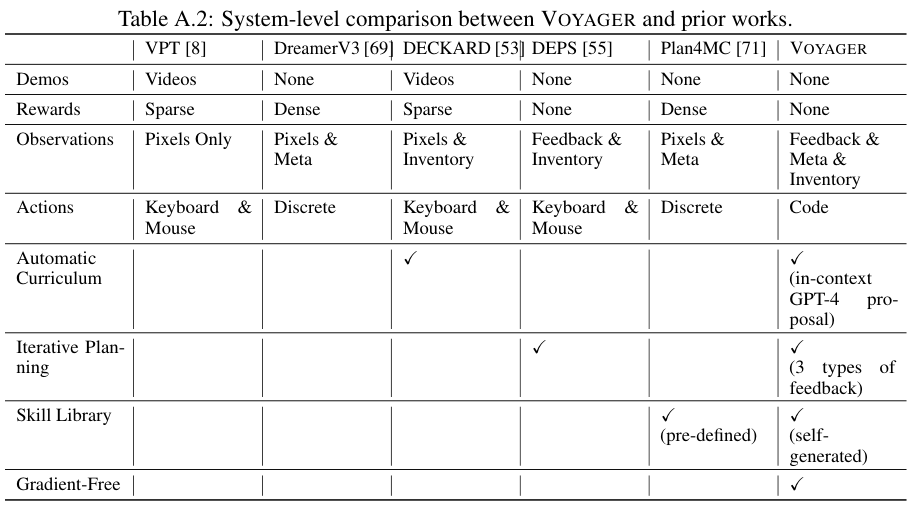

**附录表 A.2　VOYAGER 与此前 Minecraft 智能体的系统层面比较。** 表格对比演示数据、奖励形式、观察信号、动作类型、自动课程、迭代规划、技能库与是否依赖梯度。VOYAGER 的主要特点是通过高层反馈和程序化动作、GPT-4 提出的课程、自我生成的技能库以及无需梯度更新的运行方式实现探索。

## 附录 B 实验细节（Experiments）

### B.1 环境与执行配置

模拟基于 MineDojo，动作由 Mineflayer JavaScript API 执行。作者在多个 Mineflayer 函数中加入 `bot.chat()`，以获得丰富的执行反馈；还加入条件检查和 `try-catch` 异常处理，让程序尽可能不中断。角色死亡时，系统会在附近地面复活它，并**保留原有库存**，以便继续探索。执行程序后，系统会回收工作台和熔炉等可重复使用物品。

### B.2 基线实现细节

ReAct 在每个任务中从零生成一轮代码并最多进行三轮修复，接收环境状态与环境反馈。Reflexion 在相似流程中额外获得执行错误和自我验证意见。AutoGPT 使用 GPT-4 拆分任务，利用状态、反馈及错误完成子任务；每项子任务若未发生错误就标为完成，否则最多经过额外三轮修复；如果连续三个子任务都没有带来新物品，重新进行任务分解。所有基线共有的开放目标是“探索世界并尽可能获得多种不同物品”。

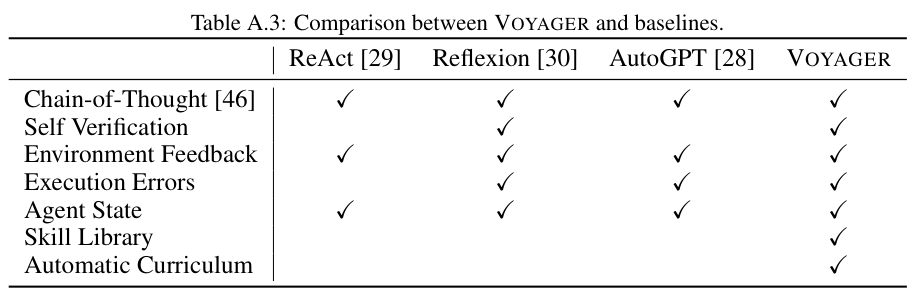

**附录表 A.3　ReAct、Reflexion、AutoGPT、VOYAGER 的能力组件比较。** 对比思维链、自我验证、环境反馈、执行错误、状态感知、技能库和自动课程的支持情况。

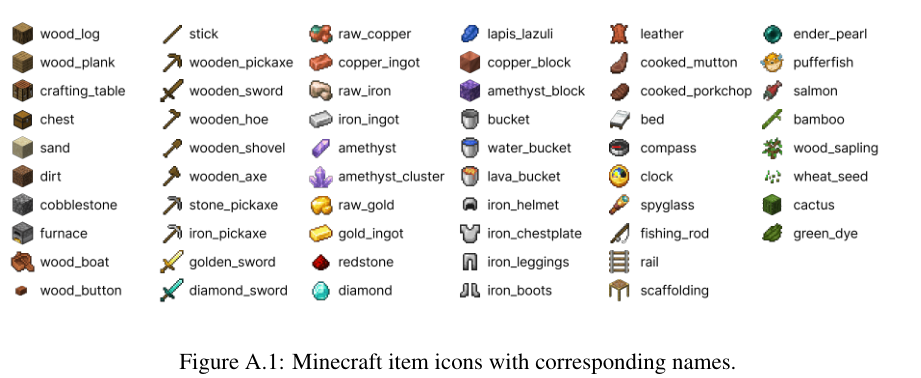

**附录图 A.1　Minecraft 物品图标和英文名称对照。** 含原木、木板、镐、剑、矿石、金属、食物、箱子、装备等。这些物品名称在代码中作为实际 ID，因此不替换成中文标识符。

### B.3 消融设置

六个变体分别为：（1）**人工课程**：用人工列出的挖木、制作工作台、制作木镐、挖圆石、制作石镐、制作熔炉、采集铁矿、冶炼铁矿、制作铁镐、采集钻石等固定步骤取代自动课程；（2）**随机课程**：从 VOYAGER 实际获得的101种物品中随机选出下一个目标；（3）**去掉技能库**：生成新代码时不检索既有程序；（4）**去掉环境反馈**：移除提示中的聊天日志；（5）**去掉执行错误**：不提供解释器错误；（6）**去掉自我验证**：每项任务仅按固定轮次生成及修订代码而不使用批评器；另将 GPT-4 代码生成器替换为 GPT-3.5，保留自动课程和自我验证使用 GPT-4。消融在同一探索任务上比较物品发现进度。

### B.4 更多评估结果

#### B.4.1 探索表现

原论文附录报告各方法在三次实验中取得的物品清单以及图1中使用的图标释义。为了精确复现，`oak_log`、`cobblestone`、`diamond` 等物品的英文内部 ID 保留在原稿第39—40页，不能根据中文物品译名修改这些标识符。

#### B.4.2 地图探索范围

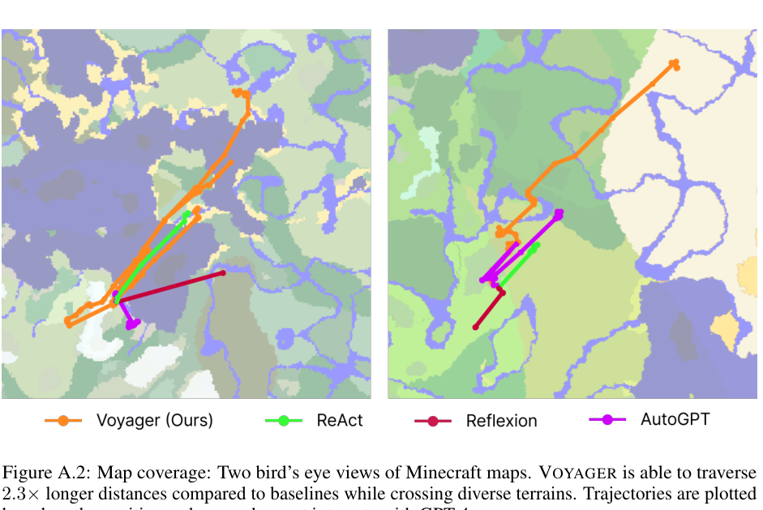

**附录图 A.2　不同方法的实际地图移动轨迹。** 轨迹由各智能体与 GPT-4 交互时记录的位置绘制。正文图7是在这些轨迹上计算最小覆盖圆得到的。VOYAGER 三次运行分别穿越草地、沙漠、河流、稀树草原、森林、平原、竹林、钟乳石洞穴，以及雪原、冻河、海岸、海洋、山峰等多样地貌；其他方法覆盖区域更为有限。

#### B.4.3 新任务泛化

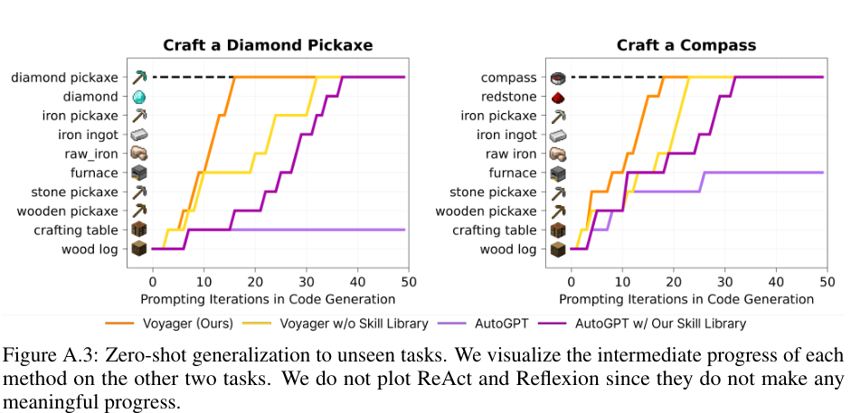

**附录图 A.3　剩余两个未见任务的泛化过程。** 图中展示制作钻石镐和指南针等任务的进展；ReAct 和 Reflexion 没有取得有意义的进展而未绘出。VOYAGER 可使用既有技能库快速完成；AutoGPT 在加载同一技能库后亦得到改善。

#### B.4.4 技能检索准确率

在共 **309个**技能检索样本上，作者测试目标技能在前 \(k\) 个候选技能中的出现比例。检索采用**Top-5** 结果提供给代码生成模型。


| Top-1 | Top-2 | Top-3 | Top-4 | Top-5 |
|---:|---:|---:|---:|---:|
| 80.2 ± 3.0 | 89.3 ± 1.8 | 93.2 ± 0.7 | 95.2 ± 1.8 | **96.5 ± 0.3** |

**附录表 A.4　技能检索准确率。** 前5项命中率 **96.5%**，说明检索模块能够为大多数新技能合成提供正确的程序基础。

#### B.4.5 对基础模型版本的鲁棒性

主体实验全部使用 `gpt-4-0314`。作者另使用 `gpt-4-0613` 进行了补充测试，发现性能大体相当，说明 VOYAGER 对这两个模型版本的变化具有一定稳健性。

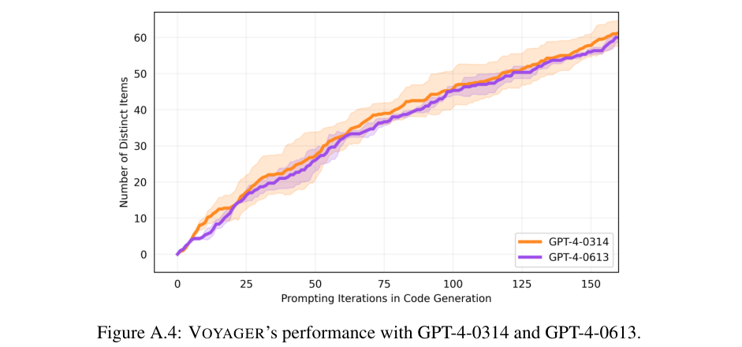

**附录图 A.4　GPT-4-0314 与 GPT-4-0613 下的 VOYAGER 表现比较。** 两条探索曲线走势接近。

---

## 参考文献（References）

下面保留原论文的全部英文参考文献、条目编号及出版信息，方便通过作者、英文题名和 DOI 精准检索。

```text
[1] Eric Kolve, Roozbeh Mottaghi, Winson Han, Eli VanderBilt, Luca Weihs, Alvaro Herrasti,
Daniel Gordon, Yuke Zhu, Abhinav Gupta, and Ali Farhadi. Ai2-thor: An interactive 3d
environment for visual ai. arXiv preprint arXiv: Arxiv-1712.05474, 2017.
[2] Manolis Savva, Jitendra Malik, Devi Parikh, Dhruv Batra, Abhishek Kadian, Oleksandr
Maksymets, Yili Zhao, Erik Wijmans, Bhavana Jain, Julian Straub, Jia Liu, and Vladlen
Koltun. Habitat: A platform for embodied AI research. In 2019 IEEE/CVF International
Conference on Computer Vision, ICCV 2019, Seoul, Korea (South), October 27 - November 2,
2019, pages 9338–9346. IEEE, 2019.
[3] Yuke Zhu, Josiah Wong, Ajay Mandlekar, and Roberto Martín-Martín. robosuite: A mod-
ular simulation framework and benchmark for robot learning. arXiv preprint arXiv: Arxiv-
2009.12293, 2020.
[4] Fei Xia, William B. Shen, Chengshu Li, Priya Kasimbeg, Micael Tchapmi, Alexander Toshev,
Li Fei-Fei, Roberto Martín-Martín, and Silvio Savarese. Interactive gibson benchmark (igibson
0.5): A benchmark for interactive navigation in cluttered environments. arXiv preprint arXiv:
Arxiv-1910.14442, 2019.
[5] Bokui Shen, Fei Xia, Chengshu Li, Roberto Martín-Martín, Linxi Fan, Guanzhi Wang, Claudia
Pérez-D’Arpino, Shyamal Buch, Sanjana Srivastava, Lyne P. Tchapmi, Micael E. Tchapmi, Kent
Vainio, Josiah Wong, Li Fei-Fei, and Silvio Savarese. igibson 1.0: a simulation environment for
interactive tasks in large realistic scenes. arXiv preprint arXiv: Arxiv-2012.02924, 2020.
11

[6] Jens Kober, J Andrew Bagnell, and Jan Peters. Reinforcement learning in robotics: A survey.
The International Journal of Robotics Research, 32(11):1238–1274, 2013.
[7] Kai Arulkumaran, Marc Peter Deisenroth, Miles Brundage, and Anil Anthony Bharath. Deep
reinforcement learning: A brief survey. IEEE Signal Processing Magazine, 34(6):26–38, 2017.
[8] Bowen Baker, Ilge Akkaya, Peter Zhokhov, Joost Huizinga, Jie Tang, Adrien Ecoffet, Brandon
Houghton, Raul Sampedro, and Jeff Clune. Video pretraining (vpt): Learning to act by watching
unlabeled online videos. arXiv preprint arXiv: Arxiv-2206.11795, 2022.
[9] DeepMind Interactive Agents Team, Josh Abramson, Arun Ahuja, Arthur Brussee, Federico
Carnevale, Mary Cassin, Felix Fischer, Petko Georgiev, Alex Goldin, Mansi Gupta, Tim
Harley, Felix Hill, Peter C Humphreys, Alden Hung, Jessica Landon, Timothy Lillicrap, Hamza
Merzic, Alistair Muldal, Adam Santoro, Guy Scully, Tamara von Glehn, Greg Wayne, Nathaniel
Wong, Chen Yan, and Rui Zhu. Creating multimodal interactive agents with imitation and
self-supervised learning. arXiv preprint arXiv: Arxiv-2112.03763, 2021.
[10] Oriol Vinyals, Igor Babuschkin, Junyoung Chung, Michael Mathieu, Max Jaderberg, Wo-
jciech M Czarnecki, Andrew Dudzik, Aja Huang, Petko Georgiev, Richard Powell, et al.
Alphastar: Mastering the real-time strategy game starcraft ii. DeepMind blog, 2, 2019.
[11] Adrien Ecoffet, Joost Huizinga, Joel Lehman, Kenneth O. Stanley, and Jeff Clune. Go-explore:
a new approach for hard-exploration problems. arXiv preprint arXiv: Arxiv-1901.10995, 2019.
[12] Joost Huizinga and Jeff Clune. Evolving multimodal robot behavior via many stepping stones
with the combinatorial multiobjective evolutionary algorithm.
Evolutionary computation,
30(2):131–164, 2022.
[13] Rui Wang, Joel Lehman, Aditya Rawal, Jiale Zhi, Yulun Li, Jeffrey Clune, and Kenneth O.
Stanley. Enhanced POET: open-ended reinforcement learning through unbounded invention of
learning challenges and their solutions. In Proceedings of the 37th International Conference on
Machine Learning, ICML 2020, 13-18 July 2020, Virtual Event, volume 119 of Proceedings of
Machine Learning Research, pages 9940–9951. PMLR, 2020.
[14] Ingmar Kanitscheider, Joost Huizinga, David Farhi, William Hebgen Guss, Brandon Houghton,
Raul Sampedro, Peter Zhokhov, Bowen Baker, Adrien Ecoffet, Jie Tang, Oleg Klimov, and Jeff
Clune. Multi-task curriculum learning in a complex, visual, hard-exploration domain: Minecraft.
arXiv preprint arXiv: Arxiv-2106.14876, 2021.
[15] Michael Dennis, Natasha Jaques, Eugene Vinitsky, Alexandre M. Bayen, Stuart Russell, Andrew
Critch, and Sergey Levine. Emergent complexity and zero-shot transfer via unsupervised
environment design. In Hugo Larochelle, Marc’Aurelio Ranzato, Raia Hadsell, Maria-Florina
Balcan, and Hsuan-Tien Lin, editors, Advances in Neural Information Processing Systems 33:
Annual Conference on Neural Information Processing Systems 2020, NeurIPS 2020, December
6-12, 2020, virtual, 2020.
[16] Jacky Liang, Wenlong Huang, Fei Xia, Peng Xu, Karol Hausman, Brian Ichter, Pete Florence,
and Andy Zeng. Code as policies: Language model programs for embodied control. arXiv
preprint arXiv: Arxiv-2209.07753, 2022.
[17] Shao-Hua Sun, Te-Lin Wu, and Joseph J. Lim. Program guided agent. In 8th International
Conference on Learning Representations, ICLR 2020, Addis Ababa, Ethiopia, April 26-30, 2020.
OpenReview.net, 2020.
[18] Zelin Zhao, Karan Samel, Binghong Chen, and Le Song. Proto: Program-guided transformer for
program-guided tasks. In Marc’Aurelio Ranzato, Alina Beygelzimer, Yann N. Dauphin, Percy
Liang, and Jennifer Wortman Vaughan, editors, Advances in Neural Information Processing
Systems 34: Annual Conference on Neural Information Processing Systems 2021, NeurIPS
2021, December 6-14, 2021, virtual, pages 17021–17036, 2021.
[19] Yunfan Jiang, Agrim Gupta, Zichen Zhang, Guanzhi Wang, Yongqiang Dou, Yanjun Chen,
Li Fei-Fei, Anima Anandkumar, Yuke Zhu, and Linxi (Jim) Fan. Vima: General robot manipu-
lation with multimodal prompts. ARXIV.ORG, 2022.
12

[20] Mohit Shridhar, Lucas Manuelli, and Dieter Fox. Cliport: What and where pathways for robotic
manipulation. arXiv preprint arXiv: Arxiv-2109.12098, 2021.
[21] Linxi Fan, Guanzhi Wang, De-An Huang, Zhiding Yu, Li Fei-Fei, Yuke Zhu, and Animashree
Anandkumar. SECANT: self-expert cloning for zero-shot generalization of visual policies. In
Marina Meila and Tong Zhang, editors, Proceedings of the 38th International Conference on
Machine Learning, ICML 2021, 18-24 July 2021, Virtual Event, volume 139 of Proceedings of
Machine Learning Research, pages 3088–3099. PMLR, 2021.
[22] Ishika Singh, Valts Blukis, Arsalan Mousavian, Ankit Goyal, Danfei Xu, Jonathan Tremblay,
Dieter Fox, Jesse Thomason, and Animesh Garg. Progprompt: Generating situated robot task
plans using large language models. arXiv preprint arXiv: Arxiv-2209.11302, 2022.
[23] Linxi Fan, Guanzhi Wang, Yunfan Jiang, Ajay Mandlekar, Yuncong Yang, Haoyi Zhu, Andrew
Tang, De-An Huang, Yuke Zhu, and Anima Anandkumar. Minedojo: Building open-ended
embodied agents with internet-scale knowledge. arXiv preprint arXiv: Arxiv-2206.08853, 2022.
[24] Andy Zeng, Adrian Wong, Stefan Welker, Krzysztof Choromanski, Federico Tombari, Aveek
Purohit, Michael Ryoo, Vikas Sindhwani, Johnny Lee, Vincent Vanhoucke, and Pete Florence.
Socratic models: Composing zero-shot multimodal reasoning with language. arXiv preprint
arXiv: Arxiv-2204.00598, 2022.
[25] Michael Ahn, Anthony Brohan, Noah Brown, Yevgen Chebotar, Omar Cortes, Byron David,
Chelsea Finn, Keerthana Gopalakrishnan, Karol Hausman, Alex Herzog, Daniel Ho, Jasmine
Hsu, Julian Ibarz, Brian Ichter, Alex Irpan, Eric Jang, Rosario Jauregui Ruano, Kyle Jeffrey,
Sally Jesmonth, Nikhil J Joshi, Ryan Julian, Dmitry Kalashnikov, Yuheng Kuang, Kuang-Huei
Lee, Sergey Levine, Yao Lu, Linda Luu, Carolina Parada, Peter Pastor, Jornell Quiambao,
Kanishka Rao, Jarek Rettinghouse, Diego Reyes, Pierre Sermanet, Nicolas Sievers, Clayton Tan,
Alexander Toshev, Vincent Vanhoucke, Fei Xia, Ted Xiao, Peng Xu, Sichun Xu, and Mengyuan
Yan. Do as i can, not as i say: Grounding language in robotic affordances. arXiv preprint arXiv:
Arxiv-2204.01691, 2022.
[26] Wenlong Huang, Fei Xia, Ted Xiao, Harris Chan, Jacky Liang, Pete Florence, Andy Zeng,
Jonathan Tompson, Igor Mordatch, Yevgen Chebotar, Pierre Sermanet, Noah Brown, Tomas
Jackson, Linda Luu, Sergey Levine, Karol Hausman, and Brian Ichter. Inner monologue:
Embodied reasoning through planning with language models. arXiv preprint arXiv: Arxiv-
2207.05608, 2022.
[27] Wenlong Huang, Pieter Abbeel, Deepak Pathak, and Igor Mordatch. Language models as zero-
shot planners: Extracting actionable knowledge for embodied agents. In Kamalika Chaudhuri,
Stefanie Jegelka, Le Song, Csaba Szepesvári, Gang Niu, and Sivan Sabato, editors, International
Conference on Machine Learning, ICML 2022, 17-23 July 2022, Baltimore, Maryland, USA,
volume 162 of Proceedings of Machine Learning Research, pages 9118–9147. PMLR, 2022.
[28] Significant-gravitas/auto-gpt: An experimental open-source attempt to make gpt-4 fully au-
tonomous., 2023.
[29] Shunyu Yao, Jeffrey Zhao, Dian Yu, Nan Du, Izhak Shafran, Karthik Narasimhan, and Yuan
Cao. React: Synergizing reasoning and acting in language models. arXiv preprint arXiv:
Arxiv-2210.03629, 2022.
[30] Noah Shinn, Beck Labash, and Ashwin Gopinath. Reflexion: an autonomous agent with
dynamic memory and self-reflection. arXiv preprint arXiv: Arxiv-2303.11366, 2023.
[31] German Ignacio Parisi, Ronald Kemker, Jose L. Part, Christopher Kanan, and Stefan Wermter.
Continual lifelong learning with neural networks: A review. Neural Networks, 113:54–71, 2019.
[32] Liyuan Wang, Xingxing Zhang, Hang Su, and Jun Zhu. A comprehensive survey of continual
learning: Theory, method and application. arXiv preprint arXiv: Arxiv-2302.00487, 2023.
[33] Volodymyr Mnih, Koray Kavukcuoglu, David Silver, Alex Graves, Ioannis Antonoglou, Daan
Wierstra, and Martin Riedmiller. Playing atari with deep reinforcement learning. arXiv preprint
arXiv: Arxiv-1312.5602, 2013.
13

[34] OpenAI, :, Christopher Berner, Greg Brockman, Brooke Chan, Vicki Cheung, Przemysław
D˛ebiak, Christy Dennison, David Farhi, Quirin Fischer, Shariq Hashme, Chris Hesse, Rafal Józe-
fowicz, Scott Gray, Catherine Olsson, Jakub Pachocki, Michael Petrov, Henrique P. d. O. Pinto,
Jonathan Raiman, Tim Salimans, Jeremy Schlatter, Jonas Schneider, Szymon Sidor, Ilya
Sutskever, Jie Tang, Filip Wolski, and Susan Zhang. Dota 2 with large scale deep reinforcement
learning. arXiv preprint arXiv: Arxiv-1912.06680, 2019.
[35] OpenAI. Gpt-4 technical report. arXiv preprint arXiv: Arxiv-2303.08774, 2023.
[36] Jason Wei, Yi Tay, Rishi Bommasani, Colin Raffel, Barret Zoph, Sebastian Borgeaud, Dani
Yogatama, Maarten Bosma, Denny Zhou, Donald Metzler, Ed H. Chi, Tatsunori Hashimoto,
Oriol Vinyals, Percy Liang, Jeff Dean, and William Fedus. Emergent abilities of large language
models. arXiv preprint arXiv: Arxiv-2206.07682, 2022.
[37] Tom B. Brown, Benjamin Mann, Nick Ryder, Melanie Subbiah, Jared Kaplan, Prafulla Dhariwal,
Arvind Neelakantan, Pranav Shyam, Girish Sastry, Amanda Askell, Sandhini Agarwal, Ariel
Herbert-Voss, Gretchen Krueger, Tom Henighan, Rewon Child, Aditya Ramesh, Daniel M.
Ziegler, Jeffrey Wu, Clemens Winter, Christopher Hesse, Mark Chen, Eric Sigler, Mateusz
Litwin, Scott Gray, Benjamin Chess, Jack Clark, Christopher Berner, Sam McCandlish, Alec
Radford, Ilya Sutskever, and Dario Amodei. Language models are few-shot learners. In Hugo
Larochelle, Marc’Aurelio Ranzato, Raia Hadsell, Maria-Florina Balcan, and Hsuan-Tien Lin,
editors, Advances in Neural Information Processing Systems 33: Annual Conference on Neural
Information Processing Systems 2020, NeurIPS 2020, December 6-12, 2020, virtual, 2020.
[38] Colin Raffel, Noam Shazeer, Adam Roberts, Katherine Lee, Sharan Narang, Michael Matena,
Yanqi Zhou, Wei Li, and Peter J. Liu. Exploring the limits of transfer learning with a unified
text-to-text transformer. J. Mach. Learn. Res., 21:140:1–140:67, 2020.
[39] Benjamin Eysenbach, Abhishek Gupta, Julian Ibarz, and Sergey Levine. Diversity is all you
need: Learning skills without a reward function. In 7th International Conference on Learning
Representations, ICLR 2019, New Orleans, LA, USA, May 6-9, 2019. OpenReview.net, 2019.
[40] Edoardo Conti, Vashisht Madhavan, Felipe Petroski Such, Joel Lehman, Kenneth O. Stanley,
and Jeff Clune. Improving exploration in evolution strategies for deep reinforcement learning via
a population of novelty-seeking agents. In Samy Bengio, Hanna M. Wallach, Hugo Larochelle,
Kristen Grauman, Nicolò Cesa-Bianchi, and Roman Garnett, editors, Advances in Neural
Information Processing Systems 31: Annual Conference on Neural Information Processing
Systems 2018, NeurIPS 2018, December 3-8, 2018, Montréal, Canada, pages 5032–5043, 2018.
[41] Mark Chen, Jerry Tworek, Heewoo Jun, Qiming Yuan, Henrique Ponde de Oliveira Pinto,
Jared Kaplan, Harri Edwards, Yuri Burda, Nicholas Joseph, Greg Brockman, Alex Ray, Raul
Puri, Gretchen Krueger, Michael Petrov, Heidy Khlaaf, Girish Sastry, Pamela Mishkin, Brooke
Chan, Scott Gray, Nick Ryder, Mikhail Pavlov, Alethea Power, Lukasz Kaiser, Mohammad
Bavarian, Clemens Winter, Philippe Tillet, Felipe Petroski Such, Dave Cummings, Matthias
Plappert, Fotios Chantzis, Elizabeth Barnes, Ariel Herbert-Voss, William Hebgen Guss, Alex
Nichol, Alex Paino, Nikolas Tezak, Jie Tang, Igor Babuschkin, Suchir Balaji, Shantanu Jain,
William Saunders, Christopher Hesse, Andrew N. Carr, Jan Leike, Josh Achiam, Vedant Misra,
Evan Morikawa, Alec Radford, Matthew Knight, Miles Brundage, Mira Murati, Katie Mayer,
Peter Welinder, Bob McGrew, Dario Amodei, Sam McCandlish, Ilya Sutskever, and Wojciech
Zaremba. Evaluating large language models trained on code. arXiv preprint arXiv: Arxiv-
2107.03374, 2021.
[42] Rui Wang, Joel Lehman, Jeff Clune, and Kenneth O. Stanley. Paired open-ended trailblazer
(poet): Endlessly generating increasingly complex and diverse learning environments and their
solutions. arXiv preprint arXiv: Arxiv-1901.01753, 2019.
[43] Rémy Portelas, Cédric Colas, Lilian Weng, Katja Hofmann, and Pierre-Yves Oudeyer. Auto-
matic curriculum learning for deep RL: A short survey. In Christian Bessiere, editor, Proceedings
of the Twenty-Ninth International Joint Conference on Artificial Intelligence, IJCAI 2020, pages
4819–4825. ijcai.org, 2020.
14

[44] Sébastien Forestier, Rémy Portelas, Yoan Mollard, and Pierre-Yves Oudeyer. Intrinsically
motivated goal exploration processes with automatic curriculum learning. The Journal of
Machine Learning Research, 23(1):6818–6858, 2022.
[45] Kevin Ellis, Catherine Wong, Maxwell Nye, Mathias Sable-Meyer, Luc Cary, Lucas Morales,
Luke Hewitt, Armando Solar-Lezama, and Joshua B. Tenenbaum. Dreamcoder: Growing
generalizable, interpretable knowledge with wake-sleep bayesian program learning. arXiv
preprint arXiv: Arxiv-2006.08381, 2020.
[46] Jason Wei, Xuezhi Wang, Dale Schuurmans, Maarten Bosma, Ed Chi, Quoc Le, and Denny
Zhou. Chain of thought prompting elicits reasoning in large language models. arXiv preprint
arXiv: Arxiv-2201.11903, 2022.
[47] Volodymyr Mnih, Adrià Puigdomènech Badia, Mehdi Mirza, Alex Graves, Timothy P. Lillicrap,
Tim Harley, David Silver, and Koray Kavukcuoglu. Asynchronous methods for deep rein-
forcement learning. In Maria-Florina Balcan and Kilian Q. Weinberger, editors, Proceedings
of the 33nd International Conference on Machine Learning, ICML 2016, New York City, NY,
USA, June 19-24, 2016, volume 48 of JMLR Workshop and Conference Proceedings, pages
1928–1937. JMLR.org, 2016.
[48] John Schulman, Filip Wolski, Prafulla Dhariwal, Alec Radford, and Oleg Klimov. Proximal
policy optimization algorithms. arXiv preprint arXiv: Arxiv-1707.06347, 2017.
[49] Timothy P. Lillicrap, Jonathan J. Hunt, Alexander Pritzel, Nicolas Heess, Tom Erez, Yuval
Tassa, David Silver, and Daan Wierstra. Continuous control with deep reinforcement learning.
In Yoshua Bengio and Yann LeCun, editors, 4th International Conference on Learning Repre-
sentations, ICLR 2016, San Juan, Puerto Rico, May 2-4, 2016, Conference Track Proceedings,
2016.
[50] Introducing chatgpt, 2022.
[51] New and improved embedding model, 2022.
[52] PrismarineJS. Prismarinejs/mineflayer: Create minecraft bots with a powerful, stable, and high
level javascript api., 2013.
[53] Kolby Nottingham, Prithviraj Ammanabrolu, Alane Suhr, Yejin Choi, Hanna Hajishirzi, Sameer
Singh, and Roy Fox. Do embodied agents dream of pixelated sheep?: Embodied decision
making using language guided world modelling. ARXIV.ORG, 2023.
[54] Shaofei Cai, Zihao Wang, Xiaojian Ma, Anji Liu, and Yitao Liang. Open-world multi-task
control through goal-aware representation learning and adaptive horizon prediction. arXiv
preprint arXiv: Arxiv-2301.10034, 2023.
[55] Zihao Wang, Shaofei Cai, Anji Liu, Xiaojian Ma, and Yitao Liang. Describe, explain, plan and
select: Interactive planning with large language models enables open-world multi-task agents.
arXiv preprint arXiv: Arxiv-2302.01560, 2023.
[56] Sébastien Bubeck, Varun Chandrasekaran, Ronen Eldan, Johannes Gehrke, Eric Horvitz, Ece
Kamar, Peter Lee, Yin Tat Lee, Yuanzhi Li, Scott Lundberg, Harsha Nori, Hamid Palangi,
Marco Tulio Ribeiro, and Yi Zhang. Sparks of artificial general intelligence: Early experiments
with gpt-4. arXiv preprint arXiv: Arxiv-2303.12712, 2023.
[57] Yiheng Liu, Tianle Han, Siyuan Ma, Jiayue Zhang, Yuanyuan Yang, Jiaming Tian, Hao He,
Antong Li, Mengshen He, Zhengliang Liu, Zihao Wu, Dajiang Zhu, Xiang Li, Ning Qiang,
Dingang Shen, Tianming Liu, and Bao Ge. Summary of chatgpt/gpt-4 research and perspective
towards the future of large language models. arXiv preprint arXiv: Arxiv-2304.01852, 2023.
[58] Shikun Liu, Linxi Fan, Edward Johns, Zhiding Yu, Chaowei Xiao, and Anima Anandkumar.
Prismer: A vision-language model with an ensemble of experts. arXiv preprint arXiv: Arxiv-
2303.02506, 2023.
15

[59] Danny Driess, Fei Xia, Mehdi S. M. Sajjadi, Corey Lynch, Aakanksha Chowdhery, Brian Ichter,
Ayzaan Wahid, Jonathan Tompson, Quan Vuong, Tianhe Yu, Wenlong Huang, Yevgen Chebotar,
Pierre Sermanet, Daniel Duckworth, Sergey Levine, Vincent Vanhoucke, Karol Hausman, Marc
Toussaint, Klaus Greff, Andy Zeng, Igor Mordatch, and Pete Florence. Palm-e: An embodied
multimodal language model. arXiv preprint arXiv: Arxiv-2303.03378, 2023.
[60] Hugo Touvron, Thibaut Lavril, Gautier Izacard, Xavier Martinet, Marie-Anne Lachaux, Timo-
thée Lacroix, Baptiste Rozière, Naman Goyal, Eric Hambro, Faisal Azhar, Aurelien Rodriguez,
Armand Joulin, Edouard Grave, and Guillaume Lample. Llama: Open and efficient foundation
language models. arXiv preprint arXiv: Arxiv-2302.13971, 2023.
[61] William H. Guss, Brandon Houghton, Nicholay Topin, Phillip Wang, Cayden Codel, Manuela
Veloso, and Ruslan Salakhutdinov. Minerl: A large-scale dataset of minecraft demonstrations.
In Sarit Kraus, editor, Proceedings of the Twenty-Eighth International Joint Conference on
Artificial Intelligence, IJCAI 2019, Macao, China, August 10-16, 2019, pages 2442–2448.
ijcai.org, 2019.
[62] William H. Guss, Cayden Codel, Katja Hofmann, Brandon Houghton, Noboru Kuno, Stephanie
Milani, Sharada Mohanty, Diego Perez Liebana, Ruslan Salakhutdinov, Nicholay Topin,
Manuela Veloso, and Phillip Wang. The minerl 2019 competition on sample efficient re-
inforcement learning using human priors. arXiv preprint arXiv: Arxiv-1904.10079, 2019.
[63] William H. Guss, Mario Ynocente Castro, Sam Devlin, Brandon Houghton, Noboru Sean Kuno,
Crissman Loomis, Stephanie Milani, Sharada Mohanty, Keisuke Nakata, Ruslan Salakhutdinov,
John Schulman, Shinya Shiroshita, Nicholay Topin, Avinash Ummadisingu, and Oriol Vinyals.
The minerl 2020 competition on sample efficient reinforcement learning using human priors.
arXiv preprint arXiv: Arxiv-2101.11071, 2021.
[64] Anssi Kanervisto, Stephanie Milani, Karolis Ramanauskas, Nicholay Topin, Zichuan Lin, Jun-
you Li, Jianing Shi, Deheng Ye, Qiang Fu, Wei Yang, Weijun Hong, Zhongyue Huang, Haicheng
Chen, Guangjun Zeng, Yue Lin, Vincent Micheli, Eloi Alonso, François Fleuret, Alexander
Nikulin, Yury Belousov, Oleg Svidchenko, and Aleksei Shpilman. Minerl diamond 2021
competition: Overview, results, and lessons learned. arXiv preprint arXiv: Arxiv-2202.10583,
2022.
[65] Matthew Johnson, Katja Hofmann, Tim Hutton, and David Bignell. The malmo platform for
artificial intelligence experimentation. In Subbarao Kambhampati, editor, Proceedings of the
Twenty-Fifth International Joint Conference on Artificial Intelligence, IJCAI 2016, New York,
NY, USA, 9-15 July 2016, pages 4246–4247. IJCAI/AAAI Press, 2016.
[66] Zichuan Lin, Junyou Li, Jianing Shi, Deheng Ye, Qiang Fu, and Wei Yang. Juewu-mc: Playing
minecraft with sample-efficient hierarchical reinforcement learning. arXiv preprint arXiv:
Arxiv-2112.04907, 2021.
[67] Hangyu Mao, Chao Wang, Xiaotian Hao, Yihuan Mao, Yiming Lu, Chengjie Wu, Jianye
Hao, Dong Li, and Pingzhong Tang. Seihai: A sample-efficient hierarchical ai for the minerl
competition. arXiv preprint arXiv: Arxiv-2111.08857, 2021.
[68] Alexey Skrynnik, Aleksey Staroverov, Ermek Aitygulov, Kirill Aksenov, Vasilii Davydov, and
Aleksandr I. Panov. Hierarchical deep q-network from imperfect demonstrations in minecraft.
Cogn. Syst. Res., 65:74–78, 2021.
[69] Danijar Hafner, Jurgis Pasukonis, Jimmy Ba, and Timothy Lillicrap. Mastering diverse domains
through world models. arXiv preprint arXiv: Arxiv-2301.04104, 2023.
[70] Ryan Volum, Sudha Rao, Michael Xu, Gabriel DesGarennes, Chris Brockett, Benjamin
Van Durme, Olivia Deng, Akanksha Malhotra, and Bill Dolan. Craft an iron sword: Dy-
namically generating interactive game characters by prompting large language models tuned on
code. In Proceedings of the 3rd Wordplay: When Language Meets Games Workshop (Wordplay
2022), pages 25–43, Seattle, United States, 2022. Association for Computational Linguistics.
[71] Haoqi Yuan, Chi Zhang, Hongcheng Wang, Feiyang Xie, Penglin Cai, Hao Dong, and Zongqing
Lu. Plan4mc: Skill reinforcement learning and planning for open-world minecraft tasks. arXiv
preprint arXiv: 2303.16563, 2023.
16

[72] Rishi Bommasani, Drew A. Hudson, Ehsan Adeli, Russ Altman, Simran Arora, Sydney von Arx,
Michael S. Bernstein, Jeannette Bohg, Antoine Bosselut, Emma Brunskill, Erik Brynjolfsson,
Shyamal Buch, Dallas Card, Rodrigo Castellon, Niladri Chatterji, Annie Chen, Kathleen Creel,
Jared Quincy Davis, Dora Demszky, Chris Donahue, Moussa Doumbouya, Esin Durmus, Stefano
Ermon, John Etchemendy, Kawin Ethayarajh, Li Fei-Fei, Chelsea Finn, Trevor Gale, Lauren
Gillespie, Karan Goel, Noah Goodman, Shelby Grossman, Neel Guha, Tatsunori Hashimoto,
Peter Henderson, John Hewitt, Daniel E. Ho, Jenny Hong, Kyle Hsu, Jing Huang, Thomas
Icard, Saahil Jain, Dan Jurafsky, Pratyusha Kalluri, Siddharth Karamcheti, Geoff Keeling,
Fereshte Khani, Omar Khattab, Pang Wei Koh, Mark Krass, Ranjay Krishna, Rohith Kuditipudi,
Ananya Kumar, Faisal Ladhak, Mina Lee, Tony Lee, Jure Leskovec, Isabelle Levent, Xiang Lisa
Li, Xuechen Li, Tengyu Ma, Ali Malik, Christopher D. Manning, Suvir Mirchandani, Eric
Mitchell, Zanele Munyikwa, Suraj Nair, Avanika Narayan, Deepak Narayanan, Ben Newman,
Allen Nie, Juan Carlos Niebles, Hamed Nilforoshan, Julian Nyarko, Giray Ogut, Laurel Orr,
Isabel Papadimitriou, Joon Sung Park, Chris Piech, Eva Portelance, Christopher Potts, Aditi
Raghunathan, Rob Reich, Hongyu Ren, Frieda Rong, Yusuf Roohani, Camilo Ruiz, Jack
Ryan, Christopher Ré, Dorsa Sadigh, Shiori Sagawa, Keshav Santhanam, Andy Shih, Krishnan
Srinivasan, Alex Tamkin, Rohan Taori, Armin W. Thomas, Florian Tramèr, Rose E. Wang,
William Wang, Bohan Wu, Jiajun Wu, Yuhuai Wu, Sang Michael Xie, Michihiro Yasunaga,
Jiaxuan You, Matei Zaharia, Michael Zhang, Tianyi Zhang, Xikun Zhang, Yuhui Zhang, Lucia
Zheng, Kaitlyn Zhou, and Percy Liang. On the opportunities and risks of foundation models.
arXiv preprint arXiv: Arxiv-2108.07258, 2021.
[73] Aakanksha Chowdhery, Sharan Narang, Jacob Devlin, Maarten Bosma, Gaurav Mishra, Adam
Roberts, Paul Barham, Hyung Won Chung, Charles Sutton, Sebastian Gehrmann, Parker
Schuh, Kensen Shi, Sasha Tsvyashchenko, Joshua Maynez, Abhishek Rao, Parker Barnes,
Yi Tay, Noam Shazeer, Vinodkumar Prabhakaran, Emily Reif, Nan Du, Ben Hutchinson,
Reiner Pope, James Bradbury, Jacob Austin, Michael Isard, Guy Gur-Ari, Pengcheng Yin,
Toju Duke, Anselm Levskaya, Sanjay Ghemawat, Sunipa Dev, Henryk Michalewski, Xavier
Garcia, Vedant Misra, Kevin Robinson, Liam Fedus, Denny Zhou, Daphne Ippolito, David
Luan, Hyeontaek Lim, Barret Zoph, Alexander Spiridonov, Ryan Sepassi, David Dohan, Shivani
Agrawal, Mark Omernick, Andrew M. Dai, Thanumalayan Sankaranarayana Pillai, Marie Pellat,
Aitor Lewkowycz, Erica Moreira, Rewon Child, Oleksandr Polozov, Katherine Lee, Zongwei
Zhou, Xuezhi Wang, Brennan Saeta, Mark Diaz, Orhan Firat, Michele Catasta, Jason Wei,
Kathy Meier-Hellstern, Douglas Eck, Jeff Dean, Slav Petrov, and Noah Fiedel. Palm: Scaling
language modeling with pathways. arXiv preprint arXiv: Arxiv-2204.02311, 2022.
[74] Hyung Won Chung, Le Hou, Shayne Longpre, Barret Zoph, Yi Tay, William Fedus, Eric Li,
Xuezhi Wang, Mostafa Dehghani, Siddhartha Brahma, Albert Webson, Shixiang Shane Gu,
Zhuyun Dai, Mirac Suzgun, Xinyun Chen, Aakanksha Chowdhery, Sharan Narang, Gaurav
Mishra, Adams Yu, Vincent Zhao, Yanping Huang, Andrew Dai, Hongkun Yu, Slav Petrov,
Ed H. Chi, Jeff Dean, Jacob Devlin, Adam Roberts, Denny Zhou, Quoc V. Le, and Jason Wei.
Scaling instruction-finetuned language models. arXiv preprint arXiv: Arxiv-2210.11416, 2022.
[75] Jiafei Duan, Samson Yu, Hui Li Tan, Hongyuan Zhu, and Cheston Tan. A survey of embodied
AI: from simulators to research tasks. IEEE Trans. Emerg. Top. Comput. Intell., 6(2):230–244,
2022.
[76] Dhruv Batra, Angel X. Chang, Sonia Chernova, Andrew J. Davison, Jia Deng, Vladlen Koltun,
Sergey Levine, Jitendra Malik, Igor Mordatch, Roozbeh Mottaghi, Manolis Savva, and Hao Su.
Rearrangement: A challenge for embodied ai. arXiv preprint arXiv: Arxiv-2011.01975, 2020.
[77] Harish Ravichandar, Athanasios S Polydoros, Sonia Chernova, and Aude Billard. Recent
advances in robot learning from demonstration.
Annual review of control, robotics, and
autonomous systems, 3:297–330, 2020.
[78] Jack Collins, Shelvin Chand, Anthony Vanderkop, and David Howard. A review of physics
simulators for robotic applications. IEEE Access, 9:51416–51431, 2021.
[79] So Yeon Min, Devendra Singh Chaplot, Pradeep Ravikumar, Yonatan Bisk, and R. Salakhutdi-
nov. Film: Following instructions in language with modular methods. International Conference
on Learning Representations, 2021.
17

[80] Valts Blukis, Chris Paxton, Dieter Fox, Animesh Garg, and Yoav Artzi. A persistent spatial
semantic representation for high-level natural language instruction execution. In 5th Annual
Conference on Robot Learning, 2021.
[81] Varun Nair, Elliot Schumacher, Geoffrey Tso, and Anitha Kannan. Dera: Enhancing large
language model completions with dialog-enabled resolving agents. arXiv preprint arXiv:
Arxiv-2303.17071, 2023.
[82] Joon Sung Park, Joseph C. O’Brien, Carrie J. Cai, Meredith Ringel Morris, Percy Liang, and
Michael S. Bernstein. Generative agents: Interactive simulacra of human behavior. arXiv
preprint arXiv: Arxiv-2304.03442, 2023.
[83] Yue Wu, Shrimai Prabhumoye, So Yeon Min, Yonatan Bisk, Ruslan Salakhutdinov, Amos
Azaria, Tom Mitchell, and Yuanzhi Li. Spring: Gpt-4 out-performs rl algorithms by studying
papers and reasoning. arXiv preprint arXiv: 2305.15486, 2023.
[84] Erik Nijkamp, Bo Pang, Hiroaki Hayashi, Lifu Tu, Huan Wang, Yingbo Zhou, Silvio Savarese,
and Caiming Xiong. A conversational paradigm for program synthesis. arXiv preprint arXiv:
Arxiv-2203.13474, 2022.
[85] Hung Le, Yue Wang, Akhilesh Deepak Gotmare, Silvio Savarese, and Steven C. H. Hoi. Coderl:
Mastering code generation through pretrained models and deep reinforcement learning. arXiv
preprint arXiv: Arxiv-2207.01780, 2022.
[86] Xinyun Chen, Chang Liu, and Dawn Song. Execution-guided neural program synthesis. In 7th
International Conference on Learning Representations, ICLR 2019, New Orleans, LA, USA,
May 6-9, 2019. OpenReview.net, 2019.
[87] Xinyun Chen, Dawn Song, and Yuandong Tian. Latent execution for neural program synthesis.
arXiv preprint arXiv: Arxiv-2107.00101, 2021.
[88] Kevin Ellis, Maxwell I. Nye, Yewen Pu, Felix Sosa, Josh Tenenbaum, and Armando Solar-
Lezama. Write, execute, assess: Program synthesis with a REPL. In Hanna M. Wallach, Hugo
Larochelle, Alina Beygelzimer, Florence d’Alché-Buc, Emily B. Fox, and Roman Garnett,
editors, Advances in Neural Information Processing Systems 32: Annual Conference on Neural
Information Processing Systems 2019, NeurIPS 2019, December 8-14, 2019, Vancouver, BC,
Canada, pages 9165–9174, 2019.
[89] Yujia Li, David Choi, Junyoung Chung, Nate Kushman, Julian Schrittwieser, Rémi Leblond,
Tom Eccles, James Keeling, Felix Gimeno, Agustin Dal Lago, Thomas Hubert, Peter Choy,
Cyprien de Masson d’Autume, Igor Babuschkin, Xinyun Chen, Po-Sen Huang, Johannes Welbl,
Sven Gowal, Alexey Cherepanov, James Molloy, Daniel J. Mankowitz, Esme Sutherland Robson,
Pushmeet Kohli, Nando de Freitas, Koray Kavukcuoglu, and Oriol Vinyals. Competition-level
code generation with alphacode. arXiv preprint arXiv: Arxiv-2203.07814, 2022.
[90] Karl Cobbe, Vineet Kosaraju, Mohammad Bavarian, Mark Chen, Heewoo Jun, Lukasz Kaiser,
Matthias Plappert, Jerry Tworek, Jacob Hilton, Reiichiro Nakano, Christopher Hesse, and
John Schulman. Training verifiers to solve math word problems. arXiv preprint arXiv: Arxiv-
2110.14168, 2021.
[91] Ansong Ni, Srini Iyer, Dragomir Radev, Ves Stoyanov, Wen tau Yih, Sida I. Wang, and
Xi Victoria Lin. Lever: Learning to verify language-to-code generation with execution. arXiv
preprint arXiv: Arxiv-2302.08468, 2023.
[92] Marta Skreta, Naruki Yoshikawa, Sebastian Arellano-Rubach, Zhi Ji, Lasse Bjørn Kristensen,
Kourosh Darvish, Alán Aspuru-Guzik, Florian Shkurti, and Animesh Garg. Errors are useful
prompts: Instruction guided task programming with verifier-assisted iterative prompting. arXiv
preprint arXiv: Arxiv-2303.14100, 2023.
18
```
