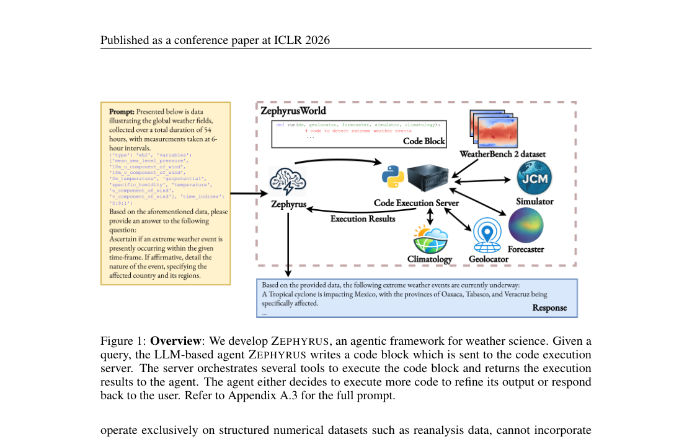
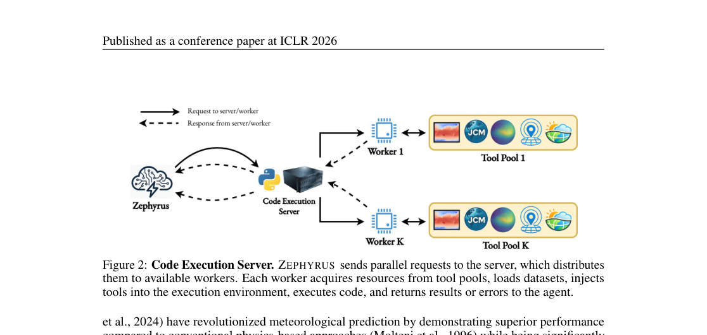
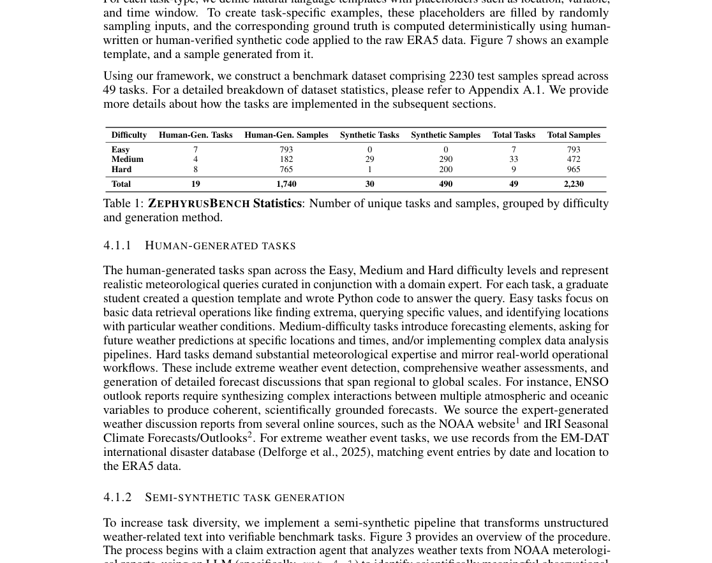
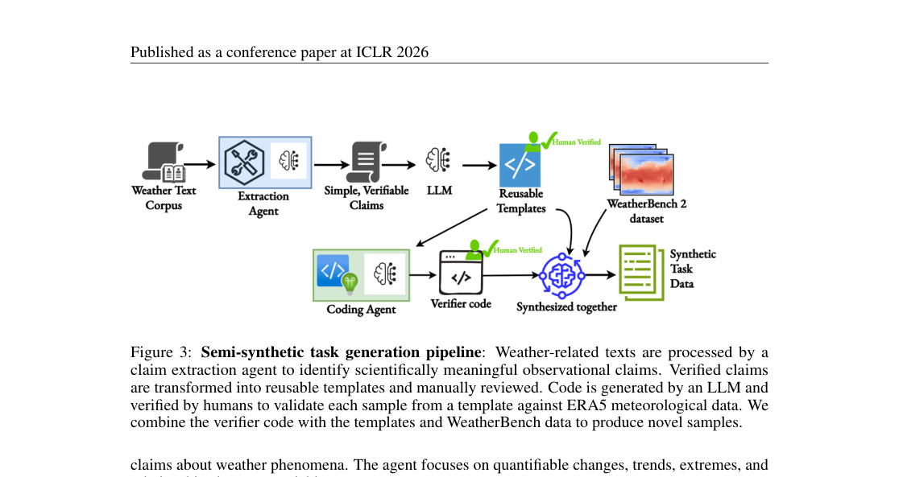
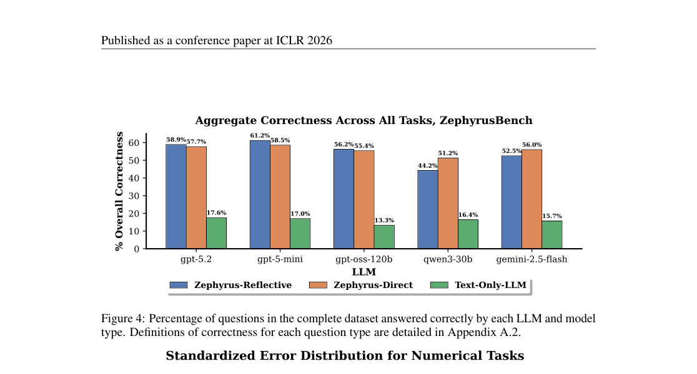
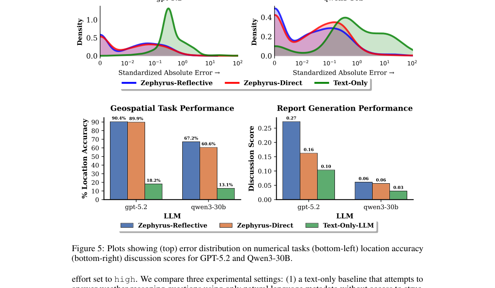
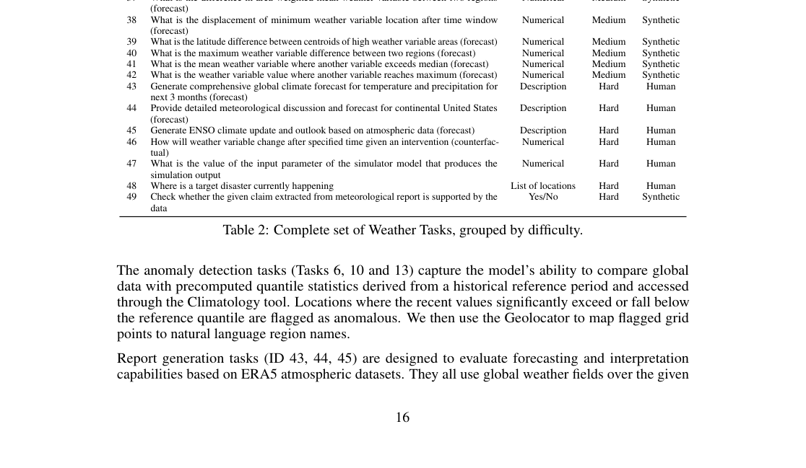
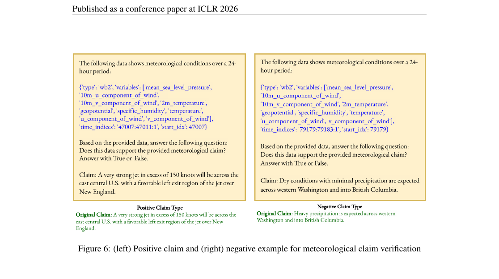

# Zephyrus：面向天气科学的智能体框架

**原文题目：** Zephyrus: An Agentic Framework for Weather Science

**原始 PDF：** [原始论文](./原始论文.pdf)（共 51 页）

> **翻译覆盖声明（请先阅读）**：本文件提供**摘要完整中文翻译**及主要研究章节的**中文学术译述**，不等同于逐字逐句的全文译本。为避免遗漏资料，原 PDF 全部页面的英文文字与附录、参考文献均已收录在 `英文原文_逐页.md` 和 `英文全文_保留版面.txt`，图、表另见 `图表索引.md`。不可把本文档当作全部正文及附录均已翻译的材料。

---

## 摘要（完整中文翻译）

天气科学基础模型以海量结构化数值数据为预训练材料，其预测性能已经超过部分传统天气预报系统。但这类模型缺乏基于自然语言的推理能力，限制了它们在交互式科学工作流中的使用。大语言模型（LLM）擅长理解和生成文本，却不能直接充分处理高维气象数据。本文通过构建面向天气科学的智能体框架来弥合两者之间的差距。框架包含一个用于智能体操作天气数据的 Python 代码环境 ZephyrusWorld，提供 WeatherBench 2 数据集索引、将自然语言地名转换为空间位置的地理编码工具、天气预报、气候模拟，以及支持查询不同时间尺度气候统计量（例如均值、极值、分位数）的气候态模块。作者设计了多轮 LLM 天气智能体 Zephyrus，使其能够反复分析天气数据、观察运行结果并根据对话式反馈改进分析方案。此外，论文提出新基准 ZephyrusBench，利用可扩展的数据生成管线构建各种天气相关问答，任务从基础数据检索扩展至预报、极端事件检测和反事实推理。实验发现，Zephyrus 智能体在该基准上的正确率比纯文本基线最多高 44 个百分点。不过，即使使用前沿大语言模型，困难任务依然具有挑战，显示出继续改进的空间。作者公开了框架与基准代码。

## 主要研究章节（中文学术译述）

### 问题背景

天气与气候分析依赖高维、多变量、连续时空网格数据，通常需要结合再分析资料、数值预报模型、统计方法和业务经验。语言模型虽然能解释文字问题，却无法仅凭内部知识可靠计算真实的温度、风场或极端天气指标。Zephyrus 希望借助可执行工具和数据环境，把语言理解与气象计算连接起来。

### ZephyrusWorld 环境

ZephyrusWorld 提供统一的 Python 工具环境，涵盖 WeatherBench 2 数据集索引、自然语言地名到坐标的转换、天气预报器、基于 JCM 的气候模拟，以及按时间尺度查询均值、极值和分位数等气候态统计信息。程序执行服务负责调用上述工具，再把数值结果反馈给智能体。

### 两类智能体工作流

Zephyrus-Direct 根据问题一次性生成 Python 代码，执行并回答；Zephyrus-Reflective 则采用迭代式“编写代码—执行—观察结果—修正方案”的过程。后者在执行失败或科学结果不合适时允许进一步调用工具、重写代码和改善答案，其目标是让模型利用运行时反馈而不是停留在静态文本推理。

### ZephyrusBench 的数据组织

基准主要利用 WeatherBench 2 中的 ERA5 再分析数据，包含 49 种天气任务、2,230 组问答样本，既有人工编写问题，也有半合成生成的问题。任务从位置及变量读取、时间比较和预报，扩展到极端事件识别、气象报告以及反事实情景分析。论文按任务难度、答案类型和模型配置开展分析。

### 评价方法

由于气象问题的答案可能是二元判断、数值、时间、位置或多段描述，单一字符串匹配难以全面评价结果。论文针对不同答案类型采用对应的误差或正确性检验，并分析输出有效性、预报误差、时间误差、地理位置偏差及不同任务难度下的表现。具体阈值和各项误差计算公式应查阅原文评估章节及附录表格。

### 实验与审计启示

研究报告带工具的智能体相对纯文本基线可提升最多 44 个百分点的正确率，但高难度任务依然薄弱。对 Benchmark 有效性研究来说，Zephyrus 的重要价值在于：把不同答案类型对应到不同评分函数，并通过可执行的数值工具减少语言判断的随意性；同时需要核查不同评分尺度是否可比较，及计算正确是否足以保证气象解释正确。

## 专业术语中英对照

| English | 中文术语 |
|---|---|
| ZephyrusWorld | Zephyrus 气象工具执行环境 |
| ZephyrusBench | Zephyrus 天气任务基准 |
| climatology | 气候态统计 |
| reanalysis | 再分析资料 |
| counterfactual reasoning | 反事实推理 |
| WeatherBench 2 | WeatherBench 2 天气数据基准 |
| location error | 位置误差 |
| semi-synthetic | 半合成 |

## 图表与逐页原文导航

独立裁图共 **74** 张；完整原版页面截图共 **51** 张。

- [全部图表索引](./图表索引.md)
- [逐页原文与对应图表](./逐页原文与配图.md)
- [英文原文逐页](./英文原文_逐页.md)
- [参考文献英文原文](./参考文献_英文原文.md)
- [QA 逐页核查报告](./QA_逐页核查报告.md)

### 代表性原始图表

**图1（第 2 页）**

> Figure 1: Overview: We develop ZEPHYRUS, an agentic framework for weather science. Given a query, the LLM-based agent ZEPHYRUS writes a code block which is sent to the code execution server. The server orchestrates several tools to execute the code block and returns the execution results to the agent. The agent either decides to execute more code to refine its output or respond back to the user. Refer to Appendix A.3 for the full prompt.

**图2（第 4 页）**

> Figure 2: Code Execution Server. ZEPHYRUS sends parallel requests to the server, which distributes them to available workers. Each worker acquires resources from tool pools, loads datasets, injects tools into the execution environment, executes code, and returns results or errors to the agent.

**表1（第 6 页）**

> Table 1: ZEPHYRUSBENCH Statistics: Number of unique tasks and samples, grouped by difficulty and generation method.

**图3（第 7 页）**

> Figure 3: Semi-synthetic task generation pipeline: Weather-related texts are processed by a claim extraction agent to identify scientifically meaningful observational claims. Verified claims are transformed into reusable templates and manually reviewed. Code is generated by an LLM and verified by humans to validate each sample from a template against ERA5 meteorological data. We combine the verifier code with the templates and WeatherBench data to produce novel samples.

**图4（第 9 页）**

> Figure 4: Percentage of questions in the complete dataset answered correctly by each LLM and model type. Definitions of correctness for each question type are detailed in Appendix A.2.

**图5（第 9 页）**

> Figure 5: Plots showing (top) error distribution on numerical tasks (bottom-left) location accuracy (bottom-right) discussion scores for GPT-5.2 and Qwen3-30B.

**表2（第 16 页）**

> Table 2: Complete set of Weather Tasks, grouped by difficulty.

**图6（第 18 页）**

> Figure 6: (left) Positive claim and (right) negative example for meteorological claim verification
