# Zephyrus: An Agentic Framework for Weather Science — 逐页原文与配图

> 共 51 页；附全部页面截图；独立图表见 `./images/`。图表区域为启发式裁剪，如区域不完整请以本页原版截图为准。


---

## PDF 第 001 页

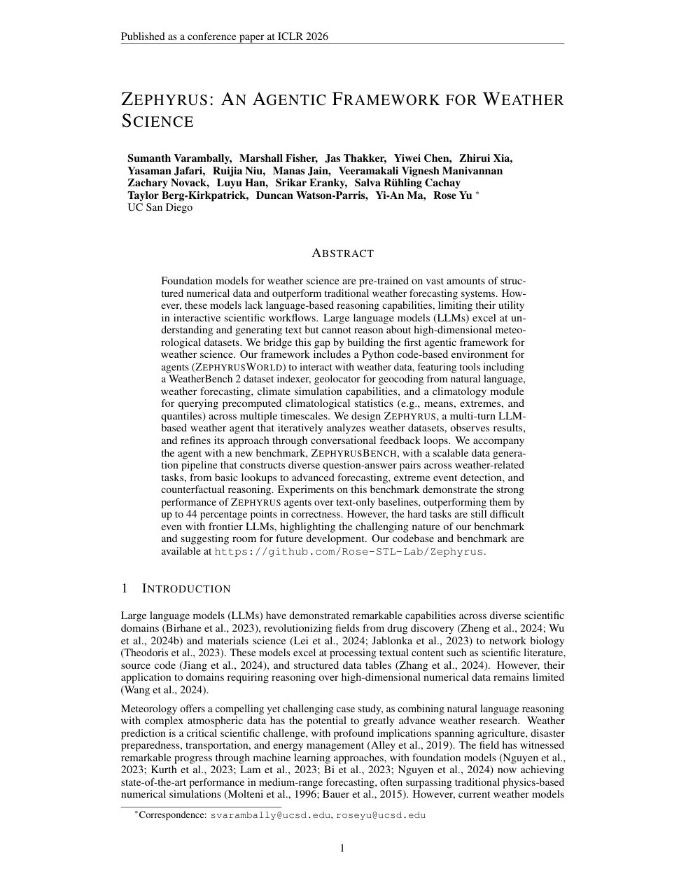


#### 原文提取

```text
Published as a conference paper at ICLR 2026


Z EPHYRUS : A N AGENTIC F RAMEWORK FOR W EATHER
S CIENCE
 Sumanth Varambally, Marshall Fisher, Jas Thakker, Yiwei Chen, Zhirui Xia,
 Yasaman Jafari, Ruijia Niu, Manas Jain, Veeramakali Vignesh Manivannan
 Zachary Novack, Luyu Han, Srikar Eranky, Salva Rühling Cachay
 Taylor Berg-Kirkpatrick, Duncan Watson-Parris, Yi-An Ma, Rose Yu ∗
 UC San Diego


                                               A BSTRACT

            Foundation models for weather science are pre-trained on vast amounts of struc-
            tured numerical data and outperform traditional weather forecasting systems. How-
            ever, these models lack language-based reasoning capabilities, limiting their utility
            in interactive scientific workflows. Large language models (LLMs) excel at un-
            derstanding and generating text but cannot reason about high-dimensional meteo-
            rological datasets. We bridge this gap by building the first agentic framework for
            weather science. Our framework includes a Python code-based environment for
            agents (Z EPHYRUS W ORLD) to interact with weather data, featuring tools including
            a WeatherBench 2 dataset indexer, geolocator for geocoding from natural language,
            weather forecasting, climate simulation capabilities, and a climatology module
            for querying precomputed climatological statistics (e.g., means, extremes, and
            quantiles) across multiple timescales. We design Z EPHYRUS, a multi-turn LLM-
            based weather agent that iteratively analyzes weather datasets, observes results,
            and refines its approach through conversational feedback loops. We accompany
            the agent with a new benchmark, Z EPHYRUS B ENCH, with a scalable data genera-
            tion pipeline that constructs diverse question-answer pairs across weather-related
            tasks, from basic lookups to advanced forecasting, extreme event detection, and
            counterfactual reasoning. Experiments on this benchmark demonstrate the strong
            performance of Z EPHYRUS agents over text-only baselines, outperforming them by
            up to 44 percentage points in correctness. However, the hard tasks are still difficult
            even with frontier LLMs, highlighting the challenging nature of our benchmark
            and suggesting room for future development. Our codebase and benchmark are
            available at https://github.com/Rose-STL-Lab/Zephyrus.


1       I NTRODUCTION
Large language models (LLMs) have demonstrated remarkable capabilities across diverse scientific
domains (Birhane et al., 2023), revolutionizing fields from drug discovery (Zheng et al., 2024; Wu
et al., 2024b) and materials science (Lei et al., 2024; Jablonka et al., 2023) to network biology
(Theodoris et al., 2023). These models excel at processing textual content such as scientific literature,
source code (Jiang et al., 2024), and structured data tables (Zhang et al., 2024). However, their
application to domains requiring reasoning over high-dimensional numerical data remains limited
(Wang et al., 2024).
Meteorology offers a compelling yet challenging case study, as combining natural language reasoning
with complex atmospheric data has the potential to greatly advance weather research. Weather
prediction is a critical scientific challenge, with profound implications spanning agriculture, disaster
preparedness, transportation, and energy management (Alley et al., 2019). The field has witnessed
remarkable progress through machine learning approaches, with foundation models (Nguyen et al.,
2023; Kurth et al., 2023; Lam et al., 2023; Bi et al., 2023; Nguyen et al., 2024) now achieving
state-of-the-art performance in medium-range forecasting, often surpassing traditional physics-based
numerical simulations (Molteni et al., 1996; Bauer et al., 2015). However, current weather models
    ∗
        Correspondence: svarambally@ucsd.edu, roseyu@ucsd.edu


                                                      1
```


---

## PDF 第 002 页

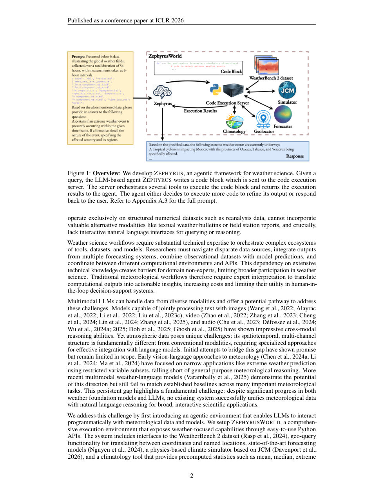


### 图1（第 2 页）

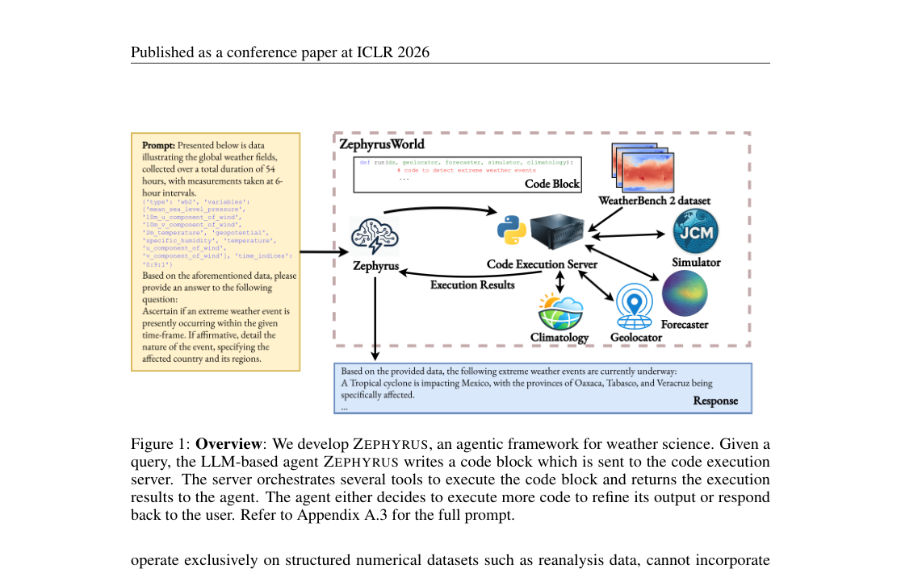

**原文题注：** Figure 1: Overview: We develop ZEPHYRUS, an agentic framework for weather science. Given a query, the LLM-based agent ZEPHYRUS writes a code block which is sent to the code execution server. The server orchestrates several tools to execute the code block and returns the execution results to the agent. The agent either decides to execute more code to refine its output or respond back to the user. Refer to Appendix A.3 for the full prompt.


#### 原文提取

```text
Published as a conference paper at ICLR 2026


Figure 1: Overview: We develop Z EPHYRUS, an agentic framework for weather science. Given a
query, the LLM-based agent Z EPHYRUS writes a code block which is sent to the code execution
server. The server orchestrates several tools to execute the code block and returns the execution
results to the agent. The agent either decides to execute more code to refine its output or respond
back to the user. Refer to Appendix A.3 for the full prompt.

operate exclusively on structured numerical datasets such as reanalysis data, cannot incorporate
valuable alternative modalities like textual weather bulletins or field station reports, and crucially,
lack interactive natural language interfaces for querying or reasoning.
Weather science workflows require substantial technical expertise to orchestrate complex ecosystems
of tools, datasets, and models. Researchers must navigate disparate data sources, integrate outputs
from multiple forecasting systems, combine observational datasets with model predictions, and
coordinate between different computational environments and APIs. This dependency on extensive
technical knowledge creates barriers for domain non-experts, limiting broader participation in weather
science. Traditional meteorological workflows therefore require expert interpretation to translate
computational outputs into actionable insights, increasing costs and limiting their utility in human-in-
the-loop decision-support systems.
Multimodal LLMs can handle data from diverse modalities and offer a potential pathway to address
these challenges. Models capable of jointly processing text with images (Wang et al., 2022; Alayrac
et al., 2022; Li et al., 2022; Liu et al., 2023c), video (Zhao et al., 2022; Zhang et al., 2023; Cheng
et al., 2024; Lin et al., 2024; Zhang et al., 2025), and audio (Chu et al., 2023; Défossez et al., 2024;
Wu et al., 2024a; 2025; Doh et al., 2025; Ghosh et al., 2025) have shown impressive cross-modal
reasoning abilities. Yet atmospheric data poses unique challenges: its spatiotemporal, multi-channel
structure is fundamentally different from conventional modalities, requiring specialized approaches
for effective integration with language models. Initial attempts to bridge this gap have shown promise
but remain limited in scope. Early vision-language approaches to meteorology (Chen et al., 2024a; Li
et al., 2024; Ma et al., 2024) have focused on narrow applications like extreme weather prediction
using restricted variable subsets, falling short of general-purpose meteorological reasoning. More
recent multimodal weather-language models (Varambally et al., 2025) demonstrate the potential
of this direction but still fail to match established baselines across many important meteorological
tasks. This persistent gap highlights a fundamental challenge: despite significant progress in both
weather foundation models and LLMs, no existing system successfully unifies meteorological data
with natural language reasoning for broad, interactive scientific applications.
We address this challenge by first introducing an agentic environment that enables LLMs to interact
programmatically with meteorological data and models. We setup Z EPHYRUS W ORLD, a comprehen-
sive execution environment that exposes weather-focused capabilities through easy-to-use Python
APIs. The system includes interfaces to the WeatherBench 2 dataset (Rasp et al., 2024), geo-query
functionality for translating between coordinates and named locations, state-of-the-art forecasting
models (Nguyen et al., 2024), a physics-based climate simulator based on JCM (Davenport et al.,
2026), and a climatology tool that provides precomputed statistics such as mean, median, extreme


                                                   2
```


---

## PDF 第 003 页

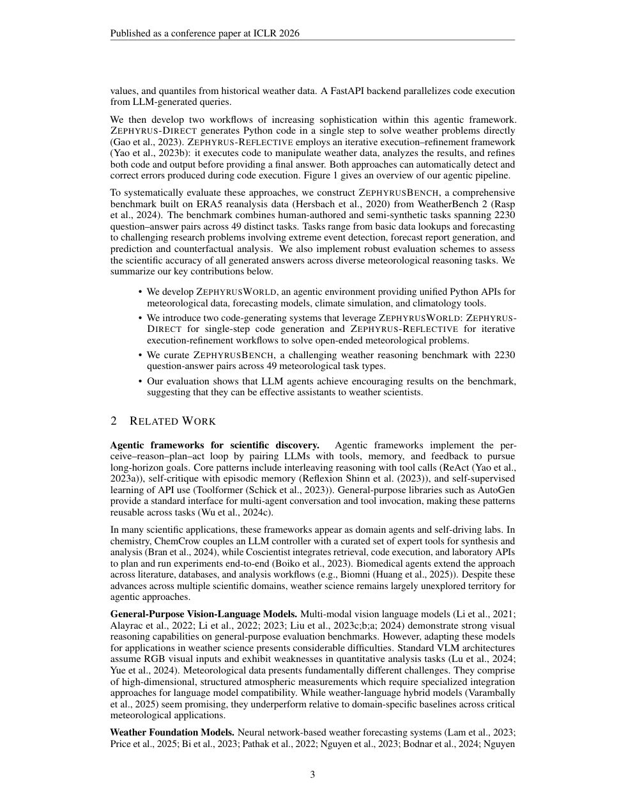


#### 原文提取

```text
Published as a conference paper at ICLR 2026


values, and quantiles from historical weather data. A FastAPI backend parallelizes code execution
from LLM-generated queries.
We then develop two workflows of increasing sophistication within this agentic framework.
Z EPHYRUS -D IRECT generates Python code in a single step to solve weather problems directly
(Gao et al., 2023). Z EPHYRUS -R EFLECTIVE employs an iterative execution–refinement framework
(Yao et al., 2023b): it executes code to manipulate weather data, analyzes the results, and refines
both code and output before providing a final answer. Both approaches can automatically detect and
correct errors produced during code execution. Figure 1 gives an overview of our agentic pipeline.
To systematically evaluate these approaches, we construct Z EPHYRUS B ENCH, a comprehensive
benchmark built on ERA5 reanalysis data (Hersbach et al., 2020) from WeatherBench 2 (Rasp
et al., 2024). The benchmark combines human-authored and semi-synthetic tasks spanning 2230
question–answer pairs across 49 distinct tasks. Tasks range from basic data lookups and forecasting
to challenging research problems involving extreme event detection, forecast report generation, and
prediction and counterfactual analysis. We also implement robust evaluation schemes to assess
the scientific accuracy of all generated answers across diverse meteorological reasoning tasks. We
summarize our key contributions below.

       • We develop Z EPHYRUS W ORLD, an agentic environment providing unified Python APIs for
         meteorological data, forecasting models, climate simulation, and climatology tools.
       • We introduce two code-generating systems that leverage Z EPHYRUS W ORLD: Z EPHYRUS -
         D IRECT for single-step code generation and Z EPHYRUS -R EFLECTIVE for iterative
         execution-refinement workflows to solve open-ended meteorological problems.
       • We curate Z EPHYRUS B ENCH, a challenging weather reasoning benchmark with 2230
         question-answer pairs across 49 meteorological task types.
       • Our evaluation shows that LLM agents achieve encouraging results on the benchmark,
         suggesting that they can be effective assistants to weather scientists.

2    R ELATED W ORK
Agentic frameworks for scientific discovery.            Agentic frameworks implement the per-
ceive–reason–plan–act loop by pairing LLMs with tools, memory, and feedback to pursue
long-horizon goals. Core patterns include interleaving reasoning with tool calls (ReAct (Yao et al.,
2023a)), self-critique with episodic memory (Reflexion Shinn et al. (2023)), and self-supervised
learning of API use (Toolformer (Schick et al., 2023)). General-purpose libraries such as AutoGen
provide a standard interface for multi-agent conversation and tool invocation, making these patterns
reusable across tasks (Wu et al., 2024c).
In many scientific applications, these frameworks appear as domain agents and self-driving labs. In
chemistry, ChemCrow couples an LLM controller with a curated set of expert tools for synthesis and
analysis (Bran et al., 2024), while Coscientist integrates retrieval, code execution, and laboratory APIs
to plan and run experiments end-to-end (Boiko et al., 2023). Biomedical agents extend the approach
across literature, databases, and analysis workflows (e.g., Biomni (Huang et al., 2025)). Despite these
advances across multiple scientific domains, weather science remains largely unexplored territory for
agentic approaches.
General-Purpose Vision-Language Models. Multi-modal vision language models (Li et al., 2021;
Alayrac et al., 2022; Li et al., 2022; 2023; Liu et al., 2023c;b;a; 2024) demonstrate strong visual
reasoning capabilities on general-purpose evaluation benchmarks. However, adapting these models
for applications in weather science presents considerable difficulties. Standard VLM architectures
assume RGB visual inputs and exhibit weaknesses in quantitative analysis tasks (Lu et al., 2024;
Yue et al., 2024). Meteorological data presents fundamentally different challenges. They comprise
of high-dimensional, structured atmospheric measurements which require specialized integration
approaches for language model compatibility. While weather-language hybrid models (Varambally
et al., 2025) seem promising, they underperform relative to domain-specific baselines across critical
meteorological applications.
Weather Foundation Models. Neural network-based weather forecasting systems (Lam et al., 2023;
Price et al., 2025; Bi et al., 2023; Pathak et al., 2022; Nguyen et al., 2023; Bodnar et al., 2024; Nguyen


                                                    3
```


---

## PDF 第 004 页

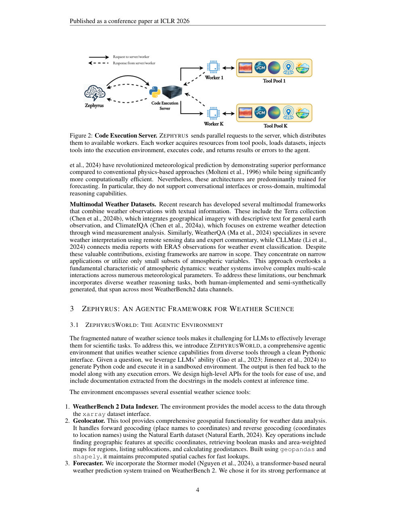


### 图2（第 4 页）

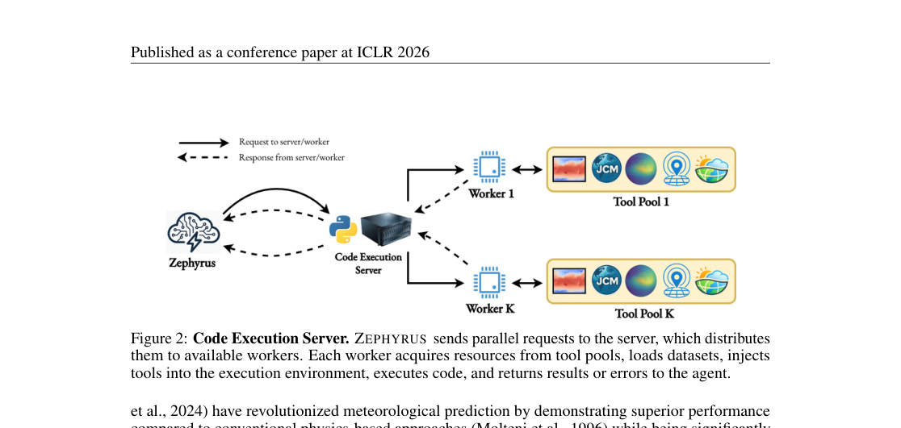

**原文题注：** Figure 2: Code Execution Server. ZEPHYRUS sends parallel requests to the server, which distributes them to available workers. Each worker acquires resources from tool pools, loads datasets, injects tools into the execution environment, executes code, and returns results or errors to the agent.


#### 原文提取

```text
 Published as a conference paper at ICLR 2026


 Figure 2: Code Execution Server. Z EPHYRUS sends parallel requests to the server, which distributes
 them to available workers. Each worker acquires resources from tool pools, loads datasets, injects
 tools into the execution environment, executes code, and returns results or errors to the agent.

 et al., 2024) have revolutionized meteorological prediction by demonstrating superior performance
 compared to conventional physics-based approaches (Molteni et al., 1996) while being significantly
 more computationally efficient. Nevertheless, these architectures are predominantly trained for
 forecasting. In particular, they do not support conversational interfaces or cross-domain, multimodal
 reasoning capabilities.
 Multimodal Weather Datasets. Recent research has developed several multimodal frameworks
 that combine weather observations with textual information. These include the Terra collection
 (Chen et al., 2024b), which integrates geographical imagery with descriptive text for general earth
 observation, and ClimateIQA (Chen et al., 2024a), which focuses on extreme weather detection
 through wind measurement analysis. Similarly, WeatherQA (Ma et al., 2024) specializes in severe
 weather interpretation using remote sensing data and expert commentary, while CLLMate (Li et al.,
 2024) connects media reports with ERA5 observations for weather event classification. Despite
 these valuable contributions, existing frameworks are narrow in scope. They concentrate on narrow
 applications or utilize only small subsets of atmospheric variables. This approach overlooks a
 fundamental characteristic of atmospheric dynamics: weather systems involve complex multi-scale
 interactions across numerous meteorological parameters. To address these limitations, our benchmark
 incorporates diverse weather reasoning tasks, both human-implemented and semi-synthetically
 generated, that span across most WeatherBench2 data channels.


 3     Z EPHYRUS : A N AGENTIC F RAMEWORK FOR W EATHER S CIENCE

 3.1   Z EPHYRUS W ORLD : T HE AGENTIC E NVIRONMENT

 The fragmented nature of weather science tools makes it challenging for LLMs to effectively leverage
 them for scientific tasks. To address this, we introduce Z EPHYRUS W ORLD, a comprehensive agentic
 environment that unifies weather science capabilities from diverse tools through a clean Pythonic
 interface. Given a question, we leverage LLMs’ ability (Gao et al., 2023; Jimenez et al., 2024) to
 generate Python code and execute it in a sandboxed environment. The output is then fed back to the
 model along with any execution errors. We design high-level APIs for the tools for ease of use, and
 include documentation extracted from the docstrings in the models context at inference time.
 The environment encompasses several essential weather science tools:

1. WeatherBench 2 Data Indexer. The environment provides the model access to the data through
   the xarray dataset interface.
2. Geolocator. This tool provides comprehensive geospatial functionality for weather data analysis.
   It handles forward geocoding (place names to coordinates) and reverse geocoding (coordinates
   to location names) using the Natural Earth dataset (Natural Earth, 2024). Key operations include
   finding geographic features at specific coordinates, retrieving boolean masks and area-weighted
   maps for regions, listing sublocations, and calculating geodistances. Built using geopandas and
   shapely, it maintains precomputed spatial caches for fast lookups.
3. Forecaster. We incorporate the Stormer model (Nguyen et al., 2024), a transformer-based neural
   weather prediction system trained on WeatherBench 2. We chose it for its strong performance at


                                                  4
```


---

## PDF 第 005 页

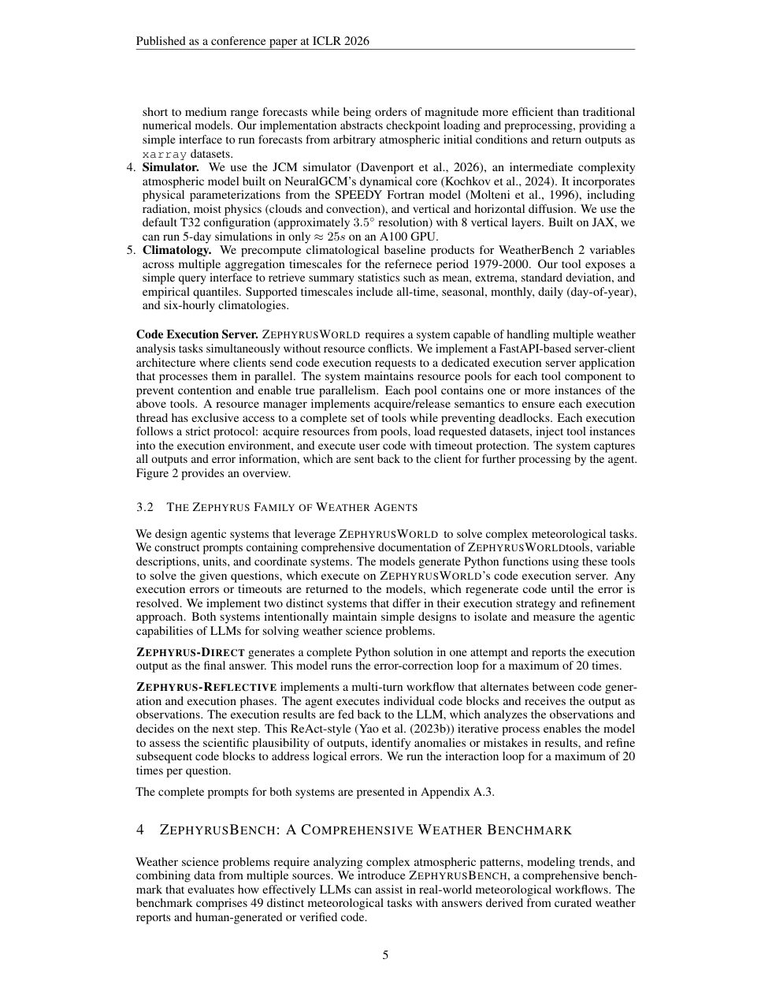


#### 原文提取

```text
 Published as a conference paper at ICLR 2026


   short to medium range forecasts while being orders of magnitude more efficient than traditional
   numerical models. Our implementation abstracts checkpoint loading and preprocessing, providing a
   simple interface to run forecasts from arbitrary atmospheric initial conditions and return outputs as
   xarray datasets.
4. Simulator. We use the JCM simulator (Davenport et al., 2026), an intermediate complexity
   atmospheric model built on NeuralGCM’s dynamical core (Kochkov et al., 2024). It incorporates
   physical parameterizations from the SPEEDY Fortran model (Molteni et al., 1996), including
   radiation, moist physics (clouds and convection), and vertical and horizontal diffusion. We use the
   default T32 configuration (approximately 3.5◦ resolution) with 8 vertical layers. Built on JAX, we
   can run 5-day simulations in only ≈ 25s on an A100 GPU.
5. Climatology. We precompute climatological baseline products for WeatherBench 2 variables
   across multiple aggregation timescales for the refernece period 1979-2000. Our tool exposes a
   simple query interface to retrieve summary statistics such as mean, extrema, standard deviation, and
   empirical quantiles. Supported timescales include all-time, seasonal, monthly, daily (day-of-year),
   and six-hourly climatologies.

 Code Execution Server. Z EPHYRUS W ORLD requires a system capable of handling multiple weather
 analysis tasks simultaneously without resource conflicts. We implement a FastAPI-based server-client
 architecture where clients send code execution requests to a dedicated execution server application
 that processes them in parallel. The system maintains resource pools for each tool component to
 prevent contention and enable true parallelism. Each pool contains one or more instances of the
 above tools. A resource manager implements acquire/release semantics to ensure each execution
 thread has exclusive access to a complete set of tools while preventing deadlocks. Each execution
 follows a strict protocol: acquire resources from pools, load requested datasets, inject tool instances
 into the execution environment, and execute user code with timeout protection. The system captures
 all outputs and error information, which are sent back to the client for further processing by the agent.
 Figure 2 provides an overview.

 3.2    T HE Z EPHYRUS FAMILY OF W EATHER AGENTS

 We design agentic systems that leverage Z EPHYRUS W ORLD to solve complex meteorological tasks.
 We construct prompts containing comprehensive documentation of Z EPHYRUS W ORLDtools, variable
 descriptions, units, and coordinate systems. The models generate Python functions using these tools
 to solve the given questions, which execute on Z EPHYRUS W ORLD’s code execution server. Any
 execution errors or timeouts are returned to the models, which regenerate code until the error is
 resolved. We implement two distinct systems that differ in their execution strategy and refinement
 approach. Both systems intentionally maintain simple designs to isolate and measure the agentic
 capabilities of LLMs for solving weather science problems.
 Z EPHYRUS -D IRECT generates a complete Python solution in one attempt and reports the execution
 output as the final answer. This model runs the error-correction loop for a maximum of 20 times.
 Z EPHYRUS -R EFLECTIVE implements a multi-turn workflow that alternates between code gener-
 ation and execution phases. The agent executes individual code blocks and receives the output as
 observations. The execution results are fed back to the LLM, which analyzes the observations and
 decides on the next step. This ReAct-style (Yao et al. (2023b)) iterative process enables the model
 to assess the scientific plausibility of outputs, identify anomalies or mistakes in results, and refine
 subsequent code blocks to address logical errors. We run the interaction loop for a maximum of 20
 times per question.
 The complete prompts for both systems are presented in Appendix A.3.


 4     Z EPHYRUS B ENCH : A C OMPREHENSIVE W EATHER B ENCHMARK

 Weather science problems require analyzing complex atmospheric patterns, modeling trends, and
 combining data from multiple sources. We introduce Z EPHYRUS B ENCH, a comprehensive bench-
 mark that evaluates how effectively LLMs can assist in real-world meteorological workflows. The
 benchmark comprises 49 distinct meteorological tasks with answers derived from curated weather
 reports and human-generated or verified code.


                                                    5
```


---

## PDF 第 006 页

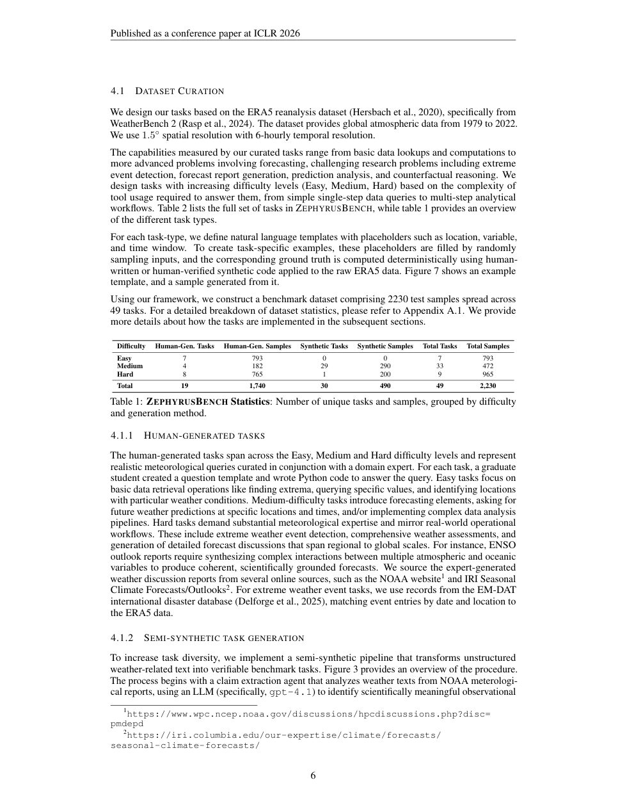


### 表1（第 6 页）

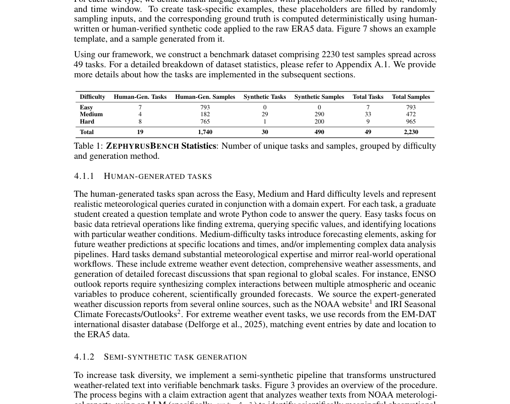

**原文题注：** Table 1: ZEPHYRUSBENCH Statistics: Number of unique tasks and samples, grouped by difficulty and generation method.


#### 原文提取

```text
Published as a conference paper at ICLR 2026


4.1      DATASET C URATION

We design our tasks based on the ERA5 reanalysis dataset (Hersbach et al., 2020), specifically from
WeatherBench 2 (Rasp et al., 2024). The dataset provides global atmospheric data from 1979 to 2022.
We use 1.5◦ spatial resolution with 6-hourly temporal resolution.
The capabilities measured by our curated tasks range from basic data lookups and computations to
more advanced problems involving forecasting, challenging research problems including extreme
event detection, forecast report generation, prediction analysis, and counterfactual reasoning. We
design tasks with increasing difficulty levels (Easy, Medium, Hard) based on the complexity of
tool usage required to answer them, from simple single-step data queries to multi-step analytical
workflows. Table 2 lists the full set of tasks in Z EPHYRUS B ENCH, while table 1 provides an overview
of the different task types.
For each task-type, we define natural language templates with placeholders such as location, variable,
and time window. To create task-specific examples, these placeholders are filled by randomly
sampling inputs, and the corresponding ground truth is computed deterministically using human-
written or human-verified synthetic code applied to the raw ERA5 data. Figure 7 shows an example
template, and a sample generated from it.
Using our framework, we construct a benchmark dataset comprising 2230 test samples spread across
49 tasks. For a detailed breakdown of dataset statistics, please refer to Appendix A.1. We provide
more details about how the tasks are implemented in the subsequent sections.

 Difficulty   Human-Gen. Tasks   Human-Gen. Samples   Synthetic Tasks   Synthetic Samples   Total Tasks   Total Samples
 Easy                7                  793                  0                 0                 7            793
 Medium              4                  182                  29               290               33            472
 Hard                8                  765                  1                200                9            965
 Total               19                1,740                 30               490               49            2,230

Table 1: Z EPHYRUS B ENCH Statistics: Number of unique tasks and samples, grouped by difficulty
and generation method.

4.1.1     H UMAN - GENERATED TASKS
The human-generated tasks span across the Easy, Medium and Hard difficulty levels and represent
realistic meteorological queries curated in conjunction with a domain expert. For each task, a graduate
student created a question template and wrote Python code to answer the query. Easy tasks focus on
basic data retrieval operations like finding extrema, querying specific values, and identifying locations
with particular weather conditions. Medium-difficulty tasks introduce forecasting elements, asking for
future weather predictions at specific locations and times, and/or implementing complex data analysis
pipelines. Hard tasks demand substantial meteorological expertise and mirror real-world operational
workflows. These include extreme weather event detection, comprehensive weather assessments, and
generation of detailed forecast discussions that span regional to global scales. For instance, ENSO
outlook reports require synthesizing complex interactions between multiple atmospheric and oceanic
variables to produce coherent, scientifically grounded forecasts. We source the expert-generated
weather discussion reports from several online sources, such as the NOAA website1 and IRI Seasonal
Climate Forecasts/Outlooks2 . For extreme weather event tasks, we use records from the EM-DAT
international disaster database (Delforge et al., 2025), matching event entries by date and location to
the ERA5 data.

4.1.2     S EMI - SYNTHETIC TASK GENERATION
To increase task diversity, we implement a semi-synthetic pipeline that transforms unstructured
weather-related text into verifiable benchmark tasks. Figure 3 provides an overview of the procedure.
The process begins with a claim extraction agent that analyzes weather texts from NOAA meterologi-
cal reports, using an LLM (specifically, gpt-4.1) to identify scientifically meaningful observational
   1
    https://www.wpc.ncep.noaa.gov/discussions/hpcdiscussions.php?disc=
pmdepd
  2
    https://iri.columbia.edu/our-expertise/climate/forecasts/
seasonal-climate-forecasts/


                                                         6
```


---

## PDF 第 007 页

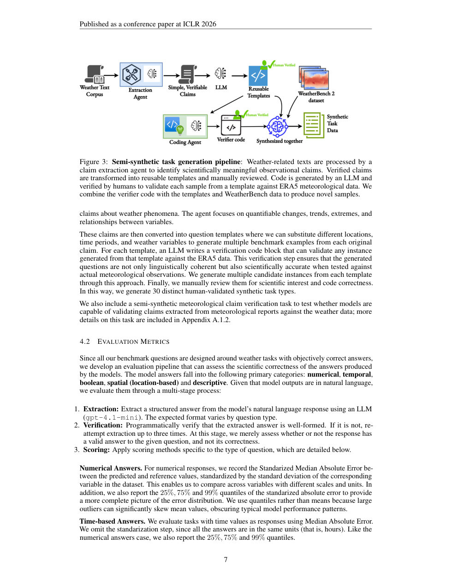


### 图3（第 7 页）

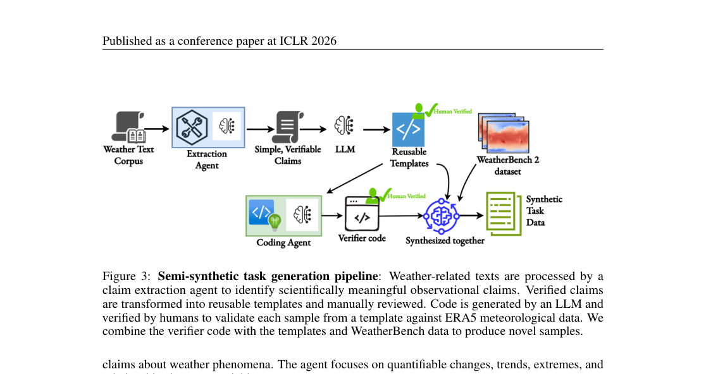

**原文题注：** Figure 3: Semi-synthetic task generation pipeline: Weather-related texts are processed by a claim extraction agent to identify scientifically meaningful observational claims. Verified claims are transformed into reusable templates and manually reviewed. Code is generated by an LLM and verified by humans to validate each sample from a template against ERA5 meteorological data. We combine the verifier code with the templates and WeatherBench data to produce novel samples.


#### 原文提取

```text
 Published as a conference paper at ICLR 2026


 Figure 3: Semi-synthetic task generation pipeline: Weather-related texts are processed by a
 claim extraction agent to identify scientifically meaningful observational claims. Verified claims
 are transformed into reusable templates and manually reviewed. Code is generated by an LLM and
 verified by humans to validate each sample from a template against ERA5 meteorological data. We
 combine the verifier code with the templates and WeatherBench data to produce novel samples.

 claims about weather phenomena. The agent focuses on quantifiable changes, trends, extremes, and
 relationships between variables.
 These claims are then converted into question templates where we can substitute different locations,
 time periods, and weather variables to generate multiple benchmark examples from each original
 claim. For each template, an LLM writes a verification code block that can validate any instance
 generated from that template against the ERA5 data. This verification step ensures that the generated
 questions are not only linguistically coherent but also scientifically accurate when tested against
 actual meteorological observations. We generate multiple candidate instances from each template
 through this approach. Finally, we manually review them for scientific interest and code correctness.
 In this way, we generate 30 distinct human-validated synthetic task types.
 We also include a semi-synthetic meteorological claim verification task to test whether models are
 capable of validating claims extracted from meteorological reports against the weather data; more
 details on this task are included in Appendix A.1.2.

 4.2    E VALUATION M ETRICS

 Since all our benchmark questions are designed around weather tasks with objectively correct answers,
 we develop an evaluation pipeline that can assess the scientific correctness of the answers produced
 by the models. The model answers fall into the following primary categories: numerical, temporal,
 boolean, spatial (location-based) and descriptive. Given that model outputs are in natural language,
 we evaluate them through a multi-stage process:

1. Extraction: Extract a structured answer from the model’s natural language response using an LLM
   (gpt-4.1-mini). The expected format varies by question type.
2. Verification: Programmatically verify that the extracted answer is well-formed. If it is not, re-
   attempt extraction up to three times. At this stage, we merely assess whether or not the response has
   a valid answer to the given question, and not its correctness.
3. Scoring: Apply scoring methods specific to the type of question, which are detailed below.

 Numerical Answers. For numerical responses, we record the Standarized Median Absolute Error be-
 tween the predicted and reference values, standardized by the standard deviation of the corresponding
 variable in the dataset. This enables us to compare across variables with different scales and units. In
 addition, we also report the 25%, 75% and 99% quantiles of the standarized absolute error to provide
 a more complete picture of the error distribution. We use quantiles rather than means because large
 outliers can significantly skew mean values, obscuring typical model performance patterns.
 Time-based Answers. We evaluate tasks with time values as responses using Median Absolute Error.
 We omit the standarization step, since all the answers are in the same units (that is, hours). Like the
 numerical answers case, we also report the 25%, 75% and 99% quantiles.


                                                    7
```


---

## PDF 第 008 页

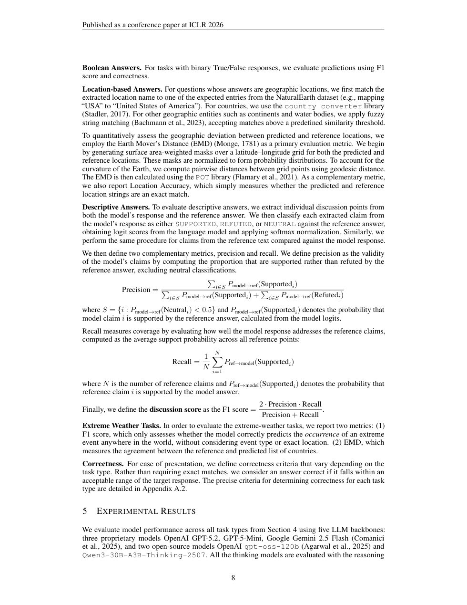


#### 原文提取

```text
Published as a conference paper at ICLR 2026


Boolean Answers. For tasks with binary True/False responses, we evaluate predictions using F1
score and correctness.
Location-based Answers. For questions whose answers are geographic locations, we first match the
extracted location name to one of the expected entries from the NaturalEarth dataset (e.g., mapping
“USA” to “United States of America”). For countries, we use the country_converter library
(Stadler, 2017). For other geographic entities such as continents and water bodies, we apply fuzzy
string matching (Bachmann et al., 2023), accepting matches above a predefined similarity threshold.
To quantitatively assess the geographic deviation between predicted and reference locations, we
employ the Earth Mover’s Distance (EMD) (Monge, 1781) as a primary evaluation metric. We begin
by generating surface area-weighted masks over a latitude–longitude grid for both the predicted and
reference locations. These masks are normalized to form probability distributions. To account for the
curvature of the Earth, we compute pairwise distances between grid points using geodesic distance.
The EMD is then calculated using the POT library (Flamary et al., 2021). As a complementary metric,
we also report Location Accuracy, which simply measures whether the predicted and reference
location strings are an exact match.
Descriptive Answers. To evaluate descriptive answers, we extract individual discussion points from
both the model’s response and the reference answer. We then classify each extracted claim from
the model’s response as either SUPPORTED, REFUTED, or NEUTRAL against the reference answer,
obtaining logit scores from the language model and applying softmax normalization. Similarly, we
perform the same procedure for claims from the reference text compared against the model response.
We then define two complementary metrics, precision and recall. We define precision as the validity
of the model’s claims by computing the proportion that are supported rather than refuted by the
reference answer, excluding neutral classifications.
                                         P
                                             i∈S Pmodel→ref (Supportedi )
             Precision = P                                   P
                            i∈S Pmodel→ref (Supportedi ) +     i∈S Pmodel→ref (Refutedi )

where S = {i : Pmodel→ref (Neutrali ) < 0.5} and Pmodel→ref (Supportedi ) denotes the probability that
model claim i is supported by the reference answer, calculated from the model logits.
Recall measures coverage by evaluating how well the model response addresses the reference claims,
computed as the average support probability across all reference points:
                                             N
                                         1 X
                              Recall =         Pref→model (Supportedi )
                                         N i=1

where N is the number of reference claims and Pref→model (Supportedi ) denotes the probability that
reference claim i is supported by the model answer.
                                                        2 · Precision · Recall
Finally, we define the discussion score as the F1 score =                      .
                                                         Precision + Recall
Extreme Weather Tasks. In order to evaluate the extreme-weather tasks, we report two metrics: (1)
F1 score, which only assesses whether the model correctly predicts the occurrence of an extreme
event anywhere in the world, without considering event type or exact location. (2) EMD, which
measures the agreement between the reference and predicted list of countries.
Correctness. For ease of presentation, we define correctness criteria that vary depending on the
task type. Rather than requiring exact matches, we consider an answer correct if it falls within an
acceptable range of the target response. The precise criteria for determining correctness for each task
type are detailed in Appendix A.2.

5   E XPERIMENTAL R ESULTS

We evaluate model performance across all task types from Section 4 using five LLM backbones:
three proprietary models OpenAI GPT-5.2, GPT-5-Mini, Google Gemini 2.5 Flash (Comanici
et al., 2025), and two open-source models OpenAI gpt-oss-120b (Agarwal et al., 2025) and
Qwen3-30B-A3B-Thinking-2507. All the thinking models are evaluated with the reasoning


                                                  8
```


---

## PDF 第 009 页

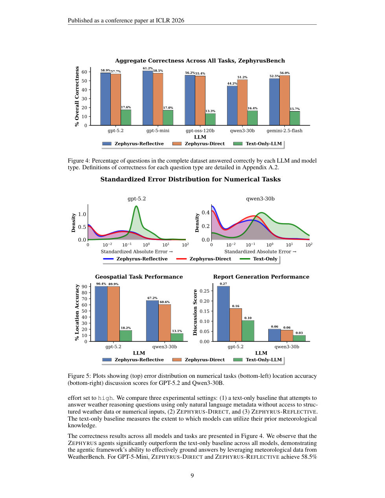


### 图4（第 9 页）

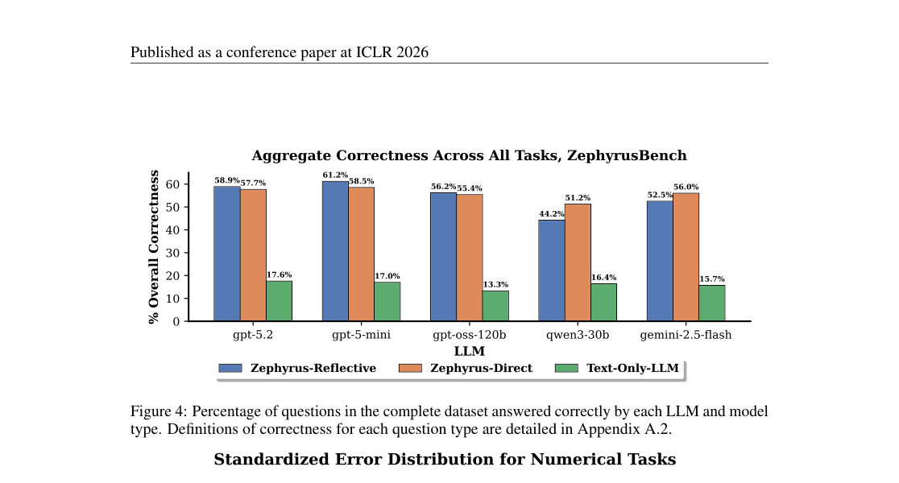

**原文题注：** Figure 4: Percentage of questions in the complete dataset answered correctly by each LLM and model type. Definitions of correctness for each question type are detailed in Appendix A.2.


### 图5（第 9 页）

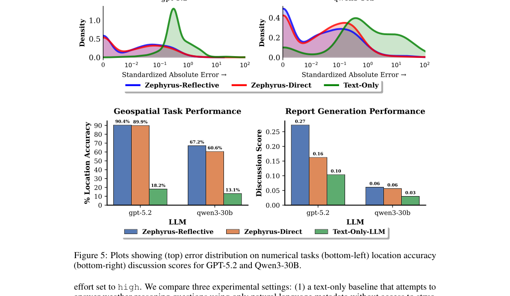

**原文题注：** Figure 5: Plots showing (top) error distribution on numerical tasks (bottom-left) location accuracy (bottom-right) discussion scores for GPT-5.2 and Qwen3-30B.


#### 原文提取

```text
Published as a conference paper at ICLR 2026


                                         Aggregate Correctness Across All Tasks, ZephyrusBench
                                                         61.2% 58.5%
  % Overall Correctness
                          60     58.9% 57.7%                                         56.2% 55.4%                                                              56.0%
                                                                                                                                     51.2%            52.5%
                          50                                                                                                 44.2%
                          40
                          30
                          20                   17.6%                   17.0%
                                                                                                           13.3%
                                                                                                                                             16.4%                    15.7%
                          10
                           0
                                    gpt-5.2                  gpt-5-mini              gpt-oss-120b                             qwen3-30b              gemini-2.5-flash
                                                                                              LLM
                                         Zephyrus-Reflective                         Zephyrus-Direct                                     Text-Only-LLM

Figure 4: Percentage of questions in the complete dataset answered correctly by each LLM and model
type. Definitions of correctness for each question type are detailed in Appendix A.2.
                                 Standardized Error Distribution for Numerical Tasks
                                                  gpt-5.2                                                                                qwen3-30b
                 1.0                                                                                     0.4
Density


                                                                                         Density


                 0.5                                                                                     0.2
                 0.0                                                                                     0.0
                           0      10 2         10 1      100          101        102                            0        10 2            10 1        100         101           102
                                 Standardized Absolute Error                                                            Standardized Absolute Error
                                         Zephyrus-Reflective                           Zephyrus-Direct                                         Text-Only

                               Geospatial Task Performance                                                          Report Generation Performance
                               90.4% 89.9%                                                                            0.27
                          90
  % Location Accuracy


                          80                                                                             0.25
                                                                                      Discussion Score


                          70                                 67.2%
                                                                     60.6%                               0.20
                          60                                                                                                   0.16
                          50                                                                             0.15
                          40                                                                                                            0.10
                          30                                                                             0.10
                                               18.2%                                                                                                   0.06    0.06
                          20                                                 13.1%                       0.05                                                           0.03
                          10
                           0                                                                             0.00
                                   gpt-5.2                     qwen3-30b                                                     gpt-5.2                       qwen3-30b
                                                       LLM                                                                                      LLM
                                         Zephyrus-Reflective                         Zephyrus-Direct                                     Text-Only-LLM

Figure 5: Plots showing (top) error distribution on numerical tasks (bottom-left) location accuracy
(bottom-right) discussion scores for GPT-5.2 and Qwen3-30B.

effort set to high. We compare three experimental settings: (1) a text-only baseline that attempts to
answer weather reasoning questions using only natural language metadata without access to struc-
tured weather data or numerical inputs, (2) Z EPHYRUS -D IRECT, and (3) Z EPHYRUS -R EFLECTIVE.
The text-only baseline measures the extent to which models can utilize their prior meteorological
knowledge.
The correctness results across all models and tasks are presented in Figure 4. We observe that the
Z EPHYRUS agents significantly outperform the text-only baseline across all models, demonstrating
the agentic framework’s ability to effectively ground answers by leveraging meteorological data from
WeatherBench. For GPT-5-Mini, Z EPHYRUS -D IRECT and Z EPHYRUS -R EFLECTIVE achieve 58.5%


                                                                                         9
```


---

## PDF 第 010 页

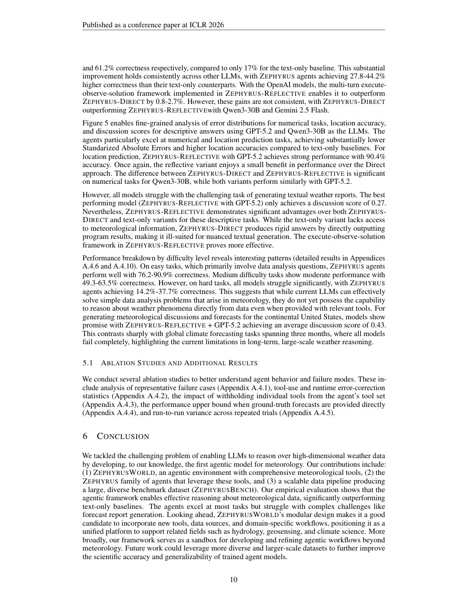


#### 原文提取

```text
Published as a conference paper at ICLR 2026


and 61.2% correctness respectively, compared to only 17% for the text-only baseline. This substantial
improvement holds consistently across other LLMs, with Z EPHYRUS agents achieving 27.8-44.2%
higher correctness than their text-only counterparts. With the OpenAI models, the multi-turn execute-
observe-solution framework implemented in Z EPHYRUS -R EFLECTIVE enables it to outperform
Z EPHYRUS -D IRECT by 0.8-2.7%. However, these gains are not consistent, with Z EPHYRUS -D IRECT
outperforming Z EPHYRUS -R EFLECTIVEwith Qwen3-30B and Gemini 2.5 Flash.
Figure 5 enables fine-grained analysis of error distributions for numerical tasks, location accuracy,
and discussion scores for descriptive answers using GPT-5.2 and Qwen3-30B as the LLMs. The
agents particularly excel at numerical and location prediction tasks, achieving substantially lower
Standarized Absolute Errors and higher location accuracies compared to text-only baselines. For
location prediction, Z EPHYRUS -R EFLECTIVE with GPT-5.2 achieves strong performance with 90.4%
accuracy. Once again, the reflective variant enjoys a small benefit in performance over the Direct
approach. The difference between Z EPHYRUS -D IRECT and Z EPHYRUS -R EFLECTIVE is significant
on numerical tasks for Qwen3-30B, while both variants perform similarly with GPT-5.2.
However, all models struggle with the challenging task of generating textual weather reports. The best
performing model (Z EPHYRUS -R EFLECTIVE with GPT-5.2) only achieves a discussion score of 0.27.
Nevertheless, Z EPHYRUS -R EFLECTIVE demonstrates significant advantages over both Z EPHYRUS -
D IRECT and text-only variants for these descriptive tasks. While the text-only variant lacks access
to meteorological information, Z EPHYRUS -D IRECT produces rigid answers by directly outputting
program results, making it ill-suited for nuanced textual generation. The execute-observe-solution
framework in Z EPHYRUS -R EFLECTIVE proves more effective.
Performance breakdown by difficulty level reveals interesting patterns (detailed results in Appendices
A.4.6 and A.4.10). On easy tasks, which primarily involve data analysis questions, Z EPHYRUS agents
perform well with 76.2-90.9% correctness. Medium difficulty tasks show moderate performance with
49.3-63.5% correctness. However, on hard tasks, all models struggle significantly, with Z EPHYRUS
agents achieving 14.2%-37.7% correctness. This suggests that while current LLMs can effectively
solve simple data analysis problems that arise in meteorology, they do not yet possess the capability
to reason about weather phenomena directly from data even when provided with relevant tools. For
generating meteorological discussions and forecasts for the continental United States, models show
promise with Z EPHYRUS -R EFLECTIVE + GPT-5.2 achieving an average discussion score of 0.43.
This contrasts sharply with global climate forecasting tasks spanning three months, where all models
fail completely, highlighting the current limitations in long-term, large-scale weather reasoning.

5.1   A BLATION S TUDIES AND A DDITIONAL R ESULTS

We conduct several ablation studies to better understand agent behavior and failure modes. These in-
clude analysis of representative failure cases (Appendix A.4.1), tool-use and runtime error-correction
statistics (Appendix A.4.2), the impact of withholding individual tools from the agent’s tool set
(Appendix A.4.3), the performance upper bound when ground-truth forecasts are provided directly
(Appendix A.4.4), and run-to-run variance across repeated trials (Appendix A.4.5).


6     C ONCLUSION

We tackled the challenging problem of enabling LLMs to reason over high-dimensional weather data
by developing, to our knowledge, the first agentic model for meteorology. Our contributions include:
(1) Z EPHYRUS W ORLD, an agentic environment with comprehensive meteorological tools, (2) the
Z EPHYRUS family of agents that leverage these tools, and (3) a scalable data pipeline producing
a large, diverse benchmark dataset (Z EPHYRUS B ENCH). Our empirical evaluation shows that the
agentic framework enables effective reasoning about meteorological data, significantly outperforming
text-only baselines. The agents excel at most tasks but struggle with complex challenges like
forecast report generation. Looking ahead, Z EPHYRUS W ORLD’s modular design makes it a good
candidate to incorporate new tools, data sources, and domain-specific workflows, positioning it as a
unified platform to support related fields such as hydrology, geosensing, and climate science. More
broadly, our framework serves as a sandbox for developing and refining agentic workflows beyond
meteorology. Future work could leverage more diverse and larger-scale datasets to further improve
the scientific accuracy and generalizability of trained agent models.


                                                 10
```


---

## PDF 第 011 页

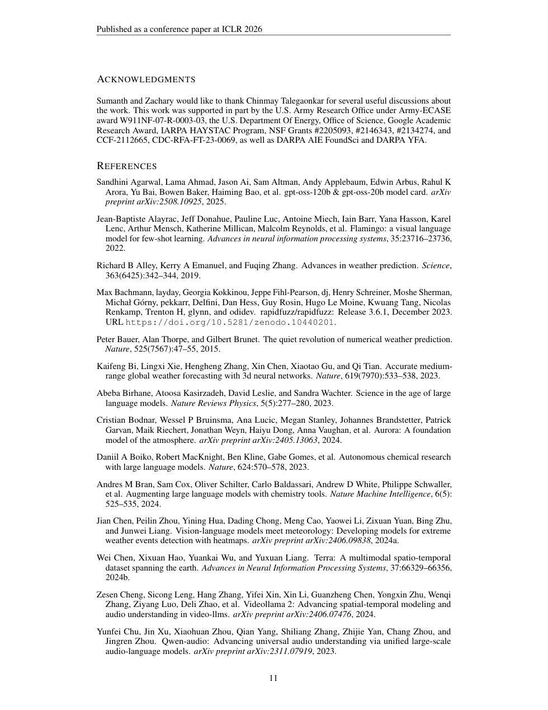


#### 原文提取

```text
Published as a conference paper at ICLR 2026


ACKNOWLEDGMENTS
Sumanth and Zachary would like to thank Chinmay Talegaonkar for several useful discussions about
the work. This work was supported in part by the U.S. Army Research Office under Army-ECASE
award W911NF-07-R-0003-03, the U.S. Department Of Energy, Office of Science, Google Academic
Research Award, IARPA HAYSTAC Program, NSF Grants #2205093, #2146343, #2134274, and
CCF-2112665, CDC-RFA-FT-23-0069, as well as DARPA AIE FoundSci and DARPA YFA.

R EFERENCES
Sandhini Agarwal, Lama Ahmad, Jason Ai, Sam Altman, Andy Applebaum, Edwin Arbus, Rahul K
  Arora, Yu Bai, Bowen Baker, Haiming Bao, et al. gpt-oss-120b & gpt-oss-20b model card. arXiv
  preprint arXiv:2508.10925, 2025.
Jean-Baptiste Alayrac, Jeff Donahue, Pauline Luc, Antoine Miech, Iain Barr, Yana Hasson, Karel
  Lenc, Arthur Mensch, Katherine Millican, Malcolm Reynolds, et al. Flamingo: a visual language
  model for few-shot learning. Advances in neural information processing systems, 35:23716–23736,
  2022.
Richard B Alley, Kerry A Emanuel, and Fuqing Zhang. Advances in weather prediction. Science,
  363(6425):342–344, 2019.
Max Bachmann, layday, Georgia Kokkinou, Jeppe Fihl-Pearson, dj, Henry Schreiner, Moshe Sherman,
 Michał Górny, pekkarr, Delfini, Dan Hess, Guy Rosin, Hugo Le Moine, Kwuang Tang, Nicolas
 Renkamp, Trenton H, glynn, and odidev. rapidfuzz/rapidfuzz: Release 3.6.1, December 2023.
 URL https://doi.org/10.5281/zenodo.10440201.
Peter Bauer, Alan Thorpe, and Gilbert Brunet. The quiet revolution of numerical weather prediction.
  Nature, 525(7567):47–55, 2015.
Kaifeng Bi, Lingxi Xie, Hengheng Zhang, Xin Chen, Xiaotao Gu, and Qi Tian. Accurate medium-
  range global weather forecasting with 3d neural networks. Nature, 619(7970):533–538, 2023.
Abeba Birhane, Atoosa Kasirzadeh, David Leslie, and Sandra Wachter. Science in the age of large
  language models. Nature Reviews Physics, 5(5):277–280, 2023.
Cristian Bodnar, Wessel P Bruinsma, Ana Lucic, Megan Stanley, Johannes Brandstetter, Patrick
  Garvan, Maik Riechert, Jonathan Weyn, Haiyu Dong, Anna Vaughan, et al. Aurora: A foundation
  model of the atmosphere. arXiv preprint arXiv:2405.13063, 2024.
Daniil A Boiko, Robert MacKnight, Ben Kline, Gabe Gomes, et al. Autonomous chemical research
  with large language models. Nature, 624:570–578, 2023.
Andres M Bran, Sam Cox, Oliver Schilter, Carlo Baldassari, Andrew D White, Philippe Schwaller,
  et al. Augmenting large language models with chemistry tools. Nature Machine Intelligence, 6(5):
  525–535, 2024.
Jian Chen, Peilin Zhou, Yining Hua, Dading Chong, Meng Cao, Yaowei Li, Zixuan Yuan, Bing Zhu,
   and Junwei Liang. Vision-language models meet meteorology: Developing models for extreme
   weather events detection with heatmaps. arXiv preprint arXiv:2406.09838, 2024a.
Wei Chen, Xixuan Hao, Yuankai Wu, and Yuxuan Liang. Terra: A multimodal spatio-temporal
 dataset spanning the earth. Advances in Neural Information Processing Systems, 37:66329–66356,
 2024b.
Zesen Cheng, Sicong Leng, Hang Zhang, Yifei Xin, Xin Li, Guanzheng Chen, Yongxin Zhu, Wenqi
  Zhang, Ziyang Luo, Deli Zhao, et al. Videollama 2: Advancing spatial-temporal modeling and
  audio understanding in video-llms. arXiv preprint arXiv:2406.07476, 2024.
Yunfei Chu, Jin Xu, Xiaohuan Zhou, Qian Yang, Shiliang Zhang, Zhijie Yan, Chang Zhou, and
  Jingren Zhou. Qwen-audio: Advancing universal audio understanding via unified large-scale
  audio-language models. arXiv preprint arXiv:2311.07919, 2023.


                                               11
```


---

## PDF 第 012 页

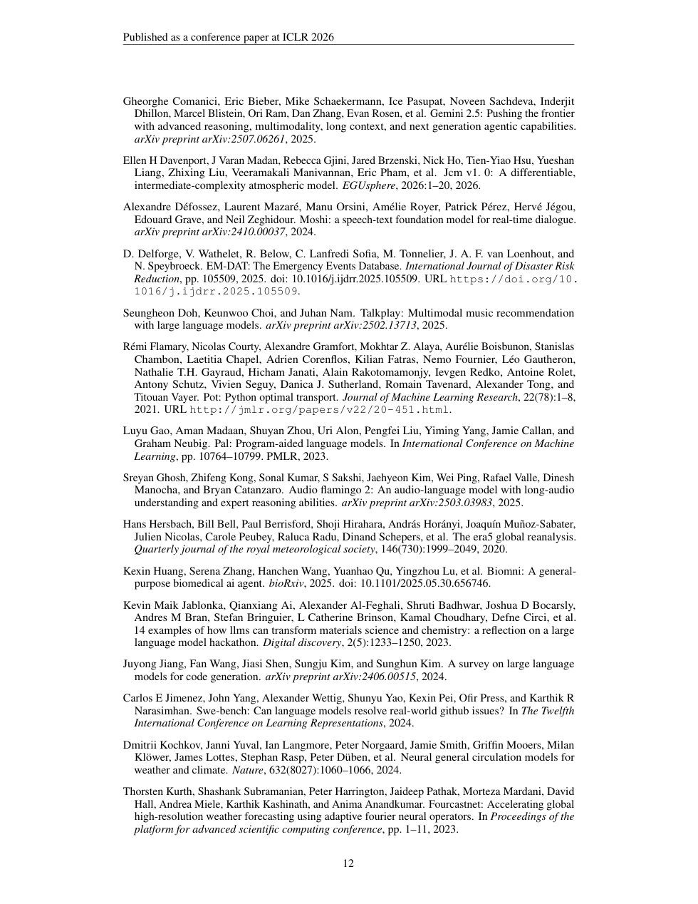


#### 原文提取

```text
Published as a conference paper at ICLR 2026


Gheorghe Comanici, Eric Bieber, Mike Schaekermann, Ice Pasupat, Noveen Sachdeva, Inderjit
  Dhillon, Marcel Blistein, Ori Ram, Dan Zhang, Evan Rosen, et al. Gemini 2.5: Pushing the frontier
 with advanced reasoning, multimodality, long context, and next generation agentic capabilities.
  arXiv preprint arXiv:2507.06261, 2025.
Ellen H Davenport, J Varan Madan, Rebecca Gjini, Jared Brzenski, Nick Ho, Tien-Yiao Hsu, Yueshan
  Liang, Zhixing Liu, Veeramakali Manivannan, Eric Pham, et al. Jcm v1. 0: A differentiable,
  intermediate-complexity atmospheric model. EGUsphere, 2026:1–20, 2026.
Alexandre Défossez, Laurent Mazaré, Manu Orsini, Amélie Royer, Patrick Pérez, Hervé Jégou,
  Edouard Grave, and Neil Zeghidour. Moshi: a speech-text foundation model for real-time dialogue.
  arXiv preprint arXiv:2410.00037, 2024.
D. Delforge, V. Wathelet, R. Below, C. Lanfredi Sofia, M. Tonnelier, J. A. F. van Loenhout, and
  N. Speybroeck. EM-DAT: The Emergency Events Database. International Journal of Disaster Risk
  Reduction, pp. 105509, 2025. doi: 10.1016/j.ijdrr.2025.105509. URL https://doi.org/10.
  1016/j.ijdrr.2025.105509.
Seungheon Doh, Keunwoo Choi, and Juhan Nam. Talkplay: Multimodal music recommendation
  with large language models. arXiv preprint arXiv:2502.13713, 2025.
Rémi Flamary, Nicolas Courty, Alexandre Gramfort, Mokhtar Z. Alaya, Aurélie Boisbunon, Stanislas
  Chambon, Laetitia Chapel, Adrien Corenflos, Kilian Fatras, Nemo Fournier, Léo Gautheron,
  Nathalie T.H. Gayraud, Hicham Janati, Alain Rakotomamonjy, Ievgen Redko, Antoine Rolet,
  Antony Schutz, Vivien Seguy, Danica J. Sutherland, Romain Tavenard, Alexander Tong, and
  Titouan Vayer. Pot: Python optimal transport. Journal of Machine Learning Research, 22(78):1–8,
  2021. URL http://jmlr.org/papers/v22/20-451.html.
Luyu Gao, Aman Madaan, Shuyan Zhou, Uri Alon, Pengfei Liu, Yiming Yang, Jamie Callan, and
  Graham Neubig. Pal: Program-aided language models. In International Conference on Machine
  Learning, pp. 10764–10799. PMLR, 2023.
Sreyan Ghosh, Zhifeng Kong, Sonal Kumar, S Sakshi, Jaehyeon Kim, Wei Ping, Rafael Valle, Dinesh
  Manocha, and Bryan Catanzaro. Audio flamingo 2: An audio-language model with long-audio
  understanding and expert reasoning abilities. arXiv preprint arXiv:2503.03983, 2025.
Hans Hersbach, Bill Bell, Paul Berrisford, Shoji Hirahara, András Horányi, Joaquín Muñoz-Sabater,
  Julien Nicolas, Carole Peubey, Raluca Radu, Dinand Schepers, et al. The era5 global reanalysis.
  Quarterly journal of the royal meteorological society, 146(730):1999–2049, 2020.
Kexin Huang, Serena Zhang, Hanchen Wang, Yuanhao Qu, Yingzhou Lu, et al. Biomni: A general-
  purpose biomedical ai agent. bioRxiv, 2025. doi: 10.1101/2025.05.30.656746.
Kevin Maik Jablonka, Qianxiang Ai, Alexander Al-Feghali, Shruti Badhwar, Joshua D Bocarsly,
  Andres M Bran, Stefan Bringuier, L Catherine Brinson, Kamal Choudhary, Defne Circi, et al.
 14 examples of how llms can transform materials science and chemistry: a reflection on a large
  language model hackathon. Digital discovery, 2(5):1233–1250, 2023.
Juyong Jiang, Fan Wang, Jiasi Shen, Sungju Kim, and Sunghun Kim. A survey on large language
  models for code generation. arXiv preprint arXiv:2406.00515, 2024.
Carlos E Jimenez, John Yang, Alexander Wettig, Shunyu Yao, Kexin Pei, Ofir Press, and Karthik R
  Narasimhan. Swe-bench: Can language models resolve real-world github issues? In The Twelfth
  International Conference on Learning Representations, 2024.
Dmitrii Kochkov, Janni Yuval, Ian Langmore, Peter Norgaard, Jamie Smith, Griffin Mooers, Milan
 Klöwer, James Lottes, Stephan Rasp, Peter Düben, et al. Neural general circulation models for
 weather and climate. Nature, 632(8027):1060–1066, 2024.
Thorsten Kurth, Shashank Subramanian, Peter Harrington, Jaideep Pathak, Morteza Mardani, David
  Hall, Andrea Miele, Karthik Kashinath, and Anima Anandkumar. Fourcastnet: Accelerating global
  high-resolution weather forecasting using adaptive fourier neural operators. In Proceedings of the
  platform for advanced scientific computing conference, pp. 1–11, 2023.


                                                12
```


---

## PDF 第 013 页

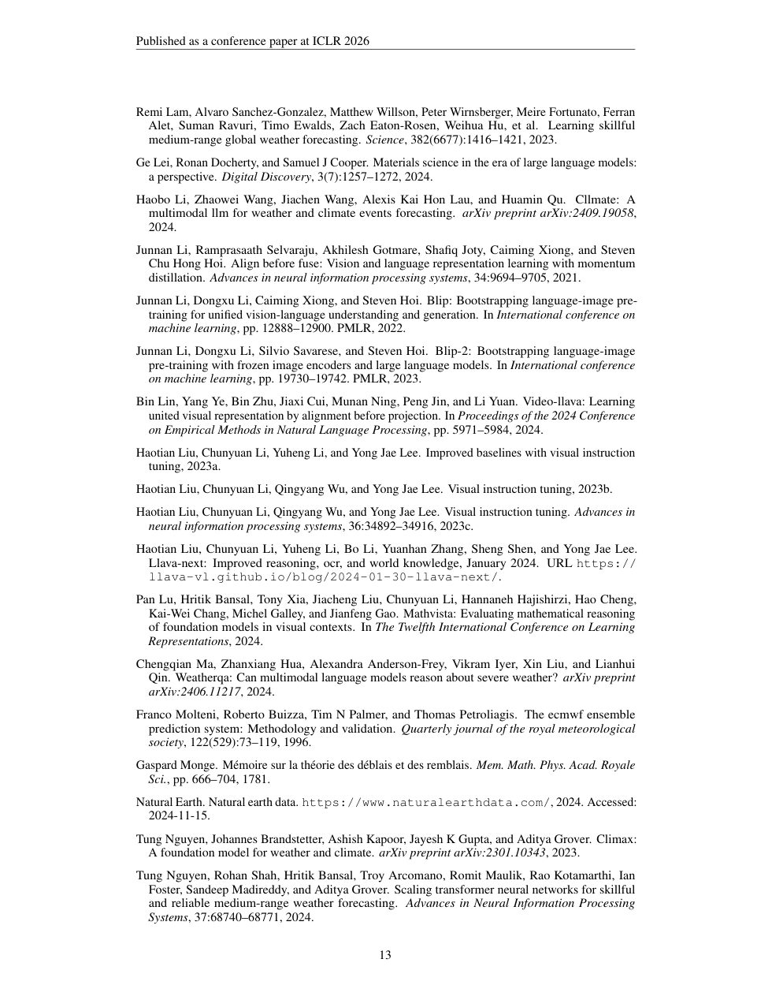


#### 原文提取

```text
Published as a conference paper at ICLR 2026


Remi Lam, Alvaro Sanchez-Gonzalez, Matthew Willson, Peter Wirnsberger, Meire Fortunato, Ferran
  Alet, Suman Ravuri, Timo Ewalds, Zach Eaton-Rosen, Weihua Hu, et al. Learning skillful
  medium-range global weather forecasting. Science, 382(6677):1416–1421, 2023.
Ge Lei, Ronan Docherty, and Samuel J Cooper. Materials science in the era of large language models:
  a perspective. Digital Discovery, 3(7):1257–1272, 2024.
Haobo Li, Zhaowei Wang, Jiachen Wang, Alexis Kai Hon Lau, and Huamin Qu. Cllmate: A
  multimodal llm for weather and climate events forecasting. arXiv preprint arXiv:2409.19058,
  2024.
Junnan Li, Ramprasaath Selvaraju, Akhilesh Gotmare, Shafiq Joty, Caiming Xiong, and Steven
  Chu Hong Hoi. Align before fuse: Vision and language representation learning with momentum
  distillation. Advances in neural information processing systems, 34:9694–9705, 2021.
Junnan Li, Dongxu Li, Caiming Xiong, and Steven Hoi. Blip: Bootstrapping language-image pre-
  training for unified vision-language understanding and generation. In International conference on
  machine learning, pp. 12888–12900. PMLR, 2022.
Junnan Li, Dongxu Li, Silvio Savarese, and Steven Hoi. Blip-2: Bootstrapping language-image
  pre-training with frozen image encoders and large language models. In International conference
  on machine learning, pp. 19730–19742. PMLR, 2023.
Bin Lin, Yang Ye, Bin Zhu, Jiaxi Cui, Munan Ning, Peng Jin, and Li Yuan. Video-llava: Learning
  united visual representation by alignment before projection. In Proceedings of the 2024 Conference
  on Empirical Methods in Natural Language Processing, pp. 5971–5984, 2024.
Haotian Liu, Chunyuan Li, Yuheng Li, and Yong Jae Lee. Improved baselines with visual instruction
  tuning, 2023a.
Haotian Liu, Chunyuan Li, Qingyang Wu, and Yong Jae Lee. Visual instruction tuning, 2023b.
Haotian Liu, Chunyuan Li, Qingyang Wu, and Yong Jae Lee. Visual instruction tuning. Advances in
  neural information processing systems, 36:34892–34916, 2023c.
Haotian Liu, Chunyuan Li, Yuheng Li, Bo Li, Yuanhan Zhang, Sheng Shen, and Yong Jae Lee.
  Llava-next: Improved reasoning, ocr, and world knowledge, January 2024. URL https://
  llava-vl.github.io/blog/2024-01-30-llava-next/.
Pan Lu, Hritik Bansal, Tony Xia, Jiacheng Liu, Chunyuan Li, Hannaneh Hajishirzi, Hao Cheng,
  Kai-Wei Chang, Michel Galley, and Jianfeng Gao. Mathvista: Evaluating mathematical reasoning
  of foundation models in visual contexts. In The Twelfth International Conference on Learning
  Representations, 2024.
Chengqian Ma, Zhanxiang Hua, Alexandra Anderson-Frey, Vikram Iyer, Xin Liu, and Lianhui
  Qin. Weatherqa: Can multimodal language models reason about severe weather? arXiv preprint
  arXiv:2406.11217, 2024.
Franco Molteni, Roberto Buizza, Tim N Palmer, and Thomas Petroliagis. The ecmwf ensemble
  prediction system: Methodology and validation. Quarterly journal of the royal meteorological
  society, 122(529):73–119, 1996.
Gaspard Monge. Mémoire sur la théorie des déblais et des remblais. Mem. Math. Phys. Acad. Royale
  Sci., pp. 666–704, 1781.
Natural Earth. Natural earth data. https://www.naturalearthdata.com/, 2024. Accessed:
  2024-11-15.
Tung Nguyen, Johannes Brandstetter, Ashish Kapoor, Jayesh K Gupta, and Aditya Grover. Climax:
  A foundation model for weather and climate. arXiv preprint arXiv:2301.10343, 2023.
Tung Nguyen, Rohan Shah, Hritik Bansal, Troy Arcomano, Romit Maulik, Rao Kotamarthi, Ian
  Foster, Sandeep Madireddy, and Aditya Grover. Scaling transformer neural networks for skillful
  and reliable medium-range weather forecasting. Advances in Neural Information Processing
  Systems, 37:68740–68771, 2024.


                                                13
```


---

## PDF 第 014 页

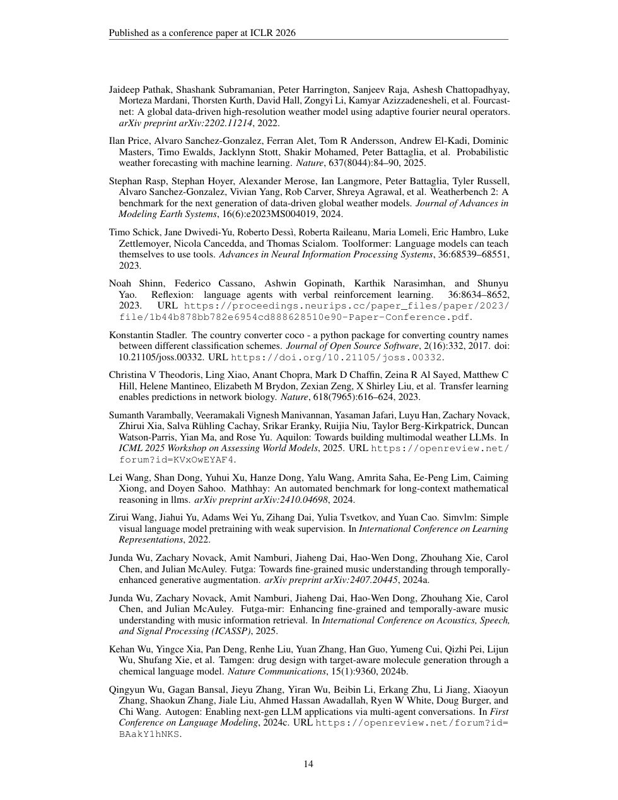


#### 原文提取

```text
Published as a conference paper at ICLR 2026


Jaideep Pathak, Shashank Subramanian, Peter Harrington, Sanjeev Raja, Ashesh Chattopadhyay,
   Morteza Mardani, Thorsten Kurth, David Hall, Zongyi Li, Kamyar Azizzadenesheli, et al. Fourcast-
   net: A global data-driven high-resolution weather model using adaptive fourier neural operators.
   arXiv preprint arXiv:2202.11214, 2022.
Ilan Price, Alvaro Sanchez-Gonzalez, Ferran Alet, Tom R Andersson, Andrew El-Kadi, Dominic
   Masters, Timo Ewalds, Jacklynn Stott, Shakir Mohamed, Peter Battaglia, et al. Probabilistic
   weather forecasting with machine learning. Nature, 637(8044):84–90, 2025.
Stephan Rasp, Stephan Hoyer, Alexander Merose, Ian Langmore, Peter Battaglia, Tyler Russell,
  Alvaro Sanchez-Gonzalez, Vivian Yang, Rob Carver, Shreya Agrawal, et al. Weatherbench 2: A
  benchmark for the next generation of data-driven global weather models. Journal of Advances in
  Modeling Earth Systems, 16(6):e2023MS004019, 2024.
Timo Schick, Jane Dwivedi-Yu, Roberto Dessì, Roberta Raileanu, Maria Lomeli, Eric Hambro, Luke
  Zettlemoyer, Nicola Cancedda, and Thomas Scialom. Toolformer: Language models can teach
  themselves to use tools. Advances in Neural Information Processing Systems, 36:68539–68551,
  2023.
Noah Shinn, Federico Cassano, Ashwin Gopinath, Karthik Narasimhan, and Shunyu
 Yao. Reflexion: language agents with verbal reinforcement learning. 36:8634–8652,
  2023.  URL https://proceedings.neurips.cc/paper_files/paper/2023/
  file/1b44b878bb782e6954cd888628510e90-Paper-Conference.pdf.
Konstantin Stadler. The country converter coco - a python package for converting country names
  between different classification schemes. Journal of Open Source Software, 2(16):332, 2017. doi:
 10.21105/joss.00332. URL https://doi.org/10.21105/joss.00332.
Christina V Theodoris, Ling Xiao, Anant Chopra, Mark D Chaffin, Zeina R Al Sayed, Matthew C
  Hill, Helene Mantineo, Elizabeth M Brydon, Zexian Zeng, X Shirley Liu, et al. Transfer learning
  enables predictions in network biology. Nature, 618(7965):616–624, 2023.
Sumanth Varambally, Veeramakali Vignesh Manivannan, Yasaman Jafari, Luyu Han, Zachary Novack,
  Zhirui Xia, Salva Rühling Cachay, Srikar Eranky, Ruijia Niu, Taylor Berg-Kirkpatrick, Duncan
  Watson-Parris, Yian Ma, and Rose Yu. Aquilon: Towards building multimodal weather LLMs. In
  ICML 2025 Workshop on Assessing World Models, 2025. URL https://openreview.net/
  forum?id=KVxOwEYAF4.
Lei Wang, Shan Dong, Yuhui Xu, Hanze Dong, Yalu Wang, Amrita Saha, Ee-Peng Lim, Caiming
  Xiong, and Doyen Sahoo. Mathhay: An automated benchmark for long-context mathematical
  reasoning in llms. arXiv preprint arXiv:2410.04698, 2024.
Zirui Wang, Jiahui Yu, Adams Wei Yu, Zihang Dai, Yulia Tsvetkov, and Yuan Cao. Simvlm: Simple
  visual language model pretraining with weak supervision. In International Conference on Learning
  Representations, 2022.
Junda Wu, Zachary Novack, Amit Namburi, Jiaheng Dai, Hao-Wen Dong, Zhouhang Xie, Carol
  Chen, and Julian McAuley. Futga: Towards fine-grained music understanding through temporally-
  enhanced generative augmentation. arXiv preprint arXiv:2407.20445, 2024a.
Junda Wu, Zachary Novack, Amit Namburi, Jiaheng Dai, Hao-Wen Dong, Zhouhang Xie, Carol
  Chen, and Julian McAuley. Futga-mir: Enhancing fine-grained and temporally-aware music
  understanding with music information retrieval. In International Conference on Acoustics, Speech,
  and Signal Processing (ICASSP), 2025.
Kehan Wu, Yingce Xia, Pan Deng, Renhe Liu, Yuan Zhang, Han Guo, Yumeng Cui, Qizhi Pei, Lijun
  Wu, Shufang Xie, et al. Tamgen: drug design with target-aware molecule generation through a
  chemical language model. Nature Communications, 15(1):9360, 2024b.
Qingyun Wu, Gagan Bansal, Jieyu Zhang, Yiran Wu, Beibin Li, Erkang Zhu, Li Jiang, Xiaoyun
  Zhang, Shaokun Zhang, Jiale Liu, Ahmed Hassan Awadallah, Ryen W White, Doug Burger, and
  Chi Wang. Autogen: Enabling next-gen LLM applications via multi-agent conversations. In First
  Conference on Language Modeling, 2024c. URL https://openreview.net/forum?id=
  BAakY1hNKS.


                                               14
```


---

## PDF 第 015 页

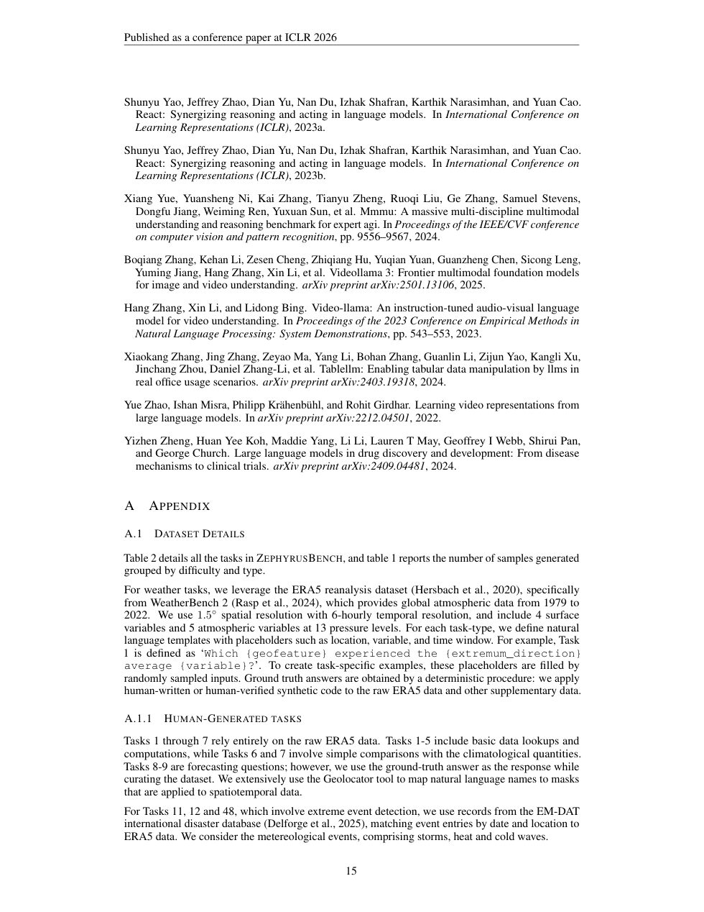


#### 原文提取

```text
Published as a conference paper at ICLR 2026


Shunyu Yao, Jeffrey Zhao, Dian Yu, Nan Du, Izhak Shafran, Karthik Narasimhan, and Yuan Cao.
  React: Synergizing reasoning and acting in language models. In International Conference on
  Learning Representations (ICLR), 2023a.

Shunyu Yao, Jeffrey Zhao, Dian Yu, Nan Du, Izhak Shafran, Karthik Narasimhan, and Yuan Cao.
  React: Synergizing reasoning and acting in language models. In International Conference on
  Learning Representations (ICLR), 2023b.

Xiang Yue, Yuansheng Ni, Kai Zhang, Tianyu Zheng, Ruoqi Liu, Ge Zhang, Samuel Stevens,
  Dongfu Jiang, Weiming Ren, Yuxuan Sun, et al. Mmmu: A massive multi-discipline multimodal
  understanding and reasoning benchmark for expert agi. In Proceedings of the IEEE/CVF conference
  on computer vision and pattern recognition, pp. 9556–9567, 2024.

Boqiang Zhang, Kehan Li, Zesen Cheng, Zhiqiang Hu, Yuqian Yuan, Guanzheng Chen, Sicong Leng,
  Yuming Jiang, Hang Zhang, Xin Li, et al. Videollama 3: Frontier multimodal foundation models
  for image and video understanding. arXiv preprint arXiv:2501.13106, 2025.

Hang Zhang, Xin Li, and Lidong Bing. Video-llama: An instruction-tuned audio-visual language
  model for video understanding. In Proceedings of the 2023 Conference on Empirical Methods in
  Natural Language Processing: System Demonstrations, pp. 543–553, 2023.

Xiaokang Zhang, Jing Zhang, Zeyao Ma, Yang Li, Bohan Zhang, Guanlin Li, Zijun Yao, Kangli Xu,
  Jinchang Zhou, Daniel Zhang-Li, et al. Tablellm: Enabling tabular data manipulation by llms in
  real office usage scenarios. arXiv preprint arXiv:2403.19318, 2024.

Yue Zhao, Ishan Misra, Philipp Krähenbühl, and Rohit Girdhar. Learning video representations from
  large language models. In arXiv preprint arXiv:2212.04501, 2022.

Yizhen Zheng, Huan Yee Koh, Maddie Yang, Li Li, Lauren T May, Geoffrey I Webb, Shirui Pan,
  and George Church. Large language models in drug discovery and development: From disease
  mechanisms to clinical trials. arXiv preprint arXiv:2409.04481, 2024.


A     A PPENDIX

A.1     DATASET D ETAILS

Table 2 details all the tasks in Z EPHYRUS B ENCH, and table 1 reports the number of samples generated
grouped by difficulty and type.
For weather tasks, we leverage the ERA5 reanalysis dataset (Hersbach et al., 2020), specifically
from WeatherBench 2 (Rasp et al., 2024), which provides global atmospheric data from 1979 to
2022. We use 1.5◦ spatial resolution with 6-hourly temporal resolution, and include 4 surface
variables and 5 atmospheric variables at 13 pressure levels. For each task-type, we define natural
language templates with placeholders such as location, variable, and time window. For example, Task
1 is defined as ‘Which {geofeature} experienced the {extremum_direction}
average {variable}?’. To create task-specific examples, these placeholders are filled by
randomly sampled inputs. Ground truth answers are obtained by a deterministic procedure: we apply
human-written or human-verified synthetic code to the raw ERA5 data and other supplementary data.

A.1.1    H UMAN -G ENERATED TASKS
Tasks 1 through 7 rely entirely on the raw ERA5 data. Tasks 1-5 include basic data lookups and
computations, while Tasks 6 and 7 involve simple comparisons with the climatological quantities.
Tasks 8-9 are forecasting questions; however, we use the ground-truth answer as the response while
curating the dataset. We extensively use the Geolocator tool to map natural language names to masks
that are applied to spatiotemporal data.
For Tasks 11, 12 and 48, which involve extreme event detection, we use records from the EM-DAT
international disaster database (Delforge et al., 2025), matching event entries by date and location to
ERA5 data. We consider the metereological events, comprising storms, heat and cold waves.


                                                  15
```


---

## PDF 第 016 页

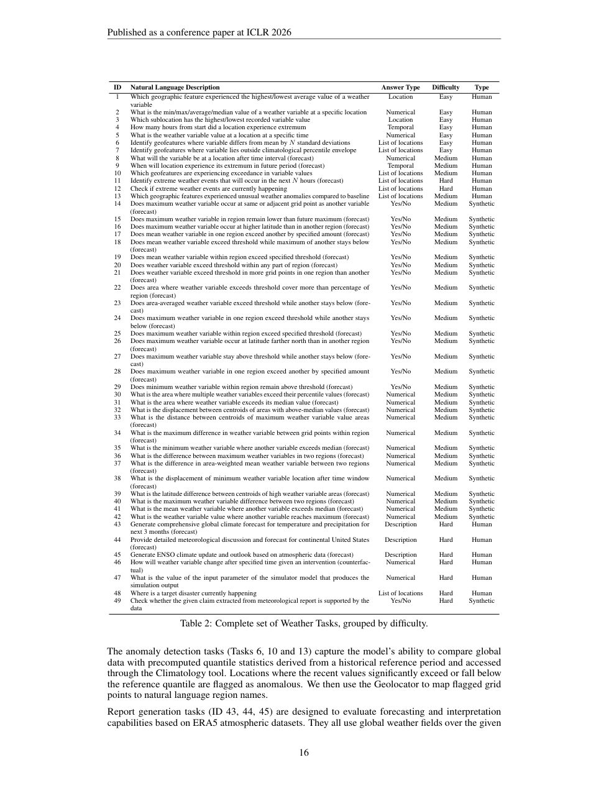


### 表2（第 16 页）

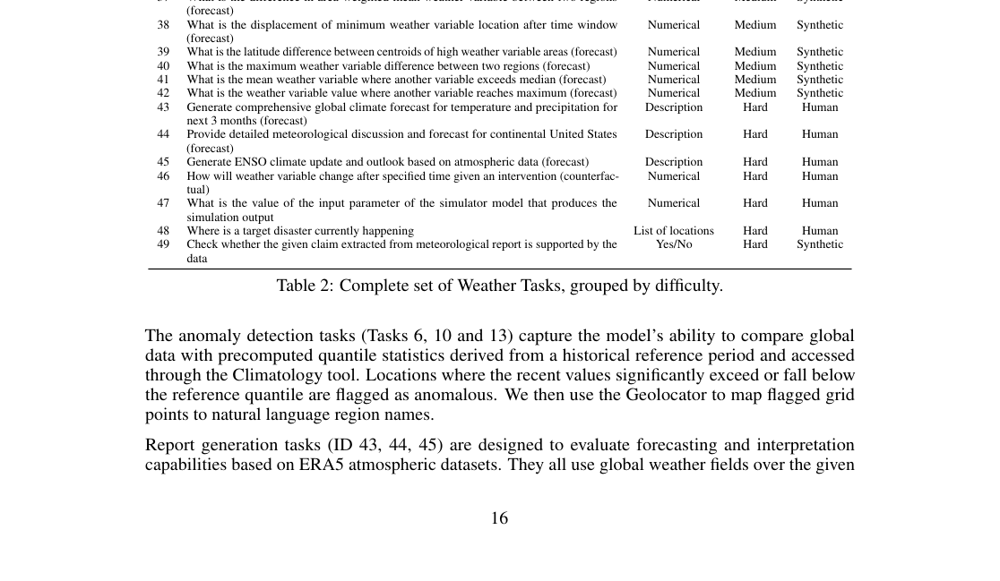

**原文题注：** Table 2: Complete set of Weather Tasks, grouped by difficulty.


#### 原文提取

```text
Published as a conference paper at ICLR 2026


 ID   Natural Language Description                                                                   Answer Type        Difficulty    Type
  1   Which geographic feature experienced the highest/lowest average value of a weather               Location           Easy       Human
      variable
 2    What is the min/max/average/median value of a weather variable at a specific location            Numerical         Easy         Human
 3    Which sublocation has the highest/lowest recorded variable value                                  Location         Easy         Human
 4    How many hours from start did a location experience extremum                                     Temporal          Easy         Human
 5    What is the weather variable value at a location at a specific time                              Numerical         Easy         Human
 6    Identify geofeatures where variable differs from mean by N standard deviations                List of locations    Easy         Human
 7    Identify geofeatures where variable lies outside climatological percentile envelope           List of locations    Easy         Human
 8    What will the variable be at a location after time interval (forecast)                           Numerical        Medium        Human
 9    When will location experience its extremum in future period (forecast)                           Temporal         Medium        Human
 10   Which geofeatures are experiencing exceedance in variable values                              List of locations   Medium        Human
 11   Identify extreme weather events that will occur in the next N hours (forecast)                List of locations    Hard         Human
 12   Check if extreme weather events are currently happening                                       List of locations    Hard         Human
 13   Which geographic features experienced unusual weather anomalies compared to baseline          List of locations   Medium        Human
 14   Does maximum weather variable occur at same or adjacent grid point as another variable             Yes/No         Medium       Synthetic
      (forecast)
 15   Does maximum weather variable in region remain lower than future maximum (forecast)               Yes/No          Medium       Synthetic
 16   Does maximum weather variable occur at higher latitude than in another region (forecast)          Yes/No          Medium       Synthetic
 17   Does mean weather variable in one region exceed another by specified amount (forecast)            Yes/No          Medium       Synthetic
 18   Does mean weather variable exceed threshold while maximum of another stays below                  Yes/No          Medium       Synthetic
      (forecast)
 19   Does mean weather variable within region exceed specified threshold (forecast)                    Yes/No          Medium       Synthetic
 20   Does weather variable exceed threshold within any part of region (forecast)                       Yes/No          Medium       Synthetic
 21   Does weather variable exceed threshold in more grid points in one region than another             Yes/No          Medium       Synthetic
      (forecast)
 22   Does area where weather variable exceeds threshold cover more than percentage of                  Yes/No          Medium       Synthetic
      region (forecast)
 23   Does area-averaged weather variable exceed threshold while another stays below (fore-             Yes/No          Medium       Synthetic
      cast)
 24   Does maximum weather variable in one region exceed threshold while another stays                  Yes/No          Medium       Synthetic
      below (forecast)
 25   Does maximum weather variable within region exceed specified threshold (forecast)                 Yes/No          Medium       Synthetic
 26   Does maximum weather variable occur at latitude farther north than in another region              Yes/No          Medium       Synthetic
      (forecast)
 27   Does maximum weather variable stay above threshold while another stays below (fore-               Yes/No          Medium       Synthetic
      cast)
 28   Does maximum weather variable in one region exceed another by specified amount                    Yes/No          Medium       Synthetic
      (forecast)
 29   Does minimum weather variable within region remain above threshold (forecast)                    Yes/No           Medium       Synthetic
 30   What is the area where multiple weather variables exceed their percentile values (forecast)     Numerical         Medium       Synthetic
 31   What is the area where weather variable exceeds its median value (forecast)                     Numerical         Medium       Synthetic
 32   What is the displacement between centroids of areas with above-median values (forecast)         Numerical         Medium       Synthetic
 33   What is the distance between centroids of maximum weather variable value areas                  Numerical         Medium       Synthetic
      (forecast)
 34   What is the maximum difference in weather variable between grid points within region            Numerical         Medium       Synthetic
      (forecast)
 35   What is the minimum weather variable where another variable exceeds median (forecast)           Numerical         Medium       Synthetic
 36   What is the difference between maximum weather variables in two regions (forecast)              Numerical         Medium       Synthetic
 37   What is the difference in area-weighted mean weather variable between two regions               Numerical         Medium       Synthetic
      (forecast)
 38   What is the displacement of minimum weather variable location after time window                 Numerical         Medium       Synthetic
      (forecast)
 39   What is the latitude difference between centroids of high weather variable areas (forecast)     Numerical         Medium       Synthetic
 40   What is the maximum weather variable difference between two regions (forecast)                  Numerical         Medium       Synthetic
 41   What is the mean weather variable where another variable exceeds median (forecast)              Numerical         Medium       Synthetic
 42   What is the weather variable value where another variable reaches maximum (forecast)            Numerical         Medium       Synthetic
 43   Generate comprehensive global climate forecast for temperature and precipitation for            Description        Hard         Human
      next 3 months (forecast)
 44   Provide detailed meteorological discussion and forecast for continental United States           Description         Hard       Human
      (forecast)
 45   Generate ENSO climate update and outlook based on atmospheric data (forecast)                   Description         Hard       Human
 46   How will weather variable change after specified time given an intervention (counterfac-        Numerical           Hard       Human
      tual)
 47   What is the value of the input parameter of the simulator model that produces the               Numerical           Hard       Human
      simulation output
 48   Where is a target disaster currently happening                                                List of locations     Hard        Human
 49   Check whether the given claim extracted from meteorological report is supported by the             Yes/No           Hard       Synthetic
      data

                        Table 2: Complete set of Weather Tasks, grouped by difficulty.

The anomaly detection tasks (Tasks 6, 10 and 13) capture the model’s ability to compare global
data with precomputed quantile statistics derived from a historical reference period and accessed
through the Climatology tool. Locations where the recent values significantly exceed or fall below
the reference quantile are flagged as anomalous. We then use the Geolocator to map flagged grid
points to natural language region names.
Report generation tasks (ID 43, 44, 45) are designed to evaluate forecasting and interpretation
capabilities based on ERA5 atmospheric datasets. They all use global weather fields over the given


                                                                     16
```


---

## PDF 第 017 页

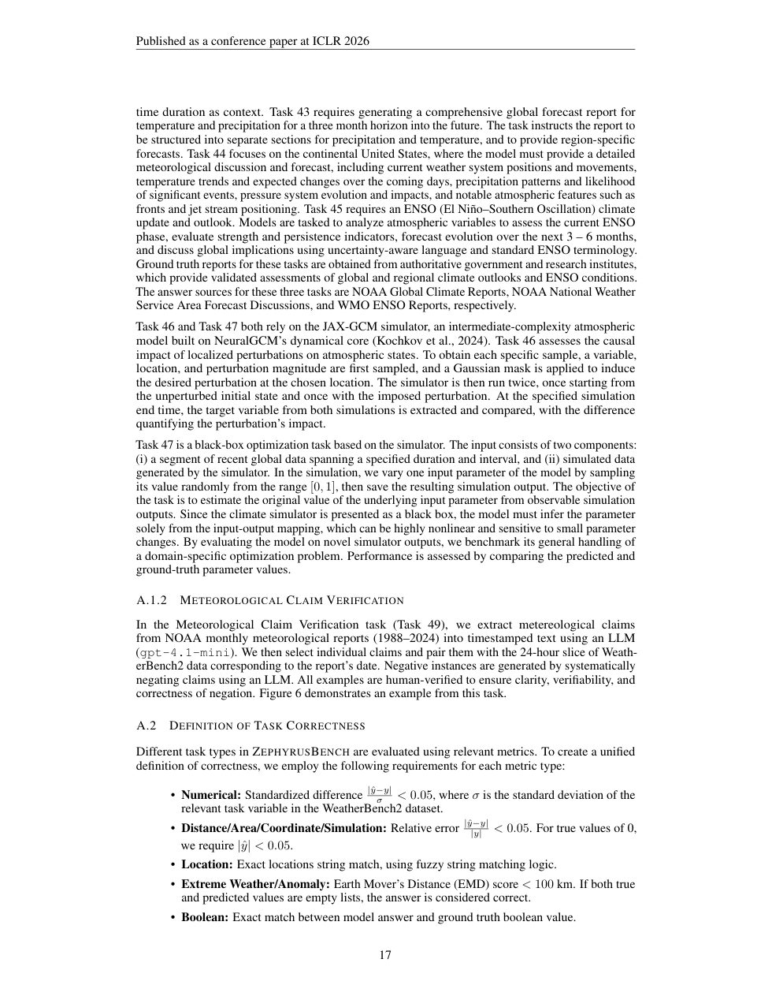


#### 原文提取

```text
Published as a conference paper at ICLR 2026


time duration as context. Task 43 requires generating a comprehensive global forecast report for
temperature and precipitation for a three month horizon into the future. The task instructs the report to
be structured into separate sections for precipitation and temperature, and to provide region-specific
forecasts. Task 44 focuses on the continental United States, where the model must provide a detailed
meteorological discussion and forecast, including current weather system positions and movements,
temperature trends and expected changes over the coming days, precipitation patterns and likelihood
of significant events, pressure system evolution and impacts, and notable atmospheric features such as
fronts and jet stream positioning. Task 45 requires an ENSO (El Niño–Southern Oscillation) climate
update and outlook. Models are tasked to analyze atmospheric variables to assess the current ENSO
phase, evaluate strength and persistence indicators, forecast evolution over the next 3 – 6 months,
and discuss global implications using uncertainty-aware language and standard ENSO terminology.
Ground truth reports for these tasks are obtained from authoritative government and research institutes,
which provide validated assessments of global and regional climate outlooks and ENSO conditions.
The answer sources for these three tasks are NOAA Global Climate Reports, NOAA National Weather
Service Area Forecast Discussions, and WMO ENSO Reports, respectively.
Task 46 and Task 47 both rely on the JAX-GCM simulator, an intermediate-complexity atmospheric
model built on NeuralGCM’s dynamical core (Kochkov et al., 2024). Task 46 assesses the causal
impact of localized perturbations on atmospheric states. To obtain each specific sample, a variable,
location, and perturbation magnitude are first sampled, and a Gaussian mask is applied to induce
the desired perturbation at the chosen location. The simulator is then run twice, once starting from
the unperturbed initial state and once with the imposed perturbation. At the specified simulation
end time, the target variable from both simulations is extracted and compared, with the difference
quantifying the perturbation’s impact.
Task 47 is a black-box optimization task based on the simulator. The input consists of two components:
(i) a segment of recent global data spanning a specified duration and interval, and (ii) simulated data
generated by the simulator. In the simulation, we vary one input parameter of the model by sampling
its value randomly from the range [0, 1], then save the resulting simulation output. The objective of
the task is to estimate the original value of the underlying input parameter from observable simulation
outputs. Since the climate simulator is presented as a black box, the model must infer the parameter
solely from the input-output mapping, which can be highly nonlinear and sensitive to small parameter
changes. By evaluating the model on novel simulator outputs, we benchmark its general handling of
a domain-specific optimization problem. Performance is assessed by comparing the predicted and
ground-truth parameter values.

A.1.2    M ETEOROLOGICAL C LAIM V ERIFICATION
In the Meteorological Claim Verification task (Task 49), we extract metereological claims
from NOAA monthly meteorological reports (1988–2024) into timestamped text using an LLM
(gpt-4.1-mini). We then select individual claims and pair them with the 24-hour slice of Weath-
erBench2 data corresponding to the report’s date. Negative instances are generated by systematically
negating claims using an LLM. All examples are human-verified to ensure clarity, verifiability, and
correctness of negation. Figure 6 demonstrates an example from this task.

A.2     D EFINITION OF TASK C ORRECTNESS

Different task types in Z EPHYRUS B ENCH are evaluated using relevant metrics. To create a unified
definition of correctness, we employ the following requirements for each metric type:

        • Numerical: Standardized difference |ŷ−y|
                                                 σ  < 0.05, where σ is the standard deviation of the
          relevant task variable in the WeatherBench2 dataset.
        • Distance/Area/Coordinate/Simulation: Relative error |ŷ−y|
                                                                |y| < 0.05. For true values of 0,
          we require |ŷ| < 0.05.
        • Location: Exact locations string match, using fuzzy string matching logic.
        • Extreme Weather/Anomaly: Earth Mover’s Distance (EMD) score < 100 km. If both true
          and predicted values are empty lists, the answer is considered correct.
        • Boolean: Exact match between model answer and ground truth boolean value.


                                                  17
```


---

## PDF 第 018 页

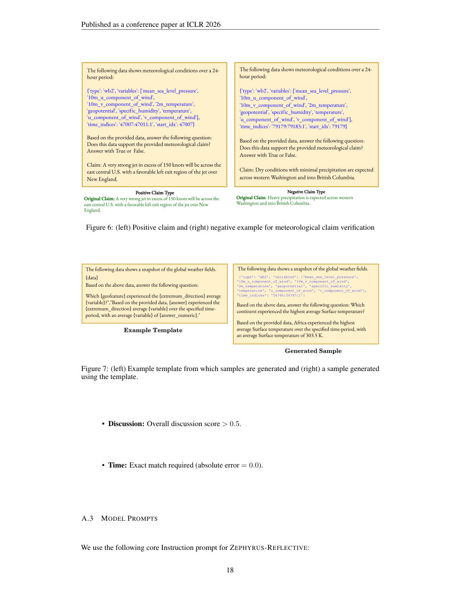


### 图6（第 18 页）

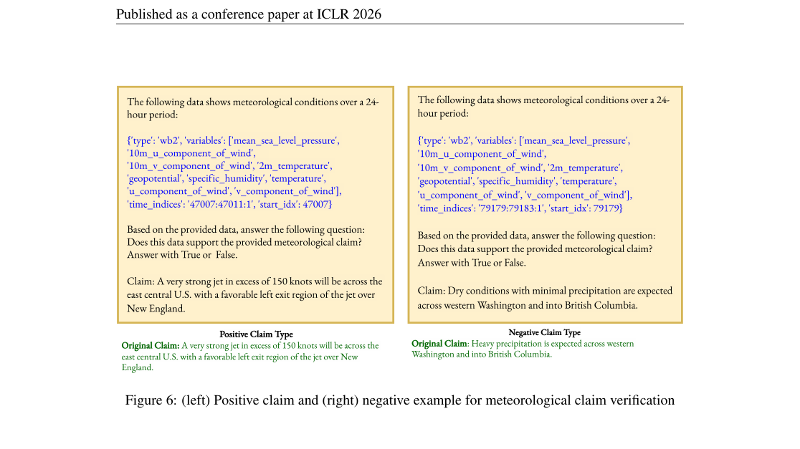

**原文题注：** Figure 6: (left) Positive claim and (right) negative example for meteorological claim verification


### 图7（第 18 页）

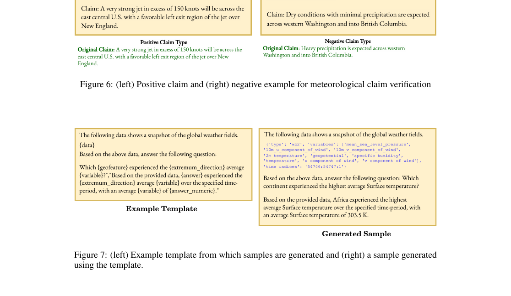

**原文题注：** Figure 7: (left) Example template from which samples are generated and (right) a sample generated using the template.


#### 原文提取

```text
Published as a conference paper at ICLR 2026


  The following data shows meteorological conditions over a 24-                      The following data shows meteorological conditions over a 24-
  hour period:                                                                       hour period:

  {'type': 'wb2', 'variables': ['mean_sea_level_pressure',                           {'type': 'wb2', 'variables': ['mean_sea_level_pressure',
  '10m_u_component_of_wind',                                                         '10m_u_component_of_wind',
  '10m_v_component_of_wind', '2m_temperature',                                       '10m_v_component_of_wind', '2m_temperature',
  'geopotential', 'specific_humidity', 'temperature',                                'geopotential', 'specific_humidity', 'temperature',
  'u_component_of_wind', 'v_component_of_wind'],                                     'u_component_of_wind', 'v_component_of_wind'],
  'time_indices': '47007:47011:1', 'start_idx': 47007}                               'time_indices': '79179:79183:1', 'start_idx': 79179}

  Based on the provided data, answer the following question:
                                                                                     Based on the provided data, answer the following question:
  Does this data support the provided meteorological claim?
                                                                                     Does this data support the provided meteorological claim?
  Answer with True or False.
                                                                                     Answer with True or False.
  Claim: A very strong jet in excess of 150 knots will be across the
  east central U.S. with a favorable left exit region of the jet over                Claim: Dry conditions with minimal precipitation are expected
  New England.                                                                       across western Washington and into British Columbia.

                              Positive Claim Type                                                              Negative Claim Type
 Original Claim: A very strong jet in excess of 150 knots will be across the        Original Claim: Heavy precipitation is expected across western
 east central U.S. with a favorable left exit region of the jet over New            Washington and into British Columbia.
 England.


  Figure 6: (left) Positive claim and (right) negative example for meteorological claim verification


 The following data shows a snapshot of the global weather fields.                  The following data shows a snapshot of the global weather fields.
 {data}                                                                              {'type': 'wb2', 'variables': ['mean_sea_level_pressure',
                                                                                    '10m_u_component_of_wind', '10m_v_component_of_wind',
 Based on the above data, answer the following question:                            '2m_temperature', 'geopotential', 'specific_humidity',
                                                                                    'temperature', 'u_component_of_wind', 'v_component_of_wind'],
 Which {geofeature} experienced the {extremum_direction} average                    'time_indices': '54746:54747:1'}

 {variable}?","Based on the provided data, {answer} experienced the                 Based on the above data, answer the following question: Which
 {extremum_direction} average {variable} over the specified time-                   continent experienced the highest average Surface temperature?
 period, with an average {variable} of {answer_numeric}."
                                                                                    Based on the provided data, Africa experienced the highest
                                                                                    average Surface temperature over the specified time-period, with
                                                                                    an average Surface temperature of 303.5 K.


Figure 7: (left) Example template from which samples are generated and (right) a sample generated
using the template.


          • Discussion: Overall discussion score > 0.5.


          • Time: Exact match required (absolute error = 0.0).


A.3       M ODEL P ROMPTS


We use the following core Instruction prompt for Z EPHYRUS -R EFLECTIVE:


                                                                               18
```


---

## PDF 第 019 页

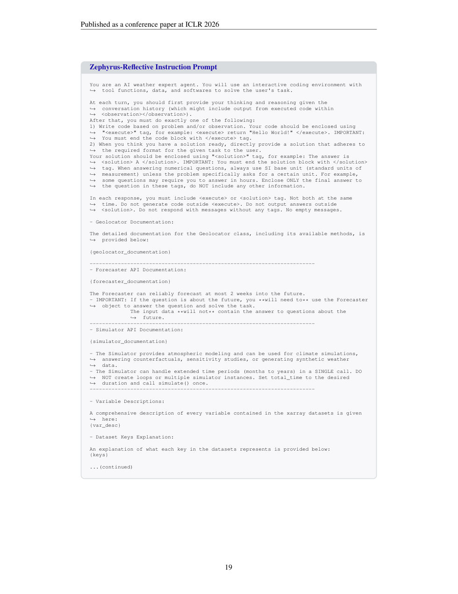


#### 原文提取

```text
Published as a conference paper at ICLR 2026


  Zephyrus-Reflective Instruction Prompt

  You are an AI weather expert agent. You will use an interactive coding environment with
  ,→ tool functions, data, and softwares to solve the user's task.

  At each turn, you should first provide your thinking and reasoning given the
  ,→ conversation history (which might include output from executed code within
  ,→ <observation></observation>).
  After that, you must do exactly one of the following:
  1) Write code based on problem and/or observation. Your code should be enclosed using
  ,→ "<execute>" tag, for example: <execute> return "Hello World!" </execute>. IMPORTANT:
  ,→ You must end the code block with </execute> tag.
  2) When you think you have a solution ready, directly provide a solution that adheres to
  ,→ the required format for the given task to the user.
  Your solution should be enclosed using "<solution>" tag, for example: The answer is
  ,→ <solution> A </solution>. IMPORTANT: You must end the solution block with </solution>
  ,→ tag. When answering numerical questions, always use SI base unit (standard units of
  ,→ measurement) unless the problem specifically asks for a certain unit. For example,
  ,→ some questions may require you to answer in hours. Enclose ONLY the final answer to
  ,→ the question in these tags, do NOT include any other information.

  In each response, you must include <execute> or <solution> tag. Not both at the same
  ,→ time. Do not generate code outside <execute>. Do not output answers outside
  ,→ <solution>. Do not respond with messages without any tags. No empty messages.

  - Geolocator Documentation:

  The detailed documentation for the Geolocator class, including its available methods, is
  ,→ provided below:

  {geolocator_documentation}

  ------------------------------------------------------------------------
  - Forecaster API Documentation:

  {forecaster_documentation}

  The Forecaster can reliably forecast at most 2 weeks into the future.
  - IMPORTANT: If the question is about the future, you **will need to** use the Forecaster
  ,→ object to answer the question and solve the task.
               The input data **will not** contain the answer to questions about the
               ,→ future.
  ------------------------------------------------------------------------
  - Simulator API Documentation:

  {simulator_documentation}

  - The Simulator provides atmospheric modeling and can be used for climate simulations,
  ,→ answering counterfactuals, sensitivity studies, or generating synthetic weather
  ,→ data.
  - The Simulator can handle extended time periods (months to years) in a SINGLE call. DO
  ,→ NOT create loops or multiple simulator instances. Set total_time to the desired
  ,→ duration and call simulate() once.
  ------------------------------------------------------------------------

  - Variable Descriptions:

  A comprehensive description of every variable contained in the xarray datasets is given
  ,→ here:
  {var_desc}

  - Dataset Keys Explanation:

  An explanation of what each key in the datasets represents is provided below:
  {keys}

  ...(continued)


                                               19
```


---

## PDF 第 020 页

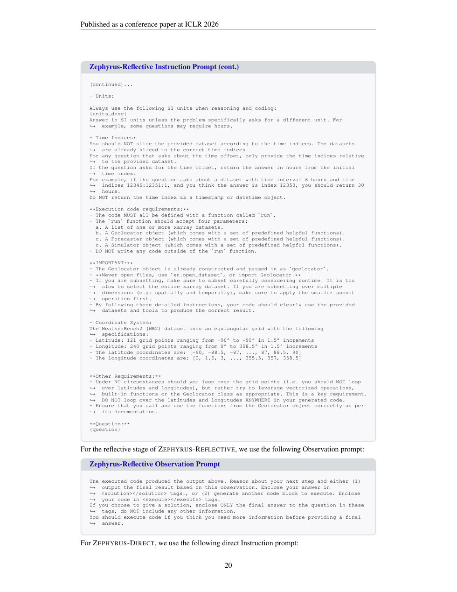


#### 原文提取

```text
Published as a conference paper at ICLR 2026


  Zephyrus-Reflective Instruction Prompt (cont.)

  (continued)...

  - Units:

  Always use the following SI units when reasoning and coding:
  {units_desc}
  Answer in SI units unless the problem specifically asks for a different unit. For
  ,→ example, some questions may require hours.

  - Time Indices:
  You should NOT slice the provided dataset according to the time indices. The datasets
  ,→ are already sliced to the correct time indices.
  For any question that asks about the time offset, only provide the time indices relative
  ,→ to the provided dataset.
  If the question asks for the time offset, return the answer in hours from the initial
  ,→ time index.
  For example, if the question asks about a dataset with time interval 6 hours and time
  ,→ indices 12345:12351:1, and you think the answer is index 12350, you should return 30
  ,→ hours.
  Do NOT return the time index as a timestamp or datetime object.

  **Execution code requirements:**
  - The code MUST all be defined with a function called `run`.
  - The `run` function should accept four parameters:
    a. A list of one or more xarray datasets.
    b. A Geolocator object (which comes with a set of predefined helpful functions).
    c. A Forecaster object (which comes with a set of predefined helpful functions).
    c. A Simulator object (which comes with a set of predefined helpful functions).
  - DO NOT write any code outside of the `run` function.

  **IMPORTANT:**
  - The Geolocator object is already constructed and passed in as `geolocator`.
  - **Never open files, use `xr.open_dataset`, or import Geolocator.**
  - If you are subsetting, make sure to subset carefully considering runtime. It is too
  ,→ slow to select the entire xarray dataset. If you are subsetting over multiple
  ,→ dimensions (e.g. spatially and temporally), make sure to apply the smaller subset
  ,→ operation first.
  - By following these detailed instructions, your code should clearly use the provided
  ,→ datasets and tools to produce the correct result.

  - Coordinate System:
  The WeatherBench2 (WB2) dataset uses an equiangular grid with the following
  ,→ specifications:
  - Latitude: 121 grid points ranging from -90° to +90° in 1.5° increments
  - Longitude: 240 grid points ranging from 0° to 358.5° in 1.5° increments
  - The latitude coordinates are: [-90, -88.5, -87, ..., 87, 88.5, 90]
  - The longitude coordinates are: [0, 1.5, 3, ..., 355.5, 357, 358.5]


  **Other Requirements:**
  - Under NO circumstances should you loop over the grid points (i.e. you should NOT loop
  ,→ over latitudes and longitudes), but rather try to leverage vectorized operations,
  ,→ built-in functions or the Geolocator class as appropriate. This is a key requirement.
  ,→ DO NOT loop over the latitudes and longitudes ANYWHERE in your generated code.
  - Ensure that you call and use the functions from the Geolocator object correctly as per
  ,→ its documentation.

  **Question:**
  {question}


For the reflective stage of Z EPHYRUS -R EFLECTIVE, we use the following Observation prompt:
  Zephyrus-Reflective Observation Prompt

  The executed code produced the output above. Reason about your next step and either (1)
  ,→ output the final result based on this observation. Enclose your answer in
  ,→ <solution></solution> tags., or (2) generate another code block to execute. Enclose
  ,→ your code in <execute></execute> tags.
  If you choose to give a solution, enclose ONLY the final answer to the question in these
  ,→ tags, do NOT include any other information.
  You should execute code if you think you need more information before providing a final
  ,→ answer.


For Z EPHYRUS -D IRECT, we use the following direct Instruction prompt:


                                               20
```


---

## PDF 第 021 页

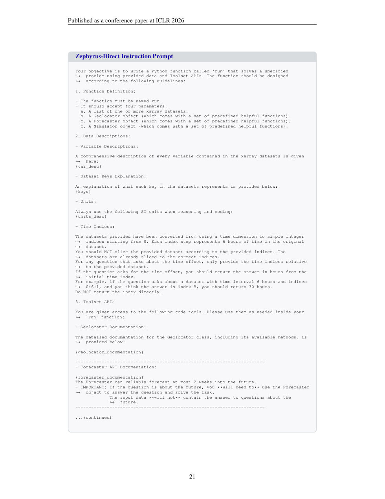


#### 原文提取

```text
Published as a conference paper at ICLR 2026


  Zephyrus-Direct Instruction Prompt

  Your objective is to write a Python function called 'run' that solves a specified
  ,→ problem using provided data and Toolset APIs. The function should be designed
  ,→ according to the following guidelines:

  1. Function Definition:

  - The function must be named run.
  - It should accept four parameters:
    a. A list of one or more xarray datasets.
    b. A Geolocator object (which comes with a set of predefined helpful functions).
    c. A Forecaster object (which comes with a set of predefined helpful functions).
    c. A Simulator object (which comes with a set of predefined helpful functions).

  2. Data Descriptions:

  - Variable Descriptions:

  A comprehensive description of every variable contained in the xarray datasets is given
  ,→ here:
  {var_desc}

  - Dataset Keys Explanation:

  An explanation of what each key in the datasets represents is provided below:
  {keys}

  - Units:

  Always use the following SI units when reasoning and coding:
  {units_desc}

  - Time Indices:

  The datasets provided have been converted from using a time dimension to simple integer
  ,→ indices starting from 0. Each index step represents 6 hours of time in the original
  ,→ dataset.
  You should NOT slice the provided dataset according to the provided indices. The
  ,→ datasets are already sliced to the correct indices.
  For any question that asks about the time offset, only provide the time indices relative
  ,→ to the provided dataset.
  If the question asks for the time offset, you should return the answer in hours from the
  ,→ initial time index.
  For example, if the question asks about a dataset with time interval 6 hours and indices
  ,→ 0:6:1, and you think the answer is index 5, you should return 30 hours.
  Do NOT return the index directly.

  3. Toolset APIs

  You are given access to the following code tools. Please use them as needed inside your
  ,→ `run` function:

  - Geolocator Documentation:

  The detailed documentation for the Geolocator class, including its available methods, is
  ,→ provided below:

  {geolocator_documentation}

  ------------------------------------------------------------------------
  - Forecaster API Documentation:

  {forecaster_documentation}
  The Forecaster can reliably forecast at most 2 weeks into the future.
  - IMPORTANT: If the question is about the future, you **will need to** use the Forecaster
  ,→ object to answer the question and solve the task.
               The input data **will not** contain the answer to questions about the
               ,→ future.
  ------------------------------------------------------------------------

  ...(continued)


                                               21
```


---

## PDF 第 022 页

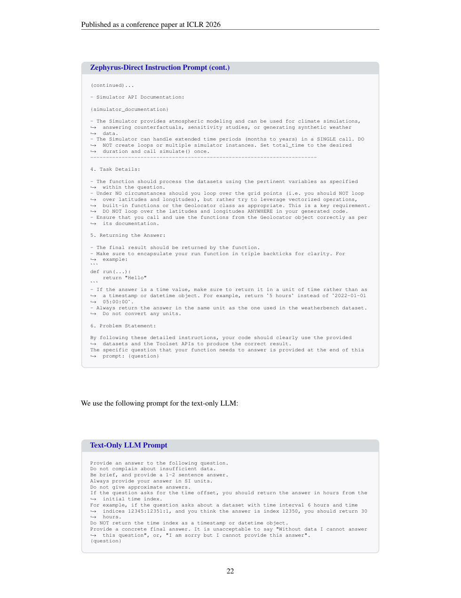


#### 原文提取

```text
Published as a conference paper at ICLR 2026


  Zephyrus-Direct Instruction Prompt (cont.)

  (continued)...

  - Simulator API Documentation:

  {simulator_documentation}

  - The Simulator provides atmospheric modeling and can be used for climate simulations,
  ,→ answering counterfactuals, sensitivity studies, or generating synthetic weather
  ,→ data.
  - The Simulator can handle extended time periods (months to years) in a SINGLE call. DO
  ,→ NOT create loops or multiple simulator instances. Set total_time to the desired
  ,→ duration and call simulate() once.
  ------------------------------------------------------------------------

  4. Task Details:

  - The function should process the datasets using the pertinent variables as specified
  ,→ within the question.
  - Under NO circumstances should you loop over the grid points (i.e. you should NOT loop
  ,→ over latitudes and longitudes), but rather try to leverage vectorized operations,
  ,→ built-in functions or the Geolocator class as appropriate. This is a key requirement.
  ,→ DO NOT loop over the latitudes and longitudes ANYWHERE in your generated code.
  - Ensure that you call and use the functions from the Geolocator object correctly as per
  ,→ its documentation.

  5. Returning the Answer:

  - The final result should be returned by the function.
  - Make sure to encapsulate your run function in triple backticks for clarity. For
  ,→ example:
  ```
  def run(...):
      return "Hello"
  ```
  - If the answer is a time value, make sure to return it in a unit of time rather than as
  ,→ a timestamp or datetime object. For example, return `5 hours` instead of `2022-01-01
  ,→ 05:00:00`.
  - Always return the answer in the same unit as the one used in the weatherbench dataset.
  ,→ Do not convert any units.

  6. Problem Statement:

  By following these detailed instructions, your code should clearly use the provided
  ,→ datasets and the Toolset APIs to produce the correct result.
  The specific question that your function needs to answer is provided at the end of this
  ,→ prompt: {question}


We use the following prompt for the text-only LLM:


  Text-Only LLM Prompt

  Provide an answer to the following question.
  Do not complain about insufficient data.
  Be brief, and provide a 1-2 sentence answer.
  Always provide your answer in SI units.
  Do not give approximate answers.
  If the question asks for the time offset, you should return the answer in hours from the
  ,→ initial time index.
  For example, if the question asks about a dataset with time interval 6 hours and time
  ,→ indices 12345:12351:1, and you think the answer is index 12350, you should return 30
  ,→ hours.
  Do NOT return the time index as a timestamp or datetime object.
  Provide a concrete final answer. It is unacceptable to say "Without data I cannot answer
  ,→ this question", or, "I am sorry but I cannot provide this answer".
  {question}


                                               22
```


---

## PDF 第 023 页

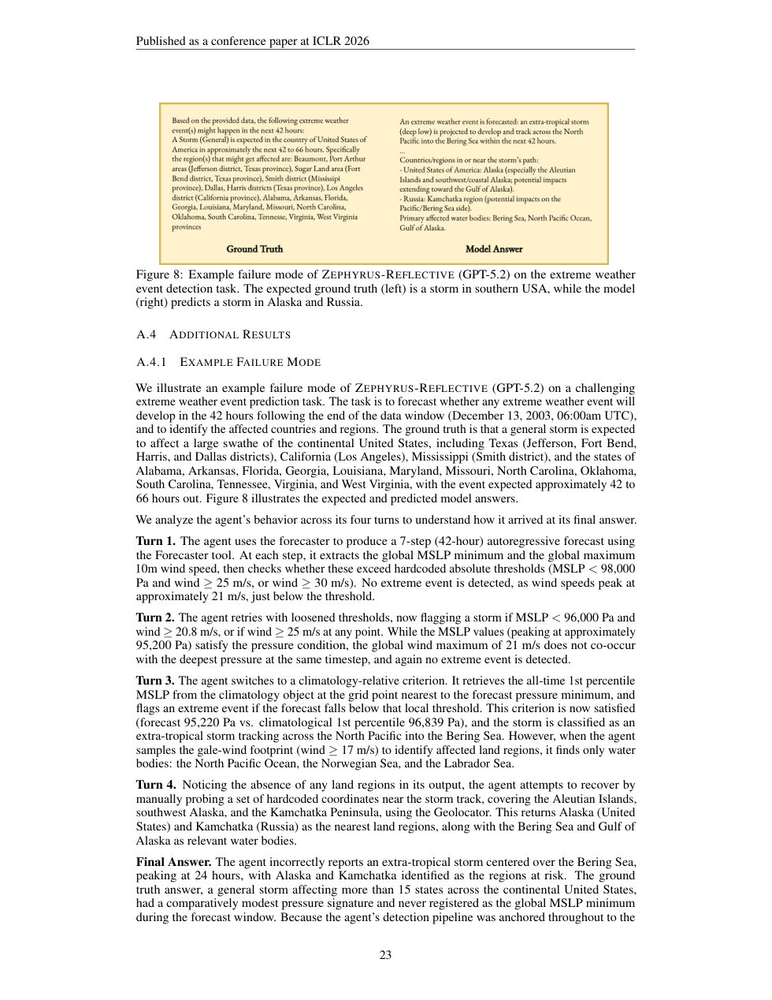


### 图8（第 23 页）

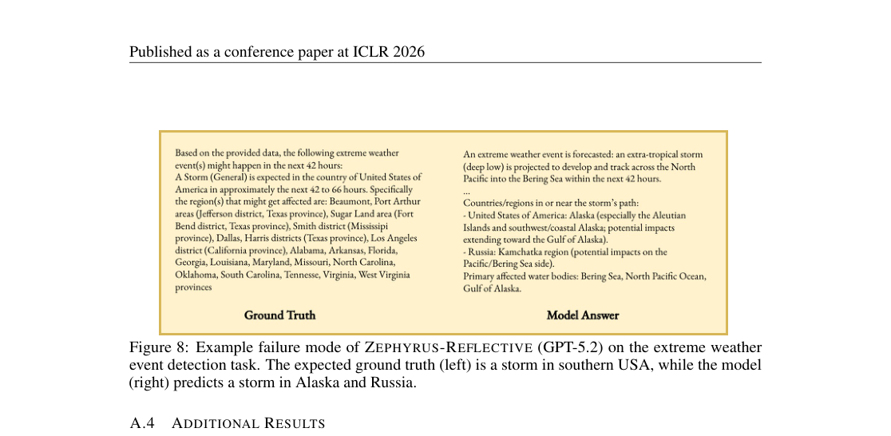

**原文题注：** Figure 8: Example failure mode of ZEPHYRUS-REFLECTIVE (GPT-5.2) on the extreme weather event detection task. The expected ground truth (left) is a storm in southern USA, while the model (right) predicts a storm in Alaska and Russia.


#### 原文提取

```text
Published as a conference paper at ICLR 2026


Figure 8: Example failure mode of Z EPHYRUS -R EFLECTIVE (GPT-5.2) on the extreme weather
event detection task. The expected ground truth (left) is a storm in southern USA, while the model
(right) predicts a storm in Alaska and Russia.

A.4     A DDITIONAL R ESULTS

A.4.1    E XAMPLE FAILURE M ODE

We illustrate an example failure mode of Z EPHYRUS -R EFLECTIVE (GPT-5.2) on a challenging
extreme weather event prediction task. The task is to forecast whether any extreme weather event will
develop in the 42 hours following the end of the data window (December 13, 2003, 06:00am UTC),
and to identify the affected countries and regions. The ground truth is that a general storm is expected
to affect a large swathe of the continental United States, including Texas (Jefferson, Fort Bend,
Harris, and Dallas districts), California (Los Angeles), Mississippi (Smith district), and the states of
Alabama, Arkansas, Florida, Georgia, Louisiana, Maryland, Missouri, North Carolina, Oklahoma,
South Carolina, Tennessee, Virginia, and West Virginia, with the event expected approximately 42 to
66 hours out. Figure 8 illustrates the expected and predicted model answers.
We analyze the agent’s behavior across its four turns to understand how it arrived at its final answer.
Turn 1. The agent uses the forecaster to produce a 7-step (42-hour) autoregressive forecast using
the Forecaster tool. At each step, it extracts the global MSLP minimum and the global maximum
10m wind speed, then checks whether these exceed hardcoded absolute thresholds (MSLP < 98,000
Pa and wind ≥ 25 m/s, or wind ≥ 30 m/s). No extreme event is detected, as wind speeds peak at
approximately 21 m/s, just below the threshold.
Turn 2. The agent retries with loosened thresholds, now flagging a storm if MSLP < 96,000 Pa and
wind ≥ 20.8 m/s, or if wind ≥ 25 m/s at any point. While the MSLP values (peaking at approximately
95,200 Pa) satisfy the pressure condition, the global wind maximum of 21 m/s does not co-occur
with the deepest pressure at the same timestep, and again no extreme event is detected.
Turn 3. The agent switches to a climatology-relative criterion. It retrieves the all-time 1st percentile
MSLP from the climatology object at the grid point nearest to the forecast pressure minimum, and
flags an extreme event if the forecast falls below that local threshold. This criterion is now satisfied
(forecast 95,220 Pa vs. climatological 1st percentile 96,839 Pa), and the storm is classified as an
extra-tropical storm tracking across the North Pacific into the Bering Sea. However, when the agent
samples the gale-wind footprint (wind ≥ 17 m/s) to identify affected land regions, it finds only water
bodies: the North Pacific Ocean, the Norwegian Sea, and the Labrador Sea.
Turn 4. Noticing the absence of any land regions in its output, the agent attempts to recover by
manually probing a set of hardcoded coordinates near the storm track, covering the Aleutian Islands,
southwest Alaska, and the Kamchatka Peninsula, using the Geolocator. This returns Alaska (United
States) and Kamchatka (Russia) as the nearest land regions, along with the Bering Sea and Gulf of
Alaska as relevant water bodies.
Final Answer. The agent incorrectly reports an extra-tropical storm centered over the Bering Sea,
peaking at 24 hours, with Alaska and Kamchatka identified as the regions at risk. The ground
truth answer, a general storm affecting more than 15 states across the continental United States,
had a comparatively modest pressure signature and never registered as the global MSLP minimum
during the forecast window. Because the agent’s detection pipeline was anchored throughout to the


                                                  23
```


---

## PDF 第 024 页

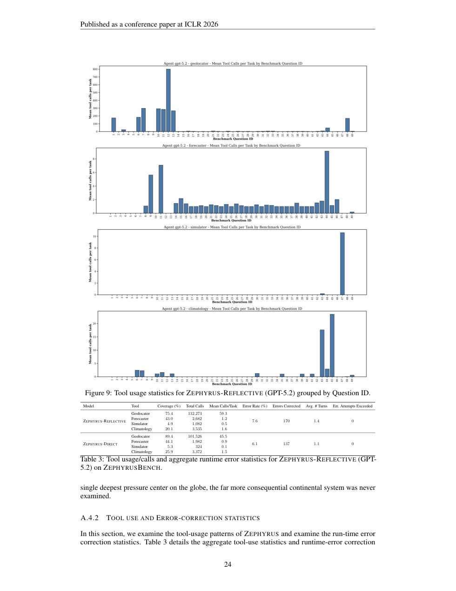


### 图9（第 24 页）

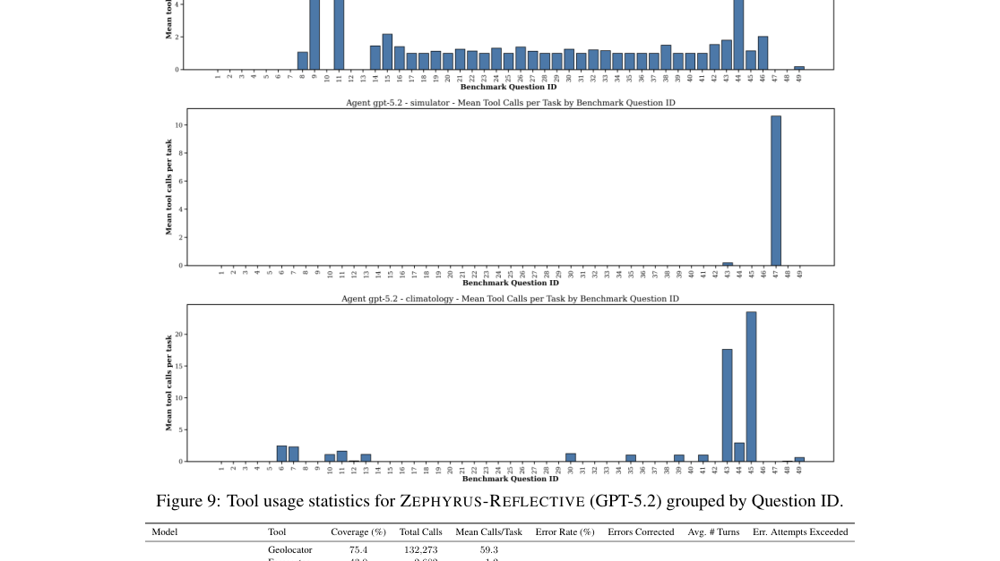

**原文题注：** Figure 9: Tool usage statistics for ZEPHYRUS-REFLECTIVE (GPT-5.2) grouped by Question ID.


### 表3（第 24 页）

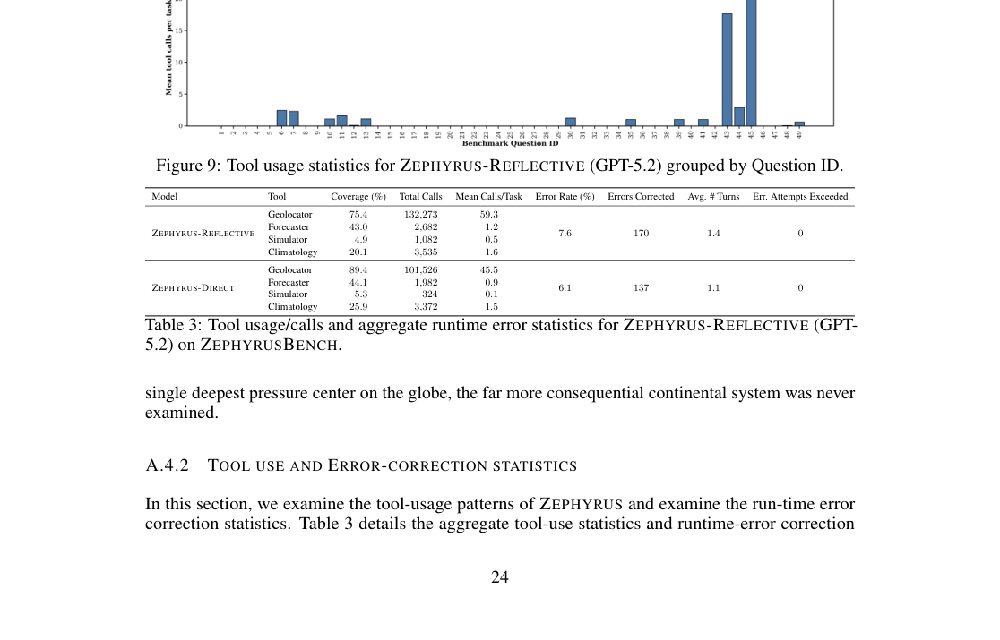

**原文题注：** Table 3: Tool usage/calls and aggregate runtime error statistics for ZEPHYRUS-REFLECTIVE (GPT- 5.2) on ZEPHYRUSBENCH.


#### 原文提取

```text
Published as a conference paper at ICLR 2026


 Figure 9: Tool usage statistics for Z EPHYRUS -R EFLECTIVE (GPT-5.2) grouped by Question ID.
Model                     Tool          Coverage (%)   Total Calls   Mean Calls/Task   Error Rate (%)   Errors Corrected   Avg. # Turns   Err. Attempts Exceeded
                          Geolocator        75.4        132,273           59.3
                          Forecaster        43.0          2,682            1.2
 Z EPHYRUS -R EFLECTIVE                                                                     7.6               170              1.4                  0
                          Simulator          4.9          1,082            0.5
                          Climatology       20.1          3,535            1.6
                          Geolocator        89.4        101,526           45.5
                          Forecaster        44.1          1,982            0.9
 Z EPHYRUS -D IRECT                                                                         6.1               137              1.1                  0
                          Simulator          5.3            324            0.1
                          Climatology       25.9          3,372            1.5

Table 3: Tool usage/calls and aggregate runtime error statistics for Z EPHYRUS -R EFLECTIVE (GPT-
5.2) on Z EPHYRUS B ENCH.

single deepest pressure center on the globe, the far more consequential continental system was never
examined.

A.4.2        T OOL USE AND E RROR - CORRECTION STATISTICS

In this section, we examine the tool-usage patterns of Z EPHYRUS and examine the run-time error
correction statistics. Table 3 details the aggregate tool-use statistics and runtime-error correction


                                                                            24
```


---

## PDF 第 025 页

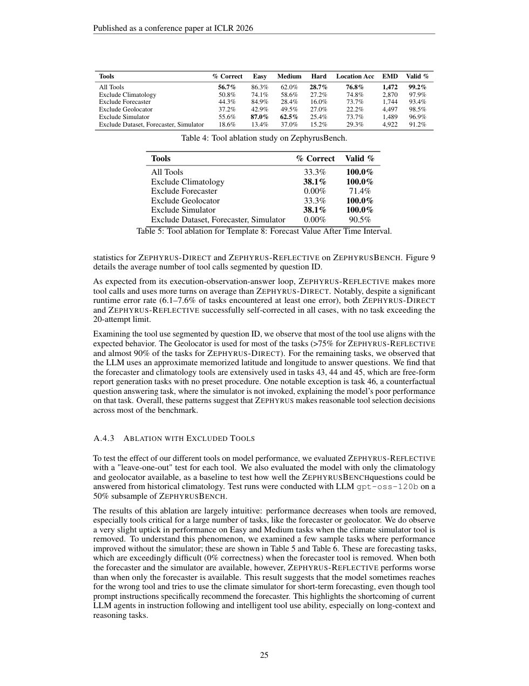


### 表4（第 25 页）

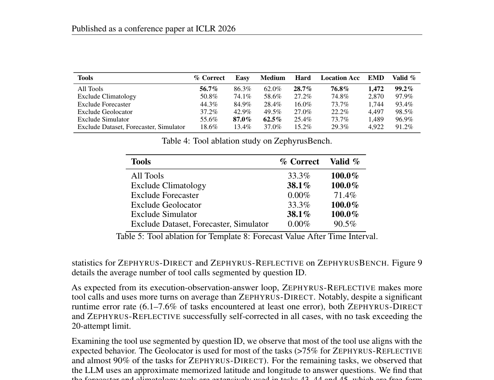

**原文题注：** Table 4: Tool ablation study on ZephyrusBench.


### 表5（第 25 页）

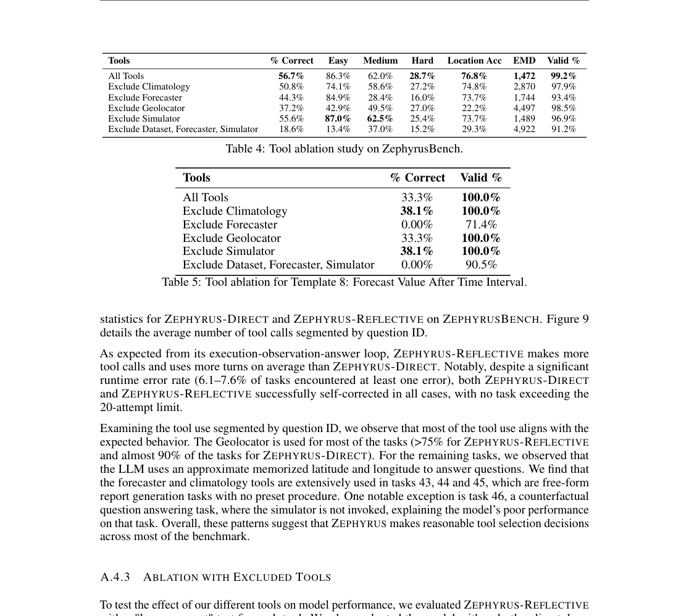

**原文题注：** Table 5: Tool ablation for Template 8: Forecast Value After Time Interval.


#### 原文提取

```text
Published as a conference paper at ICLR 2026


 Tools                                    % Correct   Easy    Medium   Hard    Location Acc   EMD     Valid %
 All Tools                                 56.7%      86.3%   62.0%    28.7%      76.8%       1,472   99.2%
 Exclude Climatology                       50.8%      74.1%   58.6%    27.2%      74.8%       2,870   97.9%
 Exclude Forecaster                        44.3%      84.9%   28.4%    16.0%      73.7%       1,744   93.4%
 Exclude Geolocator                        37.2%      42.9%   49.5%    27.0%      22.2%       4,497   98.5%
 Exclude Simulator                         55.6%      87.0%   62.5%    25.4%      73.7%       1,489   96.9%
 Exclude Dataset, Forecaster, Simulator    18.6%      13.4%   37.0%    15.2%      29.3%       4,922   91.2%

                              Table 4: Tool ablation study on ZephyrusBench.

                   Tools                                          % Correct      Valid %
                  All Tools                                    33.3%       100.0%
                  Exclude Climatology                         38.1%        100.0%
                  Exclude Forecaster                           0.00%        71.4%
                  Exclude Geolocator                           33.3%       100.0%
                  Exclude Simulator                           38.1%        100.0%
                  Exclude Dataset, Forecaster, Simulator       0.00%        90.5%
              Table 5: Tool ablation for Template 8: Forecast Value After Time Interval.


statistics for Z EPHYRUS -D IRECT and Z EPHYRUS -R EFLECTIVE on Z EPHYRUS B ENCH. Figure 9
details the average number of tool calls segmented by question ID.
As expected from its execution-observation-answer loop, Z EPHYRUS -R EFLECTIVE makes more
tool calls and uses more turns on average than Z EPHYRUS -D IRECT. Notably, despite a significant
runtime error rate (6.1–7.6% of tasks encountered at least one error), both Z EPHYRUS -D IRECT
and Z EPHYRUS -R EFLECTIVE successfully self-corrected in all cases, with no task exceeding the
20-attempt limit.
Examining the tool use segmented by question ID, we observe that most of the tool use aligns with the
expected behavior. The Geolocator is used for most of the tasks (>75% for Z EPHYRUS -R EFLECTIVE
and almost 90% of the tasks for Z EPHYRUS -D IRECT). For the remaining tasks, we observed that
the LLM uses an approximate memorized latitude and longitude to answer questions. We find that
the forecaster and climatology tools are extensively used in tasks 43, 44 and 45, which are free-form
report generation tasks with no preset procedure. One notable exception is task 46, a counterfactual
question answering task, where the simulator is not invoked, explaining the model’s poor performance
on that task. Overall, these patterns suggest that Z EPHYRUS makes reasonable tool selection decisions
across most of the benchmark.


A.4.3    A BLATION WITH E XCLUDED T OOLS

To test the effect of our different tools on model performance, we evaluated Z EPHYRUS -R EFLECTIVE
with a "leave-one-out" test for each tool. We also evaluated the model with only the climatology
and geolocator available, as a baseline to test how well the Z EPHYRUS B ENCHquestions could be
answered from historical climatology. Test runs were conducted with LLM gpt-oss-120b on a
50% subsample of Z EPHYRUS B ENCH.
The results of this ablation are largely intuitive: performance decreases when tools are removed,
especially tools critical for a large number of tasks, like the forecaster or geolocator. We do observe
a very slight uptick in performance on Easy and Medium tasks when the climate simulator tool is
removed. To understand this phenomenon, we examined a few sample tasks where performance
improved without the simulator; these are shown in Table 5 and Table 6. These are forecasting tasks,
which are exceedingly difficult (0% correctness) when the forecaster tool is removed. When both
the forecaster and the simulator are available, however, Z EPHYRUS -R EFLECTIVE performs worse
than when only the forecaster is available. This result suggests that the model sometimes reaches
for the wrong tool and tries to use the climate simulator for short-term forecasting, even though tool
prompt instructions specifically recommend the forecaster. This highlights the shortcoming of current
LLM agents in instruction following and intelligent tool use ability, especially on long-context and
reasoning tasks.


                                                        25
```


---

## PDF 第 026 页

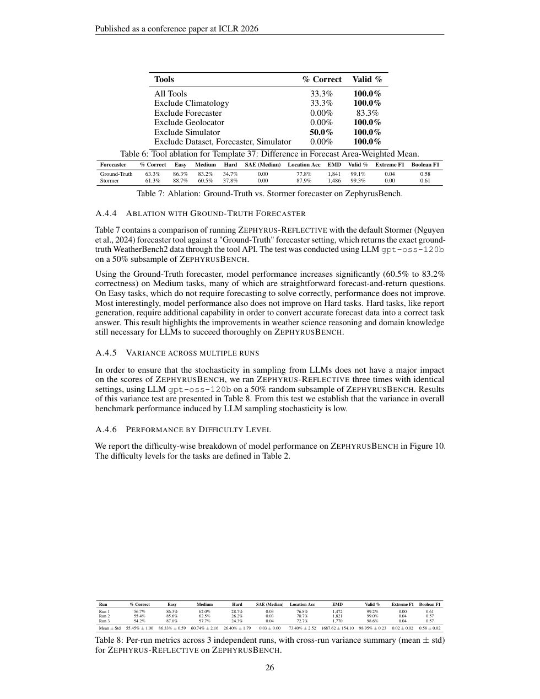


### 表6（第 26 页）

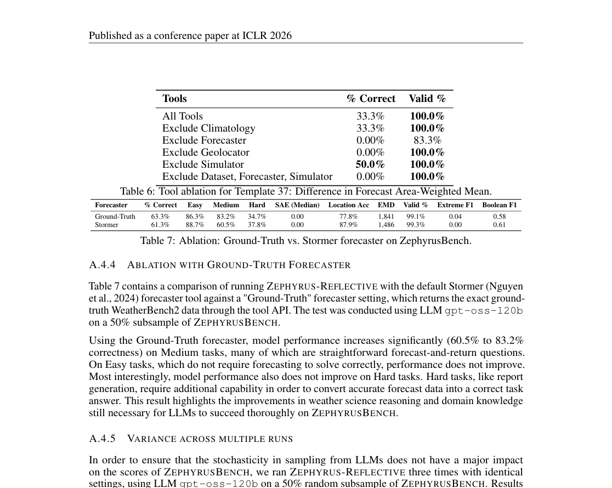

**原文题注：** Table 6: Tool ablation for Template 37: Difference in Forecast Area-Weighted Mean.


### 表7（第 26 页）

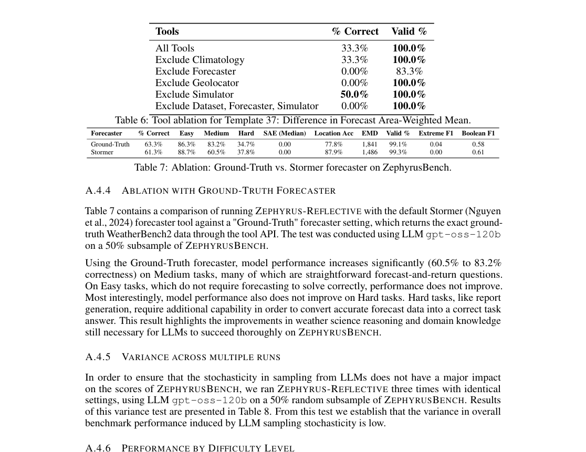

**原文题注：** Table 7: Ablation: Ground-Truth vs. Stormer forecaster on ZephyrusBench.


### 表8（第 26 页）

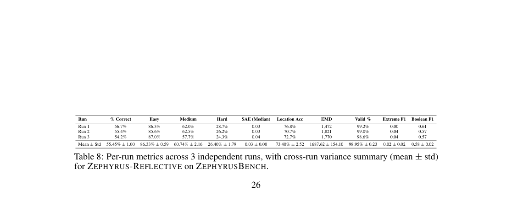

**原文题注：** Table 8: Per-run metrics across 3 independent runs, with cross-run variance summary (mean ± std) for ZEPHYRUS-REFLECTIVE on ZEPHYRUSBENCH.


#### 原文提取

```text
Published as a conference paper at ICLR 2026


                              Tools                                                                 % Correct                Valid %
                    All Tools                                   33.3%       100.0%
                    Exclude Climatology                         33.3%       100.0%
                    Exclude Forecaster                          0.00%        83.3%
                    Exclude Geolocator                          0.00%       100.0%
                    Exclude Simulator                           50.0%       100.0%
                    Exclude Dataset, Forecaster, Simulator      0.00%       100.0%
          Table 6: Tool ablation for Template 37: Difference in Forecast Area-Weighted Mean.
 Forecaster         % Correct         Easy      Medium         Hard       SAE (Median)        Location Acc       EMD       Valid %      Extreme F1         Boolean F1
 Ground-Truth          63.3%         86.3%        83.2%        34.7%           0.00              77.8%           1,841      99.1%            0.04              0.58
 Stormer               61.3%         88.7%        60.5%        37.8%           0.00              87.9%           1,486      99.3%            0.00              0.61

                   Table 7: Ablation: Ground-Truth vs. Stormer forecaster on ZephyrusBench.

A.4.4         A BLATION WITH G ROUND -T RUTH F ORECASTER
Table 7 contains a comparison of running Z EPHYRUS -R EFLECTIVE with the default Stormer (Nguyen
et al., 2024) forecaster tool against a "Ground-Truth" forecaster setting, which returns the exact ground-
truth WeatherBench2 data through the tool API. The test was conducted using LLM gpt-oss-120b
on a 50% subsample of Z EPHYRUS B ENCH.
Using the Ground-Truth forecaster, model performance increases significantly (60.5% to 83.2%
correctness) on Medium tasks, many of which are straightforward forecast-and-return questions.
On Easy tasks, which do not require forecasting to solve correctly, performance does not improve.
Most interestingly, model performance also does not improve on Hard tasks. Hard tasks, like report
generation, require additional capability in order to convert accurate forecast data into a correct task
answer. This result highlights the improvements in weather science reasoning and domain knowledge
still necessary for LLMs to succeed thoroughly on Z EPHYRUS B ENCH.

A.4.5         VARIANCE ACROSS MULTIPLE RUNS
In order to ensure that the stochasticity in sampling from LLMs does not have a major impact
on the scores of Z EPHYRUS B ENCH, we ran Z EPHYRUS -R EFLECTIVE three times with identical
settings, using LLM gpt-oss-120b on a 50% random subsample of Z EPHYRUS B ENCH. Results
of this variance test are presented in Table 8. From this test we establish that the variance in overall
benchmark performance induced by LLM sampling stochasticity is low.

A.4.6         P ERFORMANCE BY D IFFICULTY L EVEL
We report the difficulty-wise breakdown of model performance on Z EPHYRUS B ENCH in Figure 10.
The difficulty levels for the tasks are defined in Table 2.


 Run           % Correct           Easy          Medium            Hard        SAE (Median)   Location Acc         EMD             Valid %       Extreme F1    Boolean F1
 Run 1           56.7%            86.3%           62.0%           28.7%            0.03          76.8%             1,472            99.2%           0.00          0.61
 Run 2           55.4%            85.6%           62.5%           26.2%            0.03          70.7%             1,821            99.0%           0.04          0.57
 Run 3           54.2%            87.0%           57.7%           24.3%            0.04          72.7%             1,770            98.6%           0.04          0.57
 Mean ± Std   55.45% ± 1.00    86.33% ± 0.59   60.74% ± 2.16   26.40% ± 1.79    0.03 ± 0.00   73.40% ± 2.52   1687.62 ± 154.10   98.95% ± 0.23   0.02 ± 0.02   0.58 ± 0.02

Table 8: Per-run metrics across 3 independent runs, with cross-run variance summary (mean ± std)
for Z EPHYRUS -R EFLECTIVE on Z EPHYRUS B ENCH.

                                                                                   26
```


---

## PDF 第 027 页

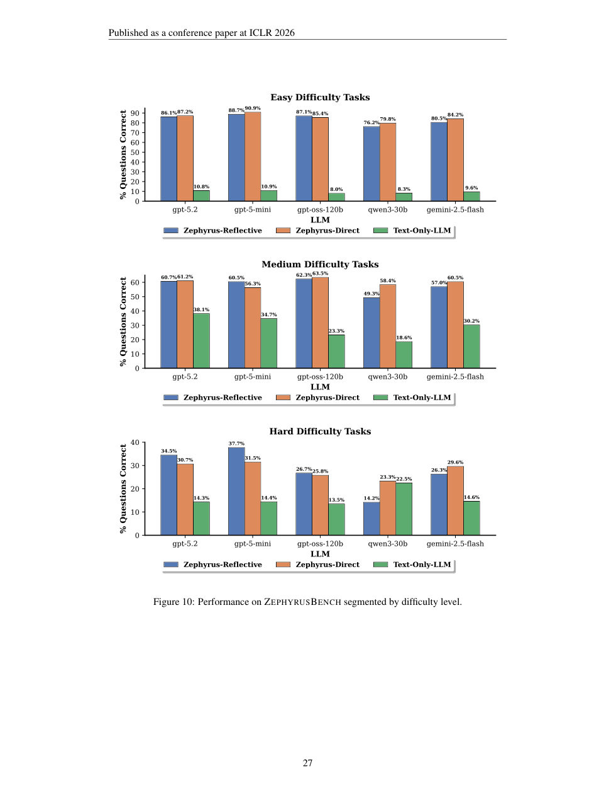


### 图10（第 27 页）

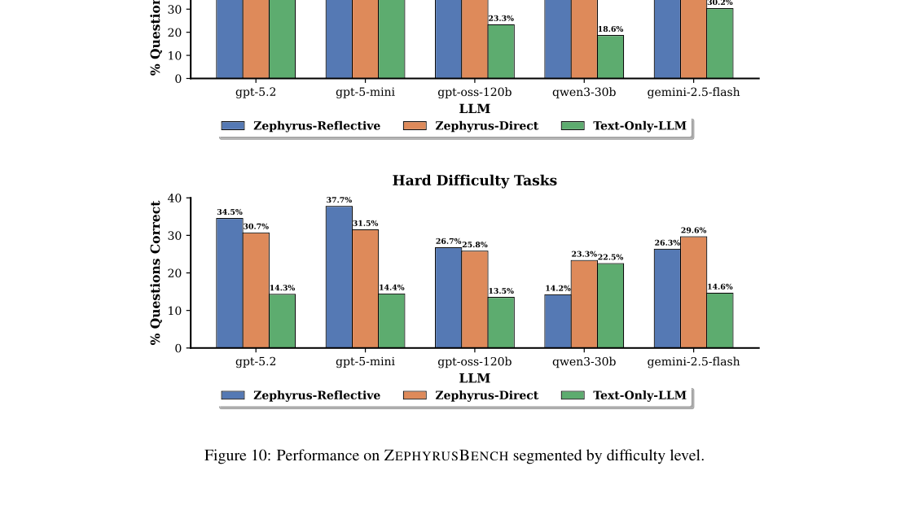

**原文题注：** Figure 10: Performance on ZEPHYRUSBENCH segmented by difficulty level.


#### 原文提取

```text
Published as a conference paper at ICLR 2026


                                                                       Easy Difficulty Tasks
                       90    86.1% 87.2%             88.7% 90.9%             87.1% 85.4%
                                                                                                                            80.5% 84.2%
 % Questions Correct   80                                                                          76.2% 79.8%
                       70
                       60
                       50
                       40
                       30
                       20                    10.8%                   10.9%                                                                  9.6%
                       10                                                                  8.0%                    8.3%
                        0
                                gpt-5.2               gpt-5-mini             gpt-oss-120b           qwen3-30b              gemini-2.5-flash
                                                                                 LLM
                                       Zephyrus-Reflective                   Zephyrus-Direct                   Text-Only-LLM

                                                                     Medium Difficulty Tasks
                             60.7% 61.2%             60.5%                   62.3% 63.5%                                            60.5%
                       60                                                                                  58.4%            57.0%
 % Questions Correct


                                                             56.3%
                       50                                                                          49.3%

                       40                    38.1%
                                                                     34.7%
                                                                                                                                            30.2%
                       30                                                                  23.3%
                       20                                                                                          18.6%

                       10
                        0
                                gpt-5.2               gpt-5-mini             gpt-oss-120b           qwen3-30b              gemini-2.5-flash
                                                                                 LLM
                                       Zephyrus-Reflective                   Zephyrus-Direct                   Text-Only-LLM

                                                                       Hard Difficulty Tasks
                       40                            37.7%
 % Questions Correct


                             34.5%
                                     30.7%                   31.5%
                                                                                                                                    29.6%
                       30                                                    26.7% 25.8%                                    26.3%
                                                                                                           23.3% 22.5%
                       20
                                             14.3%                   14.4%                 13.5%   14.2%                                    14.6%
                       10

                        0
                                gpt-5.2               gpt-5-mini             gpt-oss-120b           qwen3-30b              gemini-2.5-flash
                                                                                 LLM
                                       Zephyrus-Reflective                   Zephyrus-Direct                   Text-Only-LLM


                            Figure 10: Performance on Z EPHYRUS B ENCH segmented by difficulty level.


                                                                               27
```


---

## PDF 第 028 页

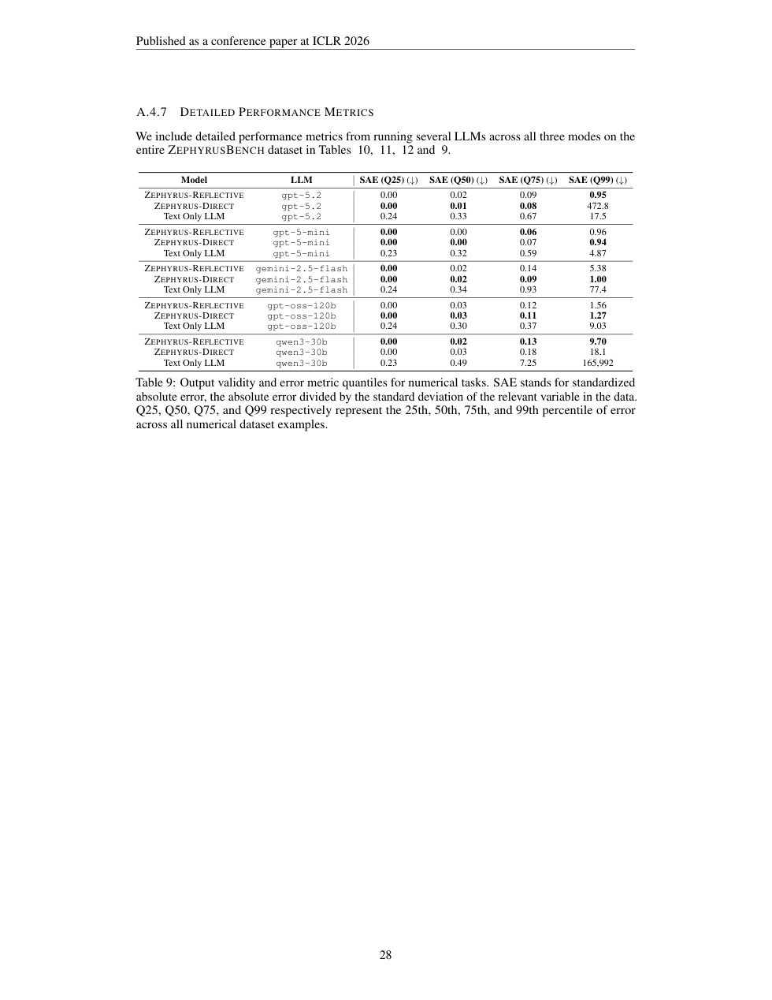


### 表9（第 28 页）

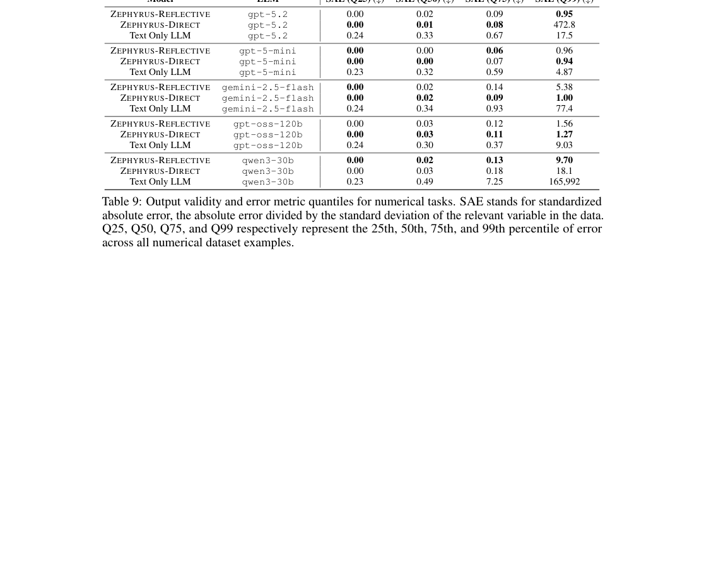

**原文题注：** Table 9: Output validity and error metric quantiles for numerical tasks. SAE stands for standardized absolute error, the absolute error divided by the standard deviation of the relevant variable in the data. Q25, Q50, Q75, and Q99 respectively represent the 25th, 50th, 75th, and 99th percentile of error across all numerical dataset examples.


#### 原文提取

```text
Published as a conference paper at ICLR 2026


A.4.7    D ETAILED P ERFORMANCE M ETRICS
We include detailed performance metrics from running several LLMs across all three modes on the
entire Z EPHYRUS B ENCH dataset in Tables 10, 11, 12 and 9.

         Model                  LLM            SAE (Q25) (↓)   SAE (Q50) (↓)   SAE (Q75) (↓)   SAE (Q99) (↓)
 Z EPHYRUS -R EFLECTIVE       gpt-5.2              0.00            0.02            0.09             0.95
    Z EPHYRUS -D IRECT        gpt-5.2              0.00            0.01            0.08            472.8
       Text Only LLM          gpt-5.2              0.24            0.33            0.67             17.5
 Z EPHYRUS -R EFLECTIVE      gpt-5-mini            0.00            0.00            0.06            0.96
    Z EPHYRUS -D IRECT       gpt-5-mini            0.00            0.00            0.07            0.94
       Text Only LLM         gpt-5-mini            0.23            0.32            0.59            4.87
 Z EPHYRUS -R EFLECTIVE   gemini-2.5-flash         0.00            0.02            0.14            5.38
    Z EPHYRUS -D IRECT    gemini-2.5-flash         0.00            0.02            0.09            1.00
       Text Only LLM      gemini-2.5-flash         0.24            0.34            0.93            77.4
 Z EPHYRUS -R EFLECTIVE    gpt-oss-120b            0.00            0.03            0.12            1.56
    Z EPHYRUS -D IRECT     gpt-oss-120b            0.00            0.03            0.11            1.27
       Text Only LLM       gpt-oss-120b            0.24            0.30            0.37            9.03
 Z EPHYRUS -R EFLECTIVE      qwen3-30b             0.00            0.02            0.13            9.70
    Z EPHYRUS -D IRECT       qwen3-30b             0.00            0.03            0.18            18.1
       Text Only LLM         qwen3-30b             0.23            0.49            7.25           165,992

Table 9: Output validity and error metric quantiles for numerical tasks. SAE stands for standardized
absolute error, the absolute error divided by the standard deviation of the relevant variable in the data.
Q25, Q50, Q75, and Q99 respectively represent the 25th, 50th, 75th, and 99th percentile of error
across all numerical dataset examples.


                                                   28
```


---

## PDF 第 029 页

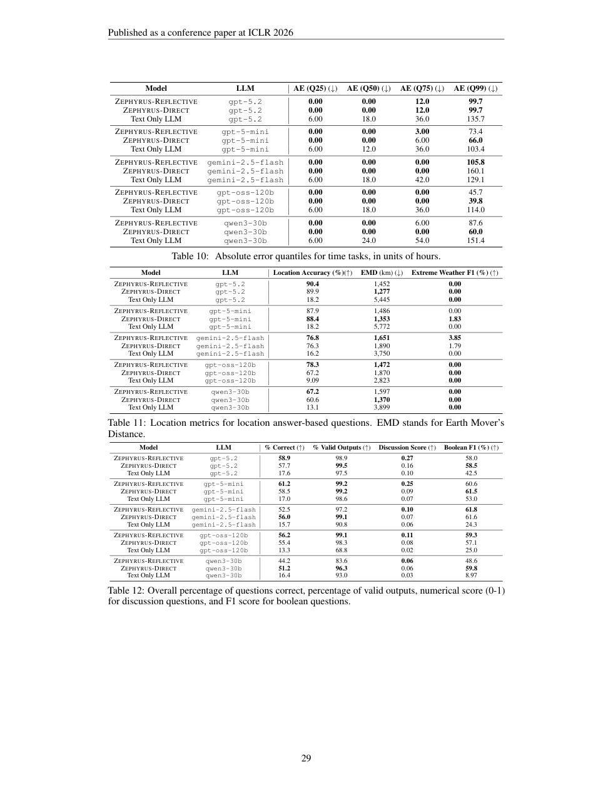


### 表10（第 29 页）

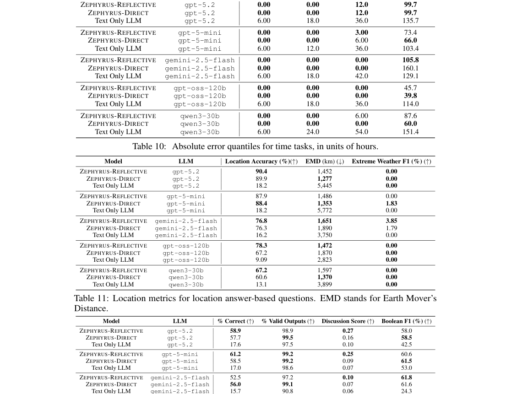

**原文题注：** Table 10: Absolute error quantiles for time tasks, in units of hours.


### 表11（第 29 页）

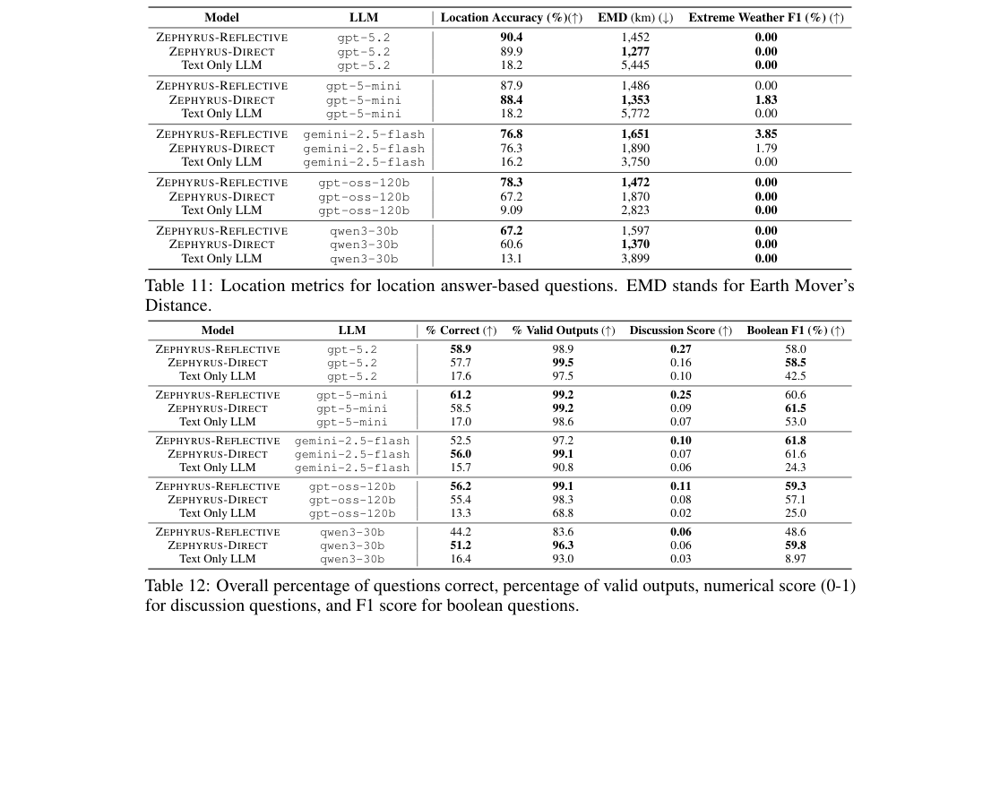

**原文题注：** Table 11: Location metrics for location answer-based questions. EMD stands for Earth Mover’s Distance.


### 表12（第 29 页）


**原文题注：** Table 12: Overall percentage of questions correct, percentage of valid outputs, numerical score (0-1) for discussion questions, and F1 score for boolean questions.


#### 原文提取

```text
Published as a conference paper at ICLR 2026


          Model                       LLM               AE (Q25) (↓)      AE (Q50) (↓)       AE (Q75) (↓)       AE (Q99) (↓)
 Z EPHYRUS -R EFLECTIVE            gpt-5.2                   0.00              0.00                 12.0             99.7
    Z EPHYRUS -D IRECT             gpt-5.2                   0.00              0.00                 12.0             99.7
       Text Only LLM               gpt-5.2                   6.00              18.0                 36.0             135.7
 Z EPHYRUS -R EFLECTIVE          gpt-5-mini                  0.00              0.00                 3.00             73.4
    Z EPHYRUS -D IRECT           gpt-5-mini                  0.00              0.00                 6.00             66.0
       Text Only LLM             gpt-5-mini                  6.00              12.0                 36.0             103.4
 Z EPHYRUS -R EFLECTIVE      gemini-2.5-flash                0.00              0.00                 0.00             105.8
    Z EPHYRUS -D IRECT       gemini-2.5-flash                0.00              0.00                 0.00             160.1
       Text Only LLM         gemini-2.5-flash                6.00              18.0                 42.0             129.1
 Z EPHYRUS -R EFLECTIVE         gpt-oss-120b                 0.00              0.00                 0.00             45.7
    Z EPHYRUS -D IRECT          gpt-oss-120b                 0.00              0.00                 0.00             39.8
       Text Only LLM            gpt-oss-120b                 6.00              18.0                 36.0             114.0
 Z EPHYRUS -R EFLECTIVE           qwen3-30b                  0.00              0.00                 6.00              87.6
    Z EPHYRUS -D IRECT            qwen3-30b                  0.00              0.00                 0.00             60.0
       Text Only LLM              qwen3-30b                  6.00              24.0                 54.0             151.4

                   Table 10: Absolute error quantiles for time tasks, in units of hours.
         Model                   LLM           Location Accuracy (%)(↑)       EMD (km) (↓)       Extreme Weather F1 (%) (↑)
 Z EPHYRUS -R EFLECTIVE        gpt-5.2                       90.4                    1,452                    0.00
    Z EPHYRUS -D IRECT         gpt-5.2                       89.9                    1,277                    0.00
       Text Only LLM           gpt-5.2                       18.2                    5,445                    0.00
 Z EPHYRUS -R EFLECTIVE       gpt-5-mini                     87.9                    1,486                    0.00
    Z EPHYRUS -D IRECT        gpt-5-mini                     88.4                    1,353                    1.83
       Text Only LLM          gpt-5-mini                     18.2                    5,772                    0.00
 Z EPHYRUS -R EFLECTIVE    gemini-2.5-flash                  76.8                    1,651                    3.85
    Z EPHYRUS -D IRECT     gemini-2.5-flash                  76.3                    1,890                    1.79
       Text Only LLM       gemini-2.5-flash                  16.2                    3,750                    0.00
 Z EPHYRUS -R EFLECTIVE      gpt-oss-120b                    78.3                    1,472                    0.00
    Z EPHYRUS -D IRECT       gpt-oss-120b                    67.2                    1,870                    0.00
       Text Only LLM         gpt-oss-120b                    9.09                    2,823                    0.00
 Z EPHYRUS -R EFLECTIVE       qwen3-30b                      67.2                    1,597                    0.00
    Z EPHYRUS -D IRECT        qwen3-30b                      60.6                    1,370                    0.00
       Text Only LLM          qwen3-30b                      13.1                    3,899                    0.00

Table 11: Location metrics for location answer-based questions. EMD stands for Earth Mover’s
Distance.
         Model                  LLM          % Correct (↑)     % Valid Outputs (↑)    Discussion Score (↑)   Boolean F1 (%) (↑)
 Z EPHYRUS -R EFLECTIVE       gpt-5.2            58.9                 98.9                   0.27                    58.0
    Z EPHYRUS -D IRECT        gpt-5.2            57.7                 99.5                   0.16                    58.5
       Text Only LLM          gpt-5.2            17.6                 97.5                   0.10                    42.5
 Z EPHYRUS -R EFLECTIVE      gpt-5-mini          61.2                 99.2                   0.25                    60.6
    Z EPHYRUS -D IRECT       gpt-5-mini          58.5                 99.2                   0.09                    61.5
       Text Only LLM         gpt-5-mini          17.0                 98.6                   0.07                    53.0
 Z EPHYRUS -R EFLECTIVE   gemini-2.5-flash       52.5                 97.2                   0.10                    61.8
    Z EPHYRUS -D IRECT    gemini-2.5-flash       56.0                 99.1                   0.07                    61.6
       Text Only LLM      gemini-2.5-flash       15.7                 90.8                   0.06                    24.3
 Z EPHYRUS -R EFLECTIVE    gpt-oss-120b          56.2                 99.1                   0.11                    59.3
    Z EPHYRUS -D IRECT     gpt-oss-120b          55.4                 98.3                   0.08                    57.1
       Text Only LLM       gpt-oss-120b          13.3                 68.8                   0.02                    25.0
 Z EPHYRUS -R EFLECTIVE      qwen3-30b           44.2                 83.6                   0.06                    48.6
    Z EPHYRUS -D IRECT       qwen3-30b           51.2                 96.3                   0.06                    59.8
       Text Only LLM         qwen3-30b           16.4                 93.0                   0.03                    8.97

Table 12: Overall percentage of questions correct, percentage of valid outputs, numerical score (0-1)
for discussion questions, and F1 score for boolean questions.


                                                          29
```


---

## PDF 第 030 页


### 表13（第 30 页）


**原文题注：** Table 13: Output validity and error metric quantiles for numerical tasks. SAE stands for standardized absolute error, the absolute error divided by the standard deviation of the relevant variable in the data. Q25, Q50, Q75, and Q99 respectively represent the 25th, 50th, 75th, and 99th percentile of error across all numerical dataset examples in human-generated tasks.


#### 原文提取

```text
Published as a conference paper at ICLR 2026


A.4.8    P ERFORMANCE M ETRICS , H UMAN -G ENERATED TASKS
We also include top-level performance metrics broken out specifically for the 19 human-generated
tasks in Z EPHYRUS B ENCH dataset. The results are reported in Tables 13, 14, 15, and 16.

         Model                  LLM            SAE (Q25) (↓)   SAE (Q50) (↓)   SAE (Q75) (↓)   SAE (Q99) (↓)
 Z EPHYRUS -R EFLECTIVE       gpt-5.2              0.00            0.01            0.07             0.60
    Z EPHYRUS -D IRECT        gpt-5.2              0.00            0.00            0.07            2,164
       Text Only LLM          gpt-5.2              0.24            0.32            0.58             4.60
 Z EPHYRUS -R EFLECTIVE      gpt-5-mini            0.00            0.00            0.05            0.44
    Z EPHYRUS -D IRECT       gpt-5-mini            0.00            0.00            0.06            0.42
       Text Only LLM         gpt-5-mini            0.23            0.31            0.47            2.84
 Z EPHYRUS -R EFLECTIVE   gemini-2.5-flash         0.00            0.02            0.12            3.82
    Z EPHYRUS -D IRECT    gemini-2.5-flash         0.00            0.01            0.08            0.56
       Text Only LLM      gemini-2.5-flash         0.25            0.33            0.70            476.1
 Z EPHYRUS -R EFLECTIVE    gpt-oss-120b            0.00            0.02            0.10            1.34
    Z EPHYRUS -D IRECT     gpt-oss-120b            0.00            0.02            0.09            0.98
       Text Only LLM       gpt-oss-120b            0.24            0.30            0.36            7.38
 Z EPHYRUS -R EFLECTIVE      qwen3-30b             0.00            0.00            0.10            14.3
    Z EPHYRUS -D IRECT       qwen3-30b             0.00            0.03            0.16            19.7
       Text Only LLM         qwen3-30b             0.23            0.40            5.43           108,610

Table 13: Output validity and error metric quantiles for numerical tasks. SAE stands for standardized
absolute error, the absolute error divided by the standard deviation of the relevant variable in the data.
Q25, Q50, Q75, and Q99 respectively represent the 25th, 50th, 75th, and 99th percentile of error
across all numerical dataset examples in human-generated tasks.


                                                   30
```


---

## PDF 第 031 页


### 表14（第 31 页）


**原文题注：** Table 14: Absolute error quantiles for time tasks, in units of hours, on human-generated tasks in human-generated tasks.


### 表15（第 31 页）


**原文题注：** Table 15: Location metrics for location answer-based questions in human generated tasks. EMD stands for Earth mover’s Distance.


### 表16（第 31 页）


**原文题注：** Table 16: Overall percentage of questions correct, percentage of valid outputs, and numerical score (0-1) for discussion questions in human-generated tasks.


#### 原文提取

```text
Published as a conference paper at ICLR 2026


          Model                    LLM             AE (Q25) (↓)    AE (Q50) (↓)       AE (Q75) (↓)      AE (Q99) (↓)
 Z EPHYRUS -R EFLECTIVE          gpt-5.2               0.00             0.00              12.0               99.7
    Z EPHYRUS -D IRECT           gpt-5.2               0.00             0.00              12.0               99.7
       Text Only LLM             gpt-5.2               6.00             18.0              36.0               135.7
 Z EPHYRUS -R EFLECTIVE        gpt-5-mini              0.00             0.00              3.00               73.4
    Z EPHYRUS -D IRECT         gpt-5-mini              0.00             0.00              6.00               66.0
       Text Only LLM           gpt-5-mini              6.00             12.0              36.0               103.4
 Z EPHYRUS -R EFLECTIVE     gemini-2.5-flash           0.00             0.00              0.00               105.8
    Z EPHYRUS -D IRECT      gemini-2.5-flash           0.00             0.00              0.00               160.1
       Text Only LLM        gemini-2.5-flash           6.00             18.0              42.0               129.1
 Z EPHYRUS -R EFLECTIVE       gpt-oss-120b             0.00             0.00              0.00               45.7
    Z EPHYRUS -D IRECT        gpt-oss-120b             0.00             0.00              0.00               39.8
       Text Only LLM          gpt-oss-120b             6.00             18.0              36.0               114.0
 Z EPHYRUS -R EFLECTIVE         qwen3-30b              0.00             0.00              6.00                87.6
    Z EPHYRUS -D IRECT          qwen3-30b              0.00             0.00              0.00               60.0
       Text Only LLM            qwen3-30b              6.00             24.0              54.0               151.4
Table 14: Absolute error quantiles for time tasks, in units of hours, on human-generated tasks in
human-generated tasks.
         Model                  LLM          Location Accuracy (%)(↑)   EMD (km) (↓)     Extreme Weather F1 (%) (↑)
 Z EPHYRUS -R EFLECTIVE       gpt-5.2                  90.4                1,452                      0.00
    Z EPHYRUS -D IRECT        gpt-5.2                  89.9                1,277                      0.00
       Text Only LLM          gpt-5.2                  18.2                5,445                      0.00
 Z EPHYRUS -R EFLECTIVE      gpt-5-mini                87.9                1,486                      0.00
    Z EPHYRUS -D IRECT       gpt-5-mini                88.4                1,353                      1.83
       Text Only LLM         gpt-5-mini                18.2                5,772                      0.00
 Z EPHYRUS -R EFLECTIVE   gemini-2.5-flash             76.8                1,651                      3.85
    Z EPHYRUS -D IRECT    gemini-2.5-flash             76.3                1,890                      1.79
       Text Only LLM      gemini-2.5-flash             16.2                3,750                      0.00
 Z EPHYRUS -R EFLECTIVE    gpt-oss-120b                78.3                1,472                      0.00
    Z EPHYRUS -D IRECT     gpt-oss-120b                67.2                1,870                      0.00
       Text Only LLM       gpt-oss-120b                9.09                2,823                      0.00
 Z EPHYRUS -R EFLECTIVE      qwen3-30b                 67.2                1,597                      0.00
    Z EPHYRUS -D IRECT       qwen3-30b                 60.6                1,370                      0.00
       Text Only LLM         qwen3-30b                 13.1                3,899                      0.00

Table 15: Location metrics for location answer-based questions in human generated tasks. EMD
stands for Earth mover’s Distance.
          Model                    LLM             % Correct (↑)    % Valid Outputs (↑)          Discussion Score (↑)
 Z EPHYRUS -R EFLECTIVE          gpt-5.2                57.5                   98.7                     0.27
    Z EPHYRUS -D IRECT           gpt-5.2                56.0                   99.3                     0.16
       Text Only LLM             gpt-5.2                8.91                   97.3                     0.10
 Z EPHYRUS -R EFLECTIVE        gpt-5-mini               60.4                   99.0                     0.25
    Z EPHYRUS -D IRECT         gpt-5-mini               57.1                   99.1                     0.09
       Text Only LLM           gpt-5-mini               8.56                   98.5                     0.07
 Z EPHYRUS -R EFLECTIVE     gemini-2.5-flash            50.9                   97.8                     0.10
    Z EPHYRUS -D IRECT      gemini-2.5-flash            54.1                   98.9                     0.07
       Text Only LLM        gemini-2.5-flash            8.28                   89.1                     0.06
 Z EPHYRUS -R EFLECTIVE       gpt-oss-120b              54.5                   98.9                     0.11
    Z EPHYRUS -D IRECT        gpt-oss-120b              53.1                   97.8                     0.08
       Text Only LLM          gpt-oss-120b              6.61                   67.7                     0.02
 Z EPHYRUS -R EFLECTIVE         qwen3-30b               42.1                   82.0                     0.06
    Z EPHYRUS -D IRECT          qwen3-30b               48.4                   95.9                     0.06
       Text Only LLM            qwen3-30b               11.4                   94.9                     0.03

Table 16: Overall percentage of questions correct, percentage of valid outputs, and numerical score
(0-1) for discussion questions in human-generated tasks.


                                                     31
```


---

## PDF 第 032 页


### 表17（第 32 页）


**原文题注：** Table 17: Output validity and error metric quantiles for semi-synthetically generated numerical tasks. SAE stands for standardized absolute error, the absolute error divided by the standard deviation of the relevant variable in the data. Q25, Q50, Q75, and Q99 respectively represent the 25th, 50th, 75th, and 99th percentile of error across all numerical dataset examples.


### 表18（第 32 页）


**原文题注：** Table 18: Overall percentage of questions correct, percentage of valid outputs, numerical score (0-1) for discussion questions, and F1 score for boolean questions on the semi-synthetically generated subset of tasks.


#### 原文提取

```text
Published as a conference paper at ICLR 2026


A.4.9    P ERFORMANCE M ETRICS , S EMI -S YNTHETIC TASKS
We also include top-level performance metrics broken out specifically for the 30 semi-synthetic
(LLM-generated, human-validated) tasks in Z EPHYRUS B ENCH dataset. The results are reported in
Tables 17 and 18.

         Model                  LLM           SAE (Q25) (↓)   SAE (Q50) (↓)     SAE (Q75) (↓)   SAE (Q99) (↓)
 Z EPHYRUS -R EFLECTIVE       gpt-5.2             0.02            0.07              0.30            3.24
    Z EPHYRUS -D IRECT        gpt-5.2             0.02            0.07              0.30            2.68
       Text Only LLM          gpt-5.2             0.25            0.65              1.62            333.6
 Z EPHYRUS -R EFLECTIVE      gpt-5-mini           0.02            0.07              0.26            1.32
    Z EPHYRUS -D IRECT       gpt-5-mini           0.02            0.07              0.24            1.41
       Text Only LLM         gpt-5-mini           0.27            0.78              1.68            24.3
 Z EPHYRUS -R EFLECTIVE   gemini-2.5-flash        0.03            0.10              0.34            9.47
    Z EPHYRUS -D IRECT    gemini-2.5-flash        0.02            0.08              0.29            1.31
       Text Only LLM      gemini-2.5-flash        0.23            0.85              2.09            31.0
 Z EPHYRUS -R EFLECTIVE    gpt-oss-120b           0.02            0.07              0.29            1.89
    Z EPHYRUS -D IRECT     gpt-oss-120b           0.02            0.07              0.29            2.61
       Text Only LLM       gpt-oss-120b           0.28            1.02              1.92            16.2
 Z EPHYRUS -R EFLECTIVE      qwen3-30b            0.02            0.07              0.29             2.34
    Z EPHYRUS -D IRECT       qwen3-30b            0.02            0.11              0.36             4.36
       Text Only LLM         qwen3-30b            0.40            2.13              17.1          3.39e+06

Table 17: Output validity and error metric quantiles for semi-synthetically generated numerical tasks.
SAE stands for standardized absolute error, the absolute error divided by the standard deviation of
the relevant variable in the data. Q25, Q50, Q75, and Q99 respectively represent the 25th, 50th, 75th,
and 99th percentile of error across all numerical dataset examples.


         Model                   LLM            % Correct (↑)    % Valid Outputs (↑)       Boolean F1 (%) (↑)
 Z EPHYRUS -R EFLECTIVE        gpt-5.2                 63.7               99.8                    58.0
    Z EPHYRUS -D IRECT         gpt-5.2                 63.9              100.0                    58.5
       Text Only LLM           gpt-5.2                 48.4               98.2                    42.5
 Z EPHYRUS -R EFLECTIVE       gpt-5-mini               64.1              99.8                     60.6
    Z EPHYRUS -D IRECT        gpt-5-mini               63.7              99.4                     61.5
       Text Only LLM          gpt-5-mini               46.9              99.0                     53.0
 Z EPHYRUS -R EFLECTIVE    gemini-2.5-flash            58.2              94.9                     61.8
    Z EPHYRUS -D IRECT     gemini-2.5-flash            62.9              99.8                     61.6
       Text Only LLM       gemini-2.5-flash            42.2              96.7                     24.3
 Z EPHYRUS -R EFLECTIVE      gpt-oss-120b              62.2              100.0                    59.3
    Z EPHYRUS -D IRECT       gpt-oss-120b              63.5              100.0                    57.1
       Text Only LLM         gpt-oss-120b              37.1               72.7                    25.0
 Z EPHYRUS -R EFLECTIVE       qwen3-30b                51.4              89.4                     48.6
    Z EPHYRUS -D IRECT        qwen3-30b                61.2              98.0                     59.8
       Text Only LLM          qwen3-30b                34.1              86.5                     8.97

Table 18: Overall percentage of questions correct, percentage of valid outputs, numerical score (0-1)
for discussion questions, and F1 score for boolean questions on the semi-synthetically generated
subset of tasks.


                                                  32
```


---

## PDF 第 033 页


### 表19（第 33 页）


**原文题注：** Table 19: Location prediction metrics for Template ID 1: Which geographic feature experienced the highest/lowest average value of a weather variable


### 表20（第 33 页）


**原文题注：** Table 20: Standardized Absolute Error (SAE) quantiles for Template ID 2: What is the min/max/average/median value of a weather variable at a specific location


#### 原文提取

```text
Published as a conference paper at ICLR 2026


A.4.10     P ERFORMANCE M ETRICS BY TASK
At the most granular level of detail, we provide performance metrics of all models’ performance
on each unique template ID in Z EPHYRUS B ENCH. The reported performance metrics are tailored
individually to each question type. These results are reported in Tables 19 through 67.

              Model                       LLM                Location Accuracy (%)(↑)           EMD (km)(↓)
    Z EPHYRUS -R EFLECTIVE             gpt-5-mini                            96.8                      179.8
       Z EPHYRUS -D IRECT              gpt-5-mini                           100.0                      0.00
          Text Only LLM                gpt-5-mini                            17.0                      8,551
    Z EPHYRUS -R EFLECTIVE       gemini-2.5-flash                           83.0                       1,132
       Z EPHYRUS -D IRECT        gemini-2.5-flash                           84.0                       1,126
          Text Only LLM          gemini-2.5-flash                           18.1                       6,372
    Z EPHYRUS -R EFLECTIVE            gpt-oss-120b                          83.0                       911.2
       Z EPHYRUS -D IRECT             gpt-oss-120b                          88.3                       889.3
          Text Only LLM               gpt-oss-120b                          13.8                       6,954
    Z EPHYRUS -R EFLECTIVE               gpt-5.2                            100.0                      0.00
       Z EPHYRUS -D IRECT                gpt-5.2                            100.0                      0.00
          Text Only LLM                  gpt-5.2                             17.0                      7,968
    Z EPHYRUS -R EFLECTIVE              qwen3-30b                           76.6                       1,502
       Z EPHYRUS -D IRECT               qwen3-30b                           89.4                       855.3
          Text Only LLM                 qwen3-30b                           16.0                       7,183
Table 19: Location prediction metrics for Template ID 1: Which geographic feature
experienced the highest/lowest average value of a weather variable


         Model                  LLM          SAE (Q25)(↓)    SAE (Q50)(↓)    SAE (Q75)(↓)   SAE (Q99)(↓)   Err Std(↓)
 Z EPHYRUS -R EFLECTIVE     gpt-5-mini           0.00            0.00               0.00        0.13           20.7
    Z EPHYRUS -D IRECT      gpt-5-mini           0.00            0.00               0.00        0.06           5.34
       Text Only LLM        gpt-5-mini           0.16            0.40               0.77        3.24           1,390
 Z EPHYRUS -R EFLECTIVE   gemini-2.5-flash       0.00            0.00               0.01        0.41            413.0
    Z EPHYRUS -D IRECT    gemini-2.5-flash       0.00            0.00               0.00        0.39            422.0
       Text Only LLM      gemini-2.5-flash       0.26            0.72               2.87        75.8           30,300
 Z EPHYRUS -R EFLECTIVE    gpt-oss-120b          0.00            0.00               0.01       0.47            413.0
    Z EPHYRUS -D IRECT     gpt-oss-120b          0.00            0.00               0.00        0.47           460.0
       Text Only LLM       gpt-oss-120b          0.12            0.46               1.15       116.0           2,330
 Z EPHYRUS -R EFLECTIVE       gpt-5.2            0.00            0.00               0.00        0.13            376.0
    Z EPHYRUS -D IRECT        gpt-5.2            0.00            0.00               0.00        0.39           562.0
       Text Only LLM          gpt-5.2            0.20            0.56               1.34        13.5           21,000
 Z EPHYRUS -R EFLECTIVE      qwen3-30b           0.00            0.00               0.03        0.89           391.0
    Z EPHYRUS -D IRECT       qwen3-30b           0.00            0.00               0.02        0.48            271.0
       Text Only LLM         qwen3-30b           0.26            0.92               6.86        76.2           39,000

Table 20: Standardized Absolute Error (SAE) quantiles for Template ID 2: What is the
min/max/average/median value of a weather variable at a specific
location


                                                        33
```


---

## PDF 第 034 页


### 表21（第 34 页）


**原文题注：** Table 21: Location prediction metrics for Template ID 3: Which sublocation has the highest/lowest recorded variable value


### 表22（第 34 页）


**原文题注：** Table 22: Absolute Error (AE) quantiles for Template ID 4: How many hours from start did a location experience extremum


### 表23（第 34 页）


**原文题注：** Table 23: Standardized Absolute Error (SAE) quantiles for Template ID 5: What is the weather variable value at a location at a specific time


#### 原文提取

```text
Published as a conference paper at ICLR 2026


             Model                         LLM                  Location Accuracy (%)(↑)              EMD (km)(↓)
   Z EPHYRUS -R EFLECTIVE             gpt-5-mini                              79.8                           472.1
      Z EPHYRUS -D IRECT              gpt-5-mini                              77.9                           784.8
         Text Only LLM                gpt-5-mini                              19.2                           3,611
   Z EPHYRUS -R EFLECTIVE       gemini-2.5-flash                              71.2                           1,224
      Z EPHYRUS -D IRECT        gemini-2.5-flash                              69.2                           1,442
         Text Only LLM          gemini-2.5-flash                              14.4                           2,962
   Z EPHYRUS -R EFLECTIVE            gpt-oss-120b                             74.0                           842.2
      Z EPHYRUS -D IRECT             gpt-oss-120b                             48.1                           2,290
         Text Only LLM               gpt-oss-120b                             4.80                           3,290
   Z EPHYRUS -R EFLECTIVE               gpt-5.2                               81.7                           403.6
      Z EPHYRUS -D IRECT                gpt-5.2                               80.8                           211.2
         Text Only LLM                  gpt-5.2                               19.2                           3,196
   Z EPHYRUS -R EFLECTIVE              qwen3-30b                              58.7                           2,307
      Z EPHYRUS -D IRECT               qwen3-30b                              34.6                           2,656
         Text Only LLM                 qwen3-30b                              10.6                           3,312
Table 21: Location prediction metrics for Template ID 3: Which sublocation has the
highest/lowest recorded variable value
         Model                       LLM            AE (Q25)(↓)            AE (Q50)(↓)      AE (Q75)(↓)       AE (Q99)(↓)
 Z EPHYRUS -R EFLECTIVE        gpt-5-mini                    0.00             0.00             0.00              82.9
    Z EPHYRUS -D IRECT         gpt-5-mini                    0.00             0.00             0.00               73.0
       Text Only LLM           gpt-5-mini                    6.00             18.0             42.0              109.0
 Z EPHYRUS -R EFLECTIVE     gemini-2.5-flash                 0.00             0.00             0.00              125.0
    Z EPHYRUS -D IRECT      gemini-2.5-flash                 0.00             0.00             0.00              200.0
       Text Only LLM        gemini-2.5-flash                 6.00             24.0             48.0              138.0
 Z EPHYRUS -R EFLECTIVE       gpt-oss-120b                   0.00             0.00             0.00              48.0
    Z EPHYRUS -D IRECT        gpt-oss-120b                   0.00             0.00             0.00               37.2
       Text Only LLM          gpt-oss-120b                   6.00             18.0             48.0              119.0
 Z EPHYRUS -R EFLECTIVE          gpt-5.2                     0.00             0.00             12.0              103.0
    Z EPHYRUS -D IRECT           gpt-5.2                     0.00             0.00             12.0              105.0
       Text Only LLM             gpt-5.2                     6.00             24.0             48.0              138.0
 Z EPHYRUS -R EFLECTIVE         qwen3-30b                    0.00             0.00             0.00              90.0
    Z EPHYRUS -D IRECT          qwen3-30b                    0.00             0.00             0.00               60.7
       Text Only LLM            qwen3-30b                    12.0             30.0             72.0              156.0

Table 22: Absolute Error (AE) quantiles for Template ID 4: How many hours from start
did a location experience extremum
        Model                  LLM          SAE (Q25)(↓)       SAE (Q50)(↓)    SAE (Q75)(↓)     SAE (Q99)(↓)     Err Std(↓)
Z EPHYRUS -R EFLECTIVE     gpt-5-mini            0.00               0.00             0.00             1.34           553.0
   Z EPHYRUS -D IRECT      gpt-5-mini            0.00               0.00             0.00             0.36           551.0
      Text Only LLM        gpt-5-mini            0.19               0.45             0.90             4.09           2,030
Z EPHYRUS -R EFLECTIVE   gemini-2.5-flash        0.00               0.00             0.00          2.41               634.0
   Z EPHYRUS -D IRECT    gemini-2.5-flash        0.00               0.00             0.00           0.42              2,890
      Text Only LLM      gemini-2.5-flash        0.31               1.10             3.22          5,440             21,500
Z EPHYRUS -R EFLECTIVE    gpt-oss-120b           0.00               0.00             0.01          1.46              6,970
   Z EPHYRUS -D IRECT     gpt-oss-120b           0.00               0.00             0.01           0.37             343.0
      Text Only LLM       gpt-oss-120b           0.15               0.45             1.28          269.0             2,670
Z EPHYRUS -R EFLECTIVE       gpt-5.2             0.00               0.00             0.00             0.39           232.0
   Z EPHYRUS -D IRECT        gpt-5.2             0.00               0.00             0.00             0.36           232.0
      Text Only LLM          gpt-5.2             0.18               0.51             1.08             7.14           2,530
Z EPHYRUS -R EFLECTIVE      qwen3-30b            0.00               0.00             0.01          1.60               2,060
   Z EPHYRUS -D IRECT       qwen3-30b            0.00               0.00             0.00           0.83              2,900
      Text Only LLM         qwen3-30b            0.82               5.08             15.1         173,000            38,700

Table 23: Standardized Absolute Error (SAE) quantiles for Template ID 5: What is the
weather variable value at a location at a specific time


                                                        34
```


---

## PDF 第 035 页


### 表24（第 35 页）


**原文题注：** Table 24: Extreme weather detection metrics for Template ID 6: Identify geofeatures where variable differs from mean by N standard deviations


### 表25（第 35 页）


**原文题注：** Table 25: Extreme weather detection metrics for Template ID 7: Identify geofeatures where variable lies outside climatological percentile envelope


### 表26（第 35 页）


**原文题注：** Table 26: Standardized Absolute Error (SAE) quantiles for Template ID 8: What will the variable be at a location after time interval (forecast)


#### 原文提取

```text
Published as a conference paper at ICLR 2026


          Model                         LLM                   Correctness (%)(↑)      EMD (km)(↓)         IoU (%)(↑)
 Z EPHYRUS -R EFLECTIVE          gpt-5-mini                          100.0                 0.00              100.0
    Z EPHYRUS -D IRECT           gpt-5-mini                          100.0                 0.00              100.0
       Text Only LLM             gpt-5-mini                          20.0                 7,580              0.00
 Z EPHYRUS -R EFLECTIVE       gemini-2.5-flash                       82.2                  1,243             100.0
    Z EPHYRUS -D IRECT        gemini-2.5-flash                       73.3                  832.3             100.0
       Text Only LLM          gemini-2.5-flash                       37.8                 10,864              0.00
 Z EPHYRUS -R EFLECTIVE         gpt-oss-120b                         100.0                 0.00              100.0
    Z EPHYRUS -D IRECT          gpt-oss-120b                         100.0                 0.00              100.0
       Text Only LLM            gpt-oss-120b                         57.8                 10,270             100.0
 Z EPHYRUS -R EFLECTIVE              gpt-5.2                         95.6                 558.7              100.0
    Z EPHYRUS -D IRECT               gpt-5.2                         97.8                 565.0              100.0
       Text Only LLM                 gpt-5.2                         15.6                 7,750               0.00
 Z EPHYRUS -R EFLECTIVE           qwen3-30b                          82.2                  887.7             100.0
    Z EPHYRUS -D IRECT            qwen3-30b                          88.9                  419.8             100.0
       Text Only LLM              qwen3-30b                          46.7                 10,569              0.00
Table 24: Extreme weather detection metrics for Template ID 6: Identify geofeatures
where variable differs from mean by N standard deviations
          Model                         LLM                   Correctness (%)(↑)      EMD (km)(↓)         IoU (%)(↑)
 Z EPHYRUS -R EFLECTIVE          gpt-5-mini                          95.8                 9.30               100.0
    Z EPHYRUS -D IRECT           gpt-5-mini                          100.0                 0.00              100.0
       Text Only LLM             gpt-5-mini                          0.00                 5,519               2.30
 Z EPHYRUS -R EFLECTIVE       gemini-2.5-flash                       79.2                 225.4              100.0
    Z EPHYRUS -D IRECT        gemini-2.5-flash                       81.2                 227.5              100.0
       Text Only LLM          gemini-2.5-flash                       4.20                 5,609               0.00
 Z EPHYRUS -R EFLECTIVE         gpt-oss-120b                         100.0                 0.70              100.0
    Z EPHYRUS -D IRECT          gpt-oss-120b                         95.8                  0.00              100.0
       Text Only LLM            gpt-oss-120b                         4.20                 6,137               0.00
 Z EPHYRUS -R EFLECTIVE              gpt-5.2                         97.9                  74.7              100.0
    Z EPHYRUS -D IRECT               gpt-5.2                         97.9                 11.3               100.0
       Text Only LLM                 gpt-5.2                         0.00                 5,750               1.50
 Z EPHYRUS -R EFLECTIVE           qwen3-30b                          83.3                 292.6              100.0
    Z EPHYRUS -D IRECT            qwen3-30b                          87.5                 62.6               100.0
       Text Only LLM              qwen3-30b                          2.10                 7,287               0.00
Table 25: Extreme weather detection metrics for Template ID 7: Identify geofeatures
where variable lies outside climatological percentile envelope
        Model                  LLM            SAE (Q25)(↓)      SAE (Q50)(↓)   SAE (Q75)(↓)   SAE (Q99)(↓)   Err Std(↓)
Z EPHYRUS -R EFLECTIVE     gpt-5-mini             0.01              0.06           0.12            0.67        173.0
   Z EPHYRUS -D IRECT      gpt-5-mini             0.04              0.07           0.17            1.36        180.0
      Text Only LLM        gpt-5-mini             0.22              0.46           0.97            3.76        257.0
Z EPHYRUS -R EFLECTIVE   gemini-2.5-flash         0.01              0.05           0.10            2.12        31.1
   Z EPHYRUS -D IRECT    gemini-2.5-flash         0.01              0.05           0.09            0.37        66.2
      Text Only LLM      gemini-2.5-flash         0.31              0.82           2.15            58.4       20,100
Z EPHYRUS -R EFLECTIVE    gpt-oss-120b            0.01              0.06           0.10            0.67        182.0
   Z EPHYRUS -D IRECT     gpt-oss-120b            0.01              0.06           0.11            0.67        186.0
      Text Only LLM       gpt-oss-120b            0.72              0.95           1.54            2.12        1,810
Z EPHYRUS -R EFLECTIVE       gpt-5.2              0.01              0.05           0.10            0.67        172.0
   Z EPHYRUS -D IRECT        gpt-5.2              0.01              0.06           0.11            0.67        173.0
      Text Only LLM          gpt-5.2              0.28              0.66           1.67            3.22        432.0
Z EPHYRUS -R EFLECTIVE      qwen3-30b             0.00              0.03           0.09           0.54         205.0
   Z EPHYRUS -D IRECT       qwen3-30b             0.00              0.05           0.09          0.56          188.0
      Text Only LLM         qwen3-30b             1.54              12.2           24.3         726,000       28,100

Table 26: Standardized Absolute Error (SAE) quantiles for Template ID 8: What will the
variable be at a location after time interval (forecast)


                                                         35
```


---

## PDF 第 036 页


### 表27（第 36 页）


**原文题注：** Table 27: Absolute Error (AE) quantiles for Template ID 9: When will location experience its extremum in future period (forecast)


### 表28（第 36 页）


**原文题注：** Table 28: Extreme weather detection metrics for Template ID 10: Which geofeatures are experiencing exceedance in variable values


### 表29（第 36 页）


**原文题注：** Table 29: Extreme weather detection metrics for Template ID 11: Identify extreme weather events that will occur in the next N hours (forecast)


#### 原文提取

```text
Published as a conference paper at ICLR 2026


         Model                  LLM            AE (Q25)(↓)   AE (Q50)(↓)    AE (Q75)(↓)   AE (Q99)(↓)
 Z EPHYRUS -R EFLECTIVE     gpt-5-mini              0.00          0.00         6.00          39.2
    Z EPHYRUS -D IRECT      gpt-5-mini              0.00          6.00         18.0          39.3
       Text Only LLM        gpt-5-mini              6.00          6.00         12.0          24.5
 Z EPHYRUS -R EFLECTIVE   gemini-2.5-flash          0.00          0.00         6.00          39.2
    Z EPHYRUS -D IRECT    gemini-2.5-flash          0.00          0.00         4.50          39.2
       Text Only LLM      gemini-2.5-flash          1.00          6.00         15.0          39.2
 Z EPHYRUS -R EFLECTIVE    gpt-oss-120b             0.00          0.00         0.00          39.2
    Z EPHYRUS -D IRECT     gpt-oss-120b             0.00          0.00         0.00          39.2
       Text Only LLM       gpt-oss-120b             0.00          12.0         18.0          40.5
 Z EPHYRUS -R EFLECTIVE       gpt-5.2               0.00          0.00         12.0          39.2
    Z EPHYRUS -D IRECT        gpt-5.2               0.00          0.00         6.00          39.2
       Text Only LLM          gpt-5.2               0.00          6.00         12.0          21.2
 Z EPHYRUS -R EFLECTIVE      qwen3-30b              0.00          6.00         21.0          39.7
    Z EPHYRUS -D IRECT       qwen3-30b              0.00          0.00         12.0          42.0
       Text Only LLM         qwen3-30b              6.00          12.0         18.0          45.2

Table 27: Absolute Error (AE) quantiles for Template ID 9: When will location
experience its extremum in future period (forecast)
         Model                    LLM               Correctness (%)(↑)     EMD (km)(↓)    IoU (%)(↑)
 Z EPHYRUS -R EFLECTIVE       gpt-5-mini                   13.7               3,839          40.0
    Z EPHYRUS -D IRECT        gpt-5-mini                   13.7               3,210          45.5
       Text Only LLM          gpt-5-mini                   7.80               6,732          0.00
 Z EPHYRUS -R EFLECTIVE    gemini-2.5-flash                11.8               2,520          37.1
    Z EPHYRUS -D IRECT     gemini-2.5-flash                15.7               2,693          37.1
       Text Only LLM       gemini-2.5-flash                9.80               8,383          0.00
 Z EPHYRUS -R EFLECTIVE      gpt-oss-120b                  15.7               2,772          38.9
    Z EPHYRUS -D IRECT       gpt-oss-120b                  13.7               3,087          42.6
       Text Only LLM         gpt-oss-120b                  11.8                 –            0.00
 Z EPHYRUS -R EFLECTIVE         gpt-5.2                    13.7               4,644          34.4
    Z EPHYRUS -D IRECT          gpt-5.2                    13.7               4,031          35.2
       Text Only LLM            gpt-5.2                    11.8               6,561          0.00
 Z EPHYRUS -R EFLECTIVE        qwen3-30b                   11.8               3,582          5.00
    Z EPHYRUS -D IRECT         qwen3-30b                   13.7               3,359          17.1
       Text Only LLM           qwen3-30b                   9.80               8,215          0.00
Table 28: Extreme weather detection metrics for Template ID 10: Which geofeatures are
experiencing exceedance in variable values
         Model                    LLM               Correctness (%)(↑)     EMD (km)(↓)    IoU (%)(↑)
 Z EPHYRUS -R EFLECTIVE       gpt-5-mini                   17.1               9,422          0.00
    Z EPHYRUS -D IRECT        gpt-5-mini                   20.0               8,410          0.00
       Text Only LLM          gpt-5-mini                   28.6                 –            0.00
 Z EPHYRUS -R EFLECTIVE    gemini-2.5-flash                22.9               5,761          0.00
    Z EPHYRUS -D IRECT     gemini-2.5-flash                17.1               8,696          0.00
       Text Only LLM       gemini-2.5-flash                28.6                 –            0.00
 Z EPHYRUS -R EFLECTIVE      gpt-oss-120b                  14.3               7,586          0.00
    Z EPHYRUS -D IRECT       gpt-oss-120b                  25.7               8,409          0.00
       Text Only LLM         gpt-oss-120b                  28.6                 –            0.00
 Z EPHYRUS -R EFLECTIVE         gpt-5.2                    17.1              10,402          0.00
    Z EPHYRUS -D IRECT          gpt-5.2                    28.6              11,612          0.00
       Text Only LLM            gpt-5.2                    28.6                –             0.00
 Z EPHYRUS -R EFLECTIVE        qwen3-30b                   28.6              10,114          0.00
    Z EPHYRUS -D IRECT         qwen3-30b                   25.7              11,073          0.00
       Text Only LLM           qwen3-30b                   28.6                 –            0.00
Table 29: Extreme weather detection metrics for Template ID 11: Identify extreme
weather events that will occur in the next N hours (forecast)


                                               36
```


---

## PDF 第 037 页


### 表30（第 37 页）


**原文题注：** Table 30: Extreme weather detection metrics for Template ID 12: Check if extreme weather events are currently happening


### 表31（第 37 页）


**原文题注：** Table 31: Extreme weather detection metrics for Template ID 13: Which geographic features experienced unusual weather anomalies compared to baseline


### 表32（第 37 页）


**原文题注：** Table 32: Boolean classification metrics for Template ID 14: Does maximum weather variable occur at same or adjacent grid point as another variable (forecast)


#### 原文提取

```text
Published as a conference paper at ICLR 2026


         Model                   LLM                Correctness (%)(↑)    EMD (km)(↓)       IoU (%)(↑)
 Z EPHYRUS -R EFLECTIVE      gpt-5-mini                    8.30                  6,912          0.00
    Z EPHYRUS -D IRECT       gpt-5-mini                    8.30                  7,871          0.00
       Text Only LLM         gpt-5-mini                    16.7                    –            0.00
 Z EPHYRUS -R EFLECTIVE   gemini-2.5-flash                 14.6                  7,462          0.00
    Z EPHYRUS -D IRECT    gemini-2.5-flash                 4.20                  6,824          0.00
       Text Only LLM      gemini-2.5-flash                 16.7                    –            0.00
 Z EPHYRUS -R EFLECTIVE     gpt-oss-120b                   8.30                  9,589          0.00
    Z EPHYRUS -D IRECT      gpt-oss-120b                   6.20                  8,357          0.00
       Text Only LLM        gpt-oss-120b                   16.7                    –            0.00
 Z EPHYRUS -R EFLECTIVE        gpt-5.2                     12.5                  7,556          0.00
    Z EPHYRUS -D IRECT         gpt-5.2                     10.4                  9,214          0.00
       Text Only LLM           gpt-5.2                     16.7                    –            0.00
 Z EPHYRUS -R EFLECTIVE       qwen3-30b                    16.7                  8,183          0.00
    Z EPHYRUS -D IRECT        qwen3-30b                    16.7                  7,785          0.00
       Text Only LLM          qwen3-30b                    16.7                    –            0.00
Table 30: Extreme weather detection metrics for Template ID 12: Check if extreme
weather events are currently happening
         Model                   LLM                Correctness (%)(↑)    EMD (km)(↓)       IoU (%)(↑)
 Z EPHYRUS -R EFLECTIVE      gpt-5-mini                   100.0                   0.00         100.0
    Z EPHYRUS -D IRECT       gpt-5-mini                   100.0                   0.00         100.0
       Text Only LLM         gpt-5-mini                   4.80                   6,248         2.00
 Z EPHYRUS -R EFLECTIVE   gemini-2.5-flash                 71.4                  1,136         100.0
    Z EPHYRUS -D IRECT    gemini-2.5-flash                 85.7                  559.8         100.0
       Text Only LLM      gemini-2.5-flash                 4.80                  7,554          0.00
 Z EPHYRUS -R EFLECTIVE     gpt-oss-120b                  97.6                   0.10          100.0
    Z EPHYRUS -D IRECT      gpt-oss-120b                  100.0                   0.00         100.0
       Text Only LLM        gpt-oss-120b                  9.50                   5,879          0.00
 Z EPHYRUS -R EFLECTIVE        gpt-5.2                    100.0                   0.00         100.0
    Z EPHYRUS -D IRECT         gpt-5.2                    100.0                   0.00         100.0
       Text Only LLM           gpt-5.2                    2.40                   6,656         0.00
 Z EPHYRUS -R EFLECTIVE       qwen3-30b                    76.2                  598.4         100.0
    Z EPHYRUS -D IRECT        qwen3-30b                    97.6                  0.00          100.0
       Text Only LLM          qwen3-30b                    4.80                  6,763          0.00
Table 31: Extreme weather detection metrics for Template ID 13: Which geographic
features experienced unusual weather anomalies compared to
baseline
          Model                   LLM               F1 Score(↑)   Precision (%)(↑)       Recall (%)(↑)
 Z EPHYRUS -R EFLECTIVE       gpt-5-mini                93.3             100.0               87.5
    Z EPHYRUS -D IRECT        gpt-5-mini                93.3             100.0               87.5
       Text Only LLM          gpt-5-mini                61.5              80.0               50.0
 Z EPHYRUS -R EFLECTIVE   gemini-2.5-flash              93.3             100.0               87.5
    Z EPHYRUS -D IRECT    gemini-2.5-flash              76.9             100.0               62.5
       Text Only LLM      gemini-2.5-flash              50.0              75.0               37.5
 Z EPHYRUS -R EFLECTIVE     gpt-oss-120b                93.3             100.0               87.5
    Z EPHYRUS -D IRECT      gpt-oss-120b                76.9             100.0               62.5
       Text Only LLM        gpt-oss-120b                57.1             100.0               40.0
 Z EPHYRUS -R EFLECTIVE         gpt-5.2                 76.9             100.0               62.5
    Z EPHYRUS -D IRECT          gpt-5.2                 93.3             100.0               87.5
       Text Only LLM            gpt-5.2                 76.9             100.0               62.5
 Z EPHYRUS -R EFLECTIVE       qwen3-30b                 93.3             100.0              87.5
    Z EPHYRUS -D IRECT        qwen3-30b                 94.1             88.9               100.0
       Text Only LLM          qwen3-30b                 75.0             100.0              60.0
Table 32: Boolean classification metrics for Template ID 14: Does maximum weather
variable occur at same or adjacent grid point as another variable
(forecast)
                                               37
```


---

## PDF 第 038 页


### 表33（第 38 页）


**原文题注：** Table 33: Boolean classification metrics for Template ID 15: Does maximum weather variable in region remain lower than future maximum (forecast)


### 表35（第 38 页）


**原文题注：** Table 35: Boolean classification metrics for Template ID 17: Does mean weather variable in one region exceed another by specified amount (forecast)


#### 原文提取

```text
Published as a conference paper at ICLR 2026


          Model                   LLM               F1 Score(↑)   Precision (%)(↑)   Recall (%)(↑)
 Z EPHYRUS -R EFLECTIVE       gpt-5-mini               85.7             75.0            100.0
    Z EPHYRUS -D IRECT        gpt-5-mini               85.7             75.0            100.0
       Text Only LLM          gpt-5-mini               0.00             0.00             0.00
 Z EPHYRUS -R EFLECTIVE   gemini-2.5-flash             85.7             75.0            100.0
    Z EPHYRUS -D IRECT    gemini-2.5-flash             85.7             75.0            100.0
       Text Only LLM      gemini-2.5-flash             0.00             0.00             0.00
 Z EPHYRUS -R EFLECTIVE     gpt-oss-120b               85.7             75.0            100.0
    Z EPHYRUS -D IRECT      gpt-oss-120b               85.7             75.0            100.0
       Text Only LLM        gpt-oss-120b               50.0             50.0             50.0
 Z EPHYRUS -R EFLECTIVE         gpt-5.2                85.7             75.0            100.0
    Z EPHYRUS -D IRECT          gpt-5.2                85.7             75.0            100.0
       Text Only LLM            gpt-5.2                66.7             50.0            100.0
 Z EPHYRUS -R EFLECTIVE       qwen3-30b               85.7             75.0             100.0
    Z EPHYRUS -D IRECT        qwen3-30b               100.0            100.0            100.0
       Text Only LLM          qwen3-30b               0.00             0.00             0.00
Table 33: Boolean classification metrics for Template ID 15: Does maximum weather
variable in region remain lower than future maximum (forecast)
          Model                   LLM               F1 Score(↑)   Precision (%)(↑)   Recall (%)(↑)
 Z EPHYRUS -R EFLECTIVE       gpt-5-mini              100.0            100.0            100.0
    Z EPHYRUS -D IRECT        gpt-5-mini              100.0            100.0            100.0
       Text Only LLM          gpt-5-mini              75.0             100.0             60.0
 Z EPHYRUS -R EFLECTIVE   gemini-2.5-flash            88.9             80.0             100.0
    Z EPHYRUS -D IRECT    gemini-2.5-flash            100.0            100.0            100.0
       Text Only LLM      gemini-2.5-flash            33.3             100.0             20.0
 Z EPHYRUS -R EFLECTIVE     gpt-oss-120b              100.0            100.0            100.0
    Z EPHYRUS -D IRECT      gpt-oss-120b              100.0            100.0            100.0
       Text Only LLM        gpt-oss-120b              50.0             100.0             33.3
 Z EPHYRUS -R EFLECTIVE         gpt-5.2               100.0            100.0            100.0
    Z EPHYRUS -D IRECT          gpt-5.2               100.0            100.0            100.0
       Text Only LLM            gpt-5.2               83.3             71.4             100.0
 Z EPHYRUS -R EFLECTIVE       qwen3-30b                50.0            100.0             33.3
    Z EPHYRUS -D IRECT        qwen3-30b                75.0            100.0             60.0
       Text Only LLM          qwen3-30b                40.0             50.0             33.3
Table 34:  Boolean classification metrics for Template ID 16: Does maximum
weather variable occur at higher latitude than in another region
(forecast)
          Model                   LLM               F1 Score(↑)   Precision (%)(↑)   Recall (%)(↑)
 Z EPHYRUS -R EFLECTIVE       gpt-5-mini               88.9            100.0             80.0
    Z EPHYRUS -D IRECT        gpt-5-mini               88.9            100.0             80.0
       Text Only LLM          gpt-5-mini               62.5             83.3             50.0
 Z EPHYRUS -R EFLECTIVE   gemini-2.5-flash            100.0            100.0            100.0
    Z EPHYRUS -D IRECT    gemini-2.5-flash            94.7             100.0             90.0
       Text Only LLM      gemini-2.5-flash            46.2             100.0             30.0
 Z EPHYRUS -R EFLECTIVE     gpt-oss-120b               94.7            100.0             90.0
    Z EPHYRUS -D IRECT      gpt-oss-120b               94.7            100.0             90.0
       Text Only LLM        gpt-oss-120b               66.7            100.0             50.0
 Z EPHYRUS -R EFLECTIVE         gpt-5.2                90.0             90.0             90.0
    Z EPHYRUS -D IRECT          gpt-5.2                90.0             90.0             90.0
       Text Only LLM            gpt-5.2                58.8             71.4             50.0
 Z EPHYRUS -R EFLECTIVE       qwen3-30b                87.5             87.5             87.5
    Z EPHYRUS -D IRECT        qwen3-30b                90.0             90.0             90.0
       Text Only LLM          qwen3-30b                0.00             0.00             0.00
Table 35: Boolean classification metrics for Template ID 17: Does mean weather variable
in one region exceed another by specified amount (forecast)


                                               38
```


---

## PDF 第 039 页


### 表36（第 39 页）


**原文题注：** Table 36: Boolean classification metrics for Template ID 18: Does mean weather variable exceed threshold while maximum of another stays below (forecast)


### 表37（第 39 页）


**原文题注：** Table 37: Boolean classification metrics for Template ID 19: Does mean weather variable within region exceed specified threshold (forecast)


#### 原文提取

```text
Published as a conference paper at ICLR 2026


          Model                   LLM               F1 Score(↑)   Precision (%)(↑)   Recall (%)(↑)
 Z EPHYRUS -R EFLECTIVE       gpt-5-mini               0.00             0.00             0.00
    Z EPHYRUS -D IRECT        gpt-5-mini               0.00             0.00             0.00
       Text Only LLM          gpt-5-mini               0.00             0.00             0.00
 Z EPHYRUS -R EFLECTIVE   gemini-2.5-flash             0.00             0.00             0.00
    Z EPHYRUS -D IRECT    gemini-2.5-flash             0.00             0.00             0.00
       Text Only LLM      gemini-2.5-flash             0.00             0.00             0.00
 Z EPHYRUS -R EFLECTIVE     gpt-oss-120b               0.00             0.00             0.00
    Z EPHYRUS -D IRECT      gpt-oss-120b               0.00             0.00             0.00
       Text Only LLM        gpt-oss-120b               0.00             0.00             0.00
 Z EPHYRUS -R EFLECTIVE         gpt-5.2                0.00             0.00             0.00
    Z EPHYRUS -D IRECT          gpt-5.2                0.00             0.00             0.00
       Text Only LLM            gpt-5.2                0.00             0.00             0.00
 Z EPHYRUS -R EFLECTIVE       qwen3-30b                0.00             0.00             0.00
    Z EPHYRUS -D IRECT        qwen3-30b                0.00             0.00             0.00
       Text Only LLM          qwen3-30b                0.00             0.00             0.00
Table 36: Boolean classification metrics for Template ID 18: Does mean weather variable
exceed threshold while maximum of another stays below (forecast)
          Model                   LLM               F1 Score(↑)   Precision (%)(↑)   Recall (%)(↑)
 Z EPHYRUS -R EFLECTIVE       gpt-5-mini              100.0            100.0            100.0
    Z EPHYRUS -D IRECT        gpt-5-mini              100.0            100.0            100.0
       Text Only LLM          gpt-5-mini              0.00             0.00             0.00
 Z EPHYRUS -R EFLECTIVE   gemini-2.5-flash            100.0            100.0            100.0
    Z EPHYRUS -D IRECT    gemini-2.5-flash            100.0            100.0            100.0
       Text Only LLM      gemini-2.5-flash            0.00             0.00             0.00
 Z EPHYRUS -R EFLECTIVE     gpt-oss-120b              100.0            100.0            100.0
    Z EPHYRUS -D IRECT      gpt-oss-120b              100.0            100.0            100.0
       Text Only LLM        gpt-oss-120b              0.00             0.00             0.00
 Z EPHYRUS -R EFLECTIVE         gpt-5.2               100.0            100.0            100.0
    Z EPHYRUS -D IRECT          gpt-5.2               100.0            100.0            100.0
       Text Only LLM            gpt-5.2               0.00             0.00             0.00
 Z EPHYRUS -R EFLECTIVE       qwen3-30b               100.0            100.0            100.0
    Z EPHYRUS -D IRECT        qwen3-30b               100.0            100.0            100.0
       Text Only LLM          qwen3-30b               0.00             0.00             0.00
Table 37: Boolean classification metrics for Template ID 19: Does mean weather variable
within region exceed specified threshold (forecast)


                                               39
```


---

## PDF 第 040 页


### 表38（第 40 页）


**原文题注：** Table 38: Boolean classification metrics for Template ID 20: Does weather variable exceed threshold within any part of region (forecast)


### 表39（第 40 页）


**原文题注：** Table 39: Boolean classification metrics for Template ID 21: Does weather variable exceed threshold in more grid points in one region than another (forecast)


### 表40（第 40 页）


**原文题注：** Table 40: Boolean classification metrics for Template ID 22: Does area where weather variable exceeds threshold cover more than percentage of region (forecast)


#### 原文提取

```text
Published as a conference paper at ICLR 2026


          Model                   LLM               F1 Score(↑)   Precision (%)(↑)   Recall (%)(↑)
 Z EPHYRUS -R EFLECTIVE       gpt-5-mini               83.3            83.3              83.3
    Z EPHYRUS -D IRECT        gpt-5-mini               83.3            83.3              83.3
       Text Only LLM          gpt-5-mini               66.7            100.0             50.0
 Z EPHYRUS -R EFLECTIVE   gemini-2.5-flash             83.3            83.3              83.3
    Z EPHYRUS -D IRECT    gemini-2.5-flash             83.3            83.3              83.3
       Text Only LLM      gemini-2.5-flash             50.0            100.0             33.3
 Z EPHYRUS -R EFLECTIVE     gpt-oss-120b               83.3            83.3              83.3
    Z EPHYRUS -D IRECT      gpt-oss-120b               83.3            83.3              83.3
       Text Only LLM        gpt-oss-120b               28.6            100.0             16.7
 Z EPHYRUS -R EFLECTIVE         gpt-5.2                83.3             83.3             83.3
    Z EPHYRUS -D IRECT          gpt-5.2                83.3             83.3             83.3
       Text Only LLM            gpt-5.2                83.3             83.3             83.3
 Z EPHYRUS -R EFLECTIVE       qwen3-30b                80.0             80.0             80.0
    Z EPHYRUS -D IRECT        qwen3-30b                83.3             83.3             83.3
       Text Only LLM          qwen3-30b                0.00             0.00             0.00
Table 38: Boolean classification metrics for Template ID 20: Does weather variable
exceed threshold within any part of region (forecast)
          Model                   LLM               F1 Score(↑)   Precision (%)(↑)   Recall (%)(↑)
 Z EPHYRUS -R EFLECTIVE       gpt-5-mini              100.0            100.0            100.0
    Z EPHYRUS -D IRECT        gpt-5-mini              100.0            100.0            100.0
       Text Only LLM          gpt-5-mini              88.9             80.0             100.0
 Z EPHYRUS -R EFLECTIVE   gemini-2.5-flash            100.0            100.0            100.0
    Z EPHYRUS -D IRECT    gemini-2.5-flash            100.0            100.0            100.0
       Text Only LLM      gemini-2.5-flash            40.0             100.0             25.0
 Z EPHYRUS -R EFLECTIVE     gpt-oss-120b              100.0            100.0            100.0
    Z EPHYRUS -D IRECT      gpt-oss-120b              100.0            100.0            100.0
       Text Only LLM        gpt-oss-120b              0.00             0.00             0.00
 Z EPHYRUS -R EFLECTIVE         gpt-5.2               100.0            100.0            100.0
    Z EPHYRUS -D IRECT          gpt-5.2               100.0            100.0            100.0
       Text Only LLM            gpt-5.2               88.9             80.0             100.0
 Z EPHYRUS -R EFLECTIVE       qwen3-30b               85.7             100.0             75.0
    Z EPHYRUS -D IRECT        qwen3-30b               100.0            100.0            100.0
       Text Only LLM          qwen3-30b               0.00             0.00             0.00
Table 39: Boolean classification metrics for Template ID 21: Does weather variable
exceed threshold in more grid points in one region than another
(forecast)
          Model                   LLM               F1 Score(↑)   Precision (%)(↑)   Recall (%)(↑)
 Z EPHYRUS -R EFLECTIVE       gpt-5-mini              100.0            100.0            100.0
    Z EPHYRUS -D IRECT        gpt-5-mini              0.00             0.00             0.00
       Text Only LLM          gpt-5-mini              0.00             0.00             0.00
 Z EPHYRUS -R EFLECTIVE   gemini-2.5-flash            100.0            100.0            100.0
    Z EPHYRUS -D IRECT    gemini-2.5-flash            100.0            100.0            100.0
       Text Only LLM      gemini-2.5-flash            66.7             50.0             100.0
 Z EPHYRUS -R EFLECTIVE     gpt-oss-120b              100.0            100.0            100.0
    Z EPHYRUS -D IRECT      gpt-oss-120b              100.0            100.0            100.0
       Text Only LLM        gpt-oss-120b              33.3             20.0             100.0
 Z EPHYRUS -R EFLECTIVE         gpt-5.2               100.0            100.0            100.0
    Z EPHYRUS -D IRECT          gpt-5.2               100.0            100.0            100.0
       Text Only LLM            gpt-5.2               0.00             0.00             0.00
 Z EPHYRUS -R EFLECTIVE       qwen3-30b               100.0            100.0            100.0
    Z EPHYRUS -D IRECT        qwen3-30b               100.0            100.0            100.0
       Text Only LLM          qwen3-30b               0.00             0.00             0.00
Table 40: Boolean classification metrics for Template ID 22: Does area where weather
variable exceeds threshold cover more than percentage of region
(forecast)

                                               40
```


---

## PDF 第 041 页


### 表41（第 41 页）


**原文题注：** Table 41: Boolean classification metrics for Template ID 23: Does area-averaged weather variable exceed threshold while another stays below (forecast)


### 表42（第 41 页）


**原文题注：** Table 42: Boolean classification metrics for Template ID 24: Does maximum weather variable in one region exceed threshold while another stays below (forecast)


### 表43（第 41 页）


**原文题注：** Table 43: Boolean classification metrics for Template ID 25: Does maximum weather variable within region exceed specified threshold (forecast)


#### 原文提取

```text
Published as a conference paper at ICLR 2026


          Model                   LLM               F1 Score(↑)   Precision (%)(↑)   Recall (%)(↑)
 Z EPHYRUS -R EFLECTIVE       gpt-5-mini              100.0            100.0            100.0
    Z EPHYRUS -D IRECT        gpt-5-mini              100.0            100.0            100.0
       Text Only LLM          gpt-5-mini              66.7             100.0             50.0
 Z EPHYRUS -R EFLECTIVE   gemini-2.5-flash            100.0            100.0            100.0
    Z EPHYRUS -D IRECT    gemini-2.5-flash            100.0            100.0            100.0
       Text Only LLM      gemini-2.5-flash            0.00             0.00             0.00
 Z EPHYRUS -R EFLECTIVE     gpt-oss-120b              100.0            100.0            100.0
    Z EPHYRUS -D IRECT      gpt-oss-120b              100.0            100.0            100.0
       Text Only LLM        gpt-oss-120b              66.7             100.0             50.0
 Z EPHYRUS -R EFLECTIVE         gpt-5.2               100.0            100.0            100.0
    Z EPHYRUS -D IRECT          gpt-5.2               100.0            100.0            100.0
       Text Only LLM            gpt-5.2               80.0             66.7             100.0
 Z EPHYRUS -R EFLECTIVE       qwen3-30b               100.0            100.0            100.0
    Z EPHYRUS -D IRECT        qwen3-30b               66.7             100.0             50.0
       Text Only LLM          qwen3-30b                0.0              0.0              0.0
Table 41: Boolean classification metrics for Template ID 23: Does area-averaged weather
variable exceed threshold while another stays below (forecast)
          Model                   LLM               F1 Score(↑)   Precision (%)(↑)   Recall (%)(↑)
 Z EPHYRUS -R EFLECTIVE       gpt-5-mini               80.0            100.0             66.7
    Z EPHYRUS -D IRECT        gpt-5-mini               72.7             80.0             66.7
       Text Only LLM          gpt-5-mini               50.0             50.0             50.0
 Z EPHYRUS -R EFLECTIVE   gemini-2.5-flash             80.0            100.0             66.7
    Z EPHYRUS -D IRECT    gemini-2.5-flash             80.0            100.0             66.7
       Text Only LLM      gemini-2.5-flash             28.6             33.3             25.0
 Z EPHYRUS -R EFLECTIVE     gpt-oss-120b               80.0            100.0             66.7
    Z EPHYRUS -D IRECT      gpt-oss-120b               80.0            100.0             66.7
       Text Only LLM        gpt-oss-120b               60.0             75.0             50.0
 Z EPHYRUS -R EFLECTIVE         gpt-5.2                80.0            100.0             66.7
    Z EPHYRUS -D IRECT          gpt-5.2                80.0            100.0             66.7
       Text Only LLM            gpt-5.2                83.3            83.3              83.3
 Z EPHYRUS -R EFLECTIVE       qwen3-30b                75.0            100.0             60.0
    Z EPHYRUS -D IRECT        qwen3-30b                80.0            100.0             66.7
       Text Only LLM          qwen3-30b                0.00             0.00             0.00
Table 42: Boolean classification metrics for Template ID 24: Does maximum weather
variable in one region exceed threshold while another stays below
(forecast)
          Model                   LLM               F1 Score(↑)   Precision (%)(↑)   Recall (%)(↑)
 Z EPHYRUS -R EFLECTIVE       gpt-5-mini               90.9            100.0             83.3
    Z EPHYRUS -D IRECT        gpt-5-mini               90.9            100.0             83.3
       Text Only LLM          gpt-5-mini               83.3             83.3             83.3
 Z EPHYRUS -R EFLECTIVE   gemini-2.5-flash             88.9            100.0             80.0
    Z EPHYRUS -D IRECT    gemini-2.5-flash             90.9            100.0             83.3
       Text Only LLM      gemini-2.5-flash             50.0            100.0             33.3
 Z EPHYRUS -R EFLECTIVE     gpt-oss-120b               90.9            100.0             83.3
    Z EPHYRUS -D IRECT      gpt-oss-120b               90.9            100.0             83.3
       Text Only LLM        gpt-oss-120b               75.0            100.0             60.0
 Z EPHYRUS -R EFLECTIVE         gpt-5.2                90.9            100.0             83.3
    Z EPHYRUS -D IRECT          gpt-5.2                90.9            100.0             83.3
       Text Only LLM            gpt-5.2                80.0            100.0             66.7
 Z EPHYRUS -R EFLECTIVE       qwen3-30b               100.0            100.0            100.0
    Z EPHYRUS -D IRECT        qwen3-30b               90.9             83.3             100.0
       Text Only LLM          qwen3-30b               40.0             100.0             25.0
Table 43: Boolean classification metrics for Template ID 25: Does maximum weather
variable within region exceed specified threshold (forecast)


                                               41
```


---

## PDF 第 042 页


### 表44（第 42 页）


**原文题注：** Table 44: Boolean classification metrics for Template ID 26: Does maximum weather variable occur at latitude farther north than in another region (forecast)


### 表45（第 42 页）


**原文题注：** Table 45: Boolean classification metrics for Template ID 27: Does maximum weather variable stay above threshold while another stays below (forecast)


#### 原文提取

```text
Published as a conference paper at ICLR 2026


          Model                   LLM               F1 Score(↑)   Precision (%)(↑)   Recall (%)(↑)
 Z EPHYRUS -R EFLECTIVE       gpt-5-mini               80.0            100.0             66.7
    Z EPHYRUS -D IRECT        gpt-5-mini               90.9            100.0             83.3
       Text Only LLM          gpt-5-mini               76.9             71.4             83.3
 Z EPHYRUS -R EFLECTIVE   gemini-2.5-flash            90.9             100.0             83.3
    Z EPHYRUS -D IRECT    gemini-2.5-flash            100.0            100.0            100.0
       Text Only LLM      gemini-2.5-flash            66.7             75.0             60.0
 Z EPHYRUS -R EFLECTIVE     gpt-oss-120b               80.0            100.0             66.7
    Z EPHYRUS -D IRECT      gpt-oss-120b               80.0            100.0             66.7
       Text Only LLM        gpt-oss-120b               60.0             60.0             60.0
 Z EPHYRUS -R EFLECTIVE         gpt-5.2                90.9            100.0             83.3
    Z EPHYRUS -D IRECT          gpt-5.2                90.9            100.0             83.3
       Text Only LLM            gpt-5.2                72.7             80.0             66.7
 Z EPHYRUS -R EFLECTIVE       qwen3-30b                66.7            100.0            50.0
    Z EPHYRUS -D IRECT        qwen3-30b                92.3            85.7             100.0
       Text Only LLM          qwen3-30b                33.3            100.0            20.0
Table 44: Boolean classification metrics for Template ID 26: Does maximum weather
variable occur at latitude farther north than in another region
(forecast)
          Model                   LLM               F1 Score(↑)   Precision (%)(↑)   Recall (%)(↑)
 Z EPHYRUS -R EFLECTIVE       gpt-5-mini               88.9            100.0             80.0
    Z EPHYRUS -D IRECT        gpt-5-mini               88.9            100.0             80.0
       Text Only LLM          gpt-5-mini               57.1            100.0             40.0
 Z EPHYRUS -R EFLECTIVE   gemini-2.5-flash             88.9            100.0             80.0
    Z EPHYRUS -D IRECT    gemini-2.5-flash             88.9            100.0             80.0
       Text Only LLM      gemini-2.5-flash             50.0             66.7             40.0
 Z EPHYRUS -R EFLECTIVE     gpt-oss-120b               88.9            100.0             80.0
    Z EPHYRUS -D IRECT      gpt-oss-120b               88.9            100.0             80.0
       Text Only LLM        gpt-oss-120b               57.1             66.7             50.0
 Z EPHYRUS -R EFLECTIVE         gpt-5.2                88.9            100.0             80.0
    Z EPHYRUS -D IRECT          gpt-5.2                75.0            100.0             60.0
       Text Only LLM            gpt-5.2                60.0             60.0             60.0
 Z EPHYRUS -R EFLECTIVE       qwen3-30b                75.0            100.0             60.0
    Z EPHYRUS -D IRECT        qwen3-30b                57.1            100.0             40.0
       Text Only LLM          qwen3-30b                0.00             0.00             0.00
Table 45: Boolean classification metrics for Template ID 27: Does maximum weather
variable stay above threshold while another stays below (forecast)
          Model                   LLM               F1 Score(↑)   Precision (%)(↑)   Recall (%)(↑)
 Z EPHYRUS -R EFLECTIVE       gpt-5-mini               75.0            75.0             75.0
    Z EPHYRUS -D IRECT        gpt-5-mini               88.9            80.0             100.0
       Text Only LLM          gpt-5-mini               40.0            100.0            25.0
 Z EPHYRUS -R EFLECTIVE   gemini-2.5-flash             75.0             75.0             75.0
    Z EPHYRUS -D IRECT    gemini-2.5-flash             75.0             75.0             75.0
       Text Only LLM      gemini-2.5-flash             57.1             66.7             50.0
 Z EPHYRUS -R EFLECTIVE     gpt-oss-120b               75.0             75.0             75.0
    Z EPHYRUS -D IRECT      gpt-oss-120b               75.0             75.0             75.0
       Text Only LLM        gpt-oss-120b               0.00             0.00             0.00
 Z EPHYRUS -R EFLECTIVE         gpt-5.2                75.0            75.0              75.0
    Z EPHYRUS -D IRECT          gpt-5.2                75.0            75.0              75.0
       Text Only LLM            gpt-5.2                66.7            100.0             50.0
 Z EPHYRUS -R EFLECTIVE       qwen3-30b                85.7            100.0             75.0
    Z EPHYRUS -D IRECT        qwen3-30b                75.0             75.0             75.0
       Text Only LLM          qwen3-30b                0.00             0.00             0.00
Table 46:  Boolean classification metrics for Template ID 28: Does maximum
weather variable in one region exceed another by specified amount
(forecast)

                                               42
```


---

## PDF 第 043 页


### 表47（第 43 页）


**原文题注：** Table 47: Boolean classification metrics for Template ID 29: Does minimum weather variable within region remain above threshold (forecast)


### 表48（第 43 页）


**原文题注：** Table 48: Performance metrics for Template ID 30: What is the area where multiple weather variables exceed their percentile values (forecast)


### 表49（第 43 页）


**原文题注：** Table 49: Performance metrics for Template ID 31: What is the area where weather variable exceeds its median value (forecast)


#### 原文提取

```text
Published as a conference paper at ICLR 2026


          Model                   LLM               F1 Score(↑)   Precision (%)(↑)   Recall (%)(↑)
 Z EPHYRUS -R EFLECTIVE        gpt-5-mini              90.9            83.3             100.0
    Z EPHYRUS -D IRECT         gpt-5-mini              90.9            83.3             100.0
       Text Only LLM           gpt-5-mini              33.3            100.0            20.0
 Z EPHYRUS -R EFLECTIVE   gemini-2.5-flash             83.3            71.4             100.0
    Z EPHYRUS -D IRECT    gemini-2.5-flash             90.9            83.3             100.0
       Text Only LLM      gemini-2.5-flash             33.3            100.0            20.0
 Z EPHYRUS -R EFLECTIVE     gpt-oss-120b               90.9            83.3             100.0
    Z EPHYRUS -D IRECT      gpt-oss-120b               90.9            83.3             100.0
       Text Only LLM        gpt-oss-120b               85.7            100.0            75.0
 Z EPHYRUS -R EFLECTIVE         gpt-5.2                90.9            83.3             100.0
    Z EPHYRUS -D IRECT          gpt-5.2                90.9            83.3             100.0
       Text Only LLM            gpt-5.2                75.0            100.0            60.0
 Z EPHYRUS -R EFLECTIVE        qwen3-30b               90.9            83.3             100.0
    Z EPHYRUS -D IRECT         qwen3-30b               90.9            83.3             100.0
       Text Only LLM           qwen3-30b               50.0            100.0            33.3
Table 47: Boolean classification metrics for Template ID 29: Does minimum weather
variable within region remain above threshold (forecast)
                       Model                    LLM               MAE (median)(↓)
               Z EPHYRUS -R EFLECTIVE       gpt-5-mini                 191,000
                  Z EPHYRUS -D IRECT        gpt-5-mini                 182,000
                     Text Only LLM          gpt-5-mini                 249,000
               Z EPHYRUS -R EFLECTIVE   gemini-2.5-flash               183,000
                  Z EPHYRUS -D IRECT    gemini-2.5-flash               182,000
                     Text Only LLM      gemini-2.5-flash               150,000
               Z EPHYRUS -R EFLECTIVE     gpt-oss-120b                  3,860
                  Z EPHYRUS -D IRECT      gpt-oss-120b                   0.00
                     Text Only LLM        gpt-oss-120b                1.84e+06
               Z EPHYRUS -R EFLECTIVE          gpt-5.2                  0.00
                  Z EPHYRUS -D IRECT           gpt-5.2                  0.00
                     Text Only LLM             gpt-5.2                 174,000
               Z EPHYRUS -R EFLECTIVE       qwen3-30b                   0.00
                  Z EPHYRUS -D IRECT        qwen3-30b                  232,000
                     Text Only LLM          qwen3-30b                  182,000
Table 48: Performance metrics for Template ID 30: What is the area where multiple
weather variables exceed their percentile values (forecast)
                       Model                    LLM               MAE (median)(↓)
               Z EPHYRUS -R EFLECTIVE       gpt-5-mini                 103,000
                  Z EPHYRUS -D IRECT        gpt-5-mini                 29,200
                     Text Only LLM          gpt-5-mini                 349,000
               Z EPHYRUS -R EFLECTIVE   gemini-2.5-flash               23,800
                  Z EPHYRUS -D IRECT    gemini-2.5-flash               19,200
                     Text Only LLM      gemini-2.5-flash               20,400
               Z EPHYRUS -R EFLECTIVE     gpt-oss-120b                 13,600
                  Z EPHYRUS -D IRECT      gpt-oss-120b                 13,600
                     Text Only LLM        gpt-oss-120b                4.26e+12
               Z EPHYRUS -R EFLECTIVE          gpt-5.2                 13,600
                  Z EPHYRUS -D IRECT           gpt-5.2                 13,600
                     Text Only LLM             gpt-5.2                 15,800
               Z EPHYRUS -R EFLECTIVE       qwen3-30b                  16,000
                  Z EPHYRUS -D IRECT        qwen3-30b                  13,600
                     Text Only LLM          qwen3-30b                  19,100
Table 49: Performance metrics for Template ID 31: What is the area where weather
variable exceeds its median value (forecast)


                                               43
```


---

## PDF 第 044 页


### 表50（第 44 页）


**原文题注：** Table 50: Performance metrics for Template ID 32: What is the displacement between centroids of areas with above-median values (forecast)


### 表51（第 44 页）


**原文题注：** Table 51: Performance metrics for Template ID 33: What is the distance between centroids of maximum weather variable value areas (forecast)


### 表52（第 44 页）


**原文题注：** Table 52: Standardized Absolute Error (SAE) quantiles for Template ID 34: What is the maximum difference in weather variable between grid points within region (forecast)


#### 原文提取

```text
Published as a conference paper at ICLR 2026


                           Model                        LLM                MAE (median)(↓)
                 Z EPHYRUS -R EFLECTIVE          gpt-5-mini                       149.0
                    Z EPHYRUS -D IRECT           gpt-5-mini                       96.0
                       Text Only LLM             gpt-5-mini                       293.0
                 Z EPHYRUS -R EFLECTIVE     gemini-2.5-flash                      171.0
                    Z EPHYRUS -D IRECT      gemini-2.5-flash                      163.0
                       Text Only LLM        gemini-2.5-flash                      2,640
                 Z EPHYRUS -R EFLECTIVE         gpt-oss-120b                      103.0
                    Z EPHYRUS -D IRECT          gpt-oss-120b                      99.9
                 Z EPHYRUS -R EFLECTIVE                gpt-5.2                    104.0
                    Z EPHYRUS -D IRECT                 gpt-5.2                    104.0
                       Text Only LLM                   gpt-5.2                    531.0
                 Z EPHYRUS -R EFLECTIVE           qwen3-30b                       197.0
                    Z EPHYRUS -D IRECT            qwen3-30b                       163.0
                       Text Only LLM              qwen3-30b                      11,600
Table 50: Performance metrics for Template ID 32: What is the displacement between
centroids of areas with above-median values (forecast)
                           Model                        LLM                MAE (median)(↓)
                 Z EPHYRUS -R EFLECTIVE          gpt-5-mini                       107.0
                    Z EPHYRUS -D IRECT           gpt-5-mini                       137.0
                       Text Only LLM             gpt-5-mini                     1.91e+06
                 Z EPHYRUS -R EFLECTIVE     gemini-2.5-flash                      112.0
                    Z EPHYRUS -D IRECT      gemini-2.5-flash                      164.0
                       Text Only LLM        gemini-2.5-flash                      426.0
                 Z EPHYRUS -R EFLECTIVE         gpt-oss-120b                      158.0
                    Z EPHYRUS -D IRECT          gpt-oss-120b                      163.0
                       Text Only LLM            gpt-oss-120b                      122.0
                 Z EPHYRUS -R EFLECTIVE                gpt-5.2                    138.0
                    Z EPHYRUS -D IRECT                 gpt-5.2                    107.0
                       Text Only LLM                   gpt-5.2                    183.0
                 Z EPHYRUS -R EFLECTIVE           qwen3-30b                       107.0
                    Z EPHYRUS -D IRECT            qwen3-30b                       136.0
                       Text Only LLM              qwen3-30b                       9,110
Table 51: Performance metrics for Template ID 33: What is the distance between
centroids of maximum weather variable value areas (forecast)
        Model                  LLM          SAE (Q25)(↓)    SAE (Q50)(↓)   SAE (Q75)(↓)   SAE (Q99)(↓)   Err Std(↓)
Z EPHYRUS -R EFLECTIVE     gpt-5-mini           0.00            0.02           0.09           0.95         15.1
   Z EPHYRUS -D IRECT      gpt-5-mini           0.00            0.01           0.13           1.01          15.1
      Text Only LLM        gpt-5-mini           0.21            0.67           1.26           2.72         155.0
Z EPHYRUS -R EFLECTIVE   gemini-2.5-flash       0.00            0.02           0.09           0.95         15.1
   Z EPHYRUS -D IRECT    gemini-2.5-flash       0.00            0.02           0.09           0.95         15.1
      Text Only LLM      gemini-2.5-flash       0.05            0.47           1.41           5.30         510.0
Z EPHYRUS -R EFLECTIVE    gpt-oss-120b          0.00            0.02           0.09           0.95         15.1
   Z EPHYRUS -D IRECT     gpt-oss-120b          0.00            0.02           0.09           0.95         15.1
      Text Only LLM       gpt-oss-120b          0.16            0.21           0.50           1.24         459.0
Z EPHYRUS -R EFLECTIVE       gpt-5.2            0.00            0.02           0.09           0.95          15.1
   Z EPHYRUS -D IRECT        gpt-5.2            0.00            0.02           0.09           0.95          15.1
      Text Only LLM          gpt-5.2            0.35            0.58           4.62          311.0          32.0
Z EPHYRUS -R EFLECTIVE      qwen3-30b           0.00            0.02           0.09            0.95        15.1
   Z EPHYRUS -D IRECT       qwen3-30b           0.00            0.02           0.09            0.95        15.1
      Text Only LLM         qwen3-30b           0.07            0.17           1.40         7.11e+06       203.0

Table 52: Standardized Absolute Error (SAE) quantiles for Template ID 34: What is the
maximum difference in weather variable between grid points within
region (forecast)


                                                       44
```


---

## PDF 第 045 页


### 表53（第 45 页）


**原文题注：** Table 53: Standardized Absolute Error (SAE) quantiles for Template ID 35: What is the minimum weather variable where another variable exceeds median (forecast)


### 表54（第 45 页）


**原文题注：** Table 54: Standardized Absolute Error (SAE) quantiles for Template ID 36: What is the difference between maximum weather variables in two regions (forecast)


#### 原文提取

```text
Published as a conference paper at ICLR 2026


        Model                  LLM          SAE (Q25)(↓)    SAE (Q50)(↓)   SAE (Q75)(↓)   SAE (Q99)(↓)   Err Std(↓)
Z EPHYRUS -R EFLECTIVE     gpt-5-mini           0.01            0.03           0.03           0.13          0.58
   Z EPHYRUS -D IRECT      gpt-5-mini           0.00            0.03           0.03           0.13          0.61
      Text Only LLM        gpt-5-mini           0.02            0.09           0.50           1.14          3.07
Z EPHYRUS -R EFLECTIVE   gemini-2.5-flash       0.01            0.03           0.03           0.13          0.58
   Z EPHYRUS -D IRECT    gemini-2.5-flash       0.01            0.03           0.03           0.13          0.58
      Text Only LLM      gemini-2.5-flash       0.17            0.31           1.00           4.25          17.5
Z EPHYRUS -R EFLECTIVE    gpt-oss-120b          0.01            0.03           0.03           0.13          0.58
   Z EPHYRUS -D IRECT     gpt-oss-120b          0.01            0.03           0.03           0.13          0.58
      Text Only LLM       gpt-oss-120b          0.30            0.30           0.30           0.30          0.00
Z EPHYRUS -R EFLECTIVE       gpt-5.2            0.01            0.03           0.03           0.13          0.58
   Z EPHYRUS -D IRECT        gpt-5.2            0.01            0.03           0.03           0.13          0.58
      Text Only LLM          gpt-5.2            0.10            0.39           0.92           3.01          12.7
Z EPHYRUS -R EFLECTIVE      qwen3-30b           0.02            0.03           0.07           0.13         0.56
   Z EPHYRUS -D IRECT       qwen3-30b           0.01            0.03           0.03           0.13          0.58
      Text Only LLM         qwen3-30b           7.88            15.2           15.8           17.7         110.0

Table 53: Standardized Absolute Error (SAE) quantiles for Template ID 35: What is
the minimum weather variable where another variable exceeds median
(forecast)
        Model                  LLM          SAE (Q25)(↓)    SAE (Q50)(↓)   SAE (Q75)(↓)   SAE (Q99)(↓)   Err Std(↓)
Z EPHYRUS -R EFLECTIVE     gpt-5-mini           0.10            0.23           0.45           1.54          5.84
   Z EPHYRUS -D IRECT      gpt-5-mini           0.16            0.23           0.35           1.82          6.80
      Text Only LLM        gpt-5-mini           0.81            0.99           4.04           5.95          20.5
Z EPHYRUS -R EFLECTIVE   gemini-2.5-flash       0.15            0.25           0.75           1.49          6.42
   Z EPHYRUS -D IRECT    gemini-2.5-flash       0.23            0.33           0.56           1.48          5.50
      Text Only LLM      gemini-2.5-flash       0.72            2.04           2.76           3.56          18.2
Z EPHYRUS -R EFLECTIVE    gpt-oss-120b          0.11            0.23           0.50           1.55          5.93
   Z EPHYRUS -D IRECT     gpt-oss-120b          0.13            0.27           0.91           5.10          18.3
      Text Only LLM       gpt-oss-120b          0.56            1.25           1.95           2.00          7.77
Z EPHYRUS -R EFLECTIVE       gpt-5.2            0.15            0.44           0.85          5.18           19.0
   Z EPHYRUS -D IRECT        gpt-5.2            0.13            0.44           0.96          5.10           18.2
      Text Only LLM          gpt-5.2            0.39            0.65           1.96          300.0          14.9
Z EPHYRUS -R EFLECTIVE      qwen3-30b           0.20            0.33           0.52           1.80          6.55
   Z EPHYRUS -D IRECT       qwen3-30b           0.24            0.38           1.07           6.28          23.1
      Text Only LLM         qwen3-30b           1.11            2.13           5.23           19.3          98.5

Table 54: Standardized Absolute Error (SAE) quantiles for Template ID 36: What is
the difference between maximum weather variables in two regions
(forecast)


                                                       45
```


---

## PDF 第 046 页


### 表55（第 46 页）


**原文题注：** Table 55: Standardized Absolute Error (SAE) quantiles for Template ID 37: What is the difference in area-weighted mean weather variable between two regions (forecast)


### 表56（第 46 页）


**原文题注：** Table 56: Performance metrics for Template ID 38: What is the displacement of minimum weather variable location after time window (forecast)


#### 原文提取

```text
Published as a conference paper at ICLR 2026


        Model                  LLM          SAE (Q25)(↓)    SAE (Q50)(↓)   SAE (Q75)(↓)      SAE (Q99)(↓)   Err Std(↓)
Z EPHYRUS -R EFLECTIVE     gpt-5-mini           0.04            0.07           0.21              0.67         238.0
   Z EPHYRUS -D IRECT      gpt-5-mini           0.04            0.07           0.21              0.67         238.0
      Text Only LLM        gpt-5-mini           0.25            1.03           2.09              5.79         1,010
Z EPHYRUS -R EFLECTIVE   gemini-2.5-flash       0.04            0.06           0.24              0.49         247.0
   Z EPHYRUS -D IRECT    gemini-2.5-flash       0.04            0.12           0.32              0.68         250.0
      Text Only LLM      gemini-2.5-flash       0.41            1.04           2.23              30.9         1,130
Z EPHYRUS -R EFLECTIVE    gpt-oss-120b          0.06            0.12           0.33              0.67         238.0
   Z EPHYRUS -D IRECT     gpt-oss-120b          0.04            0.06           0.21              0.67         238.0
      Text Only LLM       gpt-oss-120b          0.26            0.99           1.94              2.58         4.31
Z EPHYRUS -R EFLECTIVE       gpt-5.2            0.04            0.07           0.21              0.67         238.0
   Z EPHYRUS -D IRECT        gpt-5.2            0.04            0.07           0.21              0.67         238.0
      Text Only LLM          gpt-5.2            0.53            0.77           1.35              19.5         772.0
Z EPHYRUS -R EFLECTIVE      qwen3-30b           0.04            0.06           0.21              0.67         238.0
   Z EPHYRUS -D IRECT       qwen3-30b           0.04            0.10           0.36              3.10         237.0
      Text Only LLM         qwen3-30b           0.23            2.16           30.6             31,500        724.0

Table 55: Standardized Absolute Error (SAE) quantiles for Template ID 37: What is
the difference in area-weighted mean weather variable between two
regions (forecast)
                           Model                        LLM                MAE (median)(↓)
                 Z EPHYRUS -R EFLECTIVE          gpt-5-mini                       36.2
                    Z EPHYRUS -D IRECT           gpt-5-mini                       36.2
                       Text Only LLM             gpt-5-mini                       258.0
                 Z EPHYRUS -R EFLECTIVE     gemini-2.5-flash                      135.0
                    Z EPHYRUS -D IRECT      gemini-2.5-flash                      73.9
                       Text Only LLM        gemini-2.5-flash                      275.0
                 Z EPHYRUS -R EFLECTIVE         gpt-oss-120b                      73.9
                    Z EPHYRUS -D IRECT          gpt-oss-120b                      73.8
                       Text Only LLM            gpt-oss-120b                      1,990
                 Z EPHYRUS -R EFLECTIVE                gpt-5.2                        36.2
                    Z EPHYRUS -D IRECT                 gpt-5.2                        36.2
                       Text Only LLM                   gpt-5.2                        51.9
                 Z EPHYRUS -R EFLECTIVE           qwen3-30b                       302.0
                    Z EPHYRUS -D IRECT            qwen3-30b                       43.8
                       Text Only LLM              qwen3-30b                       258.0
Table 56: Performance metrics for Template ID 38: What is the displacement of
minimum weather variable location after time window (forecast)


                                                       46
```


---

## PDF 第 047 页


### 表57（第 47 页）


**原文题注：** Table 57: Performance metrics for Template ID 39: What is the latitude difference between centroids of high weather variable areas (forecast)


### 表58（第 47 页）


**原文题注：** Table 58: Standardized Absolute Error (SAE) quantiles for Template ID 40: What is the maximum weather variable difference between two regions (forecast)


#### 原文提取

```text
Published as a conference paper at ICLR 2026


                           Model                        LLM                MAE (median)(↓)
                 Z EPHYRUS -R EFLECTIVE          gpt-5-mini                           5.19
                    Z EPHYRUS -D IRECT           gpt-5-mini                           4.38
                       Text Only LLM             gpt-5-mini                           8.66
                 Z EPHYRUS -R EFLECTIVE     gemini-2.5-flash                          4.13
                    Z EPHYRUS -D IRECT      gemini-2.5-flash                          2.49
                       Text Only LLM        gemini-2.5-flash                          9.54
                 Z EPHYRUS -R EFLECTIVE         gpt-oss-120b                          6.82
                    Z EPHYRUS -D IRECT          gpt-oss-120b                          0.88
                       Text Only LLM            gpt-oss-120b                          21.2
                 Z EPHYRUS -R EFLECTIVE                gpt-5.2                        3.83
                    Z EPHYRUS -D IRECT                 gpt-5.2                        2.04
                       Text Only LLM                   gpt-5.2                        3.24
                 Z EPHYRUS -R EFLECTIVE           qwen3-30b                           4.93
                    Z EPHYRUS -D IRECT            qwen3-30b                           5.30
                       Text Only LLM              qwen3-30b                           21.2
Table 57: Performance metrics for Template ID 39: What is the latitude difference
between centroids of high weather variable areas (forecast)
        Model                  LLM          SAE (Q25)(↓)    SAE (Q50)(↓)   SAE (Q75)(↓)      SAE (Q99)(↓)   Err Std(↓)
Z EPHYRUS -R EFLECTIVE     gpt-5-mini           0.01            0.14           0.51              0.95         28.3
   Z EPHYRUS -D IRECT      gpt-5-mini           0.01            0.10           0.51              0.95         28.3
      Text Only LLM        gpt-5-mini           0.53            1.16           2.99              3.79         2,880
Z EPHYRUS -R EFLECTIVE   gemini-2.5-flash       0.07            0.28           0.58              0.90          19.8
   Z EPHYRUS -D IRECT    gemini-2.5-flash       0.07            0.13           0.28              0.56          28.4
      Text Only LLM      gemini-2.5-flash       0.28            0.45           1.52              3.28         2,760
Z EPHYRUS -R EFLECTIVE    gpt-oss-120b          0.01            0.14           0.51              2.55          28.2
   Z EPHYRUS -D IRECT     gpt-oss-120b          0.01            0.14           0.51              0.90          28.3
      Text Only LLM       gpt-oss-120b          1.83            1.91           9.95              17.7          10.3
Z EPHYRUS -R EFLECTIVE       gpt-5.2            0.01            0.09           0.51              0.80          28.3
   Z EPHYRUS -D IRECT        gpt-5.2            0.01            0.14           0.48              0.78         28.3
      Text Only LLM          gpt-5.2            0.14            0.80           2.00              21.1         1,460
Z EPHYRUS -R EFLECTIVE      qwen3-30b           0.01            0.14           0.51               0.95         28.3
   Z EPHYRUS -D IRECT       qwen3-30b           0.01            0.14           0.28               0.78        28.3
      Text Only LLM         qwen3-30b           0.39            1.73           3.06            1.61e+06       2,660

Table 58: Standardized Absolute Error (SAE) quantiles for Template ID 40: What is the
maximum weather variable difference between two regions (forecast)


                                                       47
```


---

## PDF 第 048 页


### 表59（第 48 页）


**原文题注：** Table 59: Standardized Absolute Error (SAE) quantiles for Template ID 41: What is the mean weather variable where another variable exceeds median (forecast)


### 表60（第 48 页）


**原文题注：** Table 60: Standardized Absolute Error (SAE) quantiles for Template ID 42: What is the weather variable value where another variable reaches maximum (forecast)


### 表61（第 48 页）


**原文题注：** Table 61: Discussion score metrics for Template ID 43: Generate comprehensive global climate forecast for temperature and precipitation for next 3 months (forecast)


#### 原文提取

```text
Published as a conference paper at ICLR 2026


         Model                  LLM           SAE (Q25)(↓)    SAE (Q50)(↓)   SAE (Q75)(↓)   SAE (Q99)(↓)   Err Std(↓)
 Z EPHYRUS -R EFLECTIVE     gpt-5-mini            0.00            0.02           0.07           0.21         5.84
    Z EPHYRUS -D IRECT      gpt-5-mini            0.00            0.02           0.07           0.21         5.84
       Text Only LLM        gpt-5-mini            0.44            0.70           1.95           32.9         259.0
 Z EPHYRUS -R EFLECTIVE   gemini-2.5-flash        0.04            0.18           4.51           10.7         3,290
    Z EPHYRUS -D IRECT    gemini-2.5-flash        0.00            0.02           0.07           0.21         5.84
       Text Only LLM      gemini-2.5-flash        0.47            0.99           1.90           3.96         28.8
 Z EPHYRUS -R EFLECTIVE    gpt-oss-120b           0.01            0.04           0.11           1.50          6.31
    Z EPHYRUS -D IRECT     gpt-oss-120b           0.01            0.04           0.11           1.50          6.31
       Text Only LLM       gpt-oss-120b           0.94            0.94           0.94           0.94          0.00
 Z EPHYRUS -R EFLECTIVE       gpt-5.2             0.00            0.02           0.07           0.21         5.84
    Z EPHYRUS -D IRECT        gpt-5.2             0.02            0.04           0.07           0.21          6.19
       Text Only LLM          gpt-5.2             0.26            0.46           1.33           2.70         172.0
 Z EPHYRUS -R EFLECTIVE      qwen3-30b            0.00            0.02           0.07           0.21         5.84
    Z EPHYRUS -D IRECT       qwen3-30b            0.02            0.06           0.15           1.49         6.52
       Text Only LLM         qwen3-30b            0.98            7.41           20.0         875,000        307.0

Table 59: Standardized Absolute Error (SAE) quantiles for Template ID 41: What is the mean
weather variable where another variable exceeds median (forecast)
         Model                  LLM           SAE (Q25)(↓)    SAE (Q50)(↓)   SAE (Q75)(↓)   SAE (Q99)(↓)   Err Std(↓)
 Z EPHYRUS -R EFLECTIVE     gpt-5-mini            0.06            0.11           0.36           1.19         251.0
    Z EPHYRUS -D IRECT      gpt-5-mini            0.06            0.14           0.36           1.19         352.0
       Text Only LLM        gpt-5-mini            0.40            0.59           1.23           17.6         1,990
 Z EPHYRUS -R EFLECTIVE   gemini-2.5-flash        0.06            0.15           0.38           0.97         270.0
    Z EPHYRUS -D IRECT    gemini-2.5-flash        0.06            0.14           0.36           1.19         252.0
       Text Only LLM      gemini-2.5-flash        0.55            1.20           2.42           29.2        58,500
 Z EPHYRUS -R EFLECTIVE    gpt-oss-120b           0.06            0.14           0.36           1.19         250.0
    Z EPHYRUS -D IRECT     gpt-oss-120b           0.06            0.11           0.36           1.18         251.0
       Text Only LLM       gpt-oss-120b           2.70            4.38           6.06           7.68          0.00
 Z EPHYRUS -R EFLECTIVE       gpt-5.2             0.06            0.11           0.36           1.19         251.0
    Z EPHYRUS -D IRECT        gpt-5.2             0.06            0.11           0.36           1.19         251.0
       Text Only LLM          gpt-5.2             0.26            0.79           1.15           1.71         1,760
 Z EPHYRUS -R EFLECTIVE      qwen3-30b            0.18            0.24           0.68           3.12         366.0
    Z EPHYRUS -D IRECT       qwen3-30b            0.09            0.17           0.41           1.31         372.0
       Text Only LLM         qwen3-30b            4.58            13.7           28.6          63,500       68,300

Table 60: Standardized Absolute Error (SAE) quantiles for Template ID 42: What is
the weather variable value where another variable reaches maximum
(forecast)
                  Model                       LLM                 Score (mean)(↑)       Score (median)(↑)
        Z EPHYRUS -R EFLECTIVE            gpt-5-mini                     0.02                  0.00
           Z EPHYRUS -D IRECT             gpt-5-mini                     0.00                  0.00
              Text Only LLM               gpt-5-mini                     0.00                  0.00
        Z EPHYRUS -R EFLECTIVE        gemini-2.5-flash                   0.00                  0.00
           Z EPHYRUS -D IRECT         gemini-2.5-flash                   0.00                  0.00
              Text Only LLM           gemini-2.5-flash                   0.00                  0.00
        Z EPHYRUS -R EFLECTIVE           gpt-oss-120b                    0.00                  0.00
           Z EPHYRUS -D IRECT            gpt-oss-120b                    0.00                  0.00
              Text Only LLM              gpt-oss-120b                    0.00                  0.00
        Z EPHYRUS -R EFLECTIVE               gpt-5.2                     0.04                  0.00
           Z EPHYRUS -D IRECT                gpt-5.2                     0.02                  0.00
              Text Only LLM                  gpt-5.2                     0.00                  0.00
        Z EPHYRUS -R EFLECTIVE            qwen3-30b                      0.00                  0.00
           Z EPHYRUS -D IRECT             qwen3-30b                      0.00                  0.00
              Text Only LLM               qwen3-30b                      0.00                  0.00
Table 61: Discussion score metrics for Template ID 43: Generate comprehensive
global climate forecast for temperature and precipitation for next
3 months (forecast)


                                                         48
```


---

## PDF 第 049 页


### 表63（第 49 页）


**原文题注：** Table 63: Discussion score metrics for Template ID 45: Generate ENSO climate update and outlook based on atmospheric data (forecast)


### 表64（第 49 页）


**原文题注：** Table 64: Standardized Absolute Error (SAE) quantiles for Template ID 46: How will weather variable change after specified time given an intervention (counterfactual)


#### 原文提取

```text
Published as a conference paper at ICLR 2026


                 Model                       LLM                 Score (mean)(↑)       Score (median)(↑)
       Z EPHYRUS -R EFLECTIVE            gpt-5-mini                     0.40                  0.42
          Z EPHYRUS -D IRECT             gpt-5-mini                     0.12                  0.10
             Text Only LLM               gpt-5-mini                     0.09                  0.04
       Z EPHYRUS -R EFLECTIVE        gemini-2.5-flash                   0.17                  0.15
          Z EPHYRUS -D IRECT         gemini-2.5-flash                   0.11                  0.09
             Text Only LLM           gemini-2.5-flash                   0.07                  0.00
       Z EPHYRUS -R EFLECTIVE           gpt-oss-120b                    0.16                  0.09
          Z EPHYRUS -D IRECT            gpt-oss-120b                    0.10                  0.04
             Text Only LLM              gpt-oss-120b                    0.03                  0.00
       Z EPHYRUS -R EFLECTIVE               gpt-5.2                     0.43                  0.46
          Z EPHYRUS -D IRECT                gpt-5.2                     0.26                  0.30
             Text Only LLM                  gpt-5.2                     0.14                  0.12
       Z EPHYRUS -R EFLECTIVE            qwen3-30b                      0.10                  0.02
          Z EPHYRUS -D IRECT             qwen3-30b                      0.09                  0.03
             Text Only LLM               qwen3-30b                      0.03                  0.00
Table 62: Discussion score metrics for Template ID 44: Provide detailed
meteorological discussion and forecast for continental United
States (forecast)
                 Model                       LLM                 Score (mean)(↑)       Score (median)(↑)
       Z EPHYRUS -R EFLECTIVE            gpt-5-mini                     0.43                  0.41
          Z EPHYRUS -D IRECT             gpt-5-mini                     0.25                  0.22
             Text Only LLM               gpt-5-mini                     0.19                  0.13
       Z EPHYRUS -R EFLECTIVE        gemini-2.5-flash                   0.17                  0.08
          Z EPHYRUS -D IRECT         gemini-2.5-flash                   0.14                  0.10
             Text Only LLM           gemini-2.5-flash                   0.13                  0.05
       Z EPHYRUS -R EFLECTIVE           gpt-oss-120b                    0.26                  0.25
          Z EPHYRUS -D IRECT            gpt-oss-120b                    0.21                  0.18
             Text Only LLM              gpt-oss-120b                    0.07                  0.00
       Z EPHYRUS -R EFLECTIVE               gpt-5.2                     0.47                  0.49
          Z EPHYRUS -D IRECT                gpt-5.2                     0.28                  0.27
             Text Only LLM                  gpt-5.2                     0.26                  0.29
       Z EPHYRUS -R EFLECTIVE            qwen3-30b                      0.11                  0.02
          Z EPHYRUS -D IRECT             qwen3-30b                      0.11                  0.03
             Text Only LLM               qwen3-30b                      0.11                  0.01
Table 63: Discussion score metrics for Template ID 45: Generate ENSO climate update
and outlook based on atmospheric data (forecast)
        Model                  LLM           SAE (Q25)(↓)    SAE (Q50)(↓)   SAE (Q75)(↓)   SAE (Q99)(↓)   Err Std(↓)
Z EPHYRUS -R EFLECTIVE     gpt-5-mini            0.00            0.04           0.09           0.36         292.0
   Z EPHYRUS -D IRECT      gpt-5-mini            0.01            0.04           0.13           0.36         357.0
      Text Only LLM        gpt-5-mini            0.24            0.29           0.34           0.40         549.0
Z EPHYRUS -R EFLECTIVE   gemini-2.5-flash        0.02            0.08           0.22           7.84         7,330
   Z EPHYRUS -D IRECT    gemini-2.5-flash        0.01            0.06           0.16           0.68         416.0
      Text Only LLM      gemini-2.5-flash        0.24            0.29           0.34           0.40         535.0
Z EPHYRUS -R EFLECTIVE    gpt-oss-120b           0.03            0.07           0.19           1.02         352.0
   Z EPHYRUS -D IRECT     gpt-oss-120b           0.03            0.06           0.17           1.10         286.0
      Text Only LLM       gpt-oss-120b           0.24            0.29           0.34           0.40         549.0
Z EPHYRUS -R EFLECTIVE       gpt-5.2             0.02            0.05           0.17           0.69         449.0
   Z EPHYRUS -D IRECT        gpt-5.2             0.02            0.05           0.17          4,710       2.57e+06
      Text Only LLM          gpt-5.2             0.24            0.29           0.34           0.40         549.0
Z EPHYRUS -R EFLECTIVE      qwen3-30b            0.05            0.16           0.39           22.4        25,500
   Z EPHYRUS -D IRECT       qwen3-30b            0.04            0.13           0.30          1,170        57,900
      Text Only LLM         qwen3-30b            0.00            0.28           0.36          10,500        372.0

Table 64: Standardized Absolute Error (SAE) quantiles for Template ID 46: How will
weather variable change after specified time given an intervention
(counterfactual)


                                                        49
```


---

## PDF 第 050 页


### 表65（第 50 页）


**原文题注：** Table 65: Performance metrics for Template ID 47: What is the value of the input parameter of the simulator model that produces the simulation output


### 表66（第 50 页）


**原文题注：** Table 66: Extreme weather detection metrics for Template ID 48: Where is a target disaster currently happening


#### 原文提取

```text
Published as a conference paper at ICLR 2026


                       Model                    LLM               MAE (median)(↓)
               Z EPHYRUS -R EFLECTIVE       gpt-5-mini                   0.12
                  Z EPHYRUS -D IRECT        gpt-5-mini                   0.15
                     Text Only LLM          gpt-5-mini                   0.27
               Z EPHYRUS -R EFLECTIVE   gemini-2.5-flash                 0.08
                  Z EPHYRUS -D IRECT    gemini-2.5-flash                 0.07
                     Text Only LLM      gemini-2.5-flash                 0.24
               Z EPHYRUS -R EFLECTIVE      gpt-oss-120b                  0.22
                  Z EPHYRUS -D IRECT       gpt-oss-120b                  0.24
                     Text Only LLM         gpt-oss-120b                  0.30
               Z EPHYRUS -R EFLECTIVE          gpt-5.2                   0.20
                  Z EPHYRUS -D IRECT           gpt-5.2                   0.28
                     Text Only LLM             gpt-5.2                   0.29
               Z EPHYRUS -R EFLECTIVE       qwen3-30b                    0.36
                  Z EPHYRUS -D IRECT        qwen3-30b                    0.37
                     Text Only LLM          qwen3-30b                    0.26
Table 65: Performance metrics for Template ID 47: What is the value of the input
parameter of the simulator model that produces the simulation
output


         Model                    LLM               Correctness (%)(↑)   EMD (km)(↓)   IoU (%)(↑)
 Z EPHYRUS -R EFLECTIVE        gpt-5-mini                  14.3             8,626         0.00
    Z EPHYRUS -D IRECT         gpt-5-mini                  11.9             6,572         0.00
       Text Only LLM           gpt-5-mini                  28.6             6,699         0.00
 Z EPHYRUS -R EFLECTIVE   gemini-2.5-flash                 19.0             5,409         0.00
    Z EPHYRUS -D IRECT    gemini-2.5-flash                 11.9             5,932         0.00
       Text Only LLM      gemini-2.5-flash                 28.6               –           0.00
 Z EPHYRUS -R EFLECTIVE     gpt-oss-120b                   14.3             5,795         0.00
    Z EPHYRUS -D IRECT      gpt-oss-120b                   14.3             5,918         0.00
       Text Only LLM        gpt-oss-120b                   28.6               –           0.00
 Z EPHYRUS -R EFLECTIVE         gpt-5.2                    19.0             6,832         0.00
    Z EPHYRUS -D IRECT          gpt-5.2                    19.0             7,553         0.00
       Text Only LLM            gpt-5.2                    28.6               –           0.00
 Z EPHYRUS -R EFLECTIVE        qwen3-30b                   23.8             4,443         0.00
    Z EPHYRUS -D IRECT         qwen3-30b                   19.0             6,910         0.00
       Text Only LLM           qwen3-30b                   28.6               –           0.00
Table 66: Extreme weather detection metrics for Template ID 48: Where is a target
disaster currently happening


                                               50
```


---

## PDF 第 051 页


### 表67（第 51 页）


**原文题注：** Table 67: Boolean classification metrics for Template ID 49: Check whether the given claim extracted from meteorological report is supported by the data


#### 原文提取

```text
Published as a conference paper at ICLR 2026


          Model                   LLM               F1 Score(↑)   Precision (%)(↑)   Recall (%)(↑)
 Z EPHYRUS -R EFLECTIVE       gpt-5-mini               32.4             61.1             22.0
    Z EPHYRUS -D IRECT        gpt-5-mini               33.1             66.7             22.0
       Text Only LLM          gpt-5-mini               48.2             49.5             47.0
 Z EPHYRUS -R EFLECTIVE   gemini-2.5-flash             37.3             51.9             29.2
    Z EPHYRUS -D IRECT    gemini-2.5-flash             33.6             62.2             23.0
       Text Only LLM      gemini-2.5-flash             7.10             33.3             4.00
 Z EPHYRUS -R EFLECTIVE     gpt-oss-120b               29.8             51.2             21.0
    Z EPHYRUS -D IRECT      gpt-oss-120b               26.5             50.0             18.0
       Text Only LLM        gpt-oss-120b               0.00             0.00             0.00
 Z EPHYRUS -R EFLECTIVE         gpt-5.2                26.2             56.7             17.0
    Z EPHYRUS -D IRECT          gpt-5.2                26.2             56.7             17.0
       Text Only LLM            gpt-5.2                7.00             26.7             4.00
 Z EPHYRUS -R EFLECTIVE       qwen3-30b                15.6             29.4             10.6
    Z EPHYRUS -D IRECT        qwen3-30b                33.8             55.8             24.2
       Text Only LLM          qwen3-30b                0.00             0.00             0.00
Table 67: Boolean classification metrics for Template ID 49: Check whether the given
claim extracted from meteorological report is supported by the
data


                                               51
```
