# τ-bench：面向真实世界领域中工具—智能体—用户交互的基准

**英文标题**：*τ-bench: A Benchmark for Tool-Agent-User Interaction in Real-World Domains*  
**作者**：Shunyu Yao、Noah Shinn、Pedram Razavi、Karthik Narasimhan  
**版本**：arXiv:2406.12045v1，2024-06-17；Sierra 预印本  
**原稿页数**：50 页。

> **阅读及译文范围**：本文档提供原论文摘要的完整中文翻译，以及主要正文、核心公式、实验结果、研究局限与附录结构的中文学术译述。它**不等同于逐句完整翻译 50 页**。原稿中的英文领域政策、函数定义、JSON 示例及 50 页英文全文已逐页保存在 `tau-bench_英文全文逐页提取.md`，每一页的截图位于 `source_pages/`。特别是大型附录中的政策条款及工具代码，不能只凭下面的中文译述替代原文复现。

## 摘要（完整翻译）

现有基准测试未能检验语言智能体与人类用户进行交互的能力，也没有检验其遵守特定领域规则的能力，而这两种能力对于智能体在真实世界应用中部署都至关重要。我们提出 **τ-bench**，一个通过模拟用户（由语言模型扮演）与拥有领域专用 API 工具和政策指南的语言智能体之间的动态对话来开展测试的基准。我们采用一种高效且忠实的评测方式：比较对话结束时的数据库状态和人工标注的目标状态。我们还提出新的指标 **pass^k**，用于评估智能体在多次试验中行为的可靠性。实验结果表明，即使是最先进的函数调用智能体（如 gpt-4o），在不足 50% 的任务上取得成功，并且其表现非常不稳定（在零售领域的 `pass^8 < 25%`）。这些发现凸显了开发新方法的必要性，以提升智能体采取一致行动并可靠遵守规则的能力。

## 1 引言

作者指出，在真实业务中，智能体不是收到完整指令后就能一次性执行的自动化脚本。它必须在较长的交互周期里同时与用户及程序化 API 通信，以逐步补齐信息；理解复杂且领域特定的政策；并在大量会话中保持稳定一致的行为。

以机票改签为例，用户要求换目的地机场时，智能体需要查询现有订单、确认票种限制、寻找备选航班、必要时征求取消再预订的授权，且不能违反航空公司的改签与退票规则。相同请求可能在不同的对话方式下表达，可靠的智能体应该得到相同的正确最终结果。

传统基准通常把所有信息提前提供给智能体，再考察其与网页、终端或 API 的交互；τ-bench 则把真实场景中关键的**用户交互、部分信息、政策约束、数据库更新及多次试验的一致性**纳入同一个评测框架。作者首先设计了零售客服 `τ-retail` 与航空客服 `τ-airline` 两个领域。

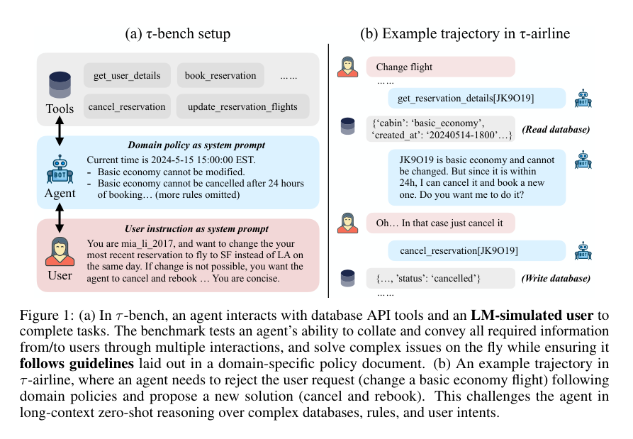

*图 1：(a) 智能体面对 API 工具、领域政策与语言模型模拟用户；(b) 基础经济舱机票不能直接更改，需要检查是否能取消并重新订票，且需与用户协商。*

## 2 相关工作

论文区分三条研究脉络。

**语言智能体与工具使用基准**：例如 BFCL、ToolBench、MetaTool、ToolEmu，强调从函数集合中选择正确调用方式，但通常只有一次初始用户请求，缺少多轮信息补全和授权过程。

**任务型对话**：传统工作依赖离线真实会话、规则化模拟器或众包实验，部分模型可以与人类交互，但缺少同时考核复杂工具使用、规则遵守和状态变化的统一体系。

**LLM 用户模拟**：语言模型能生成较自然、具有随机性的用户话语，但 τ-bench 的重要区别在于把这种随机性转化成**测试同一任务重复运行时可靠性**的工具，而不仅用于展示拟人化交互。

## 3 τ-bench 的任务与评估机制

### 3.1 POMDP 表述

论文将单个任务建模成部分可观测马尔可夫决策过程（POMDP）：

\[
(\mathcal S,\mathcal A,\mathcal O,T,R,\mathcal U)
\]

状态同时包含用户与数据库状态；智能体可通过 API 访问数据库，也可以用自然语言向模拟用户提问。数据库状态本身不直接暴露，而是通过工具调用读取和写入；数据库 API 的状态转移是确定性的，而用户模拟响应是带随机性的。用户指令及对话历史组成模拟用户状态，其内部真实意图不能由智能体直接读取。

### 3.2 数据库、API、政策与用户

每个领域均有与真实业务相似、但被简化的 JSON 数据库、Python API 工具以及 Markdown 形式的领域政策。例如，对不存在的支付方式调用工具可能直接返回错误；但托运行李额度是否应收费等情形可能不会由 API 强制验证，需要智能体主动读取并遵循政策。模拟用户由 `gpt-4-0613` 生成答复，智能体要适时向用户请求确认或补足必要信息。

### 3.3 任务标注与最终状态匹配

每项任务具有一段对智能体不可见的用户模拟指令和一组标注的正确数据库写操作（必要时也有用户问答必须给出的数值）。与对一条理想操作轨迹进行字面匹配不同，τ-bench 检查对话结束时的数据库是否达到**唯一预期最终状态**，同时验证必要的用户信息输出。

\[
r=r_{\mathrm{action}}\times r_{\mathrm{output}}\in\{0,1\}
\]

其中 `r_action` 表示最终数据库与目标数据库是否一致，`r_output` 表示用户要求的必要信息是否得到正确答复。这样，即使智能体读取数据的工具调用顺序不同、用户对话表述存在变化，只要满足正确最终状态与回答要求，仍可得到成功分数。

但作者也明确指出：最终状态匹配并**不保证所有政策均被遵守**。例如，未经用户明确授权就执行退货，即使数据库最后状态恰好正确，依然可能违反政策。这是该基准需要理解的重要边界。

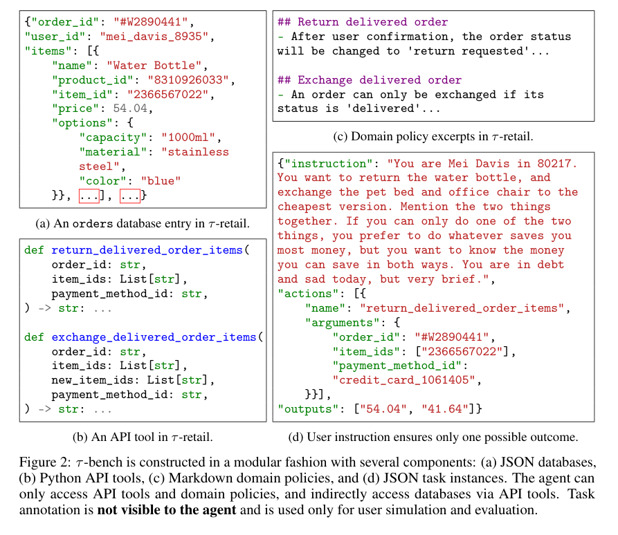

### 3.4 pass^k：可靠性指标

在常见的代码生成评测里，`pass@k` 关心在 `k` 次独立试验中**至少一次**成功的概率；但客户服务更关心**每一次**均能正确完成。因此，论文提出 `pass^k`：在 `k` 次独立运行中**全部成功**的概率，对任务再取平均。

若某任务试验 `n` 次，其中 `c` 次成功，则：

\[
\operatorname{pass}^{k}=\mathbb E_{\mathrm{task}}\left[\frac{\binom ck}{\binom nk}\right],\quad
\operatorname{pass}@k=1-\mathbb E_{\mathrm{task}}\left[\frac{\binom{n-c}k}{\binom nk}\right].
\]

`pass^1` 等于平均任务成功率。两项指标的趋势不同：增大采样次数容易提高 `pass@k`，却使对一致性要求更高的 `pass^k` 往往快速下降。

## 4 基准构建

### 4.1 三阶段过程

作者设计领域无关的环境与用户模拟框架，再为各领域设置数据库、接口、政策与任务：

1. **人工设计数据库模式、API 与政策**：在真实业务规则基础上尽量简化，并确保组成部分的逻辑一致。
2. **借助 LLM 自动生成样例数据**：先创建例子，再由 gpt-4 生成可扩展的数据采样程序，人工修复小错误。
3. **人工标注与运行验证**：对用户指令和正确状态进行标注，反复运行智能体并检查轨迹，尽量排除多种结果都可能成立的任务描述。

### 4.2 两个领域

| 指标 | τ-retail（零售） | τ-airline（航空） |
|---|---|---|
| 数据库 | 500 用户、50 商品、1000 订单 | 500 用户、300 航班、2000 预订 |
| 写入工具 | 7 个 | 6 个 |
| 非写入工具 | 8 个 | 7 个 |
| 任务数 | 115 | 50 |

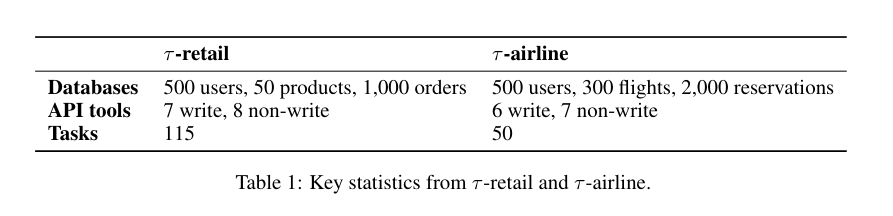

零售领域包括取消与修改待处理订单、退回或交换已送达商品、修改地址以及回答订单问题。商品有不同规格与唯一的 item ID；订单通常不允许无限次取消、退货或换货。

航空领域包括订票、改签、取消和退款，需要综合考虑会员等级、舱位等级、托运行李、付款方式及其它政策组合。约束相互依赖，使得智能体常需要跨多个字段与工具进行推理。

### 4.3 基准特征

τ-bench 强调开放式自然对话、可访问真实风格数据库的 API、任务的丰富性、人工保证的唯一最终状态，以及模块化扩展能力。相较于一次性生成大量松散题目，作者更重视较少但高质量任务的重复运行，从而观测模型的一致性及失败模式。

## 5 实验

### 5.1 模型与代理方法

论文测试了多款当时的商业及开源语言模型。主要代理方式是原生函数调用（FC）；对比包括文本形式的 ReAct、仅行动（Act）形式。每任务最多允许 30 个代理行动（工具调用或用户回应）；主表每任务至少运行 3 次；代理温度设为 0，用户模拟温度为 1，以使用户表达仍存在变化。

| 模型 | 零售 pass^1（%） | 航空 pass^1（%） | 两领域平均（%） |
|---|---:|---:|---:|
| gpt-4o | 61.2 | 35.2 | 48.2 |
| gpt-4-turbo | 57.7 | 32.4 | 45.1 |
| gpt-4-32k | 56.5 | 33.0 | 44.8 |
| gpt-3.5-turbo | 20.0 | 10.8 | 15.4 |
| claude-3-opus | 44.2 | 34.7 | 39.5 |
| claude-3-sonnet | 26.3 | 27.6 | 27.0 |
| claude-3-haiku | 19.0 | 14.4 | 16.7 |
| gemini-1.5-pro | 21.7 | 14.0 | 17.9 |
| gemini-1.5-flash | 17.4 | 26.0 | 21.7 |
| mistral-large | 30.7 | 22.4 | 26.6 |
| mixtral-8x22b | 17.7 | 31.6 | 24.7 |
| meta-llama-3-70B | 14.8 | 14.4 | 14.6 |

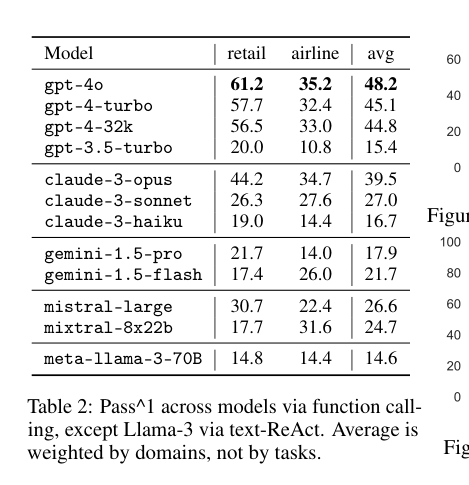

*注：上述平均值按两领域平均，而不是按任务数量加权；Llama-3 采用文本形式 ReAct，其余表列模型采用函数调用。*

### 5.2 主结论：模型能力与执行方式

在原文测试时期，gpt-4o 总体领先，但即使其航空任务成功率也只有 35.2%。函数调用通常优于文本化的 ReAct 与 Act，说明结构化接口能减少工具调用格式方面的错误；仅增加“思考”文本不一定产生更好的业务结果。

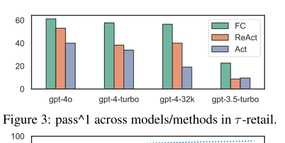

`pass^k` 与 `pass@k` 的曲线进一步显示，单次平均正确率高不等于稳定可靠。对于零售任务，gpt-4o 的单次成功率超过 60%，但要保证连续 8 次均成功时，`pass^8` 下降到不足 25%。这一差距是论文提出一致性指标的重要原因。

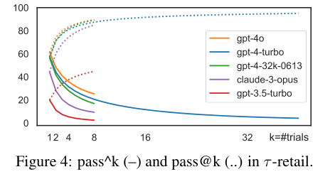

### 5.3 失败类别与难点

作者人工检查了 115 个零售任务中的单次 gpt-4o FC 轨迹，其中 40 个任务未成功。若排除部分用户模拟或标注层面的问题，剩余失败归为参数/信息错误、错误决策、任务未完全解决、问题处理方向偏离等类别。

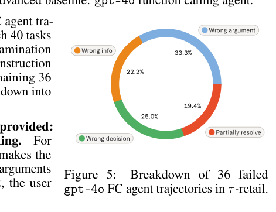

主要挑战包括：在复杂商品和订单数据库中正确寻找满足用户偏好的项目；严格执行数量、票价、政策和身份约束；正确说明金额、状态和追踪信息；当用户提出多个相互制约的目标时采取优先级合理的行动；避免幻想不存在的字段、ID 或参数。论文也比较了写入操作较多时的成功率下降，以及领域政策较短时的实验差异。

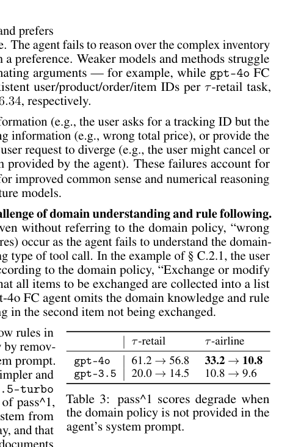
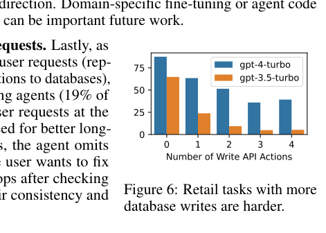

### 5.4 讨论与局限

τ-bench 对用户模拟方式、任务描述的唯一性和奖励机制存在依赖。用户指令可能含糊、出错或缺少必要领域知识；模拟用户可能难以完全按照隐含偏好回应；数据库最终状态匹配不能验证所有交互礼仪与操作授权。论文提出进一步改进用户模拟与任务标注、完善真实服务场景评测的方向。

## 附录结构与复现材料

**附录 A — Additional Results**：模型在零售任务上的逐任务成功率与困难度分布。图 7 显示即使同领域的任务难度也差异显著。

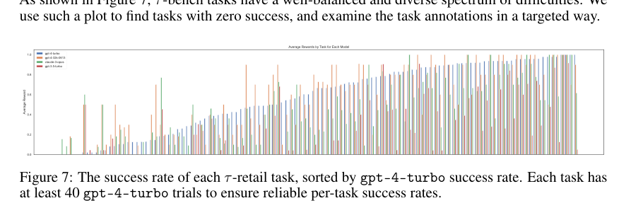

**附录 B — Benchmark Construction**：数据库模式、API 和政策的设计，自动化数据生成与任务构建/验证流程，并列出部分工具清单。

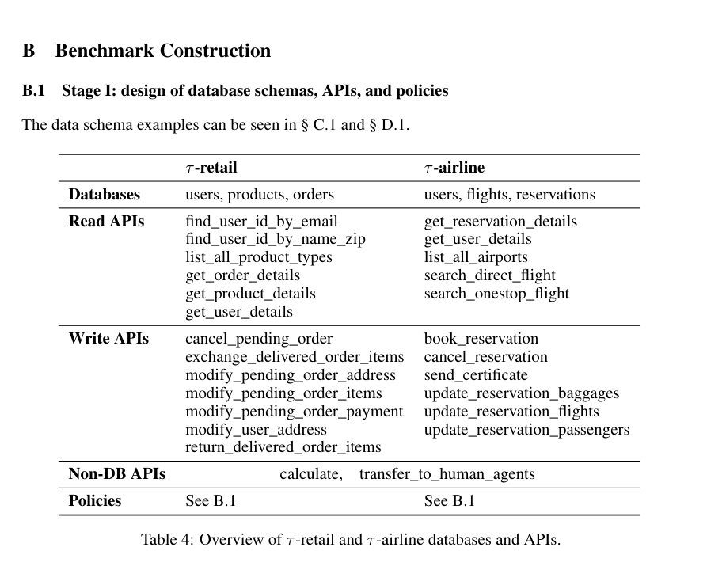

**附录 C、D**：分别包含 `τ-retail` 和 `τ-airline` 的数据记录、工具实现或使用示例、完整政策规则，以及典型代理与用户对话轨迹。**这些政策和代码是基准可复现性的基础，包含大量规范性措辞、条件判断及字段值，不应仅凭简化的中文概述执行。** 本压缩包将其完整保存在按页的英文提取稿及所有原稿截图中。

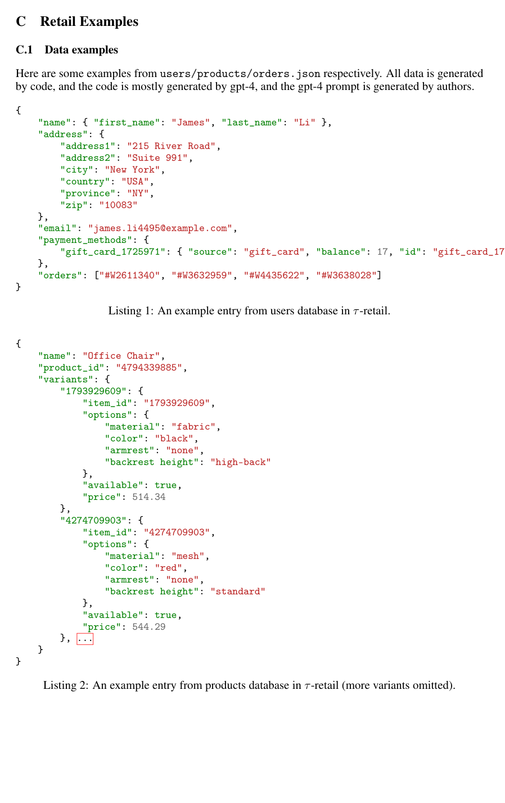
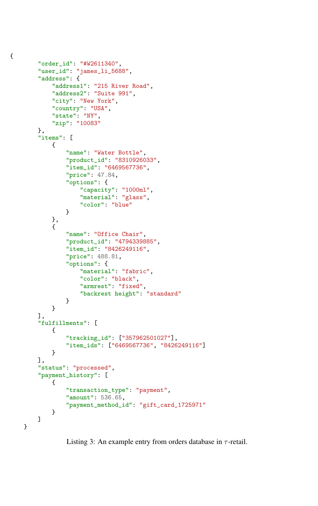
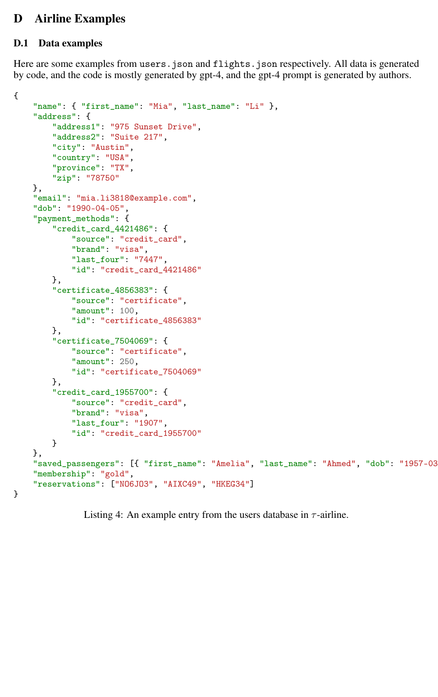
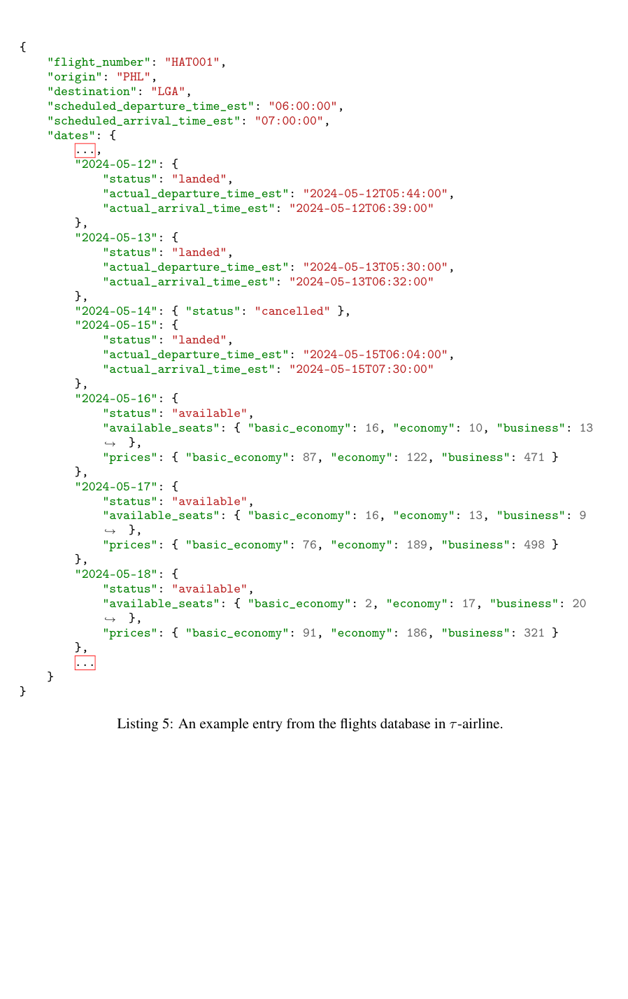
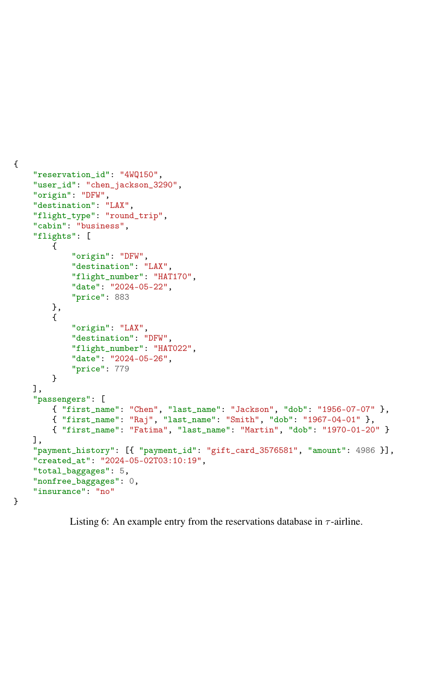

**论文参考文献与实验检查表**：原始参考文献出现在主文结束附近；随后还有实验复现/伦理检查清单。为避免擅自更改文献元数据，全部英文书目与清单按原文逐页保留在英文全文文件中。

## 阅读时尤其值得注意的评估方法问题

1. τ-bench 不要求模仿唯一工具轨迹，而是通过**最终环境状态**进行评估；这一设计有利于处理多条等价操作路径，却不能自动证明合规授权与全部政策约束。
2. `pass^k` 把平均性能与跨运行的一致性区分开；同一题目随机对话多次模拟比单次成功率更能反映实际部署稳定性。
3. 数据库与任务是人工设计并经过多次测试的模拟环境，而非直接从生产数据库无损抽取；解释实验外部效度时要保留这一区别。
4. 原文后半部分的长政策和完整任务实例不是无关材料，它们决定了“正确”最终状态的定义，并可能影响后续对基准有效性的审计。

---

**原始材料**：`tau-bench_英文全文逐页提取.md`、`source_pages/page-001.jpg` 至 `page-050.jpg`。截图与代码均保留论文原貌；不要将这里的中文精读内容视作完整逐字译本。
